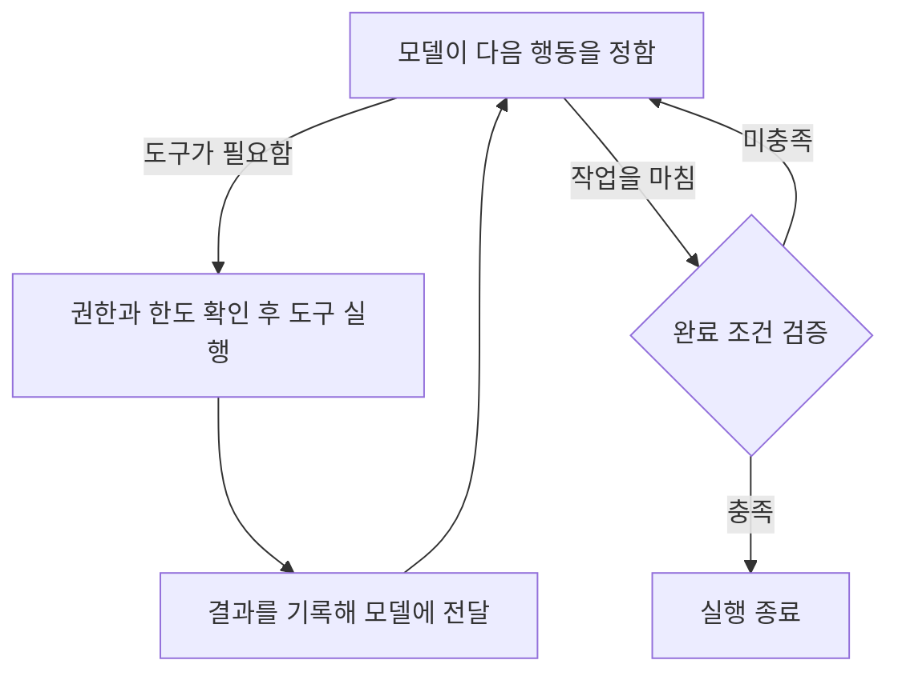

## 환경 ✅

| 구분 | 에이전트 하네스 |
| ------ | ------ |
| 쓰임 | 운영자가 직접 돌려 보는 시험용이다 |
| 쓰는 하네스 | ▶️ Claude Code 하나만 쓴다 ▶️ 도구를 부르기 전에 도는 검사가 실패하거나 시간을 넘기면 그 호출을 막는 설정과, 대화 자동 압축을 끄는 설정이 있어서 골랐다 ▶️ Codex는 두 설정이 없어 뺐다. 검사가 실패해도 도구 호출을 그대로 진행하고, 압축은 시작하는 기준만 바꿀 수 있다 |
| 모델이 도는 곳 | ▶️ 제공사 서버 ▶️ (Claude Code와 도구는 한 사람의 PC) |
| 지금의 주 모델 | ▶️ Claude Opus 5.5 ▶️ 쓸 수 있는 모델을 주 모델 하나로 묶는다. Claude Code는 안전 검사에 걸린 요청을 다른 모델로 다시 돌리는 기능이 기본으로 켜져 있는데, 쓸 수 있는 모델 밖으로는 넘어가지 못한다 |
| 모델 부르기 | Claude Code가 부른다 |
| 자료가 가는 곳 | ▶️ 모델 회사 서버로 나간다 ▶️ 그래서 실제 고객의 제3자 개인정보는 넣지 않는다. 시험용으로 만든 자료나, 쓰는 데 동의받은 자료만 쓴다 |
| 요금과 로그인 | ▶️ 구독 요금 안에서 쓴다 ▶️ 구독 로그인은 운영자가 직접 시험할 때만 쓴다. Anthropic은 구독 로그인을 사람이 직접 쓰는 용도로 두고, 서비스로 돌릴 때는 API 키를 쓰게 한다 |
| 계정 | Team이나 Enterprise처럼 대화를 모델 학습에 쓰지 않는 회사 계정으로만 돌린다. 개인 구독은 대화를 학습에 쓰는 것이 기본값이라 비밀 유지 의무와 부딪힌다 |
| PC | ▶️ 판독(약 2GB), 받아쓰기(약 4GB), 임베딩(약 16GB), 재정렬(약 8GB) 모델을 PC에서 돌린다. 그래서 모델에 쓸 메모리가 32GB 이상이어야 한다 ▶️ 모든 PC를 같은 사양으로 맞춘다 |
| 사내 서버 | ▶️ 여러 PC가 함께 쓰는 기록, 대기열, 권한 판정, 단계 잇기를 둔다 ▶️ 사내 서버에서는 모델을 돌리지 않는다 ▶️ 생존 신호와 경보는 사내 서버와 다른 작은 장비 한 대(감시 장비)에서 받는다. 사내 서버가 통째로 멈춰도 알아채기 위해서다 |

## AI 모델 ✅

**원칙**

- **주 모델**: 모든 작업에 그때 가장 뛰어난 모델 하나를 쓴다. 주 대화와 하위 에이전트(일을 나눠 맡는 보조 대화)에 모두 이 모델을 지정한다.
- **추론 강도**: 추론 강도는 모델이 답하기 전에 생각하는 정도다. AA 점수를 잰 가장 높은 설정으로 돌린다.
- **결과 검사**: 주 모델이 하되, 결과를 만든 대화가 아닌 새 대화에서 한다. 같은 대화에서 검사하면 자기 답을 후하게 본다. 상주 프로그램이 Claude Code를 따로 새로 실행해 맡긴다. 결과를 만든 대화가 띄운 하위 에이전트는 받을 자료를 그 대화가 고르게 되므로 쓰지 않는다.
- **다른 모델**: 주 모델이 못 하는 일에만 쓴다. 지금 쓰는 것은 다섯 가지다.
  - **받아쓰기**: 주 모델은 글과 그림만 받고 소리는 받지 못한다.
  - **판독**: 문서 그림에서 글과 표를 쪽과 칸 위치까지 붙여 뽑는다. 프로그램이 인용을 원문과 글자로 맞춰 볼 때 기준이 되는 글이라, 맞춰 볼 대상인 주 모델이 만들면 안 된다.
  - **임베딩**: 뜻이 가까운 글을 찾을 수 있게 글을 숫자 묶음으로 바꾼다. 주 모델의 회사는 이런 모델을 내지 않는다.
  - **재정렬**: 찾은 후보 수백 개마다 질문과 관련 있을 확률을 숫자로 낸다. 주 모델은 이런 확률을 내지 않고, 후보를 모두 읽히면 구독 한도를 빨리 쓴다.
  - **개인정보 탐지**: 자료를 바깥 모델에 넘기기 전에 PC에서 먼저 찾아야 한다. 주 모델에 맡기면 이미 넘긴 뒤다.

**가장 뛰어난 모델 고르기**

[Artificial Analysis 지수](https://artificialanalysis.ai/leaderboards/models)(AA 지수)로, 하네스가 부를 수 있는 모델 가운데 아래 순서대로 거른다. 점수는 모델마다 가장 높은 설정의 것을 쓴다.

1. 40점 미만은 뺀다. 1점 차이까지는 40점으로 본다.
2. 그중 1위보다 2점 이상 낮으면 뺀다. 1점 차이까지는 같은 점수로 본다.
3. 남은 모델 가운데 AA가 지수를 잴 때 쓴 출력 토큰이 적은 모델을 고른다. 같은 실력이면 적게 쓰는 모델이 빨리 끝나고, 구독 한도를 덜 쓴다.
4. 출력 토큰 수도 비슷하면, 하네스에서 직접 돌려 보아 답을 더 빨리 내는 모델을 고른다.

**주 모델이 바뀔 때**

- 주 모델 이름은 하네스의 모델 설정 한 곳에만 적는다. 전문가 정의와 지시문에는 이름 대신 "주 모델"이라고 쓴다. 이름을 여러 곳에 적으면 모델이 바뀔 때 빠뜨린 곳이 생긴다.
- 새 모델이 나왔을 때, AA가 지수를 개편했을 때, 쓰던 모델의 제공이 끝나거나 사용 허가가 바뀌었을 때 위 순서로 다시 거른다. 모델이 그대로여도 지수가 바뀌면 순위가 바뀐다. 이런 소식이 없어도 한 달에 한 번은 다시 거른다.
- 결과가 지금 주 모델과 같으면 그대로 둔다. 다르면 환경을 맡은 사람에게 알리고, 그 사람이 설정 한 곳을 고쳐 바꾼다.
- 주 모델에 장애가 났다고 바로 다른 모델로 넘기지 않는다. 바꾸는 것은 이 절차를 거친 때뿐이다.

## 실행 제어

**부품**

| 부품 | 도는 곳 | 하는 일 |
|---|---|---|
| Claude Code | PC | 한 번 실행 안에서 주 모델을 부르고 도구를 쓴다 |
| 상주 프로그램 | PC | 수신 서버에서 자기 몫의 일을 받아 Claude Code를 실행하고, 결과를 돌려준다. 모델에 줄 정보를 골라 실행에 넣는 일도 여기서 한 번만 한다 |
| 훅(자동 검사 장치) | PC | Claude Code가 도구를 부르기 직전에 사내 서버의 권한 판정 창구에 묻고, 값만 보고 바로 가릴 수 있는 검사를 한다. 실패하면 막는다 |
| PC MCP 서버 | PC | 고객 파일 열기, 문서 판독, 음성 받아쓰기, 임베딩과 재정렬, 화면 조작(Playwright) |
| 수신 서버 | 사내 서버 | 요청과 알림을 받고, 일을 PC별 대기열에 넣고, 사람에게 묻는 결정 요청 화면과 사내 메신저 연결을 맡는다 |
| DBOS 단계 코드 | 사내 서버 | 한 건의 단계를 잇고, 끊기면 이어 가고, 사람 답을 기다리고, 밖으로 나가는 행동(송금, 발송, 제출, 기록 수정)을 요청 번호를 붙여 실행하고, 내보내기 전 검사를 돌린다 |
| 서버 MCP 서버 | 사내 서버 | 기억, 진행 상태, 판단 근거, 검색, 지식 그래프, 관계자 목록을 읽고 쓴다. 고객 번호는 서버가 낸 업무 토큰에서만 꺼낸다 |
| 권한 판정 창구 | 사내 서버 | Cedar로 허락할지 판정한다. 훅, PC MCP, 서버 MCP, DBOS 단계 코드가 모두 여기에 묻는다 |
| PostgreSQL | 사내 서버 | 모든 기록. pgvector와 pg_textsearch로 검색도 한다 |
| OpenBao | 사내 서버 | 비밀값과 암호 키 |
| Prometheus와 Alertmanager | 감시 장비(사내 서버와 다른 작은 장비 한 대) | 생존 신호와 경보 |
| pgBackRest | 사내 서버 → 감시 장비 | 백업과 되살리기 |

PC는 DB에 직접 붙지 않는다. 밖으로 나가는 행동은 Claude Code 안의 도구로 하지 않는다. 실행 안에서는 제안을 답에 적기만 하고, 실행은 DBOS 단계 코드가 한다.

**한 건의 실행 흐름**

Claude Code를 새로 띄우는 횟수는 한 건에 **기본 3번, 많아야 5번**이다.

| 차례 | 하는 부품 | 하는 일 | Claude Code 실행 |
|---|---|---|---|
| 1. 받기 | DBOS 단계 코드, 상주 프로그램, Claude Code | ▶️ DBOS 단계 코드가 허용 목록과 관계자 목록을 조회해 맡을지 확인한다 ▶️ 상주 프로그램이, 맡긴 사람이 확인한 조건에 맞는 처리 대상을 고객 작업 폴더에서 세어 올린다 ▶️ 도구를 모두 끈 Claude Code가 그 건의 자료를 한꺼번에 읽고, 자료 속 지시와 평가 요구가 있는 자리를 찾는다 | 1번 |
| 2. 일하기 | Claude Code | ▶️ 판단 절차의 단계를 이 실행 안에서 차례로 한다. 필요하면 하위 에이전트를 쓴다 ▶️ 사람의 답이 필요하면 그 자리에서 끝낸다. 답이 오면 사내 서버의 기록을 넣은 새 실행으로 잇는다 | 1번. 답을 받아 이을 때마다 1번 더 |
| 3. 독립 검사 | Claude Code | 결과를 만든 실행과 따로 띄운다. 합격 기준 판정, 늘 지킬 원칙 판정, 인용이 주장을 뒷받침하는지, 받는 사람 입장에서 읽기를 한 번에 한다 | 1번 |
| 4. 다시 판단 | Claude Code | 틀렸을 때 피해가 감수할 위험을 넘을 수 있는 판단이 있을 때만 한다. 앞선 답은 넣지 않는다 | 그런 판단이 있을 때만 1번 |
| 5. 내보내기 검사와 실행 | DBOS 단계 코드 | ▶️ 모델 없이 인용 글자 대조, 계산 다시 하기, 번호 모양 개인정보 찾기를 한다 ▶️ 통과하면 답에 적힌 밖으로 나가는 행동마다 권한 판정 창구에 묻고, 승인이 필요한 행동은 승인을 받은 뒤 실행한다 ▶️ 끝으로 보고를 실행 기록과 맞춰 본 뒤 내보낸다 | 없음 |

**실행 수 상한**

▶️ DBOS 단계 코드가 건마다 띄운 수를 센다. 
▶️ 독립 검사나 내보내기 검사에서 틀리거나 빠진 곳이 나오면, 고치는 일하기 실행과 다시 하는 독립 검사로 2번이 더 든다. 그 밖에 새 실행으로 잇는 경우도 모두 센다. 
▶️ 남은 차례를 마치려면 5번을 넘게 될 때는, 다음 실행을 띄우기 전에 그때까지 한 것과 남은 일을 맡긴 사람에게 알린다. 더 하라는 답이 오면 남은 차례를 마친다. 
▶️ 같은 실행을 다시 하는 것은 이 수에 넣지 않고 따로 센다. PC를 잃었거나, 형식에 맞는 답 없이 끝났거나, 거절하거나 길이 한도에 걸려 끊긴 경우다. 실행마다 2번까지 다시 하고, 그래도 안 되면 그 건을 멈추고 운영자에게 경보한다.

<!-- 그림 다시: '실행 프로그램'을 부품 표의 이름(훅, 권한 판정 창구, 상주 프로그램, DBOS 단계 코드)으로 바꾸고, 한 건의 다섯 차례와 실행 수(기본 3번, 많아야 5번), 밖으로 나가는 행동은 실행 안이 아니라 DBOS 단계 코드가 하는 길을 그린다 -->

실행 반복과 종료 조건 보기

<!-- 그림 다시: 한 번 실행 안의 반복만 그린 그림이다. '권한과 한도 확인 후 도구 실행'을 '훅이 권한 판정 창구에 묻고 도구 실행'으로, '완료 조건 검증'을 'Claude Code가 마지막 답을 스키마로 검사'로 바꾼다 -->

**단계를 잇는 방법**

DBOS 단계 코드로 잇는다. DBOS는 이미 쓰는 PostgreSQL 안에 단계와 대기열을 기록하는 라이브러리라 따로 띄울 서버가 없다.

▶️ 끊긴 뒤에는 DBOS가 단계마다 PostgreSQL에 저장해 둔 결과로, 끝난 단계는 건너뛰고 멈춘 단계부터 잇는다. 
▶️ 갈래가 나뉘거나 앞 차례로 돌아가는 흐름도 DBOS 단계 코드 안의 분기로 쓴다. 
▶️ Temporal은 따로 띄울 서버 묶음과 그 저장소가 늘어 뺐다. LangGraph는 모델 부르기를 잇는 도구인데, 모델은 Claude Code가 부르므로 남는 쓸모가 단계를 잇는 문법뿐이라 뺐다.

**한 번 실행의 앞뒤**

상주 프로그램은 Claude Code를 한 번 띄울 때마다 아래 차례를 지킨다.

1. 수신 서버에서 자기 PC 대기열의 일을 받아 간다. 받아 간 일에는 차례 번호가 붙고, 그 번호는 실행에 넘기는 업무 토큰에 담긴다. 훅, 두 MCP 서버, 수신 서버는 이 토큰으로 어느 차례의 요청인지 안다.
2. 고객 작업 폴더를 사내 서버의 원격 저장소에서, DBOS 단계 코드가 마지막으로 기록한 버전으로 맞춘다. 앞 실행이 끊기며 남긴 변경은 버린다.
3. 모델에 줄 정보를 골라 실행에 넣는다.
4. Claude Code를 띄운다. 도는 동안 30초마다 수신 서버에 생존 신호를 보낸다.
5. 끝나면 작업 폴더의 변경을 원격 저장소에 올리고, 답과 올린 버전을 수신 서버에 돌려준다. DBOS 단계 코드는 그 버전을 기록한다.

▶️ PC 한 대에서는 Claude Code를 한 번에 하나만 띄운다. 판독, 받아쓰기, 임베딩, 재정렬 모델이 PC 메모리를 함께 쓰기 때문이다. 
▶️ 수신 서버는 PC마다 마지막 생존 신호 시각을 Prometheus가 읽을 수 있게 내놓는다. 감시 장비는 이 값으로 PC가 끊긴 것을 경보한다. 
▶️ 원격 저장소는 사내 서버에 고객마다 둔 git 저장소이고, SSH로만 닿는다. PC 계정은 맡은 고객의 저장소만 읽고 쓴다. 
▶️ 원격 저장소가 있어서 PC 디스크를 잃어도 작업 폴더를 되살리고, 고객을 다른 PC로 옮겨도 같은 버전에서 잇는다. 
▶️ Forgejo 같은 저장소 서버는 웹 화면과 따로 띄울 서버가 늘어 뺐다.

**받아 간 일의 시한과 다시 넣기**

| 경우 | 처리 |
|---|---|
| 생존 신호가 5분 동안 오지 않는다 | 수신 서버가 그 일을 같은 PC의 대기열에 다시 넣고 차례 번호를 1 올린다 |
| 실행이 시한을 넘긴다 | 수신 서버가 생존 신호에 대한 답으로 멈추라고 알리고, 상주 프로그램이 Claude Code를 끝낸다. 그 일은 차례 번호를 올려 다시 넣는다 |
| 구독 한도에 걸려 실행이 끝났다 | 다시 하기로 세지 않는다. 상주 프로그램이 오류에 적힌 풀리는 시각까지 그 PC의 대기열을 멈췄다가, 같은 실행을 처음부터 다시 한다 |
| 담당 PC를 바꾼다 | 장애 때문이든 아니든 차례 번호부터 올린다. 이전 PC의 쓰기를 먼저 막아 같은 일이 두 번 도는 것을 막기 위해서다 |
| 옛 차례 번호로 답이나 요청이 온다 | ▶️ 수신 서버는 그 답을 받지 않는다 ▶️ 권한 판정 창구는 그 차례 번호로 오는 요청을 모두 막는다 ▶️ 옛 차례의 생존 신호에는 멈추라고 답한다 |
| PC가 꺼져 있다 | 일은 대기열에 남는다. PC가 켜지면 상주 프로그램이 받아 간다 |
| 기다리다 기한을 못 맞추게 된다 | 업무 기한까지 남은 시간이 그 일의 실행 시한보다 짧아지면, DBOS 단계 코드가 확인한 내용과 남은 일을 맡긴 사람에게 넘긴다 |

실행 시한의 처음 값은 받기 20분, 일하기 120분, 독립 검사 30분, 다시 판단 60분이다. 업무 종류마다 운영하는 쪽이 바꾼다.

**답을 받는 형식**

▶️ 실행마다 마지막 답의 형식은 Claude Code의 비대화 실행이 주는 JSON 스키마 출력이 지키게 한다. Claude Code는 실행 안에서는 형식 없이 생각하고 일하다가, 끝날 때 마지막 답에만 스키마를 건다. 
▶️ 상주 프로그램은 받은 답을 같은 스키마로 한 번 더 검사한다. Claude Code는 스키마의 일부 조건(전자우편 주소 모양 같은 형식 조건)을 검사하지 않고, 성공으로 끝나도 답이 비어 있을 수 있기 때문이다. 
▶️ 일하기 실행 안의 단계 결과는 서버 MCP 서버의 단계 기록 도구로 적는다. 이 도구는 그 단계의 스키마에 맞지 않거나 차례를 건너뛴 기록을 받지 않고, 받은 뒤에야 다음 단계의 지시를 돌려준다. 그래서 한 실행 안에서도 모델 앞에는 지금 단계의 지시가 가장 가까이 있다. 
▶️ DBOS 단계 코드는 일하기 실행의 답을 받으면 모든 단계가 기록됐는지 본다. 빠졌으면 같은 실행을 다시 한다. 
▶️ 스키마는 LinkML로 적은 업무 지식의 기준표 원본에서 뽑는다.

### 요청 접수

수신 서버가 업무 시작 신호를 모두 받는다.

▶️ 수신 서버는 FastAPI로 짠 Python 프로그램이다. DBOS 단계 코드와 같은 Python이라, DBOS가 주는 연결 도구로 일을 넣고 답을 전한다. 
▶️ DBOS 단계 코드와 떼어 따로 띄운다. 밖에서 오는 알림을 받는 곳에 밖으로 나가는 행동의 비밀값을 두지 않기 위해서다. 
▶️ n8n 같은 흐름 도구는 DBOS와 하는 일이 겹치고 저장소가 하나 더 늘어 뺐다.

| 항목 | 처리 |
|---|---|
| 업무 종류 | 업무별 창구나 요청 서식에서 요청과 함께 받는다 |
| 새 업무인지 가르기 | ▶️ 요청 번호로 가른다 ▶️ 처음 보는 번호면 그 번호를 작업 번호(DBOS가 건마다 붙이는 번호)로 삼아 DBOS 단계 코드에 새 업무로 넣는다 ▶️ 진행 중인 업무의 번호면 그 업무에 온 답으로 전한다 |
| 같은 알림이 여러 번 온다 | ▶️ 한 번만 받는다 ▶️ 새 업무는 요청 번호가 곧 작업 번호라, 두 번 넣어도 DBOS가 한 번만 시작한다 ▶️ 진행 중인 업무에 온 답은 알림 번호를 붙여 전하므로, 두 번 전해도 DBOS가 한 번만 받는다 |
| 밖에서 온 알림 | ▶️ 보낸 쪽이 붙인 서명을 확인한 뒤에 받는다 ▶️ 보낸 시각이 5분보다 오래된 알림은 받지 않는다. 가로챈 알림을 나중에 다시 보내는 것을 막기 위해서다 ▶️ 받지 않은 알림도 기록은 남긴다 |
| 반복 일정 | ▶️ DBOS의 일정 기능에 시간대를 함께 적는다. 적지 않으면 세계 표준시(UTC)로 돌아 한국 시각과 9시간 어긋난다 ▶️ 사내 서버가 꺼져 있던 동안 빠진 회차는 다시 켜질 때 DBOS가 찾는다 ▶️ 가장 최근 회차 하나만 바로 실행하고, 그보다 앞서 빠진 회차는 목록으로 맡긴 사람에게 알린다. 몰아서 돌리면 구독 한도를 한꺼번에 쓰고, 이미 때가 지난 회차까지 돌기 때문이다 |
| PC 대기열에 넣기 | 일은 그 고객을 맡은 PC의 대기열에 넣는다. 그 고객의 작업 폴더와 허용된 폴더가 그 PC에 있기 때문이다 |

### 업무 도구 연결

**도구를 붙이는 곳**

| 도구가 하는 일 | 붙이는 곳 | 까닭 |
|---|---|---|
| 고객 파일 열기, 문서 판독, 받아쓰기, 임베딩과 재정렬 | PC MCP 서버 | 고객 파일과 작은 모델이 PC에 있다 |
| 기억, 진행 상태, 판단 근거, 검색, 지식 그래프, 관계자 목록 | 서버 MCP 서버 | 여러 PC가 같은 기록을 보고, PC는 DB에 붙지 않는다 |
| 업무 시스템 조회 | 서버 MCP 서버 | 읽기만 되는 업무 계정으로 조회한다. 그 계정의 비밀값은 사내 서버의 OpenBao에서만 꺼낸다 |
| 화면으로만 볼 수 있는 업무 시스템 조회 | PC MCP 서버의 Playwright | 모델이 화면을 보며 어디를 누를지 정하므로 실행 안의 도구여야 한다 |
| 밖으로 나가는 행동(송금, 발송, 제출, 기록 수정) | DBOS 단계 코드 | 쓰기가 되는 업무 계정의 비밀값은 DBOS 단계 코드만 꺼낸다. 그래서 실행 안에서는 하려 해도 할 수 없다 |

**연결 방법 고르기**

▶️ 기본은 공식 API나 SDK를 감싼 자체 MCP 서버다. Claude Code의 셸은 바깥 연결을 막아 두므로, 바깥 시스템에는 MCP 서버를 거쳐서만 닿는다. MCP 서버는 부를 때마다 권한 판정 창구에 묻는다. 
▶️ 화면으로만 할 수 있는 밖으로 나가는 행동은 DBOS 단계 코드가 미리 짜 둔 Playwright 순서를 승인된 값으로 돌린다. 모델은 이 순서를 바꾸지 못한다. 
▶️ 로그인 인증서가 PC에만 있는 시스템이면, DBOS 단계 코드가 그 순서를 그 PC의 상주 프로그램에 맡겨 돌린다. 이때 Claude Code는 띄우지 않는다.

**도구마다 등록할 것**

| 등록할 것 | 쓰는 곳 |
|---|---|
| 하는 일, 닿을 수 있는 범위, 읽기만 하는지 쓰기도 하는지 | 권한 판정 창구가 허락할지 가를 때 |
| 돌려줄 수 있는 처리 결과의 목록 | DBOS 단계 코드가 목록 밖의 결과를 모르는 결과로 다룰 때 |
| 취소할 수 있는지와 취소하는 방법 | 중단할 때 |

▶️ 연결만 확인한 도구는 등록하지 않는다. 
▶️ 시험용 계정으로 실제로 불러 보고, 원본에 반영되는지와 등록한 처리 결과가 다 나오는지까지 시험한 도구만 등록한다.

### 진행 조정과 작업 분담

| 재료 | 어떻게 |
|---|---|
| **작업 진행·연결** | ▶️ PC 대기열에서는 되돌릴 수 없는 기한이 걸린 일을 가장 먼저 받아 간다. 그다음은 기한이 이른 일이고, 기한이 같으면 먼저 들어온 일이다 ▶️ 진행 중인 건에 자료가 새로 오거나 바뀌면, 그 자료만 도구를 끈 실행으로 지시 찾기를 하고, DBOS 단계 코드가 관계자를 다시 조회한 뒤 일하기를 새 실행으로 잇는다. 앞서 낸 판단 가운데 그 자료를 근거로 쓴 것만 다시 본다. 두 실행 모두 실행 수에 센다 |
| **나눠 맡기기** | ▶️ 한 건 안의 일은 일하기 실행 안의 하위 에이전트로만 나눈다. DBOS에서 실행을 따로 띄우면 실행 수 상한을 넘는다 ▶️ 하위 에이전트는 맡을 때 이 건의 목표, 완료 조건, 자료 버전, 적용 전제, 미확인 사항, 권한과 예산을 서버 MCP 서버에서 직접 읽는다. 주 대화가 요약해 건넨 글에만 기대지 않게 하려는 것이다 ▶️ 한 실행에서 동시에 도는 하위 에이전트는 3개까지다. 하위 에이전트는 다시 하위 에이전트를 띄우지 않는다. 업무 종류마다 운영하는 쪽이 바꾼다 |
| 총괄이 결과를 합칠 때 | ▶️ 하위 에이전트의 결과는 주 대화가 합친다 ▶️ 의견이 엇갈리면 사실에서 갈렸는지 기준에서 갈렸는지 가르고, 다수결로 정하지 않는다 ▶️ 이 두 지시는 일하기 실행의 공통 지시에 넣는다 |

### 대기, 중단과 재개

| 상황 | 처리 |
|---|---|
| 사람의 답이나 승인을 기다린다 | ▶️ Claude Code 실행은 물을 것을 답에 적고 끝난다. 기다리는 동안 PC와 Claude Code를 붙잡지 않는다 ▶️ DBOS 단계 코드가 수신 서버를 거쳐 묻고, 답 기한까지 기다린다. 기한을 정하지 않은 결정은 48시간을 기다린다. 업무 종류마다 운영하는 쪽이 바꾼다 |
| 판단에 쓸 답이 왔다 | ▶️ 상주 프로그램이 사내 서버의 진행 상태, 판단 근거, 받은 답을 넣은 새 Claude Code 실행으로 잇는다 ▶️ 앞 실행의 대화를 이어 붙이지 않는다. 그 대화는 띄운 PC에만 남아, PC를 바꾸거나 잃으면 이을 수 없기 때문이다 |
| 실행 승인이 왔다 | 예가 오면 DBOS 단계 코드가 그 행동을 실행한다. Claude Code는 새로 띄우지 않는다 |
| 처리 결과가 등록한 목록 밖이다 | DBOS 단계 코드가 모르는 결과로 기록하고 그 건을 멈춘 뒤, 맡긴 사람의 답을 기다린다 |
| 읽기 요청에 통신 장애가 잠깐 났다 | MCP 서버와 DBOS 단계 코드가 처음 시도 뒤 3번까지 다시 시도한다. 간격은 1초에서 두 배씩 늘리고, 한 번에 30초를 넘기면 실패로 본다 |
| 입력이 잘못됐거나 권한이 모자란다 | 다시 시도하지 않는다. 원인을 고친 뒤에 실행한다 |
| 중단 요청이 오거나 권한이 철회됐다 | ▶️ 수신 서버가 권한 판정 창구의 판정부터 바꾼다. 그 뒤로 훅, 두 MCP 서버, DBOS 단계 코드가 묻는 요청은 모두 막힌다 ▶️ 그 건의 DBOS 작업을 취소하고, 대기열에 남은 일과 그 건의 반복 일정도 지운다. DBOS는 돌고 있는 단계를 끊지 않고 다음 단계가 시작될 때 멈춘다 ▶️ 돌고 있는 Claude Code 실행에는 수신 서버가 생존 신호에 대한 답으로 멈추라고 알린다. 상주 프로그램은 길어야 30초 안에 이 답을 받고 실행을 끝낸다 ▶️ 이미 보낸 밖으로 나가는 행동과 바깥에 걸어 둔 예약, 구독은 등록한 방법으로 취소를 요청한다. 취소를 요청한 것과 원본에서 취소가 확인된 것은 따로 기록한다 |
| 이미 실행한 행동에 문제가 드러났다 | DBOS 단계 코드가 원본의 실제 상태를 조회해 맡긴 사람에게 넘긴다. 바로잡는 행동도 다른 행동처럼 권한 판정 창구와 승인을 거쳐 DBOS 단계 코드가 한다 |
