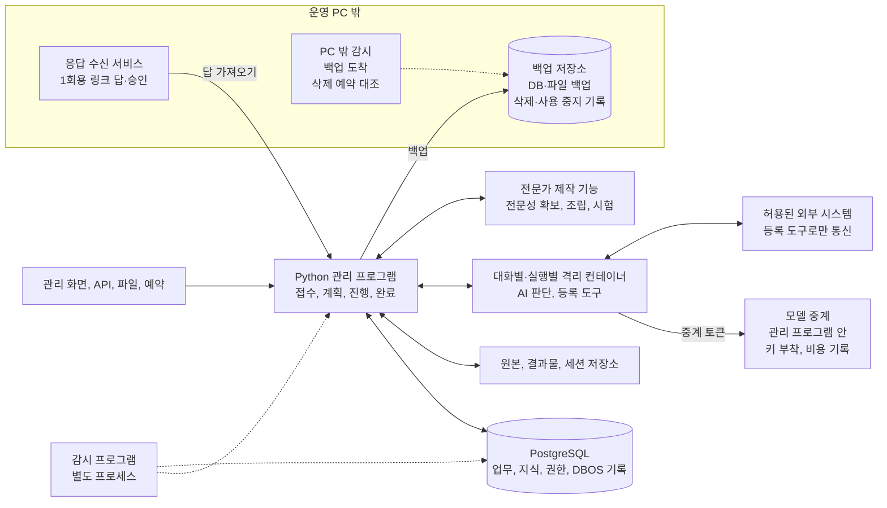

# 공장 구현 설계

**공통 실행 프로그램을 한 번 만들고, 분야별 지식과 판단법, 도구, 평가를 연결해 여러 전문가를 만든다. 만들어진 전문가는 같은 프로그램에서 업무를 접수하고 처리하고 검증하고 전달하며, 이후의 변화까지 관리한다.**


전문가가 갖춰야 할 구성 요소를 재료라 부르며, 재료마다 번호가 붙어 있다. 이 문서는 모든 재료를 공통 실행 프로그램의 어느 부분에 넣고, 어떤 자료를 주고받고, 어떤 순서로 개발할지 정한다. 전문 판단에 필요한 자료 관문, 근거 공급, 판단, 검사, 실행, 변경 추적은 모든 전문가가 함께 쓰도록 한 번만 구현한다.

## 완성할 것

| 만들 것 | 사용자가 하는 일 | 프로그램이 내놓는 것 |
|---|---|---|
| 공통 업무 실행 프로그램 | 전문가를 골라 업무와 자료를 맡긴다 | 검증한 결과물, 실제 처리 결과, 남은 의무와 후속 일정 |
| 전문성 확보 기능 | 분야 이름과 전문가의 자료, 결과물, 작업 기록을 준다 | 원문에 연결된 지식, 조건별 판단법, 실무서와 실행 절차 |
| 전문가 제작 기능 | 맡길 업무 범위와 쓸 전문성, 도구를 지정한다 | 시험을 통과한 전문가 구성과 지원 업무 목록 |
| 관리 화면 | 진행 상황과 결과를 보고 필요한 결정에 답한다 | 진행, 대기, 문제, 승인, 결과를 같은 업무 번호로 확인하고 조치하는 화면 |

새 회계 전문가를 추가한다고 하자. 접수, 실행 복구, 파일 저장, 승인, 납품 기능은 다시 만들지 않는다. 회계 지식과 계산법, 업무 절차, 도구 연결, 평가 사례를 더한다. 새 도구가 필요하면 공통 도구 규격에 맞춘 도구 컨테이너만 더한다. 전문가 구성과 도구 등록은 실행 중에 읽는 자료라서, 전문가를 더해도 관리 프로그램을 다시 배포하지 않는다.

**가장 중요한 운영 목표는 맡은 내용과 필수 검증을 끝까지 해내는 것이다.** 내부 비용, 시간, 토큰 예상치를 넘으면 자원을 다시 배정하거나 일을 나누고, 순서대로 처리하거나 이어서 한다. 내용을 몰래 줄이거나 시도 횟수가 찼다는 이유로 끝내지 않는다.

**법정 기한이 있는 업무는 접수할 때 기한까지 처리할 수 있는지 계산한다.** AI 실행 자리, 그 사무소의 하루 지출 몫, 맡긴 사람 쪽 검토자의 남은 검토 시간을 각각 기한까지 처리할 수 있는 건수로 바꾼다. 셋 가운데 가장 작은 값으로 접수, 조건부 접수, 거절 중 하나를 정한다.

**기한이 검증보다 앞서도, 결론을 바꿀 수 있는 미확인이 남은 채로 공장이 제출하지 않는다.**
- 결론에 영향이 큰 항목부터 채운다.
- `playbook.yaml`에 정해 둔 시점에 맡긴 사람에게 알리고, 정해 둔 선택지(기한 연장 신청, 결론이 확정된 부분만 제출, 맡긴 사람이 직접 판단해 제출 등)를 보여 준다.
- 어떻게 할지는 맡긴 사람이 정한다. 남은 검증은 빼지 않고 이어서 끝낸다.

**돈은 미리 정한 한도 안에서만 쓴다.** 남은 일까지 하면 한도를 넘을 것으로 계산되면 다음 유료 호출 전에 멈추고, 그 한도를 정한 사람에게 늘릴지 묻는다.

| 한도 | 정하는 사람 | 규칙 |
|---|---|---|
| 공장 전체의 하루 지출 상한 | 운영자 | ▶️ 정하기 전에는 고객 업무를 받지 않는다<br>▶️ 사무소마다 몫을 나눠, 한 사무소의 업무가 다른 사무소의 몫을 쓰지 않게 한다 |
| 업무 비용 한도 | 맡긴 사람 | 업무마다 모델 중계의 기록으로 따진다 |

권한, 보안, 법적 의무, 지출 한도 때문에 실제로 막히면 그 행동만 보류한다. 확보한 결과와 해결 담당, 다음 행동은 남기고, 독립적으로 할 수 있는 일은 계속한다.

**맡긴 사람은 자격이 필요한 업무에서는 수임 자격자나 그 법인이고, 그 밖의 업무에서는 운영하는 쪽 책임자다.** 자격이 필요한 업무(세무대리, 법률사무, 감정평가 등)에서 공장은 자격자가 고객에게서 맡은 업무를 처리하는 도구다.

| 사람 | 맡는 일 |
|---|---|
| 맡긴 사람 | ▶️ 감수할 위험, 비용 한도, 미리 허락할 행동, 권고 선택, 판단 거부와 재검토를 정한다<br>▶️ 수임, 이해 충돌, 계속 맡을지를 정한다. 법상 수임 결정은 자격자가 하기 때문이다 |
| 고객 | 자료와 사실 확인, 범위 변경 동의 |

자격이 필요한 업무에는 다음을 더 지킨다.
- 자격자는 결론만 승인하지 않고 근거를 직접 검토한 뒤 자기 이름으로 낸다. 고객에게 가는 권고도 자격자가 검토한 뒤 자격자 이름으로만 보낸다.
- 보수와 추가 비용은 자격자가 받는다. 운영하는 쪽은 고객을 모으거나 넘기지 않고, 보수에 비례한 몫을 받지 않는다.
- 접수 화면, 약관, 고객 화면은 자격자 사무소 명의로 둔다.
- 오류로 생긴 손해의 책임 분담, 약관의 책임 한도, 배상 보험은 자격자와 운영하는 쪽의 계약에 정한다. 이 계약이 없으면 고객 업무를 받지 않는다.

**업무 종류마다 법과 모델 제공사 정책의 위험 등급을 미리 정한다.**

| 기준 | 업무 종류마다 할 일 |
|---|---|
| 인공지능기본법의 고영향 인공지능(제2조4호) | ▶️ 해당하는지 미리 검토해 그 근거와 함께 적는다(제33조①)<br>▶️ 해당하면 제34조①의 조치(위험관리, 결과 설명, 이용자 보호, 사람의 관리와 감독, 조치 문서 보관)를 갖춘다 |
| [Anthropic 사용 정책](https://www.anthropic.com/legal/aup)의 고위험 영역: 법률, 의료, 금융(투자 상품 개인 권고와 개인 세금 조언·신고서), 신용, 보험, 주택, 고용, 교육과 자격, 의료 서비스 접근, 공공 급여와 서비스, 법적 판정 | ▶️ 고위험 영역인지 표시한다<br>▶️ 이 영역의 권고를 개인에게 전하기 전에 결론을 바꿀 권한이 있는 자격자가 검토하고, AI가 쓰였다고 그 개인에게 알린다<br>▶️ 개인에게 전적으로 유리한 결정은 자격자 검토의 예외다. 부분 승인, 금액 삭감, 조건부 승인은 예외가 아니다. 예외에도 AI 사용 고지는 한다 |

## 프로그램 배치

처음에는 운영 PC 한 대에 관리 프로그램 하나, 감시 프로그램 하나, PostgreSQL 하나를 둔다. 응답 수신 서비스, 백업 저장소, 백업 도착을 확인하는 감시는 운영 PC 밖에 둔다. 운영 PC를 잃어도 답을 받고 백업을 지키고 운영자에게 알리기 위해서다.

- 관리 프로그램은 FastAPI와 DBOS를 함께 쓰는 Python 애플리케이션이다.
- AI 판단은 대화마다, 문서 변환·계산·브라우저 작업은 도구 실행마다 새로 띄우는 격리 컨테이너에서 하고, 결과를 관리 프로그램에 돌려준다.
- AI가 쓰는 브라우저는 로그인하지 않은 조회 전용이다. 로그인한 계정으로 하는 조회와 제출은 `dispatch_action()`이 부르는 등록 스크립트만 하고, 로그인 프로필은 그 스크립트에만 마운트한다.



| 실행 단위 | 담당 | 저장과 권한 |
|---|---|---|
| 관리 프로그램 | 요청 접수, 업무 상태 변경 요청, 실행 허가, DBOS 작업 등록, 결과 확정, 모델 중계 | ▶️ 상태와 이력 테이블을 직접 고치지 않는다<br>▶️ 필요한 권한만 가진 DB 상태 변경 함수만 호출하고, 이 함수가 현재 상태, 권한, 필수 항목, 검사 증거와 승인을 확인한다 |
| 비밀 저장소 | API 키, 비밀키, 고객 인증정보, 업무 건 키 | ▶️ 운영 PC 안에서는 이 한 곳에만 둔다<br>▶️ 관리 프로그램이 실행마다 필요한 비밀만 넘기고, 모델에는 주지 않는다 |
| PostgreSQL | 업무의 현재 상태와 이력, 지식과 검색, 검사 증거, DBOS 실행 기록 | ▶️ 업무 자료와 DBOS 기록은 같은 데이터베이스의 서로 다른 스키마에 둔다<br>▶️ 고객 자료 테이블은 DB가 직접 지금 처리 중인 고객과 그 고객 안의 범위의 행만 보여 준다. 어느 고객인지 정하지 않은 조회는 아무 행도 받지 못한다<br>▶️ 공통 지식과 법령은 고객 열 없는 공용 범위에 두고, 고객 범위와 따로 조회해 허용된 결과만 합친다<br>▶️ 여러 고객에 걸친 조회는 셋만 허용한다. 앞선 결론 목록은 고객을 알아볼 수 없게 바꿔 올리고, 이해 충돌 관계자 목록은 충돌 검사 기능만 조회하고, 변경 영향 조회는 고객 값은 못 읽고 의존 관계만 읽는 DB 계정으로 한다 |
| AI 실행 환경 | 요청 해석, 전략, 의미 판단, 작업 제안, 독립 검토 | ▶️ 대화마다 새로 띄우는 Podman 컨테이너에서 SDK를 돌린다<br>▶️ 독립 재판단 대화는 작업자의 답, 앞선 결론, 앞선 대화 기록을 볼 수 없다<br>▶️ 그 대화에 허용한 작업 폴더와 자료만 본다<br>▶️ 통신은 모델 중계 주소로만 나가고, 웹 조회와 그 밖의 통신은 등록 도구를 거친다<br>▶️ API 키 대신 그 대화에서만 통하는 중계 토큰을 받는다<br>▶️ 중계 토큰은 셸 명령과 MCP 서버에 넘기지 않는다(`CLAUDE_CODE_SUBPROCESS_ENV_SCRUB=1`)<br>▶️ 작업 폴더에 들어 있는 지시 파일과 자동 실행 훅은 설정으로 불러오지 않는다<br>▶️ 관리 프로그램이 다시 시작하면 업무 기록에 없는 남은 컨테이너를 멈추고 지운다 |
| 도구 실행 환경 | 등록한 계산, 변환, 제작 함수와 연결 도구 실행 | ▶️ 분야 도구는 도구별 컨테이너 이미지로 만들고, 이미지 해시와 입출력 자료형으로 등록한다<br>▶️ 입력은 읽기 전용이고 출력은 지정한 위치에 기록한다<br>▶️ 외부 행동은 관리 프로그램의 허가를 거친다 |
| 파일 저장소 | 원본, 가공 파일, 결과물, 세션과 복구 자료, 모델 응답 원문 | ▶️ 파일 내용 해시와 DB의 버전, 접근 범위를 연결한다<br>▶️ DBOS 작업 입력과 단계 결과에는 고객 값 대신 자료 ID와 해시만 넣는다<br>▶️ 운영 PC와 자료 디스크는 전체 디스크를 암호화하고, 고객 본문은 그 위에 업무 건과 보유 기간마다 둔 키로 다시 암호화한다<br>▶️ 판단용 본문, 검색 색인, 임베딩, DB의 고객 칸에는 주민등록번호 같은 고유식별정보와 건강, 범죄 경력 같은 민감정보 대신 대체값만 넣는다<br>▶️ 민감정보는 별도 동의나 법령 근거를 확인하기 전에는 판단에 쓰지 않는다 |
| 감시 프로그램 | 프로세스, DB, 백업, 디스크, 메모리, 대기 기한 감시와 운영자 알림, `operations/`처럼 감시 계정이 읽는 폴더의 변경 감시 | ▶️ 관리 프로그램과 별도 프로세스로 두고 OS 서비스로 등록한다<br>▶️ 관리 프로그램이 멈춰도 감시는 계속 돈다<br>▶️ 감시 계정은 `operations/`, DB 상태 조회, 백업 저장소의 마지막 도착 시각만 읽고 고객 자료는 읽지 못한다 |
| PC 밖 감시 | ▶️ 백업 저장소에 마지막 백업이 도착한 시각 확인<br>▶️ 업무 건 키 사본의 삭제 예약을 삭제·사용 중지 기록의 삭제 사건과 매일 대조 | ▶️ 운영 PC 밖에서 돌아, 운영 PC를 잃어도 운영자에게 알린다<br>▶️ 사건 없는 예약이나 정한 수를 넘는 예약은 운영자에게 알려 실제 삭제 전에 취소할 수 있게 한다 |
| 응답 수신 서비스 | 운영 PC 밖에서 보낸 답과 승인 접수 | ▶️ 운영 PC 밖에 둔다<br>▶️ 서명과 1회용 번호를 확인하고 답만 보관하며, 고객 자료는 두지 않는다<br>▶️ 관리 프로그램이 정한 주기로 답을 가져온다 |
| 백업 저장소 | DB 기본 백업과 WAL, 파일 백업, 삭제·사용 중지 기록 | ▶️ 운영 PC 밖에 둔다<br>▶️ 하나는 운영 PC가 지우거나 덮어쓸 수 없는 저장소(WORM, Object Lock)로 한다 |
| 운영 기능 | 시작, 백업, 복원, 업데이트 | ▶️ OS 계정은 관리, 업무 실행, 시험, 평가, 감시 다섯으로 나눈다<br>▶️ 지원 범위는 실제 복원 시험으로 확인한다 |

**DBOS를 실행하는 관리 프로세스는 처음에 하나만 둔다.** 프로세스를 여러 개로 늘리면, 한 프로세스가 죽었을 때 그 작업을 다른 프로세스가 이어받게 하는 DBOS Conductor가 필요하다. 그래서 초기 구조는 실행 서버 한 대만 지원한다.

**AI 실행은 모두 DBOS 공통 대기열 하나를 거치고, `global_concurrency=2`로 2개까지 돈다.** 여기서 AI 실행은 주 모델을 부르는 SDK 대화(주 대화, 분담, 계획 제안, 독립 검토)다. 업무마다 따로 대기열을 만들지 않는다.

| 정할 것 | 규칙 |
|---|---|
| 한도에 드는 것 | ▶️ 옛 코드 버전으로 대기열에 남은 작업도 센다<br>▶️ 업무 조정, 이벤트 접수, 재개 작업은 모델과 도구 컨테이너를 직접 부르지 않으므로 세지 않는다<br>▶️ 답이나 기한을 기다리는 업무는 AI 실행을 마치고 대기 상태만 남겨, 실행 자리를 차지하지 않는다 |
| 세션 안의 도구 | AI 세션 안에서 부르는 도구는 그 세션의 몫 안에서 실행해, AI 실행끼리 서로 기다리다 멈추지 않게 한다 |
| 판독 모델 | ▶️ PC에서 직접 띄우는 문서 파싱 VLM 같은 큰 보조 모델은 한 번에 하나만 쓴다<br>▶️ 스캔 판독은 AI 실행과 다른 판독 전용 대기열에서 돌려, 큰 문서 판독이 다른 업무를 막지 않게 한다 |
| 순서 | ▶️ 이미 맡은 업무의 마무리와 필수 검증에 필요한 몫을 먼저 확보한다<br>▶️ 그다음 기한이 가까운 업무 순으로 돌린다. 근거가 바뀌어 다시 검토할 고객 결과도 기한에 따라 이 순서에 넣는다<br>▶️ 그 밖의 변경 재검사와 전문가 제작 시험은 고객 업무 뒤로 보낸다 |
| 옛 버전 업무 | 옛 버전으로 시작한 업무는 그 버전으로 끝내는 것을 기본으로 하고, 새 버전으로 옮길 때는 검증한 전환 절차만 쓴다 |
| 처음 값 | ▶️ 업무 종류별 세션 수, 토큰, 시간의 처음 값은 개발 0단계(핵심 가정 시험)에서 잰 값으로 둔다<br>▶️ 능력 시험 뒤에는 시험의 P95에 50% 여유를 붙인 값으로 바꾼다<br>▶️ 성수기 처리량 목표와 동시 실행 수, 그 비용은 이 값으로 정한다 |
| 자원 확인 | ▶️ 모델을 불러오기 전에 메모리와 디스크를 확인하고, 작업용 메모리의 80%를 쓰고 있으면 새 작업은 기다린다<br>▶️ 대기열이 정해 둔 시간 넘게 줄지 않으면 감시 프로그램이 알린다 |

**고객 업무를 처리하는 주 모델은 API 키로 인증한다.** Anthropic은 별도 승인 없이 Agent SDK로 만든 제품에 claude.ai 로그인을 쓰지 못하게 한다. [Agent SDK 개요](https://code.claude.com/docs/en/agent-sdk/overview)
- 모델 중계가 키를 붙여 보내고 호출마다 비용을 기록한다. 그래서 고객 문서에 숨은 지시가 컨테이너 안에서 키를 꺼내 갈 수 없다.
- 중계는 모델에 가는 요청 전체를 그 실행의 `traces/`에 기록한다. 같은 도구를 같은 입력으로 되풀이하는 세션은 중계가 찾아 멈추고, 방법을 바꿔 다시 시작한다.
- SDK의 호출 횟수와 비용 상한 설정에는 내부 예상치를 넣지 않고, 비용 상한(`max_budget_usd`)에 업무 비용 한도에서 남은 금액을 넣는다.
- 이 상한에 걸려 멈추면 완료로 보지 않고, 맡긴 사람에게 한도를 늘릴지 묻는다. 허락하면 그 대화의 세션 기록에서 이어 간다.

**고객 자료가 든 요청은 다음을 모두 확인한 업무만 모델 제공사에 보낸다.**

| 확인할 것 | 내용 |
|---|---|
| 국외 이전 근거 | 정보주체의 별도 동의, 또는 처리위탁·보관 사항을 개인정보 처리방침에 공개하거나 정보주체에게 알린 경우 등 개인정보보호법 제28조의8①의 요건 [원문](https://www.law.go.kr/LSW/lsInfoP.do?lsiSeq=283839&efYd=20260911) |
| 위탁자의 동의 | 고객에게서 위탁받아 처리하는 자료면, 수탁자가 모델 제공사에 다시 맡기는 데 대한 위탁자의 동의(개인정보보호법 제26조⑥) |
| 저장하지 않는 계약 | 고객 자료를 보내는 조직이 제공사와 맺은, 고객 자료를 응답 뒤 저장하지 않는 계약(Zero Data Retention) |

Anthropic 상용 API는 입력을 학습에 쓰지 않고([상용 약관](https://www.anthropic.com/legal/commercial-terms)), 기본으로 30일 안에 지운다([보관 기간](https://privacy.claude.com/en/articles/7996866-how-long-do-you-store-my-organization-s-data)). 응답 뒤 저장하지 않는 계약은 계약한 조직에만 적용되고, 이 계약에도 제공사에 사본이 남는 예외가 있다. [Anthropic의 Zero Data Retention 범위](https://docs.claude.com/en/docs/build-with-claude/zero-data-retention)
- 자동 안전 검사에 걸린 요청은 최대 2년까지 보관될 수 있다.
- 법이 요구하는 보관에는 기간 상한이 없다.
- Claude Code의 사용 통계 기록을 켜면 그 통계는 계약에서 빠진다.

이 계약이 적용되지 않는 기능(코드 실행 도구 등)과, 계약과 상관없이 입력과 응답을 30일 보관하는 모델은 고객 자료 경로에서 쓰지 않는다. 판단에 필요 없는 고유식별정보는 모델 중계가 대체값으로 가린 뒤 보낸다.

**관리 화면과 API는 인터넷에 그대로 열지 않는다.** 화면은 맡긴 사람용, 고객용, 운영자용으로 나누고, 각자 자기가 맡은 업무만 본다. 자격이 필요한 업무에서 고객이 보는 화면은 자격자 사무소 명의로 둔다. 외부 서비스의 처리 결과는 접수 창구로 알림을 받고, 운영 PC가 밖에서 들어오는 연결을 받을 수 없으면 제공사의 조회 API로 확인한다.

**운영 PC 밖에서 답하거나 승인하는 사람(맡긴 사람, 고객, 실행 결정권자, 위급 담당자)은 응답 수신 서비스로 답한다.**
- 서명한 1회용 링크를 보내고, 링크는 받는 사람, 대상 업무, 만료 시각에 묶는다.
- 승인할 때는 미리 등록한 휴대폰이나 메일로 받은 1회용 번호를 한 번 더 넣는다.
- 문자와 메일을 보내는 제공사는 개인정보 처리 위탁 목록에 적는다.

**격리 실행은 Linux에서는 rootless Podman으로, Windows와 macOS에서는 Podman Machine의 Linux VM으로 한다.** OS별 설치와 파일 공유, 네트워크, 장치 접근을 실제로 시험한 조합만 지원한다. 운영 PC가 쓰는 OS를 먼저 완성하고 나머지 OS는 제품 운영 단계에서 더한다.
- Podman Machine에는 VM에 별도 디스크를 붙이는 옵션이 없고, `podman machine rm`은 VM 안의 볼륨을 함께 지운다. 그래서 원본과 파생 파일은 호스트 폴더에 두고 `--volume`으로 VM에 연결하며, DB만 VM 안 볼륨에 둔다.
- 운영 중인 VM은 지우지 않는다. VM 디스크를 잃으면 PC 밖 WAL 보관과 기본 백업으로 DB를 복원한다.
- GPU는 따로 검증하는 항목이며 기본 업무 처리의 필수 전제로 두지 않는다. 쪽당 판독 시간을 개발 0단계에서 재고, 그 값으로 GPU가 필요한지 정한다.

## 전문 판단 시스템을 실행에 연결

**전문가가 받는 것은 관리 프로그램이 가공·선별해 구성한 판단 입력이다.**
- 온톨로지(OWL 정의, SHACL 검사)는 자료를 읽고 기록할 의미의 기준이고, 시간축 지식 그래프는 그 기준에 맞는 실제 대상·관계·적용 기간을 담는다.
- 하이브리드 검색은 키워드 검색(BM25)과 의미 검색(벡터)을 RRF로 합쳐 판단용 본문을 찾는다. GraphRAG는 PostgreSQL 재귀 SQL로 별첨·인용·예외 연결을 따라가 근거를 보탠다.
- Decision Model(`vllm-sr/d3-nano`)은 후보의 관련성을 분류한다. 놓쳐도 되는 비율을 검증하기 전에는 자동 제외 없이 읽을 순서에만 쓴다. 필수 근거, 반대 근거, 숨긴 글·자료 속 명령 문장이 있던 자료는 '관련 없음'으로 나와도 빼지 않고 표시와 함께 넘긴다.
- 관리 프로그램이 권한·관련성·검사 상태를 확인해 이 결과와 업무 기준·진행 기록으로 판단 입력을 구성한다.
- 가공·색인·관계 등록은 새로 들어오거나 바뀐 자료에만 하고, 업무마다 현재 권한과 효력을 확인한 버전을 조회한다.

같은 기능을 전문가마다 다시 만들지 않고 아래 모듈에 연결한다.

| 단계 | 연결할 해결책 | 다음 단계로 넘기는 것 | 구현 자리 |
|---|---|---|---|
| 기준 준비 | 온톨로지, Rules as Code, 판단 절차 SOP, 행동 원칙 시스템 프롬프트, 업무 플레이북 | 승인한 개념·관계·단위, 계산 코드, 공통 원칙, 단계별 지시와 업무 기준의 버전 | `knowledge/`, `tools/`, `workflow/`, `agent/`, 전문가 배포물 |
| 맡을지 확인 | Conflict check, 에이전트 평가 Evals, 에이전트 하네스 | 이해 충돌 조회와 허용 범위 목록(`allowed-scope.json`) 대조를 거친 접수·보완·넘김 결정 | `policy/`의 충돌 검사 기능, `workflow/` |
| 자료 관문 | 문서 파싱 VLM, 숨김 텍스트 탐지, Quarantined LLM, 멀티테넌트 격리 | ▶️ 색인과 지식 그래프에 넣기 전에, 숨긴 글과 자료 속 명령 문장을 빼고 뺀 자리를 표시한 판단용 본문<br>▶️ 계약·법령의 의무 문장, 각주, 이미지 대체 텍스트는 빼지 않는다<br>▶️ 원문 위치, 검사 결과, 접근 범위를 붙이고, 원문은 `objects/`에 그대로 보존한다 | `knowledge/`, 등록 판독 도구 |
| 지식·현재 값 관리 | 온톨로지, 시간축 지식 그래프, 로컬 법령 데이터베이스, 원본 시스템(System of Record) | 확인한 대상·관계·적용 기간, 법령의 버전·효력, 조회 시각이 붙은 현재 값 | `knowledge/`, PostgreSQL, 등록 조회 도구 |
| 근거 공급 | 하이브리드 검색, GraphRAG, Decision Model, Policy as Code 정책 엔진 | 판단용 본문에서 찾은 근거와 연결된 조문·특약·별첨, 반대 근거 후보, 관련성 판정과 미확인 사항을 담은 판단 입력 | `knowledge/`, `policy/`, `agent/`의 입력 조립 코드 |
| 판단 | Rules as Code, 판단 절차 SOP, 행동 원칙 시스템 프롬프트, 업무 플레이북, Structured note-taking과 변경 이력 관리, 구조화 출력 | ▶️ 주 모델이 조건·예외의 뜻을 해석하고, 검증된 Python 판정 함수가 충족·불충족·미확인·해당 없음을 계산한다<br>▶️ 반대 근거·대안·위험을 비교한 `Judgment`와 계산 증거 | `agent/`, `workflow/`, `tools/` |
| 검사 | LLM-as-a-Judge, 규칙 기반 출력 가드레일, Decision Traces, PII 탐지와 k-익명성, Threshold rule 검사, Human-in-the-loop 승인 | ▶️ 항목별 `CheckResult`와 결론을 바꿀 권한이 있는 사람의 전문 판단 검토<br>▶️ 근거 부족은 근거 공급으로, 판단 오류는 판단 단계로, 기준이 틀렸으면 기준 준비로 돌려보낸다 | `review/`, `knowledge/`, `workflow/` |
| 실행·확인 | 에이전트 하네스, Policy as Code 정책 엔진, Human-in-the-loop 승인, 원본 시스템 | 검사·실행 승인·현재 권한을 대조한 실행 요청과 원본 시스템에서 확인한 처리 결과 | `policy/`, `tools/`, `actions/`, `people/` |
| 기록·변경 추적 | Agent tracing, Structured note-taking과 변경 이력 관리, Decision Traces, Lineage 추적과 Citator형 변경 알림 | 각 단계의 입력·출력·판단과 의존 관계, 영향받는 판단·결과·수신자와 재검토 작업 | `review/`, `knowledge/`, `workflow/` |
| 능력 평가 | 에이전트 평가 Evals | 모델·자료·검색·절차를 함께 시험한 증거와 맡겨도 되는 업무 범위 | 별도 권한의 `grader/`, `review/`, `factory/` |

**모든 단계에 적용하는 것**
- 권한 검사와 고객 격리: 자료를 찾을 때, 관계를 따라갈 때, 결과를 합칠 때, 기록할 때, 납품할 때.
- 위급할 때의 즉시 안내: 누가 생명이나 몸이 위험하다고 말하면 어느 단계에서든 승인을 기다리지 않고 그 사람에게 도움받을 곳의 연락처를 먼저 알린다.
- 자료 관문: 검색이나 외부 도구가 새로 가져온 자료도 거친다.

**독립 재판단은 작업자의 답과 앞선 결론을 보지 않은 별도 대화로 한다.** 이번 업무 자료 전체를 찾는 도구를 주고, 물음의 말투와 자료를 넣는 순서를 바꾼다. 위험이 큰 판단은 서로 결론을 보지 않은 답변 3개를 비교한다.

**근거가 바뀌면 다음 순서로 처리한다.**
1. 변경을 접수하면 그 근거의 사용을 바로 보류한다.
2. 그 근거를 쓴 모든 판단과 결과물을 찾는다. 진행 중인 업무와 그대로 써도 되는 기한이 남은 결과는 다시 검토한다.
3. 이미 낸 결과물도 영향을 판단한다. 결론이 달라지면 정정해 받은 사람에게 알린다.
4. 외부 행동은 실행 직전에 상태와 승인을 다시 검사한다.

판단 입력에는 판단용 조문·판결의 필요한 본문과 문맥도 들어간다. 온톨로지나 그래프만 보고 사실을 확정하지 않으며, 원본 파일 경로를 모델에 열어 주는 것으로 입력 조립을 대신하지 않는다. 원본은 판독·추출·인용 대조 기능이 사용하고, 모델에는 검사한 근거와 원문 위치를 준다. 그래프에 연결이 없으면 하이브리드 검색으로 보완하고, 없다는 사실로 단정하지 않는다.

## 재료를 넣을 코드

코드 모듈은 관리 프로그램 안의 모듈이며 별도 서버가 아니다. 표 끝의 `watchdog/`와 `grader/`만 별도 프로그램으로 돈다. 한 재료의 검사와 저장 기능은 다른 모듈에서도 불러 쓴다.

| 코드 모듈 | 재료 | 직접 만들 기능 | 다음에 넘기는 결과 |
|---|---|---|---|
| `platform/` | 4 분리 실행, 5 운영 감시·복구, 6 시작 신호, 9 실시간 대화, 10 시험 환경 | 시작 신호 접수, 실행 공간, 실시간 연결, 운영 상태 보고와 복구, 시험 환경 | 인증한 입력 이벤트, 사용할 수 있는 실행 환경 |
| `workflow/` | 2 실행 제어, 8 나눠 맡기기, 25 현재 진행 상태, 43 업무 절차·실행 계획, 45 작업 진행·연결, 46 대기·후속 관리 | ▶️ DBOS 작업, 계획의 의존 관계, 분담, 대기와 재개, 상태 변경<br>▶️ 여러 분야가 필요한 건은 총괄이 쟁점과 자료를 나눠 주고 해석 충돌과 분야 간 영향을 확인해 합친다<br>▶️ 일정과 예산을 함께 쓰는 여러 건은 전체 총괄이 의존 관계와 공통 한도를 관리한다 | 실행할 작업, 보존한 진행 상태, 다음 실행 시각 |
| `knowledge/` | 11 근거의 신뢰성·적합성, 12 자료의 시점·버전, 13 규칙·기준 원문, 14 업무별 정보, 15 정보·자료 이해, 16 정보·자료 찾기, 17 못 찾음·없음 구분, 18 적용 사례, 19 참고 자료, 21 현재 값·상태 확인, 22 변경 감시·반영, 23 업무 지식, 24 실전 경험·감각, 26 장기 기억 | 원문 등록과 읽기, 숨긴 글과 자료 속 명령 문장을 빼고 뺀 자리를 표시하는 자료 관문, 근거의 신뢰성 판정, 온톨로지와 그 검사, 시간축 지식 그래프, 하이브리드 검색, GraphRAG, 못 찾음과 없음 구분, 현재 값 확인, 로컬 법령 데이터베이스의 날마다 변경 받기, 지식·경험·기억 관리, 변경 영향 추적 | 접근할 수 있는 근거 묶음, 지식 버전, 다시 검토할 대상 |
| `agent/` | 1 AI 모델, 3 현재 작업 정보, 38 표현 방식·스타일, 39 지시·의도 파악, 40 문제·목표·완료 조건, 41 대안·전략 판단, 44 먼저 알아채기 | SDK 호출, 업무 맥락 구성, 요청 해석, 완료 조건, 전략, 상황 판단, 표현 방식과 스타일 적용, 먼저 알아챈 일의 알림 | 구조화한 판단, 계획 또는 도구 실행 요청 |
| `policy/` | 27 법·의무 기준, 28 직업 윤리·의무, 29 에이전트 기본 원칙, 30 계약·합의 조건, 31 플랫폼·제출처 규정, 32 조직 규칙, 33 사용자 지정 규칙, 34 규칙의 적용·우선순위, 35 업무 권한, 36 안전장치, 37 비용·위험 한도 | 적용 규칙, 충돌 검사 기능, Cedar 권한, 승인 조건, 안전 검사, 자원 예약과 정산, 같은 판단이 적용되는 건의 피해 합산, 되돌릴 수 있는지 분류, 값의 출처 표시 | 실행 가능 여부, 필요한 조건, 예약 번호, 충돌이 있는지 |
| `tools/` | 7 업무 도구·시스템, 47 자료 선별·분류, 48 자료 정리·결합, 49 형식·구조 변환, 50 계산, 51 분석, 52 기준 적용·판정, 53 예측, 54 조건 안에서 최선 찾기, 66 관찰·측정, 67 실험, 68 시뮬레이션 | 도구 등록과 연결, 외부 행동의 유일한 실행 입구 `dispatch_action()`, 구조가 다른 판독 모델 두 개의 대조, 조문별 계산 코드 | 처리 결과와 근거, 실행 자원, 검사할 수 있는 출력 |
| `artifacts/` | 20 재사용 자료, 55 결과물 설계, 56 내용 재구성, 57 결과물 만들기·수정, 63 게시·배포, 64 납품 준비 | 자산 활용, 결과물의 설계, 요약과 번역 같은 내용 재구성, 제작, 수정, 포장, 게시 준비, 공개 결과 확인 | 고정한 파일 버전, 배포 묶음, 공개 상태 |
| `people/` | 42 사람에게 넘기기, 58 사람과 소통, 59 협상·조율, 65 전달·인수 확인 | 질문, 인계, 넘길 곳 고르기, 위급 안내, 연락, 협상, 인수와 검수, 남은 약속 | 응답, 합의, 인수 증거, 후속 작업 |
| `actions/` | 60 기록 입력·수정, 61 신청·거래 처리, 62 설정·작동 제어 | 행동 종류마다 상대 시스템에 보내고, 처리 상태를 조회하고, 취소하는 연결 | 외부 접수 번호, 실제 반영 상태, 확인되지 않은 거래 |
| `review/` | 69 판단 근거 기록, 70 보고 주체 확인, 71 결과 검증·재검증, 72 반대 근거·다시 확인, 73 빠진 위험 확인, 74 일하는 과정 평가, 75 결과 품질 평가, 76 성과 추적, 77 업무 능력 시험, 78 성공·실패 원인 분석 | 감사 기록, 제출자 확인, 독립 검증, 반증, 위험, 과정, 품질, 성과, 능력 평가 관리, 원인 확인, 출력 검사, 표본 검사, 평가 쏠림 검사 | 통과 증거, 수정 요구, 원인과 개선 후보 |
| `factory/` | 79 능력 개선·확장 | 전문가 구성 조립, 버전 고정, 배포물 생성, 설치 묶음 서명과 검증, 교체, 되돌리기, 도구와 모델 교체 후보 비교 | 검증한 전문가 배포물과 변경 영향 목록 |
| `watchdog/` (별도 프로세스) | 5 운영 감시·복구 | 프로세스, DB, 백업, 디스크, 메모리, 대기 기한 감시와 운영자 알림, 감시 계정이 읽는 폴더의 변경 감시 | 운영자 알림, 비정상 부품 표시 |
| `grader/` (별도 권한) | 77 업무 능력 시험 | 업무 능력 시험의 채점. 작업 계정과 AI는 이 프로그램과 정답을 읽거나 고칠 수 없다 | 채점 결과 |

`knowledge/`는 전문성 확보 기능의 결과를 받고, `factory/`는 그 지식과 실무서, 도구, 평가를 전문가 구성에 연결한다. 직무마다 새 모델이나 검색 DB를 추가하지 않는다. 시험 프로그램에는 운영 배포 권한을 주지 않는다.

**외부 행동은 모두 `tools/dispatch.py`의 `dispatch_action()` 하나가 실행한다.** 연락, 게시, 납품도 `people/`나 `artifacts/`에서 직접 실행하지 않는다. `actions/`는 행동 종류별 연결만 두고, `dispatch_action()`만 이 연결을 부른다.

## 주고받는 자료

함수, API, MCP가 같은 Pydantic 자료형을 쓴다. 모델이 쓴 자연어를 그대로 DB 상태 변경이나 외부 명령으로 쓰지 않는다. 업무 번호와 버전, 근거, 실제 결과를 다음 단계까지 이어 간다.

| 공통 자료형 | 반드시 포함할 내용 | 작성하고 확정하는 곳 |
|---|---|---|
| `ExpertRelease` | 전문가와 버전, 업무 범위, 지식과 절차와 도구의 버전, 필요한 권한, 시험 결과, 시험으로 확인한 범위(업무 종류, 자료 언어, 적용 법, 자료 양과 작업 길이, 대상 집단), 지원 환경 | `factory/`가 검증한 뒤 등록 |
| `CaseInput` | 고객, 업무, 요청 번호, 인증한 요청자, 맡긴 사람이 확인한 업무 종류, 목표와 범위, 입력 파일 버전, 기한, 비용 한도, 감수할 위험, 미리 허락한 행동과 한도, 위급 담당자와 응답 시간, 기존 위임, 자격이 필요한 업무의 수임 계약 참조, 모델 제공사 전송 권한의 근거 | `platform/`과 `workflow/` |
| `ContextSnapshot` (판단 입력) | ▶️ 업무 식별: 업무·고객 번호, 현재 단계, 계획·상태 버전, 판단 기준일<br>▶️ 목표와 조건: 맡긴 사람의 지시(목표, 권한·승인 범위, 금지 조건, 기한, 감수할 위험, 적용 조건과 전제)를 검토할 자료와 다른 칸으로 넣고, 규칙 층(행동 원칙 시스템 프롬프트, 지금 단계의 판단 절차 SOP, 업무 플레이북과 계약·조직·사용자 지정 규칙의 버전)을 붙인다<br>▶️ 필수 근거: 고른 판단용 본문과 필요한 문맥, 확인한 사실·관계·적용 기간, 값마다 조회 시각, 뺀 자리 표시와 미확인 사항, 찾아본 곳과 못 찾은 곳, 반대 근거 후보, 현재 유효한 진행 기록<br>▶️ 보충 자료: 검증된 실무서, 적용 범위에 드는 실전 경험, 적용 사례, 허용된 장기 기억<br>▶️ 참조: 원문 ID·버전·위치, 파생 결과 ID·해시, 자료 관문 검사 참조, 온톨로지·검색·관련성 판정·업무 기준의 버전, 조회·선별 실행 기록 | `knowledge/`가 근거를 공급하고 `agent/`의 코드가 조립, `workflow/`가 고정 |
| `TaskPlan` | 목표와 완료 조건, 작업별 입력과 출력, 선행 작업, 쓸 등록 함수, 필요한 승인, 검사 방법 | AI가 제안하고 `workflow/`가 전체 계획을 검사 |
| `Judgment` | 쟁점, 조건마다 충족, 불충족, 미확인, 해당 없음과 그 이유, 기댄 원문 위치, 문장마다 확인, 추정, 미확인 표시, 반대 근거와 결론을 바꾸지 않는 이유, 비교한 방안(현상 유지와 더 확인한 뒤 결정 포함)과 고른 이유, 결론이 성립할 조건, 다시 검토할 조건, 사용 기한, 법적 절차와 기한 | `agent/`가 작성하고 `review/`가 검사 |
| `ToolRequest` | ▶️ 업무 행동 번호(`action_id`), 상대 시스템에 보내는 중복 방지 번호(`idempotency_key`), 도구와 버전, 대상과 값, 값마다 나온 자료, 입력 해시, 권한과 승인과 상태 버전, 되돌릴 수 있는지, 담당 실행 번호<br>▶️ 대상·금액·내용이 바뀐 요청은 이전 요청과 연결하되 새 중복 방지 번호를 쓴다 | `tools/`가 검증하고 실행 전에 저장 |
| `ToolReceipt` | ▶️ 요청 번호, 상태, 실제 결과, 확인 시각과 증거<br>▶️ 상태는 전송 대기, 전송 시도 중, 외부 접수, 처리 중, 부분 완료, 완료, 거절·실패, 확인 불가 중 하나다<br>▶️ 부분 완료는 반영된 항목과 남은 항목을 구분한다<br>▶️ 이 밖의 결과는 확인 불가로 보고, 확인 불가를 미실행이나 실패로 단정하지 않는다 | 연결 도구와 `actions/` |
| `CheckResult` | 검사 대상과 버전, 조건, 방법과 검사자, 결과, 증거 위치, 유효 조건 | 검사 코드와 독립 검토의 결과를 `review/`가 기록 |

이름과 형식은 공통으로 두고, 분야별 계산 입력과 결과물 규격은 등록한 확장 자료형으로 더한다. 임의의 자유 필드로 필수 검사를 피하지 못하도록, 관리 프로그램은 허용한 필드와 엄격한 자료형, 근거와 버전 참조를 검사한다.

| 저장 내용 | 테이블 | 갱신하는 곳 |
|---|---|---|
| 업무, 계획, 작업, 현재 상태 | `cases`, `case_events`, `subtasks`, `requirements`, `work_scopes` | DB 상태 변경 함수 |
| 진행 기록 | `progress_notes` | 관리 프로그램. 모델에는 덧붙이는 도구만 준다 |
| 원문, 파일, 근거, 변경 영향 | `source_versions`, `artifacts`, `evidence_links`, `artifact_dependencies` | 자료 등록과 결과 확정 함수 |
| 계약·합의 조건, 조직 규칙, 사용자 지정 규칙, 현재 값 조회 결과, 감시 목록 | `rule_terms`, `current_values`, `watch_items` | `knowledge/`와 `policy/` |
| 지식과 장기 기억 | `knowledge_items`, `memories` | `knowledge/` |
| 권한, 승인, 자원 | `delegations`, `approvals`, `expert_reviews`, `budget_reservations`, `budget_usage` | 인증한 관리 기능과 `policy/` |
| 이해 충돌 관계자 목록 | `parties`, `conflict_checks` | `policy/`의 충돌 검사 기능 |
| 넘길 곳 | `handoff_routes` | `people/` |
| 외부 행동, 응답, 후속 일정 | `action_intents`, `action_receipts`, `inbound_messages`, `outbound_messages`, `timers`, `commitments`, `deliveries` | 공통 실행, 접수, 대기 기능 |
| 검사, 성과, 배포 | `checks`, `evaluations`, `outcomes`, `releases`, `capabilities` | 검사, 평가, 배포 기능 |
| 앞선 결론 목록 | `decision_traces`, `decision_trace_links` | 관리 프로그램 |
| 먼저 알아챈 일(재료 44 먼저 알아채기의 기록) | `incidents`, `incident_versions` | `agent/`와 `people/` |

`approvals`는 실행 승인이고 `expert_reviews`는 결론을 바꿀 권한이 있는 사람이 남긴 전문 판단 검토다.

**이해 충돌 관계자 목록은 고객 자료와 분리하고 맡긴 사람마다 나눈 전용 기록이다.** 충돌 검사 기능만 조회하고, 모델에는 충돌이 있는지만 돌려준다. 다른 맡긴 사람의 목록과는 대조하지 않는다.

**앞선 결론 목록에는 모든 판단을 올린다.**
- 쟁점, 기준 버전, 기준표 항목으로 옮긴 사실, 조건별 충족, 결론만 넣고 고객을 알아볼 값은 넣지 않는다. 항목과 고객의 연결은 관리 프로그램만 읽는 `decision_trace_links`에 둔다.
- 쟁점, 기준 버전, 사실 값이 모두 같은 항목의 고객 수가 정해 둔 수보다 적으면, 사실 값을 더 넓은 구간으로 바꿔 그 수를 넘긴 뒤에 올린다. 업종, 지역, 규모도 사실 값과 함께 묶어 센다.
- 다른 고객의 결론과 맞춰 보는 것은 계약이 허락할 때만 한다.
- 새 판단은 앞선 결론을 보지 않고 먼저 기록한 뒤 맞춰 본다.

업무마다 실행 종료, 목표 달성, 검증, 후속 성과를 별도 상태로 관리한다. 실행 상태는 진행, 대기, 완료, 실패, 보류, 취소, 복구 필요로 나눈다. DBOS 단계가 끝났거나 AI가 답을 마쳤다고 해서 업무를 완료로 바꾸지 않는다. 과거 완료 때의 증거와 지금의 유효성도 구분한다.

업무 상태 변경과 다음 작업 등록은 같은 PostgreSQL 트랜잭션에서 한다. 같은 SQLAlchemy 연결로 상태 변경 함수와 요청 기록을 처리하고 `DBOSClient.enqueue_in_transaction`을 부른 뒤 함께 확정한다. 그래서 상태만 바뀌고 작업은 등록되지 않거나, 작업만 등록되는 일이 없다. 확정되기 전에는 성공 응답을 보내지 않고 작업 결과를 기다리지도 않는다.

파일 저장과 외부 API 호출은 DB 트랜잭션으로 한꺼번에 되돌릴 수 없다. 파일은 임시 저장, 내용 검사, 고정한 파일 등록, DB 참조 확정 순서로 처리한다. 외부 행동은 사전 요청 기록, 실행, 실제 결과 대조 순서로 처리한다. 중간에 장애가 나면 등록 상태와 원본 시스템을 대조해 복구한다.

`case_events`, 진행 기록, 실행 기록은 덧붙이기만 허용한다. 실행 기록은 관리 프로그램만 쓰고, 모델과 도구 실행자는 읽거나 고치거나 지울 수 없다. 단계마다 모델에 넣은 입력 전체와 응답은 업무 건과 보유 기간마다 둔 키로 암호화해 파일 저장소에 둔다. 기록이 남지 않는 실행은 하지 않는다.

## 전문가를 만드는 과정

전문가 제작도 공통 실행 프로그램의 업무 절차 하나다. 별도의 자율 실행 서버를 만들지 않고 같은 계획, 도구, 기록, 검사 기능을 쓴다.

| 단계 | 프로그램이 하는 일 | 남길 것 |
|---|---|---|
| 업무 범위 정의 | 직종 이름을 실제로 맡길 과업, 입력, 결과물, 품질 기준으로 나눈다 | `work_scopes`, 능력 목록, 평가 계획 |
| 전문성 확보 | ▶️ 분야만 주어지면 자료를 찾고, 자료가 있으면 형식에 맞게 분석하고 비교하고 실험한다<br>▶️ 전문가가 준 과거 결과물과 작업 기록도 자료 관문을 거친다<br>▶️ 그 결과물의 원래 의뢰인이 동의하지 않았으면 가명처리한 사본만 쓴다<br>▶️ 가명처리본은 PII 탐지와 k-익명성, Threshold rule 검사를 통과한 것만 쓰고, 가명과 실명을 잇는 대응표는 평가 자료에 두지 않고 원래 고객의 범위에 둔다 | 원문 위치가 연결된 지식 후보와 적용 조건, 예외 |
| 실무 지식 검증 | 기록으로 남은 것과 기억에 의존한 것을 나누고, 요령을 독립 사례로 시험한다 | 검증 상태가 붙은 지식, 실무서, 절차, 실패와 복구 사례 |
| 전문가 조립 | 필요한 공통 기능, 분야 지식, 등록 도구, 지시, 절차, 검사를 연결한다 | 버전을 고정한 전문가 구성, 빠진 기능 목록 |
| 업무 시험 | ▶️ 실제 입력에서 납품까지 해 보고 장애, 변경, 복구, 전문 품질을 검사한다<br>▶️ 채점은 별도 권한의 `grader/`가 한다 | 시험 증거, 쓸 수 있는 업무와 환경 범위 |
| 등록과 배포 | ▶️ 평가 계정이 시험을 통과한 범위를 허용 범위 목록(`allowed-scope.json`)에 적어 서명한다<br>▶️ 통과한 구성과 검사 증거를 묶어 운영하는 쪽 책임자가 운영 전환을 승인한 뒤, 배포물을 서명하고 설치 목록에 등록한다<br>▶️ 그 전문가에게 자기 업무를 맡길지는 맡긴 사람이 정한다 | `ExpertRelease`, `allowed-scope.json`, 설치와 업데이트 자료 |
| 운영 경험 반영 | 새 오류와 성공 방법을 원문과 실제 기록으로 검토하고 다시 시험한다 | 새 지식과 절차 후보, 검증한 다음 버전 |

지식 하나에는 `knowledge_id`, 원문과 위치와 버전, 적용 분야와 조건과 기간, 판단 단서, 절차와 예외, 확인 방법, 검증 상태를 연결한다. 경험에서 뽑은 요령은 가설로 등록하고, 검증한 뒤에 업무 지침으로 쓴다. 기억마다 어느 고객의 어느 건에서 나왔는지 표시하고, 다른 고객의 업무에는 익힌 방법과 원문으로 다시 확인한 공개 사실만 들인다.

단순 검색 결과만으로 전문가가 완성됐다고 보지 않는다.

**기존 획득 기능은 전문성 획득 공장의 엔진이다.** 이 엔진은 자체 PostgreSQL을 따로 띄우므로, 그 DB를 `pg_dump`로 받아 운영 PostgreSQL 안의 별도 스키마에 적재하고 엔진이 그 스키마를 쓰도록 바꿔 연결한다. 지식 버전과 근거 연결을 한 DB에서 조회하고 백업도 하나로 하기 위해서다.
- 고객 자료 테이블에는 고객 구분 열과 고객별 행 제한을 더한다.
- 공통 지식 테이블은 고객 열 없이 공용 범위에 두고, 운영 PostgreSQL의 지식 테이블과 같은 일을 하는 테이블은 하나로 합친다.
- 검색용 테이블과 BM25·벡터 색인은 범위별로 새로 만든다.
- 연결 시험을 통과하기 전에는 동작하는 부품으로 치지 않고, 실제로 없는 부분만 새로 만든다.

전문가 구성으로 만들 파일은 지식 원본을 따로 두고 ID와 버전으로 가리킨다.

```text
experts/<expert-id>/
├── profile.yaml           # 업무 범위, 필요한 분야와 기능, 행동 원칙 시스템 프롬프트 참조
├── playbook.yaml          # 업무 플레이북: 업무 종류마다 정하는 값(아래 표)
├── workflows/             # 업무별 YAML 절차와 완료 조건
├── tools.yaml             # 등록 도구 ID, 버전, 이미지 해시, 입출력, 필요한 권한
├── knowledge.lock         # 적용 지식, 규칙, 실무서의 정확한 버전
└── evaluation.yaml        # 평가 항목과 보호 시험의 참조 ID
```

**`playbook.yaml`에는 업무 종류마다 다음 값을 정한다.**

| 항목 | 정하는 값 |
|---|---|
| 결과물 | 들어갈 항목과 합격 기준, 필수 자료 목록 |
| 조사 | 조사할 곳과 어디까지 조사할지 |
| 기본값 | 맡긴 사람이 정하지 않은 부분에 쓸 값, 감수할 위험의 기본값 |
| 다시 확인할 때 | ▶️ 값을 다시 조회할 기간<br>▶️ 근거가 바뀌었는지 확인할 주기와 감시할 근거 범위 |
| 피해 판정 | 피해 금액을 재는 법, 금액으로 잴 수 없는 피해의 판정 기준 |
| 검토 | 검토자 한 명이 맡을 건수, 고위험 영역 여부와 필수 검토자 자격 |
| 평가하는 일 | ▶️ 평가받는 쪽의 자료에서 뽑을 항목<br>▶️ 뽑은 항목만으로는 앞뒤 맥락이 빠져 원문을 함께 봐야 하는 판단 |
| 내보내기 | 통계를 내보내지 않을 집단 인원 기준, 기록을 볼 수 있는 사람 |
| 고영향 인공지능 | ▶️ 해당 여부와 그 근거<br>▶️ 해당하면 인공지능기본법 제34조①의 조치(위험관리, 결과 설명, 이용자 보호, 사람의 관리와 감독, 조치 문서 보관) |
| 기한이 검증보다 앞설 때 | ▶️ 맡긴 사람에게 알릴 시점과 보여 줄 선택지만 정한다<br>▶️ 어떻게 할지는 맡긴 사람이 정한다 |

`release.json`과 `allowed-scope.json`은 검증과 조립 때 만들어 설치 버전에만 넣는다.
- `release.json`: 호환되는 코드, 도구, 절차, 실무 기준, 평가 버전과 각 파일 해시, 시험과 지원 범위.
- `allowed-scope.json`: 평가 계정이 서명한 허용 범위 목록. 시험을 통과한 업무, 국가와 법, 언어, 대상 집단, 자료량, 작업 길이를 적는다. 업무 실행 계정은 평가 자료를 읽지 못하므로, 관리 프로그램은 업무를 시작할 때 이 목록으로 범위를 대조한다.

비밀번호, 고객의 원문과 기억과 대화, 진행 중인 업무 상태, 보호된 시험 정답은 이 묶음에 넣지 않는다. 필요한 권한을 선언하는 것과 고객이 실제로 권한을 주는 것은 다르다. 사용자의 업무를 받을 때 인증한 고객, 계정, 위임을 따로 연결한다.

## 업무 한 건을 처리하는 과정

업무 한 건은 아래 순서로 처리한다. 긴급한 일은 어느 단계에서든 0번을 먼저 한다.

| 순서 | 실제 실행 | 저장하고 확인할 것 |
|---|---|---|
| 0. 긴급 대응 | ▶️ 생명이나 몸의 위험을 말하는 입력이 오면 출력 검사와 승인을 기다리지 않고 도움 연락처(자살예방 상담전화 109 등)를 바로 알리고, 접수 때 정한 위급 담당자에게 알린다<br>▶️ 정한 시간 안에 답이 없으면 접수 때 미리 허락받은 곳(119 등)에 위치와 위험 내용만 보낸다<br>▶️ 위급하다며 정보를 달라는 쪽에는 직접 보내지 않는다<br>▶️ 피해나 장애가 진행 중이면 안전한 임시조치(문제 작업 중지, 추가 결제나 전송 막기)와 미리 승인된 긴급 조치만 실행하고, 실행하는 즉시 맡긴 사람에게 보고한다<br>▶️ 그런 조치가 없으면 긴급 승인을 요청한다<br>▶️ 지금 놓치면 사라지는 기회를 찾으면 그 시점을 업무 기한으로 등록한다 | 조치 내용, 알린 곳과 시각, 피해가 멈췄는지, 등록한 기한 |
| 1. 접수 | ▶️ `accept_case()`가 인증과 중복 요청을 검사하고 새 건인지 기존 건인지 가린다<br>▶️ 기존 건이면 현재 상태와 바뀐 목표, 사실, 규칙, 당사자를 확인한다<br>▶️ 업무 종류, 감수할 위험, 미리 허락할 행동과 한도, 위급할 때 답할 사람과 답이 없을 때 할 조치를 맡긴 사람에게 확인한다<br>▶️ 자격이 필요한 업무의 접수 화면과 약관은 자격자 사무소 명의로 둔다<br>▶️ 접수 화면과 약관에서 AI가 업무를 처리한다고 미리 알린다 | 업무 번호, 전체 대상 목록, 입력 버전, DBOS 작업 번호, 위급 담당자와 응답 시간 |
| 2. 맡을지 확인 | ▶️ `check_intake()`가 요청자 권한과 당사자 동의를 확인한다<br>▶️ 맡긴 사람(자격이 필요한 업무는 그 자격자 사무소)의 관계자 목록만으로 이해 충돌을 조회한다. 이 목록은 고객 자료와 따로 두고, 다른 사무소의 목록은 조회하지 않는다<br>▶️ 수임 전 상담 자료는 충돌을 판정하는 사람만 열람하고, 검색과 모델 입력에서 뺀다<br>▶️ 거절하면 이해 충돌 확인에 필요한 최소 항목만 남긴다<br>▶️ 업무, 국가와 법, 언어, 대상 집단, 자료량, 작업 길이를 전문가 설치 버전의 허용 범위 목록(`allowed-scope.json`)과 대조한다<br>▶️ 범위 밖이면 전문 판단을 실행하지 않고 맡긴 사람에게 넘긴다. 자료 준비처럼 따로 할 수 있는 일은 계속한다<br>▶️ 자격이 필요한 업무는 수임 자격자와 수임 계약이 기록에 있는지 본다<br>▶️ 모델 제공사로 보낼 전송 권한이 있는지 본다<br>▶️ 법정 기한이 있으면 기한까지 남은 처리 용량으로 접수, 조건부 접수, 거절을 정한다 | 접수, 조건 보완 요청, 거절, 넘김 중 하나와 그 이유 |
| 3. 맡은 일 확정 | ▶️ `build_context()`와 `interpret_request()`가 목표, 조건, 확인되지 않은 것을 나눈다<br>▶️ 요청받은 일을 그대로 해서는 원하는 결과가 나오지 않으면 실제로 해결해야 할 문제를 다시 정의한다. 목표나 범위가 바뀌면 맡긴 사람에게 확인받는다<br>▶️ 업무 종류의 필수 자료 목록과 받은 자료를 대조하고, 기한에서 거꾸로 센 마지막 수령일을 정한다<br>▶️ 빠진 자료는 고객에게 요청하고, 마지막 수령일이 다가오면 지연 알림을 보낸다 | 원래 요청, 완료 조건, 중요한 질문, 가정과 영향 범위, 받지 못한 자료와 요청 기록 |
| 4. 자료 관문과 확인 | ▶️ `gate_sources()`가 원본을 그대로 보존하고 판독한다. 이미지 판독이 필요한 쪽은 문서 파싱 VLM 두 개로 대조한다<br>▶️ 숨김 텍스트 탐지로 숨긴 글을, Quarantined LLM으로 자료 속 명령 문장을 찾는다<br>▶️ 찾은 것은 판단용 본문, 색인, 지식 그래프, 판단 입력에서 빼고 뺀 자리를 표시한다<br>▶️ 정상적인 계약 의무, 각주, 이미지 대체 텍스트는 숨긴 글로 보지 않는다<br>▶️ 고유식별정보와 민감정보는 판단용 본문과 색인에 대체값만 넣는다. 민감정보는 별도 동의나 법령 근거를 확인하기 전에는 판단에 쓰지 않는다<br>▶️ 이 검사를 마친 판단용 본문으로만 색인과 지식 그래프를 만든다<br>▶️ 사실과 주장과 추정을 나누고 출처, 시점, 버전을 붙인다. 같은 사실을 두고 자료가 엇갈리면 채택 가능성 순으로 등급을 매긴다<br>▶️ 더 조회하거나 상대나 기관에 묻기 전에, 그 수집 행위가 근거를 해칠 위험을 먼저 판정한다 | 원본·판단용 본문 ID와 해시, 검사 상태, 색인·관계 버전, 확인되지 않은 사실과 확인 방법 |
| 5. 작업 계획 | ▶️ `propose_plan()`이 방법과 대안을 만들고 효과, 비용, 위험을 비교해 고른다<br>▶️ 불확실하면 작은 범위에서 먼저 시험하거나 되돌리기 쉬운 방법을 고르고, 어떤 결과가 나오면 멈출지 정한다<br>▶️ `validate_plan()`이 작업 연결을 검사하고, 실행 전에 계획의 핵심 전제가 아직 맞는지 다시 확인한다 | YAML, 함수, 계획 버전, 선행 관계, 승인과 검사 위치 |
| 6. 자료 처리와 판단 | ▶️ 하이브리드 검색(키워드 검색 BM25와 의미 검색 벡터를 RRF로 합침)과 GraphRAG(PostgreSQL 재귀 SQL로 별첨·인용·예외 연결을 따라감)로 근거를 모은다<br>▶️ Decision Model(`vllm-sr/d3-nano`)은 검증 전에는 자동 제외 없이 읽을 순서에만 쓴다<br>▶️ `build_context()`가 단계마다 판단 입력을 만든다. 자료는 맡긴 사람의 지시와 다른 칸으로 넘긴다<br>▶️ 주 모델이 조건과 예외의 뜻을 해석하고, 검증된 Python 판정 함수가 결과(충족·불충족·미확인·해당 없음)를 계산해 `Judgment`를 만든다<br>▶️ 새 판단은 앞선 결론을 보지 않고 먼저 기록한 뒤 `decision_traces`와 맞춰 본다. 다른 고객의 결론과 맞춰 보는 것은 계약이 허락할 때만 한다<br>▶️ 어긋나면 원문과 계산으로 어느 쪽이 맞는지 정해 틀린 쪽을 고친다. 앞선 결론이 틀렸으면 지우지 않고 바로잡는 글을 덧붙인다 | 판단 입력(`ContextSnapshot`), 원문·판단용 본문·관계·기준의 버전, 선별·미확인 기록, 계산 입력과 결과, 독립 검산 |
| 7. 결과물 제작 | ▶️ `produce_artifact()`가 보고서와 편집 원본을 만든다<br>▶️ 맨 앞에는 그대로 써도 되는 결론과 쓰기 전에 확인할 것을 둔다<br>▶️ 모든 결과물 파일에는 기계가 읽는 생성 표시를 넣는다(인공지능기본법 제31조②)<br>▶️ AI 사용 사실은 결과물과 따로 알리고, 사람이 보는 표시는 서식이나 법이 요구할 때만 결과물에 넣는다<br>▶️ 결과물과 따로, 쓴 기준과 기본값, 건너뛴 확인, 찾지 못한 곳을 담은 검토표를 맡긴 사람에게 준다 | 원문과 계산에 연결된 결과물 버전, 납품 목록, 검토표 |
| 8. 검사와 수정 | ▶️ `verify_artifact()`가 출력 검사와 독립 검토를 한다<br>▶️ 계산은 다시 하고, 남이 낸 계산과 문서도 같은 기준으로 검산한다<br>▶️ 고칠 곳이 나오면 원인이 자료, 판단·계획, 처리 가운데 어디인지 가려 그 단계부터 다시 한다<br>▶️ 고칠 수 없는 문제는 숨기지 않고 영향, 그대로 써도 되는 기한, 재검토 시점을 기록한다 | 항목별 증거, 수정 요구, 수정 뒤 영향받는 재검사 |
| 9. 전달과 확인 | ▶️ 결론을 바꿀 수 있는 미확인이 남았거나 기한이 검증보다 먼저 오면, 업무 플레이북에 정한 시점에 맡긴 사람에게 알리고 선택지(기한 연장 신청, 결론이 확정된 부분만 제출 등)를 보여 준다. 어떻게 할지는 맡긴 사람이 정한다<br>▶️ 자격자만 낼 수 있는 결과물과 고위험 영역 업무의 결과물은 결론을 바꿀 권한이 있는 자격자가 승인한 뒤 그 사람 이름으로만 내보낸다<br>▶️ 고위험 영역의 권고를 개인에게 전할 때는 AI가 쓰였다고 그 개인에게 알린다<br>▶️ 업무 종류마다 제출 경로와 서명 주체(자격자 사무소의 대리 계정, 고객 본인 계정 등)를 정해 두고 그 경로로만 낸다<br>▶️ 제출 전에 그 시스템의 제출 기록과 접수번호를 조회한다<br>▶️ 필수 결과 파일이 별도 저장소에 도착했는지 확인한다<br>▶️ `dispatch_action()`이 실행 직전에 승인 내용과 실제 대상, 값을 대조하고 유효한 권한으로 보낸다. 내용이 달라졌거나 승인 기한이 지났으면 기존 승인을 다시 쓰지 않고 다시 결정받는다<br>▶️ `reconcile_action()`이 원본 시스템에서 실제 처리 상태를 확인한다 | 업무 행동 번호, 외부 접수, 반영, 인수, 검수 증거, 받은 곳과 날짜 |
| 10. 완료와 후속 | ▶️ `finalize_case()`가 필수 작업과 현재 유효한 증거를 모두 확인하고 후속 일정을 등록한다<br>▶️ 완료 보고에 적은 처리 건수와 수정, 삭제, 외부 전송을 실행 기록과 다시 대조한다<br>▶️ 완료 조건을 다 채우지 못했으면 완료한 부분, 남은 일, 못 끝낸 이유를 나눠 전달한다 | 전체 완료나 부분 완료, 남은 약속, 성과 확인 일정 |
| 11. 기록과 갱신 | ▶️ `record_case()`가 사례, 실패 원인, 판단 과정, 실제 성과를 남기고 지식, 규칙, 절차, 기억 후보를 갱신한다<br>▶️ 바뀐 규칙을 쓴 결과를 찾아 재검토 대상으로 넘긴다 | 사례 기록, 갱신 후보, 재검토 대상 |

**제출처마다 지킬 규칙이 다르다.**

| 제출처 | 규칙 |
|---|---|
| 홈택스 | ▶️ 세무대리인 계정으로는 수임 등록과 납세자 동의가 확인된 고객만 조회한다 [수임 등록 절차](https://www.kacpta.or.kr/incpta/up_home/notice_file/%EC%84%B8%EB%AC%B4%EB%8C%80%EB%A6%AC%EC%9D%B8%20%ED%99%88%ED%83%9D%EC%8A%A4%20%EC%8B%A0%EA%B3%A0%EB%8C%80%EB%A6%AC%20%EC%88%98%EC%9E%84%EB%82%A9%EC%84%B8%EC%9E%90%20%EB%93%B1%EB%A1%9D%20%EC%A0%88%EC%B0%A8.pdf)<br>▶️ 신고기간 안에 다시 내면 마지막 신고만 반영되므로, 다시 내기 전에 이미 낸 신고와 접수증을 조회한다 [국세청 상담 답변](https://call.nts.go.kr/call/qna/selectHomeQnaInfo.do?ctgId=CTG11978&mi=3555)<br>▶️ 국세청이 민간 플랫폼의 홈택스 접속을 막은 일이 있으므로, 신고기간 자료는 자격자나 고객이 내려받은 파일을 기본 경로로 받고 자동 조회는 보조로만 쓴다. 마지막 수령일도 이 경로로 센다 [기사](https://www.mt.co.kr/future/2025/05/20/2025051912380677629) |
| 4대보험 EDI | 다시 내기 전에 이미 낸 신고의 처리 결과를 조회해 확인한다 |
| 전자소송 | 제출 뒤 임의로 철회하거나 수정할 수 없으므로 자격자의 최종 승인 뒤 한 번만 낸다 [민사소송 전자문서 이용 업무처리지침](https://korea.legal/%EB%8C%80%EB%B2%95%EC%9B%90-%EC%98%88%EA%B7%9C/%EC%9E%AC%ED%8C%90%EC%98%88%EA%B7%9C/%EB%AF%BC%EC%82%AC%EC%86%8C%EC%86%A1-%EC%A0%84%EC%9E%90%EB%AC%B8%EC%84%9C-%EC%9D%B4%EC%9A%A9-%EC%97%85%EB%AC%B4%EC%B2%98%EB%A6%AC%EC%A7%80%EC%B9%A8/) |

**주 모델 호출과 DBOS 단계.** 주 모델은 Python Claude Agent SDK로 호출한다. DBOS의 한 단계는 모델 호출 한 번, 자료 조회 한 번, 계산이나 파일 제작 한 번처럼 결과를 보존할 수 있는 단위다. 모델 응답, 현재 시각, 난수, 외부 조회는 기록해 두었다가 복구할 때 그 결과를 다시 쓴다. 고객 값이 든 결과는 암호화한 파일로 두고, DBOS 단계 결과에는 그 자료 ID와 해시만 남긴다. 모델 응답을 기다리는 동안 DB 잠금을 오래 잡지 않는다.

**세션.** 업무, 실행, 대화의 세션 번호를 연결한다. 세션 기록은 대화마다 업무 건 키로 암호화해 두고, 다음 단계나 재실행은 저장한 세션 번호로 그 기록에서 이어 간다. 그래서 컨테이너가 없어져도 업무가 끊기지 않는다. SDK의 하위 에이전트 직접 실행은 막는다.

**외부 행동.** AI 세션에는 읽기, 검색, 계산처럼 다시 실행해도 바깥이 바뀌지 않는 도구만 준다. 연락, 게시, 납품, 거래처럼 바깥을 바꾸는 행동은 AI가 `ToolRequest`로 제안만 한다. 세션이 끝난 뒤 별도 DBOS 단계에서 `dispatch_action()`이 권한, 버전, 입력을 검사하고 실행한다.

| 정할 것 | 규칙 |
|---|---|
| 업무 행동 번호 | ▶️ 대화·DBOS 작업 번호와 따로, 고객과 원래 청구·신청 건, 행동 종류, 회차로 같은 행동인지 가려 번호를 매긴다<br>▶️ 재시작이나 계획 변경으로 DBOS 작업 번호나 계획 버전이 바뀌어도 진행 중인 번호를 이어 쓴다<br>▶️ 대상·금액·내용이 바뀐 요청은 이전 요청과 연결하되 새 중복 방지 번호를 쓴다<br>▶️ 이 번호는 `ToolRequest`에 고정하고, `action_intents`는 같은 번호를 두 번 받지 않는다 |
| 응답을 잃었을 때 | ▶️ 원본 시스템에서 실제로 처리됐는지 먼저 조회하고, 결과가 분명하지 않은 변경은 다시 실행하지 않는다<br>▶️ 받는 쪽이 중복 방지 번호를 지원하지 않거나 그 보관 기간이 지났는데 조회로도 결과를 확인하지 못하면, 업무를 멈추고 맡긴 사람에게 넘긴다 |
| 다른 변경과의 충돌 | 실행 직전에 다시 조회하는 것만으로 막았다고 보지 않는다. 원본 시스템의 조건부 변경 기능, 곧 읽은 뒤 값이 바뀌지 않았을 때만 반영하는 기능을 쓴다 |

업무는 이 순서를 한 번 지나고 끝나는 고정 흐름이 아니다. 답변, 변경, 오류가 오면 그 자리에서 이어 간다.

| 발생한 일 | 이어 가는 방법 |
|---|---|
| 중요한 질문에 답이 아직 없음 | ▶️ 그 답에 기대는 작업만 기다린다<br>▶️ 답이 오면 현재 계획과 권한을 확인하고 바로 다시 시작한다 |
| 사람의 결정이 필요함 | ▶️ 조사, 계산, 작성, 대안 비교, 검증을 먼저 끝낸다<br>▶️ 그다음 `handoff_routes`에서 권한이 있고 이해 충돌이 없는 결정권자를 골라 요청한다<br>▶️ 결정 기한은 결정하고 처리할 시간을 남겨 정한다<br>▶️ 받았다는 답이 없거나 기한이 지나면 무응답을 승인으로 보지 않고 정해 둔 다음 담당자에게 넘긴다<br>▶️ 넘길 곳이 없으면 그 부분은 결론을 내지 않은 채로 남긴다<br>▶️ 반려나 보류면 사유와 남은 일을 기록한다 |
| 당사자가 바뀌거나 새 관계자가 나옴 | ▶️ 이해 충돌을 다시 조회한다<br>▶️ 충돌이 나오면 그 일을 멈추고 맡긴 사람에게 넘긴다 |
| 원문, 규칙, 승인이 바뀜 | ▶️ 변경을 접수하면 그 근거를 '재검토 필요'로 표시하고 사용을 바로 보류한다<br>▶️ 인용한 문장만이 아니라 실제로 공급한 근거, 관계, 기준을 따라 그 근거를 쓴 모든 판단과 결과물을 찾는다<br>▶️ 원문 글자가 그대로여도 판례 변경, 효력 상실, 관계 정정, 적용 기준 변경이 있으면 찾는다. 규칙 개정은 시행일, 부칙, 경과조치, 적용 대상 시점을 함께 따진다<br>▶️ 원인이 밝혀지지 않은 오류는 같은 단계를 거친 판단까지 넓혀 검사한다<br>▶️ 진행 중인 업무와 그대로 써도 되는 기한이 남은 결과는 다시 검토한다<br>▶️ 이미 낸 결과물도 영향을 판단한다. 결론이 달라지면 그에 기대는 다음 행동을 멈추고, 정정해 받은 사람과 다음 작업에 알린다<br>▶️ 이미 끝낸 외부 행동은 정정이나 취소가 가능한지 확인하고, 남은 외부 행동은 실행 직전에 상태와 승인을 다시 검사한다 |
| 취소나 권한, 승인 철회 | ▶️ 새 실행, 예약, 자동 재시도를 막는다<br>▶️ 이미 시작한 외부 행동은 실제 취소와 처리 상태를 확인하고, 확인하지 못하면 복구 필요로 남긴다<br>▶️ 한 건의 중단인지 상시 업무 전체의 종료인지 가려 예약과 구독에도 적용한다 |
| 받는 사람이 수정을 요청함 | ▶️ 기존 범위 안이면 수정하고 다시 검증한다<br>▶️ AI 결과의 결함을 고치는 수정은 보수에 든 수정 횟수에 세지 않고 추가 비용도 받지 않는다<br>▶️ 추가 비용은 고객이 범위를 바꾸는 요청에만 받으며, 먼저 알리고 동의를 받는다<br>▶️ 범위 밖이면 새 목표, 범위, 완료 조건으로 다시 접수한다 |
| 내부 예상 자원을 넘었거나 같은 오류가 반복됨 | ▶️ 남은 내용은 그대로 두고 배정, 분할, 방법, 실행 환경을 바꾼다<br>▶️ 방법을 바꿔도 풀리지 않으면 현재 상태, 실패 원인, 대안을 붙여 복구 담당에게 넘기고 다음 확인 시각을 등록한다<br>▶️ 그 항목은 빼지 않고, 독립된 다른 항목은 계속한다 |
| 인증 실패나 권한 부족 | 자동 재시도를 멈추고 해결된 뒤 재개한다 |
| 제공사 호출 한도 소진 | ▶️ 회복 시각에 재개하도록 등록하거나 이미 허용된 동등 품질의 실행 경로를 쓴다<br>▶️ 기한에 미치는 영향을 확인한다<br>▶️ 새 유료 서비스나 계정으로 임의로 바꾸지 않는다 |
| 제공사 장애나 계정 정지 | ▶️ 새 접수를 멈춘다<br>▶️ 기한이 있는 업무는 바로 맡긴 사람에게 알리고 선택지(기한 연장 신청, 결론이 확정된 부분만 제출 등)를 보여 준다. 어떻게 할지는 맡긴 사람이 정한다 |
| 서버 재시작 | DBOS 기록, 업무 상태, 파일과 세션, 외부 행동 기록을 대조해 유효한 지점부터 다시 시작한다 |
| 병렬 작업 일부 실패 | ▶️ 성공한 결과는 두고 독립 작업은 계속한다<br>▶️ 실패한 결과에 기대는 작업만 다시 배정한다 |

기다리는 업무는 DBOS 작업으로 붙잡아 두지 않는다. 답변, 기한, 성과 확인을 기다리는 업무는 `timers`와 `inbound_messages`에 상태를 남기고 작업을 끝낸다. 1분마다 도는 예약 작업이 만기와 새 답변을 찾아 짧은 재개 작업을 등록한다. 그래서 몇 달씩 기다리는 업무가 동시 실행 한도를 차지하지 않고, 업데이트 때 옛 코드의 작업이 남아 멈추지도 않는다.

## 판단을 믿을 수 있게 하는 장치

AI가 그럴듯하게 틀리는 것을 AI의 성실함에 맡기지 않는다. 아래 장치는 관리 프로그램이 강제하고, AI가 끄거나 건너뛸 수 없다.

| 장치 | 하는 일 | 자리 |
|---|---|---|
| 기본값 금지 | ▶️ 업무 종류, 감수할 위험, 미리 허락할 행동과 한도, 위급할 때 답할 사람과 답이 없을 때 할 조치는 기본값으로 정하지 않는다<br>▶️ 맡긴 사람이 이 값을 잴 수 있는 값으로 확인하기 전에는 그에 기대는 일을 하지 않는다<br>▶️ 확인할 항목이 많아 접수를 포기하지 않게, 업무 종류마다 흔히 쓰는 값을 미리 채운 확인 화면을 보여 주고 다른 점만 고치게 한다. 미리 채운 값도 맡긴 사람이 확인하기 전에는 적용하지 않는다<br>▶️ 확인받은 위험 범위를 AI가 임의로 넓히지 않는다 | 처리 1단계 |
| 값의 출처 | 값마다 어느 자료에서 왔는지 표시하고, 받는 사람과 보낼 곳은 원본 시스템에서 온 값일 때만 허락한다 | `policy/` |
| 계정 구분 | ▶️ AI가 쓰는 프로그램은 DB 관리자 계정이나 고객 구분을 건너뛰는 계정으로 접속하지 않는다<br>▶️ 계정을 건마다 나눌 수 없는 외부 시스템은 그 계정의 실행을 한 번에 한 건만 한다<br>▶️ 여러 고객을 한 계정으로 다루는 사무소 계정은 요청마다 이번 고객으로 대상을 고정하고, 다른 고객을 조회하지 않는다 | PostgreSQL, `actions/` |
| 값의 신선도 | 업무 종류마다 정한 기간이 지난 값은 쓰기 전에 원본에서 다시 조회하고, 되돌릴 수 없는 행동 직전에는 한 번 더 조회한다 | `ContextSnapshot`, `knowledge/` |
| 단계 대조 | ▶️ 단계가 바뀔 때마다 대상, 기준일, 권한, 전제를 다시 넣고 지금 하는 일이 맞는지 대조한다<br>▶️ 칸이 비면 다음 단계로 넘기지 않는다 | `workflow/` |
| 판단 기록 | ▶️ 조건마다 충족 여부와 원문 위치, 문장마다 확인 정도를 남긴다<br>▶️ 근거가 없는 문장은 미확인으로 바꾼다<br>▶️ "없다"는 정해 둔 곳을 다 조회했을 때만 쓴다 | `Judgment`, `agent/` |
| 합격 판정 | ▶️ 답을 만든 세션과 따로 연 세션이 합격 기준, 결과물, 이번 업무 자료만 받아 항목마다 예나 아니오로 판정한다<br>▶️ 검토에 줄 자료는 AI가 고르지 않는다<br>▶️ 관리 프로그램이 판정 항목마다 관련 원문 위치와 문맥, 반대 근거 후보를 정한 규칙으로 묶는다<br>▶️ 묶음이 정한 크기를 넘으면 항목을 나눠 따로 판정한다<br>▶️ 판정에 적은 원문 위치는 코드가 글자로 대조한 것만 통과로 센다 | `review/` |
| 다시 판단 | ▶️ 틀렸을 때 피해가 감수할 위험을 넘을 수 있는 판단은 독립 재판단한다<br>▶️ 독립 재판단은 작업자의 답과 앞선 결론을 보지 않은 별도 대화가 한다. 이번 업무 자료 전체를 찾아보고 계산을 돌릴 도구를 주고, 질문 말투와 자료 순서를 바꾼다<br>▶️ 위험이 큰 판단이나 근거가 충돌하는 판단은 서로 결론을 보지 않은 답변 3개를 비교한다<br>▶️ 감사, 감정평가, 손해사정처럼 남이 믿고 쓰는 확인은 맡긴 쪽이 누구인지와 원하는 값을 지운 자료로 다시 판단해, 맡긴 쪽에 유리하게 기울지 않게 한다<br>▶️ 결론이나 필수 조건의 충족 값이 다르면 다수결로 정하지 않고 원문과 계산을 다시 확인한다<br>▶️ 결론과 충족 값이 같고 근거를 적은 말만 다르면 갈린 것으로 보지 않는다 | `review/` |
| 출력 검사 | ▶️ AI는 인용할 원문 위치만 가리키고 원문 글자는 프로그램이 붙인다. 인용 뒤에 붙은 '다만' 같은 단서 문장과 그 조문을 가리키는 예외 조문도 함께 붙인다<br>▶️ 규칙 기반 출력 가드레일이 받는 사람이 볼 수 없는 자료에서 나온 값, 출처 없이 겹친 문장, 파일을 열면 바깥 주소에서 내용을 불러오는 링크나 그림을 찾는다<br>▶️ PII 탐지와 k-익명성, Threshold rule 검사로 개인 식별 정보와 정해 둔 인원보다 적은 집단의 통계를 찾는다<br>▶️ 앞선 작업을 보지 않은 새 대화가 받는 사람 입장에서 읽어, 실린 값을 맞춰 특정한 사람을 알아내거나 볼 수 없는 사실을 짐작할 수 있는지 본다<br>▶️ 처리 건수는 실행 기록에서 뽑아 "N건 중 M건"으로 붙이고, 기록에 남은 수정, 삭제, 외부 전송이 보고에 모두 들었는지 대조한다<br>▶️ 기계가 읽는 생성 표시가 없거나, 서식이나 법이 요구하는 사람이 보는 AI 사용 표시가 없는 결과물은 내보내지 않는다 | 처리 8단계, `review/` |
| 합산 위험 | ▶️ 같은 판단이 적용되는 건을 모두 합쳐 건수와 금액을 프로그램이 계산한다<br>▶️ 금액으로 잴 수 없는 피해는 업무 종류의 기준으로 판정한다<br>▶️ 이 기준은 업무 종류의 필수 항목이라, 기준이 없는 업무 종류는 배포하지 않는다<br>▶️ 감수할 위험을 넘는 판단 가운데 사실을 더 얻을 수 없거나 다시 판단해도 갈리는 것은 사실, 갈리는 해석, 선택마다 틀렸을 때의 결과, 권하는 쪽을 정리해 맡긴 사람에게 넘긴다<br>▶️ 고객에게 가는 권고는 자격자가 검토한 뒤 자격자 이름으로만 보낸다 | `policy/` |
| 되돌릴 수 없는 행동 | ▶️ 행동마다 실행 전에 복구본이나 취소 기능이 있는지, 법적 효과와 공개, 자금 이동을 실제로 되돌릴 수 있는지 확인한다<br>▶️ 되돌릴 수 없는 처리를 사람 확인 없이 이어 하는 시스템에 결과를 넣는 일도 되돌릴 수 없는 행동으로 본다<br>▶️ 되돌릴 수 없으면 미리 허락된 행동이 아닌 한 맡긴 사람에게 넘긴다<br>▶️ 넘길 때는 실행 제어가 미리 돌려 본 실제 대상과 값을 에이전트의 설명과 따로 보여 준다<br>▶️ 미리 허락한 한도는 나눠서 한 행동과 이미 했거나 진행 중인 행동을 모두 더해 따진다 | `policy/`, 질문과 승인 화면 |
| 사람에게 넘기기 | ▶️ 경우마다 받을 사람이 정해져 있다<br>▶️ 자동 판단 거부, 재검토 요구, 상대 주장을 인정하는 문장, 이해 충돌, 함께 맡긴 고객끼리 맡은 뒤 맞서는 일, 계속 맡을지의 결정은 맡긴 사람에게 넘긴다<br>▶️ 조직이 맡긴 일에서 담당자가 문제의 당사자이거나 조직에 큰 해를 줄 법 위반을 바로잡지 않으면, 조직 안 그 위의 결정권자(대표, 감사, 이사회)에게 넘긴다<br>▶️ 업무 종류마다 건당 사람 검토 횟수와 시간 목표를 정하고, 개발 0단계부터 실제 걸린 시간을 잰다<br>▶️ 한 사람이 동시에 검토할 건은 처음에 2건으로 하고, 실제 걸린 시간에 맞춰 업무 종류마다 조정한다<br>▶️ 이 수를 넘는 건이 생기면 바로 맡긴 사람에게 알리고, 넘치는 건은 결론을 보류한 채 순서대로 기다리거나 같은 자격과 권한을 가진 다음 승인권자에게 올린다 | `handoff_routes`, `people/` |
| 조직 안 상대에게 알림 | 조직의 일을 맡았을 때 조직과 이해가 맞서는 조직 안 사람이 직접 물으면, 답하기 전에 에이전트가 조직을 위해 일하고 들은 내용이 조직에 전달될 수 있다고 알린다 | `people/` |
| 평가 쏠림 | ▶️ 여러 사람을 같은 기준으로 평가한 결과는 전달 전에 모아, 쓰지 않기로 한 특성에 따라 쏠렸는지 계산한다<br>▶️ 쏠렸거나 알 수 없으면 전달하지 않고 맡긴 사람에게 알린다 | `review/` |
| 표본 검사 | ▶️ 검사할 건과 항목은 결과가 모두 나온 뒤 관리 프로그램이 무작위로 고르고 AI에게 알리지 않는다<br>▶️ 기준이나 시험을 바꿔 얻은 통과는 인정하지 않는다<br>▶️ 필수 검사와 법·계약에 따른 사람의 직접 검토는 표본 검사로 줄이지 않는다 | `review/` |
| 결과 추적 | ▶️ 실제 업무에서 결과가 나온 뒤 완료 건의 5%를 무작위로 골라 깊게 검토해 시험 결과와 비교한다<br>▶️ 치명적 오류의 징후, 근거 충돌, 고객 불만, 규정 변경 때문에 추가로 검사한 건은 무작위 표본과 따로 세고, 전체 오류율 계산에 섞지 않는다<br>▶️ 표본 수가 부족하면 낮은 오류율이 입증됐다고 표시하지 않는다<br>▶️ 실제 건 감사는 맡긴 사람 쪽 검토자가 그 건의 범위 안에서 하고, 평가 계정은 고른 목록과 결과만 가진다<br>▶️ 결과가 나빠진 집단, 법, 언어, 크기는 허용 범위 목록(`allowed-scope.json`)에서 뺀다 | `review/`, `factory/` |

## 운영과 관리

### 장애 감시와 재시작

관리 프로그램과 감시 프로그램은 OS 서비스로 띄워 죽으면 다시 시작하고, 운영 PC의 절전을 끈다. 재시작이 가능한 장애는 해당 부품만 다시 켜고, 30초, 1분, 5분으로 간격을 늘려 세 번 시도해도 회복되지 않으면 자동 반복을 멈추고 운영자에게 알린다. 가상 머신, 디스크 암호화, 인증 때문에 사용자가 로그인해야 다시 뜨는 구성은 무인 복구로 표시하지 않는다.

감시 프로그램은 30초마다 상태를 점검하고, 3회 연속 응답이 없는 부품은 비정상으로 표시해 그 부품을 쓰는 새 실행을 보류한다. 다음 일은 운영자에게 알린다.

| 알릴 일 | 기준과 조치 |
|---|---|
| 실행 | 프로세스 재시작, 자동 시도 중단, 미확인 외부 행동, 대기열 정체 |
| 기한과 비용 | ▶️ 답이나 승인 대기가 기한의 절반을 넘김<br>▶️ 하루 지출 상한의 80%<br>▶️ 업무 종류별 대기 시간, 건당 비용, 불합격률, 사람에게 넘긴 비율이 정한 범위를 벗어남 |
| 디스크와 메모리 | ▶️ 디스크 사용률 70%면 경고하고, 85%면 필수가 아닌 수집을 보류하고, 95%면 새 대량 입력의 시작을 멈춘다<br>▶️ 비율은 처음 제안값이며 실제 사용량을 잰 뒤 정한다<br>▶️ 메모리 부족 |
| 백업 | ▶️ 백업 실패와 지연<br>▶️ WAL 보관이 실패하면 바로 알린다. 실패가 이어져 DB 볼륨의 남은 공간이 정한 값 아래로 내려가면 새 접수와 새 업무 시작을 멈추고, 진행 중인 업무의 다음 단계는 계속한다 |
| 개인정보 유출 의심 | 감시 계정은 고객 자료를 읽지 않으므로, 관리 프로그램이 찾아 감시 프로그램에 알린다 |

정해 둔 시각마다 PC 밖 감시 서비스로 정상 신호를 보낸다. 신호가 정한 시간 안에 오지 않으면 그 서비스가 운영자에게 알린다. 백업 저장소에 마지막 백업이 도착한 시각도 PC 밖에서 따로 확인한다.

### 개인정보 유출 대응

다른 고객이 볼 수 없던 자료가 보였으면 유출로 판정한다. 유출로 판정하면 관리 프로그램이 실행 기록과 접속 기록으로 유출된 항목과 정보주체 수를 센다.

| 처리 관계 | 할 일 |
|---|---|
| 맡은 자료를 처리하는 수탁자 | ▶️ 운영하는 쪽은 위탁자에게 바로 알린다<br>▶️ 신고와 정보주체 통지에 필요한 자료를 넘긴다 |
| 직접 처리하는 개인정보처리자 | ▶️ 유출을 알게 된 때부터 72시간 안에 신고하고 정보주체에게 알린다 [개인정보 보호법 시행령 제39조·제40조](https://www.law.go.kr/LSW/lsInfoP.do?lsiSeq=289537) |

신고와 통지는 기한이 붙은 업무로 등록한다. 기한이 다가오는데 끝나지 않았으면 감시 알림으로 운영자에게 알린다.

### 백업과 복원

목표는 **변경 손실 5분 이내, 장애 발생부터 업무 재개까지 1시간 이내**다. 이 1시간에는 감지, 장비 준비, 복호화, 파일 복원, 검사까지 넣는다.

- 대체 장비가 미리 없으면 PC를 잃은 경우는 목표 미달로 표시한다.
- 가상 머신, 디스크 암호화, 인증 때문에 재부팅 뒤 사람이 로그인해야 복구가 이어지는 구성은 근무 시간 밖 장애를 목표 미달로 표시한다.
- 5분 목표를 넘기거나 복구할 수 있는지 불분명하면 목표 미달을 알리고 그 업무의 새 완료와 납품을 보류한다.

| 대상 | 보관 방법 |
|---|---|
| PostgreSQL | ▶️ DB 기본 백업은 하루 1회 만든다<br>▶️ WAL은 `archive_timeout` 60초로 구간을 나눠 별도 저장소에 보낸다<br>▶️ 보냈다고 도착한 것은 아니므로, 마지막 보관 성공 시각과 아직 보관되지 않은 변경의 양과 지연을 감시한다<br>▶️ 실제 저장소에 보관된 WAL과 중간 누락을 확인하고, 도착이 5분을 넘으면 목표 미달로 표시한다 |
| 원본, 확정 결과, 판단 증거 | ▶️ 저장이 끝난 불변 파일은 등록 즉시 암호화한 그대로 지울 수 없는 저장소(WORM, Object Lock)에 하나씩 올린다<br>▶️ 누락은 1분마다 확인하고, 별도 저장소의 보관 완료까지 5분 이내여야 한다<br>▶️ restic 백업은 하루 1회 한다<br>▶️ restic이 일부 파일을 읽지 못한 종료 코드 `3`은 성공으로 치지 않는다 |

한 시점의 DB가 가리키는 파일이 모두 백업돼 있어야 그 시점으로 복구할 수 있다고 본다. 백업 저장소 하나는 운영 PC가 지우거나 덮어쓸 수 없게 한다. 추가만 되는 저장소나 지울 수 없는 저장소를 쓴다. 늘 연결된 외장 디스크는 운영 PC가 지울 수 있으므로 이 저장소로 치지 않는다.

**키 보관.**
- 백업을 푸는 키와 저장소 접속 정보는 운영 PC가 없어져도 운영자가 꺼낼 수 있는 별도의 보호된 곳에 둔다.
- 업무 건 키는 다른 키로 암호화한 사본까지 포함해 운영 PC 안에서는 비밀 저장소에만 두고, DB, DB 백업, 파일 백업에 넣지 않는다.
- 업무 건과 보유 기간마다 둔 키의 PC 밖 사본은 예약 삭제 저장소에 둔다. 운영 PC는 이 사본을 바로 지울 수 없다.
- PC 밖 감시가 삭제 예약을 삭제·사용 중지 기록의 삭제 사건과 매일 대조한다. 사건 없는 예약이나 정한 수를 넘는 예약은 운영자에게 알리고, 실제 삭제 전에 취소할 수 있게 한다.

**복원 순서.**
1. PC 밖의 최신 삭제·사용 중지 기록(`control_root`)을 가장 먼저 가져온다. 삭제된 해시의 파일은 되살리지 않는다.
2. 모든 외부 행동을 막은 채 격리 환경에서 DB, 참조 파일과 대화와 설치 부품, 색인과 권한 대조 순으로 확인한다. 파일은 진행 중인 업무의 범위부터 복원한다.
3. 법령 원본도 백업에서 복원하고, API로는 복원 뒤 바뀐 것만 받는다. 받은 파일이 DB에 기록된 버전이면 해시가 같을 때만 그 버전으로 등록하고, 새 버전은 접수 절차로 등록한다.
4. 가장 최근에 서명한 묶음(`blocklists/`)을 적용하고, 그 뒤의 사건을 모두 다시 적용한다. 그 전에는 검색, SDK 재개, 발송을 열지 않는다.
5. 복원 시점 이후에 실행됐을 수 있는 외부 행동은 원본 시스템에서 조회해 대조하고, 대조가 끝난 업무부터 외부 행동을 다시 연다.

매달 관리 프로그램이 DB와 표본으로 고른 범위의 파일을 격리 환경에 자동으로 복원하고, 파일 내용과 해시(`restic check --read-data`), 대화 재개, 외부 중복 행동 방지, 걸린 시간을 검사한다. 시험이 실패하거나 돌지 않으면 그날 알린다.

### 삭제

**삭제는 조회를 막는 단계와 실제로 지우는 단계로 나눈다.** 삭제, 권한 철회, 사용 중지는 사건마다 PC 밖 별도 저장소의 삭제·사용 중지 기록에 먼저 쓴다. 그 기록과 DB 반영을 모두 확인한 뒤에 완료로 응답한다.

| 삭제 종류 | 지우기 전 확인 |
|---|---|
| 고객 요청, 권한 철회, 고객 탈퇴, 범위 정정 | ▶️ 관리 프로그램이 미리 돌려 본 실제 대상(고객, 범위, 지울 자료 목록과 건수, 용량)을 에이전트의 설명과 따로 보여 준다<br>▶️ 맡긴 사람이 예·아니오로 확인한다 |
| 보존 기한이 지난 자료, 다시 만들 수 있는 캐시와 임시 파일 | 계약과 `retention.yaml`로 미리 허락받은 삭제이므로 관리 프로그램이 확인 없이 지운다 |

**정보주체의 삭제 요구는 고객에게 넘긴다.** 고객의 개인정보를 맡아 처리하는 수탁자이므로, 관리 프로그램은 정보주체가 직접 보낸 삭제 요구를 위탁자인 고객에게 바로 넘기고 고객의 지시에 따른다. 고객은 요구를 받은 날부터 10일 이내에 조치 결과를 정보주체에게 알려야 하므로, 받은 날과 이 기한을 함께 넘긴다. [개인정보 보호법 시행령 제43조③](https://www.law.go.kr/LSW/lsInfoP.do?lsiSeq=289537)

**지울 대상은 연결을 따라 모두 찾은 뒤에 지운다.**
- 찾는 순서: `원본 → 파생물 → 지식과 관계 → 색인 → 대화, 실행 기록, DBOS 작업 기록, 내보낸 사본, 납품 사본, 로그, 캐시 → 백업`. 원본에서 출발해 연결을 따라가며 대상 목록을 만든다.
- 지우는 순서: 목록을 확정한 뒤 캐시, 색인, 파생물 쪽부터 지우고 원본은 마지막에 지운다. 중간에 멈춰도 남은 사본을 원본 연결로 다시 찾을 수 있다.
- 끝난 DBOS 기록은 필요한 내용이 `case_events`에 남은 것을 확인한 뒤 정해 둔 기간이 지나면 지운다.
- 이미 외부로 전달한 파일은 내부 삭제만으로 회수됐다고 표시하지 않는다. 수신자, 정정, 회수 처리 상태를 남긴다.

**남길 자료.** 삭제 의무와 보존 의무가 부딪치는 자료는 지우지 않고 목적과 접근을 제한해 따로 둔다. 고객이 떠날 때는 다음 자료만 접근을 막아 보존 기한까지 남긴다. 남길 자료, 기간, 근거 법조는 모두 `retention.yaml`의 필수 항목이다.
- 직역별 법정 보존 자료: 감사조서, 감정평가서, 신고서 사본, 계약과 정산 기록 등
- 배상 청구 같은 분쟁에 대비할 진행 기록과 실행 기록
- 원문 열람과 복호화의 접속 기록: 본문 없이 2년 이상 보존한다
- 이해 충돌 관계자 목록의 그 고객 항목

**키 폐기.** 암호화한 본문은 업무 건과 보유 기간마다 둔 키를 폐기해 지운다.
- 같은 키로 암호화한 자료 가운데 보존할 것(진행 기록, 법정 보존 자료, 다른 범위의 정상 자료)은 먼저 다른 키로 다시 암호화하고, 새 백업이 `backup_target`에 도착한 것을 확인한 뒤 옛 키를 폐기한다.
- 키를 폐기할 때는 비밀 저장소의 키와 PC 밖 예약 삭제 저장소의 키 사본을 함께 지운다. 사본이 삭제 대기 기간을 지나 실제로 없어진 뒤에야 그 키로 암호화한 본문을 백업에서도 읽을 수 없다. 이 대기 기간은 법정 처리 기한을 넘지 않게 정한다.
- 폐기 예약이나 접근권 회수만으로는 삭제 완료라 하지 않는다.
- 그 키로 암호화하지 않은 DB 행, 로그, 내보낸 사본, 납품 묶음은 따로 지운다.

**백업 사본.** 이미 보관된 WAL과 DB 기본 백업, restic 백업은 하나씩 골라 지울 수 없다. 여기 남은 사본은 보관 기간이 지나 없어질 때까지 두고, 복원할 때마다 삭제·사용 중지 기록으로 다시 막는다. 이 백업 보관 기간의 상한은 개인정보 처리방침에 적는다.

**모델 제공사.** 고객 자료를 응답 뒤 저장하지 않는 계약에도 제공사에 사본이 남는 예외가 있다. [Anthropic의 Zero Data Retention 범위](https://docs.claude.com/en/docs/build-with-claude/zero-data-retention)
- 자동 안전 검사에 걸린 요청은 최대 2년까지 보관될 수 있다.
- 법이 요구하는 보관에는 기간 상한이 없다.
- Claude Code의 사용 통계 기록을 켜면 그 통계는 계약에서 빠진다.

**고객 통지와 완료 확인.** 고객에게는 지운 것, 남은 백업 사본과 그 사본이 없어지는 날, 모델 제공사에 남을 수 있는 위 예외를 알린다. "삭제 완료"는 모든 사본이 실제로 없어지고 아래 확인을 통과한 뒤에만 쓴다.
- 지운 자료의 ID와 해시로 DB, 검색 색인, `derived/`, `cache/`, `exports/`를 조회해 0건인지 확인한다.
- 같은 대상으로 검색과 판단 입력을 만들어 지운 자료가 다시 나오지 않는지 확인한다.

### 업데이트

**변경 시험.** SDK 버전은 고정하고, 갱신은 정한 주기에 모아서 한다. 프로그램을 바꿀 때는 먼저 모든 전문가의 지난 업무 실행 기록에 남은 `Judgment`, `TaskPlan`, 도구 결과 같은 자료형을 그대로 넣어 새 프로그램을 돌리고, 고치려던 곳 밖의 결과가 그대로인지 확인한다. 모델 요청 단위로 재생하지 않으므로, SDK에 든 시스템 프롬프트가 바뀌어도 기록해 둔 결과를 다시 쓸 수 있다. 실제 모델을 부르는 평가는 구성이 바뀐 전문가에 한다. 공통 검색이나 판단 순서처럼 여러 전문가가 함께 쓰는 판단 경로를 바꾸면 영향받는 모든 전문가에 같은 시험을 다시 돌린다.

**절차 버전과 전환.**
- 실행 프로세스는 하나라서 옛 버전과 새 버전 프로세스를 함께 띄우지 않는다. 업무마다 접수할 때 정한 절차 버전을 DB에 적고, 코드는 그 값을 보고 옛 절차와 새 절차 가운데 하나로 처리한다. 옛 순서로 시작한 업무는 단계 순서가 바뀌어도 옛 순서를 따른다.
- 진행 중인 업무를 새 코드로 옮기는 전환은 기록 재생 시험을 통과한 것만 쓴다.
- 새 코드는 운영자가 정한 일부 업무에만 먼저 쓰고 차츰 늘린다. 고치려던 곳 밖에서 결과가 달라지거나 오류가 나면 새 업무는 바로 옛 코드로 처리하고, 새 코드로 시작한 업무는 멈춘 뒤 고친 코드로 옮기거나 사람에게 넘긴다.
- DBOS는 시작할 때와 같은 버전의 실행 코드로만 복구하므로, 업데이트는 새 등록을 멈추고 실행 중인 DBOS 작업이 모두 끝나기를 기다린 뒤 재시작한다.
- 옛 버전의 코드, 이미지, 모델, SDK 호환 정보는 그 버전을 쓰는 업무가 모두 끝나거나 전환이 확인될 때까지 지우지 않는다.
- DB 구조 변경을 되돌릴 때는 업데이트 뒤에 쌓인 업무 기록과 외부 행동을 따로 보존하고 대조한다.
- 업데이트 기록은 프로그램, 업무 절차, 전문가 구성, 지식 버전을 따로 남긴다.

**주 모델 고르기.** [Artificial Analysis 지수](https://artificialanalysis.ai/leaderboards/models)(AA 지수)로, 하네스가 부를 수 있고 고객 자료를 응답 뒤 저장하지 않는 계약이 적용되는 모델 가운데 아래 순서로 거른다. 점수는 모델마다 가장 높은 설정의 것을 쓴다.
1. 40점 미만은 뺀다. 1점 차이까지는 40점으로 본다.
2. 그중 1위보다 2점 이상 낮으면 뺀다. 1점 차이까지는 같은 점수로 본다.

새 모델이 나왔을 때, AA가 지수를 개편했을 때, 쓰던 모델의 제공이 끝나거나 사용 허가가 바뀌었을 때 다시 거른다. 이런 소식이 없어도 한 달에 한 번은 다시 거른다. 결과가 지금 주 모델과 다르면 환경을 맡은 사람에게 알리고, 그 사람이 설정 한 곳을 고쳐 바꾼다. 제공사 모델은 은퇴하면 호출이 실패하므로, 은퇴 공지를 감시하고 은퇴일 전에 그 모델을 쓰는 업무를 끝내거나 새 주 모델로 옮긴다. 주 모델에 장애가 났다고 바로 다른 모델로 넘기지 않는다.

### 버전 고정과 변경 영향

업무는 접수할 때 고정한 `ExpertRelease`와 `knowledge.lock`으로 처리한다. 판단 입력에 실제로 공급한 원문·파생 결과·관계·적용 기준·진행 기록의 ID와 버전, 검사 결과를 `evidence_links`, `artifact_dependencies`로 결론과 잇는다. 어떤 입력이 실제로 결론을 움직였는지 모델의 설명만으로 확정할 수 없으므로, 결론에 인용한 근거뿐 아니라 입력으로 공급한 근거도 변경 영향 조회에 넣는다.

지식·기준 변경은 이를 쓰는 전문가의 다음 배포 후보를 만들고, 같은 입력·관계·기준·검색·처리 단계를 쓰는 평가 사례를 다시 시험한다. 인용 여부만으로 시험 대상을 좁히지 않는다. 인용문은 같지만 관계나 효력이 바뀐 사례, 인용 없이 쓰인 근거가 정정된 사례로 변경 전파를 시험한다.

## 개발할 폴더와 화면

제품 코드는 설계 문서와 분리한 `expert-factory/` 프로젝트로 만든다. 이미 확보한 구현이 있으면 해당 모듈에 연결하고 같은 기능을 다시 만들지 않는다.

```text
expert-factory/
├── pyproject.toml
├── src/expert_factory/
│   ├── app.py                     # FastAPI와 DBOS 시작, 정상 종료
│   ├── contracts/                 # 공통 입력과 출력 자료형
│   ├── platform/                  # 접수, 인증, 실행 환경, 실시간 연결
│   ├── workflow/                  # 상태 변경, 계획, 작업, 대기, 복구, 총괄
│   ├── knowledge/                 # 등록, 자료 관문, 검색, 전문 지식, 기억, 변경 영향
│   ├── agent/                     # SDK 연결, 모델 중계, 맥락, 판단, 계획 제안
│   ├── policy/                    # 규칙, Cedar, 승인, 자원 예약, 합산 위험
│   ├── tools/                     # 도구 등록표, dispatch.py, 연결 코드
│   ├── actions/                   # 행동 종류별 상대 시스템 연결(보내기, 상태 조회, 취소)
│   ├── artifacts/                 # 설계, 제작, 파일 확정, 포장, 게시
│   ├── people/                    # 질문, 인계, 넘길 곳, 위급 안내, 인수
│   ├── review/                    # 출력 검사, 감사, 평가, 원인 분석
│   ├── factory/                   # 전문가 조립, 배포, 서명
│   └── web/                       # 관리 화면과 정적 파일
├── watchdog/                      # 별도 프로세스로 도는 감시 프로그램
├── grader/                        # 별도 권한으로 도는 채점 프로그램
├── db/                            # 업무 DB의 변경 이력과 상태 변경 함수
├── tool-images/                   # 분야 도구의 컨테이너 이미지 정의
├── principles/                    # 모든 작업과 검토에 쓰는 행동 원칙 시스템 프롬프트 한 벌
├── policies/                      # Cedar 권한 정책과 스키마
├── knowledge/                     # 공통과 분야별 온톨로지, 실무서, 절차의 작성 원본
├── experts/                       # 전문가별 작성 원본
├── tests/                         # 단위, 실제 DB, 전체 흐름, 복구, 기록 재생 시험
├── deploy/                        # 고정 이미지, OS별 실행과 설치 설정
└── operations/                    # 백업, 복원, 업데이트, 이전 절차
```

고객 자료와 모델 파일, DB 볼륨, 보호된 시험 정답은 소스 저장소 밖에 둔다. 업무 DB의 상태를 YAML이나 임시 JSON에 다시 저장해 기준이 둘이 되게 하지 않는다.

첫 관리 화면은 다음과 같다. 사람마다 자기가 맡은 업무만 본다.

| 화면 | 쓰는 사람 | 내용 |
|---|---|---|
| 첫 화면 | 운영자 | ▶️ 맨 위에 오늘 지출과 하루 상한, 대기 중인 질문과 승인 수, 막힌 업무 수<br>▶️ 그 아래에 업무 종류별 대기 시간, 건당 비용, 불합격률, 사람에게 넘긴 비율 |
| 업무 목록과 상세 | 맡긴 사람, 자격자, 운영자 | ▶️ 목표, 현재 처리, 대기 이유, 필요한 응답, 결과, 기한을 보여 준다<br>▶️ 업무를 멈추거나 다시 시작하고 우선순위를 바꿀 수 있다 |
| 질문과 승인 | 실행 승인은 그 행동의 결정권자, 판단은 맡긴 사람, 자격이 필요한 일은 자격자. 운영자는 승인하지 않는다 | ▶️ 실제로 실행할 대상, 값, 파일 버전, 되돌릴 수 없는 결과와 대안을 보여 주고 인증한 답변과 승인을 기록한다<br>▶️ 실행 승인과 전문 판단 검토를 따로 받는다<br>▶️ 검토할 건은 위험이 큰 순서로 놓고, 건 안에서는 바뀐 항목부터 보여 준다<br>▶️ 결과가 분명하지 않은 외부 행동은 원본 시스템 조회 증거와 함께 보여 주고, 맡긴 사람이 실제 결과를 확정한다 |
| 삭제 확인 | 맡긴 사람이 확인하고, 운영하는 쪽은 건수와 용량만 본다 | 확인을 기다리는 삭제를 매일 한 화면에 모아 보여 준다 |
| 위급 응답 | 위급 담당자 | 위급 알림의 내용, 답할 기한, 답이 없을 때 할 조치를 보여 주고 답을 기록한다 |
| 전문가 제작과 등록 | 운영자 | ▶️ 업무 범위, 연결한 지식과 도구, 부족한 기능, 시험 결과, 배포 버전을 보여 준다<br>▶️ 시험 통과 기록과 평가 계정이 서명한 허용 범위 목록이 있는 버전만 운영자가 운영으로 전환한다 |
| 운영과 복구 | 운영자 | ▶️ 실행 오류, 자료 갱신, 백업과 복원, 업데이트 상태, 다시 시작할 업무를 보여 준다<br>▶️ 새 접수를 멈출 수 있다 |

비용, 로그, 부품 버전은 필요한 상세 화면에서 본다. 사용자가 매번 내부 순서나 도구를 골라야 업무가 진행되는 화면은 만들지 않는다.

## 개발 순서

재료를 번호순으로 하나씩 완성한 뒤 합치지 않는다. 업무 한 건이 끝까지 이어지는 구조부터 만들고, 같은 구조에 다른 업무를 붙이며 공통 기능을 완성한다. 첫 업무에 꼭 필요한 보호, 검사, 복구는 해당 기능을 실행하기 전에 함께 구현한다. 개발은 0단계부터 시작한다.

**첫 상용 직무.** 처음으로 실제 고객에게 제공할 직무 하나다. 실제 자료, 전문 도구, 숙련자 비교, 평가 권한을 확보할 수 있는 직무로 0단계 전에 정한다.

**시험 자료.** 0~2단계는 첫 상용 직무의 업무 한 건으로 시험한다. 문서와 거래 표를 받아 대조하고 계산해, 근거가 연결된 보고서를 그 직무의 실제 양식으로 만들고, 제출만 시험용 제출처로 한다. 처음에는 공개 자료로 한다. 고객 자료를 보내는 조직이 모델 제공사와 고객 자료를 응답 뒤 저장하지 않는 계약을 맺은 뒤에는, 맡긴 사람이 시험 사용과 국외 전송에 동의한 실제 사례를 가명처리해 쓴다. 이 사례는 전체 디스크 암호화와 실행 뒤 삭제를 갖춘 `test_root`에만 두고, 시험 계정과 채점하는 숙련자만 연다.

| 단계 | 구현할 것 | 직접 확인할 결과 |
|---|---|---|
| 0. 핵심 가정 시험 | SDK와 손으로 만든 판단 입력으로 첫 상용 직무의 업무를 돌린다 | ▶️ 연결만 보지 않고, 숙련자가 채점한 판단 품질과 세션 수, 토큰, 시간, 건당 사람 검토 시간, 쪽당 판독 시간을 잰다<br>▶️ 이 측정값을 업무 종류별 단계마다 세션 수, 토큰, 시간 예산과 동시 실행 수의 처음 값으로 둔다<br>▶️ 판단 품질이 숙련자에 못 미치거나, "모델 비용 + 건당 자격자 검토 시간(무작위 깊은 검토 몫 포함) × 단가 + 운영비"가 "사무소 현재 건당 원가 × (1 − 목표 절감률)"보다 크면 1단계로 가지 않는다<br>▶️ 목표 절감률은 첫 상용 직무를 맡기는 사무소와 정한다 |
| 1. 공통 연결 | 기존 파일의 현황 목록, 프로젝트와 자료형, FastAPI, PostgreSQL과 상태 변경 함수, 고객 구분 규칙, DBOS, 모델 중계와 SDK 연결, 격리 컨테이너, 실행 기록의 쓰기 권한 분리, 감시 프로그램, 위급 안내, 운영과 복구 화면의 오류 목록과 다시 시작, 시험용 도구 | ▶️ 요청 하나를 저장하고 실행하고 다시 조회한다<br>▶️ 중복 접수나 서버 재시작에도 같은 업무가 유지된다<br>▶️ SDK 세션과 도구 권한이 맞는지, 상태 변경과 작업 등록이 한꺼번에 확정되는지 실제로 시험한다<br>▶️ 파일과 DB 등록 사이에 장애를 넣는 시험에서 누락과 잘못된 공개가 0건이다<br>▶️ 재사용할 기존 코드는 기존 시험을 모두 통과한다 |
| 2. 한 업무 완주 | 손으로 쓴 시험 전문가 구성, 맡을지 확인과 이해 충돌 조회, 자료 관문, 로컬 법령 데이터베이스(`shared/collections/legal-kr/`)의 수집·갱신·색인·검색, 앞선 결론 기록과 대조, 문서와 표 등록, 검색과 계산, 목표와 계획, `Judgment`, 보고서 제작, 출력 검사와 독립 검토, 실행 직전 승인 대조, 시험용 제출과 인수, 업무 목록과 질문과 승인 화면, 백업과 복원, PC 밖 삭제·사용 중지 기록, 삭제와 보관 기간 | ▶️ 첫 상용 직무의 업무 한 건을 접수부터 검수까지 끝낸다<br>▶️ 고객 둘과 한 고객 안의 두 범위로 시험해, 다른 범위의 파일, 검색 통계, 정답에 접근한 건이 0건이다<br>▶️ 로컬 법령 데이터베이스는 이 격리 시험을 통과한 뒤에 판단의 근거로 쓴다<br>▶️ 원문이 바뀌면 여러 고객에 걸친 영향받는 판단과 결과물을 빠짐없이 찾는다<br>▶️ 격리 환경에 복원한 뒤 삭제·사용 중지 기록을 다시 적용하기 전에는 검색, 재개, 발송이 열리지 않는다<br>▶️ 지운 자료가 검색과 판단 입력에 다시 나오지 않는다<br>▶️ 도중에 오류가 나거나, 답을 기다리거나, 원문이 바뀌거나, 응답이 사라지거나, 비용 한도를 넘거나, 시험 범위 밖의 건이 와도 정해 둔 대로 멈추거나 이어 가거나 넘긴다<br>▶️ 응답을 끊는 시험에서도 같은 요청이 두 번 처리된 건이 0건이다 |
| 3. 전문성 공급 | 입력 진단, 기존 획득 엔진을 공장 DB로 연결하며 고객 구분을 더하고 같은 일을 하는 지식 테이블을 하나로 합침, 기존 자료의 범위별 이관, 대상 기준표와 기간이 붙은 관계 저장, 근거와 조건과 실무서와 실행 절차의 등록과 갱신 | ▶️ 확보한 전문 지식이 실제 업무에 주어지고, 결과에 쓴 버전과 원문을 추적할 수 있다<br>▶️ 검증하기 전의 요령은 확정한 지침과 구분된다<br>▶️ 이관에서 바뀐 기존 ID가 0건이고, 이전 위치로 되돌리는 시험을 통과한다 |
| 4. 전문가 제작 자동화 | 구성 검사, 지식과 도구와 절차 조립, 별도 권한의 채점, 공격 시험, 섀도 테스트, 배포물 생성과 서명, 전문가 제작과 등록 화면 | ▶️ 2단계에서 손으로 쓴 시험 전문가 구성을 조립 기능이 똑같이 다시 만들어 낸다<br>▶️ 빠진 기능과 시험을 통과하지 못한 범위를 정확히 표시한다<br>▶️ 숨은 지시가 든 자료를 건네는 공격 시험과, 방어 구조를 아는 공격용 AI가 문장을 고쳐 다시 시도하는 시험에서 허락받지 않은 행동이 실행된 건이 0건이다<br>▶️ 섀도 테스트로 시험 사용에 동의한 실제 건을 담당자와 에이전트에게 함께 맡겨 결과를 비교한다<br>▶️ 첫 상용 직무가 업무 능력 시험을 통과해 허용 범위 목록에 오른다 |
| 5. 공장 반복 검증 | 문서 중심, 계산 중심, 외부 처리 중심의 서로 다른 업무 구성 | ▶️ 세 유형을 같은 조립 절차로 만든다<br>▶️ 새 업무마다 공통 실행 코드를 복사하지 않고 관리 프로그램을 다시 배포하지 않는다<br>▶️ 새 업무 구성마다 공격 시험과 섀도 테스트를 같은 절차로 돌린다<br>▶️ 더한 전문 코드와 자료와 작업량, 기존 업무를 다시 시험한 결과를 기록한다<br>▶️ 직무마다 제작 예산(숙련자 시간, 평가 사례 수, 비용)과 멈출 기준을 먼저 정하고, 실제로 쓴 양을 그와 비교한다 |
| 6. 제품 운영 완성 | 나머지 OS의 설치와 백업 복원, 업데이트와 절차 버전 전환, DB 변경, 결과 추적, 이관 뒤 이전 사본 정리 | ▶️ 지원할 환경에서 새로 설치해 업무 처리, 재부팅, 복원까지 통과한다<br>▶️ 전문 품질과 운영 조건을 통과한 범위만 배포한다<br>▶️ 유효한 업무, 보존 의무, 백업, 장기 대기의 참조가 0건인 이전 사본만 지운다 |

실시간 음성, 장비 연결, 특정 제작 도구가 시험 업무에 꼭 필요하면 그 작업 전에 앞당긴다.

**파일·폴더 적용 단계와의 대응.** 저장 구조를 옮기는 적용 단계 1~7은 아래 개발 단계에서 함께 끝낸다. 첫 실고객 관문은 4단계를 마친 뒤, 5단계 전에 둔다.

| 개발 단계 | 함께 끝내는 적용 단계 |
|---|---|
| 0. 핵심 가정 시험 | 없음(`test_root`만 쓴다) |
| 1. 공통 연결 | 단계 1. 현황 목록<br>단계 2. 한 자료실, 한 업무 |
| 2. 한 업무 완주 | 단계 3. 권한·복구 검증<br>단계 4. 지식·구성 배포<br>단계 5. 납품·운영 |
| 3. 전문성 공급 | 단계 6. 범위별 이관 |
| 4. 전문가 제작 자동화 | 없음 |
| 첫 실고객 관문 | 실제 고객 업무를 받기 시작한다 |
| 5. 공장 반복 검증 | 없음 |
| 6. 제품 운영 완성 | 단계 7. 이관 뒤 정리 |

**첫 실고객 관문.** 실제 고객 업무는 아래를 모두 갖춘 뒤에 받는다.

- 고객 자료를 모델 제공사에 보내는 조직이 제공사와 고객 자료를 응답 뒤 저장하지 않는 계약을 맺었다.
- 그 업무 종류가 업무 능력 시험을 통과해 허용 목록에 올라 있다.
- 충돌 검사 기능이 작동해, 이해가 충돌하는 일을 맡기 전에 걸러 낸다.
- 운영 PC와 자료 디스크 전체를 암호화했다.
- 고객 둘과 한 고객 안의 두 범위로 시험해, 행 단위 접근 제한, 업무 건 키 암호화, 대화 암호화, PC 밖 삭제·사용 중지 기록이 다른 범위의 자료를 막았다.
- 시점 복구(WAL 보관)와 지울 수 없는 저장소의 백업을 갖추고, 격리 환경에 실제로 복원한 뒤 삭제·사용 중지 기록을 다시 적용해도 차단이 유지됐다.
- 지운 자료가 검색과 판단 입력에 다시 나오지 않는 것을 시험으로 확인했다.
- 외부 저장 서비스와 모델 제공사를 개인정보 처리 위탁과 국외 이전 공개 목록에 올리고, 백업 보관 기간의 상한을 개인정보 처리방침에 적었다.
- 매달 복원 시험이 자동으로 돈다.

연결 시험을 통과했다고 특정 전문직의 자격, 20년차급 전문 능력, 모든 직종 지원을 선언하지 않는다. 전문 업무는 시험할 일과 통과 기준을 먼저 정한다. 익숙한 일, 처음 보는 일, 조건이 바뀌는 상황, 예외를 끝까지 처리했는지는 별도 권한의 채점 프로그램이 판정한다.

## 완료 기준

1. 새 전문가를 추가하는 입력, 만들어지는 파일과 DB 기록, 검사, 등록까지 같은 절차로 되풀이되고, 관리 프로그램을 다시 배포하지 않는다.
2. 조립된 전문가가 실제 업무를 접수부터 필수 검증, 전달, 인수까지 처리하고, 중단된 뒤에도 이어 간다.
3. 원문, 규칙, 승인, 담당, 버전이 바뀌면 영향받는 작업과 결과를 빠짐없이 찾는다.
4. 내부 예상 비용이나 처리 횟수 때문에 필요한 내용을 빼지 않는다. 풀리지 않는 실제 제약에는 보존한 진행 상태와 구체적인 재개 경로가 있다.
5. 다른 유형의 전문가를 추가해도 공통 실행 기반을 다시 만들지 않고, 기존 업무가 그대로 돌아간다.
6. 시험 범위 밖의 일, 감수할 위험을 넘는 판단, 되돌릴 수 없는 행동은 정해 둔 사람에게 넘어가고, 무응답을 승인으로 보지 않는다.
7. 설치와 복구 성공, 프로그램 연결 성공, 전문 품질 합격, 실제 성과를 각각 증거로 확인한다.
8. 첫 상용 직무에서 숙련자 대비 오류율, 대기 시간, 건당 원가, 기한 준수율, 건당 사람 검토 시간, 장애 직전에 잃은 변경의 양과 복구 시간을 실제로 재고, 숙련자의 현재 오류율과 처리 시간, 기한 준수 100%를 기준으로 정한 숫자 합격선을 넘는다. 오류율은 미리 정한 수의 독립 표본으로 재고, 관측 오류율이 아니라 단측 95% 신뢰상한이 허용 오류율 이내여야 넘은 것으로 본다.
9. 다른 범위의 자료에 접근한 건, 지운 자료가 검색이나 판단 입력에 다시 나온 건, 숨은 지시로 허락받지 않은 행동이 실행된 건, 외부 행동이 두 번 실행된 건이 시험에서 모두 0건이다.
