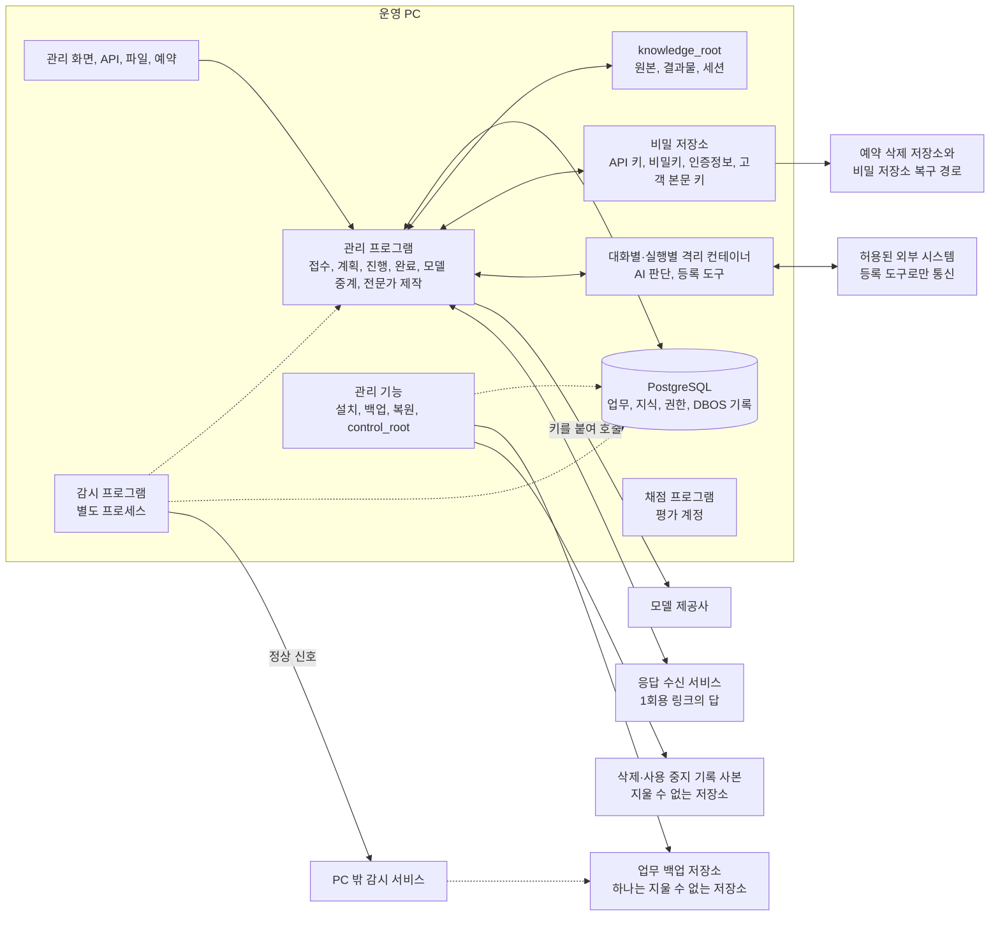

# 공장 구현 설계

**공통 실행 프로그램을 한 번 만들고, 분야별 지식과 판단법, 도구, 평가를 연결해 여러 전문가를 만든다. 만들어진 전문가는 같은 프로그램에서 업무를 접수하고 처리하고 검증하고 전달하며, 이후의 변화까지 관리한다.**


전문가가 갖춰야 할 구성 요소를 재료라 부르며, 재료마다 번호가 붙어 있다. 모든 재료는 공통 실행 프로그램의 정해진 모듈에 들어가고, 같은 자료형을 주고받으며, 정해진 개발 순서로 만든다. 전문 판단에 필요한 자료 관문, 근거 공급, 판단, 검사, 실행, 변경 추적은 전문가마다 만들지 않고 공통으로 구현한다.

## 완성할 것

| 만들 것 | 사용자가 하는 일 | 프로그램이 내놓는 것 |
|---|---|---|
| 공통 업무 실행 프로그램 | 전문가를 골라 업무와 자료를 맡긴다 | 검증한 결과물, 실제 처리 결과, 남은 의무와 후속 일정 |
| 전문성 확보 기능 | 분야 이름과 숙련자의 자료, 결과물, 작업 기록을 준다 | 원문에 연결된 지식, 조건별 판단법, 실무서와 실행 절차 |
| 전문가 제작 기능 | 맡길 업무 범위와 쓸 전문성, 도구를 지정한다 | 시험을 통과한 전문가 구성과 지원 업무 목록 |
| 관리 화면 | 진행 상황과 결과를 보고 필요한 결정에 답한다 | 진행, 대기, 문제, 승인, 결과를 같은 업무 번호로 확인하고 조치하는 화면 |

새 회계 전문가를 추가한다고 하자. 접수, 실행 복구, 파일 저장, 승인, 납품 기능은 다시 만들지 않는다. 회계 지식과 계산법, 업무 절차, 도구 연결, 평가 사례를 더한다. 새 도구가 필요하면 공통 도구 규격에 맞춘 도구 컨테이너만 더한다. 전문가 구성과 도구 등록은 실행 중에 읽는 자료라서, 전문가를 더해도 관리 프로그램(에이전트 하네스)을 다시 배포하지 않는다.

**일에 관여하는 사람과 정하는 것은 다음과 같다.**

| 사람 | 누구인가 | 정하는 것 |
|---|---|---|
| 맡긴 사람 | ▶️ 자격이 필요한 업무는 고객에게서 수임한 자격자나 그 법인<br>▶️ 그 밖의 업무는 업무를 맡긴 고객(개인이나 조직)<br>▶️ 개인정보 처리에서는 위탁자다 | 목표와 범위, 업무 비용 한도, 감수할 위험, 미리 허락할 행동, 실행 승인, 위임할 결정권자 |
| 고객 | ▶️ 자격이 필요한 업무에서 자격자에게 업무를 맡긴 사람<br>▶️ 그 밖의 업무에서는 맡긴 사람과 같다 | 자료와 사실 확인, 범위 변경 동의 |
| 검토자 | ▶️ 결론을 바꿀 권한이 있고 업무 플레이북에 정한 자격을 갖춘 숙련자(자격이 필요한 업무는 수임 자격자)<br>▶️ 결과 추적과 시험 채점을 맡는 검토자는 제작·개선 담당과 분리한다 | 전문 판단 검토, 결과 추적 검토, 시험 채점 |
| 결정권자 | ▶️ 맡긴 사람이 `delegations`에 정해 둔 사람<br>▶️ 조직이 맡긴 일에서는 담당자 위의 결정권자(대표, 감사, 이사회)도 든다 | 위임받은 범위의 실행 승인 |
| 위급 담당자 | 맡긴 사람이 일을 맡길 때 정한, 위급할 때 답할 사람 | 정한 시간 안의 위급 응답 |
| 운영하는 쪽 책임자 | ▶️ 공장을 운영하는 쪽의 책임자<br>▶️ 고객 자료를 대신 처리할 때 운영하는 쪽은 수탁자다<br>▶️ 계정, 접속 기록처럼 자기 목적으로 처리하는 정보는 운영하는 쪽이 개인정보처리자다 | ▶️ 공장 하루 지출 상한과 사무소별 몫, 업무 종류마다의 업무 플레이북 기준, 고영향·고위험 여부, 첫 상용 직무, 운영 전환 승인<br>▶️ 프로그램과 절차 버전의 변경 승인, 새 절차 버전을 먼저 쓸 업무, 허용 오류율과 합격선, 직무별 제작 예산, 예약 삭제의 취소<br>▶️ 자격이 필요 없는 업무의 이해 충돌, 고객끼리 맞서는 일, 계속 맡을지<br>▶️ 맡긴 사람이 밖에 낸 결과물의 정정을 거부할 때 계속 맡을지 |
| 운영자 | PC와 프로그램을 돌보는 사람(환경을 맡은 사람) | ▶️ 판단과 실행을 승인하지 않는다<br>▶️ 장애 알림을 받고 복구한다<br>▶️ 장애 때 새 접수를 멈출 수 있다<br>▶️ 주 모델을 다시 거른 결과가 지금과 다르면 관리 기능으로 주 모델 설정을 바꾼다 |

사무소는 지출 몫을 나누는 단위다. 자격이 필요한 업무는 수임 자격자의 사무소, 그 밖의 업무는 맡긴 사람이 사무소다.

**가장 중요한 운영 목표는 맡은 내용과 필수 검증을 끝까지 해내는 것이다.** 내부 비용, 시간, 토큰 예상치를 넘으면 자원을 다시 배정하거나 일을 나누고, 순서대로 처리하거나 이어서 한다. 내용을 몰래 줄이거나 시도 횟수가 찼다는 이유로 끝내지 않는다.

**법정 기한이 있는 업무는 접수할 때 처리 용량을 계산해 접수, 조건 보완 요청, 거절, 넘김 가운데 하나로 정한다.** 다음 세 값을 각각 기한까지 처리할 수 있는 건수로 바꾸고, 그 가운데 가장 작은 값을 처리 용량으로 쓴다.
- 주 모델 공통 대기열의 동시 실행 수로 처리할 수 있는 건수
- 하루 지출 상한 가운데 그 사무소의 몫으로 처리할 수 있는 건수
- 결론을 바꿀 권한이 있는 검토자의 남은 검토 시간으로 검토할 수 있는 건수

결론을 바꿀 수 있는 미확인이 남은 채로 공장이 제출하지 않는다. 기한이 검증보다 앞설 것 같으면 결론에 영향이 큰 항목부터 채우고, 업무 종류마다 정해 둔 시점에 맡긴 사람에게 알린다. 이때 채우지 못한 항목과 선택지(기한 연장 신청, 결론이 확정된 부분만 제출, 자격자가 직접 판단하고 제출하기 등)를 보여 주고, 어떻게 할지는 맡긴 사람이 정한다. 공장은 그 결정 없이 어느 선택지도 실행하지 않는다. 남은 검증은 빼지 않고 이어서 끝낸다.

**돈은 미리 정한 한도 안에서만 쓴다.** 한도는 둘이고, 정한 사람에게만 늘릴지 묻는다.

| 한도 | 정하는 사람 | 쓰는 법 |
|---|---|---|
| 공장 전체의 하루 지출 상한 | 운영하는 쪽 책임자 | ▶️ 사무소마다 몫을 나눠, 한 사무소의 업무가 다른 사무소의 몫을 쓰지 않게 한다<br>▶️ 접수 때 그 업무를 끝내는 데 필요한 예상액을 사무소 몫에 예약한다<br>▶️ 몫이 모자랄 것 같으면 관리 프로그램이 새 업무 접수부터 멈추고 운영하는 쪽 책임자에게 늘릴지 묻는다 |
| 업무 비용 한도 | 맡긴 사람 | ▶️ 접수 때 예상 비용을 이 한도와 비교한다<br>▶️ 남은 일까지 하면 넘을 것으로 계산되면 다음 유료 호출 전에 멈춘다<br>▶️ 먼저 결과 재사용과 중복 제거로 줄인다<br>▶️ 그래도 넘으면 필요한 비용과 같은 품질의 대안을 붙여 맡긴 사람에게 늘릴지 묻는다 |

권한, 보안, 법적 의무, 지출 한도 때문에 실제로 막히면 그 행동만 보류한다. 이때 확보한 결과와 해결 담당, 다음 행동은 남기고, 독립적으로 할 수 있는 일은 계속한다.

**자격이 필요한 업무(세무대리, 법률사무, 감정평가 등)는 자격자나 그 법인이 수임한다.** 공장은 자격자가 고객에게서 맡은 업무를 처리하는 도구다.
- 수임 자격자는 감수할 위험, 업무 비용 한도, 미리 허락할 행동을 정하고, 고객에게 낼 권고안을 고르며, 자동 판단 거부와 재검토 요구에 답한다.
- 이해 충돌을 정하는 사람은 자격이 필요 없는 업무에서는 운영하는 쪽 책임자, 자격이 필요한 업무에서는 수임 자격자다. 법이 수임을 자격자에게만 허용하기 때문이다. 고객끼리 맞서는 일과 계속 맡을지도 같은 사람이 정한다. 다만 맡긴 사람이 밖에 낸 결과물의 정정을 거부하면, 계속 맡을지(자격이 필요한 업무는 그 사무소에 공장을 계속 제공할지)는 운영하는 쪽 책임자가 정한다.
- 자격자는 근거를 직접 검토한 뒤 자기 이름으로 낸다. 고객에게 가는 권고도 자격자 이름으로만 보낸다.
- 보수와 추가 비용은 자격자가 받는다. 운영하는 쪽은 고객을 모으거나 넘기지 않고, 보수에 비례한 몫을 받지 않는다.
- 접수 화면, 약관, 고객 화면은 자격자 사무소 명의로 둔다.
- 오류로 생긴 손해의 책임 분담, 약관의 책임 한도, 배상 보험은 자격자와 운영하는 쪽의 계약에 정한다.

**운영하는 쪽 책임자는 업무 종류마다 [인공지능기본법](https://www.law.go.kr/LSW/lsInfoP.do?lsiSeq=282791&efYd=20260721)의 고영향 인공지능(제2조제4호)에 해당하는지 미리 검토해 그 근거와 함께 업무 플레이북에 적는다(제33조①).** 해당하면 제34조①의 조치를 갖추고 그 내용도 업무 플레이북에 적는다.

**운영하는 쪽 책임자는 업무 종류마다 고위험 영역인지도 업무 플레이북에 표시한다.** [Anthropic 사용 정책](https://www.anthropic.com/legal/aup)이 정한 고위험 영역은 법률, 의료, 금융(투자 상품 개인 권고와 개인 세금 조언·신고서), 신용, 보험, 주택, 고용, 교육과 자격, 의료 서비스 접근, 공공 급여와 서비스, 법적 판정이다.
- 자격이 필요한 업무의 결과물은 자격자가 근거를 직접 검토하고 그 이름으로 낸다.
- 그 밖의 고위험 영역의 결과물은 검토자가 근거를 직접 검토한 뒤 낸다.
- 자격이 필요 없는 업무에서 개인에게 전적으로 유리한 결정은 검토자 검토를 생략할 수 있다.
- 부분 승인, 금액 삭감, 조건부 승인은 전적으로 유리한 결정이 아니다.
- AI가 쓰였다고 그 개인에게 알린다. 이 고지는 어느 경우에도 한다.

## 프로그램 배치

**운영 PC 한 대에 관리 프로그램, 감시 프로그램, 관리 기능, 채점 프로그램, PostgreSQL 하나를 둔다.** PC 밖에는 PC를 잃어도 남아야 하는 것만 둔다.

| PC 밖에 두는 것 | 내용 |
|---|---|
| 업무 백업 저장소(`backup_target`) | ▶️ DB 기본 백업과 WAL, 확정 파일, restic 파일 백업, 복구 목록<br>▶️ 하나는 운영 PC가 지우거나 덮어쓸 수 없는 지울 수 없는 저장소(WORM, Object Lock)다 |
| 삭제·사용 중지 기록 사본 저장소 | ▶️ 관리 계정만 쓰는 `control_root` 폴더의 기록을 기록·서명 즉시 올리는 곳이다<br>▶️ 업무 백업과 다른 지울 수 없는 저장소라서, 서명 키를 가진 사람도 이미 올린 기록을 바꾸거나 지울 수 없다 |
| 키의 예약 삭제 저장소 | 고객 본문을 암호화한 키(업무 건 키, 범위 키, 파일 키)의 PC 밖 사본 |
| 비밀 저장소 복구 경로 | 비밀 저장소의 암호화 백업, 백업을 푸는 키와 저장소 접속 정보 |
| PC 밖 감시 서비스 | 정상 신호 수신, 백업 도착 시각 확인, 예약 삭제 대조 |
| 응답 수신 서비스 | 1회용 링크로 받은 답과 승인 |

PC 밖 서비스는 고객 본문을 받지 않는다. 저장소에는 PC에서 암호화한 본문만 보내고, 푸는 키는 함께 두지 않는다. 외부 저장 서비스는 개인정보 처리 위탁과 국외 이전 공개 목록에 적는다.

관리 프로그램은 FastAPI와 DBOS를 함께 쓰는 Python 애플리케이션이며, 모델 중계와 전문가 제작도 그 안의 기능이다. AI 판단은 대화마다 새로 띄우는 격리 컨테이너에서 한다. 문서 변환, 계산, 브라우저 작업은 도구 실행마다 띄우는 격리 컨테이너에서 한다. 두 컨테이너 모두 결과를 관리 프로그램에 돌려준다.

AI가 쓰는 브라우저는 로그인하지 않은 조회 전용이다. 로그인한 계정으로 하는 조회와 제출은 AI 세션 밖 DBOS 단계에서 `dispatch_action()`이 부르는 등록 스크립트만 하고, 로그인 프로필은 그 스크립트에만 마운트한다. 로그인 조회 결과는 자료 관문을 거쳐 다음 세션의 판단 입력으로 준다.



**실행 자료 폴더는 다섯으로 나눈다.** 이름은 경로 설정 이름이며, 폴더를 나눈 것만으로 고객 격리나 정답 보호가 끝났다고 보지 않는다.

| 폴더 | 두는 것 | 쓰는 계정 |
|---|---|---|
| `install_root` | 검사를 마친 프로그램, 전문가 구성, 도구, 모델의 설치 버전 | ▶️ 관리 계정만 쓴다<br>▶️ 업무 실행 계정은 읽기만 한다 |
| `knowledge_root` | ▶️ 원본, 파생물, 고객 업무, 대화, 실행 기록<br>▶️ DB 볼륨(macOS·Windows는 VM 안 볼륨)<br>▶️ `operations/`의 상태 보고와 운영 수치 | 업무 실행 계정 |
| `control_root` | ▶️ 삭제·사용 중지 기록과 서명한 삭제·사용 중지 묶음(`blocklists/`)<br>▶️ 업데이트 신뢰 기록: 업데이트 서명을 확인하는 공개 키, 폐기 목록, 받아들인 가장 높은 순번<br>▶️ 감사 확인점: 감사 기록의 해시에 서명한 것 | ▶️ 관리 계정만 쓴다<br>▶️ 업무 DB를 과거로 복원해도 최신 상태를 유지한다<br>▶️ 서명 키는 운영자와 운영하는 쪽 책임자가 함께 승인해야 바꿀 수 있다 |
| `evaluation_root` | 업무 능력 시험의 보호된 문제와 정답, 채점 자료, 섀도 테스트의 시작 상태와 에이전트 결과(업무 건 키로 암호화), 결과 추적 대상 목록 | ▶️ 평가 계정만 쓴다<br>▶️ 업무 실행 계정, 시험 계정, AI는 읽거나 고칠 수 없다<br>▶️ 관리 계정은 백업과 복원 때만 암호화된 그대로 다룬다 |
| `test_root` | 시험 전용 DB, 파일, DBOS 작업 공간 | ▶️ 시험 계정이 쓴다<br>▶️ 평가 계정이 `test_root/inbox/`에 시험 입력을 넣고 `test_root/outbox/`의 결과를 읽는다<br>▶️ 시험 계정은 `test_root/inbox/`를 읽기만 한다<br>▶️ 운영 DB와 운영 작업 폴더에 연결하지 않는다 |

`knowledge_root`의 핵심 폴더는 다음과 같다.

```text
knowledge_root/
├── config/                         # storage.yaml(자료실 위치·용량·백업 대상), retention.yaml(보존 기간·삭제 조건)
├── shared/collections/legal-kr/    # 로컬 법령 데이터베이스 원문
├── tenants/<tenant-id>/
│   ├── browser-profiles/<account-id>/
│   └── scopes/<scope-id>/           # 범위. 분류 대기 범위도 여기에 하나 둔다
│       ├── objects/<key-id>/sha256/ # 고객 원본과 확정 결과
│       ├── derived/                 # 추출 결과와 판단용 본문
│       ├── exports/  models/  releases/
│       └── cases/<case-id>/         # snapshots/, sessions/<conversation-id>/{sdk,cwd}/, traces/, work/, deliveries/
├── joint-scopes/<scope-id>/        # 여러 고객에 걸친 범위. 구조는 scopes/와 같다
├── offices/<office-id>/browser-profiles/<account-id>/
├── stores/postgres/                # DB 볼륨
├── staging/<scope-id>/  cache/<scope-id>/
└── operations/                     # 상태 보고와 운영 수치
```

| 실행 단위 | 담당 | 저장과 권한 |
|---|---|---|
| 관리 프로그램 | 요청 접수, 업무 상태 변경 요청, 실행 허가, DBOS 작업 등록, 결과 확정, 모델 중계 | ▶️ 상태와 이력 테이블을 직접 고치지 않는다<br>▶️ 필요한 권한만 가진 DB 상태 변경 함수만 호출한다<br>▶️ 이 함수가 현재 상태, 권한, 필수 항목, 검사 증거와 승인을 확인한다<br>▶️ 실행마다 필요한 비밀만 비밀 저장소에서 꺼내 넘기고, 모델에는 주지 않는다 |
| 비밀 저장소 | API 키, 서명용 비밀키, 고객 인증정보, 고객 본문을 암호화한 키 | ▶️ 운영 PC 안에서 비밀을 두는 곳은 여기 한 곳이다<br>▶️ 예외는 브라우저를 띄울 때 파일로 있어야 하는 브라우저 로그인 프로필이다<br>▶️ 로그인 프로필은 `knowledge_root`의 `tenants/<tenant-id>/browser-profiles/<account-id>/`나 사무소 공용 계정이면 `offices/<office-id>/browser-profiles/<account-id>/`에 두고, 계정마다 비밀 저장소의 키로 암호화한다 |
| PostgreSQL | 업무의 현재 상태와 이력, 지식과 검색, 검사 증거, DBOS 실행 기록 | ▶️ 업무 자료와 DBOS 기록은 같은 데이터베이스의 서로 다른 스키마에 둔다<br>▶️ 범위는 한 고객 안에서 접근을 나누는 단위(사건, 팀, 이해 충돌로 볼 수 있는 사람이 다른 자료)다<br>▶️ 고객 자료 테이블은 DB가 직접 지금 처리 중인 업무가 볼 수 있는 범위와 공동 범위(대표 개인과 그 법인처럼 여러 고객에 걸친 범위)의 행만 보여 준다<br>▶️ 어느 범위인지 정하지 않은 조회는 아무 행도 받지 못한다<br>▶️ 범위 값은 트랜잭션 안에서만 유지해, 커넥션을 다시 쓸 때 앞 업무의 범위가 남지 않게 한다<br>▶️ 법령과 공통 지식은 고객 열 없이 공용 범위 테이블에 두고, 고객 범위와 따로 조회해 허용된 결과만 합친다<br>▶️ 여러 고객에 걸쳐 읽는 예외는 셋이다: 고객을 알아볼 수 없게 바꿔 올린 앞선 결론 목록, Conflict check(충돌 검사 기능)만 조회하는 이해 충돌 관계자 목록, 고객 값은 못 읽고 의존 관계만 읽는 DB 계정으로 하는 변경 영향 조회 |
| AI 실행 환경 | 요청 해석, 전략, 의미 판단, 작업 제안, 독립 검토 | ▶️ 대화마다 새로 띄우는 Podman 컨테이너에서 SDK를 돌린다<br>▶️ 재판단 세션은 앞선 세션의 기록을 볼 수 없다<br>▶️ 그 대화에 허용한 작업 폴더와 자료만 본다<br>▶️ 통신은 관리 프로그램의 모델 중계 주소로만 나가고, 웹 조회와 그 밖의 통신은 등록 도구를 거친다<br>▶️ API 키 대신 그 대화에서만 통하는 중계 토큰을 받는다<br>▶️ 중계 토큰은 `ANTHROPIC_AUTH_TOKEN`처럼 인증정보로 알아보는 이름으로 넘기고, `CLAUDE_CODE_SUBPROCESS_ENV_SCRUB=1`로 셸 명령, 훅, MCP 서버에는 넘어가지 않게 한다([환경 변수](https://code.claude.com/docs/en/env-vars))<br>▶️ 쓸 수 있는 도구는 SDK의 `tools`와 `disallowed_tools`로 막고, `strict_mcp_config=True`로 관리 프로그램이 등록한 연결만 쓴다<br>▶️ `allowed_tools`는 자동 승인 목록이라 이것만으로 막았다고 보지 않는다<br>▶️ 자동 기억을 끄고(`autoMemoryEnabled: false`, `CLAUDE_CODE_DISABLE_AUTO_MEMORY=1`), `setting_sources=[]`로 작업 폴더의 지시 파일과 자동 실행 훅을 불러오지 않는다<br>▶️ 대화마다 `CLAUDE_CONFIG_DIR`를 그 대화의 `sessions/…/sdk/`로, `cwd`를 그 대화의 `cwd/`로 둔다<br>▶️ SDK는 `setting_sources=[]` 오류를 고친 0.1.60 이상을 쓰고, 실제 실행할 CLI 버전과 함께 고정한다<br>▶️ 관리 프로그램이 다시 시작하면 업무 기록에 없는 남은 컨테이너를 멈추고 지운다 |
| 도구 실행 환경 | 등록한 계산, 변환, 제작 함수와 연결 도구 실행 | ▶️ 분야 도구는 도구별 컨테이너 이미지로 만들고, 이미지 해시와 입출력 자료형으로 등록한다<br>▶️ 입력은 읽기 전용이고 출력은 그 작업 전용 공간에 쓴다<br>▶️ `--read-only`, 일반 사용자 실행, `--cap-drop=all`, `--security-opt=no-new-privileges`를 적용한다<br>▶️ 통신이 필요 없는 작업은 `--network=none`으로 막는다<br>▶️ `--memory`, `--cpus`, `--pids-limit`과 작업 공간·로그 용량, 제한 시간을 작업 종류별 설정에 숫자로 둔다<br>▶️ 값이 없거나 제한을 적용하지 못하면 그 작업을 시작하지 않는다<br>▶️ AI 컨테이너와 도구 컨테이너에는 DB 접속 경로와 DB·관리 API 인증정보를 두지 않는다<br>▶️ 브라우저는 `chromium_sandbox=True`와 `service_workers="block"`으로 띄운다<br>▶️ 연결 시점의 IP까지 확인해 허용하지 않은 내부망, 관리 포트, 클라우드 인증정보 주소를 IPv4·IPv6 모두 막는다<br>▶️ CAPTCHA나 추가 인증으로 막히면 그 작업을 보류하고 맡긴 사람에게 넘기며 우회하지 않는다<br>▶️ 외부 행동은 관리 프로그램의 허가를 거친다 |
| 파일 저장소 | `knowledge_root` 아래 원본, 가공 파일, 결과물, 세션과 복구 자료, 모델 응답 원문 | ▶️ 파일 해시와 DB의 버전, 접근 범위를 연결한다<br>▶️ DBOS 작업 입력과 단계 결과에는 고객 값을 넣지 않고 자료 ID와 해시만 넣는다<br>▶️ 운영 PC와 자료 디스크는 전체 디스크를 암호화한다<br>▶️ `cases/` 아래 폴더와 그 업무의 `objects/`, `derived/`, `staging/`은 업무 건과 보존 기간마다 둔 업무 건 키로 암호화한다<br>▶️ 업무 건에 묶이지 않은 범위 공용 자료(`exports/`, 그 고객만 쓰는 학습 모델 사본 `models/`, 고객 전용 업무 지식 배포물 `releases/`, `cache/`)는 범위와 보존 기간마다 둔 범위 키로 암호화한다<br>▶️ 여러 사람 정보가 든 파일은 파일마다 파일 키를 둔다<br>▶️ 보존 기간이 바뀌면 새 기간의 키로 다시 암호화하고 옛 키로 된 사본을 지운다<br>▶️ 고객 파일은 범위 폴더의 `objects/<key-id>/sha256/…`에 둔다<br>▶️ 검색 색인, 임베딩, DB의 고객 칸에는 주민등록번호 같은 고유식별정보와 건강, 범죄 경력 같은 민감정보 대신 대체값만 넣는다<br>▶️ 원래 값은 별도 동의나 법령 근거(주민등록번호는 법령 근거)를 DB에 기록한 업무에서만 판단 입력에 넣는다 |
| 감시 프로그램 | 프로세스, DB, 백업, 디스크, 메모리, 대기 기한 감시와 운영자 알림 | ▶️ 관리 프로그램과 별도 프로세스로 두고 OS 서비스로 등록한다<br>▶️ 관리 프로그램이 멈춰도 감시는 계속 돈다<br>▶️ 감시 계정은 `knowledge_root/operations/`, DB 상태 조회, 백업 저장소의 마지막 도착 시각만 읽고 고객 자료는 읽지 못한다 |
| 관리 기능 | 설치, 백업, 복원, 업데이트, 삭제·사용 중지 기록, 감사 확인점 서명 | ▶️ 관리 계정으로 도는 별도 기능이 `install_root`, `control_root`, `backup_target`에 쓴다<br>▶️ 백업과 복원 때만 `knowledge_root`와 `evaluation_root`의 암호화된 파일을 그대로 읽고 되돌린다<br>▶️ `test_root`의 자료는 관리 기능이 삭제를 요청하고, 시험 계정이 지운 뒤 지운 실행 ID를 돌려준다<br>▶️ 관리 프로그램은 정해 둔 요청만 보낸다<br>▶️ OS 계정은 관리, 업무 실행, 시험, 평가, 감시 다섯으로 나눈다<br>▶️ 지원 범위는 실제 복원 시험으로 확인한다 |

**DBOS를 실행하는 관리 프로세스는 처음에 하나만 둔다.** 여러 프로세스에서 올바르게 복구하려면 DBOS의 Conductor나 직접 만든 조정 기능이 복구를 나눠 맡아야 한다([DBOS 구조](https://docs.dbos.dev/architecture)). 이 조정을 따로 검증하기 전에는 여러 실행 서버 구성을 지원 범위에 넣지 않는다.

**모든 주 모델 실행은 DBOS 공통 대기열 하나를 거치고, 처음에는 `global_concurrency=2`로 2개까지 돈다.** 주 대화, 분담, 계획 제안, 독립 검토가 모두 여기에 들고, 업무마다 따로 대기열을 만들지 않는다.
- 답이나 기한을 기다리는 DBOS 작업, 업무 조정, 이벤트 접수, 재개 작업은 모델을 부르지 않으므로 이 한도에 들지 않는다.
- 이 한도는 옛 코드 버전으로 대기열에 남은 AI 작업도 센다.
- AI 세션 안에서 부르는 도구는 그 세션의 몫 안에서 실행해, AI 실행끼리 서로 기다리다 멈추지 않게 한다.
- AI 세션 밖의 도구 실행과 스캔 판독(문서 파싱 VLM)은 별도 도구 대기열에서 돌려, 큰 문서 판독이 다른 업무를 막지 않게 한다.
- 이미 맡은 업무의 마무리와 필수 검증에 필요한 몫을 먼저 확보하고, 그다음 기한이 가까운 업무 순으로 돌린다.
- 진행 중인 업무와 기한이 남은 결과의 변경 재검토는 고객 업무와 같은 순서로 돌리고, 나머지 변경 재검사와 전문가 제작 시험은 고객 업무 뒤로 보낸다.
- 같은 계정이나 파일을 바꾸는 작업은 대상마다 PostgreSQL 잠금을 잡아 한 번에 하나만 돈다.
- 대기열이 정해 둔 시간 넘게 줄지 않으면 감시 프로그램이 알린다.
- 판독 VLM이나 임베딩 모델처럼 PC에서 직접 띄우는 큰 보조 모델은 한 번에 하나만 쓴다.
- 모델을 불러오기 전에 메모리와 디스크를 확인하고, 작업용 메모리의 80%를 쓰고 있으면 새 작업은 기다린다.
- 업무 종류별 세션 수, 토큰, 시간의 처음 값은 개발 0단계(핵심 가정 시험)에서 잰 값으로 두고, 업무 능력 시험 뒤에는 시험의 P95에 50% 여유를 붙인 값으로 바꾼다.
- 성수기 처리량 목표와 동시 실행 수, 그 비용은 이 값으로 정한다.

**고객 업무를 처리하는 주 모델은 API 키로 인증한다.** Anthropic은 별도 승인 없이 Agent SDK로 만든 제품에 claude.ai 로그인을 쓰지 못하게 한다([Agent SDK 개요](https://code.claude.com/docs/en/agent-sdk/overview)). 모델 중계가 키를 붙여 보내고 호출마다 비용을 기록하므로, 고객 문서에 숨은 지시가 컨테이너 안에서 키를 꺼내 갈 수 없다. 중계는 모델에 가는 요청 전체를 그 실행의 `traces/`에 암호화해 기록한다.
- SDK의 호출 횟수와 비용 상한 설정에는 내부 예상치를 넣지 않는다.
- 비용 상한(`max_budget_usd`)에는 업무 비용 한도에서 남은 금액보다 여유를 두고 낮춘 값을 넣는다. 이 값은 추정치라 넘칠 수 있고, 이어 받은 세션에서 앞서 쓴 비용은 세지 않는다([Agent SDK 설정](https://code.claude.com/docs/en/agent-sdk/python#claudeagentoptions)).
- 이 설정에 걸려 멈추면 완료로 보지 않는다. 실제 남은 금액으로 다시 설정해 그 대화의 세션 기록에서 이어 간다.
- 업무 전체 비용은 모델 중계의 기록으로 따지고, 제공사의 공식 비용 내역과 정기적으로 대조한다.
- 같은 도구를 같은 입력으로 되풀이하는 세션은 중계가 찾아 멈추고, 방법을 바꿔 다시 시작한다.

**고객 자료는 모델 제공사 서버로 가므로, 국외 이전 근거, 위탁자의 동의, 응답 뒤 저장하지 않는 계약을 모두 확인한 자료만 보낸다.** 등록 도구로 외부 검색에 보내는 질의도 같은 확인을 거친다.

| 확인할 것 | 내용 |
|---|---|
| 국외 이전 근거 | 정보주체의 별도 동의, 또는 처리위탁·보관 사항을 개인정보 처리방침에 공개하거나 정보주체에게 알린 경우 등 [개인정보 보호법 제28조의8①](https://www.law.go.kr/LSW/lsInfoP.do?lsiSeq=283839&efYd=20260911)의 요건 |
| 위탁자의 동의 | ▶️ 운영하는 쪽이 모델 제공사에 다시 맡기는 데 대한 위탁자인 맡긴 사람의 동의(개인정보 보호법 제26조⑥)<br>▶️ 맡긴 사람도 고객의 수탁자이면 처음 맡긴 고객의 동의까지 확인한다 |
| 응답 뒤 저장하지 않는 계약 | 고객 자료를 보내는 조직이 제공사와 맺은, 고객 자료를 응답 뒤 저장하지 않는 계약(Zero Data Retention) |

Anthropic 상용 API는 기본으로 입력을 학습에 쓰지 않고([상용 약관](https://www.anthropic.com/legal/commercial-terms)), 기본으로 30일 안에 지운다([보관 기간](https://privacy.claude.com/en/articles/7996866-how-long-do-you-store-my-organization-s-data)). 응답 뒤 저장하지 않는 계약은 조직마다 따로 켜므로, 새 조직에는 저절로 적용되지 않는다([Anthropic의 Zero Data Retention 범위](https://docs.claude.com/en/docs/build-with-claude/zero-data-retention)). Anthropic 서버의 코드 실행 도구처럼 이 계약이 적용되지 않는 기능과 30일 보관이 필요한 모델은 고객 자료 경로에서 쓰지 않는다. 판단에 필요 없는 고유식별정보와 민감정보는 자료 관문에서 대체값으로 바꾼 뒤 보내고, 원래 값은 별도 동의나 법령 근거를 DB에 기록한 업무에서만 판단 입력에 넣는다.

**관리 화면과 API는 인터넷에 그대로 열지 않는다.** 같은 PC의 브라우저라도 사용자를 인증하고 그 업무의 접근 권한을 검사하며, 변경 요청은 CSRF 토큰과 요청을 보낸 웹 주소(Origin)를 검사한다.
- 운영 PC 밖에 있는 맡긴 사람, 고객, 검토자, 결정권자, 위급 담당자는 서명한 1회용 링크로 답하고 승인한다. 링크는 받는 사람, 대상 업무, 만료 시각에 묶는다.
- 승인할 때는 미리 등록한 휴대폰이나 메일로 받은 1회용 번호를 한 번 더 넣는다.
- 자기가 요청한 행동을 자기가 승인하지 못하게 하고, 여러 사람의 승인이 필요한 행동은 그 조건을 서버에서 강제한다.
- 링크는 응답 수신 서비스로 열린다. 이 서비스는 서명과 1회용 번호를 확인하고 답만 보관하며, 관리 프로그램이 정한 주기로 답을 가져온다.
- 문자와 메일을 보내는 제공사는 개인정보 처리 위탁 목록에 적는다.

**업무를 시작하는 신호는 관리 화면과 API 요청, 정기 예약, 외부 서비스 알림, 지정 폴더의 파일 변경이다.** 지정 폴더에서 저장 완료 표시가 없는 파일은 잠정 자료로 둔다. 외부 서비스의 처리 결과는 접수 창구로 알림을 받는다. 수신한 원본 본문에 제공사의 서명 검증을 적용하고, 허용한 발신처와 알림 종류인지 본다. 받는 경로마다 마지막으로 정상 확인한 위치와 시각을 저장해, 재시작하면 그 위치부터 놓친 변경을 이어 받는다. 운영 PC가 밖에서 들어오는 연결을 받을 수 없으면 제공사의 조회 API로 확인한다. 정기 예약은 `automatic_backfill=True`로 두어 멈춘 동안 빠진 회차를 채운다.

**Linux에서는 rootless Podman을 쓰고, Windows와 macOS에서는 Podman Machine의 제품 전용 Linux VM을 쓴다.** OS별 설치와 파일 공유, 네트워크, 장치 접근을 실제로 시험한 조합만 지원한다. 운영 PC가 쓰는 OS를 먼저 완성하고 나머지 OS는 개발 6단계(제품 운영 완성)에서 더한다.
- Podman Machine에는 VM에 별도 디스크를 붙이는 옵션이 없고, `podman machine rm`은 VM 안의 볼륨을 함께 지운다. 그래서 원본과 파생 파일은 호스트 폴더에 두고 `--volume`으로 VM에 연결한다.
- VM의 기본 홈 폴더 공유는 끄고 제품에 필요한 경로만 연결한다.
- DB는 쓰기 확정(fsync)과 속도를 믿을 수 없는 공유 폴더에 두지 않고 VM 안 볼륨에 둔다.
- VM 디스크 하나를 DB 볼륨과 다른 볼륨이 나눠 쓰므로, `knowledge_root/config/storage.yaml`의 공간 예약으로 다른 볼륨이 DB 공간을 쓰지 못하게 막는다. 볼륨 크기 한도를 함께 걸 때는 넘치게 써 보는 시험으로 실제로 걸리는지 확인한다.
- Linux에서는 DB 볼륨을 접수, 추출, 캐시, 작업 공간과 나눠 쓰지 않는다.
- 운영 중인 VM은 지우지 않으며, VM 디스크를 잃으면 PC 밖 WAL 보관과 기본 백업으로 DB를 복원한다.
- GPU는 따로 검증하는 항목이며 기본 업무 처리의 필수 전제로 두지 않는다.
- 쪽당 판독 시간은 개발 0단계에서 재고, 그 값으로 GPU가 필요한지 정한다.

## 전문 판단 시스템을 실행에 연결

**주 모델은 원본 파일을 받지 않는다. 관리 프로그램이 이번 판단에 필요한 정보만 골라 판단 입력을 만들고, 주 모델은 그것을 읽고 판단한다.** 온톨로지(OWL 정의, SHACL 검사)는 자료를 읽고 기록할 의미의 기준이고, 시간축 지식 그래프는 그 기준에 맞는 실제 대상·관계·적용 기간을 담는다. 가공·색인·관계 등록은 새로 들어오거나 바뀐 자료에만 하고, 업무마다 현재 권한과 적용 기간을 확인한 버전을 조회한다.

같은 기능을 전문가마다 다시 만들지 않고, 단계마다 공통 해결책에 연결한다.

| 단계 | 연결할 해결책 | 다음 단계로 넘기는 것 | 구현 자리 |
|---|---|---|---|
| 기준 준비 | 온톨로지, 코드 실행 도구와 Rules as Code, 판단 절차 SOP와 Prompt chaining, 행동 원칙 시스템 프롬프트, 업무 플레이북 | ▶️ 승인한 개념·관계·단위, 공통 원칙, 단계별 지시와 업무 기준의 버전<br>▶️ Rules as Code 판정 코드(검증된 Python 판정 함수)는 확인된 사실을 조건과 예외에 적용해 충족·불충족·미확인·해당 없음을 계산하고, 기간, 세율, 이자처럼 법이 정한 계산도 한다<br>▶️ 이 코드는 조문 옆에 두고, 그 분야 숙련자가 조문과 한 줄씩 맞춰 보고 소관 기관의 계산 사례 시험을 통과한 것만 쓴다<br>▶️ 십진수 계산, 끝수 처리, 공휴일 자료는 조문이 정한 대로 따른다<br>▶️ 같은 값이 자료마다 다르게 적혀 있거나 합계와 그 안의 항목이 함께 들어오면 계산하지 않고 멈춘다<br>▶️ 근거 조문이 바뀌면 바뀐 조문이 적용되는 건에서 그 코드의 계산을 멈춘다 | `knowledge/`, `tools/`, `workflow/`, `agent/`, 전문가 배포물 |
| 맡을지 확인 | Conflict check(충돌 검사 기능), 에이전트 평가 Evals, 에이전트 하네스 | 충돌 검사 판정과 `allowed-scope.json` 대조를 거친 접수·조건 보완 요청·거절·넘김 결정 | `policy/`, `workflow/` |
| 자료 관문 | 문서 파싱 VLM, 숨김 텍스트 탐지, Quarantined LLM, 멀티테넌트 격리 | ▶️ 원문 위치를 살린 판단용 본문, 뺀 자리 표시, 본문과 구분해 꺼낸 문서 구성 요소(메모, 발표자 노트, 대체 텍스트 등), 검사 결과와 접근 범위<br>▶️ 숨김 텍스트 탐지는 화면 모습과 파일 속 글의 차이와 함께 글자와 바탕의 명암 대비도 계산한다<br>▶️ 원문은 `objects/`에 그대로 보존한다<br>▶️ 이 검사는 색인하거나 지식 그래프에 넣기 전에 한다 | `knowledge/`, 등록 판독 도구, 범위별 `objects/`·`derived/` |
| 지식·현재 값 관리 | 온톨로지, 시간축 지식 그래프, 로컬 법령 데이터베이스(`shared/collections/legal-kr/`), System of Record(원본 시스템) | ▶️ 확인한 대상·관계·적용 기간, 법령의 버전과 적용 기간, 조회 시각이 붙은 현재 값<br>▶️ 사람과 회사는 원문에서 확인한 식별 근거(생년월일, 법인등록번호, 사업자등록번호 등)와 발급기관·적용 시점이 맞을 때만 같은 대상으로 잇는다<br>▶️ 사업자등록번호는 사업장마다 따로 받을 수 있으므로, 이 번호가 다르다고 다른 회사로 보지 않는다<br>▶️ 이름만 같으면 '같은 대상으로 추정' 관계로만 잇고 개별 대상을 유지한다<br>▶️ 서로 다른 대상을 하나로 합칠 수 있는 OWL 표현(`owl:sameAs`, `owl:hasKey` 등)은 추론에 넣지 않는다<br>▶️ 추론 결과에 다른 대상끼리 동일성이 생기면 그 추론 결과 전체를 반영하지 않는다<br>▶️ 항목마다 어느 시스템이 원본인지 목록으로 정해 둔다<br>▶️ 증명서는 고객이 낸 사본 대신 전자증명서로 받아 진본인지 검증한다 | `knowledge/`, PostgreSQL, 등록 조회 도구 |
| 근거 공급 | 하이브리드 검색 RAG, GraphRAG, Decision Model, Policy as Code 정책 엔진 | ▶️ 하이브리드 검색 RAG: 자료를 조, 항, 별첨 단위로 나눠 색인하고, 찾은 조는 조 전체를 건넨다<br>▶️ Kiwi로 조사와 어미를 뗀 키워드 검색(BM25, pg_textsearch)과 Qwen3-Embedding-4B 의미 검색을 RRF로 합친다<br>▶️ 재정렬 모델(Qwen3-Reranker)은 중요한 근거의 누락이나 읽을 양을 줄일 때만 비교해 넣는다<br>▶️ 정답 자료가 쌓이면 두 점수를 같은 척도로 맞춰 그 자료로 정한 비율로 합친다<br>▶️ 나눈 조각 수와 색인된 조각 수를 프로그램이 맞춰 보고, 다르면 그 자료를 검색에 쓰지 않는다<br>▶️ GraphRAG: 문서에 적힌 별첨·인용·예외 연결은 AI가 아니라 프로그램이 정해 둔 규칙으로 뽑는다<br>▶️ PostgreSQL 재귀 SQL로 별첨·인용·예외와 반대 근거의 연결을 따라가 보태되, 기본 검색이 찾은 근거는 빼지 않는다<br>▶️ Decision Model(`vllm-sr/d3-nano`): 권한 검사를 마친 후보마다 관련이 있는지만 가르고 결론은 맡지 않는다<br>▶️ 모델이 낸 확률을 그대로 쓰지 않고 정답 자료로 보정한 뒤 가른다<br>▶️ 앞선 결론 목록에서 같은 쟁점의 후보를 고르는 데에도 쓴다<br>▶️ 경계 점수는 보기 순서를 바꿔 다시 가르고, 답이 다르거나 '판단 못 함'이면 주 모델이 직접 읽는다<br>▶️ 검증 전에는 '관련 없음'으로 나와도 빼지 않고 표시만 붙여 모두 넘긴다<br>▶️ 잘못 뺀 비율의 단측 95% 신뢰상한이 1% 이하로 확인된 업무와 설정에서만 자동 제외를 켜고, 주 1회 다시 확인한다<br>▶️ 필수 근거, 반대 근거, 숨긴 글이나 자료 속 명령 문장이 있던 자료는 자동 제외를 켠 뒤에도 빼지 않는다 | `knowledge/`, `policy/`, `agent/`의 입력 조립 코드 |
| 판단 | 코드 실행 도구와 Rules as Code, 판단 절차 SOP와 Prompt chaining, 행동 원칙 시스템 프롬프트, 업무 플레이북, Structured note-taking과 변경 이력 관리, 구조화 출력 Structured Outputs | ▶️ 주 모델이 조건과 예외의 뜻을 해석하고, Rules as Code 판정 코드가 확인된 사실을 적용해 조건마다 결과를 계산한다<br>▶️ 반대 근거·대안·위험을 비교한 `Judgment`와 계산 증거<br>▶️ 구조화 출력이 끊긴 답은 버리고 다시 받는다<br>▶️ 생각 과정 전체를 옮겨 적는 칸은 두지 않는다 | `agent/`, `workflow/`, `tools/` |
| 검사 | LLM-as-a-Judge(별도로 띄운 AI가 결과를 기준에 따라 평가하거나, 앞선 답을 보지 않고 다시 풀어 맞춰 봄), 규칙 기반 출력 가드레일, Decision Traces, PII 탐지와 k-익명성, Threshold rule 검사, Human-in-the-loop 승인의 전문 판단 검토 | ▶️ 항목별 `CheckResult`<br>▶️ 두 답을 견줄 때는 놓는 순서를 바꿔 다시 판정하고, 두 순서에서 모두 이긴 답만 고른다<br>▶️ 수치가 아닌 주장은 새 대화가 그 주장이 가리킨 페이지와 문단만 보고 하나씩 판정한다<br>▶️ PII 탐지는 한국 주민등록번호·사업자등록번호 같은 번호 검사가 켜져 있는지 확인하고, 한국어로 학습한 개체명 인식 모델을 쓴다<br>▶️ 재식별 검사는 k-익명성과 함께 l-다양성과 t-근접성도 본다 | `review/`, `knowledge/`, `workflow/` |
| 실행·확인 | 에이전트 하네스, Policy as Code 정책 엔진, Human-in-the-loop 승인의 실행 승인, System of Record | 검사·승인·현재 권한을 대조한 실행 요청과 원본 시스템에서 확인한 처리 결과 | `policy/`, `tools/`, `actions/`, `people/` |
| 기록·변경 추적 | Agent tracing(실행 기록), Structured note-taking과 변경 이력 관리, Decision Traces, Lineage 추적과 Citator형 변경 알림 | ▶️ 단계마다 입력·출력·판단과 의존 관계<br>▶️ 근거가 바뀌면 그 근거의 사용을 바로 보류하고 재검토 작업을 만든다 | `review/`, `knowledge/`, `workflow/` |
| 능력 평가 | 에이전트 평가 Evals | ▶️ 모델·자료·검색·절차를 함께 시험한 증거와 `allowed-scope.json`<br>▶️ 시험 문제는 정해 둔 주기마다 새것으로 바꾼다<br>▶️ 사람에게 넘긴 건은 다음 시험 문제 후보로 모은다 | `grader/`, `review/`, `factory/` |

권한 검사와 고객 격리는 자료를 찾을 때, 관계를 따라갈 때, 결과를 합칠 때, 기록할 때, 납품할 때 모두 적용한다. 검색이나 외부 도구가 새로 가져온 자료도 자료 관문을 거친다.

판단 입력에는 조문·판결의 필요한 판단용 본문과 문맥도 들어간다. 온톨로지나 그래프만 보고 사실을 확정하지 않는다. 원본은 판독·추출·인용 대조 기능이 쓰고, 모델에는 검사한 근거와 원문 위치를 준다. 그래프에 연결이 없으면 하이브리드 검색 RAG로 보완하고, 없다는 사실로 단정하지 않는다. 이번 업무에서 볼 수 없는 자료와 AI 처리가 허락되지 않은 원문은 넣지 않고, 그런 자료가 있다는 사실과 개수도 넘기지 않는다.

**로컬 법령 데이터베이스는 받은 원문 옆에 지금 쓸 수 있는지를 함께 적는다.**
- 전원합의체 판결로 바뀐 판례, 상급심에서 파기·취소된 하급심 판결, 확정됐는지 모르는 하급심 판결을 표시한다.
- 공개 자료에 빠진 판결은 판결서 인터넷 열람 서비스에서 한 건씩 받아 넣고, 찾아본 범위가 어디까지인지 함께 적는다.
- 헌법재판소 결정으로 조항마다 지금 효력이 있는지 적고, 형벌 조항은 사건 날짜에 따라 거슬러 효력을 잃는지 따진다.
- 위계와 시행일은 함께 저장하되, 적용할 후보를 찾는 데만 쓴다. 고정 순위표로 적용 순서를 정하지 않는다.
- 위계가 다르면 하위 규정이 상위 규정과 실제로 어긋나는지, 위임 범위 안인지, 상위 규정이 예외를 허용했는지 원문으로 확인한 뒤 상위 규정을 앞세운다.
- 위계가 같으면 AI가 두 규정이 실제로 부딪히는지와 한쪽이 특별법인지를 원문과 판례로 판단하고, 새 대화가 그 판단을 검토한다. 이름에 '특별'이 있다는 이유로 앞세우지 않는다. 그런 관계가 없을 때만 나중 법을 앞세운다.
- 현재 효력이 결론을 좌우하면 결과를 확정하기 직전에 그 근거의 발행처에 다시 확인한다.
- 날마다 받는 일이 실패하거나 형식이 바뀌면 그날부터 조문을 최신인지 확인되지 않은 근거로 표시하고, 결론의 근거 조문은 국가법령정보센터 원문과 맞춰 본다.

## 재료를 넣을 코드

각 코드 모듈은 관리 프로그램 안의 모듈이며 별도 서버가 아니다. 예외는 넷이다. 감시 프로그램(`watchdog/`)은 관리 프로그램이 멈춰도 돌도록 따로 띄운다. 채점 프로그램(`grader/`)은 업무 실행 계정과 AI가 읽거나 고칠 수 없는 평가 계정으로 돈다. 관리 기능(`admin/`)은 관리 계정으로만 돈다. PC 밖 서비스(`outside/`)는 운영 PC 밖에서 돈다. 한 재료의 검사와 저장 기능은 다른 모듈에서도 불러 쓴다.

| 코드 모듈 | 재료 | 직접 만들 기능 | 다음에 넘기는 결과 |
|---|---|---|---|
| `platform/` | 4 분리 실행, 6 시작 신호, 9 실시간 대화, 10 시험 환경, 5 운영 감시·복구 가운데 재시작 뒤 복구 | 시작 신호 접수, 실행 공간, 실시간 연결, 재시작 뒤 대조와 복구, 시험 환경 | 인증한 입력 이벤트, 사용할 수 있는 실행 환경 |
| `watchdog/` | 5 운영 감시·복구 가운데 감시 | 프로세스, DB, 백업, 디스크, 메모리, 대기 기한 감시와 운영자 알림 | 알림, 비정상 부품을 쓰는 새 실행의 보류 |
| `admin/` | 5 운영 감시·복구 가운데 백업과 복원 | 설치 묶음 서명과 설치, 백업, 복원, 업데이트, 삭제·사용 중지 기록, 감사 확인점 서명 | 설치 버전, 복구 목록, 서명한 기록 |
| `outside/` | 5 운영 감시·복구 가운데 PC 밖 확인 | 정상 신호 확인, 마지막 백업 도착 확인, 예약 삭제 대조, 1회용 링크의 답 받기 | 운영자 알림, 보관한 답 |
| `workflow/` | 2 실행 제어, 8 나눠 맡기기, 25 현재 진행 상태, 43 업무 절차·실행 계획, 45 작업 진행·연결, 46 대기·후속 관리 | ▶️ DBOS 작업, 계획의 의존 관계, 분담, 대기와 재개, 상태 변경<br>▶️ 여러 분야가 필요한 건은 총괄 AI 대화가 쟁점과 자료를 나눠 주고, 해석 충돌과 분야 간 영향을 확인해 합친다<br>▶️ 일정과 예산을 함께 쓰는 여러 건은 총괄 AI 대화가 의존 관계와 공통 한도를 관리한다 | 실행할 작업, 보존한 진행 상태, 다음 실행 시각 |
| `knowledge/` | 11 근거의 신뢰성·적합성, 12 자료의 시점·버전, 13 규칙·기준 원문, 14 업무별 정보, 15 정보·자료 이해, 16 정보·자료 찾기, 17 못 찾음·없음 구분, 18 적용 사례, 19 참고 자료, 21 현재 값·상태 확인, 22 변경 감시·반영, 23 업무 지식, 24 실전 경험·감각, 26 장기 기억 | 원문 등록과 읽기, 자료 관문, 근거의 신뢰성 판정, 온톨로지와 그 검사, 동일 대상 판정, 적용 기간이 붙은 관계 저장, 하이브리드 검색 RAG와 GraphRAG, 못 찾음과 없음 구분, 현재 값 조회, 로컬 법령 데이터베이스의 수집과 효력 표시, 지식·경험·기억 관리, 변경 영향 추적 | 접근할 수 있는 근거 묶음, 지식 버전, 다시 검토할 대상 |
| `agent/` | 1 AI 모델, 3 현재 작업 정보, 38 표현 방식·스타일, 39 지시·의도 파악, 40 문제·목표·완료 조건, 41 대안·전략 판단, 44 먼저 알아채기 | SDK 호출, 판단 입력 조립, 요청 해석, 완료 조건, 전략, 상황 판단, 표현 방식과 스타일 적용, 먼저 알아챈 일의 알림 | 구조화한 판단, 계획 또는 도구 실행 요청 |
| `policy/` | 27 법·의무 기준, 28 직업 윤리·의무, 29 에이전트 기본 원칙, 30 계약·합의 조건, 31 플랫폼·제출처 규정, 32 조직 규칙, 33 사용자 지정 규칙, 34 규칙의 적용·우선순위, 35 업무 권한, 36 안전장치, 37 비용·위험 한도 | ▶️ 적용 규칙, 승인 조건, Conflict check(충돌 검사 기능), 안전 검사, 자원 예약과 정산, 같은 판단이 적용되는 건의 피해 합산, 되돌릴 수 있는지 분류, 값의 출처 표시<br>▶️ Cedar 권한 판정은 허용이 나와도 평가 오류가 있으면 실행하지 않는다<br>▶️ 배포 전에 SymCC로, 업무 권한이 허용하는 요청을 상위 권한도 모두 허용하는지 검증한다 | 실행 가능 여부, 필요한 조건, 예약 번호, 충돌 검사 판정 |
| `tools/` | 7 업무 도구·시스템, 47 자료 선별·분류, 48 자료 정리·결합, 49 형식·구조 변환, 50 계산, 51 분석, 52 기준 적용·판정, 53 예측, 54 조건 안에서 최선 찾기, 66 관찰·측정, 67 실험, 68 시뮬레이션 | 도구 등록과 연결, 분류, 결합, 변환, 계산, 분석, Rules as Code 판정 코드, 예측, 최적화, 측정, 실험, 시뮬레이션, 구조가 다른 판독 모델 두 개의 대조, 외부 행동의 실행 입구 `dispatch_action()` | 처리 결과와 근거, 실행 자원, 검사할 수 있는 출력 |
| `artifacts/` | 20 재사용 자료, 55 결과물 설계, 56 내용 재구성, 57 결과물 만들기·수정, 63 게시·배포, 64 납품 준비 | 자산 활용, 결과물의 설계, 요약과 번역 같은 내용 재구성, 제작, 수정, 포장, 게시 준비, 공개 결과 확인 | 고정한 파일 버전, 배포 묶음, 공개 상태 |
| `people/` | 42 사람에게 넘기기, 58 사람과 소통, 59 협상·조율, 65 전달·인수 확인 | 질문, 인계, 넘길 곳 고르기, 위급 안내, 연락 문안, 협상, 인수와 검수, 남은 약속 | 응답, 합의, 인수 증거, 후속 작업 |
| `actions/` | 60 기록 입력·수정, 61 신청·거래 처리, 62 설정·작동 제어 | 외부 시스템마다 실행, 조회, 취소하는 연결 코드와 실제 상태 대조(`reconcile_action()`) | 외부 접수 번호, 실제 반영 상태, 확인 불가인 행동 |
| `review/` | 69 판단 근거 기록, 70 보고 주체 확인, 71 결과 검증·재검증, 72 반대 근거·다시 확인, 73 빠진 위험 확인, 74 일하는 과정 평가, 75 결과 품질 평가, 76 성과 추적, 78 성공·실패 원인 분석 | 감사 기록, 제출자 확인, 독립 검증, 반증, 위험, 과정, 품질, 성과, 원인 확인, 규칙 기반 출력 가드레일, 결과 추적, 평가 쏠림 검사 | 통과 증거, 수정 요구, 원인과 개선 후보 |
| `grader/` | 77 업무 능력 시험 | 업무 능력 시험의 보호된 문제와 정답으로 하는 채점, 결과 추적 대상 고르기, `allowed-scope.json` 작성과 서명 | 채점 결과, 서명한 허용 범위 |
| `factory/` | 79 능력 개선·확장 | 전문가 구성 조립, 버전 고정, 설치 묶음 생성, 교체와 되돌리기 후보, 도구와 모델 교체 후보 비교 | 검증한 전문가 배포물과 변경 영향 목록 |

`knowledge/`는 전문성 확보 기능의 결과를 받고, `factory/`는 그 지식과 실무서, 도구, 평가를 전문가 구성에 연결한다. 직무마다 새 모델이나 검색 DB를 추가하지 않는다. 시험 계정으로 도는 프로그램과 채점 프로그램에는 운영 배포 권한을 주지 않는다. 공개되지 않은 고객 자료로 모델을 학습시키지 않는 것이 원칙이다. 학습이 필요하면 그 고객의 동의를 받고, 그 고객만 쓰는 모델 사본에서 한다.

**Conflict check(충돌 검사 기능)는 고객 자료와 분리된 별도 DB 계정으로 이해 충돌 관계자 목록을 등록하고 조회한다.**
- 목록은 이해 충돌을 정하는 사람 단위로 하나씩 둔다. 자격이 필요한 업무는 수임 자격자 사무소마다, 그 밖의 업무는 운영하는 쪽 전체에 하나다. 서로 다른 사무소의 목록은 대조하지 않는다.
- 목록에는 지금·예전 고객, 상담만 한 사람, 상대방과 가까운 관계자(가족, 동료, 증인 등), 같은 편의 다른 당사자, 맡긴 사람 자신이 책임 주체인 경우, 운영하는 쪽 자신의 이익, 담당자·운영자의 금전적 이해를 둔다.
- 이번 건의 당사자와 관계자, 그들의 예전 이름과 다른 표기, 지배 관계에 있는 회사와 그 대표자를 조회한다. 회사는 법인등록번호와 공시 고유번호로 조회한다. 같은 건에 어느 한 고객 편에서 이미 만든 결과물이 있는지도 본다.
- 지배 관계는 전자공시, 대량보유 보고, 법인등기부와 맡긴 사람에게 받은 상대방 회사의 최대주주·모회사로 채운다. 받지 못한 관계는 확인하지 못한 관계로 표시한다.
- 다른 모듈은 새 고객, 상담, 상대방의 등록만 요청한다.
- 판정은 충돌 없음, 충돌 후보, 확인된 충돌, 확인 불가 넷이다. 이해 충돌 관계자 목록이 불완전하거나 필수 관계를 확인하지 못했으면 충돌 없음으로 보지 않는다.
- 모델에는 판정과 처리 방법만 돌려주고, 겹친 건의 이름, 원문, 상담 내용은 주지 않는다.
- 충돌 후보와 확인 불가는 관련 업무를 보류한다. 고유 번호가 원문에서 서로 다르게 확인된 후보만 프로그램이 다른 대상으로 표시하고, 나머지는 이해 충돌을 정하는 사람(그 밖의 업무는 운영하는 쪽 책임자, 자격이 필요한 업무는 수임 자격자)이 판정한다.
- 확인된 충돌은 이해 충돌을 정하는 사람의 판정과, 필요하면 받은 동의가 기록된 뒤에야 시작한다.

바깥을 바꾸는 행동(연락, 게시, 납품, 거래, 신청, 설정 변경)과 로그인한 계정으로 하는 조회의 실행 입구는 `dispatch_action()`(`tools/dispatch.py`) 하나다. `people/`과 `artifacts/`는 보낼 내용과 파일만 만들고, `actions/`의 연결 코드는 `dispatch_action()`을 거쳐서만 불린다. 실행한 뒤 실제 상태는 `reconcile_action()`이 원본 시스템에서 확인한다.

## 주고받는 자료

함수, API, MCP가 같은 Pydantic 자료형을 쓴다. 모델이 쓴 자연어를 그대로 DB 상태 변경이나 외부 명령으로 쓰지 않는다. 업무 번호와 버전, 근거, 실제 결과를 다음 단계까지 이어 간다.

| 공통 자료형 | 반드시 포함할 내용 | 작성하고 확정하는 곳 |
|---|---|---|
| `ExpertRelease` | ▶️ 전문가와 버전, 업무 범위, 지식과 절차와 도구의 버전, 필요한 권한, 시험 결과, 지원 환경<br>▶️ 평가 계정이 서명한 허용 범위 목록(`allowed-scope.json`): 시험을 통과한 업무, 국가와 법, 언어, 대상 집단, 한 조각의 최대 자료량과 작업 길이<br>▶️ 설치 버전에는 `release.json` 파일로 들어간다 | ▶️ `factory/`가 묶고, 운영 전환 승인 뒤 관리 기능이 서명해 등록한다<br>▶️ 허용 범위 목록은 `grader/`가 서명한다 |
| `CaseInput` | 고객, 맡긴 사람, 업무, 요청 번호, 인증한 요청자, 맡긴 사람이 확인한 업무 종류, 처리할 대상을 고르는 조건, 목표와 범위, 입력 파일 버전, 기한, 업무 비용 한도, 감수할 위험, 미리 허락한 행동과 한도, 위급 담당자와 응답 시간, 답이 없을 때 할 조치, 조직 업무의 상위 결정권자 연락처, 기존 위임, 자격이 필요한 업무의 수임 계약 참조, 모델 제공사 전송 권한의 근거 | `platform/`과 `workflow/` |
| `ContextSnapshot` | ▶️ 업무 식별: 업무·고객 번호, 현재 단계, 계획·상태 버전, 판단 기준일<br>▶️ 목표와 조건: 맡긴 사람의 지시(목표, 권한·승인 범위, 금지 조건, 기한, 감수할 위험, 전제)를 검토할 자료와 다른 칸으로 넘긴다<br>▶️ 규칙 층: 행동 원칙 시스템 프롬프트, 지금 단계의 SOP 지시, 업무 플레이북과 계약·조직·제출처·사용자 지정 규칙의 버전, 규칙끼리 부딪힐 때 정한 우선순위와 이유<br>▶️ 필수 근거: 고른 판단용 본문과 문맥, 적용 기간, 확인한 관계, 원본 시스템에서 조회한 지금 값과 조회 시각, 진행 기록의 확인 값과 계산 결과, 근거 상태, 찾아본 곳과 못 찾은 곳, 반대 근거 후보, 뺀 자리 표시, 본문과 구분해 꺼낸 문서 구성 요소<br>▶️ 보충 자료: 검증된 실무서, 적용 범위에 드는 경험, 비슷한 사례와 반례, 검증을 마친 장기 기억<br>▶️ 추적용: 원문 ID·버전·위치, 파생 결과 ID·해시, 자료 관문 검사 참조, 온톨로지·검색·관련성 판정·업무 기준의 버전, 조회·선별 실행 기록 | `knowledge/`가 근거를 공급하고 `agent/`의 코드가 조립, `workflow/`가 `context_snapshots`에 고정 |
| `TaskPlan` | 목표와 완료 조건, 작업별 입력과 출력, 선행 작업, 쓸 등록 함수, 필요한 승인, 검사 방법 | AI가 제안하고 `workflow/`가 전체 계획을 검사 |
| `Judgment` | 쟁점, 해석이 여럿이면 해석마다의 결론과 택한 해석·이유, 조건마다 충족, 불충족, 미확인, 해당 없음과 그 이유, 기댄 원문 위치, 문장마다 확인, 추정, 미확인 표시, 반대 근거와 결론을 바꾸지 않는 이유, 비교한 방안(현상 유지와 더 확인한 뒤 결정 포함)과 고른 이유, 결론이 성립할 조건, 다시 검토할 조건, 그대로 써도 되는 기한, 법적 절차와 기한 | `agent/`가 작성하고 `review/`가 검사 |
| `ToolRequest` | 업무 행동 번호(`action_id`), 상대 시스템에 보낼 중복 방지 번호(`idempotency_key`), 요청을 만든 DBOS 실행 번호, 도구와 버전, 대상과 값, 값마다 나온 자료, 입력 해시, 권한과 승인과 상태 버전, 되돌릴 수 있는지 | `tools/`가 검증하고 실행 전에 `action_intents`에 저장 |
| `ToolReceipt` | ▶️ 업무 행동 번호, 전송 시도 번호(`attempt_id`), 상태, 실제 결과, 확인 시각과 증거<br>▶️ 상태는 전송 대기, 전송 시도 중, 외부 접수, 처리 중, 부분 완료, 완료, 거절, 실패, 확인 불가 중 하나다<br>▶️ 부분 완료는 반영된 항목과 남은 항목을 나눠 적는다<br>▶️ 이 밖의 결과는 확인 불가로 본다<br>▶️ 확인 불가를 미실행이나 실패로 단정하지 않는다 | `actions/` |
| `CheckResult` | 검사 대상과 버전, 조건, 방법과 검사자, 결과, 증거 위치, 결과가 성립할 조건과 그대로 써도 되는 기한 | 검사 코드와 독립 검토의 결과를 `review/`가 기록 |

이름과 형식은 공통으로 두고, 분야별 계산 입력과 결과물 규격은 등록한 확장 자료형으로 더한다. 임의의 자유 필드로 필수 검사를 피하지 못하도록, 관리 프로그램은 허용한 필드와 엄격한 자료형, 근거와 버전 참조를 검사한다.

| 저장 내용 | 테이블 | 변경을 요청하는 곳 |
|---|---|---|
| 업무, 계획, 작업, 현재 상태 | `cases`, `case_events`, `subtasks`, `requirements`, `work_scopes` | `workflow/` |
| 판단 입력 | `context_snapshots` | `workflow/` |
| 원문, 파일, 근거 연결, 변경 영향 | `source_versions`, `artifacts`, `evidence_links`, `artifact_dependencies` | 자료 등록과 결과 확정 |
| 진행 기록 | `progress_notes` | 모델은 덧붙이는 도구로만 쓴다 |
| 현재 값 조회 결과, 감시 목록 | `current_values`, `watch_items` | `knowledge/` |
| 지식과 장기 기억 | `knowledge_items`, `memories` | `knowledge/` |
| 계약·합의 조건, 조직 규칙, 사용자 지정 규칙 | `agreements`, `rule_sets` | `policy/` |
| 권한, 승인, 자원 | `delegations`, `approvals`, `expert_reviews`, `budget_reservations`, `budget_usage`, `privacy_budgets`(반복 공개 통계의 누적 프라이버시 예산) | 인증한 관리 화면과 `policy/` |
| 이해 충돌 관계자 목록 | `parties`, `conflict_checks` | Conflict check(충돌 검사 기능) |
| 넘길 곳 | `handoff_routes` | `people/` |
| 외부 행동, 응답, 후속 일정 | `action_intents`, `action_receipts`, `inbound_events`, `outbound_messages`, `timers`, `commitments`, `deliveries` | 공통 실행, 접수, 대기 기능 |
| 실행 기록, 감사 이력 | `run_traces`, `audit_log` | 관리 프로그램만 |
| 검사, 성과, 배포 | `checks`, `evaluations`, `outcomes`, `releases`, `capabilities` | 검사, 평가, 배포 기능 |
| 앞선 결론 | `decision_traces`, `decision_trace_links` | 관리 프로그램만 |
| 먼저 알아챈 일(관측한 일, 영향 판단, 후속 작업) | `observations` | `agent/`와 `people/` |

`approvals`는 실행 승인이고 `expert_reviews`는 결론을 바꿀 권한이 있는 사람이 근거를 직접 보고 남긴 전문 판단 검토다. 실행 승인만 받은 것을 전문 판단 검토로 세지 않는다.

**앞선 결론 목록(`decision_traces`)에는 모든 판단을 고객을 알아볼 수 없게 바꿔 올린다.**
- 쟁점, 기준 버전, 온톨로지 항목으로 옮긴 사실, 조건별 충족, 결론, 당시 검증 결과, 바로잡혔는지만 적는다. 항목과 고객의 연결은 관리 프로그램만 읽는 `decision_trace_links`에 둔다.
- 쟁점, 기준 버전, 사실 값이 모두 같은 항목의 고객 수가 정해 둔 수보다 적으면 사실 값을 더 넓은 구간으로 바꿔 다시 센다. 업종, 지역, 규모도 사실 값과 함께 묶어 센다.
- 여러 고객이 함께 쓰는 목록에는 재사용이 허용되고, 공개 자료와 합쳐도 고객을 알아볼 수 없다는 검사를 통과한 판단만 올린다.
- 넓혀도 그 수를 넘지 못하거나, 넓힌 탓에 판단 조건을 구별할 수 없게 된 판단은 그 고객 범위의 결론 목록에만 올린다.
- 새 판단은 앞선 결론을 보지 않고 먼저 기록한 뒤 맞춰 본다. 독립 재판단에는 기존 답과 앞선 결론을 넣지 않는다.
- 같은 고객의 앞선 결론과는 늘 맞춰 본다. 다른 고객의 결론과 맞춰 보는 것은 계약이 허락할 때만 한다.
- 계약 때문에 고객 사이 대조를 하지 못한 판단은 그 사실을 검토표에 밝히고, 따로 연 새 대화가 다시 판단한다.
- 어긋나면 이번 건은 원문과 계산으로 다시 판단한다. 그래도 정할 수 없으면 맡긴 사람에게 넘긴다.
- 앞선 결론이 틀렸으면 관리 프로그램이 운영하는 쪽 책임자에게 알리고, 책임자는 그 건의 맡긴 사람에게 정정을 요청한다.
- 그 결론을 다시 쓴 판단과 결과물은 의존 관계를 따라 모두 찾아 사용을 보류하고 다시 검토한다. 틀린 결론은 지우지 않고 바로잡는 글을 덧붙인다.

업무마다 실행 종료, 목표 달성, 검증, 후속 성과를 별도 상태로 관리한다. 실행 상태는 진행, 대기, 완료, 실패, 보류, 취소, 복구 필요로 나눈다. 목표 달성은 완료, 부분 완료, 미달로 나눈다. DBOS 단계가 끝났거나 AI가 답을 마쳤다고 해서 업무를 완료로 바꾸지 않는다. 과거 완료 때의 증거와 지금의 유효성도 구분한다.

업무 상태 변경과 다음 작업 등록은 같은 PostgreSQL 트랜잭션에서 한다. 같은 SQLAlchemy 연결로 상태 변경 함수와 요청 기록을 처리하고 `DBOSClient.enqueue_in_transaction`을 부른 뒤 함께 확정한다. 그래서 상태만 바뀌고 작업은 등록되지 않거나, 작업만 등록되는 일이 없다. 확정되기 전에는 성공 응답을 보내지 않고 작업 결과를 기다리지도 않는다.

파일 저장과 외부 API 호출은 DB 트랜잭션으로 한꺼번에 되돌릴 수 없다. 파일은 임시 저장, 내용 검사, 고정한 파일 등록, DB 참조 확정 순서로 처리한다. 외부 행동은 사전 요청 기록, 실행, 실제 결과 대조 순서로 처리한다. 중간에 장애가 나면 등록 상태와 원본 시스템을 대조해 복구한다.

**`case_events`와 진행 기록은 덧붙이기만 허용한다.**
- 이미 적은 진행 기록은 고치지 않고 바로잡는 글과 까닭을 덧붙인다.
- 정해 둔 칸이 비었거나 가리킨 구절이 원문에 없으면 진행 기록을 받지 않는다.
- 진행 기록은 그 항목이 기댄 자료의 범위에 두고, 본문은 업무 건 키로 암호화한다.
- 앞 항목의 해시를 잇는 기록과 서명 확인점에는 본문의 해시만 넣어, 보존 기간이 지나 본문을 지워도 검증이 깨지지 않게 한다.
- 실행 기록(모델에 넣은 입력 전체와 응답, 도구 호출과 결과)은 관리 프로그램만 쓰고, 모델과 도구 실행자는 읽거나 고치거나 지울 수 없다. 그 본문은 업무 건 키로 암호화해 `traces/`에 둔다.
- 기록을 남기지 못하면 그 실행을 하지 않는다.

## 전문가를 만드는 과정

전문가 제작도 공통 실행 프로그램의 업무 절차 하나다. 별도의 자율 실행 서버를 만들지 않고 같은 계획, 도구, 기록, 검사 기능을 쓴다.

| 단계 | 프로그램이 하는 일 | 남길 것 |
|---|---|---|
| 업무 범위 정의 | 직종 이름을 실제로 맡길 과업, 입력, 결과물, 품질 기준으로 나눈다 | `work_scopes`, 능력 목록, 평가 계획 |
| 전문성 확보 | ▶️ 분야만 주어지면 자료를 찾고, 자료가 있으면 형식에 맞게 분석하고 비교하고 실험한다<br>▶️ 숙련자가 준 과거 결과물과 작업 기록도 자료 관문을 거친다<br>▶️ 과거 결과물은 그 결과물을 맡겼던 고객이 시험 사용에 동의한 것만 받고, 동의가 없으면 받지 않는다<br>▶️ 이름과 번호를 가명으로 바꾸면 가명과 실명을 잇는 대응표는 `evaluation_root`에 두지 않고 그 고객의 범위에 둔다 | 원문 위치가 연결된 지식 후보와 적용 조건, 예외 |
| 실무 지식 검증 | 기록으로 남은 것과 기억에 의존한 것을 나누고, 요령을 독립 사례로 시험한다 | 검증 상태가 붙은 지식, 실무서, 절차, 실패와 복구 사례 |
| 전문가 조립 | 필요한 공통 기능, 분야 지식, 등록 도구, 지시, 절차, 검사를 연결한다 | 버전을 고정한 전문가 구성, 빠진 기능 목록 |
| 업무 시험 | ▶️ 실제 입력에서 납품까지 해 보고 장애, 변경, 복구, 전문 품질을 검사한다<br>▶️ 업무 능력 시험과 공격 시험으로 맡겨도 되는 업무와 환경 범위를 잰다<br>▶️ 채점은 업무 실행 계정과 AI가 읽거나 고칠 수 없는 채점 프로그램(`grader/`)이 한다 | 시험 증거, 쓸 수 있는 업무와 환경 범위 |
| 등록과 배포 | ▶️ 시험이 끝나면 평가 계정이 통과한 범위를 `allowed-scope.json`에 적어 서명한다<br>▶️ `factory/`가 통과한 구성과 검사 증거를 배포물로 묶는다<br>▶️ 섀도 테스트(실제 업무를 숙련자와 에이전트에게 함께 맡겨 결과만 비교하는 시험)에서 합격선을 넘고 운영하는 쪽 책임자가 운영 전환을 승인하면 관리 기능이 배포물에 서명하고 설치 목록에 등록한다<br>▶️ 등록된 전문가에게 자기 업무를 맡길지는 맡긴 사람이 정한다 | `ExpertRelease`, `allowed-scope.json`, 설치와 업데이트 자료 |
| 운영 경험 반영 | 새 오류와 성공 방법을 원문과 실제 기록으로 검토하고 다시 시험한다 | 새 지식과 절차 후보, 검증한 다음 버전 |

지식 하나에는 `knowledge_id`, 원문과 위치와 버전, 적용 분야와 조건과 기간, 판단 단서, 절차와 예외, 확인 방법, 검증 상태를 연결한다. 경험에서 뽑은 요령은 가설로 등록하고, 검증한 뒤에 업무 지침으로 쓴다. 기억마다 어느 고객의 어느 건에서 나왔는지 표시한다. 다른 고객의 업무에는 재사용 권한과 효과가 확인된 방법과 원문으로 다시 확인한 공개 사실만 들인다.

단순 검색 결과만으로 전문가가 완성됐다고 보지 않는다. 지식을 확보하는 기존 프로그램인 전문성 획득 공장(`/Users/haris/Desktop/전문성 역설계/전문성 획득 공장/`)은 자체 PostgreSQL을 따로 띄운다. 지식 버전과 근거 연결을 한 DB에서 조회하고 백업도 하나로 하려고, 그 DB를 `pg_dump`로 받아 업무 DB(PostgreSQL) 안의 별도 스키마에 적재하고 그 프로그램이 이 스키마를 쓰도록 바꿔 연결한다.

- 고객 자료 테이블에는 고객 구분 열과 고객별 행 제한을 더한다.
- 공통 지식 테이블은 고객 열 없이 공용 범위에 두고, 업무 DB의 지식 테이블과 같은 일을 하는 테이블은 하나로 합친다.
- 검색용 테이블과 BM25·벡터 색인은 범위별로 새로 만든다.
- 실행 중인 DB 볼륨은 옮기지 않는다.
- 전문성 획득 공장의 기존 기능은 업무 DB와의 연결 시험을 통과한 것만 쓰고, 없는 기능만 새로 만든다.

전문가 구성으로 만들 파일은 지식 원본을 따로 두고 ID와 버전으로 가리킨다.

```text
experts/<expert-id>/
├── profile.yaml           # 업무 범위, 필요한 분야와 기능, 행동 원칙 시스템 프롬프트 참조
├── playbook.yaml          # 업무 플레이북: 업무 종류마다 정하는 값
├── workflows/             # 업무별 YAML 절차와 완료 조건
├── tools.yaml             # 등록 도구 ID, 버전, 이미지 해시, 입출력, 필요한 권한, 외부 서비스의 중복 방지 범위와 보관 기간
├── knowledge.lock         # 적용 지식, 규칙, 판단 절차 SOP의 정확한 버전
└── evaluation.yaml        # 평가 항목과 업무 능력 시험의 보호된 문제의 참조 ID. 정답은 넣지 않는다
```

**`playbook.yaml`에는 업무 종류마다 운영하는 쪽 책임자가 다음 값을 정한다.** 이 값은 법과 직업 규칙보다 느슨하게 정하지 않는다. 항목마다 기댄 법 조문을 잇고, 그 분야 숙련자가 조문과 맞춰 본 뒤 승인한 값만 쓴다. 승인 전 기준으로는 건을 끝내지 않는다.

| 항목 | 정하는 값 |
|---|---|
| 결과물 | 들어갈 항목과 합격 기준, 필수 자료 목록 |
| 조사 | 조사할 곳과 어디까지 조사할지 |
| 기본값 | ▶️ 맡긴 사람이 정하지 않은 부분에 쓸 값<br>▶️ 감수할 위험의 기본값(맡긴 사람에게 확인받을 때 제안으로만 보여 준다) |
| 다시 확인할 때 | ▶️ 값을 다시 조회할 기간<br>▶️ 근거가 바뀌었는지 확인할 주기와 감시할 근거 범위 |
| 피해 판정 | 피해 금액을 재는 법, 금액으로 잴 수 없는 피해의 판정 기준 |
| 검토 | ▶️ 고위험 영역 여부와 필수 검토자 자격<br>▶️ 건당 검토 시간 목표와 검토자 한 명이 동시에 맡을 건수(처음 2건, 개발 0단계(핵심 가정 시험)부터 잰 실제 시간으로 조정) |
| 평가하는 일 | ▶️ 평가받는 쪽의 자료에서 뽑을 항목<br>▶️ 뽑은 항목만으로는 앞뒤 맥락이 빠져 원문을 함께 봐야 하는 판단 |
| 내보내기 | 통계를 내보내지 않을 집단 인원 기준, k-익명성의 k와 검사할 값 조합, 기록을 볼 수 있는 사람 |
| 고영향 인공지능 | ▶️ 해당 여부와 그 근거<br>▶️ 해당하면 인공지능기본법 제34조①의 조치(위험관리, 결과 설명, 이용자 보호, 사람의 관리와 감독, 조치 문서 보관, 위원회가 의결한 사항) |
| 기한이 검증보다 앞설 때 | 맡긴 사람에게 알릴 시점과 보여 줄 선택지 |
| 검토표 | 결과물에 싣지 않고 검토표에만 실을 항목 |
| 여러 고객의 순서와 몫 | 같은 판단을 여러 고객에게 적용할 때 먼저 처리할 순서와 나눌 몫의 기준, 고객에게 알린 날 |
| 자격과 넘기기 | ▶️ 자격을 갖춘 사람만 낼 수 있는 결과물<br>▶️ 기준에서 벗어난 경우를 어디까지 허용하고 언제 누구에게 넘길지 |
| 대화 | 미리 허락으로 답해도 되는 대화 주제 |
| 제출 | 제출 계정과 서명 주체 |
| 여러 사람 승인 | 둘 이상의 승인이 필요한 행동과 승인할 사람 |

`release.json`은 `ExpertRelease`를 파일로 낸 것으로, 시험이 끝난 뒤 `factory/`가 배포물을 묶을 때 만든다. `allowed-scope.json`은 시험 뒤 평가 계정이 만든다. 둘 다 설치 버전에만 넣는다. `release.json`에는 호환되는 코드, 도구, 절차, 실무 기준, 평가 버전과 각 파일 해시, 시험과 지원 범위를 적는다. 업무 실행 계정은 평가 자료를 읽지 못하므로, 관리 프로그램은 평가 계정이 서명한 `allowed-scope.json`으로 업무마다 범위를 대조한다.

비밀번호, 고객의 원문과 기억과 대화, 진행 중인 업무 상태, 업무 능력 시험의 보호된 문제와 정답은 이 묶음에 넣지 않는다. 필요한 권한을 선언하는 것과 고객이 실제로 권한을 주는 것은 다르다. 업무를 받을 때 인증한 고객, 계정, 위임을 따로 연결한다.

## 업무 한 건을 처리하는 과정

업무 한 건은 다음 순서를 거친다. 함수 이름은 그 단계를 실행하는 관리 프로그램의 진입점이다.

| 순서 | 실제 실행 | 저장하고 확인할 것 |
|---|---|---|
| 0. 긴급 대응 | ▶️ 생명이나 몸의 위험을 말하는 입력이 오면 어느 단계에서든 규칙 기반 출력 가드레일과 승인을 기다리지 않고 도움 연락처(자살예방 상담전화 109 등)를 알린다<br>▶️ 도움 연락처 안내는 미리 허락할 행동과 별개로 모든 업무 종류에서 늘 한다<br>▶️ 위급 담당자에게 알리고, 정한 시간 안에 답이 없으면 미리 허락받은 곳(119 등)에 위치와 위험 내용만 보낸다<br>▶️ 위급하다며 정보를 달라는 쪽에는 직접 보내지 않는다<br>▶️ 피해나 장애가 진행 중이면 권한 안에서 문제 작업을 멈추고 추가 결제나 전송을 막는다<br>▶️ 그 밖의 긴급 조치는 미리 승인된 것만 실행하고, 없으면 긴급 승인을 요청한다<br>▶️ 실행한 조치는 바로 맡긴 사람에게 알린다<br>▶️ 놓치면 사라지는 기회는 그 시점을 업무 기한으로 등록한다 | 조치 내용과 시각, 알린 곳, 피해가 멈췄는지, 등록한 기한 |
| 1. 접수 | ▶️ `accept_case()`가 인증과 중복 요청을 검사하고 새 건인지 기존 건인지 가린다<br>▶️ 기존 건이면 현재 상태, 남은 일, 기한, 대기 사항을 불러오고 바뀐 목표, 범위, 사실, 규칙, 당사자를 확인한다<br>▶️ 처리할 대상 목록은 맡긴 사람이 확인한 조건으로 관리 프로그램이 센다<br>▶️ 내용을 읽어 봐야 대상인지 알 수 있으면 후보 전체를 대상으로 하고 후보마다 넣고 뺀 이유를 남긴다<br>▶️ 접수 화면과 약관에서 AI가 업무를 처리한다고 미리 알린다(인공지능기본법 제31조①) | 업무 번호, 전체 대상 목록, 입력 버전, DBOS 작업 번호 |
| 2. 맡을지 확인 | ▶️ `check_intake()`가 요청자 권한과 당사자 동의, 상대의 상태와 기한, 보수와 책임 조건을 확인한다<br>▶️ 당사자가 여럿이면 자격과 이익 기준으로 건을 나눈다<br>▶️ Conflict check(충돌 검사 기능)로 이해 충돌을 확인한다<br>▶️ 자격이 필요한 업무는 수임 자격자와 수임 계약이 기록에 있는지 본다<br>▶️ 모델 제공사 전송 권한이 있는지 본다<br>▶️ 조직이 맡긴 일은 담당자보다 위에 있는 결정권자의 연락처를 받아 둔다<br>▶️ 업무가 `allowed-scope.json` 안인지 대조한다<br>▶️ 범위 밖이면 전문 판단을 실행하지 않고 맡긴 사람에게 넘기며, 자료 준비처럼 따로 할 수 있는 일은 계속한다<br>▶️ 자료량이나 작업 길이가 시험한 크기를 넘으면 범위 밖이다<br>▶️ 다만 나눈 조각마다 허용 범위 안임을 관리 프로그램이 확인하면 나눠 처리하고, 단순히 길다는 이유로 거절하거나 일부만 처리하지 않는다<br>▶️ 업무 종류는 맡긴 사람이 확인한 것을 따른다<br>▶️ 맡긴 사람이 업무별 창구나 요청 서식으로 이미 골랐거나 그 전문가가 한 가지 업무만 하면 맡긴 사람이 확인한 것으로 보고, 업무 종류와 대상을 결과물 맨 앞에 적는다<br>▶️ 여러 업무 종류에 걸치면 각 기준을 모두 지키고, 기준이 다르면 확인을 더 요구하는 쪽을 따른다<br>▶️ 아직 정하지 않은 항목 가운데 결론에 영향을 주는 것을 맡긴 사람에게 한 번에 묻는다<br>▶️ 업무 플레이북의 결과물 항목 가운데 빼려는 것이 있으면 맡을 때 맡긴 사람에게 알리고, 뺄지는 맡긴 사람이 정한다<br>▶️ 법이나 직업 규칙이 요구하는 항목은 빼지 않는다<br>▶️ 완료까지 필요한 예상 비용을 업무 비용 한도와 비교한다<br>▶️ 넘을 것 같으면 먼저 결과 재사용과 중복 제거로 줄이고, 그래도 넘으면 필요한 비용과 같은 품질의 대안을 붙여 맡긴 사람에게 묻는다<br>▶️ 법정 기한이 있으면 기한까지 남은 처리 용량을 따진다<br>▶️ 결과로 접수, 조건 보완 요청, 거절, 넘김 가운데 하나를 정한다 | 접수, 조건 보완 요청, 거절, 넘김 중 하나와 그 이유, 거절이면 가능한 대안 안내 |
| 3. 맡은 일 확정 | ▶️ `interpret_request()`가 원하는 결과가 하나로 정해지는지, 맡긴 말의 분류가 실제 자료와 맞는지 본다<br>▶️ 모호하면 되묻고, 업무 플레이북 기본값을 쓸 수 있는 경우가 아니면 그 답에 기대는 작업만 기다린다<br>▶️ 요청대로 하면 원하는 결과가 실제로 나오는지 따진다<br>▶️ 아니면 해결할 문제를 다시 정의하고 바뀐 목표와 범위를 맡긴 사람에게 확인받는다<br>▶️ 풀 문제, 풀지 않을 문제, 이미 닫힌 부분을 나눠 업무 범위와 완료 조건을 확정한다<br>▶️ 필수 자료 목록과 받은 자료를 대조하고, 기한에서 거꾸로 센 마지막 수령일을 정한다<br>▶️ 빠진 자료는 자료를 가진 고객이나 맡긴 사람에게 요청하고, 수령일이 다가오면 지연 알림을 보낸다 | 원래 요청, 완료 조건, 중요한 질문과 답, 쓴 기본값과 영향 범위, 받지 못한 자료와 요청 기록 |
| 4. 자료 관문과 확인 | ▶️ `gate_sources()`가 받은 파일을 그대로 보존한다<br>▶️ 전자 문서는 Docling으로 글과 구조를 먼저 뽑는다<br>▶️ 스캔, 추출이 불완전한 페이지, 표가 있는 페이지, 스캔 위에 겹쳐 저장된 글자 층은 문서 파싱 VLM 두 개로 각각 읽어 대조한다<br>▶️ 두 판독이 다르거나 합계가 맞지 않는 칸, 흐린 스캔과 손글씨는 검토자가 원본 이미지를 보고 정한다<br>▶️ 긴 자료는 나눈 부분마다 번호를 붙여 읽고, 실행 기록과 맞춰 빠진 부분이 있으면 다음 단계로 넘기지 않는다<br>▶️ 숨김 텍스트 탐지가 찾은 숨긴 글(흰 글씨, 아주 작은 글씨, 가린 글, 폭 0 문자, 옅은 글)은 지시인지 따지지 않고 판단용 본문에서 모두 빼고 뺀 자리를 표시한다<br>▶️ 메모, 숨긴 슬라이드, 발표자 노트, 주석, 이미지 대체 텍스트처럼 문서가 정상적으로 담은 내용은 본문과 구분한 칸으로 꺼낸다<br>▶️ 이 칸과 본문, 이미지에서 판독한 글자는 Quarantined LLM(검색·실행 도구, MCP, 자동 기억이 없고 앞선 작업 기록을 받지 않는 새 주 모델 대화)이 자료 속 명령 문장을 찾고, 찾은 문장은 빼고 뺀 자리를 표시한 뒤 판단 입력에 넣는다<br>▶️ 원문은 모두 그대로 보존한다<br>▶️ 판단에 필요 없는 고유식별정보와 민감정보는 대체값으로 바꾼다<br>▶️ 원래 값은 별도 동의나 법령 근거(주민등록번호는 법령 근거)를 DB에 기록한 업무에서만 판단 입력에 넣는다<br>▶️ 이 검사를 마친 판단용 본문으로만 색인과 대상, 관계, 적용 기간을 만든다<br>▶️ 사실과 주장과 추정을 나누고 누가 낸 자료인지와 출처, 시점, 관할, 버전을 붙인다<br>▶️ 같은 사실을 두고 자료끼리 어긋나면 발급처, 원본 여부, 시점이 더 확실한 자료를 택하고 이유를 남긴다<br>▶️ 고객이 알려 준 사실에는 그 말이나 글이 남은 곳을 붙이고, 업무 자료와 어긋나면 결과물에 넣기 전에 맡긴 사람이 정한다<br>▶️ 결론을 좌우하는 서류와 사진은 발급한 곳에 조회하거나 원본 시스템과 대조해 진짜인지 확인하고, 확인하지 못하면 미확인으로 둔다<br>▶️ 감수할 위험을 넘을 수 있는 결론과, 미리 허락받은 한도를 넘는 되돌릴 수 없는 행동으로 이어지는 결론은 모든 근거를 원본에서 최근 변경까지 다시 조회한다<br>▶️ 결론을 바꿀 사실이 빠졌으면 확인 방법을 정하되, 수집 행위가 근거를 해칠 위험을 먼저 판정한다<br>▶️ 확인할 수 없는 것은 가정, 근거 부족, 입증 책임으로 적는다<br>▶️ 기한 안에 다 찾지 못하면 찾은 자료로 판단하고 못 찾은 곳과 다시 검토할 시점을 남긴다<br>▶️ 다만 틀렸을 때 피해가 감수할 위험을 넘을 수 있는 판단은 결론을 내지 않고 맡긴 사람에게 넘긴다 | 원본·가공 자료 ID와 해시, 검사 상태, 색인·관계 버전, 확인되지 않은 사실과 확인 방법 |
| 5. 작업 계획 | ▶️ `propose_plan()`이 대안마다 효과, 비용, 위험, 상대의 예상 반응, 연쇄 효과를 비교해 방법을 고른다<br>▶️ 기존 규칙이 사실을 덮지 못하면 다른 분야의 같은 구조 사례와 규칙을 바꾸는 절차도 비교한다<br>▶️ 불확실하면 작게 먼저 시험하고 되돌리기 쉬운 방법을 고른다<br>▶️ 되돌릴 수 없는 결정은 따로 표시한다<br>▶️ 실행 전에는 계획의 핵심 전제와 기한이 아직 맞는지 다시 확인한다<br>▶️ 되풀이하는 업무는 주기, 자동 실행 범위, 한도를 정한다<br>▶️ `validate_plan()`이 작업 사이의 연결, 등록 함수, 승인, 검사 위치를 검사한다 | YAML, 함수, 계획 버전, 선행 관계, 승인과 검사 위치, 중단 기준 |
| 6. 자료 처리와 판단 | ▶️ 하이브리드 검색 RAG와 GraphRAG로 근거를 모은다<br>▶️ `build_context()`가 판단 절차 SOP 단계마다 판단 입력을 만들고, 맡긴 사람의 지시는 자료와 다른 칸으로 넘긴다<br>▶️ 주 모델이 원문에서 조건과 예외의 뜻을 해석하고, Rules as Code 판정 코드가 확인된 사실을 적용해 충족, 불충족, 미확인, 해당 없음을 계산한다<br>▶️ 기간, 세율, 이자처럼 법이 정한 계산과 숫자·날짜 비교도 이 코드로 한다<br>▶️ 새 근거 없이 반박만 받았다는 이유로 결론을 바꾸지 않는다<br>▶️ 결론을 바꾸면 바꾼 근거를 `Judgment`에 적고, 새 근거 없이 바뀐 결론은 내보내지 않는다<br>▶️ 원하는 답과 근거에 맞는 답이 다르면 그 차이를 설명한다 | 판단 입력(`context_snapshots`), 원문·가공 결과·관계·기준의 버전, 선별·미확인 기록, 계산 입력과 결과, 독립 검산 |
| 7. 결과물 제작 | ▶️ `produce_artifact()`가 보고서와 편집 원본을 만든다<br>▶️ 맨 앞에는 그대로 써도 되는 결론과 쓰기 전에 확인할 것을 둔다<br>▶️ 결론의 한계, 다음에 할 일, 따라야 할 법적 절차와 기한, 맡은 범위 밖에서 눈에 띈 큰 위험을 적는다<br>▶️ 쓴 기본값과 그 때문에 건너뛴 확인, 비어 있던 기준, 찾지 못한 곳과 다시 검토할 시점은 결과물에 밝힌다<br>▶️ 따로 다시 판단하지 않은 해석은 검토표에 '검증하지 않은 해석'으로 적는다<br>▶️ 법원, 기관, 상대방에게 내는 결과물은 문장마다 붙인 확인 정도, 쓴 기본값과 건너뛴 확인, 비어 있던 기준, 찾지 못한 곳과 다시 검토할 시점, 빼거나 채우지 못한 항목, 걸려 있는 운영하는 쪽의 이익, 업무 종류와 대상을 결과물에서 빼고 검토표에만 싣는다<br>▶️ 서식이나 법이 결과물에 적으라고 한 것은 남긴다<br>▶️ 운영하는 쪽의 상품이나 보수가 걸린 판단이면 무엇이 걸려 있는지 밝히고, 고객에게 더 나은 방안이 있으면 그것을 권한다<br>▶️ 고객 편 결과물에도 거짓인 줄 아는 사실을 넣거나 불리한 사실을 빼서 오해하게 만들지 않는다<br>▶️ 모든 결과물 파일에는 기계가 읽는 생성 표시를 넣는다<br>▶️ AI가 만들었다는 사실은 결과물과 따로 안내 문구로 한 번 이상 알리고, 사람이 보는 표시는 서식이나 법이 요구할 때만 결과물에 넣는다([인공지능기본법 제31조②](https://www.law.go.kr/LSW/lsInfoP.do?lsiSeq=282791&efYd=20260721), [시행령 제23조②](https://www.law.go.kr/LSW/lsInfoP.do?lsiSeq=288781&efYd=20260820))<br>▶️ 검토표는 결과물과 따로 맡긴 사람에게만 준다 | 원문과 계산에 연결된 결과물 버전, 납품 목록, 검토표 |
| 8. 검사와 수정 | ▶️ `verify_artifact()`가 규칙 기반 출력 가드레일, 합격 판정, 다시 판단을 한다<br>▶️ 계산을 다시 해 원천 기록과 비교하고, 남이 낸 계산과 문서도 같은 기준으로 검산한다<br>▶️ 근거가 모자라면 4·6단계로, 판단이 틀렸으면 6단계로, 기준이 틀렸으면 업무 플레이북과 판단 절차 SOP를 고친 뒤 6단계로 돌아가 다시 한다<br>▶️ 같은 원문, 계산식, 규칙 해석을 쓴 부분을 모두 다시 확인하고, 원인을 찾지 못하면 같은 단계를 거친 부분을 모두 다시 확인한다<br>▶️ 자동 수정이 최초 시도 뒤 2회를 넘으면 원인과 방법을 다시 점검하되, 필요한 수정이 남았으면 방법을 바꿔 계속한다<br>▶️ 고칠 수 없는 문제는 숨기지 않고 영향, 그대로 써도 되는 기한, 재검토 시점을 기록한다 | 항목별 증거, 수정 요구, 수정 뒤 영향받는 재검사 |
| 9. 완료 확인과 전달 | ▶️ `finalize_case()`가 처음 정한 완료 조건과 필수 작업, 현재 유효한 증거를 실제 상태에서 확인한다<br>▶️ 다 채우지 못했으면 완료한 부분, 남은 일, 못 끝낸 이유를 붙여 부분 완료로 전달한다<br>▶️ 자격이 필요한 업무의 결과물은 결론을 바꿀 권한이 있는 자격자가 근거를 직접 검토하고 승인한 뒤 그 사람 이름으로만 낸다<br>▶️ 그 밖의 고위험 영역 결과물은 업무 플레이북에 정한 검토자가 근거를 직접 검토한 뒤 낸다<br>▶️ 개인에게 전적으로 유리한 결정은 자격이 필요한 업무가 아닐 때만 이 검토를 생략할 수 있다<br>▶️ 업무 종류마다 정한 제출 계정과 서명 주체로만 내고, 자격자 이름으로 내는 결과물은 사무소 계정으로만 낸다<br>▶️ 다시 내기 전에는 그 시스템의 제출 기록과 접수번호를 먼저 조회한다<br>▶️ `dispatch_action()`이 실행 직전에 승인 내용과 실제 대상, 값을 대조한다<br>▶️ 내용이 바뀌었거나 승인 기한(기본 15분)이 지났으면 다시 결정받는다<br>▶️ `reconcile_action()`이 원본 시스템에서 실제 상태를 확인한다<br>▶️ 완료 보고에 적은 처리 건수와 수정, 삭제, 외부 전송을 실행 기록과 다시 대조한다 | 전체 완료나 부분 완료, 업무 행동 번호, 외부 접수, 반영, 인수, 검수 증거, 받은 곳과 날짜 |
| 10. 후속 등록 | ▶️ 다음 기한, 반복 주기, 남은 약속, 성과 확인 시점(처음에는 인수 시점, 7일 뒤, 30일 뒤)을 감시 대상으로 등록한다<br>▶️ 확인 시점이 오지 않았다는 이유로 효과가 없다고 판정하지 않는다 | 남은 약속, 성과 확인 일정 |
| 11. 기록과 갱신 | `record_case()`가 사례, 실패 원인, 판단 과정, 실제 성과를 남기고 지식, 규칙, 절차, 기억 후보를 갱신한다 | 사례 기록, 갱신 후보 |

제출처마다 다시 내기와 자동 조회의 규칙이 다르다.

| 제출처 | 규칙 |
|---|---|
| 홈택스 | ▶️ 세무대리인 계정으로는 수임 등록과 납세자 동의가 확인된 고객만 조회한다([수임 등록 절차](https://www.kacpta.or.kr/incpta/up_home/notice_file/%EC%84%B8%EB%AC%B4%EB%8C%80%EB%A6%AC%EC%9D%B8%20%ED%99%88%ED%83%9D%EC%8A%A4%20%EC%8B%A0%EA%B3%A0%EB%8C%80%EB%A6%AC%20%EC%88%98%EC%9E%84%EB%82%A9%EC%84%B8%EC%9E%90%20%EB%93%B1%EB%A1%9D%20%EC%A0%88%EC%B0%A8.pdf))<br>▶️ 국세청은 신고기간에 민간 서비스의 대량 자동 조회를 막은 적이 있다([머니투데이](https://www.mt.co.kr/future/2025/05/20/2025051912380677629))<br>▶️ 그래서 신고기간 자료는 자격자나 고객이 내려받은 파일을 기본 경로로 받고 자동 조회는 보조로만 쓴다<br>▶️ 마지막 수령일도 이 경로로 계산한다<br>▶️ 종합소득세는 신고기한 안에 다시 내면 마지막 신고만 반영되므로([국세상담센터](https://call.nts.go.kr/call/qna/selectHomeQnaInfo.do?ctgId=CTG11978&mi=3555)), 다시 내기 전에 이미 낸 신고와 접수증을 조회한다<br>▶️ 다른 세목은 세목마다 확인한 규칙만 쓴다 |
| 4대보험 EDI | ▶️ 보낸 신고는 취소할 수 없다([국민연금 EDI 안내](https://edi.nps.or.kr/cm/main/guide/edi_guide.pdf))<br>▶️ 다시 내기 전에 이미 낸 신고의 접수번호와 처리상태(정상, 기관접수, 오류 등)를 조회한다 |
| 전자소송 | 낸 서류는 낸 사람이 철회하거나 고칠 수 없으므로(재판예규 재일 2012-1 제22조①, [사본](https://korea.legal/%EB%8C%80%EB%B2%95%EC%9B%90-%EC%98%88%EA%B7%9C/%EC%9E%AC%ED%8C%90%EC%98%88%EA%B7%9C/%EB%AF%BC%EC%82%AC%EC%86%8C%EC%86%A1-%EC%A0%84%EC%9E%90%EB%AC%B8%EC%84%9C-%EC%9D%B4%EC%9A%A9-%EC%97%85%EB%AC%B4%EC%B2%98%EB%A6%AC%EC%A7%80%EC%B9%A8/)), 자격자의 최종 승인 뒤 한 번만 낸다 |

주 모델은 Python Claude Agent SDK로 호출하고, 업무, 실행, 대화의 세션 번호를 연결한다. DBOS의 한 단계는 SDK 세션 한 번(그 세션 안의 모델 호출과 도구 호출 전부), 자료 조회 한 번, 계산이나 파일 제작 한 번처럼 결과를 보존할 수 있는 단위다. 모델 응답, 현재 시각, 난수, 외부 조회는 기록해 두었다가 복구할 때 그 결과를 다시 쓴다. 고객 값이 든 결과는 암호화한 파일로 두고, DBOS 단계 결과에는 그 자료 ID와 해시만 남긴다. 모델 응답을 기다리는 동안 DB 잠금을 오래 잡지 않는다.

세션 기록은 대화마다 업무 건 키로 연 암호화 볼륨(`sessions/…/sdk/`)에 둔다. 긴 세션은 세션 번호를 저장해 두었다가 다음 단계에서 그 기록부터 이어 가므로, 컨테이너가 없어져도 이어 갈 수 있다. 대화에 넣은 자료의 권한이 철회되거나 그 자료가 삭제·정정되면 그 세션을 이어 쓰지 않고 허용된 자료로 새 대화를 시작한다. SDK의 하위 에이전트 직접 실행은 막는다.

**AI는 바깥을 직접 바꾸지 않는다.**
- AI 세션에는 읽기, 검색, 계산처럼 다시 실행해도 바깥이 바뀌지 않는 도구만 준다.
- 연락, 게시, 납품, 거래처럼 바깥을 바꾸는 행동은 AI가 `ToolRequest`로 제안만 한다. 세션이 끝난 뒤 별도 DBOS 단계에서 `dispatch_action()`이 검사하고 실행한다.
- 로그인한 계정으로 하는 조회도 같은 방식으로 요청한다. `dispatch_action()`이 세션 사이의 DBOS 단계에서 등록 스크립트로 조회하고, 그 결과는 자료 관문을 거쳐 다음 세션의 판단 입력으로 준다.
- `dispatch_action()`은 취소·보류 상태, 근거 보류, 승인, 권한, 버전, 한도를 실행 직전에 매번 새로 검사한다. 재시도와 복구 때도 DBOS가 복구한 과거 단계의 '허용' 결과를 다시 쓰지 않는다.
- 보류 설정과 실행 허가 기록은 같은 업무·근거 행의 PostgreSQL 잠금을 쓰는 한 트랜잭션에서 처리해, 먼저 보류된 건에는 허가를 내주지 않는다.

**같은 행동은 두 번 나가지 않는다.**
- 업무 행동 번호는 대화·DBOS 실행 번호와 따로 둔다. 고객, 원래 청구·신청 건, 행동 종류와 회차로 같은 행동인지 확인하고, 이미 등록된 행동이면 기존 번호와 처리 기록을 쓴다.
- 그래서 계획을 다시 세우거나 재시작으로 DBOS 작업 번호가 바뀌어도 같은 행동의 번호는 그대로다. `action_intents`는 PostgreSQL의 고유 제약으로 같은 번호를 두 번 받지 않는다. 외부 API의 중복 방지 번호와 DBOS 실행 번호도 이 번호에 붙인다.
- 같은 번호로 다른 내용이 들어오면 그대로 보내지 않고 변경 이유와 기존 처리 상태를 확인한다. 대상, 금액, 내용이 바뀐 요청은 이전 요청과 연결하되 새 중복 방지 번호를 쓴다.
- 금액과 내용이 같다는 이유만으로 별개의 정기 결제나 새 신청을 중복으로 보지 않는다. 취소와 환불은 원거래에 연결한 별도 행동으로 등록한다.

**응답을 잃으면 먼저 조회한다.**
- 통신이 끊기면 원본 시스템에서 실제로 처리됐는지 먼저 확인하고, 처리 여부가 분명하지 않은 요청을 새 번호로 바꿔 보내지 않는다.
- 받는 쪽이 중복 방지 번호를 지원하지 않거나 보관 기간이 지났는데 원본 조회로도 결과를 확인하지 못하면, 그 행동과 그에 기대는 작업만 보류한다. 다음 조회와 담당 확인을 등록한 뒤 맡긴 사람에게 넘기고, 관련 없는 작업은 계속한다.
- 실행 직전에 다시 조회하는 것만으로 다른 변경과의 충돌을 막았다고 보지 않는다. 원본 시스템의 조건부 변경 기능, 곧 읽은 뒤 값이 바뀌지 않았을 때만 반영하는 기능을 쓴다.
- 그런 기능이 없으면 업무별로 검증한 절차를 쓰고, 위험을 통제하지 못하면 자동 변경을 보류한다.

업무는 이 순서를 한 번 지나고 끝나는 고정 흐름이 아니다. 답변, 변경, 오류가 오면 그 자리에서 이어 간다.

| 발생한 일 | 이어 가는 방법 |
|---|---|
| 중요한 질문에 답이 아직 없음 | ▶️ 그 답에 기대는 작업만 기다린다<br>▶️ 답이 오면 현재 계획과 권한을 확인하고 바로 다시 시작한다 |
| 사람의 결정이 필요함 | ▶️ 조사, 계산, 작성, 대안 비교, 검증을 먼저 끝낸다<br>▶️ `handoff_routes`에서 권한이 있고 이해 충돌이 없으며 결정의 위험이 주변에 미치지 않는 결정권자를 골라 요청한다<br>▶️ 결정 기한은 결정하고 처리할 시간을 남겨 정하고, 받았는지 확인한다<br>▶️ 받았다는 답이 없거나 기한이 지나면 무응답을 승인으로 보지 않고 정해 둔 다음 결정권자에게 넘긴다<br>▶️ 넘길 곳이 없으면 그 부분은 결론을 내지 않은 채 남긴다<br>▶️ 반려나 보류면 사유와 남은 일을 기록한다 |
| 원문, 규칙, 승인이 바뀜 | ▶️ 그 근거의 사용을 바로 보류하고 영향받는 판단, 결과물, 외부 행동을 찾아 다시 검토한다<br>▶️ 이미 끝낸 외부 행동은 정정이나 취소가 가능한지 확인한다 |
| 이해 충돌을 다시 볼 일이 생김(당사자·담당자 변경, 새 관계자, 업무 범위 확대, 합병이나 지배 관계 변경, 새 금전적 이해, 적용 규칙이나 동의의 변경·철회) | ▶️ 이해 충돌을 다시 조회한다<br>▶️ 충돌이 나오면 그 부분을 멈추고 이해 충돌을 정하는 사람에게 넘기며, 판정이 기록된 뒤에 이어 한다 |
| 일하는 도중 다른 업무 종류가 드러남 | ▶️ 맡긴 사람에게 알려 확인을 받는다<br>▶️ 확인을 받기 전에도 그 종류의 기준을 함께 지킨다 |
| 취소나 권한, 승인 철회 | ▶️ 새 실행, 예약, 자동 재시도를 막는다<br>▶️ 이미 시작한 외부 행동은 실제 취소와 처리 상태를 확인하고, 확인하지 못하면 복구 필요로 남긴다<br>▶️ 한 건의 중단인지 상시 업무 전체의 종료인지 가려 예약과 구독에도 적용한다 |
| 받는 사람이 수정을 요청함 | ▶️ 기존 범위 안이면 수정하고 다시 검증한다<br>▶️ AI 결과의 결함을 고치는 수정은 보수에 든 수정 횟수에 세지 않고 추가 비용도 받지 않는다<br>▶️ 추가 비용은 고객이 범위를 바꾸는 요청에만 받으며(자격이 필요한 업무는 자격자가, 그 밖의 업무는 운영하는 쪽이 받는다), 먼저 알리고 동의를 받는다<br>▶️ 범위 밖이면 새 목표, 범위, 완료 조건으로 다시 접수한다 |
| 일시적 연결 오류나 서버 과부하 | ▶️ 반복해도 안전한 요청만 다시 시도한다<br>▶️ 외부 변경은 먼저 중복 실행 가능성을 확인한다<br>▶️ 기본은 1초, 3초, 10초를 기다려 최대 3회, 최초 실행을 포함해 4회다<br>▶️ 제공사가 더 기다리라고 하면 따른다<br>▶️ 대기는 `DBOS.sleep`으로 기록한다<br>▶️ 관리 프로그램, DBOS, SDK, 연결 도구의 재시도를 합쳐 이 횟수를 넘지 않게 한다 |
| 잘못된 입력이나 필수 조건 위반 | 원인을 고치기 전에는 다시 실행하지 않는다 |
| 인증 실패나 권한 부족 | 자동 재시도를 멈추고 해결된 뒤 재개한다 |
| 제공사 호출 한도 소진 | ▶️ 회복 시각에 재개하도록 등록하거나 같은 계정과 모델의 이미 허용된 실행 경로를 쓴다<br>▶️ 기한에 미치는 영향을 확인한다<br>▶️ 다른 유료 서비스, 모델, 계정으로 임의로 바꾸지 않는다 |
| 시도 횟수 소진, 오래가는 장애, 같은 원인으로 2회 실패, 내부 예상 자원 초과 | ▶️ 같은 방법의 자동 반복을 끝내고 원인과 실행 기록을 남긴다<br>▶️ 남은 내용은 그대로 두고 배정, 분할, 방법, 실행 환경을 바꾼다<br>▶️ 그래도 풀리지 않으면 현재 상태, 실패 원인, 대안을 붙여 운영자에게 넘기고 다음 확인 시각을 등록한다<br>▶️ 그 항목은 빼지 않고 업무를 끝내지 않으며, 독립된 다른 항목은 계속한다 |
| 제공사 장애나 계정 정지 | ▶️ 새 접수를 멈춘다<br>▶️ 기한이 있는 업무는 업무 플레이북에 정한 시점에 맡긴 사람에게 선택지를 묻는다 |
| 서버 재시작 | DBOS 기록, 업무 상태, 파일과 세션, 외부 행동 기록을 대조해 유효한 지점부터 다시 시작한다 |
| 병렬 작업 일부 실패 | ▶️ 성공한 결과는 두고 독립 작업은 계속한다<br>▶️ 실패한 결과에 기대는 작업만 다시 배정한다 |

**답변과 기한을 기다릴 때는 DBOS `recv()`로 알림을 받고, 다음 확인 시각까지를 대기 한도로 둔다.**
- 답변이나 기한 변경이 오면 예정 시각을 기다리지 않고 처리한다. 순수하게 시간이 지나기를 기다리는 작업에만 `sleep()`을 쓴다.
- 받은 답변은 고객, 업무, 대기 항목, 발신자를 확인해 `inbound_events`에 고유 번호로 저장한다. 저장과 대기 중인 실행에 보내는 알림은 `DBOSClient.send_in_transaction`으로 한 트랜잭션에서 처리한다.
- 기본 확인 시각은 기한 24시간 전과 1시간 전이며, 필요한 처리 시간이 길면 더 일찍 본다.
- 답변 도착과 시간 초과가 겹쳐도 후속 작업은 한 번만 등록한다. 취소되거나 끝난 업무를 늦은 답변으로 자동 재개하지 않는다.

## 판단을 믿을 수 있게 하는 장치

AI가 그럴듯하게 틀리는 것을 AI의 성실함에 맡기지 않는다. 다음 장치는 관리 프로그램이 강제하고, AI가 끄거나 건너뛸 수 없다.

| 장치 | 하는 일 | 자리 |
|---|---|---|
| 기본값 금지 | ▶️ 업무 종류, 미리 허락할 행동과 한도, 위급할 때 답할 사람과 답이 없을 때 할 조치는 기본값으로 정하지 않는다<br>▶️ 맡긴 사람이 확인하기 전에는 그 값에 기대는 일을 하지 않는다<br>▶️ 감수할 위험처럼 결론에 영향을 주는 나머지 항목은 맡긴 사람에게 한 번에 묻는다<br>▶️ 확인 없이 가정해도 결과, 권리, 비용에 큰 영향이 없고 되돌릴 수 있으며 묻느라 늦어져 잃는 것이 더 클 때만 업무 플레이북의 기본값으로 진행하고, 쓴 값과 건너뛴 확인을 결과물에 밝힌다<br>▶️ 그 밖에는 그 답에 기대는 작업만 기다린다<br>▶️ 사람에게 넘긴 판단과 틀렸을 때 피해가 감수할 위험을 넘을 수 있는 판단은 기본값으로 정하지 않는다<br>▶️ 업무 플레이북 기준이 비어 있으면 짐작으로 채우지 않고 확인을 더 많이 하는 쪽으로 정하며, 비어 있었다고 결과물에 밝힌다<br>▶️ 업무 플레이북의 기본값은 확인받을 때 한 화면에 모아 제안으로만 보여 주고, 맡긴 사람이 다른 점만 고치게 한다 | 처리 2·3단계 |
| 이해 충돌 확인 | ▶️ 동의로 풀 때는 영향받는 사람 모두(예전 고객과 상담만 한 사람 포함)에게 무엇에 동의하는지, 생길 수 있는 불이익, 다른 방법, 하지 않을 때의 결과를 먼저 알린다<br>▶️ 알린 내용과 받은 답을 기록한다<br>▶️ 동의를 구하려면 다른 고객의 비밀을 밝혀야 하면 그 일을 맡지 않는다<br>▶️ 수임 전 상담 자료는 이해 충돌을 정하는 사람만 열람하고 검색과 모델 입력에서 뺀다<br>▶️ 거절하면 이해 충돌 확인에 필요한 최소 항목만 남긴다<br>▶️ 여러 고객이 함께 맡기면 자료를 어디까지 함께 쓰는지와, 서로 맞서게 되면 그만둘 수 있다는 것을 미리 알린다<br>▶️ 주장이 맞서는 고객들의 일은 법과 직업 규칙이 허용하고 모두가 동의할 때만 함께 맡는다<br>▶️ 함께 맡으면 고객마다 범위와 세션을 나누고, 서로의 자료를 보지 않은 채 결론을 각각 낸다<br>▶️ 맡은 뒤 맞서게 되면 모두 동의하면 계속 맡기, 그만두는 고객이 동의하면 나머지만 맡기, 모두 그만두기를 고객들에게 알린다<br>▶️ 계속 맡기와 나머지만 맡기는 법과 직업 규칙이 허용할 때만 쓰고, 받은 답을 이해 충돌을 정하는 사람에게 넘긴다 | `policy/`, 처리 2단계 |
| 행동 원칙 적용 | ▶️ 앞선 작업을 보지 않은 새 대화가 입력과 결과마다 행동 원칙 시스템 프롬프트의 원칙 하나하나를 지금 적용해야 하는 상황인지 예나 아니오로 판정한다<br>▶️ 적용된 원칙이 정한 알림(함께 쓰는 자료 범위, 조직 안 사람에게 알릴 세 가지, 하지 않는 이유)이 결과물에 들었는지 규칙 기반 출력 가드레일이 확인한다 | `agent/`, `review/` |
| 하지 않는 일 | ▶️ 맡은 범위 밖의 일은 필요해 보여도 직접 고치거나 더 조사하지 않고, 필요한 이유와 범위 변경안만 알린다<br>▶️ 법을 어기거나 남을 속이는 데 쓰인다는 것이 드러난 부분은 하지 않고, 이유와 법 안에서 할 수 있는 방법을 알린다<br>▶️ 업무에서 알게 된 고객 정보를 업무와 관계없는 곳에서 그 고객에게 불리하게 쓰지 않는다<br>▶️ 판단 이유를 밝힐 수 없으면 지어내지 않고 밝힐 수 없다고 적는다 | `agent/`, `review/` |
| 값의 출처 | 값마다 어느 자료에서 왔는지 표시하고, 받는 사람과 보낼 곳은 원본 시스템에서 온 값일 때만 허락한다 | `policy/` |
| 계정 구분 | ▶️ 관리 프로그램은 DB 관리자 계정이나 고객 구분을 건너뛰는 계정으로 업무를 처리하지 않는다<br>▶️ 외부 시스템 계정은 건마다 따로 받는 것을 기본으로 한다<br>▶️ 계정을 건마다 나눌 수 없는 외부 시스템은 그 계정의 실행을 한 번에 한 건만 한다<br>▶️ 여러 고객을 한 계정으로 다루는 사무소 계정은 요청마다 이번 고객으로 대상을 고정하고, 다른 고객을 조회하지 않는다 | PostgreSQL, `actions/` |
| 값의 신선도 | ▶️ 업무 종류마다 정한 기간이 지난 값은 쓰기 전에 원본에서 다시 조회한다<br>▶️ 외부 상태를 바꾸는 모든 행동 직전에는 원본에서 다시 조회한다 | `agent/`의 판단 입력 조립, `knowledge/` |
| 단계 대조 | ▶️ 단계가 바뀔 때마다 대상, 기준일, 권한, 전제를 다시 넣고 지금 하는 일이 맞는지 대조한다<br>▶️ 칸이 비면 다음 단계로 넘기지 않는다<br>▶️ 원문을 바꿔 쓰거나 요약한 문장은 원문과 비교해 단정하는 정도와 적용 대상이 그대로인지 확인한다 | `workflow/` |
| 판단 기록 | ▶️ 조건마다 충족 여부와 원문 위치, 문장마다 확인, 추정, 미확인 표시를 남긴다<br>▶️ 확인한 사실에는 원문이나 조회 결과와 그것을 읽은 실행 기록의 해당 부분을 붙인다<br>▶️ 검사 코드는 그 기록에서 조회가 성공했는지, 원문을 그대로 받았는지, 중간에 잘리지 않았는지 확인한다<br>▶️ 기록을 붙이지 못했거나 실패한 조회에 기댄 문장, 근거가 없는 문장은 미확인으로 바꾼다<br>▶️ 결론의 확실성은 모델이 매긴 점수가 아니라 결론을 받치는 문장의 표시 가운데 가장 약한 것으로 프로그램이 정한다<br>▶️ 몇 건의 사례에서 끌어낸 일반 규칙과 함께 일어났다는 이유로 짐작한 원인은 추정으로 적는다<br>▶️ "없다"는 조사할 곳 목록이 완전하고 그곳을 모두 조회해 성공했을 때만 쓴다<br>▶️ 그 밖에는 "찾아본 곳에서는 나오지 않았다"로 쓰고 찾아본 곳과 찾아보지 않은 곳을 적는다 | `Judgment`, `agent/` |
| 합격 판정 | ▶️ 답을 만든 세션과 따로 연 세션이 먼저 원래 요청과 원문만으로 항목별 판단을 저장한다<br>▶️ 그다음 결과물을 받아 대조하고, 항목마다 예, 아니오, 확인할 수 없음으로 판정한다<br>▶️ 확인할 수 없음은 통과로 세지 않는다<br>▶️ 검토 입력은 AI가 고르지 않고 관리 프로그램이 이번 업무에서 찾은 자료 전체로 만든다<br>▶️ 정한 크기를 넘으면 항목을 나눠 판정하되, 각 판정에서 자료 전체를 조회할 수 있게 한다<br>▶️ 빠진 것을 찾는 판정에는 결과물 전체를 준다<br>▶️ 판정에 적은 원문 위치는 코드가 글자로 대조한 것만 통과로 센다 | `review/` |
| 다시 판단 | ▶️ 틀렸을 때 피해가 감수할 위험을 넘을 수 있는 판단이나 근거가 충돌하는 판단은 작업자의 답과 앞선 결론을 보지 않은 별도 대화 3개가 서로의 결론도 보지 않고 각각 다시 판단해 비교한다<br>▶️ 이 대화들에는 이번 업무 자료 전체를 찾고 계산을 돌릴 도구와 반대 근거를 찾는 질문을 주고, 물음 말투와 자료 순서를 바꾼다<br>▶️ 감사, 감정평가, 손해사정처럼 남이 믿고 쓰는 확인은 확인을 의뢰한 사람이 누구인지와 원하는 값을 지운 자료로 다시 판단한다<br>▶️ 사람을 평가할 때는 쓰지 않기로 한 특성과 그 특성을 대신하는 정보를 먼저 빼고, 그런 정보를 본 판단은 버리고 새 대화의 결과를 쓴다<br>▶️ 원문을 함께 봐야 했던 평가는 뽑은 항목만 보고 다시 판정하고, 두 판정이 다르면 원문 속 문장이 판단을 움직인 것으로 보고 맡긴 사람에게 넘긴다<br>▶️ 결론이나 필수 조건의 충족 값이 다르면 다수결로 정하지 않고 원문과 계산을 다시 확인한다<br>▶️ 그래도 정할 수 없으면 맡긴 사람에게 넘긴다<br>▶️ 근거를 적은 말만 다르면 갈린 것으로 보지 않는다 | `review/` |
| 규칙 기반 출력 가드레일 | ▶️ AI는 인용할 원문 위치만 가리키고, 원문 글자와 뒤에 붙은 단서, 그 조를 가리키는 예외 조문은 프로그램이 붙인다<br>▶️ 받는 사람이 볼 수 없는 자료의 값, 조회 기록에 없는 인용, 출처 없이 겹친 문장, 바깥 주소에서 내용을 불러오는 링크나 그림, 납품 파일의 숨김 내용과 메타데이터를 찾는다<br>▶️ 겹친 문장, 그림, 표는 외부에서 받은 파일까지 실행 기록으로 출처를 찾고, 사용 조건상 옮겨 실을 수 없으면 내보내지 않는다<br>▶️ 온톨로지에 등록한 대상과 관계 밖의 것은 미확인으로 바꾸고 맡긴 사람에게 알린다<br>▶️ 당사자의 주장을 법원의 판단으로 인용한 곳을 찾는다<br>▶️ 상대 서면의 사실 주장은 하나씩 뽑아 인정, 부인, 모름 가운데 무엇으로 답했는지 맞춘다<br>▶️ 미리 허락한 서식으로 보내는 글은 정해 둔 칸 밖이 바뀌었는지 서식과 글자로 맞춘다<br>▶️ 등록한 운영하는 쪽 상품과 관계사가 나오면 관계와 보수를 밝혔는지 본다<br>▶️ PII 탐지와 k-익명성, Threshold rule 검사로 누구인지 알아낼 수 있는 값과 정해 둔 인원보다 적은 집단의 통계를 막는다<br>▶️ 같은 통계를 되풀이해 내보내면 차분 프라이버시로 내고 누적 프라이버시 예산을 `privacy_budgets`에 예약하고 정산한다<br>▶️ 앞선 작업을 보지 않은 새 대화가 받는 사람 입장에서 읽어, 값을 맞춰 사람을 알아내거나 볼 수 없는 사실을 짐작할 수 있는지 본다<br>▶️ 처리 건수는 실행 기록에서 뽑아 "N건 중 M건"으로 붙인다<br>▶️ 에이전트가 바꿀 수 있는 모든 곳의 실행 기록, DB 변경 기록, 파일을 바꾸기 전후 비교에서 수정, 삭제, 외부 전송을 뽑아 보고에 모두 들었는지 맞춘다<br>▶️ 실패한 도구 실행과 오류, 건너뛴 절차 단계, 시험이나 기준을 고치려 한 시도는 보고에 따로 붙인다<br>▶️ 생성 표시나 AI 사용 고지가 없거나 통과 기록이 하나라도 없으면 내보내지 않고 고쳐서 다시 검사한다<br>▶️ 고쳐서 풀 수 없을 때만 맡긴 사람에게 넘긴다 | 처리 8단계, `review/` |
| 합산 위험 | ▶️ 같은 판단이 적용되는 건을 모두 합쳐 건수와 금액을 프로그램이 계산한다<br>▶️ 금액으로 잴 수 없는 피해는 업무 종류의 기준으로 판정한다<br>▶️ 이 기준이 없는 업무 종류는 배포하지 않고, 배포 뒤 기준에 없는 피해 종류가 나오면 감수할 위험을 넘는 것으로 본다<br>▶️ 앞선 작업을 보지 않은 새 대화가 감수할 위험을 넘는다고 판정하면 계산과 관계없이 넘는 것으로 본다<br>▶️ 넘는 판단 가운데 사실을 더 얻을 수 없거나 다시 판단해도 갈리는 것은 사실, 갈리는 해석, 선택마다 틀렸을 때의 결과, 권하는 쪽과 그 까닭을 정리해 맡긴 사람에게 넘긴다 | `policy/` |
| 되돌릴 수 없는 행동 | ▶️ 실행 전에 복구본이나 취소 기능이 있는지, 법적 효과와 공개, 자금 이동을 실제로 되돌릴 수 있는지 확인한다<br>▶️ 되돌릴 수 없는 행동과 그런 처리를 사람 확인 없이 이어 하는 시스템에 결과를 넣는 일은 미리 허락된 것이 아니면 맡긴 사람에게 넘긴다<br>▶️ 넘길 때는 프로그램이 미리 돌려 본 실제 대상과 값(지울 건수와 목록, 보낼 곳, 금액)을 AI의 설명과 따로 보여 주고, 되돌릴 수 없는 결과와 대안을 적는다<br>▶️ 미리 허락한 한도는 나눠서 한 행동과 이미 했거나 진행 중인 행동을 모두 더해 따진다 | `policy/`, 질문과 승인 화면 |
| 비밀 유지 | ▶️ 업무에서 알게 된 비밀은 주인의 허락, 법의 요구, 생명이나 몸을 지킬 때, 자기 방어가 아니면 밖에 알리지 않는다<br>▶️ 주인이 허락하지 않은 예외 공개는 맡긴 사람에게 넘긴다 | `policy/`, `review/` |
| 사람에게 넘기기 | ▶️ 자동 판단 거부, 재검토 요구, 상대 주장을 인정하는 문장, 검토해도 판단이 서지 않는 일, 권한이나 한도를 넘는 행동은 맡긴 사람에게 넘긴다<br>▶️ 이해 충돌, 함께 맡긴 고객끼리 맞서는 일, 계속 맡을지는 이해 충돌을 정하는 사람에게 넘긴다<br>▶️ 조직이 맡긴 일에서 담당자가 문제의 당사자이거나, 조직에 큰 해를 줄 법 위반을 바로잡지 않거나, 조직 의무를 어기는 지시를 하면 대표, 감사, 이사회에 넘긴다<br>▶️ 이때 그 담당자에게 에이전트가 조직을 위해 일한다고 알린다<br>▶️ 그들도 바로잡지 않으면 계속 맡을지를 이해 충돌을 정하는 사람이 정한다<br>▶️ 맡긴 사람이 밖에 낸 결과물의 정정을 거부하면, 바로잡지 않을 때 생길 결과를 붙여 계속 맡을지를 운영하는 쪽 책임자에게 넘긴다<br>▶️ 자격이 필요한 업무에서 수임 자격자가 거부하면, 그 사무소에 공장을 계속 제공할지를 운영하는 쪽 책임자가 정한다<br>▶️ 서명과 법이 자격자에게만 맡긴 상담, 판단, 서류 작성은 그 자격자에게 넘긴다<br>▶️ 미리 허락한 행동은 허락에 적힌 대상, 내용, 한도 안이면 넘기지 않는다<br>▶️ 상대에게 보내는 글은 허락한 서식의 정해 둔 칸만 채웠을 때, 맡은 대화의 답은 정해 둔 주제 안이고 전달 전 검증과 권한 검사를 통과했을 때만 미리 허락으로 처리한다<br>▶️ 넘길 건이 업무 플레이북에 정한 검토 건수를 넘으면 바로 맡긴 사람에게 알린다<br>▶️ 넘치는 건은 결론을 보류한 채 순서를 기다리거나, 같은 자격과 권한을 가진 다음 검토자에게 올린다<br>▶️ 사람을 부를 때마다 어느 사유로 불렀는지와, 자격자가 결과를 고쳤는지를 기록한다 | `handoff_routes`, `people/` |
| 조직 안 사람과 손님에게 알림 | ▶️ 조직이 맡긴 일에서 조직과 이익이 맞서는 조직 안 사람이나 손님이 직접 묻고, 에이전트를 자기편으로 여기거나 자기 권리에 관한 조언을 구하면 답하기 전에 세 가지를 알린다<br>▶️ 에이전트는 조직을 위해 일한다<br>▶️ 들은 내용은 조직에 전달될 수 있다<br>▶️ 자신을 위한 조언은 따로 받아야 한다 | `people/`, `review/` |
| 평가 쏠림 | ▶️ 여러 사람을 같은 기준으로 평가한 결과는 전달 전에 모아, 쓰지 않기로 한 특성에 따라 쏠렸는지 계산한다<br>▶️ 쏠렸거나 알 수 없으면 전달하지 않고 맡긴 사람에게 알린다 | `review/` |
| 표본 검사와 결과 추적 | ▶️ 검사할 건과 항목은 결과가 모두 나온 뒤 채점 프로그램이 무작위로 고르고 AI에게 알리지 않는다<br>▶️ 실제 업무 결과가 나오면 완료 건의 5%를 이렇게 골라 깊게 검토하고 시험 결과와 비교한다<br>▶️ 기준이나 시험을 바꿔 얻은 통과는 인정하지 않는다<br>▶️ 필수 검사와 법이나 계약에 따른 사람의 직접 검토는 표본 검사로 줄이지 않는다<br>▶️ 오류 징후, 근거 충돌, 고객 불만, 규정 변경 때문에 추가로 검사한 건은 따로 세어 전체 오류율에 섞지 않는다<br>▶️ 표본 수가 부족한 업무 유형은 검토를 늘리고, 그 전에는 낮은 오류율이 입증됐다고 표시하지 않는다<br>▶️ 실제 건 감사는 제작·개선 담당과 분리되고 그 건의 범위를 볼 권한을 받은 검토자가 한다<br>▶️ 평가 계정은 고른 목록과 결과만 가진다<br>▶️ 결과가 나빠진 집단, 법, 언어, 자료량, 작업 길이는 평가 계정이 범위 축소에 서명한다<br>▶️ 관리 기능이 그 축소를 삭제·사용 중지 기록에 남기고 DB에 반영해 바로 막으며, 줄인 `allowed-scope.json`은 그 뒤 새 설치 버전으로 넣는다<br>▶️ 그 기간과 유형의 완료한 결과와 진행 중인 작업을 변경 영향 조회로 찾아 다시 검토한다 | `review/`, `grader/`, `factory/` |

## 운영과 관리

### 재시작과 감시

관리 프로그램과 감시 프로그램은 OS 서비스로 띄워 죽으면 다시 시작하고, 운영 PC의 절전을 끈다. 인증 실패나 저장 공간 부족처럼 재시작으로 풀리지 않는 원인은 먼저 고친다. 재시작이 가능한 장애는 해당 부품만 다시 켜고, 30초, 1분, 5분으로 간격을 늘려 세 번 시도해도 회복되지 않으면 자동 반복을 멈추고 운영자에게 알린다. 멈춘 업무에는 남은 작업과 다음 확인 시각을 붙이고, 운영자가 원인을 고치면 저장한 위치에서 재개한다.

가상 머신, 디스크 암호화, 인증 때문에 재부팅 뒤 사람이 로그인해야 복구가 이어지는 구성은 무인 복구가 된다고 표시하지 않는다. Podman Machine을 쓰는 macOS와 Windows, 부팅 때 디스크 잠금을 사람이 풀어야 하는 Linux가 여기에 든다.

감시 프로그램은 30초마다 상태를 점검하고, 3회 연속 응답이 없는 부품은 비정상으로 표시해 그 부품을 쓰는 새 실행을 보류한다. 긴 작업이나 모델 준비 중에는 진행 신호와 정한 기한으로 지연과 멈춤을 가른다. 다음 경우에는 운영자에게 알린다.

| 알리는 일 | 기준과 조치 |
|---|---|
| 부품과 대기열 | 프로세스 재시작, 자동 시도 중단, 대기열 정체 |
| 기다림 | ▶️ 답이나 승인 대기가 기한의 절반을 넘김<br>▶️ 실제 결과를 확인하지 못한 외부 행동 |
| 지출 | 하루 지출 상한의 80% |
| 디스크 | ▶️ 다운로드, 압축 해제, 추출, 재색인 같은 큰 처리는 필요한 최대 공간을 먼저 예약한다<br>▶️ 예약할 공간이 모자라면 사용률 기준에 닿기 전이라도 시작하지 않는다<br>▶️ 사용률 70%면 알린다<br>▶️ 85%면 필수가 아닌 수집(필수 원천이 아닌 참고 자료의 정기 수집, 미리 받아 두는 자료)을 보류한다<br>▶️ 95%면 새 대량 입력의 시작을 멈춘다<br>▶️ 비율은 처음 제안값이고 실제 사용량을 잰 뒤 정한다<br>▶️ 어느 단계에서도 진행 중인 업무의 다음 단계와 필수 검사는 계속한다 |
| 메모리 | 작업용 메모리 사용이 80%를 넘어 새 작업이 기다림 |
| 백업 | ▶️ WAL 보관 실패는 바로 알린다<br>▶️ 실패가 이어져 DB 볼륨의 남은 공간이 정한 값 아래로 내려가면 관리 프로그램이 새 접수와 새 업무 시작을 멈춘다<br>▶️ 진행 중인 업무의 다음 단계는 계속한다<br>▶️ 백업 지연과 실패도 알린다 |
| 업무 지표 | 업무 종류별 대기 시간, 건당 비용, 불합격률, 사람에게 넘긴 비율이 정한 범위를 벗어남 |
| 개인정보 유출 의심 | 감시 계정은 고객 자료를 읽지 않으므로, 관리 프로그램이 찾아 감시 프로그램에 넘긴다 |

PC를 통째로 잃어도 알 수 있게, 감시 프로그램은 정해 둔 시각마다 PC 밖 감시 서비스로 정상 신호를 보낸다. 신호가 정한 시간 안에 오지 않으면 그 서비스가 운영자에게 알린다. 백업 저장소에 마지막 백업이 도착한 시각도 PC 밖 감시 서비스가 따로 확인한다.

### 개인정보 유출

볼 권한이 없는 사람이나 곳에 자료가 보이거나 전달됐거나, 탈취 징후가 있으면 유출 의심으로 본다. 관리 프로그램은 관련 인증정보와 키를 철회하고, 영향받는 범위의 조회와 발송을 막은 뒤 운영자와 운영하는 쪽 책임자에게 바로 알린다. 유출로 판정하면 실행 기록과 접속 기록으로 유출된 항목과 정보주체 수를 센다.

| 누가 | 할 일 |
|---|---|
| 운영하는 쪽(수탁자) | ▶️ 위탁자인 맡긴 사람에게 바로 알리고, 신고와 정보주체 통지에 필요한 자료를 넘긴다<br>▶️ 수탁자에게도 유출 통지와 신고 조항이 적용되므로([개인정보 보호법 제26조⑧](https://www.law.go.kr/LSW/lsInfoP.do?lsiSeq=283839&efYd=20260911)), 누가 통지하고 신고할지 위탁 계약에 미리 정한다<br>▶️ 72시간 기한은 운영하는 쪽에서도 지킨다 |
| 개인정보처리자(위탁자인 맡긴 사람, 또는 자기 목적으로 처리하는 정보에서는 운영하는 쪽) | ▶️ 알게 된 때부터 72시간 안에 정보주체에게 알린다<br>▶️ 1천 명 이상, 민감정보나 고유식별정보, 외부의 불법 접근 가운데 하나에 해당하면 같은 72시간 안에 신고한다([시행령 제39조①·제40조①](https://www.law.go.kr/LSW/lsInfoP.do?lsiSeq=289537&efYd=20260911)) |

신고와 통지는 기한이 붙은 업무로 등록한다. 기한이 다가오는데 끝나지 않았으면 감시 알림으로 운영자에게 알린다.

### 백업과 복구 목표

목표는 **DB와 필수 파일의 변경 손실을 장애 직전 5분 이내로, 장애 발생부터 업무 재개까지를 1시간 이내로** 줄이는 것이다. 이 1시간에는 감지, 장비 준비, 복호화, 파일 복원, 검사까지 넣는다. 실제 자료량으로 복구 시간을 재서 입증하지 못한 구성은 목표 달성으로 표시하지 않는다. DB만 켜지고 필요한 파일이나 권한을 복원하지 못한 업무는 복구 필요로 남긴다.

- 대체 장비가 미리 없으면 PC를 잃은 경우는 목표 미달로 표시한다.
- 재부팅 뒤 사람이 로그인해야 복구가 이어지는 구성은 근무 시간 밖 장애를 목표 미달로 표시한다.
- 필수 결과 파일이 백업 저장소에 도착한 것을 확인하기 전에는 완료와 납품으로 넘기지 않는다.
- 5분 목표를 넘기거나 복구할 수 있는지 불분명하면 목표 미달을 알리고 그 업무의 새 완료와 납품을 보류한다.

| 대상 | 보관 방법 |
|---|---|
| PostgreSQL | ▶️ 기본 백업은 하루 1회 만든다<br>▶️ WAL은 `archive_timeout` 60초로 구간을 나눠 운영 PC 밖 저장소에 암호화해 보낸다<br>▶️ 보낸 것과 도착한 것을 구분해, 마지막 보관 성공 시각과 아직 보관되지 않은 변경의 양과 지연을 감시한다<br>▶️ 실제 저장소에 보관된 WAL과 중간 누락을 확인한다<br>▶️ 실행 중인 DB 폴더를 restic으로 복사한 것은 DB 백업으로 치지 않는다<br>▶️ DB 행의 고객 본문은 업무 건 키로 암호화한다<br>▶️ 검색용 글과 벡터에는 대체값으로 바꾼 값만 둔다 |
| 원본, 확정 결과, 판단 증거 | ▶️ 저장이 끝난 불변 파일은 등록 즉시 암호화한 그대로 지울 수 없는 저장소(WORM, Object Lock)에 하나씩 올린다<br>▶️ 누락은 1분마다 확인하고, 보관 완료까지 5분 이내여야 한다<br>▶️ restic 파일 백업은 하루 1회 한다<br>▶️ restic은 정리 작업(prune)이 도는 동안 새 백업을 끝내지 못하므로 5분 목표에는 쓰지 않는다<br>▶️ 일부 파일을 읽지 못한 종료 코드 `3`은 성공으로 치지 않는다<br>▶️ restic 백업은 겹쳐 실행하지 않는다 |
| 대화와 운영 설정 | ▶️ 쓰기를 잠깐 멈추거나 일관된 사본을 만들어 보관하고, 세션 번호와 경로 연결을 함께 넣는다<br>▶️ 업무 단계가 끝날 때마다 대화의 암호문 사본을 만들어 그 단계 번호와 함께 DB에 등록한다<br>▶️ 복원한 대화가 DB의 단계보다 뒤처지면 그 대화를 재개하지 않고 DB 기록으로 새 대화를 시작한다 |
| 평가 자료 | `evaluation_root`는 업무 백업과 다른 저장소와 키로 백업하고, 업무 실행 계정은 이 백업도 읽지 못한다 |
| 설치 버전과 부품 | 참조 중인 버전과 정확한 부품을 다시 구할 수 있게 보존하고, 바깥 다운로드 링크만 남기지 않는다 |
| 복구 목록 | ▶️ DB 복구 시점과 WAL 위치, 그 시점의 DB가 가리키는 파일의 ID와 해시, restic 백업 번호, 설치 버전, 대화 세션 번호를 잇는다<br>▶️ 이 파일이 모두 백업돼 있어야 그 시점으로 복구할 수 있다고 본다<br>▶️ 한 복구 목록에 필요한 DB 기본 백업, WAL, 파일은 함께 유지하고 일부만 먼저 만료시키지 않는다 |

업무 백업 저장소 하나는 운영 PC가 지우거나 덮어쓸 수 없는 지울 수 없는 저장소(WORM, Object Lock)여야 한다. 늘 연결된 외장 디스크는 운영 PC가 지울 수 있으므로 이 저장소로 치지 않는다. 오래된 백업은 운영 PC와 다른 권한으로 정한 일정에 정리한다. restic은 여러 백업이 같은 파일 조각을 함께 쓰므로, 저장 서비스의 기간 만료 기능으로 restic 파일을 하나씩 지우지 않는다.

관리 프로그램은 매일 백업 성공, 용량, 저장소 상태를 검사해 결과를 감시 프로그램에 넘긴다. 보관 실패와 지연은 감시 프로그램이, 마지막 도착 시각은 PC 밖 감시 서비스가 알린다. 매달 관리 기능이 격리된 새 환경에 한 복구 목록 전체(DB 기본 백업, WAL, 파일)와 DBOS 기록, 대화 세션, 코드, DB 확장, 권한, 설정과 인증정보를 함께 자동으로 복원한다. 그리고 파일 내용과 해시(`restic check --read-data`), 한 고객의 키로 다른 고객의 본문을 읽을 수 없는지, 대화 재개, 외부 행동 중복 방지를 검사하고 실제 자료량으로 걸린 시간을 잰다. 시험 환경의 실제 발송과 거래는 막는다. 시험이 실패하거나 돌지 않으면 그날 운영자에게 알린다.

### 키

백업을 푸는 키와 저장소 접속 정보는 운영 PC가 없어져도 운영자가 꺼낼 수 있게 비밀 저장소 복구 경로에 둔다.

고객 본문을 암호화한 키(업무 건 키, 범위 키, 파일 키)는 다른 키로 암호화한 사본까지 포함해 운영 PC 안에서는 비밀 저장소에만 두고, DB, DB 백업, 파일 백업, 비밀 저장소 백업에 넣지 않는다. 이 키의 PC 밖 사본은 예약 삭제 저장소에 둔다. 이 저장소는 운영 PC가 바로 지울 수 없고, 삭제를 요청받은 날부터 정한 날수가 지나야 실제로 지운다. PC 밖 감시 서비스가 삭제 예약을 삭제·사용 중지 기록의 삭제 사건과 매일 대조한다. 사건 없는 예약이나 정한 수를 넘는 예약은 운영자에게 알리고, 운영하는 쪽 책임자가 확인하면 관리 기능이 실제 삭제 전에 예약을 취소한다.

### 복원

복원은 다음 순서로 한다.

1. PC 밖 지울 수 없는 저장소에 올린 `control_root` 사본에서 최신 삭제·사용 중지 기록을 가장 먼저 가져온다. 삭제된 해시의 파일은 되살리지 않는다.
2. 관리 기능이 비밀 저장소 복구 경로에서 비밀 저장소를 되살린다. 고객 본문을 암호화한 키는 예약 삭제 저장소의 사본에서 가져오고, 삭제·사용 중지 기록에 폐기로 적힌 키는 가져오지 않는다.
3. 격리 환경에 DB, 참조 파일과 대화와 설치 부품, 색인과 권한을 복원하고 대조한다. 파일은 진행 중인 업무의 범위부터 복원한다.
4. 가장 최근에 서명한 삭제·사용 중지 묶음(`control_root`의 `blocklists/`)을 적용하고, 그 뒤의 사건을 모두 다시 적용한다. 이미 적용된 사건은 다시 적용해도 결과가 바뀌지 않는다. 기록이 최신인지, 훼손되지 않았는지 확인할 수 없으면 그 범위는 다시 열지 않는다. 이 단계를 마치기 전에는 검색, AI 세션 재개, 발송을 열지 않는다.
5. 외부 행동은 모두 막은 채로 시작한다. 복원 시점 뒤에 실행됐을 수 있는 외부 행동은 원본 시스템에서 조회해 대조하고, 대조가 끝난 업무부터 외부 행동을 다시 연다. 확인되지 않은 행동은 자동으로 다시 실행하지 않는다.

법령 원본도 백업에서 복원하고, API로는 복원 뒤 바뀐 것만 받는다. 받은 파일이 DB에 기록된 버전이면 해시가 같을 때만 그 버전으로 등록하고, 새 버전은 접수 절차로 등록한다.

### 다른 장비로 옮기기

1. 새 접수, 예약 실행, 자료 변경을 멈추고 진행 중인 외부 행동을 확인한다. DBOS도 안전한 중단 지점에서 멈춘다. 그 사이 받은 요청은 빠지지 않게 따로 접수하거나 재시도를 안내한다.
2. `pg_dump -Fc`로 업무와 DBOS 자료를, `pg_dumpall --globals-only`로 역할 같은 공통 정보를 내보낸다. 같은 기준 시점으로 파일의 최종 사본을 만들어 해시와 함께 남기고, 덤프 파일과 함께 백업 저장소의 지울 수 없는 저장소에 올린다.
3. 새 장비에 그 OS와 CPU에 맞는 DB 확장, 설정, 인증정보, 실행 코드를 따로 준비하고 `pg_restore`와 `psql`로 복원한다. 색인을 다시 만들고, 업무 상태, 파일, 삭제·사용 중지 기록, 권한을 같은 기준 시점으로 대조한다. 세션과 작업 공간도 복원해 실제 재개를 검사한다.
4. 옛 장비의 실행 권한을 끊은 뒤 새 장비만 재개한다. 되돌릴 때도 한쪽만 실행한다. DB 파일을 다른 OS에 그대로 복사하거나, 여러 장비가 공유 폴더의 DB 파일을 함께 열지 않는다.

### 삭제

**삭제는 조회를 막는 단계와 실제로 지우는 단계로 나눈다.**

- 삭제, 권한 철회, 사용 중지는 사건마다 관리 기능이 `control_root`의 삭제·사용 중지 기록에 먼저 쓰고 PC 밖 사본으로 보낸다. PC 밖 사본의 도착과 DB 반영을 모두 확인한 뒤에 완료로 응답한다.
- PC 밖 기록이 실패하면 차단은 유지한 채 다시 보내고, 중간에 실패하면 같은 사건 ID로 다시 처리한다.
- 실제로 지우기 전에는 취소 사건을 새로 써서 막은 것을 풀 수 있다.

| 삭제 종류 | 지우기 전 확인 |
|---|---|
| 고객 요청, 권한 철회, 고객 탈퇴, 범위 정정 | ▶️ 관리 프로그램이 미리 돌려 본 실제 대상(고객, 범위, 지울 자료 목록과 건수, 용량)을 에이전트의 설명과 따로 보여 준다<br>▶️ 지우면 되돌릴 수 없다는 것과 대안(조회만 막기, 접근 제한 보존)을 함께 적는다<br>▶️ 맡긴 사람(위탁자)이 예·아니오로 확인한다<br>▶️ 실제로 지우기 직전에 대상 목록을 다시 만들어, 확인한 것과 다르면 다시 확인받는다<br>▶️ 확인 기한 안에 답이 없으면 지우지 않고 막아 둔 채 정해 둔 다음 사람에게 넘긴다<br>▶️ 운영하는 쪽은 건수와 용량만 본다 |
| 보존 기한이 지난 자료, 다시 만들 수 있는 캐시와 임시 파일 | ▶️ 보존 기한이 지난 자료는 지우기 직전에 분쟁, 조사, 법정 보존처럼 새로 생긴 보존 의무가 없는지 DB에서 확인한다<br>▶️ 의무가 없으면 계약과 `knowledge_root/config/retention.yaml`로 미리 허락받은 삭제이므로 관리 프로그램이 확인 없이 지운다 |

정보주체가 직접 보낸 삭제 요구는 위탁자인 맡긴 사람에게 바로 넘기고 그 지시에 따른다. 위탁자는 요구를 받은 날부터 10일 이내에 조치 결과를 정보주체에게 알려야 하므로, 받은 날과 이 기한을 함께 넘긴다. 운영하는 쪽이 자기 목적으로 처리하는 정보(계정, 접속 기록)에 대한 삭제 요구는 운영하는 쪽이 받은 날부터 10일 이내에 조치하고 그 결과를 정보주체에게 알린다. [개인정보 보호법 시행령 제43조③](https://www.law.go.kr/LSW/lsInfoP.do?lsiSeq=289537)

**지울 대상은 연결을 따라 모두 찾은 뒤에 지운다.**

- 찾는 순서: `원본 → 파생물 → 지식과 관계 → 색인 → 그 자료로 추가 학습한 모델 사본 → 대화, 실행 기록, DBOS 작업 기록, 내보낸 사본, 납품 사본, 로그, 캐시 → 백업`. 원본에서 출발해 연결을 따라가며 대상 목록을 만든다.
- 지우는 순서: 목록을 확정한 뒤 캐시, 색인, 파생물 쪽부터 지우고 원본은 마지막에 지운다. 중간에 멈춰도 남은 사본을 원본 연결로 다시 찾을 수 있다.
- 고객 자료로 학습한 모델 사본은 그 고객의 동의를 받아 그 고객만 쓰는 사본으로만 만든다. 지울 자료로 학습한 사본은 바로 쓰지 못하게 막고, 그 자료를 뺀 학습 자료로 다시 만들거나 폐기한다.
- 끝난 DBOS 기록은 필요한 내용이 `case_events`에 남은 것을 확인한 뒤 정해 둔 기간이 지나면 지운다.
- 이미 밖으로 보낸 파일은 내부 삭제만으로 회수됐다고 표시하지 않고, 수신자와 정정, 회수 처리 상태를 남긴다.

**키 폐기.** 암호화한 본문은 그 본문을 암호화한 키(업무 건 키, 범위 키, 파일 키)를 폐기해 지운다.

- 같은 키로 암호화한 자료 가운데 보존할 것(진행 기록, 법정 보존 자료, 다른 범위의 정상 자료)은 먼저 다른 키로 다시 암호화하고, 새 백업이 도착한 것을 확인한 뒤 옛 키를 폐기한다.
- 여러 사람이 든 파일에서 한 사람만 지울 때는 그 사람 부분을 가린 새 버전을 새 키로 등록하고 옛 파일의 키를 폐기한다. 그 사람 정보가 든 파생물, 색인, 요약, 판단 입력은 보존 의무가 없으면 그 사람 부분을 빼고 다시 만든다.
- 비밀 저장소의 키와 예약 삭제 저장소의 키 사본을 함께 지운다. 사본이 정한 날수가 지나 실제로 없어져야 백업 속 본문도 읽을 수 없다. 이 날수는 삭제 요구 처리 기한(받은 날부터 10일)을 넘지 않게 정한다.
- 키 폐기와 폐기 예약만으로 삭제 완료라 하지 않는다. 그 키로 암호화하지 않은 DB 행, 로그, 내보낸 사본, 납품 묶음은 따로 지운다.
- 이미 보관된 WAL과 DB 기본 백업, restic 백업은 하나씩 골라 지울 수 없으므로 백업 보관 기간이 지나 없어질 때까지 두고, 복원할 때마다 삭제·사용 중지 기록으로 다시 막는다. 그 안의 검색용 글과 벡터처럼 암호화하지 않은 값도 이 기간이 지나야 없어진다. 이 백업 보관 기간의 상한은 개인정보 처리방침에 적는다.

**모델 제공사.** 고객 자료를 응답 뒤 저장하지 않는 계약에도 제공사에 사본이 남는 예외가 있다. [Anthropic의 Zero Data Retention 범위](https://docs.claude.com/en/docs/build-with-claude/zero-data-retention)

- 자동 안전 검사에 걸린 요청은 최대 2년까지 보관될 수 있다.
- 법이 요구하는 보관에는 기간 상한이 없다.
- Claude Code의 사용 통계 기록을 켜면 그 통계는 계약에서 빠진다. 그래서 이 기록은 끈다.

**고객 통지와 완료 확인.** 고객에게는 지운 것, 남은 백업 사본과 그 사본이 없어지는 날, 모델 제공사에 남을 수 있는 두 가지 예외(자동 안전 검사에 걸린 요청, 법이 요구하는 보관)를 알린다. "삭제 완료"는 우리 쪽의 모든 사본이 실제로 없어지고 다음 두 확인을 통과한 뒤에만 쓴다. 키 폐기로 읽을 수 없게 된 백업 속 암호문은 키 폐기 완료를 증거로 삼는다. 백업 속 암호화하지 않은 검색용 글과 벡터가 백업 보관 기간 만료로 없어지기 전에는 삭제 완료라 하지 않고, 남은 사본과 없어지는 날을 미완료 범위로 적어 통지한다. 모델 제공사에 남을 수 있는 사본은 완료와 따로 적는다.

- 지운 자료의 ID와 해시로 DB, 검색 색인, `objects/`, `derived/`, `sessions/`, `traces/`, `logs/`, `staging/`, `work/`, `snapshots/`, `deliveries/`, `exports/`, `cache/`, DBOS 작업 기록, 모델 사본을 조회해 0건인지 확인한다.
- 같은 대상으로 검색과 판단 입력을 만들어 지운 자료가 다시 나오지 않는지 확인한다.

### 고객이 떠날 때

관리 프로그램이 그 고객의 모든 범위 번호로 다음을 찾아 조회를 막고 지운다.

- `tenants/<tenant-id>/`, `staging/`, `cache/`, DB의 행과 색인 파티션, DBOS 작업 기록
- 여러 고객에 걸친 공동 범위(`joint-scopes/`)에서 떠나는 고객의 몫. 남은 고객의 법정 보존·분쟁 대비 기록에 든 자료는 남은 고객 범위에 보존한다
- `test_root`에 남은 그 고객의 사례: 관리 기능이 삭제를 요청하고, 시험 계정이 지운 뒤 지운 실행 ID를 돌려준다
- `evaluation_root`의 평가 자료: 관리 기능이 삭제를 요청하고, 평가 계정이 지운 뒤 지운 자료 ID를 돌려준다. 지운 사례가 쓰인 시험 결과는 다시 실행할 수 없는 결과로 표시하고, 그 결과로 허용한 범위를 다시 시험할 대상으로 올린다
- 사무소 계정(`offices/<office-id>/browser-profiles/`): 그 고객의 수임 해지를 처리해 더는 그 고객을 조회하지 못하게 한다

삭제 의무와 보존 의무가 부딪치는 자료는 지우지 않고 목적과 접근을 제한해 따로 둔다. 이렇게 남기는 자료는 다음 다섯 가지뿐이다. 남길 자료, 기간, 근거 법조는 모두 `retention.yaml`의 필수 항목이다.

- 직역별 법정 보존 자료: 감사조서, 감정평가서, 신고서 사본, 계약과 정산 기록 등
- 배상 청구 같은 분쟁에 대비할 진행 기록과 실행 기록. 본문은 `retention.yaml`에 분쟁 대비 보존 근거가 있는 것만 남기고, 나머지는 ID, 해시, 시각, 판정만 남긴다
- 사람이 원문을 열람, 복호화하거나 내려받은 접속 기록. 고유식별정보와 민감정보를 다루므로 본문 없이 2년 이상 보존한다([개인정보의 안전성 확보조치 기준 제8조①](https://www.law.go.kr/LSW/admRulInfoP.do?admRulSeq=2100000281400))
- 이해 충돌 관계자 목록의 그 고객 항목
- 공용 앞선 결론 목록에 올라 있고 고객을 다시 알아낼 위험 검사를 다시 통과한 항목. 그 고객 범위의 결론 목록과 검사에 걸리는 항목은 지운다

삭제는 남길 자료를 다른 키로 다시 암호화해 접근 제한 보존으로 뺀 뒤에 시작한다. 고객에게 돌려줄 자료는 지우기 전에 해시를 붙인 전달 목록으로 묶어 보내고 인수를 확인받는다. 그 고객 자료에서 나온 공통 지식은 출처 연결로 찾아 사용을 보류하고 다시 검토한다.

### 업데이트와 버전 전환

프로그램, 업무 절차, 전문가 구성, 지식은 따로 버전을 매기고, 업데이트 기록도 따로 남긴다. SDK 버전은 고정하고, 갱신은 정한 주기에 모아서 한다. 프로그램 업데이트는 운영하는 쪽 책임자가 승인하고, 관리 기능이 새 버전을 `install_root`에 옆으로 설치해 검증한 뒤 바꾼다. 심각한 취약점, 키 유출, 즉시 적용할 법적 의무는 정한 주기를 기다리지 않는다. 영향받는 기능과 행동만 보류하고 고친 버전이나 검증한 대체 구성으로 옮긴 뒤 재개하며, 버전 고정을 이유로 취약한 실행을 계속하지 않는다.

**기록 재생 시험.** 프로그램을 바꿀 때는 먼저 `test_root`에서 모든 전문가의 지난 업무 실행 기록에 남은 `Judgment`, `TaskPlan`, 도구 결과 같은 자료형을 그대로 넣어 새 프로그램을 돌리고, 고치려던 곳 밖의 결과가 그대로인지 확인한다. 모델 요청이 아니라 자료형 단위로 다시 넣으므로, SDK의 시스템 지시가 바뀌어도 저장한 결과를 다시 쓸 수 있다. 실제 모델을 부르는 평가는 구성이 바뀐 전문가에 한다. 검색 도구, 판단 순서, 세율표와 법령 자료처럼 여러 전문가가 함께 쓰는 판단 경로를 바꾸면 그 경로를 쓰는 모든 전문가를 다시 평가한다.

**진행 중인 업무.**

- 실행 프로세스는 하나라서 옛 버전과 새 버전 프로세스를 함께 띄우지 않는다. 업무마다 접수할 때 정한 절차 버전을 DB에 적고, 한 프로그램 안에서 그 값으로 옛 절차 버전과 새 절차 버전을 고른다. 단계 순서가 바뀌는 수정도 옛 순서로 시작한 업무는 옛 순서를 따른다.
- DBOS는 시작할 때와 같은 버전의 실행 코드로만 복구한다. 그래서 재시작 전에 새 등록을 멈추고, 실행 중·대기열·예약·응답 대기·실패 뒤 복구 대상 작업이 옛 버전을 참조하는지 확인한다. 참조하는 작업은 끝내거나 기록 재생 시험을 통과한 전환 절차로 옮긴 뒤 바꾼다.
- 몇 달씩 기다리는 업무는 끝날 때까지 기다리지 않고 현재 상태를 검증해 옮기며, 재시작과 다음 업데이트 뒤에도 다시 깨어나는지 시험한다.
- 새 절차 버전은 운영하는 쪽 책임자가 정한 일부 업무에 먼저 쓰고 차츰 늘린다. 고치려던 곳 밖에서 결과가 달라지거나 오류가 나면 새 접수를 멈추고 옛 절차 버전으로 되돌린 뒤 다시 받고, 새 절차 버전으로 시작한 업무는 멈춘 뒤 고친 버전으로 옮기거나 맡긴 사람에게 넘긴다.
- 참조하는 업무나 보존 의무가 남은 옛 버전의 코드, 이미지, 모델, SDK 호환 정보는 지우지 않는다. 모든 참조가 끝났거나 전환과 복구가 확인된 뒤에 정리한다.
- 제품을 지우거나 다시 설치해도 업무 자료, 키, 기록을 자동으로 지우지 않는다.

**DB 구조 변경과 되돌리기.**

- DB 구조는 확장, 자료 이전, 검증, 구조 정리 순서로 바꾼다. 프로그램 되돌리기와 DB 되돌리기는 따로 다룬다.
- PostgreSQL 메이저 업그레이드는 따로 복원 시험한다. `pg_upgrade --link`로 올린 새 DB를 시작한 뒤에는 기존 DB를 그대로 다시 시작하지 않는다.
- 업데이트 뒤의 업무, 외부 행동, 철회, 삭제 기록을 없애는 통째 복원은 정상적인 되돌리기로 인정하지 않는다. 되돌리기 전에 업데이트 이후의 업무, 승인과 철회, 예약, DBOS 단계, 거래 기록, 결과 파일을 백업 저장소의 별도 보존 위치에 먼저 남긴다.
- 되돌린 뒤에는 원본 시스템과 대조해 이미 처리된 외부 행동을 다시 실행하지 않고, 승인 철회와 취소와 만료를 최신 기록으로 되살려 오래된 승인이나 예약이 살아나지 않게 한다.

### 주 모델 교체

주 모델은 [Artificial Analysis 지수](https://artificialanalysis.ai/leaderboards/models)(AA 지수)로, 하네스가 부를 수 있고 고객 자료를 응답 뒤 저장하지 않는 계약이 적용되는 모델 가운데 고른다. 점수는 모델마다 가장 높은 설정의 것을 쓰고, 실제로도 AA 점수를 잰 가장 높은 추론 설정으로 돌린다. 주 대화, 분담 대화, 결과 검사는 모두 주 모델로 한다.

1. 40점 미만은 뺀다. 1점 차이까지는 40점으로 본다.
2. 1위보다 2점 이상 낮으면 뺀다. 1점 차이까지는 같은 점수로 본다.
3. 남은 후보는 실제 업무의 정확성, 충분함, 완료율을 먼저 비교한다. 점수가 가깝다는 이유만으로 같은 실력이라고 보지 않는다.
4. 업무 품질이 같다고 확인된 후보 사이에서 출력 토큰과 처리 시간으로 효율을 비교한다. 토큰이 적다는 이유로 품질을 낮추지 않는다.

주 모델 이름과 추론 설정은 설치 버전의 `harness.yaml` 한 곳에만 적고, 전문가 구성과 지시문에는 "주 모델"이라고만 쓴다. 관리 프로그램은 새 모델이 나왔을 때, AA가 지수를 개편했을 때, 쓰던 모델의 제공이 끝나거나 사용 허가가 바뀌었을 때 다시 거르고, 그런 일이 없어도 한 달에 한 번은 다시 거른다. 결과가 지금 주 모델과 다르면 운영자(환경을 맡은 사람)에게 알리고, 운영자가 관리 기능으로 `harness.yaml`을 바꾼 새 설치 버전을 서명해 설치한다. 주 모델에 장애가 났다고 바로 다른 모델로 넘기지 않는다.

제공사 모델은 은퇴하면 호출이 실패하므로 은퇴 공지를 감시하고, 은퇴일 전에 그 모델을 쓰는 업무를 끝내거나 새 주 모델로 옮긴다.

### 근거가 바뀔 때

업무는 접수할 때 고정한 `ExpertRelease`와 `knowledge.lock`으로 처리한다. 판단 입력에 실제로 공급한 원문, 파생 결과, 관계, 적용 기준, 진행 기록의 ID와 버전, 검사 결과를 `context_snapshots`, `evidence_links`, `artifact_dependencies`에 잇는다. 어떤 입력이 결론을 움직였는지 모델의 설명만으로 확정할 수 없으므로, 결론에 인용하지 않은 근거도 변경 영향 조회에 넣는다.

결론이 기댄 근거는 모두 감시한다.

- 관리 프로그램이 업무 종류마다 정해 둔 주기로 조회하고, 규칙과 공개 자료는 적어도 하루 한 번 조회한다.
- 상대와 관계자의 지위 변화(도산, 합병, 해산, 담당 교체)와 맡을 때 다툼이 있는 적용 규칙은 모든 업무의 기본 감시 항목으로 자동 등록한다.
- 변경 기록을 주지 않는 출처는 보관본과 정기적으로 대조한다. 확인하지 못한 기간은 미확인으로 두고 그 근거에 기대는 행동을 보류한다.
- 변경 기록을 주지 않는 외부 시스템에 행동할 때는 행동 전후 상태를 그 업무의 범위에 보존해 비교하고, 그것도 못 하면 그 행동을 되돌릴 수 없는 행동으로 다룬다.

원문, 온톨로지, 관계, 적용 기간, 권한, 업무 기준이나 지식이 바뀌거나, 오류가 드러나거나, 앞선 결론이 틀린 것으로 밝혀지거나, 결론의 그대로 써도 되는 기한이 지나면 다음 순서로 처리한다. 과거 결과는 덮어쓰지 않는다.

1. 변경을 접수하면 변경 기록과 같은 트랜잭션에서 그 근거를 '재검토 필요'로 표시하고 사용을 바로 보류한다. 영향 범위를 찾는 중에도 그 근거에 기댄 새 행동은 막는다. 기한이 지난 결론은 다시 검토하기 전에는 이어서 쓰지 않는다.
2. 의존 관계를 따라 그 근거를 쓴 모든 판단과 결과물을 찾는다. 원문 글자가 그대로여도 판례 변경, 효력 상실, 관계 정정, 적용 기준 변경이 있으면 찾는다. 원인이 밝혀지지 않은 오류는 같은 단계를 거친 판단까지 넓혀 찾는다.
3. 진행 중인 업무와 그대로 써도 되는 기한이 남은 결과는 다시 검토한다. 규칙 개정은 시행일과 함께 부칙, 경과조치, 적용 대상 시점을 따진다.
4. 이미 낸 결과물도 영향을 판단한다. 완료한 업무는 당시 규정에 맞게 처리했는지 먼저 보고, 새 규정이 과거 사건에 적용되는지는 따로 판단한다. 결론이 달라지면 그 결과물에 기대는 다음 행동을 멈추고 바로잡는 글을 만든다.
5. 미리 허락된 정정은 확인 없이 받은 사람과 다음 작업에 보낸다. 다만 자격이 필요한 업무와 고위험 영역의 정정은 자격자나 검토자가 근거를 직접 검토한 뒤 보낸다. 그 밖의 정정은 그 건의 맡긴 사람이 확인한 뒤 보낸다.
6. 외부 행동은 실행 직전에 상태와 승인을 다시 검사한다.

정정 전달은 승인 대기, 발송 대기, 발송 완료, 수신 확인, 실패·확인 불가를 따로 DB 상태로 둔다. 재검토 완료, 정정 발송, 수신 확인을 하나의 완료로 합치지 않는다. 정정 전달이 재개의 조건인 업무는 필요한 전달 확인까지 기다린다.

지식이나 기준이 바뀌면 이를 쓰는 전문가의 다음 배포 후보를 만들고, 같은 입력, 관계, 기준, 검색, 처리 단계를 쓰는 평가 사례를 다시 시험한다. 인용 여부로 시험 대상을 좁히지 않는다. 변경 전파는 인용문은 같지만 관계나 효력이 바뀐 사례, 인용 없이 쓴 근거가 정정된 사례로 시험한다.

## 개발할 폴더와 화면

제품 코드는 `expert-factory/` 프로젝트로 따로 만든다. 이미 확보한 구현이 있으면 해당 모듈에 연결하고 같은 기능을 다시 만들지 않는다.

```text
expert-factory/
├── pyproject.toml
├── src/expert_factory/
│   ├── app.py                     # FastAPI와 DBOS 시작, 정상 종료
│   ├── contracts/                 # 공통 입력과 출력 자료형
│   ├── platform/                  # 접수, 인증, 실행 환경, 실시간 연결
│   ├── workflow/                  # 상태 변경, 계획, 작업, 대기, 복구, 총괄
│   ├── knowledge/                 # 등록, 자료 관문, 검색, 전문 지식, 기억, 변경 영향
│   ├── agent/                     # SDK 연결, 모델 중계, 판단 입력 조립, 판단, 계획 제안
│   ├── policy/                    # 규칙, Cedar, 승인, Conflict check, 자원 예약, 합산 위험
│   ├── tools/                     # 도구 등록표, 외부 행동의 실행 입구 dispatch.py
│   ├── actions/                   # 외부 시스템 연결 코드, 실제 상태 대조
│   ├── artifacts/                 # 설계, 제작, 파일 확정, 포장, 게시
│   ├── people/                    # 질문, 인계, 넘길 곳, 위급 안내, 인수
│   ├── review/                    # 규칙 기반 출력 가드레일, 감사, 평가, 원인 분석
│   ├── factory/                   # 전문가 조립, 배포 묶음 생성
│   └── web/                       # 관리 화면과 정적 파일
├── watchdog/                      # 운영 PC 안에서 별도 프로세스로 도는 감시 프로그램
├── admin/                         # 관리 계정으로만 도는 설치, 백업, 복원, 업데이트, 삭제·사용 중지 기록
├── outside/                       # 운영 PC 밖에서 도는 정상 신호 확인, 삭제 예약 대조, 1회용 링크 응답 수신
├── grader/                        # 평가 계정으로 도는 채점과 allowed-scope.json 서명
├── db/                            # 업무 DB의 변경 이력과 상태 변경 함수
├── tool-images/                   # 분야 도구의 컨테이너 이미지 정의
├── principles/                    # 모든 작업과 검토에 쓰는 행동 원칙 시스템 프롬프트 한 벌
├── policies/                      # Cedar 권한 정책과 스키마
├── knowledge/                     # 공통과 분야별 온톨로지, 실무서, 절차의 작성 원본
├── experts/                       # 전문가별 작성 원본
├── tests/                         # 단위, 실제 DB, 전체 흐름, 복구, 기록 재생, 공격 시험
├── deploy/                        # 고정 이미지, OS별 실행과 설치 설정
└── runbooks/                      # 백업, 복원, 업데이트, 장비 이전 절차
```

고객 자료와 모델 파일, DB 볼륨, 업무 능력 시험의 보호된 문제와 정답은 소스 저장소 밖에 둔다. 업무 DB의 상태를 YAML이나 임시 JSON에 다시 저장해 기준이 둘이 되게 하지 않는다.

관리 화면은 보는 사람마다 나누고, 각자 자기가 맡은 업무만 본다. 운영 PC 밖에 있는 사람은 같은 내용을 1회용 링크로 받는다.

| 화면 | 보는 사람 | 보여 주고 받는 것 |
|---|---|---|
| 첫 화면 | 모두 | ▶️ 맡긴 사람과 자격자에게는 자기에게 온 질문과 승인 수, 막힌 업무 수<br>▶️ 운영자에게는 오늘 지출과 하루 상한, 업무 종류별 대기 시간, 건당 비용, 불합격률, 사람에게 넘긴 비율 |
| 업무 목록과 상세 | 맡긴 사람, 자격자 | ▶️ 목표, 현재 처리, 대기 이유, 필요한 응답, 결과, 기한<br>▶️ 맡긴 사람이 업무를 멈추거나 다시 시작하고 우선순위를 바꾼다 |
| 고객 화면 | 고객 | ▶️ 자기 업무의 진행, 요청받은 자료와 사실 확인, 범위 변경 동의<br>▶️ 자격이 필요한 업무는 자격자 사무소 명의로 둔다 |
| 질문과 승인 | 맡긴 사람, 자격자, 검토자, 결정권자 | ▶️ 실제로 실행할 대상, 값, 파일 버전, 되돌릴 수 없는 결과와 대안을 보여 주고 인증한 답과 승인을 기록한다<br>▶️ 실행 승인과 전문 판단 검토를 따로 받는다<br>▶️ 검토할 건은 위험이 큰 순서로 놓고, 건 안에서는 바뀐 항목부터 보여 준다<br>▶️ 결과를 확인하지 못한 외부 행동은 맡긴 사람이나 그가 정한 그 행동의 결정권자가 원본 시스템의 조회 증거를 붙여 확정한다 |
| 삭제 확인 | 맡긴 사람(위탁자) | 확인을 기다리는 삭제를 매일 한 화면에 모아, 실제 대상과 건수, 용량을 보고 예·아니오로 답한다 |
| 위급 응답 | 위급 담당자 | 위험 내용과 정한 응답 시간, 답이 없을 때 할 조치 |
| 운영 전환 승인 | 운영하는 쪽 책임자 | ▶️ 시험 결과, 섀도 테스트 결과, 허용 범위 목록, 배포 버전<br>▶️ 운영하는 쪽 책임자가 운영 전환과 프로그램·절차 변경을 승인한다 |
| 전문가 제작과 등록 | 운영하는 쪽 책임자 | 업무 범위, 연결한 지식과 도구, 부족한 기능, 시험 결과, 배포 버전 |
| 운영과 복구 | 운영자 | ▶️ 실행 오류, 자료 갱신, 백업과 복원, 업데이트 상태, 다시 시작할 업무<br>▶️ 운영자는 이 화면에서 새 접수를 멈출 수 있다 |

비용, 로그, 부품 버전은 필요한 상세 화면에서 본다. 사용자가 매번 내부 순서나 도구를 골라야 업무가 진행되는 화면은 만들지 않는다.

## 개발 순서

재료를 번호순으로 하나씩 완성한 뒤 합치지 않는다. 업무 한 건이 끝까지 이어지는 구조부터 만들어 프로그램 경계와 자료형이 실제로 맞는지 확인하고, 같은 구조에 전문성 공급과 전문가 제작, 다른 업무를 붙인다. 첫 업무에 꼭 필요한 보호, 검사, 복구는 해당 기능을 실행하기 전에 함께 구현한다. 운영 PC 한 대로 먼저 완성하고, 사내 서버와 DGX Spark 환경은 그 뒤에 더한다.

**첫 상용 직무**는 실제 자료, 전문 도구, 숙련자 비교, 평가 권한을 확보한 직무로, 운영하는 쪽 책임자가 개발 0단계 전에 정한다. 그 직무를 맡길 사무소도 이때 고르고, 목표 절감률은 그 사무소와 함께 정한다.

기존 파일은 전문성 획득 공장이 가진 `data/`(원본, 접수 중 자료, DB)와 `knowledge/`, `cases/`다. 각 단계의 '이관'은 이 파일을 공장 폴더 구조로 옮기는 일이다.

| 단계 | 구현할 것 | 직접 확인할 결과 |
|---|---|---|
| 0. 핵심 가정 시험 | ▶️ 시험 계정과 전체 디스크를 암호화한 `test_root`를 먼저 만든다<br>▶️ SDK와 손으로 만든 판단 입력으로 첫 상용 직무의 공개 자료를 돌린다<br>▶️ 고객 자료를 보내는 조직이 제공사와 고객 자료를 응답 뒤 저장하지 않는 계약을 맺은 뒤에는, 시험 사용과 국외 전송에 동의받아 가명처리한 실제 사례도 돌린다 | ▶️ 가명처리한 실제 사례는 `test_root`에만 두고, 시험 계정과 채점하는 검토자만 열며, 실행이 끝나면 지운다<br>▶️ 연결만 보지 않고, 숙련자가 채점한 판단 품질과 세션 수, 토큰, 시간, 건당 사람 검토 시간, 쪽당 판독 시간을 잰다<br>▶️ 판단 품질이 숙련자에 못 미치거나, "모델 비용 + 건당 자격자 검토 시간(무작위 깊은 검토 몫 포함) × 단가 + 운영비"가 "사무소 현재 건당 원가 × (1 − 목표 절감률)"보다 크면 1단계로 가지 않는다 |
| 1. 공통 연결 | ▶️ 프로젝트와 자료형, FastAPI, PostgreSQL과 상태 변경 함수, 고객 구분 규칙, DBOS, 모델 중계와 SDK 연결, 격리 컨테이너, 실행 기록의 쓰기 권한 분리<br>▶️ 감시 프로그램과 PC 밖 정상 신호 확인, 위급 안내, 운영과 복구 화면, 시험용 도구<br>▶️ 이관(현황 목록, 한 범위·한 업무): 기존 파일의 경로, 해시, 크기, DB 참조를 자동으로 모은 목록과, 합성 자료로 고객 하나·범위 하나의 등록, 접수, 파생, 검색, 결과 확정 연결 | ▶️ 요청 하나를 저장하고 실행하고 다시 조회한다<br>▶️ 중복 접수나 서버 재시작에도 같은 업무가 유지된다<br>▶️ SDK 세션과 도구 권한이 맞는지, 상태 변경과 작업 등록이 한꺼번에 확정되는지, 다른 고객의 자료가 조회되지 않는지 실제로 시험한다<br>▶️ 원문, 생성물, 시험 자료, 비밀 중 무엇인지 정해지지 않은 파일이 분류 대기 범위(쓰지 않고 모아 두는 범위)와 막아 둔 원래 위치 밖에 0건이다<br>▶️ 재사용할 기존 코드가 기존 시험을 모두 통과한다<br>▶️ 파일과 DB 등록 사이에 장애를 넣어도 누락과 잘못된 공개가 0건이다<br>▶️ 같은 입력을 다시 넣으면 기존 결과를 재사용한다 |
| 2. 한 업무 완주 | ▶️ 손으로 쓴 시험 전문가 구성, 맡을지 확인과 Conflict check, 자료 관문, 앞선 결론 기록과 대조, 문서와 표 등록<br>▶️ 로컬 법령 데이터베이스(`shared/collections/legal-kr/`)의 수집, 갱신, 색인<br>▶️ 검색과 계산, 목표와 계획, `Judgment`, 보고서 제작, 규칙 기반 출력 가드레일과 독립 재판단, 실행 직전 승인 대조, 시험용 제출과 인수<br>▶️ 업무 목록, 고객, 질문과 승인, 삭제 확인, 운영 전환 승인 화면<br>▶️ 백업과 복원, PC 밖 삭제·사용 중지 기록, 삭제와 보존 기간<br>▶️ 채점 프로그램(`grader/`)과 업무 능력 시험, 평가 계정이 서명하는 허용 범위 목록(`allowed-scope.json`)<br>▶️ 공격 시험: 숨은 지시가 든 자료, 그리고 방어 구조를 아는 공격용 AI가 문장을 바꿔 가며 다시 시도하는 시험<br>▶️ 이관(권한·복구 검증, 납품·운영): 고객 둘과 범위 둘의 권한·복구 검증, 전달 목록과 인수, 후속 기록 연결 | ▶️ 첫 상용 직무의 업무 한 건을 접수부터 검수까지 끝낸다<br>▶️ 문서와 거래 표를 대조하고 계산해 근거가 연결된 보고서를 그 직무의 실제 양식으로 만들고, 제출만 시험용 제출처로 한다<br>▶️ 고객 둘과 한 고객 안의 두 범위로 세션, 색인, 캐시, 로그, 백업을 함께 시험해 다른 범위의 파일, 검색 통계, 정답에 접근한 건이 0건이다<br>▶️ 로컬 법령 데이터베이스는 이 권한·복구 시험을 통과한 뒤에만 판단 근거로 쓴다<br>▶️ 원문이 바뀌면 여러 고객에 걸친 영향받는 판단을 빠짐없이 찾는다<br>▶️ 격리 환경에 복원한 뒤 삭제·사용 중지 기록을 다시 적용하기 전에는 검색, 재개, 발송이 열리지 않는다<br>▶️ 지운 자료가 검색과 판단 입력에 다시 나오지 않는다<br>▶️ 두 공격 시험에서 허락받지 않은 행동을 한 건이 0건이다<br>▶️ 실제 전달 파일의 해시가 검증한 버전과 같다<br>▶️ 도중에 오류가 나거나, 답을 기다리거나, 원문이 바뀌거나, 응답이 사라지거나, 비용 한도를 넘거나, 시험 범위 밖의 건이 와도 정해 둔 대로 멈추거나 이어 가거나 넘긴다<br>▶️ 응답을 끊는 시험에서 같은 요청이 두 번 처리된 건이 0건이다 |
| 3. 전문성 공급 | ▶️ 입력 진단(받은 자료의 종류와 형식, 빠진 것을 가리는 기능)<br>▶️ 대상 기준표(온톨로지)와 기간이 붙은 관계 저장, 근거와 조건과 실무서와 실행 절차의 등록과 갱신<br>▶️ 운영 OS의 업데이트와 절차 버전 전환, DB 구조 변경과 되돌리기, 다른 장비로 옮기기<br>▶️ 결과 추적<br>▶️ 이관(지식·구성 배포, 범위별 이관, 이관 뒤 정리): 전문성 획득 공장의 DB를 업무 DB(PostgreSQL)에 연결하고 지식과 구성을 배포한 뒤, 기존 파일을 범위별로 옮기고 이전 사본을 정리 | ▶️ 확보한 전문 지식이 실제 업무에 주어지고, 결과에 쓴 버전과 원문을 추적할 수 있다<br>▶️ 검증하기 전의 요령은 확정한 지침과 구분된다<br>▶️ 전문가 둘이 원문을 복제하지 않고 같은 원문 ID를 참조한다<br>▶️ 시험으로 넣은 개정과 철회에서 영향받는 판단과 납품을 찾지 못한 건이 0건이다<br>▶️ 옮긴 뒤 바뀐 기존 ID가 0건이다<br>▶️ 처리 중에 바뀐 것의 반영 누락이 0건이다<br>▶️ 이전 위치로 되돌리는 시험을 통과한다<br>▶️ 이전 사본은 유효한 업무, 보존 의무, 백업, 장기 대기의 참조가 0건인 것만 지운다<br>▶️ 진행 중인 업무가 있는 상태에서 업데이트해도 각 업무가 시작한 버전으로 끝나거나 검증한 전환으로 옮겨진다<br>▶️ 다른 장비로 옮겨도 파일 연결, 기한, 권한, 미완료 작업이 유지되고 거래가 중복되지 않는다 |
| 섀도 테스트와 첫 실고객 관문 | ▶️ 섀도 테스트: 실제로 들어온 일을 숙련자와 에이전트에게 함께 맡기고 결과만 비교하며, 에이전트의 결과는 납품하지 않는다<br>▶️ 고객 자료를 응답 뒤 저장하지 않는 계약을 맺고 국외 이전을 공개한 뒤, 맡긴 사람과(맡긴 사람이 수탁자이면) 처음 맡긴 고객이 시험 사용과 국외 전송에 동의한 건만 쓴다<br>▶️ 평가 계정이 관리 프로그램에 정해 둔 요청으로 접수 시점 사본을 받아 `test_root/inbox/`에 쓰고, 시험 계정이 `test_root/runs/`에서 실행한다<br>▶️ 시험 계정으로 도는 프로그램은 운영 시스템을 직접 읽거나 바꾸지 않는다<br>▶️ 시작 상태와 에이전트 결과는 업무 건 키로 암호화해 `evaluation_root`에 둔다<br>▶️ 사람이 처리한 결과는 에이전트의 판단이 끝나기 전까지 숨긴다 | 섀도 테스트 결과를 포함해 첫 실고객 관문 항목을 모두 갖춘 뒤에 실제 고객 업무를 받는다 |
| 4. 전문가 제작 자동화 | 구성 검사, 지식과 도구와 절차 조립, 배포 묶음 생성, 전문가 제작과 등록 화면 | ▶️ 2단계에서 손으로 쓴 시험 전문가 구성을 조립 기능이 똑같이 다시 만들어 낸다<br>▶️ 빠진 기능과 시험을 통과하지 못한 범위를 정확히 표시한다 |
| 5. 공장 반복 검증 | 문서 중심, 계산 중심, 외부 처리 중심의 서로 다른 업무 구성 | ▶️ 세 유형을 같은 조립 절차로 만든다<br>▶️ 새 업무마다 공통 실행 코드를 복사하지 않고 관리 프로그램을 다시 배포하지 않는다<br>▶️ 새 업무 구성마다 공격 시험과 섀도 테스트를 같은 절차로 돌린다<br>▶️ 더한 전문 코드와 자료와 작업량, 기존 업무를 다시 시험한 결과를 기록한다<br>▶️ 운영하는 쪽 책임자가 직무마다 제작 예산(숙련자 시간, 평가 사례 수, 비용)과 멈출 기준을 먼저 정하고, 실제로 쓴 양을 그와 비교한다 |
| 6. 제품 운영 완성 | 나머지 OS의 설치, 백업과 복원, 재부팅 뒤 복구, 사내 서버와 DGX Spark 환경 | ▶️ 지원할 환경에서 새로 설치해 업무 처리, 재부팅, 복원까지 통과한다<br>▶️ 새 환경에서도 첫 실고객 관문과 전문 품질을 통과한 범위만 배포한다 |

실시간 음성, 장비 연결, 특정 제작 도구가 시험 업무에 꼭 필요하면 그 작업 전에 앞당긴다.

**업무 능력 시험은 시험할 일과 통과 기준을 먼저 정한다.**

- 시험 사례는 실제 업무 자료로 만들고 시험임을 드러내는 표시를 지운다. 어느 집단에 드는지는 대체값으로 바꾸기 전 자료로 판단하고, 작업 기록에 시험이라고 짐작한 문장이 있는지 살핀다.
- 업무별 30건은 결함 탐색과 개선에 쓰고, 별도 100건은 고정한 구성의 독립 최종 평가에 쓴다. 필요한 표본 수는 허용 오류율에 따라 늘린다.
- 운영하는 쪽 책임자가 업무별 허용 오류율을 시험 전에 정한다. 관측 오류율이 아니라 단측 95% 신뢰상한이 허용 오류율 이내여야 통과로 본다. 같은 사건의 원본과 파생 문서는 한 묶음으로 세고, 구성을 고치는 데 쓴 시험은 독립 시험 성적으로 다시 세지 않는다.
- 같은 정보, 과업, 허용 자원, 완료 조건으로 일한 숙련자, 그리고 추가 기능을 붙이기 전의 기본 하네스와 비교한다. 제작과 개선을 맡은 쪽과 분리된 채점 프로그램과 검토자가 같은 기준으로 채점하고, 사람의 보완 작업도 기록한다.
- 익숙한 일, 처음 보는 일, 조건이 바뀌는 상황, 예외를 끝까지 처리했는지를 판정한다.
- 시험 문제는 정한 주기마다 새것으로 바꾸고, 사람에게 넘긴 건은 다음 시험 문제로 모은다.
- 연결 시험을 통과했다고 특정 전문직의 자격, 20년차급 전문 능력, 모든 직종 지원을 선언하지 않는다.

**첫 실고객 관문.** 실제 고객 업무는 다음을 모두 갖춘 뒤에 받는다.

- 고객 자료를 모델 제공사에 보내는 조직이 제공사와 고객 자료를 응답 뒤 저장하지 않는 계약을 맺었고, 쓰는 모델이 그 계약 대상인지 확인했다.
- 그 업무 종류가 업무 능력 시험을 통과해 허용 범위 목록(`allowed-scope.json`)에 올라 있다.
- 섀도 테스트에서 에이전트 결과가 운영하는 쪽 책임자가 정한 합격선을 넘었고, 운영하는 쪽 책임자가 운영 전환을 승인했다.
- Conflict check가 작동해, 이해가 충돌하는 일을 맡기 전에 걸러 낸다.
- 운영 PC와 자료 디스크 전체를 암호화했다.
- 고객 둘과 한 고객 안의 두 범위로 시험해, 행 단위 접근 제한, 업무 건 키 암호화, 대화 암호화, PC 밖 삭제·사용 중지 기록이 다른 범위의 자료를 막았다.
- 시점 복구(WAL 보관)와 지울 수 없는 저장소의 백업을 갖추고, 격리 환경에 실제로 복원한 뒤 삭제·사용 중지 기록을 다시 적용해도 차단이 유지됐다.
- 지운 자료가 검색과 판단 입력에 다시 나오지 않는 것을 시험으로 확인했다.
- 외부 저장 서비스와 모델 제공사를 개인정보 처리 위탁과 국외 이전 공개 목록에 올리고, 백업 보관 기간의 상한을 개인정보 처리방침에 적었다.
- 매달 복원 시험이 자동으로 돌고, 첫 실고객을 받기 전에 한 번 이상 통과했다.
- 운영하는 쪽 책임자가 하루 지출 상한과 사무소별 몫을 정했다.
- 자격이 필요한 업무는 자격자와 운영하는 쪽이 오류 손해의 책임 분담, 약관의 책임 한도, 배상 보험을 계약으로 정했다.
- 그 업무 종류가 고영향 인공지능에 해당하는지 근거와 함께 검토해 적었고, 해당하면 필요한 조치를 갖췄다.

## 완료 기준

1. 새 전문가를 추가하는 입력, 만들어지는 파일과 DB 기록, 검사, 등록까지 같은 절차로 되풀이되고, 관리 프로그램을 다시 배포하지 않는다.
2. 조립된 전문가가 실제 업무를 접수부터 필수 검증, 전달, 인수까지 처리하고, 중단된 뒤에도 이어 간다.
3. 원문, 규칙, 승인, 담당, 버전이 바뀌면 그 근거의 사용을 바로 보류하고, 영향받는 작업과 이미 낸 결과까지 빠짐없이 찾는다.
4. 내부 예상 비용이나 처리 횟수 때문에 필요한 내용을 빼지 않는다. 풀리지 않는 실제 제약에는 보존한 진행 상태와 구체적인 재개 경로가 있다.
5. 다른 유형의 전문가를 추가해도 공통 실행 기반을 다시 만들지 않고, 기존 업무가 그대로 돌아간다.
6. 시험 범위 밖의 일, 감수할 위험을 넘는 판단, 되돌릴 수 없는 행동은 정해 둔 사람에게 넘어가고, 무응답을 승인으로 보지 않는다. 사람을 부를 때마다 어느 사유인지 기록하고, 사유 없이 부른 건이 0건이다.
7. 고객 둘과 한 고객 안의 두 범위 시험에서 다른 범위의 자료에 접근한 건, 지운 자료가 검색과 판단 입력에 다시 나온 건, 숨은 지시로 허락받지 않은 행동을 한 건, 외부 행동이 두 번 나간 건이 모두 0건이다.
8. 설치와 복구 성공, 다른 장비로 옮긴 뒤의 재개, 프로그램 연결 성공, 전문 품질 합격, 실제 성과를 각각 증거로 확인한다.
9. 첫 상용 직무에서 숙련자 대비 오류율, 대기 시간, 건당 원가, 기한 준수율, 건당 사람 검토 시간, 자격자가 결과를 고친 비율, 장애 직전에 잃은 변경의 양과 복구 시간을 실제로 잰다. 숙련자의 현재 오류율과 처리 시간, 기한 준수 100%를 기준으로 운영하는 쪽 책임자가 시험 전에 정한 숫자 합격선을 독립 최종 평가 100건 이상에서 넘는다. 오류율은 단측 95% 신뢰상한으로, 나머지 지표는 실측값으로 합격선과 비교한다.
