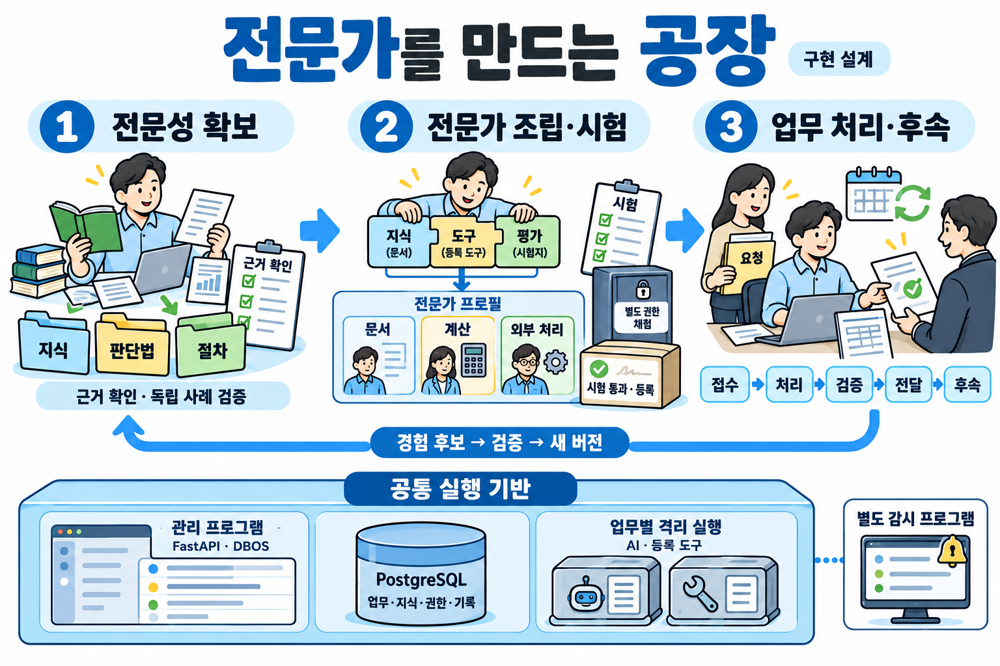
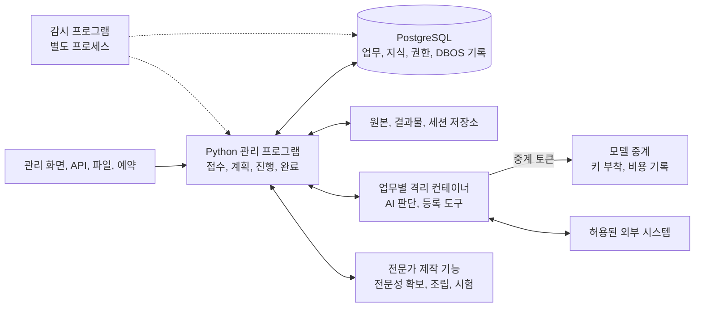

# 공장 구현 설계

**공통 실행 프로그램을 한 번 만들고, 분야별 지식과 판단법, 도구, 평가를 연결해 여러 전문가를 만든다. 만들어진 전문가는 같은 프로그램에서 업무를 접수하고 처리하고 검증하고 전달하며, 이후의 변화까지 관리한다.**



전문가가 갖춰야 할 구성 요소를 재료라 부르며, 재료마다 번호가 붙어 있다. 이 문서는 모든 재료를 공통 실행 프로그램의 어느 부분에 넣고, 어떤 자료를 주고받고, 어떤 순서로 개발할지 정한다.

## 완성할 것

| 만들 것 | 사용자가 하는 일 | 프로그램이 내놓는 것 |
|---|---|---|
| 공통 업무 실행 프로그램 | 전문가를 골라 업무와 자료를 맡긴다 | 검증한 결과물, 실제 처리 결과, 남은 의무와 후속 일정 |
| 전문성 확보 기능 | 분야 이름과 전문가의 자료, 결과물, 작업 기록을 준다 | 원문에 연결된 지식, 조건별 판단법, 실무서와 실행 절차 |
| 전문가 제작 기능 | 맡길 업무 범위와 쓸 전문성, 도구를 지정한다 | 시험을 통과한 전문가 구성과 지원 업무 목록 |
| 관리 화면 | 진행 상황과 결과를 보고 필요한 결정에 답한다 | 진행, 대기, 문제, 승인, 결과를 같은 업무 번호로 확인하고 조치하는 화면 |

새 회계 전문가를 추가한다고 하자. 접수, 실행 복구, 파일 저장, 승인, 납품 기능은 다시 만들지 않는다. 회계 지식과 계산법, 업무 절차, 도구 연결, 평가 사례를 더한다. 새 도구가 필요하면 공통 도구 규격에 맞춘 도구 컨테이너만 더한다. 전문가 구성과 도구 등록은 실행 중에 읽는 자료라서, 전문가를 더해도 관리 프로그램을 다시 배포하지 않는다.

가장 중요한 운영 목표는 맡은 내용과 필수 검증을 끝까지 해내는 것이다. 내부 비용, 시간, 토큰 예상치를 넘으면 자원을 다시 배정하거나 일을 나누고, 순서대로 처리하거나 이어서 한다. 내용을 몰래 줄이거나 시도 횟수가 찼다는 이유로 끝내지 않는다.

돈과 권한은 미리 정한 한도 안에서만 쓴다. 공장 전체의 하루 지출 상한은 운영자가 정하고, 정하기 전에는 고객 업무를 받지 않는다. 남은 일까지 하면 맡긴 사람이 정한 비용 한도를 넘을 것으로 계산되면, 다음 유료 호출 전에 멈추고 한도를 늘릴지 묻는다. 권한, 보안, 법적 의무, 지출 한도 때문에 실제로 막히면 그 행동만 보류한다. 이때 확보한 결과와 해결 담당, 다음 행동은 남기고, 독립적으로 할 수 있는 일은 계속한다.

## 프로그램 배치

처음에는 PC 한 대에서 관리 프로그램 하나, 감시 프로그램 하나, PostgreSQL 하나를 운영한다. 관리 프로그램은 FastAPI와 DBOS를 함께 쓰는 Python 애플리케이션이다. AI 판단, 문서 변환, 계산, 브라우저 작업은 업무마다 띄우는 격리 컨테이너에서 하고 결과를 관리 프로그램에 돌려준다.



| 실행 단위 | 담당 | 저장과 권한 |
|---|---|---|
| 관리 프로그램 | 요청 접수, 업무 상태 변경 요청, 실행 허가, DBOS 작업 등록, 결과 확정, 모델 중계 | 상태와 이력 테이블을 직접 고치지 않는다. 필요한 권한만 가진 DB 상태 변경 함수만 호출하고, 이 함수가 현재 상태, 권한, 필수 항목, 검사 증거와 승인을 확인한다. API 키는 관리 프로그램의 보호된 저장소에만 둔다 |
| PostgreSQL | 업무의 현재 상태와 이력, 지식과 검색, 검사 증거, DBOS 실행 기록 | 업무 자료와 DBOS 기록은 같은 데이터베이스의 서로 다른 스키마에 둔다. 업무, 지식, 기억 테이블에는 행 단위 고객 구분 규칙을 건다. 어느 고객의 요청인지는 트랜잭션 안에서만 유지되는 값으로 정하고, 정해지지 않으면 빈 결과가 나온다 |
| AI 실행 환경 | 요청 해석, 전략, 의미 판단, 작업 제안, 독립 검토 | 업무마다 새로 띄우는 Podman 컨테이너에서 SDK를 돌린다. 그 업무의 작업 폴더와 자료만 보고, 통신은 모델 중계와 허용한 주소로만 나간다. API 키 대신 그 세션에서만 통하는 중계 토큰을 받는다. 받은 저장소의 지시와 자동 실행 훅은 설정으로 불러오지 않는다 |
| 도구 실행 환경 | 등록한 계산, 변환, 제작 함수와 연결 도구 실행 | 분야 도구는 도구별 컨테이너 이미지로 만들고, 이미지 지문과 입출력 자료형으로 등록한다. 입력은 읽기 전용이고 출력은 지정한 위치에 기록한다. 외부 행동은 관리 프로그램의 허가를 거친다 |
| 파일 저장소 | 원본, 가공 파일, 결과물, 세션과 복구 자료, 모델 응답 원문 | 파일 내용 지문과 DB의 버전, 접근 범위를 연결한다. 큰 원문과 모델 응답 원문은 DBOS 단계 결과에 넣지 않고 지문만 넣는다. 고객 자료는 업무 건별 키로 암호화한다 |
| 감시 프로그램 | 프로세스, DB, 백업, 디스크, 메모리, 대기 기한 감시와 운영자 알림, 지정 폴더의 변경 감시 | 관리 프로그램과 별도 프로세스로 두고 OS 서비스로 등록한다. 관리 프로그램이 멈춰도 감시는 계속 돈다 |
| 운영 기능 | 시작, 백업, 복원, 업데이트 | 업무 실행 계정과 관리 권한을 나눈다. 지원 범위는 실제 복원 시험으로 확인한다 |

DBOS를 실행하는 관리 프로세스는 처음에 하나만 둔다. 여러 프로세스에서 올바르게 복구하려면 DBOS의 Conductor가 필요하므로, 초기 구조에서 여러 실행 서버를 이미 지원한다고 표시하지 않는다.

동시 실행은 업무 2건, 대형 보조 모델 1개로 시작한다. 주 대화, 분담, 계획 제안, 독립 검토를 포함한 모든 AI 실행은 DBOS 공통 대기열 하나를 거치고 `global_concurrency=2`로 묶는다. 업무 조정, 이벤트 접수, 재개 작업은 모델과 도구 컨테이너를 직접 부르지 않으므로 이 자리를 차지하지 않는다. AI 세션 안에서 부르는 도구는 그 세션의 자리 안에서 실행해, 자리끼리 서로 기다리다 멈추지 않게 한다. 기한이 가까운 고객 업무를 먼저 돌리고, 변경 재검사와 전문가 제작 시험은 고객 업무 뒤로 보낸다. 모델을 불러오기 전에 메모리와 디스크를 확인하고, 작업용 메모리의 80%를 쓰고 있으면 새 작업은 기다린다.

고객 업무를 처리하는 주 모델은 API 키로 인증한다. Anthropic은 별도 승인 없이 Agent SDK로 만든 제품에 claude.ai 로그인을 쓰지 못하게 한다. 모델 중계가 키를 붙여 보내고 호출마다 비용을 기록하므로, 고객 문서에 숨은 지시가 컨테이너 안에서 키를 꺼내 갈 수 없다.

외부 서비스의 처리 결과는 접수 창구로 알림을 받는다. 운영 PC가 밖에서 들어오는 연결을 받을 수 없으면 제공사의 조회 API로 확인한다. 관리 화면과 API는 인터넷에 그대로 열지 않는다.

Linux에서는 rootless Podman을 쓰고, Windows와 macOS에서는 Podman Machine의 Linux VM을 쓴다. OS별 설치와 파일 공유, 네트워크, 장치 접근을 실제로 시험한 조합만 지원한다. 운영 PC가 쓰는 OS를 먼저 완성하고 나머지 OS는 제품 운영 단계에서 더한다. GPU는 따로 검증하는 항목이며 기본 업무 처리의 필수 전제로 두지 않는다.

## 재료를 넣을 코드

각 코드 모듈은 관리 프로그램 안의 모듈이며 별도 서버가 아니다. 예외는 둘이다. 운영 감시와 폴더 변경 감시는 별도 감시 프로그램에서 돌고, 업무 능력 시험의 채점은 작업 계정과 AI가 읽거나 고칠 수 없는 별도 권한의 검사 프로그램이 한다. 한 재료의 검사와 저장 기능은 다른 모듈에서도 불러 쓴다.

| 코드 모듈 | 재료 번호 | 직접 만들 기능 | 다음에 넘기는 결과 |
|---|---|---|---|
| `platform/` | 4, 5, 6, 9, 10 | 시작 신호 접수, 실행 공간, 실시간 연결, 운영 감시와 복구, 시험 환경 | 인증한 입력 이벤트, 사용할 수 있는 실행 환경 |
| `workflow/` | 2, 8, 25, 43, 45, 46 | DBOS 작업, 계획의 의존 관계, 분담, 대기와 재개, 상태 변경. 여러 분야가 필요한 건은 총괄이 쟁점과 자료를 나눠 주고 해석 충돌과 분야 간 영향을 확인해 합친다. 일정과 예산을 함께 쓰는 여러 건은 전체 총괄이 의존 관계와 공통 한도를 관리한다 | 실행할 작업, 보존한 진행 상태, 다음 실행 시각 |
| `knowledge/` | 11–19, 21–24, 26 | 원문 등록과 읽기, 근거의 신뢰성 판정, 대상과 관계의 기준표와 그 검사, 기간이 붙은 관계 저장, 낱말과 의미를 함께 쓰는 검색, 참조를 따라가는 검색, 못 찾음과 없음 구분, 현재 값 확인, 법령과 판례 원문 저장소의 날마다 변경 받기, 지식, 경험, 기억 관리, 변경 영향 추적 | 접근할 수 있는 근거 묶음, 지식 버전, 다시 검토할 대상 |
| `agent/` | 1, 3, 38–41, 44 | SDK 호출, 업무 맥락 구성, 요청 해석, 완료 조건, 전략, 상황 판단, 표현 방식과 스타일 적용, 먼저 알아챈 일의 알림 | 구조화한 판단, 계획 또는 도구 실행 요청 |
| `policy/` | 27–37 | 적용 규칙, Cedar 권한, 승인 조건, 안전 검사, 자원 예약과 정산, 같은 판단이 적용되는 건의 피해 합산, 되돌릴 수 있는지 분류, 값의 출처 표시 | 실행 가능 여부, 필요한 조건, 예약 번호 |
| `tools/` | 7, 47–54, 66–68 | 도구 등록과 연결, 분류, 결합, 변환, 계산, 분석, 기준 적용과 판정, 예측, 최적화, 측정, 실험, 시뮬레이션, 구조가 다른 판독 모델 두 개의 대조, 조문별 계산 코드 | 처리 결과와 근거, 실행 자원, 검사할 수 있는 출력 |
| `artifacts/` | 20, 55–57, 63, 64 | 자산 활용, 결과물의 설계, 요약과 번역 같은 내용 재구성, 제작, 수정, 포장, 게시 준비, 공개 결과 확인 | 고정한 파일 버전, 배포 묶음, 공개 상태 |
| `people/` | 42, 58, 59, 65 | 질문, 인계, 넘길 곳 고르기, 위급 안내, 연락, 협상, 인수와 검수, 남은 약속 | 응답, 합의, 인수 증거, 후속 작업 |
| `actions/` | 60–62 | 기록 수정, 거래와 신청, 프로그램 설정 변경과 장비 작동을 실행하고 조회하고 취소하는 연결 | 외부 접수 번호, 실제 반영 상태, 확인되지 않은 거래 |
| `review/` | 69–78 | 감사 기록, 제출자 확인, 독립 검증, 반증, 위험, 과정, 품질, 성과, 능력 평가, 원인 확인, 출력 검사, 표본 검사, 평가 쏠림 검사 | 통과 증거, 수정 요구, 원인과 개선 후보 |
| `factory/` | 79 | 전문가 구성 조립, 버전 고정, 배포물 생성, 설치 묶음 서명과 검증, 교체, 되돌리기, 도구와 모델 교체 후보 비교 | 검증한 전문가 배포물과 변경 영향 목록 |

`knowledge/`는 전문성 확보 기능의 결과를 받고, `factory/`는 그 지식과 실무서, 도구, 평가를 전문가 구성에 연결한다. 직무마다 새 모델이나 검색 DB를 추가하지 않는다. 시험 프로그램에는 운영 배포 권한을 주지 않는다.

외부 상태를 바꾸는 연락과 게시, 납품도 `people/`나 `artifacts/`에서 직접 실행하지 않는다. 실행 요청은 모두 `tools/dispatch.py`를 거치고, 실제 상태를 확인하는 공통 절차는 `actions/`에서 가져다 쓴다.

## 주고받는 자료

함수, API, MCP가 같은 Pydantic 자료형을 쓴다. 모델이 쓴 자연어를 그대로 DB 상태 변경이나 외부 명령으로 쓰지 않는다. 업무 번호와 버전, 근거, 실제 결과를 다음 단계까지 이어 간다.

| 공통 자료형 | 반드시 포함할 내용 | 작성하고 확정하는 곳 |
|---|---|---|
| `ExpertRelease` | 전문가와 버전, 업무 범위, 지식과 절차와 도구의 버전, 필요한 권한, 시험 결과, 시험으로 확인한 범위(업무 종류, 자료 언어, 적용 법, 자료 양과 작업 길이, 대상 집단), 지원 환경 | `factory/`가 검증한 뒤 등록 |
| `CaseInput` | 고객, 업무, 요청 번호, 인증한 요청자, 맡긴 사람이 확인한 업무 종류, 목표와 범위, 입력 파일 버전, 기한, 비용 한도, 감수할 위험, 미리 허락한 행동과 한도, 위급 담당자와 응답 시간, 기존 위임 | `platform/`과 `workflow/` |
| `ContextSnapshot` | 대상, 현재 상태, 계획, 판단 기준일, 근거와 규칙의 버전, 권한, 적용 조건, 전제, 값마다 조회 시각, 찾아본 곳과 못 찾은 곳, 확인되지 않은 조건 | `knowledge/`가 조회하면 `agent/`가 구성 |
| `TaskPlan` | 목표와 완료 조건, 작업별 입력과 출력, 선행 작업, 쓸 등록 함수, 필요한 승인, 검사 방법 | AI가 제안하고 `workflow/`가 전체 계획을 검사 |
| `Judgment` | 쟁점, 조건마다 충족, 불충족, 미확인, 해당 없음과 그 이유, 기댄 원문 위치, 문장마다 확인, 추정, 미확인 표시, 반대 근거와 결론을 바꾸지 않는 이유, 비교한 방안(현상 유지와 더 확인한 뒤 결정 포함)과 고른 이유, 결론이 성립할 조건, 다시 검토할 조건, 사용 기한, 법적 절차와 기한 | `agent/`가 작성하고 `review/`가 검사 |
| `ToolRequest` | 업무 행동 번호, 도구와 버전, 대상과 값, 값마다 나온 자료, 입력 지문, 권한과 승인과 상태 버전, 되돌릴 수 있는지, 담당 실행 번호 | `tools/`가 검증하고 실행 전에 저장 |
| `ToolReceipt` | 요청 번호, 상태, 실제 결과, 확인 시각과 증거. 상태는 전송됨, 외부 접수, 처리 중, 완료, 부분 성공, 실패, 취소됨, 미확인 중 하나다. 이 밖의 결과는 미확인으로 본다 | 연결 도구와 `actions/` |
| `CheckResult` | 검사 대상과 버전, 조건, 방법과 검사자, 결과, 증거 위치, 유효 조건 | 검사 코드와 독립 검토의 결과를 `review/`가 기록 |

이름과 형식은 공통으로 두고, 분야별 계산 입력과 결과물 규격은 등록한 확장 자료형으로 더한다. 임의의 자유 필드로 필수 검사를 피하지 못하도록, 관리 프로그램은 허용한 필드와 엄격한 자료형, 근거와 버전 참조를 검사한다.

| 저장 내용 | 테이블 | 갱신하는 곳 |
|---|---|---|
| 업무, 계획, 작업, 현재 상태 | `cases`, `case_events`, `subtasks`, `requirements`, `work_scopes` | DB 상태 변경 함수 |
| 원문, 파일, 근거, 변경 영향 | `source_versions`, `artifacts`, `evidence_links`, `artifact_dependencies` | 자료 등록과 결과 확정 함수 |
| 지식과 장기 기억 | `knowledge_items`, `memories` | `knowledge/` |
| 권한, 승인, 자원 | `delegations`, `approvals`, `expert_reviews`, `budget_reservations`, `budget_usage` | 인증한 관리 기능과 `policy/` |
| 관계자와 이해 충돌, 넘길 곳 | `parties`, `conflict_checks`, `handoff_routes` | 관리 기능과 `people/` |
| 외부 행동, 응답, 후속 일정 | `action_intents`, `action_receipts`, `inbox`, `outbox`, `timers`, `commitments`, `deliveries` | 공통 실행, 접수, 대기 기능 |
| 검사, 성과, 배포, 앞선 결론 | `checks`, `evaluations`, `outcomes`, `releases`, `capabilities`, `decision_traces` | 검사, 평가, 배포 기능 |
| 알림 사건 | `incidents`, `incident_versions` | `agent/`와 `people/` |

`approvals`는 실행 승인이고 `expert_reviews`는 전문 판단 검토다. 전문 판단 검토는 결론을 바꿀 권한이 있는 사람이 근거를 직접 보고 판단한 기록이 있을 때만 센다. `decision_traces`에는 쟁점, 기준 버전, 기준표 항목으로 옮긴 사실, 조건별 충족, 결론만 넣고 고객을 알아볼 값은 넣지 않는다.

업무마다 실행 종료, 목표 달성, 검증, 후속 성과를 별도 상태로 관리한다. 실행 상태는 진행, 대기, 완료, 실패, 보류, 취소, 복구 필요로 나눈다. DBOS 단계가 끝났거나 AI가 답을 마쳤다고 해서 업무를 완료로 바꾸지 않는다. 과거 완료 때의 증거와 지금의 유효성도 구분한다.

업무 상태 변경과 다음 작업 등록은 같은 PostgreSQL 트랜잭션에서 한다. 같은 SQLAlchemy 연결로 상태 변경 함수와 요청 기록을 처리하고 `DBOSClient.enqueue_in_transaction`을 부른 뒤 함께 확정한다. 그래서 상태만 바뀌고 작업은 등록되지 않거나, 작업만 등록되는 일이 없다. 확정되기 전에는 성공 응답을 보내지 않고 작업 결과를 기다리지도 않는다.

파일 저장과 외부 API 호출은 DB 트랜잭션으로 한꺼번에 되돌릴 수 없다. 파일은 임시 저장, 내용 검사, 고정한 파일 등록, DB 참조 확정 순서로 처리한다. 외부 행동은 사전 요청 기록, 실행, 실제 결과 대조 순서로 처리한다. 중간에 장애가 나면 등록 상태와 원래 시스템을 대조해 복구한다.

`case_events`와 실행 기록은 덧붙이기만 허용하고, AI에는 쓰기와 지우기 권한을 주지 않는다. 단계마다 모델에 넣은 입력 전체와 응답은 업무 건별 키로 암호화해 파일 저장소에 둔다. 기록이 남지 않는 실행은 하지 않는다.

## 전문가를 만드는 과정

전문가 제작도 공통 실행 프로그램의 업무 절차 하나다. 별도의 자율 실행 서버를 만들지 않고 같은 계획, 도구, 기록, 검사 기능을 쓴다.

| 단계 | 프로그램이 하는 일 | 남길 것 |
|---|---|---|
| 업무 범위 정의 | 직종 이름을 실제로 맡길 과업, 입력, 결과물, 품질 기준으로 나눈다 | `work_scopes`, 능력 목록, 평가 계획 |
| 전문성 확보 | 분야만 주어지면 자료를 찾고, 자료가 있으면 형식에 맞게 분석하고 비교하고 실험한다 | 원문 위치가 연결된 지식 후보와 적용 조건, 예외 |
| 실무 지식 검증 | 기록으로 남은 것과 기억에 의존한 것을 나누고, 요령을 독립 사례로 시험한다 | 검증 상태가 붙은 지식, 실무서, 절차, 실패와 복구 사례 |
| 전문가 조립 | 필요한 공통 기능, 분야 지식, 등록 도구, 지시, 절차, 검사를 연결한다 | 버전을 고정한 전문가 구성, 빠진 기능 목록 |
| 업무 시험 | 실제 입력에서 납품까지 해 보고 장애, 변경, 복구, 전문 품질을 검사한다. 채점은 별도 권한의 검사 프로그램이 한다 | 시험 증거, 쓸 수 있는 업무와 환경 범위 |
| 등록과 배포 | 통과한 구성과 검사 증거를 묶어 운영 전환 승인을 받은 뒤 서명하고 설치 목록에 등록한다 | `ExpertRelease`, 설치와 업데이트 자료 |
| 운영 경험 반영 | 새 오류와 성공 방법을 원문과 실제 기록으로 검토하고 다시 시험한다 | 새 지식과 절차 후보, 검증한 다음 버전 |

지식 하나에는 `knowledge_id`, 원문과 위치와 버전, 적용 분야와 조건과 기간, 판단 단서, 절차와 예외, 확인 방법, 검증 상태를 연결한다. 경험에서 뽑은 요령은 가설로 등록하고, 검증한 뒤에 업무 지침으로 쓴다. 기억마다 어느 고객의 어느 건에서 나왔는지 표시하고, 다른 고객의 업무에는 익힌 방법과 원문으로 다시 확인한 공개 사실만 들인다.

단순 검색 결과만으로 전문가가 완성됐다고 보지 않는다. 기존 획득 기능은 `전문성 역설계` 프로젝트의 엔진이다. 이 엔진은 자체 PostgreSQL을 따로 띄우므로, 공장 PostgreSQL 안의 별도 스키마를 쓰도록 바꿔 연결한다. 지식 버전과 근거 연결을 한 DB에서 조회하고 백업도 하나로 하기 위해서다. 연결 시험을 통과하기 전에는 동작하는 부품으로 계산하지 않고, 실제로 없는 부분만 새로 만든다.

전문가 구성으로 만들 파일은 지식 원본을 따로 두고 ID와 버전으로 가리킨다.

```text
experts/<expert-id>/
├── profile.yaml           # 업무 범위, 필요한 분야와 기능, 기본 지시 참조
├── playbook.yaml          # 업무 종류마다 결과물 항목과 합격 기준, 조사할 곳과 깊이, 기본값, 감수할 위험의 기본값, 값 재조회 기간, 피해 금액 재는 법, 한 사람이 볼 양
├── workflows/             # 업무별 YAML 절차와 완료 조건
├── tools.yaml             # 등록 도구 ID, 이미지 지문, 입출력, 필요 권한
├── knowledge.lock         # 적용 지식, 규칙, 실무서의 정확한 버전
├── evaluation.yaml        # 평가 항목과 별도 시험 자료의 참조
└── release.json           # 파일 지문, 실행 코드 버전, 시험과 지원 범위
```

비밀번호, 고객의 원문과 기억과 대화, 진행 중인 업무 상태, 보호된 시험 정답은 이 묶음에 넣지 않는다. 필요한 권한을 선언하는 것과 고객이 실제로 권한을 주는 것은 다르다. 사용자의 업무를 받을 때 인증한 고객, 계정, 위임을 따로 연결한다.

## 업무 한 건을 처리하는 과정

첫 연결 시험은 문서와 거래 표를 받아 대조하고 계산해, 근거가 연결된 보고서를 만들어 시험용 제출처에 전달하는 업무로 한다. 공통 연결만 확인하는 시험이다.

| 순서 | 실제 실행 | 저장하고 확인할 것 |
|---|---|---|
| 0. 긴급 대응 | 생명이나 몸의 위험을 말하는 입력이 오면 어느 단계에서든 출력 검사와 승인을 기다리지 않고 미리 허락된 도움 연락처를 알리고 위급 담당자에게 알린다. 정한 시간 안에 답이 없으면 미리 허락된 곳에 위치와 위험 내용만 보낸다. 피해나 장애가 진행 중이면 미리 승인된 긴급 조치만 실행하고, 그런 조치가 없으면 긴급 승인을 요청한다 | 조치 내용, 알린 곳, 피해가 멈췄는지 |
| 1. 접수 | `accept_case()`가 인증과 중복 요청을 검사하고 새 건인지 기존 건인지 가린다. 기존 건이면 현재 상태와 바뀐 목표, 사실, 규칙, 당사자를 확인한다 | 업무 번호, 전체 대상 목록, 입력 버전, DBOS 작업 번호 |
| 2. 맡을지 확인 | `check_intake()`가 요청자 권한과 당사자 동의를 확인한다. 고객 자료와 따로 둔 관계자 목록으로 이해 충돌을 조회한다. 업무 종류, 자료 언어, 적용 법, 자료 양, 대상 집단을 `ExpertRelease`의 시험 범위와 맞춘다. 자격자만 낼 수 있는 결과물은 고객이 맡긴 자격자가 기록에 있는지 본다 | 접수, 조건 보완 요청, 거절, 넘김 중 하나와 그 이유 |
| 3. 맡은 일 확정 | `build_context()`와 `interpret_request()`가 목표, 조건, 확인되지 않은 것을 나눈다 | 원래 요청, 완료 조건, 중요한 질문, 가정과 영향 범위 |
| 4. 자료 관문과 확인 | `gate_sources()`가 화면에 보이는 모습과 뽑은 글을 비교해 숨긴 글을 빼고, 검색과 실행 도구가 없는 별도 세션이 자료 속에서 AI에게 내리는 지시를 찾아 뺀다. 핵심 자료는 원문까지 확인해 사실, 주장, 추정을 나누고 출처, 시점, 판본을 확인한다 | 뺀 자리 표시, 원본과 판단용 자료의 지문, 확인되지 않은 사실과 확인 방법 |
| 5. 작업 계획 | `propose_plan()`이 방법과 작업을 정하고 `validate_plan()`이 연결을 검사한다 | YAML, 함수, 계획 버전, 선행 관계, 승인과 검사 위치 |
| 6. 자료 처리와 판단 | 등록한 읽기, 검색, 결합, 계산 함수를 실행하고 `Judgment`를 만든다. 새 판단은 먼저 기록한 뒤 `decision_traces`의 앞선 결론과 대조하고, 어긋나면 원문과 계산으로 다시 판단한다 | 원문 위치, 짝이 없는 항목과 짝이 여럿인 항목, 계산 입력과 결과, 독립 검산 |
| 7. 결과물 제작 | `produce_artifact()`가 보고서와 편집 원본을 만든다. 맨 앞에는 그대로 써도 되는 결론과 쓰기 전에 확인할 것을 둔다. 결과물과 따로, 쓴 기준과 기본값, 건너뛴 확인, 찾지 못한 곳을 담은 검토표를 맡긴 사람에게 준다 | 원문과 계산에 연결된 결과물 버전, 납품 목록, 검토표 |
| 8. 검사와 수정 | `verify_artifact()`가 출력 검사와 독립 검토를 한다 | 항목별 증거, 수정 요구, 수정 뒤 영향받는 재검사 |
| 9. 전달과 확인 | 필수 결과 파일이 별도 저장소에 백업됐는지 확인한 뒤, `dispatch_action()`이 실행 직전에 승인 내용과 실제 대상, 값을 대조하고 유효한 권한으로 보낸다. `reconcile_action()`이 실제 상태를 확인한다 | 고유한 업무 행동 번호, 외부 접수, 반영, 인수, 검수 증거, 받은 곳과 날짜 |
| 10. 완료와 후속 | `finalize_case()`가 필수 작업과 현재 유효한 증거를 모두 확인하고 후속 일정을 등록한다. 완료 조건을 다 채우지 못했으면 완료한 부분, 남은 일, 못 끝낸 이유를 나눠 전달한다 | 전체 완료나 부분 완료, 남은 약속, 성과 확인 일정 |
| 11. 기록과 갱신 | `record_case()`가 사례, 실패 원인, 판단 과정, 실제 성과를 남기고 지식, 규칙, 절차, 기억 후보를 갱신한다. 바뀐 규칙을 쓴 과거 결과는 재검토 대상에 올린다 | 사례 기록, 갱신 후보, 재검토 대상 |

주 모델은 Python Claude Agent SDK를 통해 호출하고, 업무, 실행, 대화의 세션 번호를 연결한다. SDK 호출 한 번이 DBOS 단계 하나다. 긴 세션은 세션 번호를 저장해 다음 단계에서 이어 가고, 세션 기록은 파일 저장소에 옮겨 컨테이너가 없어져도 이어 갈 수 있게 한다. SDK의 하위 에이전트 직접 실행은 막는다.

DBOS의 한 단계는 모델 호출 한 번, 자료 조회 한 번, 계산이나 파일 제작 한 번처럼 결과를 보존할 수 있는 단위로 나눈다. 모델 응답, 현재 시각, 난수, 외부 조회는 기록해 두었다가 복구할 때 그 결과를 다시 쓴다. 모델 응답을 기다리는 동안 DB 잠금을 오래 잡지 않는다.

AI 세션에는 읽기, 검색, 계산처럼 다시 실행해도 바깥이 바뀌지 않는 도구만 준다. 연락, 게시, 납품, 거래처럼 바깥을 바꾸는 행동은 AI가 `ToolRequest`로 제안만 한다. 세션이 끝난 뒤 별도 DBOS 단계에서 `dispatch_action()`이 권한, 버전, 입력을 검사하고 실행한다. 단계를 다시 실행해도 같은 행동이 두 번 나가지 않도록, 업무 행동 번호는 DBOS 작업 번호와 단계 순번으로 만든다. 통신이 끊기면 실제로 처리됐는지 먼저 확인하고, 결과가 분명하지 않은 변경은 다시 실행하지 않는다. 받는 쪽이 요청 번호를 지원하지 않거나 보관 기간이 지났는데 원본 조회로도 결과를 확인하지 못하면, 업무를 멈추고 맡긴 사람에게 넘긴다. 실행 직전에 다시 조회하는 것만으로 다른 변경과의 충돌을 막았다고 보지 않는다. 원래 시스템의 조건부 변경 기능, 곧 읽은 뒤 값이 바뀌지 않았을 때만 반영하는 기능을 쓴다.

업무는 이 순서를 한 번 지나고 끝나는 고정 흐름이 아니다. 답변, 변경, 오류가 오면 그 자리에서 이어 간다.

| 발생한 일 | 이어 가는 방법 |
|---|---|
| 중요한 질문에 답이 아직 없음 | 그 답에 기대는 작업만 기다린다. 답이 오면 현재 계획과 권한을 확인하고 바로 다시 시작한다 |
| 사람의 결정이 필요함 | 조사, 계산, 작성, 대안 비교, 검증을 먼저 끝낸다. 그다음 `handoff_routes`에서 권한이 있고 이해 충돌이 없는 결정권자를 골라 요청한다. 받았다는 답이 없거나 기한이 지나면 무응답을 승인으로 보지 않고 정해 둔 다음 담당자에게 넘긴다. 반려나 보류면 사유와 남은 일을 기록한다 |
| 원문, 규칙, 승인이 바뀜 | 의존 관계로 영향받는 판단, 검사, 행동을 찾는다. 결론이 틀렸으면 그에 기대는 다음 행동을 멈추고, 바로잡을 방법과 함께 맡긴 사람과 다음 작업에 알린다. 이미 끝낸 행동은 두고 정정이나 취소가 가능한지 확인한다 |
| 취소나 권한, 승인 철회 | 새 실행, 예약, 자동 재시도를 막는다. 이미 시작한 외부 행동은 실제 취소와 처리 상태를 확인하고, 확인하지 못하면 복구 필요로 남긴다. 한 건의 중단인지 상시 업무 전체의 종료인지 가려 예약과 구독에도 적용한다 |
| 받는 사람이 수정을 요청함 | 기존 범위 안이면 수정하고 다시 검증한다. 범위 밖이면 새 목표, 범위, 완료 조건으로 다시 접수한다 |
| 내부 예상 자원을 넘었거나 같은 오류가 반복됨 | 남은 내용은 그대로 두고 배정, 분할, 방법, 실행 환경을 바꾼다. 방법을 바꿔도 풀리지 않으면 현재 상태, 실패 원인, 대안을 붙여 복구 담당에게 넘기고 다음 확인 시각을 등록한다. 그 항목은 빼지 않고, 독립된 다른 항목은 계속한다 |
| 인증 실패나 권한 부족 | 자동 재시도를 멈추고 해결된 뒤 재개한다 |
| 제공사 호출 한도 소진 | 회복 시각에 재개하도록 등록한다. 새 유료 서비스나 계정으로 임의로 바꾸지 않는다 |
| 서버 재시작 | DBOS 기록, 업무 상태, 파일과 세션, 외부 행동 기록을 대조해 유효한 지점부터 다시 시작한다 |
| 병렬 작업 일부 실패 | 성공한 결과는 두고 독립 작업은 계속한다. 실패한 결과에 기대는 작업만 다시 배정한다 |

기다리는 업무는 DBOS 작업으로 붙잡아 두지 않는다. 답변, 기한, 성과 확인을 기다리는 업무는 `timers`와 `inbox`에 상태를 남기고 작업을 끝낸다. 1분마다 도는 예약 작업이 만기와 새 답변을 찾아 짧은 재개 작업을 등록한다. 그래서 몇 달씩 기다리는 업무가 실행 자리를 차지하지 않고, 업데이트 때 옛 코드의 작업이 남아 멈추지도 않는다.

## 판단을 믿을 수 있게 하는 장치

AI가 그럴듯하게 틀리는 것을 AI의 성실함에 맡기지 않는다. 아래 장치는 관리 프로그램이 강제하고, AI가 끄거나 건너뛸 수 없다.

| 장치 | 하는 일 | 자리 |
|---|---|---|
| 맡을지 확인 | 시험으로 확인한 범위 밖의 일, 이해 충돌이 풀리지 않은 일, 맡은 자격자가 없는 자격자 전용 일은 시작하지 않고 넘긴다. 업무 종류, 미리 허락할 행동과 한도, 위급 담당자는 기본값으로 정하지 않고 확인받기 전에는 그에 기대는 일을 하지 않는다 | 처리 2단계, `check_intake()` |
| 자료 관문 | 숨긴 글과 자료 속 지시를 빼고 원본을 보관한다. 값마다 어느 자료에서 왔는지 표시하고, 받는 사람과 보낼 곳은 원본 시스템에서 온 값일 때만 허락한다 | 처리 4단계, `policy/` |
| 고객 구분 | 행 단위 고객 구분 규칙으로 다른 고객의 자료가 섞이지 않게 한다. AI가 쓰는 프로그램은 관리자 계정이나 규칙을 건너뛰는 계정으로 접속하지 않는다. 계정을 건마다 나눌 수 없는 외부 시스템은 그 계정의 실행을 한 번에 한 건만 한다 | PostgreSQL, `actions/` |
| 값의 신선도 | 업무 종류마다 정한 기간이 지난 값은 쓰기 전에 원본에서 다시 조회하고, 되돌릴 수 없는 행동 직전에는 한 번 더 조회한다 | `ContextSnapshot`, `knowledge/` |
| 단계 대조 | 단계가 바뀔 때마다 대상, 기준일, 권한, 전제를 다시 넣고 지금 하는 일이 맞는지 대조한다. 칸이 비면 다음 단계로 넘기지 않는다 | `workflow/` |
| 판단 기록 | 조건마다 충족 여부와 원문 위치, 문장마다 확인 정도를 남긴다. 근거가 없는 문장은 미확인으로 바꾼다. "없다"는 정해 둔 곳을 다 조회했을 때만 쓴다 | `Judgment`, `agent/` |
| 독립 검토 | 합격 판정은 답을 만든 세션과 따로 연 세션이 합격 기준, 결과물, 이번 업무 자료만 받아 항목마다 예나 아니오로 판정한다. 틀렸을 때 피해가 감수할 위험을 넘을 수 있는 판단은, 기존 답을 주지 않은 별도 세션이 질문 말투와 자료 순서를 바꿔 처음부터 다시 판단한다. 근거가 충돌하면 서로의 결론을 보지 않은 답변 셋을 비교하고, 다수결로 정하지 않고 원문과 계산을 다시 확인한다. 검토에 줄 자료는 AI가 고르지 않고 관리 프로그램이 이번 업무에서 찾은 자료 전체로 만든다. 판정에 적은 원문 위치는 코드가 글자로 대조한 것만 통과로 센다 | `review/` |
| 출력 검사 | AI는 인용할 원문 위치만 가리키고 원문 글자는 프로그램이 붙인다. 내보내기 전에 받는 사람이 볼 수 없는 자료에서 나온 값, 출처 없이 겹친 문장, 열 때 불러오는 주소, 개인 식별 정보, 정해 둔 인원보다 적은 집단의 통계를 검사한다. 처리 건수는 실행 기록에서 뽑아 "N건 중 M건"으로 붙이고, 기록에 남은 수정, 삭제, 외부 전송이 보고에 모두 들었는지 대조한다 | 처리 8단계, `review/` |
| 합산 위험 | 같은 판단이 적용되는 건을 모두 합쳐 건수와 금액을 프로그램이 계산한다. 금액으로 잴 수 없는 피해는 업무 종류의 기준으로 판정하고, 기준이 없으면 넘는 것으로 본다. 넘는 판단 가운데 사실을 더 얻을 수 없거나 다시 판단해도 갈리는 것은 사실, 갈리는 해석, 선택마다 틀렸을 때의 결과, 권하는 쪽을 정리해 맡긴 사람에게 넘긴다 | `policy/` |
| 되돌릴 수 없는 행동 | 행동마다 실행 전에 복구본이나 취소 기능이 있는지, 법적 효과와 공개, 자금 이동을 실제로 되돌릴 수 있는지 확인한다. 되돌릴 수 없으면 미리 허락된 행동이 아닌 한 넘긴다. 한도는 잘게 나눈 행동과 이미 했거나 진행 중인 행동을 합쳐 따진다 | `policy/`, 질문과 승인 화면 |
| 사람에게 넘기기 | 경우마다 받을 사람이 정해져 있다. 자동 판단 거부, 재검토 요구, 상대 주장을 인정하는 문장은 맡긴 사람에게 넘긴다. 이해 충돌과 계속 맡을지는 운영 책임자에게, 담당자 본인이 문제의 당사자이면 대표나 감사에게 넘긴다. 이해가 맞서는 조직 안 사람이 직접 물으면, 답하기 전에 에이전트가 조직을 위해 일하고 들은 내용이 조직에 전달될 수 있다고 알린다. 업무 종류마다 한 사람이 볼 건수를 정하고, 넘치는 건은 결론을 보류하고 맡긴 사람에게 알린다 | `handoff_routes`, `people/` |
| 평가 쏠림 | 여러 사람을 같은 기준으로 평가한 결과는 전달 전에 모아, 쓰지 않기로 한 특성에 따라 쏠렸는지 계산한다. 쏠렸거나 알 수 없으면 전달하지 않고 맡긴 사람에게 알린다 | `review/` |
| 표본 검사 | 검사할 건과 항목은 결과가 모두 나온 뒤 관리 프로그램이 무작위로 고르고 AI에게 알리지 않는다. 기준이나 시험을 바꿔 얻은 통과는 인정하지 않는다 | `review/` |
| 결과 추적 | 실제 업무에서 결과가 나온 뒤 무작위로 고른 건을 검토해 시험 결과와 비교한다. 결과가 나빠진 집단, 법, 언어, 크기는 `ExpertRelease`의 맡길 범위에서 뺀다 | `review/`, `factory/` |

## 운영과 관리

관리 프로그램과 감시 프로그램은 OS 서비스로 띄워 죽으면 다시 시작하고, 운영 PC의 절전을 끈다. 재시작이 가능한 장애는 해당 부품만 다시 켜고, 30초, 1분, 5분으로 간격을 늘려 세 번 시도해도 회복되지 않으면 자동 반복을 멈추고 운영자에게 알린다. 재부팅만으로 복구되는 경우와 사용자 로그인 뒤에 복구되는 경우는 구분해 표시한다.

감시 프로그램은 1분마다 상태를 점검하고 다음 경우 운영자에게 알린다. 프로세스 재시작, 답이나 승인 대기가 기한의 절반을 넘김, 미확인 외부 행동, 자동 시도 중단, 하루 지출 상한의 80%, 디스크와 메모리 부족, 백업 실패와 지연이다. 정해 둔 시각마다 정상 알림도 보내, 이 알림이 오지 않으면 PC가 꺼진 것으로 알 수 있게 한다.

백업 목표는 DB와 필수 파일의 손실을 장애 직전 5분 이내로, 업무를 안전하게 다시 시작하기까지를 1시간 이내로 줄이는 것이다. PostgreSQL은 하루 한 번 기본 백업을 하고, WAL 변경 기록은 60초마다 나눠 운영 PC 밖의 별도 디스크나 승인된 저장소에 암호화해 보관한다. 파일은 저장을 끝낸 버전을 restic으로 같은 곳에 백업한다. DB 시점이 가리키는 파일이 모두 있을 때만 복구할 수 있는 백업으로 인정한다. 매달 격리된 새 환경에서 실제로 복원해 본다.

복원한 뒤에는 모든 외부 행동을 막은 상태로 시작한다. 복원 시점 이후에 실행됐을 수 있는 외부 행동은 원래 시스템에서 조회해 대조하고, 대조가 끝난 업무부터 외부 행동을 다시 연다. 이후의 권한 철회와 삭제 요청도 복원된 자료에 다시 적용한다.

보관 기간이 지나거나 삭제 요청이 오면 고객 원문, 세션 기록, 중간 파일을 지우고 결과물과 감사 기록만 남긴다. 검색 색인, 요약, 캐시 같은 연결 자료도 함께 지운다. 업무 건별 키를 지우면 백업 속 사본도 읽을 수 없게 된다. 끝난 DBOS 기록은 필요한 내용이 `case_events`에 남은 것을 확인한 뒤 정해 둔 기간이 지나면 지운다. 디스크가 정해 둔 한도에 이르면 새 접수를 멈춘다.

프로그램을 바꿀 때는 지난 업무의 실행 기록에 남은 모델 응답과 도구 결과를 그대로 넣어 새 프로그램을 돌리고, 고치려던 곳 밖의 결과가 그대로인지 먼저 확인한다. 실행 프로세스는 하나라서 옛 버전과 새 버전 프로세스를 함께 띄우지 않는다. 대신 같은 프로그램 안에 옛 절차와 새 절차를 함께 두고, 업무는 접수할 때 정한 절차 버전으로 끝까지 처리한다. DBOS의 `application_version`은 고정하고, 단계 순서를 바꾸는 수정은 `DBOS.patch()`로 넣는다. 새 절차는 운영자가 정한 일부 업무에만 먼저 쓰고 쓰는 업무를 차츰 늘린다. 고치려던 곳 밖에서 결과가 달라지면 새 업무는 바로 옛 절차로 처리하고, 새 절차로 시작한 업무는 멈춘 뒤 고친 절차로 옮기거나 사람에게 넘긴다. 업데이트는 새 등록을 멈추고 실행 중인 단계가 끝나기를 기다린 뒤 재시작한다. DB 구조 변경을 되돌릴 때는 업데이트 뒤에 쌓인 업무 기록과 외부 행동을 따로 보존하고 대조한다.

업데이트 기록은 프로그램, 업무 절차, 전문가 구성, 지식 버전을 따로 남긴다. 코어 프로그램을 바꾸면 모든 전문가를 기록해 둔 모델 응답으로 재생 시험하고, 실제 모델을 부르는 평가는 구성이 바뀐 전문가에만 한다. 그래서 전문가 수가 늘어도 업데이트 시험 비용이 함께 커지지 않는다.

지식이 바뀌어도 업무는 접수할 때의 `ExpertRelease`와 `knowledge.lock`으로 처리하되, 바뀐 지식을 인용한 결과는 재검사한다. 의존 관계는 결과가 실제로 인용한 `knowledge_id`와 버전만 `evidence_links`에 기록한다. 규칙 개정은 효력 시작일을 적고, 판단 기준일이 그 뒤인 업무만 재검사한다. 지식 오류 정정은 그 지식을 인용한 모든 결과를 재검사한다. 재검사는 먼저 코드로 인용 문장과 새 원문을 대조하고, 달라진 경우에만 모델 검토를 고객 업무보다 낮은 순위로 넣는다. 지식 변경은 그 지식을 쓰는 전문가마다 다음 배포 후보를 만들고, 바뀐 지식을 인용한 평가 사례만 다시 시험한다.

## 개발할 폴더와 화면

제품 코드는 설계 문서와 분리한 `expert-factory/` 프로젝트로 만든다. 이미 확보한 구현이 있으면 해당 모듈에 연결하고 같은 기능을 다시 만들지 않는다.

```text
expert-factory/
├── pyproject.toml
├── src/expert_factory/
│   ├── app.py                     # FastAPI와 DBOS 시작, 정상 종료
│   ├── contracts/                 # 공통 입력과 출력 자료형
│   ├── platform/                  # 접수, 인증, 실행 환경, 실시간 연결
│   ├── workflow/                  # 상태 변경, 계획, 작업, 대기, 복구, 총괄
│   ├── knowledge/                 # 등록, 검색, 전문 지식, 기억, 변경 영향
│   ├── agent/                     # SDK 연결, 모델 중계, 맥락, 판단, 계획 제안
│   ├── policy/                    # 규칙, Cedar, 승인, 자원 예약, 합산 위험
│   ├── tools/                     # 도구 등록표, dispatch.py, 연결 코드
│   ├── actions/                   # 외부 요청 기록, 실행, 상태 대조
│   ├── artifacts/                 # 설계, 제작, 파일 확정, 포장, 게시
│   ├── people/                    # 질문, 인계, 넘길 곳, 위급 안내, 인수
│   ├── review/                    # 출력 검사, 감사, 평가, 원인 분석
│   ├── factory/                   # 전문가 조립, 배포, 서명
│   └── web/                       # 관리 화면과 정적 파일
├── watchdog/                      # 별도 프로세스로 도는 감시 프로그램
├── grader/                        # 별도 권한으로 도는 채점 프로그램
├── db/                            # 업무 DB의 변경 이력과 상태 변경 함수
├── tool-images/                   # 분야 도구의 컨테이너 이미지 정의
├── experts/                       # 전문가별 작성 원본
├── tests/                         # 단위, 실제 DB, 전체 흐름, 복구, 기록 재생 시험
├── deploy/                        # 고정 이미지, OS별 실행과 설치 설정
└── operations/                    # 백업, 복원, 업데이트, 이전 절차
```

고객 자료와 모델 파일, DB 볼륨, 보호된 시험 정답은 소스 저장소 밖에 둔다. 업무 DB의 상태를 YAML이나 임시 JSON에 다시 저장해 기준이 둘이 되게 하지 않는다.

첫 관리 화면에는 다음이 들어간다. 첫 화면 맨 위에는 오늘 지출과 하루 상한, 대기 중인 질문과 승인 수, 막힌 업무 수를 둔다.

- **업무 목록과 상세:** 목표, 현재 처리, 대기 이유, 필요한 응답, 결과, 기한을 보여 준다. 업무를 멈추거나 다시 시작하고 우선순위를 바꿀 수 있다.
- **질문과 승인:** 실제로 실행할 대상, 값, 파일 버전, 되돌릴 수 없는 결과와 대안을 보여 주고 인증한 답변과 승인을 기록한다. 실행 승인과 전문 판단 검토를 따로 받는다.
- **전문가 제작과 등록:** 업무 범위, 연결한 지식과 도구, 부족한 기능, 시험 결과, 배포 버전을 보여 주고 운영 전환을 승인한다.
- **운영과 복구:** 실행 오류, 자료 갱신, 백업과 복원, 업데이트 상태, 다시 시작할 업무를 보여 준다. 새 접수를 멈추고, 미확인 외부 행동의 실제 결과를 증거와 함께 확정할 수 있다.

비용, 로그, 부품 버전은 필요한 상세 화면에서 본다. 사용자가 매번 내부 순서나 도구를 골라야 업무가 진행되는 화면은 만들지 않는다.

## 개발 순서

재료를 번호순으로 하나씩 완성한 뒤 합치지 않는다. 업무 한 건이 끝까지 이어지는 구조부터 만들고, 같은 구조에 다른 업무를 붙이며 공통 기능을 완성한다. 첫 업무에 꼭 필요한 보호, 검사, 복구는 해당 기능을 실행하기 전에 함께 구현한다.

| 단계 | 구현할 것 | 직접 확인할 결과 |
|---|---|---|
| 1. 공통 연결 | 프로젝트와 자료형, FastAPI, PostgreSQL과 상태 변경 함수, 고객 구분 규칙, DBOS, 모델 중계와 SDK 연결, 격리 컨테이너, 실행 기록의 쓰기 권한 분리, 감시 프로그램, 위급 안내, 운영과 복구 화면의 오류 목록과 다시 시작, 시험용 도구 | 요청 하나를 저장하고 실행하고 다시 조회한다. 중복 접수나 서버 재시작에도 같은 업무가 유지된다. SDK 세션과 도구 권한이 맞는지, 상태 변경과 작업 등록이 한꺼번에 확정되는지, 다른 고객의 자료가 조회되지 않는지 실제로 시험한다 |
| 2. 한 업무 완주 | 손으로 쓴 시험 전문가 구성, 맡을지 확인, 자료 관문, 문서와 표 등록, 검색과 계산, 목표와 계획, `Judgment`, 보고서 제작, 출력 검사와 독립 검토, 실행 직전 승인 대조, 시험용 제출과 인수, 업무 목록과 질문과 승인 화면 | 문서와 거래 표를 받아 보고서를 전달하는 시험 업무를 접수부터 검수까지 끝낸다. 도중에 오류가 나거나, 답을 기다리거나, 원문이 바뀌거나, 응답이 사라지거나, 비용 한도를 넘거나, 시험 범위 밖의 건이 와도 정해 둔 대로 멈추거나 이어 가거나 넘긴다. 같은 요청이 두 번 처리된 건이 없다 |
| 3. 전문성 공급 | 입력 진단, 기존 획득 엔진을 공장 DB로 연결, 대상 기준표와 기간이 붙은 관계 저장, 법령과 판례 원문 저장소, 근거와 조건과 실무서와 실행 절차의 등록과 갱신 | 확보한 전문 지식이 실제 업무에 주어지고, 결과에 쓴 버전과 원문을 추적할 수 있다. 검증하기 전의 요령은 확정한 지침과 구분된다 |
| 4. 전문가 제작 자동화 | 구성 검사, 지식과 도구와 절차 조립, 별도 권한의 채점, 배포물 생성과 서명, 이해 충돌 조회, 앞선 결론 목록, 전문가 제작과 등록 화면 | 2단계에서 손으로 쓴 시험 전문가 구성을 조립 기능이 똑같이 다시 만들어 낸다. 빠진 기능과 시험을 통과하지 못한 범위를 정확히 표시한다 |
| 5. 공장 반복 검증 | 문서 중심, 계산 중심, 외부 처리 중심의 서로 다른 업무 구성 | 세 유형을 같은 조립 절차로 만든다. 새 업무마다 공통 실행 코드를 복사하지 않고 관리 프로그램을 다시 배포하지 않는다. 더한 전문 코드와 자료와 작업량, 기존 업무를 다시 시험한 결과를 기록한다 |
| 6. 제품 운영 완성 | 나머지 OS의 설치, 업데이트와 절차 버전 전환, DB 변경, 백업과 복원, 보관 기간과 삭제, 결과 추적 | 지원할 환경에서 새로 설치해 업무 처리, 재부팅, 복원까지 통과한다. 전문 품질과 운영 조건을 통과한 범위만 배포한다 |

실시간 음성, 장비 연결, 특정 제작 도구가 시험 업무에 꼭 필요하면 그 작업 전에 앞당긴다. 실제 고객 자료는 백업과 복원 시험을 통과한 뒤에만 받는다.

첫 상용 직무는 실제 자료, 전문 도구, 숙련자 비교, 평가 권한을 확보한 범위에서 정한다. 연결 시험을 통과했다고 특정 전문직의 자격, 20년차급 전문 능력, 모든 직종 지원을 선언하지 않는다. 전문 업무의 합격 기준은 시험할 일과 통과 기준을 먼저 정하고, 익숙한 일과 처음 보는 일, 도중에 조건이 바뀌는 상황과 예외까지 끝까지 처리하는지를 별도 권한의 채점 프로그램이 판정해 정한다.

## 완료 기준

1. 새 전문가를 추가하는 입력, 만들어지는 파일과 DB 기록, 검사, 등록까지 같은 절차로 되풀이되고, 관리 프로그램을 다시 배포하지 않는다.
2. 조립된 전문가가 실제 업무를 접수부터 필수 검증, 전달, 인수까지 처리하고, 중단된 뒤에도 이어 간다.
3. 원문, 규칙, 승인, 담당, 버전이 바뀌면 영향받는 작업과 결과를 찾아 지금도 유효한지 다시 확인한다.
4. 내부 예상 비용이나 처리 횟수 때문에 필요한 내용을 빼지 않는다. 풀리지 않는 실제 제약에는 보존한 진행 상태와 구체적인 재개 경로가 있다.
5. 다른 유형의 전문가를 추가해도 공통 실행 기반을 다시 만들지 않고, 기존 업무가 그대로 돌아간다.
6. 시험 범위 밖의 일, 감수할 위험을 넘는 판단, 되돌릴 수 없는 행동은 정해 둔 사람에게 넘어가고, 무응답을 승인으로 보지 않는다.
7. 설치와 복구 성공, 프로그램 연결 성공, 전문 품질 합격, 실제 성과를 각각 증거로 확인한다.

**바로 다음 개발 단위는 1단계 공통 연결과 2단계 업무 한 건 완주다.** 이 결과로 프로그램 경계와 자료형이 실제로 맞는지 확인한 뒤, 전문성 공급과 전문가 제작을 같은 실행 기반에 붙인다.
