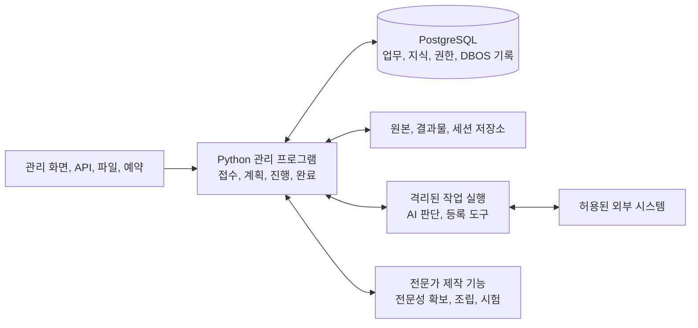

# 공장 구현 설계

**공통 실행 프로그램을 한 번 만들고, 분야별 지식과 판단법, 도구, 평가를 연결해 여러 전문가를 만든다. 만들어진 전문가는 같은 프로그램에서 업무를 접수하고 처리하고 검증하고 전달하며, 이후의 변화까지 관리한다.**


전문가가 갖춰야 할 구성 요소를 재료라 부르며, 1번부터 79번까지 번호가 붙어 있다. 이 문서는 79개 재료를 공통 실행 프로그램의 어느 부분에 넣고, 어떤 자료를 주고받고, 어떤 순서로 개발할지 정한다. 여기 적은 폴더와 함수, 자료형은 구현할 명세다.

## 완성할 것

| 만들 것 | 사용자가 하는 일 | 프로그램이 내놓는 것 |
|---|---|---|
| 공통 업무 실행 프로그램 | 전문가를 골라 업무와 자료를 맡긴다 | 검증한 결과물, 실제 처리 결과, 남은 의무와 후속 일정 |
| 전문성 확보 기능 | 분야 이름과 전문가의 자료, 결과물, 작업 기록을 준다 | 원문에 연결된 지식, 조건별 판단법, 실무서와 실행 절차 |
| 전문가 제작 기능 | 맡길 업무 범위와 쓸 전문성, 도구를 지정한다 | 시험을 통과한 전문가 구성과 지원 업무 목록 |
| 관리 화면 | 진행 상황과 결과를 보고 필요한 결정에 답한다 | 진행, 대기, 문제, 승인, 결과를 같은 업무 번호로 확인하는 화면 |

새 회계 전문가를 추가한다고 하자. 접수, 실행 복구, 파일 저장, 승인, 납품 기능은 다시 만들지 않는다. 회계 지식과 계산법, 업무 절차, 도구 연결, 평가 사례를 더한다. 새 도구가 필요하면 공통 도구 규격에 맞는 연결 코드만 더한다.

가장 중요한 운영 목표는 맡은 내용과 필수 검증을 끝까지 해내는 것이다. 내부 비용, 시간, 토큰 예상치를 넘으면 자원을 다시 배정하거나 일을 나누고, 순서대로 처리하거나 이어서 한다. 내용을 몰래 줄이거나 시도 횟수가 찼다는 이유로 끝내지 않는다. 권한, 보안, 법적 의무, 사용자가 정한 지출 상한 때문에 실제로 막히면 그 행동만 보류한다. 이때 확보한 결과와 해결 담당, 다음 행동은 남기고, 독립적으로 할 수 있는 일은 계속한다.

## 프로그램 배치

처음에는 PC 한 대에서 관리 프로그램 하나와 PostgreSQL 하나를 운영한다. 관리 프로그램은 FastAPI와 DBOS를 함께 쓰는 Python 애플리케이션이다. AI, 문서 변환, 계산, 브라우저 작업은 필요한 실행 환경에서 하고 결과를 관리 프로그램에 돌려준다.



| 실행 단위 | 담당 | 저장과 권한 |
|---|---|---|
| 관리 프로그램 | 요청 접수, 업무 상태 변경, 실행 허가, DBOS 작업 등록, 결과 확정 | 관리 프로그램이 업무 DB를 바꾸는 권한을 가진다. 모델에는 이 권한을 넘기지 않는다 |
| PostgreSQL | 업무의 현재 상태와 이력, 지식과 검색, 검사 증거, DBOS 실행 기록 | 업무 자료와 DBOS 기록은 같은 데이터베이스의 서로 다른 스키마에 둔다 |
| AI 실행 환경 | 요청 해석, 전략, 의미 판단, 작업 제안, 독립 검토 | 고객과 업무별 자료와 세션만 준다. SDK 설정 차단과 파일, 통신 격리를 함께 적용한다 |
| 도구 실행 환경 | 등록한 계산, 변환, 제작 함수와 연결 도구 실행 | 입력은 읽기 전용이고 출력은 지정한 위치에 기록한다. 외부 행동은 관리 프로그램의 허가를 거친다 |
| 파일 저장소 | 원본, 가공 파일, 결과물, 세션과 복구 자료 | 파일 내용 지문과 DB의 버전, 접근 범위를 연결한다. 큰 원문은 DBOS 단계 결과에 넣지 않는다 |
| 운영 기능 | 시작, 감시, 백업, 복원, 업데이트 | 업무 실행 계정과 관리 권한을 나눈다. 지원 범위는 실제 복원 시험으로 확인한다 |

DBOS를 실행하는 관리 프로세스는 처음에 하나만 둔다. 동시 실행 작업 수 2개는 이 프로세스 안에서 실행하는 작업 수다. 여러 서버나 프로세스로 넓히는 일은 운영을 따로 바꿔서 한다. DBOS 공식 문서는 여러 프로세스에서 올바르게 복구하려면 Conductor가 필요하다고 밝힌다. 그래서 초기 구조에서 여러 실행 서버를 이미 지원한다고 표시하지 않는다. [DBOS 운영 조건](https://docs.dbos.dev/faq#when-should-i-use-the-dbos-conductor)

Linux에서는 rootless Podman을 쓰고, Windows와 macOS에서는 Podman Machine의 Linux VM을 쓴다. OS별 설치와 파일 공유, 네트워크, 장치 접근을 실제로 시험한 조합만 지원한다. GPU는 따로 검증하는 항목이며 기본 업무 처리의 필수 전제로 두지 않는다. [Podman Machine](https://docs.podman.io/en/latest/markdown/podman-machine.1.html)

## 재료를 넣을 코드

각 코드 모듈은 같은 애플리케이션 안의 모듈이며 별도 서버가 아니다. 표는 재료마다 주로 맡는 모듈을 나눈 것이고, 한 재료의 검사와 저장 기능은 다른 모듈에서도 불러 쓴다.

| 코드 모듈 | 재료 번호 | 직접 만들 기능 | 다음에 넘기는 결과 |
|---|---|---|---|
| `platform/` | 4, 5, 6, 9, 10 | 시작 신호 접수, 실행 공간, 실시간 연결, 운영 복구, 시험 환경 | 인증한 입력 이벤트, 사용할 수 있는 실행 환경 |
| `workflow/` | 2, 8, 25, 43, 45, 46 | DBOS 작업, 계획의 의존 관계, 분담, 대기와 재개, 상태 변경 | 실행할 작업, 보존한 진행 상태, 다음 실행 시각 |
| `knowledge/` | 11–19, 21–24, 26 | 원문 등록과 읽기, 검색, 사실과 규칙, 지식, 경험, 기억 관리, 변경 영향 추적 | 접근할 수 있는 근거 묶음, 지식 버전, 다시 검토할 대상 |
| `agent/` | 1, 3, 38–41, 44 | SDK 호출, 업무 맥락 구성, 요청 해석, 완료 조건, 전략, 상황 판단 | 구조화한 판단, 계획 또는 도구 실행 요청 |
| `policy/` | 27–37 | 적용 규칙, Cedar 권한, 승인 조건, 안전 검사, 자원 예약과 정산 | 실행 가능 여부, 필요한 조건, 예약 번호 |
| `tools/` | 7, 47–54, 66–68 | 도구 등록과 연결, 분류, 결합, 변환, 계산, 분석, 예측, 최적화, 측정, 실험, 시뮬레이션 | 처리 결과와 근거, 실행 자원, 검사할 수 있는 출력 |
| `artifacts/` | 20, 55–57, 63, 64 | 자산 활용, 결과물의 설계, 제작, 수정, 포장, 게시 준비, 공개 결과 확인 | 고정한 파일 버전, 배포 묶음, 공개 상태 |
| `people/` | 42, 58, 59, 65 | 질문, 인계, 연락, 협상, 인수와 검수, 남은 약속 | 응답, 합의, 인수 증거, 후속 작업 |
| `actions/` | 60–62 | 기록 수정, 거래와 신청, 장비 명령을 실행하고 조회하고 취소하는 연결 | 외부 접수 번호, 실제 반영 상태, 확인되지 않은 거래 |
| `review/` | 69–78 | 감사 기록, 제출자 확인, 독립 검증, 반증, 위험, 과정, 품질, 성과, 능력 평가, 원인 확인 | 통과 증거, 수정 요구, 원인과 개선 후보 |
| `factory/` | 79 | 전문가 구성 조립, 버전 고정, 시험 연결, 배포, 교체, 되돌리기 | 검증한 전문가 배포물과 변경 영향 목록 |

`knowledge/`는 전문성 확보 기능의 결과를 받고, `factory/`는 그 지식과 실무서, 도구, 평가를 전문가 구성에 연결한다. 직무마다 새 모델이나 검색 DB를 추가하지 않는다. OWL, SKOS, SHACL, 관계 저장, 검색, 계산, 제작 도구는 재료마다 확정한 개별 설계를 따른다.

외부 상태를 바꾸는 연락과 게시, 납품도 `people/`나 `artifacts/`에서 직접 실행하지 않는다. 실행 요청은 모두 `tools/dispatch.py`를 거치고, 실제 상태를 확인하는 공통 절차는 `actions/`에서 가져다 쓴다.

## 주고받는 자료

함수, API, MCP가 같은 Pydantic 자료형을 쓴다. 모델이 쓴 자연어를 그대로 DB 상태 변경이나 외부 명령으로 쓰지 않는다. 업무 번호와 버전, 근거, 실제 결과를 다음 단계까지 이어 간다.

| 공통 자료형 | 반드시 포함할 내용 | 작성하고 확정하는 곳 |
|---|---|---|
| `ExpertRelease` | 전문가와 버전, 업무 범위, 지식과 절차와 도구의 버전, 필요한 권한, 시험 결과, 지원 환경 | `factory/`가 검증한 뒤 등록 |
| `CaseInput` | 고객, 업무, 요청 번호, 인증한 요청자, 목표와 범위, 입력 파일 버전, 기한, 기존 위임 | `platform/`과 `workflow/` |
| `ContextSnapshot` | 현재 상태, 계획, 규칙 버전, 판단 기준일, 필요한 근거 위치, 확인되지 않은 조건 | `knowledge/`가 조회하면 `agent/`가 구성 |
| `TaskPlan` | 목표와 완료 조건, 작업별 입력과 출력, 선행 작업, 쓸 등록 함수, 필요한 승인, 검사 방법 | AI가 제안하고 `workflow/`가 전체 계획을 검사 |
| `ToolRequest` | 업무 행동 번호, 도구와 버전, 대상과 값, 입력 지문, 권한과 승인과 상태 버전, 담당 실행 번호 | `tools/`가 검증하고 실행 전에 저장 |
| `ToolReceipt` | 요청 번호, 상태, 실제 결과, 확인 시각과 증거. 상태는 전송됨, 외부 접수, 완료, 부분 성공, 실패, 미확인 중 하나다 | 연결 도구와 `actions/` |
| `CheckResult` | 검사 대상과 버전, 조건, 방법과 검사자, 결과, 증거 위치, 유효 조건 | 검사 코드와 독립 검토의 결과를 `review/`가 기록 |

이름과 형식은 공통으로 두고, 분야별 계산 입력과 결과물 규격은 등록한 확장 자료형으로 더한다. 임의의 자유 필드로 필수 검사를 피하지 못하도록, 관리 프로그램은 허용한 필드와 엄격한 자료형, 근거와 버전 참조를 검사한다.

DB의 주된 저장 책임은 다음과 같다.

| 저장 내용 | 이미 설계한 테이블 | 갱신하는 곳 |
|---|---|---|
| 업무, 계획, 작업, 현재 상태 | `cases`, `case_events`, `subtasks`, `requirements` | `workflow/`의 검증된 상태 변경 함수 |
| 원문, 파일, 근거, 변경 영향 | `source_versions`, `artifacts`, `evidence_links`, `artifact_dependencies` | 자료 등록과 결과 확정 함수 |
| 권한, 승인, 자원 | `delegations`, `approvals`, `budget_reservations`, `budget_usage` | 인증한 관리 기능과 `policy/` |
| 외부 행동, 응답, 후속 일정 | `action_intents`, `action_receipts`, `inbox`, `outbox`, `timers`, `commitments` | 공통 실행, 접수, 대기 기능 |
| 검사, 성과, 배포 | `checks`, `evaluations`, `outcomes`, `releases`, `capabilities` | 검사, 평가, 배포 기능 |

업무마다 실행 종료, 목표 달성, 검증, 후속 성과를 별도 상태로 관리한다. DBOS 단계가 끝났거나 AI가 답을 마쳤다고 해서 업무를 완료로 바꾸지 않는다. 과거 완료 때의 증거와 지금의 유효성도 구분한다.

업무 상태 변경과 다음 작업 등록은 같은 PostgreSQL 트랜잭션에서 한다. 같은 SQLAlchemy 연결로 상태와 요청 기록을 저장하고 `DBOSClient.enqueue_in_transaction`을 부른 뒤 함께 확정한다. 그래서 상태만 바뀌고 작업은 등록되지 않거나, 작업만 등록되는 일이 없다. 확정되기 전에는 성공 응답을 보내지 않고 작업 결과를 기다리지도 않는다. [DBOS 트랜잭션 안에서 작업 등록](https://docs.dbos.dev/python/reference/client#enqueue_in_transaction)

파일 저장과 외부 API 호출은 DB 트랜잭션으로 한꺼번에 되돌릴 수 없다. 파일은 임시 저장 → 내용 검사 → 고정한 파일 등록 → DB 참조 확정 순서로 처리한다. 외부 행동은 사전 요청 기록 → 실행 → 실제 결과 대조 순서로 처리한다. 중간에 장애가 나면 등록 상태와 원래 시스템을 대조해 복구한다.

## 전문가를 만드는 과정

전문가 제작도 공통 실행 프로그램의 업무 절차 하나다. 별도의 자율 실행 서버를 만들지 않고 같은 계획, 도구, 기록, 검사 기능을 쓴다.

| 단계 | 프로그램이 하는 일 | 남길 것 |
|---|---|---|
| 업무 범위 정의 | 직종 이름을 실제로 맡길 과업, 입력, 결과물, 품질 기준으로 나눈다 | `work_scopes`, 능력 목록, 평가 계획 |
| 전문성 확보 | 분야만 주어지면 자료를 찾고, 자료가 있으면 형식에 맞게 분석하고 비교하고 실험한다 | 원문 위치가 연결된 지식 후보와 적용 조건, 예외 |
| 실무 지식 검증 | 기록으로 남은 것과 기억에 의존한 것을 나누고, 요령을 독립 사례로 시험한다 | 검증 상태가 붙은 지식, 실무서, 절차, 실패와 복구 사례 |
| 전문가 조립 | 필요한 공통 기능, 분야 지식, 등록 도구, 지시, 절차, 검사를 연결한다 | 버전을 고정한 전문가 구성, 빠진 기능 목록 |
| 업무 시험 | 실제 입력에서 납품까지 해 보고 장애, 변경, 복구, 전문 품질을 검사한다 | 시험 증거, 쓸 수 있는 업무와 환경 범위 |
| 등록과 배포 | 합격한 구성에 서명하고 설치 목록에 등록한다 | `ExpertRelease`, 설치와 업데이트 자료 |
| 운영 경험 반영 | 새 오류와 성공 방법을 원문과 실제 기록으로 검토하고 다시 시험한다 | 새 지식과 절차 후보, 검증한 다음 버전 |

지식 하나에는 `knowledge_id`, 원문과 위치와 버전, 적용 분야와 조건과 기간, 판단 단서, 절차와 예외, 확인 방법, 검증 상태를 연결한다. 경험에서 뽑은 요령은 가설로 등록하고, 검증한 뒤에 업무 지침으로 쓴다. 원본이나 규칙이 바뀌면 그 지식을 쓰는 전문가와 진행 중인 업무를 찾아 지금도 유효한지 다시 검사한다.

전문성 확보는 기존 획득 계획에서 정한 입력 종류별 분석 경로를 이어 쓴다. 단순 검색 결과만으로 전문가가 완성됐다고 보지 않는다. 획득 기능을 구현한 실행 프로젝트가 있다고 기록돼 있지만 이번 환경에서 경로를 확인하지 못했으므로, 이미 동작하는 부품으로 계산하지 않는다. 개발을 시작할 때 기존 코드와 입출력을 확보해 확인한 뒤 연결하고, 실제로 없는 부분만 만든다.

전문가 구성의 목표 파일은 다음과 같다. 지식 원본은 따로 두고 ID와 버전으로 가리킨다.

```text
experts/<expert-id>/
├── profile.yaml           # 업무 범위, 필요한 분야와 기능, 기본 지시 참조
├── workflows/             # 업무별 YAML 절차와 완료 조건
├── tools.yaml             # 등록 도구 ID, 입출력, 필요 권한
├── knowledge.lock         # 적용 지식, 규칙, 실무서의 정확한 버전
├── evaluation.yaml        # 평가 항목과 별도 시험 자료의 참조
└── release.json           # 파일 지문, 실행 코드 버전, 시험과 지원 범위
```

비밀번호, 고객의 원문과 기억과 대화, 진행 중인 업무 상태, 보호된 시험 정답은 이 묶음에 넣지 않는다. 필요한 권한을 선언하는 것과 고객이 실제로 권한을 주는 것은 다르다. 사용자의 업무를 받을 때 인증한 고객, 계정, 위임을 따로 연결한다.

## 업무 한 건을 처리하는 과정

첫 연결 시험은 문서와 거래 표를 받아 대조하고 계산해, 근거가 연결된 보고서를 만들어 시험용 제출처에 전달하는 업무로 한다. 공통 연결만 확인하는 시험이다. 이 시험을 통과했다고 특정 전문직의 자격이나 판단 능력이 입증되지는 않는다.

| 순서 | 실제 실행 | 저장하고 확인할 것 |
|---|---|---|
| 1. 접수 | `accept_case()`가 인증과 중복 요청을 검사하고 자료를 등록한다 | 업무 번호, 전체 대상 목록, 입력 버전, DBOS 작업 번호 |
| 2. 맡은 일 확정 | `build_context()`와 `interpret_request()`가 목표, 조건, 확인되지 않은 것을 나눈다 | 원래 요청, 완료 조건, 중요한 질문, 가정과 영향 범위 |
| 3. 작업 계획 | `propose_plan()`이 방법과 작업을 정하고 `validate_plan()`이 연결을 검사한다 | YAML, 함수, 계획 버전, 선행 관계, 승인과 검사 위치 |
| 4. 자료 처리 | 등록한 읽기, 검색, 결합, 계산 함수를 실행한다 | 원문 위치, 짝이 없는 항목과 짝이 여럿인 항목, 계산 입력과 결과, 독립 검산 |
| 5. 결과물 제작 | `produce_artifact()`가 보고서와 편집 원본을 만든다 | 원문과 계산에 연결된 결과물 버전, 납품 목록 |
| 6. 검사와 수정 | `verify_artifact()`가 코드 검사와 독립 원문 검토를 한다 | 항목별 증거, 수정 요구, 수정 뒤 영향받는 재검사 |
| 7. 전달과 확인 | `dispatch_action()`이 유효한 권한과 승인으로 시험용 제출처에 보내고 `reconcile_action()`이 실제 상태를 확인한다 | 고유한 업무 행동 번호, 외부 접수, 반영, 인수, 검수 증거 |
| 8. 완료와 후속 | `finalize_case()`가 필수 작업과 현재 유효한 증거를 모두 확인하고 후속 일정을 등록한다 | 전체 완료, 남은 약속, 성과 확인 일정 |

주 모델은 Python Claude Agent SDK를 통해 호출하고, 업무, 실행, 대화의 세션 번호를 연결한다. SDK 호출 한 번이 끝난 뒤에도 남은 작업은 DBOS가 이어 간다. 독립 검토는 초안 결론에 끌리지 않도록 원래 요청과 근거를 먼저 주는 별도 세션에서 한다. [Python Agent SDK](https://code.claude.com/docs/en/agent-sdk/python)

DBOS의 한 단계는 모델 호출 한 번, 자료 조회 한 번, 계산이나 파일 제작 한 번처럼 결과를 보존할 수 있는 단위로 나눈다. 모델 응답, 현재 시각, 난수, 외부 조회는 기록해 두었다가 복구할 때 그 결과를 다시 쓴다. 원문과 큰 결과 파일은 파일 저장소에 두고 ID와 지문만 돌려준다. 모델 응답을 기다리는 동안 DB 잠금을 오래 잡지 않는다.

AI에게 주는 MCP 도구와 관리 프로그램 안의 Python 함수는 모두 `dispatch_action()`에서 권한, 버전, 입력 검사를 거친다. 외부를 바꾸는 행동은 같은 업무 행동 번호를 다시 쓴다. 통신이 끊기면 실제로 처리됐는지 먼저 확인하고, 결과가 분명하지 않은 변경은 다시 실행하지 않는다. 실행 직전에 다시 조회하는 것만으로 다른 변경과의 충돌을 막았다고 보지 않는다. 원래 시스템의 조건부 변경 기능, 곧 읽은 뒤 값이 바뀌지 않았을 때만 반영하는 기능을 쓴다.

업무는 이 순서를 한 번 지나고 끝나는 고정 흐름이 아니다. 답변, 변경, 오류가 오면 그 자리에서 이어 간다.

| 발생한 일 | 이어 가는 방법 |
|---|---|
| 중요한 질문에 답이 아직 없음 | 그 답에 기대는 작업만 기다린다. 답이 오면 현재 계획과 권한을 확인하고 바로 다시 시작한다 |
| 원문, 규칙, 승인이 바뀜 | 의존 관계로 영향받는 판단, 검사, 행동을 찾는다. 이미 끝낸 행동은 두고, 정정이나 취소가 가능한지 확인한다 |
| 내부 예상 자원을 넘었거나 같은 오류가 반복됨 | 남은 내용은 그대로 두고 배정, 분할, 방법, 실행 환경을 바꾼다. 같은 실패를 그대로 되풀이하지 않는다 |
| 서버 재시작 | DBOS 기록, 업무 상태, 파일과 세션, 외부 행동 기록을 대조해 유효한 지점부터 다시 시작한다 |
| 병렬 작업 일부 실패 | 성공한 결과는 두고 독립 작업은 계속한다. 실패한 결과에 기대는 작업만 다시 배정한다 |

기다리는 업무가 실행 자리를 계속 차지해 새 작업을 막지 않도록, 상위 업무는 상태를 저장해 두고 실제로 처리하는 단계에만 자원을 배정한다. 답변이나 기한 이벤트가 오면 짧은 재개 작업을 등록한다. 처음의 동시 처리 2개는 실제 작업에만 적용한다. 계획과 이벤트 접수까지 같은 제한으로 묶어 서로 기다리는 구조를 만들지 않는다.

## 개발할 폴더와 화면

제품 코드는 설계 문서와 분리한 `expert-factory/` 프로젝트로 만든다. 이 구조는 만들 대상이며, 지금 있다는 뜻은 아니다. 이미 확보한 구현이 있으면 해당 모듈에 연결하고 같은 기능을 다시 만들지 않는다.

```text
expert-factory/
├── pyproject.toml
├── src/expert_factory/
│   ├── app.py                     # FastAPI와 DBOS 시작, 정상 종료
│   ├── contracts/                 # 공통 입력과 출력 자료형
│   ├── platform/                  # 접수, 인증, 실행 환경, 실시간 연결
│   ├── workflow/                  # 상태 변경, 계획, 작업, 대기, 복구
│   ├── knowledge/                 # 등록, 검색, 전문 지식, 변경 영향
│   ├── agent/                     # SDK 연결, 맥락, 판단, 계획 제안
│   ├── policy/                    # 규칙, Cedar, 승인, 자원 예약
│   ├── tools/                     # 도구 등록표, dispatch.py, 연결 코드
│   ├── actions/                   # 외부 요청 기록, 실행, 상태 대조
│   ├── artifacts/                 # 설계, 제작, 파일 확정, 포장, 게시
│   ├── people/                    # 질문, 인계, 소통, 인수
│   ├── review/                    # 검사, 감사, 평가, 원인 분석
│   ├── factory/                   # 전문가 조립, 시험, 배포
│   └── web/                       # 관리 화면과 정적 파일
├── migrations/                    # 업무 DB의 변경 이력
├── experts/                       # 전문가별 작성 원본
├── tests/                         # 단위, 실제 DB, 전체 흐름, 복구 시험
├── deploy/                        # 고정 이미지, OS별 실행과 설치 설정
└── operations/                    # 백업, 복원, 업데이트, 이전 절차
```

고객 자료와 모델 파일, DB 볼륨, 보호된 시험 정답은 소스 저장소 밖에 둔다. 업무 DB의 상태를 YAML이나 임시 JSON에 다시 저장해 기준이 둘이 되게 하지 않는다.

첫 관리 화면은 네 곳이다.

- **업무 목록과 상세:** 목표, 현재 처리, 대기 이유, 필요한 응답, 결과, 기한을 보여 준다.
- **질문과 승인:** 실제로 실행할 대상, 값, 파일 버전을 보여 주고 인증한 답변과 승인을 기록한다.
- **전문가 제작과 등록:** 업무 범위, 연결한 지식과 도구, 부족한 기능, 시험 결과, 배포 버전을 보여 준다.
- **운영과 복구:** 실행 오류, 자료 갱신, 백업과 복원, 업데이트 상태, 다시 시작할 업무를 보여 준다.

비용, 로그, 부품 버전은 필요한 상세 화면에서 본다. 사용자가 매번 내부 순서나 도구를 골라야 업무가 진행되는 화면은 만들지 않는다.

## 개발 순서

재료 번호순으로 79개를 하나씩 완성한 뒤 합치지 않는다. 업무 한 건이 끝까지 이어지는 구조부터 만들고, 같은 구조에 다른 업무를 붙이며 공통 기능을 완성한다. 첫 업무에 꼭 필요한 보호, 검사, 복구는 해당 기능을 실행하기 전에 함께 구현한다.

| 단계 | 구현할 것 | 직접 확인할 결과 |
|---|---|---|
| 1. 공통 연결 | 프로젝트와 자료형, FastAPI, PostgreSQL, DBOS, SDK 연결, 격리 실행, 시험용 도구 | 요청 하나를 저장하고 실행하고 다시 조회한다. 중복 접수나 서버 재시작에도 같은 업무가 유지된다. SDK 세션과 도구 권한이 맞는지, 상태 변경과 작업 등록이 한꺼번에 확정되는지 실제로 시험한다 |
| 2. 한 업무 완주 | 문서와 표 등록, 검색과 계산, 목표와 계획, 보고서 제작, 독립 검증, 시험용 제출과 인수 | 문서와 거래 표를 받아 보고서를 전달하는 시험 업무를 접수부터 검수까지 끝낸다. 도중에 오류가 나거나, 답을 기다리거나, 원문이 바뀌거나, 응답이 사라져도 빠지거나 겹치는 일 없이 이어 간다 |
| 3. 전문성 공급 | 입력 진단, 기존 획득 기능 연결, 근거와 조건과 실무서와 실행 절차의 등록과 갱신 | 확보한 전문 지식이 실제 업무에 주어지고, 결과에 쓴 버전과 원문을 추적할 수 있다. 검증하기 전의 요령은 확정한 지침과 구분된다 |
| 4. 전문가 제작 자동화 | 구성 검사, 지식과 도구와 절차 조립, 시험 실행, 배포물 생성, 등록 | 같은 공통 실행 프로그램에 전문가 구성을 더한다. 빠진 기능과 시험을 통과하지 못한 범위를 정확히 표시한다 |
| 5. 공장 반복 검증 | 문서 중심, 계산 중심, 외부 처리 중심의 서로 다른 업무 구성 | 세 유형을 같은 조립 절차로 만든다. 새 업무마다 공통 실행 코드를 복사하지 않고, 더한 전문 코드와 자료와 작업량, 기존 업무를 다시 시험한 결과를 기록한다 |
| 6. 제품 운영 완성 | OS별 설치, 업데이트와 DB 변경, 오래 기다리는 업무의 이전, 백업과 복원, 성과 추적 | 지원할 환경에서 새로 설치해 업무 처리, 재부팅, 복원까지 통과한다. 전문 품질과 운영 조건을 통과한 범위만 배포한다 |

실시간 음성, 장비 연결, 특정 제작 도구가 시험 업무에 꼭 필요하면 그 작업 전에 앞당긴다.

첫 상용 직무는 실제 자료, 전문 도구, 숙련자 비교, 평가 권한을 확보한 범위에서 정한다. 연결 시험을 통과했다고 20년차급 전문 능력이나 모든 직종 지원을 선언하지 않는다. 전문 업무의 합격 기준과 독립 시험은 재료 77번 업무 능력 시험의 방식으로 정한다.

업데이트는 프로그램, 업무 절차, 전문가 구성, 지식 버전을 따로 기록한다. 처음의 단일 실행 프로세스에서는 옛 버전과 새 버전을 동시에 운영한다고 가정하지 않는다. 진행 중인 업무를 끝내거나 검증된 상태로 옮길 준비를 한 뒤에 전환하며, 오래 기다리는 업무도 이전 시험에 넣는다. DB 구조 변경을 되돌릴 때는 업데이트 뒤에 쌓인 업무 기록과 외부 행동을 따로 보존하고 대조한다.

## 완료 기준

1. 새 전문가를 추가하는 입력, 만들어지는 파일과 DB 기록, 검사, 등록까지 같은 절차로 되풀이된다.
2. 조립된 전문가가 실제 업무를 접수부터 필수 검증, 전달, 인수까지 처리하고, 중단된 뒤에도 이어 간다.
3. 원문, 규칙, 승인, 담당, 버전이 바뀌면 영향받는 작업과 결과를 찾아 지금도 유효한지 다시 확인한다.
4. 내부 예상 비용이나 처리 횟수 때문에 필요한 내용을 빼지 않는다. 풀리지 않는 실제 제약에는 보존한 진행 상태와 구체적인 재개 경로가 있다.
5. 다른 유형의 전문가를 추가해도 공통 실행 기반을 다시 만들지 않고, 기존 업무가 그대로 돌아간다.
6. 설치와 복구 성공, 프로그램 연결 성공, 전문 품질 합격, 실제 성과를 각각 증거로 확인한다.

**바로 다음 개발 단위는 1단계 공통 연결과 2단계 업무 한 건 완주다.** 이 결과로 프로그램 경계와 자료형이 실제로 맞는지 확인한 뒤, 전문성 공급과 전문가 제작을 같은 실행 기반에 붙인다.
