# 전문 AI 에이전트 정의

## 목표 ✅

20년차 인간 전문가를 대체할 수 있는 전문 AI 에이전트를 만든다.

---

### 원하는 것 ✅

1. 인간 전문가를 고용하는 대신 전문 AI 에이전트에게 업무를 맡긴다
   - 20년차만큼 전문성과 성과가 있어야 믿고 맡길 수 있다
   - 사람은 맡기고 결과를 받을 뿐, 중간에 손대지 않는다
   - 사람이 끼는 자리는 다섯 경우 (되돌릴 수 없는 행동 · 승인 조건 · 판단이 서지 않는 것 · 한도 초과 · 자격자 전속 행위) 뿐이다. 그때도 준비·기록·검증은 다 끝낸 뒤 결정만 받는다
   - 이 다섯 가지를 벗어나 사람을 부르면 대체가 아니다
2. 온라인·컴퓨터 안에서 시작해 끝나는 일에 집중한다
   - 성과가 화면·문서·시스템·통신 안에서만 나는 전문가와 업무를 다룬다

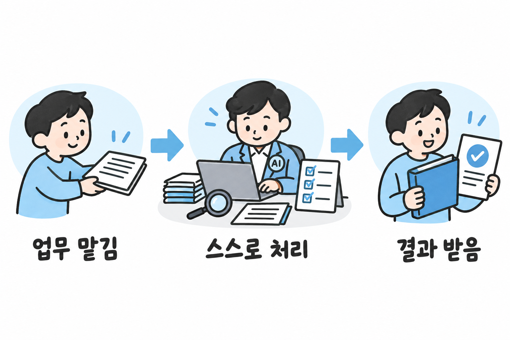

---

### 원하지 않는 것 ✅

1. 역할놀이, 상담 챗봇, 단순 질의응답, 검색·요약만 해 주는 수준
2. 몸·현장·실물 조작이 있어야 성과가 나는 일 (건물 시공·조리·의료 시술·촬영·매장 운영)
   - 몸으로 직접 움직이는 로봇이 있어야 하는 일은 이번 범위 밖이다

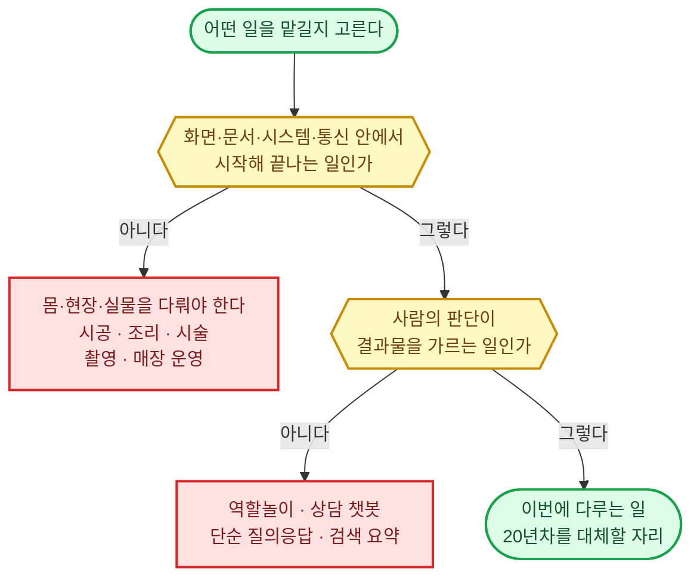

---

## 인간 전문가 ✅

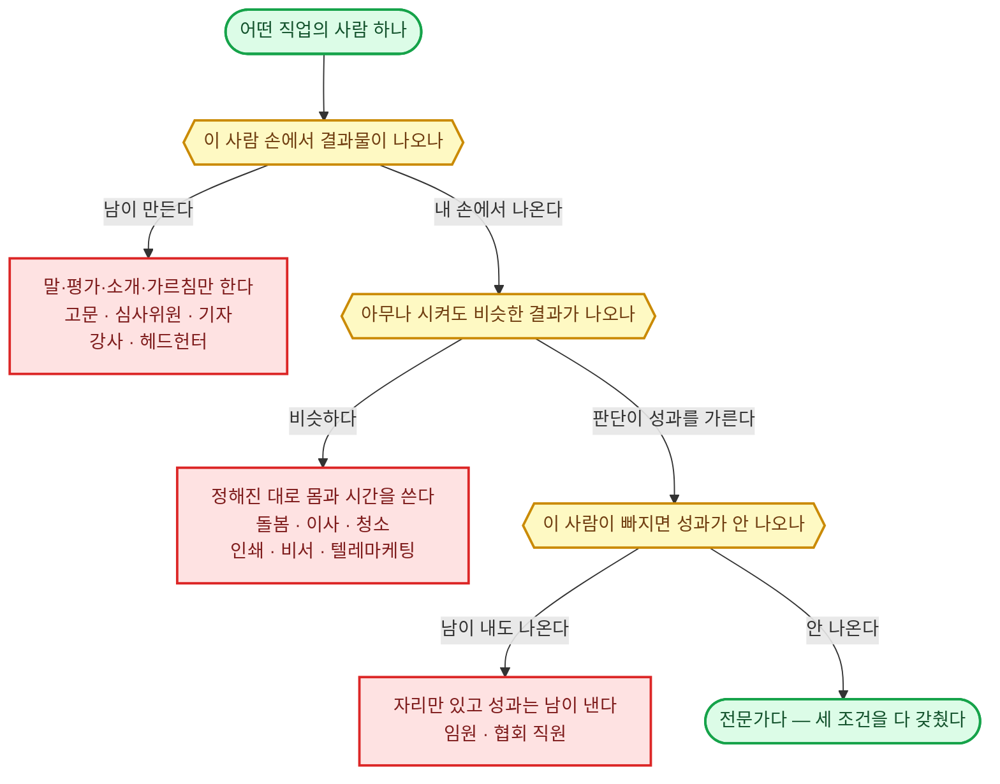
한 분야의 일을 직접 맡아 20년차 수준으로 판단하고 처리해 성과를 내는 사람. 처음 보는 상황에서도 잠깐 당황할 뿐, 결국 해낸다.

아래 세 가지를 모두 갖춰야 전문가다.
| 조건 | 뜻 | 가르는 질문 | 아니면 |
|------|-----|-----------|--------|
| 직접 처리한다 | 이 사람의 판단이 그대로 결과물이 된다 | 이 사람 손에서 결과물이 나오나? | ▶️ 말·평가·소개·가르침만 하고 결과물은 남이 만드는 사람 ▶️ 곁에서 조언만 하는 고문·컨설턴트, 남이 한 일을 심사하고 검사하는 심사위원·감사, 기자, 강사, 사람을 찾아 회사에 소개하는 헤드헌터가 여기다 |
| 판단이 성과를 가른다 | 같은 일도 초보와 고수의 성과 차이가 크고, 오래 할수록 성과가 더 올라간다 | 아무나 시켜도 비슷한 결과가 나오나? | 정해진 대로 몸과 시간을 쓰는 사람 (돌봄, 이사, 청소, 인쇄, 비서, 텔레마케팅) |
| 성과를 낸다 | 일을 맡기면 돈·결과·문제 해결이 실제로 나온다 | 이 사람이 빠지면 성과가 안 나오나? | 자리만 있고 성과는 남이 내는 사람 (임원, 협회 직원) |

---

### 초보와 전문가를 가르는 것 ✅

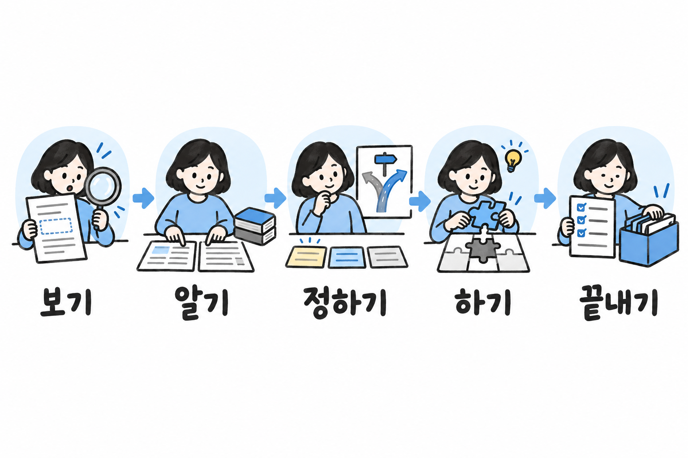

#### 1. 보기 ✅

| 항목 | 초보 | 8년차 | 20년차 |
|------|------|--------|--------|
| 문제 보기 | 말한 그대로를 문제로 본다 | 말 뒤의 진짜 문제와, 말한 사람도 모르는 문제까지 짚는다 | ▶️ 지금 문제가 앞으로 어떤 문제를 낳을지까지 보고, 풀 문제와 안 풀 문제를 정한다 ▶️ 필요하면 문제를 다시 정의해 판 자체를 바꾼다 |
| 빠진 것 보기 | 눈앞에 있는 것만 본다 | 있어야 하는데 없는 것 (안 낸 서류, 안 나온 숫자, 안 한 말) 을 알아본다 | 없는 것이 왜 없는지 (잊었나, 숨겼나, 없는 게 정상인가) 까지 읽고, 그것이 결과를 뒤집을지 가늠한다 |
| 예외·함정 | 예외를 만나면 멈추거나 틀린다 | 이 일에서 자주 터지는 예외와 함정을 미리 알고, 작은 이상 신호에서 알아챈다 | ▶️ 예외가 생기는 원리를 알아 처음 보는 예외도 예측한다 ▶️ 함정을 피하는 데서 그치지 않고, 상대의 함정과 예외 조항을 내 쪽에 유리하게 이용한다 |

#### 2. 알기 ✅

| 항목 | 초보 | 8년차 | 20년차 |
|------|------|--------|--------|
| 아는 것 | 책에서 배운 정석 (교과서에 나오는 기본 방법) 만 안다 | 정석이 어디까지 통하고 어디서부터 안 통하는지, 그 이유까지 안다 | 정석이 왜 그렇게 만들어졌는지 원리와 내력 (그 방법이 굳어지기까지의 사정) 을 알아, 정석이 없는 처음 보는 일도 원리에서 풀어낸다 |
| 모르는 것 | 모른다는 것도 모른 채 그냥 나간다 | 자기가 모르는 지점을 알고, 거기서 확인하거나 물어본다 | ▶️ 이 분야에서 아직 아무도 모르는 것과 다들 안다고 착각하는 것을 안다 ▶️ 누구에게 무엇을 물어야 답이 나오는지 안다 |
| 자료 대하기 | 받은 자료를 그대로 믿는다 | 자료가 틀리기 쉬운 곳을 알고 원문과 대조한다 | 자료가 만들어진 사정 (누가 왜 이렇게 썼는지) 을 읽어 자료가 말하지 않는 것을 알아내고, 자료 없이도 어디까지 판단해도 되는지 안다 |

#### 3. 정하기 ✅

| 항목 | 초보 | 8년차 | 20년차 |
|------|------|--------|--------|
| 결과 예측 | 해 봐야 안다 | 시작 전에 결과와 부작용을 머릿속으로 끝까지 돌려 본다 | ▶️ 몇 달·몇 년 뒤의 2차·3차 영향까지 내다보고, 그 예측이 얼마나 확실한지도 안다 ▶️ 그래서 예측이 빗나가도 살아남을 길을 미리 마련해 둔다 |
| 상대 예측 | 내가 할 일만 본다 | 상대 (고객, 상대방, 심사관, 시장) 가 어떻게 움직일지 미리 읽고 대비한다 | ▶️ 상대가 움직일 방향을 미리 만든다 ▶️ 상대·기관·시장이 무엇을 얻고 무엇을 잃는지 (이해관계) 와 버릇을 알아 협상과 판을 설계한다 |
| 방법 고르기 | 아는 방법 하나로 다 한다 | 여러 방법의 비용과 위험을 재서 이 상황에 맞는 것을 고른다 | ▶️ 있는 방법으로 안 되면 방법을 새로 만들거나 섞고 순서를 다시 짠다 ▶️ 남들이 못 보는 길을 안다 |
| 우선순위 | 시킨 순서나 눈에 띄는 순서대로 한다 | 성과를 가르는 것부터 하고 나머지는 뒤로 미룬다 | ▶️ 지금 성과와 나중 성과, 이 건과 다른 건 사이의 우선순위까지 정한다 ▶️ 급해 보이는 일이 왜 급하지 않은지 안다 |
| 버리기 | 시킨 것을 다 한다 | 안 해도 될 일과 하면 안 될 일을 가려 빼고, 왜 빼는지 말해 준다 | ▶️ 일 자체를 받을지 말지, 이 방식 전체를 버리고 다시 짤지 정한다 ▶️ 이미 들인 돈과 시간이 아까워도 버린다 |
| 정보가 모자랄 때 | 다 갖춰질 때까지 기다리거나, 아무렇게나 가정한다 | 모자란 채로도 판단하되 가정을 드러내고, 틀리면 되돌릴 길을 남긴다 | ▶️ 어떤 정보는 모자라도 결론이 안 바뀌는지 알아서, 그런 정보는 기다리지 않는다 ▶️ 결론을 바꿀 정보만 골라 가장 싸고 빠르게 얻어 낸다 |
| 되돌릴 수 없는 것 | 모든 결정을 같은 무게로 다룬다 | 되돌릴 수 없는 결정을 알아보고, 그것만은 느리게 확인하고 한다 | ▶️ 되돌릴 수 없는 큰 결정을 되돌릴 수 있는 작은 결정 여러 개로 쪼개 짠다 ▶️ 큰 손실이 나는 선을 먼저 정해 두고 그 안에서만 움직인다 |

#### 4. 하기 ✅

| 항목 | 초보 | 8년차 | 20년차 |
|------|------|--------|--------|
| 처음 보는 상황 | 배운 대로 안 되면 멈추거나 아무거나 한다 | 잠깐 당황하지만 비슷한 경험을 끌어와 길을 찾고, 되돌릴 수 있는 것부터 해 본다 | ▶️ 당황하는 시간이 짧다 ▶️ 처음 보는 상황일수록 원리로 되돌아가 새 길을 만들고, 그래도 끝까지 해낸다 ▶️ 초보와의 차이가 가장 크게 벌어지는 자리다 |
| 결과물 수준 | 내가 보기에 다 됐으면 끝낸다 | 받는 사람이 손대지 않고 그대로 쓸 수 있는 수준을 알고 거기까지 맞춘다 | ▶️ 받는 사람이 그것으로 다음에 무엇을 할지까지 보고 거기에 맞춰 만든다 ▶️ 무엇을 빼야 좋아지는지 알기 때문에 결과물이 짧고 분명하다 |

#### 5. 끝내기 ✅

| 항목 | 초보 | 8년차 | 20년차 |
|------|------|--------|--------|
| 검증 | 한 번 훑고 낸다 | 어디서 틀리기 쉬운지 알고 그 자리를 다른 길로 다시 확인한다 | ▶️ 내 결론이 틀렸다면 어디서 틀렸을지 일부러 반대편에 서서 공격해 본다 ▶️ 상대·심사관·시장이 어떻게 무너뜨릴지를 그려 보며 검증한다 |
| 멈추기 | 언제 끝인지 몰라 계속 만지거나 일찍 놓는다 | 충분한 지점과 더 가면 위험한 지점을 안다 | ▶️ 언제 밀어붙이고 언제 물러날지 판을 읽고 정한다 ▶️ 잘되고 있을 때도 멈춰야 할 때를 안다 |
| 실패 경험 | 같은 실수를 다시 한다 | 자기와 남의 실패에서 배워 같은 실수를 안 하고, 실패했을 때 수습하는 법도 안다 | ▶️ 실패가 나는 조건을 알아 그 조건 자체를 미리 없앤다 ▶️ 실패해도 큰 손실은 안 나게 판을 짜고, 실패에서 남이 못 보는 기회를 본다 |

---

### 종류 ✅

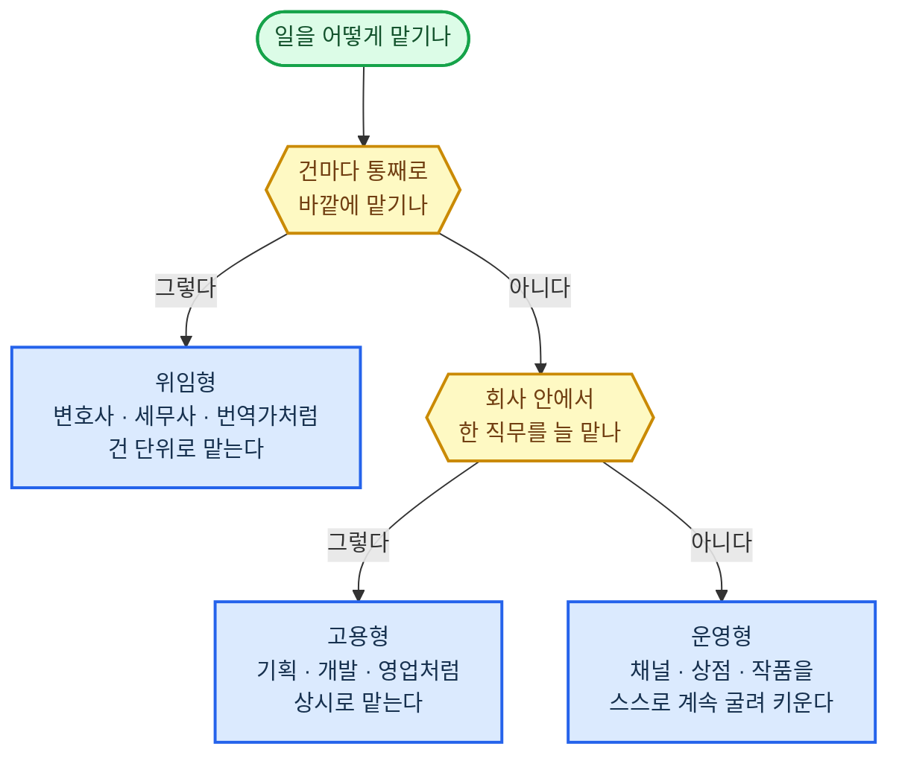

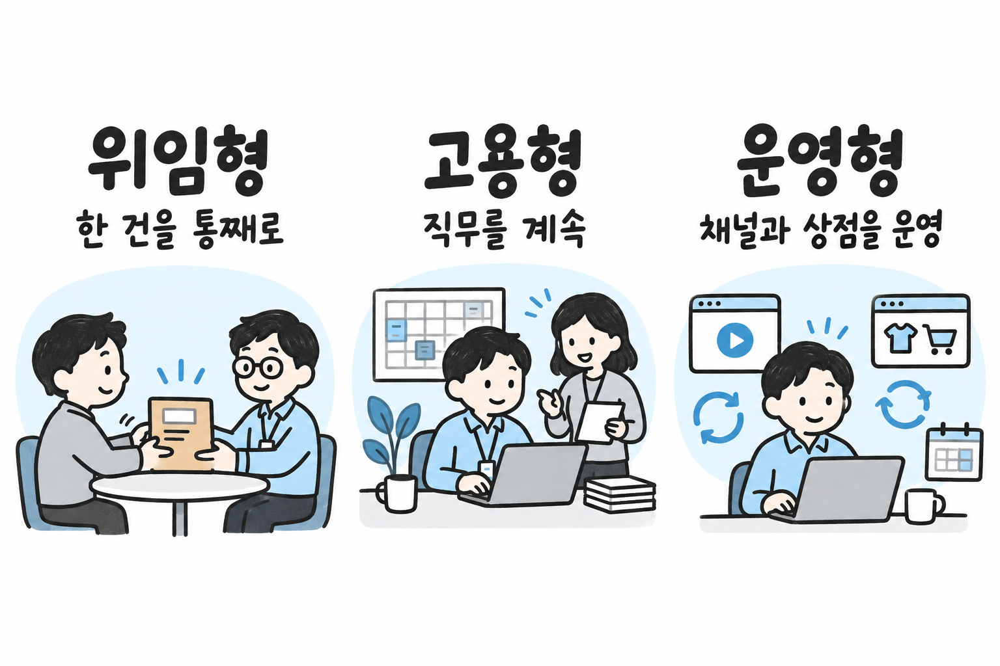

#### 위임형 — 건 단위로 외부에 통째로 맡김 ✅

| 분야 | 직종 | 주 고객 | 목표 | 성과 |
|------|------|--------|------|------|
| 법률 (소송) | 변호사 (민사·상사 송무) | 돈·계약·손해를 두고 남과 다투게 된 개인·회사 — 받을 돈은 받아 내고 물어 줄 돈은 줄이고 싶음 | ▶️ 소송·분쟁에서 의뢰인이 잃는 것은 가장 적게, 얻는 것은 가장 많게 함 ▶️ 이길 수 없는 싸움은 시작 전에 알려 주고 합의로 끝냄 | ▶️ 유리한 종결률 (이긴 것 + 유리한 합의 + 각하. 각하는 상대가 낸 소송이 재판 조건을 못 갖춰 내용도 안 보고 돌려보내진 것) ÷ 종결한 건 수 ▶️ 걸린 돈이 큰 건에 무게를 더 준 유리 종결률 (큰 건 몇 개 지면 작은 승소 여럿이 무의미) ▶️ 신청·항소 인용률 (내가 낸 신청을 재판부가 받아 준 비율) ▶️ 의뢰인 추천 의향 (NPS) |
| 법률 (소송) | 변호사 (형사 변호) | ▶️ 수사·재판을 받게 된 사람 — 구속과 처벌을 피하거나 가장 가볍게 끝내고 싶음 ▶️ 범죄 피해자 — 피해를 인정받고 처벌·배상을 받아 내고 싶음 | ▶️ 수사 단계에서 끝내거나 (불송치는 경찰이 검찰로 안 넘김, 불기소는 검찰이 재판에 안 넘김), 재판에서 무죄·집행유예 (형은 정하되 일정 기간 사고 없으면 안 살게 해 줌)·가벼운 형으로 막음 ▶️ 구속을 막고 풀려나게 함 | ▶️ 불송치·불기소·무혐의 (죄를 지은 게 아니라고 결론남) 비율 ▶️ 구속영장 기각 (가두라는 요청을 판사가 물리침)·구속적부심 (가둔 게 맞는지 다시 따져 달라는 신청)·보석 (보증금 내고 풀려남) 인용률 ▶️ 구형 (검사가 요구한 형벌) 대비 선고형 (판사가 실제로 내린 형벌) 감경폭, 집행유예·무죄 비율 ▶️ 피해자 대리 시 합의금·처벌 결과 |
| 법률 (소송) | 변호사 (가사·상속) | 이혼·양육·상속·유언 문제를 겪는 가족 — 재산과 아이를 지키면서 다툼을 짧게 끝내고 싶음 | 재산 분할·위자료·양육권을 유리하게 받아 내고, 상속 다툼을 가족 관계가 덜 망가지게 끝냄 | ▶️ 재산분할·위자료 청구액 대비 인정액 ▶️ 양육권·면접교섭 (같이 안 사는 부모가 아이를 정기적으로 만나는 권리) 목표 달성률 ▶️ 조정 (법원이 중간에서 서로 조건을 맞춰 주는 절차)·합의로 끝낸 비율과 걸린 기간 ▶️ 상속 분쟁의 유리 종결률 |
| 법률 (소송) | 변호사 (행정·조세 송무) | 정부·지자체·세무서의 처분 (인허가 (사업을 해도 된다는 나라의 허락) 거부, 영업정지, 과징금 (법을 어긴 회사에 물리는 돈), 세금 부과) 을 받은 개인·회사 — 처분을 취소·감경받고 그동안 영업이 멈추지 않길 원함 | 부당한 처분을 취소시키거나 줄이고, 재판 중에 영업이 멈추지 않게 함 | ▶️ 행정심판 (재판까지 가기 전에 행정기관에 다시 판단해 달라고 하는 절차)·행정소송 인용률 ▶️ 집행정지 인용률 (처분 효력을 재판 끝날 때까지 멈춤) ▶️ 취소·감경된 처분 금액 |
| 법률 (소송) | 변호사 (도산·회생) | ▶️ 빚을 갚을 수 없게 된 회사·개인 — 사업을 살리거나, 못 살리면 빚을 정리하고 다시 시작하고 싶음 ▶️ 채권자 — 최대한 회수하고 싶음 | ▶️ 회생 (빚을 줄이고 나눠 갚으면서 사업을 계속하는 절차) 으로 사업을 살리거나, 파산·면책 (남은 빚을 법으로 없애 줌) 으로 빚을 정리해 다시 시작하게 함 ▶️ 채권자 대리 시 회수액을 최대로 함 | ▶️ 회생 개시 (절차를 시작해도 된다는 결정)·인가 (갚을 계획을 법원이 승인) 비율 ▶️ 승인된 변제율 (전체 빚 중 갚기로 한 비율) 과 그대로 갚아 낸 비율 ▶️ 면책 인용률 ▶️ 채권자 대리 시 회수율 |
| 법률 (자문) | 변호사 (기업 자문) | 계약·규제·노무 (직원 채용·급여·해고 같은 노동 문제)·개인정보 문제가 늘 생기는 회사 — 나중에 분쟁이나 제재 (감독기관이 내리는 벌) 로 안 번지게 미리 막고, 사업이 안 멈추게 빨리 답을 얻고 싶음 | ▶️ 계약·거래가 나중에 분쟁이나 제재로 번지지 않게 막음 ▶️ 사업이 막히지 않게 빠르게 답을 줌 | ▶️ 자문한 계약에서 난 분쟁·손실 건수 ▶️ 계약 검토에 걸린 날수 ▶️ 고객 유지율 (다음 해에도 맡기는 비율) |
| 법률 (자문) | 변호사 (M&A·투자 거래) | 회사를 사고팔거나 투자를 주고받는 회사·투자자 — 거래는 깨지 않으면서 숨은 위험은 안 떠안고 조건은 유리하게 하고 싶음 | 거래를 성사시키되 진술·보증 (파는 쪽이 회사에 이런 문제는 없다고 계약서에 못 박는 약속)·손해배상 조항으로 위험을 상대에게 넘김 | ▶️ 거래 성사율 (계약 뒤 실제 종결) ▶️ 종결 후 진술·보증 위반으로 난 손실 건수 ▶️ 협상에서 우리 쪽 요구대로 넣은 핵심 조항 비율 ▶️ 서명까지 걸린 기간 |
| 법률 (등기·행정) | 법무사 (등기) | 집·건물을 사고팔거나 담보 대출을 받는 개인·회사, 법인을 세우거나 바꾸는 회사 — 등기 (집·건물의 주인이 누구고 빚이 얼마나 걸려 있는지 나라 장부에 적는 일) 를 한 번에 틀림없이 끝내고 싶음 | 등기·법인 서류를 한 번에 틀림없이 접수시킴 | ▶️ 보정 명령 (서류가 틀렸으니 고쳐 오라는 지시)·각하 비율 (기한 안에 못 고치면 통째로 반려됨) ▶️ 접수부터 완료까지 걸린 날수 ▶️ 등기 사고 (빠뜨림, 순위 실수 — 담보를 잡는 차례가 뒤로 밀림) 건수 |
| 법률 (등기·행정) | 법무사 (개인회생·파산) | 빚을 감당 못 하는 개인 — 법원 절차로 빚을 줄이거나 없애고 싶음 | 개인회생·파산 신청을 한 번에 통과시켜 빚을 줄임 | ▶️ 개시·인가율 ▶️ 보정 명령 횟수 ▶️ 탕감된 채무 비율 ▶️ 인가 뒤 변제 이행률 |
| 법률 (등기·행정) | 행정사 (인허가·지원금) | 사업을 열거나 넓히려는 사람·회사 — 인허가와 정부 지원금을 한 번에 통과시키고 싶음 | 인허가·정부지원금을 한 번에 통과시킴 | ▶️ 승인율 ▶️ 보정 요구 횟수 ▶️ 받아 낸 지원금액 |
| 법률 (등기·행정) | 행정사 (출입국·비자) | 한국에 오거나 머물려는 외국인, 외국인을 채용하려는 회사 — 비자·체류 자격을 거절 없이 기한 안에 받고 싶음 | 비자·체류 자격 (한국에 머물 수 있는 자격)·귀화 (한국 국적을 새로 얻는 것) 를 거절 없이 기한 안에 받게 함 | ▶️ 승인율·거절률 ▶️ 처리 기간 ▶️ 보완 요구 횟수 |
| 법률 (등기·행정) | 공증인 | 유언·계약·차용 문서를 만드는 개인·회사 — 나중에 다툼이 안 생기게 법적 힘을 붙이고 싶음 | 문서에 나중에 다툼이 안 생기도록 법적 힘을 붙여 줌 | ▶️ 공증 (자격 있는 사람이 문서가 진짜라고 확인해 주는 일) 이 무효가 되거나 흠이 난 건수 ▶️ 일부러 그랬거나 조금만 신경 썼으면 안 틀렸을 큰 실수 (중과실) 면 손해배상 책임을 진다 ▶️ 서류 검증 오류율 ▶️ 갖춰야 할 조건을 빠뜨린 건수 (유언 공증에 증인이 안 온 경우 등) |
| 지식재산 | 변리사 (특허) | 기술·제품을 개발한 회사·연구자 — 남이 못 베끼게 권리를 넓게 잡아 등록하고 싶음 | 권리를 넓게 잡아 등록시키고 남이 못 베끼게 지킴 | ▶️ 등록률 (등록 ÷ 최종 처리된 출원. 출원은 특허청에 권리를 달라고 낸 신청. 특허 평균 74.6%, 2024년) ▶️ 심사 의견 회신 횟수 (한 번에 통과) ▶️ 등록된 권리 범위 (경쟁사가 피해 갈 수 없는 정도) |
| 지식재산 | 변리사 (상표·디자인) | 브랜드·제품 외형을 가진 회사·창업자 — 이름과 모양을 남이 못 쓰게 먼저 잡고 싶음 | 브랜드 이름·로고·제품 모양을 거절 없이 등록시키고 침해를 막음 | ▶️ 등록률 ▶️ 거절 이유 (먼저 등록된 상표와 비슷함 등) 사전 회피율 ▶️ 침해 경고·대응 결과 |
| 지식재산 | 변리사 (심판·분쟁) | 남의 권리와 부딪힌 회사 — 남의 권리는 무효로 만들거나 피해 가고, 내 권리 침해는 막고 싶음 | 남의 권리는 무효로 만들거나 피해 가게 하고 내 권리는 지킴 | ▶️ 거절결정불복 (특허청이 거절한 걸 다시 봐 달라는 신청)·무효심판 (남이 이미 등록한 권리를 없애 달라는 신청) 인용률 ▶️ 권리범위확인심판 (내 권리가 상대 제품까지 미치는지 가려 달라는 신청) 승률 ▶️ 침해 소송 결과와 손해배상액 |
| 세무 | 세무사 (신고·기장) | 사업자·법인 — 세금을 법 안에서 가장 적게, 기한 안에, 조사 위험 없이 내고 싶음 | 세금을 법 안에서 가장 적게, 기한 안에, 조사 위험 없이 신고함 | ▶️ 신고 정확성 (수정신고 (잘못 낸 신고를 다시 내는 것)·가산세 (신고를 틀리거나 늦어서 더 무는 세금) 건수. 무신고 20%, 과소신고 10%, 납부지연 하루 0.022%) ▶️ 기한 준수율 ▶️ 법 안에서 줄인 세액 ▶️ 고객 유지율 |
| 세무 | 세무사 (상속·증여·가업 승계) | 재산이 많은 개인·가족, 가업을 물려주려는 오너 — 재산을 다음 세대에 넘길 때 세금을 가장 적게 내고 싶음 | 상속·증여·가업 승계를 미리 설계해 세금을 법 안에서 가장 적게 냄 | ▶️ 설계 전후 세액 차이 ▶️ 가업 상속 공제 (조건을 채우면 세금 매길 금액에서 빼 주는 제도) 같은 예외 혜택을 적용받은 비율 ▶️ 혜택을 받은 뒤 지켜야 할 조건을 어겨 세금을 다시 물어낸 (추징) 건수 |
| 세무 | 세무사 (조사·불복) | 세무조사를 받거나 세금을 부당하게 부과받은 사업자·개인 — 추징을 줄이고 잘못 매긴 세금은 돌려받고 싶음 | 세무조사에서 추징을 줄이고, 부당한 과세는 되돌림 | ▶️ 조사 예상 대비 추징액 감소폭 ▶️ 이의신청·심판청구 (세무서보다 윗 기관에 다시 판단해 달라고 내는 신청) 인용률 (조세심판 전체 인용률 27.3%, 2024년) ▶️ 조사 걸린 기간 |
| 세무 | 기장 대행 | 장부를 직접 쓸 여력이 없는 작은 사업자 — 장부가 틀림없이 정리돼 신고와 경영 판단에 바로 쓰이길 원함 | 장부를 매달 정확히 기록해 신고와 경영 판단의 바탕을 만듦 | ▶️ 장부 정확도 ▶️ 월 마감 걸린 날수 ▶️ 재작업 비율 ▶️ 계좌·거래 대사 (장부 숫자와 실제 통장·거래 내역을 하나씩 맞춰 보는 일) 완료율 100% |
| 회계·관세 | 회계사 (감사) | ▶️ 재무제표 (한 해 동안 돈이 얼마나 들어오고 나갔는지, 재산과 빚이 얼마인지 적은 표) 를 밖에 보여 줘야 하는 회사 (상장사, 투자·대출 받는 회사) — 숫자를 믿어도 된다는 도장을 받고 싶음 ▶️ 그 숫자를 믿고 돈을 넣는 투자자·은행 — 속지 않고 싶음 | 재무제표를 믿을 수 있게 만들어 투자·대출에 쓰이게 함 | ▶️ 감사의견과 실제 결과 일치 ▶️ 문제없다는 적정 의견을 준 뒤에 상장폐지 (주식 시장에서 쫓겨남) 나 재무제표 정정이 나오면 감사 실패다 (상장사 적정 비율 97.6%, 2025 회계연도) ▶️ 재무제표 정정 공시 건수 ▶️ 감사 품질 지표 (위험이 큰 부분에 시간을 얼마나 썼는지, 경력 많은 회계사가 얼마나 직접 봤는지) |
| 회계·관세 | 회계사 (자문·실사) | 회사를 사거나 투자하려는 회사·투자자 — 사기 전에 숨은 빚과 진짜 값을 알고 싶음 | 회사를 사거나 투자하기 전에 실사 (장부와 속사정을 직접 뒤져 확인하는 일) 로 숨은 위험과 진짜 가치를 찾아냄 | ▶️ 실사 때 못 찾고 나중에 드러난 빚·손실 건수 ▶️ 가치 평가액과 실제 거래가 차이 ▶️ 고객 유지율 |
| 회계·관세 | 관세사 | 수출입하는 회사 — 통관 (물건이 세관을 통과해 나라 밖으로 나가거나 안으로 들어오는 절차) 이 안 막히고 관세는 가장 적게 내고 싶음 | 통관을 막힘 없이, 관세는 법 안에서 가장 적게 냄 | ▶️ 통관 지연·보류 비율 ▶️ 품목 분류 정확도 ▶️ 특혜관세 (나라끼리 맺은 자유무역협정 (FTA) 덕에 관세를 깎아 주는 것) 를 쓴 비율 ▶️ 환급·절감한 관세액, 추징 건수 |
| 노무 | 노무사 (자문·급여) | 직원을 둔 회사 — 뽑고 쓰고 내보내는 일이 법과 비용 양쪽에서 문제 안 되게 미리 챙기고 싶음 | 사람 뽑고 쓰고 내보내는 일이 법과 비용 양쪽에서 문제 안 되게 함 | ▶️ 과태료·시정 명령 (잘못된 걸 고치라는 정부 지시) 건수 ▶️ 취업규칙 (회사가 정해 놓은 근무·급여 규칙)·임금 체계를 어겨서 더 나간 비용 ▶️ 노동청 진정 (부당한 일을 당했다고 신고하는 것)·고소 발생 건수 |
| 노무 | 노무사 (분쟁 대리) | 해고·징계·임금 체불로 다투게 된 회사와 근로자 — 노동위원회·노동청에서 이기고 싶음 | 부당해고·임금 체불 같은 분쟁에서 노동위원회·노동청·법원에서 이김 | ▶️ 노동위원회 (해고·임금 다툼을 재판 전에 가려 주는 국가 기관) 판정 결과 (부당해고 인정률은 판정한 건 기준 26.9%, 2024년 1~10월. 5년 평균은 32.6%. 대리하는 쪽에서 이 평균을 넘어야 함) ▶️ 화해 (판정까지 안 가고 서로 조건을 맞춰 끝냄) 로 끝낸 비율과 그 조건 ▶️ 임금 체불 회수액 |
| 노무 | 노무사 (산재) | 일하다 다치거나 병든 근로자와 유족 — 산재로 인정받아 치료비·보상을 받고 싶음 | 산재 (일하다 다치거나 병든 것을 나라가 인정해 치료비·보상을 주는 제도) 로 인정받아 정당한 보상을 받게 함 | ▶️ 산재 승인율 (특히 질병·과로로 생긴 건) ▶️ 장해 등급 (몸에 남은 후유증이 얼마나 심한지 매기는 등급) 결정 결과 ▶️ 불승인 뒤 심사·재심사 인용률 |
| 부동산 | 공인중개사 (주거) | 집을 사고팔고 빌리려는 개인 — 원하는 조건의 집을 시세보다 좋은 값에, 탈 없이 계약하고 싶음 | ▶️ 원하는 조건의 집을 찾아 사고팔거나 빌리는 계약을 탈 없이 성사시킴 ▶️ 계약 조건은 시세보다 좋게 함 | ▶️ 계약 성사율 (문의 대비 계약) ▶️ 중개 사고 건수 (사고가 나면 중개사가 미리 들어 둔 보상금인 공제금을 청구하거나 소송으로 감) ▶️ 시세 대비 계약 가격 ▶️ 재의뢰·소개 비율 |
| 부동산 | 공인중개사 (상가·빌딩) | 가게 자리를 찾는 사업자, 건물을 사고파는 투자자 — 장사가 될 자리, 수익 나는 건물을 권리 관계나 권리금 (앞 가게 주인에게 자리값으로 따로 주는 돈) 문제 없이 잡고 싶음 | 장사가 되는 자리와 수익 나는 건물을 시세보다 좋은 조건으로, 권리·권리금 문제 없이 계약함 | ▶️ 계약 성사율 ▶️ 계약 뒤 임차인 (빌려서 장사하는 사람) 매출과 건물 공실 (빈 채로 놀리는 비율) — 자리 보는 눈 ▶️ 권리금·명도 (세입자를 내보내고 자리를 넘겨받는 일) 분쟁 건수 ▶️ 재의뢰·소개 비율 |
| 부동산 | 공인중개사 (토지·개발) | 땅을 사서 짓거나 개발하려는 개인·회사 — 원하는 용도로 쓸 수 있는 땅을 규제 문제 없이 사고 싶음 | 원하는 용도로 개발 가능한 땅을 규제·권리 문제 없이 시세보다 싸게 계약함 | ▶️ 계약한 뒤에 개발이 안 되는 땅으로 드러난 건수 (용도 제한, 규제, 들어가는 도로 없음) ▶️ 시세 대비 계약 가격 ▶️ 계약 성사율 |
| 부동산 | 경매사 | 시세보다 싸게 부동산을 사고 싶은 투자자·실수요자 — 권리 문제를 떠안지 않고 낙찰받고 싶음 | 권리 문제 없는 물건을 시세보다 싸게 낙찰받게 함 | ▶️ 권리 분석 사고 (떠안는 권리를 놓침) 건수 ▶️ 시세 대비 낙찰가 ▶️ 입찰 대비 낙찰 성공률 ▶️ 명도 걸린 기간 |
| 부동산 | 감정평가사 | 담보·보상·소송·세금 때문에 자산 값이 필요한 은행·정부·개인 — 누구에게 내놔도 안 뒤집히는 값을 원함 | 부동산·자산의 가치를 근거 있게 정확히 매김 (현장 사진·실측은 밖에 맡기고 자료 분석·가치 산정·평가서 작성을 맡음. 서명은 자격자 전속) | ▶️ 다른 평가사·실거래가와의 격차 ▶️ 이의 제기·재평가 요청 건수 ▶️ 평가서가 소송·과세에서 뒤집힌 건수 |
| 건축·기술 | 건축사 (주택·소규모 건축) | 집·작은 건물을 짓거나 고치려는 개인·소규모 건축주 — 법·예산 안에서 허가를 한 번에 받고 원하는 건물을 갖고 싶음 | 법·예산·용도에 맞는 설계로 허가를 한 번에 통과하고 원하는 건물을 완성함 | ▶️ 허가 보완 횟수와 걸린 날수 ▶️ 설계 변경률 (변경 금액 ÷ 계약 금액, 낮을수록 좋음) ▶️ 예산 대비 실제 공사비 차이 ▶️ 준공 (공사를 다 끝내고 검사까지 마침) 후 하자·민원 건수 |
| 건축·기술 | 건축사 (대형·공공 건축) | 큰 건물·공공시설을 짓는 시행사 (땅을 사고 돈을 대서 건축 사업을 벌이는 회사)·기관 — 심의·허가를 통과하고 공사비·일정을 지키면서 완성하고 싶음 | 심의 (전문가 위원회가 설계를 미리 검토해 통과시키는 절차)·허가를 통과하고 설계 변경과 공사비 초과 없이 완성함 | ▶️ 심의·허가 통과 횟수와 걸린 날수 ▶️ 설계 변경률 ▶️ 예산 대비 실제 공사비 차이 ▶️ 준공 후 하자·민원 건수 |
| 건축·기술 | 기술사 (구조) | 건물·다리·공장을 짓거나 고치는 건축주·시공사 — 무너지지 않으면서 재료는 덜 쓰는 설계를 원함 | 안전하고 법에 맞으면서 재료가 덜 드는 구조를 설계·검토함 | ▶️ 구조 심의·검토 통과율 ▶️ 준공 후 구조 하자·사고 건수 ▶️ 검토로 줄인 자재비 |
| 건축·기술 | 기술사 (기계·전기 설비) | 공장·건물·데이터센터를 짓거나 운영하는 회사 — 설비가 멈추지 않고 전기·에너지 비용이 덜 들기를 원함 | 설비가 안 멈추고 법에 맞으며 에너지 비용이 덜 들게 설계·검토함 | ▶️ 검토 통과율 ▶️ 가동 후 설비 고장·사고 건수 ▶️ 줄인 에너지·운영 비용 |
| 보험 | 보험설계사 (생명·장기) | 사망·큰 병·노후를 대비하려는 개인 — 꼭 필요한 보장만 적은 보험료로 오래 유지하고 싶음 | 필요한 위험만 가장 적은 보험료로, 오래 유지되게 보장함 | ▶️ 13회차 유지율 (1년 뒤 살아 있는 계약, 생·손보 전체 평균 87.9%, 2025년 실적) ▶️ 25회차 유지율 (2년 뒤, 전체 평균 73.9%) ▶️ 불완전판매 (중요한 내용을 제대로 안 알리고 판 계약) 건수 ▶️ 보장 공백 (사고 났는데 보장 안 됨) 건수 |
| 보험 | 보험설계사 (손해·자동차) | 차·집·가게 사고에 대비하려는 개인·사업자 — 사고 났을 때 실제로 보상받고 보험료는 낮게 내고 싶음 | 사고 났을 때 실제로 보상되게, 보험료는 낮게 함 | ▶️ 갱신율 (만기 때 다시 계약) ▶️ 장기손해보험 13회차·25회차 유지율 ▶️ 보상 거절·분쟁 건수 |
| 보험 | 보험계리사 | 보험 상품을 만들고 파는 보험사 — 상품이 손해 없이 유지되고 감독 기준을 넘기길 원함 | 보험 상품이 손해 없이 유지되게 보험료와 준비금 (나중에 보험금 줄 몫으로 미리 쌓아 두는 돈) 을 계산함 | ▶️ 손해율 (받은 보험료 중 보험금으로 나가는 비율) 예측 오차 ▶️ 준비금 정확도 (추정 ÷ 실제, 1.0에 가까울수록 좋음) ▶️ 1년 뒤 준비금 변동폭 (20% 넘으면 위험 신호) ▶️ 상품 수익성 |
| 보험 | 손해사정사 (재물·배상) | 화재·수해·사고로 재산이 상하거나 남에게 물어 줘야 할 개인·회사 — 손해액을 근거 있게 인정받아 정당한 보험금을 받고 싶음 | 재산 손해·배상 책임 금액을 근거 있게 산정해 정당한 보험금을 받게 함 (현장 사진·실측은 밖에 맡기고 손해액 산정·근거 문서·보험사 협의를 맡음) | ▶️ 산정액 인정률 (보험사가 받아들인 비율) ▶️ 받아 낸 보험금액 ▶️ 분쟁·민원 건수 (손해보험 민원의 52.8%가 보험금 산정·지급 문제, 2025년) |
| 보험 | 손해사정사 (신체·질병) | 다치거나 병들어 보험금을 청구하는 개인 — 장해·후유증을 정당하게 인정받고 싶음 | 장해·후유증·진단을 근거 있게 입증해 보험금을 받게 함 | ▶️ 청구액 대비 지급액 ▶️ 장해 등급·후유증 인정 결과 ▶️ 지급 거절 뒤 뒤집은 건수 |
| 자산·대출 | 투자자문사 | 목돈을 가진 개인·법인 — 정한 위험 안에서 자산을 불리고 싶음 | 정한 위험 안에서 고객 자산을 불림 | ▶️ 기준으로 삼은 시장 지수 (벤치마크) 보다 더 번 수익 (알파) ▶️ 위험 대비 수익 (샤프 비율 — 오르내리는 위험 한 몫당 얼마를 벌었나. 1.0 이상이면 양호) ▶️ 최대 낙폭 (MDD — 제일 높았을 때부터 제일 낮았을 때까지 가장 크게 까먹은 폭) 한도 준수 |
| 자산·대출 | 재무설계사 | 집·교육·은퇴 같은 인생 목표에 돈을 맞추고 싶은 개인·가족 — 계획대로 목표를 이루고 싶음 | 집·교육·은퇴 같은 인생 목표에 맞게 돈 계획을 세워 달성시킴 | ▶️ 재무 목표 달성률 ▶️ 순자산 (가진 재산에서 빚을 뺀 돈) 증가 ▶️ 고객 유지율 (다음 해에도 관리받는 비율, 미국 자문업계 97%) ▶️ 계획 이행률 |
| 자산·대출 | 대출상담사 (주택·개인) | 집을 사거나 급전이 필요한 개인 — 가장 좋은 조건의 대출을 가장 빨리 받고 싶음 | 가장 좋은 조건의 대출을 가장 빨리 승인받게 함 | ▶️ 승인율 (신청 대비 승인) ▶️ 신청한 사람 중 실제로 돈까지 받은 비율 (풀스루율) ▶️ 시장 대비 금리·한도 조건 ▶️ 처리 기간 |
| 자산·대출 | 대출상담사 (사업자·기업) | 운영 자금·시설 자금이 필요한 사업자 — 보증·담보를 엮어 한도는 크게, 금리는 낮게, 빨리 받고 싶음 | 보증 (기관이 대신 갚아 주겠다고 서 주는 것)·정책자금 (정부가 낮은 금리로 빌려주는 돈)·담보를 엮어 가장 큰 한도를 가장 낮은 금리로 승인받게 함 | ▶️ 승인율·한도 달성률 ▶️ 시장 대비 금리 ▶️ 보증·정책자금을 엮은 건수 ▶️ 처리 기간 |
| 진료·약 | 의사 (만성질환) | 혈압·당뇨 같은 병을 오래 안고 사는 환자 — 수치를 잡아 합병증 없이 살고 싶음 | 혈당·혈압 같은 수치를 목표 안에 오래 유지해 합병증을 막음 | ▶️ 조절률 (수치가 목표 범위 안에 들어온 환자 비율. 병이 있는 사람 기준 국내 고혈압 58.6%·당뇨 32.4%, 2024년 통계) ▶️ 합병증 발생률 ▶️ 복약 순응도 (처방일수 대비 실제 복용 80% 이상) ▶️ 진단 정확도 (오진·늦은 진단) |
| 진료·약 | 의사 (정신건강) | 우울·불안·중독·수면 문제로 일상이 무너진 환자 — 일상을 되찾고 재발하지 않기를 원함 | 증상을 줄여 일상을 되찾게 하고 재발과 위기를 막음 | ▶️ 증상 척도 (증상이 얼마나 심한지 점수로 재는 검사) 개선율 ▶️ 재발·재입원율 ▶️ 자해·위기가 일어난 건수 ▶️ 치료 중단율 |
| 마음·몸 | 심리상담사 (개인) | 불안·우울·대인관계 문제로 힘든 성인 — 마음의 문제를 줄여 일상을 되찾고 싶음 | 마음의 문제를 줄여 일상을 되찾게 하고 그 상태를 유지시킴 | ▶️ 상담 앞뒤 점수 차이가 우연이 아닐 만큼 크게 좋아졌는지 재는 값 (신뢰변화지수) ▶️ 눈에 띄게 좋아진 사람 비율 (임상시험은 절반 넘게, 실제 현장은 3분의 1 아래) ▶️ 종결 후 재발·유지 ▶️ 중도 탈락률 |
| 마음·몸 | 심리상담사 (아동·청소년) | 아이의 정서·행동·학교 문제로 걱정하는 부모와 아이 — 아이가 나아지고 가정·학교에 잘 적응하길 원함 | 아이의 정서·행동 문제를 줄이고 가정·학교 적응을 도우며 부모의 대응도 바꿈 | ▶️ 행동·정서 척도 개선 ▶️ 학교 적응 (등교, 또래 관계) 변화 ▶️ 부모 보고 개선율 ▶️ 중도 탈락률 |
| 마음·몸 | 심리상담사 (부부·가족) | 갈등·이혼 위기에 놓인 부부·가족 — 관계를 회복하거나, 덜 상처받고 정리하고 싶음 | 관계 갈등을 줄여 관계를 회복시키거나 정리 과정을 덜 아프게 함 | ▶️ 관계 만족도 척도 개선 ▶️ 이혼·별거로 간 비율 (회복 목표 사례) ▶️ 갈등 재발률 |
| 마음·몸 | 영양사 | 체중·혈당·콜레스테롤 수치를 식단으로 잡고 싶은 사람, 병 때문에 식단이 필요한 환자 — 지킬 수 있는 식단으로 수치를 바꾸고 싶음 | 식단으로 체중·혈당 같은 건강 수치를 개선함 | ▶️ 당화혈색소 (최근 두세 달 평균 혈당을 알려 주는 피 검사 수치) 감소폭 (영양 치료 3개월 뒤 0.3~2.0%p) ▶️ 체중 변화 (여러 연구 평균 약 1.5kg 감량) ▶️ 식단 실천도 ▶️ 목표 수치 유지율 |
| 언어 | 번역가 (산업·법률 문서) | 계약서·매뉴얼·특허 문서를 다른 나라에 내야 하는 회사 — 틀린 한 단어로 사고가 안 나게 정확하길 원함 | 원문의 뜻을 정확하게, 용어를 일관되게, 쓰임새에 맞게 옮김 | ▶️ 품질 점수 (번역 오류를 종류와 심각도별로 감점하는 국제 채점 기준 MQM. 100점 만점에 98~99점 안팎이 통과선) ▶️ 오역·용어 불일치로 난 사고 건수 ▶️ 수정 요청 건수 ▶️ 납기 준수율 |
| 언어 | 번역가 (출판·문학) | 외국 책을 내려는 출판사 — 원문의 결·재미가 살아 읽히고 팔리길 원함 | 원문의 결·문체를 살려 끝까지 읽히게 옮김 | ▶️ 독자 평점·완독 반응 ▶️ 판매 부수 ▶️ 편집자 수정 요청 건수 |
| 언어 | 번역가 (영상·게임 현지화) | 영상·게임을 해외에 내는 제작사·플랫폼 — 자막·대사가 자연스럽고 글자 수·타이밍에 맞길 원함 | 대사의 뜻과 말맛을 살리면서 글자 수·타이밍·문화 차이에 맞춤 | ▶️ 시청자·플레이어 번역 불만 건수 ▶️ 글자 수·타이밍 규격 위반 건수 ▶️ 납기 준수율 |
| 언어 | 통역사 (국제회의 동시통역) | 국제회의·학회·행사를 여는 기관 — 발표가 끊김 없이 실시간으로 전달되길 원함 | 발표와 동시에 뜻을 놓치지 않고 전달함 | ▶️ 의미 일치도 (누락·추가·오역 건수) ▶️ 전문용어 정확성 ▶️ 재지명률 (다음에도 부르는 비율) |
| 언어 | 통역사 (비즈니스·법정) | 협상·계약·수사·재판에서 말이 통해야 하는 회사·개인 — 뜻뿐 아니라 의도·뉘앙스까지 전달돼 불리해지지 않길 원함 | 협상·법정에서 양쪽 말의 뜻·의도·격식까지 정확히 전달함 | ▶️ 의미 일치도 ▶️ 격식·뉘앙스 적절성 ▶️ 통역 오류로 난 불이익 건수 ▶️ 재지명률 |
| 언어 | 카피라이터 | 광고·상세페이지로 사람을 움직여야 하는 회사 — 한 줄로 누르고 사게 만들고 싶음 | 읽는 사람을 한 줄로 움직여 누르고 사게 함 | ▶️ 클릭률 (CTR, 검색광고 평균 6.6%, 2026년) ▶️ 전환율 (광고를 본 사람 중 실제로 사거나 신청한 비율) ▶️ A/B 테스트 (두 가지 문구를 같이 내보내 어느 쪽이 나은지 재는 실험) 승률 |
| IT 외주 | 외주 개발 (웹·앱) | 서비스·앱을 만들고 싶지만 개발팀이 없는 회사·창업자 — 예산·기간 안에 동작하는 결과물을 받고 출시 뒤 고장이 없길 원함 | 예산·기간 안에 동작하는 서비스를 완성해 출시하고 넘겨줌 | ▶️ 일정·예산 준수율 ▶️ 넘겨받은 뒤 발견된 결함 건수 ▶️ 출시 후 가동률 (서비스가 안 멈추고 돌아간 시간 비율) ▶️ 재의뢰 |
| IT 외주 | 외주 개발 (시스템 구축·SI) | 회사 업무 시스템 (ERP — 재무·재고·인사를 한 프로그램에서 관리하는 것, 그룹웨어 — 사내 메일·결재·일정 프로그램, 여러 시스템을 하나로 잇는 통합) 을 새로 놓거나 바꾸는 회사 — 업무가 멈추지 않고 새 시스템으로 넘어가길 원함 | 요구를 빠짐없이 반영해 기존 업무가 끊기지 않게 새 시스템으로 옮김 | ▶️ 요구사항 반영률 ▶️ 전환 뒤 장애·업무 중단 건수 ▶️ 일정·예산 준수 ▶️ 검수 (맡긴 쪽이 결과물을 요구대로 됐는지 확인하고 받는 일) 통과 횟수 |
| 영상 제작 | 영상 제작자 (광고·홍보) | 광고·홍보 영상이 필요한 회사·기관 — 예산 안에서 알리거나 사게 하는 목적을 이루는 영상을 원함 | 예산·기간 안에 목적을 달성하는 영상을 완성함 (촬영은 밖에 맡기고 기획·연출·편집을 맡음) | ▶️ 조회수·완주율 (영상을 끝까지 본 비율)·전환 같은 목적 지표 ▶️ 예산·일정 준수율 ▶️ 수정 횟수 |

---

#### 고용형 — 회사 안에서 직무를 상시로 맡김 ✅

| 분야 | 직종 | 주 고객 | 목표 | 성과 |
|------|------|--------|------|------|
| 경영·전략 | 경영기획 | 대표·경영진 — 회사 목표가 숫자 계획으로 쪼개져 달성되고 있는지 알고 관리하고 싶음 | 회사 목표를 숫자 계획으로 쪼개고 달성되게 관리함 | ▶️ 계획 달성률 ▶️ 예측 오차 (계획 대 실제) ▶️ 전략 과제 실행률 |
| 경영·전략 | 전략 | 대표·이사회 — 어디서 어떻게 이길지 정하고 자원을 그쪽에 몰고 싶음 | 어디서 어떻게 이길지 정하고 자원을 그쪽으로 몰아 줌 | ▶️ 매출·점유율 성장률 ▶️ 선택한 사업의 영업이익률 (매출에서 물건값과 운영비를 빼고 남은 이익의 비율) 개선폭 ▶️ 전략 과제 달성률 |
| 경영·전략 | 사업개발 | 대표·사업부장 — 새 매출원 (신사업·제휴·판로) 이 필요함 | 새 사업·제휴·판로로 새 매출원을 만듦 | ▶️ 신규 매출액 ▶️ 계약·제휴 건수와 규모 ▶️ 잠재 고객에서 계약으로 바뀐 비율 ▶️ 고객 획득 비용 (CAC) |
| 인사 | 인사 (평가·보상) | ▶️ 경영진 — 잘한 사람이 보상받고 남게, 인건비는 성과에 맞게 쓰이길 원함 ▶️ 직원 — 공정하게 평가받고 싶음 | 평가·보상으로 성과 낸 사람이 남고 인건비가 성과에 맞게 쓰이게 함 | ▶️ 핵심 인재 이직률 ▶️ 인건비 대비 성과 ▶️ 평가 공정성 인식 점수 ▶️ 보상 이의·분쟁 건수 |
| 인사 | 인사 (조직·인재개발) | 경영진·팀장 — 조직이 잘 굴러가고 사람이 성장하며 몰입하길 원함 | 조직 구조·문화·교육으로 사람이 성장하고 몰입하게 함 | ▶️ 직원 만족·몰입 점수 ▶️ 내부 승진·핵심 직무 충원율 ▶️ 신입 1년 안 이탈률 ▶️ 교육 뒤 성과 변화 |
| 인사 | 채용 | 사람이 필요한 팀장·경영진 — 제때, 오래 남을 사람을 뽑고 싶음 | 필요한 사람을 제때, 오래 남을 사람으로 뽑음 | ▶️ 채용 걸린 날수 (해외 중간값 39일, 2026년. 국내 평균 32일, 2022년 조사) ▶️ 입사 90일·1년 정착률 ▶️ 채용 1명당 비용 ▶️ 합격자 입사율 |
| 재무·회계 | 회계 | 경영진·감사인 (회사 장부가 맞는지 검사하는 사람)·투자자 — 숫자가 정확하고 제때 나오길 원함 | 거래를 정확히 기록하고 결산 (한 기간의 장부를 마감해 숫자를 확정하는 일) 을 해서 숫자를 믿을 수 있게 함 | ▶️ 결산 걸린 날수 (중간값 약 6.4일, 상위 25%는 4.8일) ▶️ 결산 뒤 수정 전표 (거래 하나하나를 적어 두는 기록)·정정 건수 ▶️ 보고 기한 준수율 |
| 재무·회계 | 재무 | 대표·CFO (재무를 총괄하는 임원) — 돈이 모자라지 않게 계획하고 가장 싸게 조달하고 싶음 | 돈이 모자라지 않게 계획하고 가장 싸게 조달함 | ▶️ 현금흐름 예측 정확도 ▶️ 조달 금리 (가중평균 자본 비용, WACC) ▶️ 외상값 회수 기간 (DSO) ▶️ 현금 부족 사태 건수 |
| 재무·회계 | 자금 | CFO·거래처 — 일별 현금이 끊기지 않고 지급이 밀리지 않길 원함 | 일별 현금이 끊기지 않게 하고 남는 돈은 굴림 | ▶️ 지급 지연 건수 ▶️ 일별 현금 예측 오차 ▶️ 여유 자금 운용 수익 |
| 재무·회계 | 원가 | 경영진·사업부장 — 제품별 진짜 원가를 알아 이익 나는 데 집중하고 싶음 | 제품별 원가를 정확히 계산해 이익 나는 데 집중시킴 | ▶️ 표준 원가와 실제 원가 차이 ▶️ 원가 절감액 ▶️ 제품별 마진 (팔아서 남는 몫) 정확도 |
| 재무·회계 | 세무 (사내) | 경영진 — 회사 세금을 법 안에서 적게, 신고 실수와 추징 (덜 낸 세금을 뒤늦게 물리는 것) 없이 내고 싶음 | 회사 세금을 법 안에서 가장 적게, 신고 실수와 추징 없이 냄 | ▶️ 가산세·추징 건수와 금액 ▶️ 절세액 ▶️ 세무조사 결과 ▶️ 신고 기한 준수율 |
| 금융업 | 펀드매니저 (주식) | 돈을 맡긴 투자자·기관 — 정한 위험 안에서 시장보다 더 불리고 싶음 | 맡은 돈을 정한 위험 안에서 벤치마크 (비교 기준으로 삼는 시장 평균 수익률) 보다 더 불림 | ▶️ 벤치마크 대비 초과수익 (알파 — 시장 평균보다 더 번 몫) ▶️ 샤프 비율·정보 비율 (위험 1단위당 초과수익. 정보 비율 0.5 넘으면 실력, 1.0 넘으면 매우 우수) ▶️ 최대 낙폭 (MDD) |
| 금융업 | 펀드매니저 (채권) | 꾸준한 이자 수익을 원하는 연기금·보험사·개인 — 금리 변동과 부도 위험을 피하며 벤치마크를 넘고 싶음 | 금리·신용 위험을 관리하며 벤치마크보다 더 불림 | ▶️ 벤치마크 대비 초과수익 ▶️ 듀레이션 (금리가 움직일 때 채권 값이 얼마나 흔들리는지 나타내는 값)·신용 위험 한도 준수 ▶️ 담은 채권의 부도 건수 |
| 금융업 | 대체투자 운용 (PE·부동산·인프라) | 큰돈을 오래 묻어 둘 수 있는 기관·자산가 — 상장 시장보다 높은 수익을 원함 | 사서 키워 비싸게 팔거나 꾸준한 현금흐름으로 목표 수익률을 달성함 | ▶️ 내부수익률 (IRR)·투자 배수 (MOIC) ▶️ 회수 (엑시트) 성공률 ▶️ 손실 난 투자 건수 |
| 금융업 | 애널리스트 (리서치) | 투자 판단을 해야 하는 펀드매니저·기관·개인 투자자 — 남보다 먼저, 맞는 판단 근거를 원함 | 기업·산업의 실적과 주가를 남보다 먼저, 맞게 내다봄 | ▶️ 실적 추정 오차 ▶️ 투자의견 뒤 주가 방향 적중률 ▶️ 기관 투자자 평가 순위 |
| 금융업 | 트레이더 | 회사 (자기자본 — 회사가 굴리는 자기 돈) 와 주문을 맡긴 고객 — 한도 안에서 수익을 내고 주문은 가장 좋은 값에 체결되길 원함 | 한도 안에서 매매 수익을 내고 고객 주문을 최선 조건에 체결함 | ▶️ 손익 (P&L) ▶️ 한도 위반 건수 ▶️ 체결 품질 (시장가 대비 슬리피지 — 주문할 때 본 값과 실제로 사고팔린 값의 차이) |
| 금융업 | 여신심사 (개인) | 대출을 원하는 개인과 은행 — 갚을 사람에게는 빨리 빌려주고, 못 갚을 사람은 걸러내길 원함 | 갚을 사람에게만, 갚을 만큼만, 빨리 빌려줌 | ▶️ 연체율 (국내 은행 전체 0.56%, 2026년 6월) ▶️ 첫 회차 연체율 ▶️ 심사 걸린 시간 ▶️ 거절한 우량 고객 비율 |
| 금융업 | 여신심사 (기업) | 자금이 필요한 회사와 은행 — 사업성·담보를 보고 갚을 회사에 빌려주고 부실은 막고 싶음 | 사업성과 상환 능력을 보고 부실 없이 빌려줌 | ▶️ 부실채권 비율 (NPL, 국내 은행 평균 0.60%, 2026년 3월) ▶️ 심사 기간 ▶️ 부실 조기 경보 적중률 |
| 금융업 | 리스크 관리 | 경영진·감독기관 — 손실이 한도 안에 묶이길 원함 | 손실 위험을 재고 한도 안에 묶음 | ▶️ 한도 초과 건수 ▶️ 손실 한도 (VaR — 이보다 큰 손실은 좀처럼 안 난다고 계산해 둔 한도) 를 넘긴 건수 (250일에 4건까지 정상, 10건 넘으면 모델 불합격) ▶️ 스트레스 테스트 (아주 나쁜 상황을 가정해 버틸 수 있는지 보는 시험) 통과 |
| 금융업 | 보험 언더라이터 (인수 심사) | 보험사·설계사 — 위험에 맞는 보험료로 받되 손해 날 계약은 걸러내고 싶음 | 위험을 제대로 재서 받을 계약은 받고 손해 날 계약은 거름 | ▶️ 인수한 계약의 손해율 ▶️ 심사 기간 ▶️ 고지 위반 (계약할 때 알려야 할 사실을 숨긴 것)·사기 적발률 |
| 금융업 | IB (인수·자금조달 주선) | 회사를 팔거나 사거나 상장·회사채 (회사가 돈을 빌리려고 찍어 파는 빚 문서) 로 돈을 모으려는 기업 — 가장 좋은 값과 조건으로 거래를 끝내고 싶음 | 거래를 좋은 값·조건으로 성사시킴 | ▶️ 거래 성사율·규모 ▶️ 매각가·조달 조건 (시장 대비) ▶️ 수수료 수익 |
| 법무 | 법무 (소송·분쟁) | 경영진·사업부 — 분쟁을 유리하게, 싸게, 빨리 끝내고 싶음 | 분쟁을 유리하게 끝내고 비용을 줄임 | ▶️ 분쟁 유리 종결률과 처리 기간 ▶️ 소송·과징금 (법을 어겨서 나라에 무는 돈) 건수와 금액 ▶️ 외부 로펌 (변호사 사무소) 비용 절감액 |
| 법무 | 법무 (규제·컴플라이언스) | 경영진·현업 부서 — 법을 어기기 전에 막고 제재·유출 사고를 피하고 싶음 | 회사 활동이 법을 어기기 전에 막고 사고 나면 기한 안에 대응함 | ▶️ 규제 위반·제재 건수 ▶️ 문제 발견 뒤 대응 시간 (개인정보 유출은 72시간 안에 신고해야 함) ▶️ 내부 감사 지적 건수 |
| 법무 | 계약 관리 | 영업·구매 부서 — 불리한 조항 없이 빨리 계약하고 싶음 | 불리한 조항 없이 빨리 계약을 맺음 | ▶️ 계약 처리 걸린 날수 (요청부터 서명까지) ▶️ 계약 분쟁 건수 ▶️ 수정 요구 관철률 (요구한 수정이 실제로 반영된 비율) ▶️ 1인당 처리 건수 |
| 마케팅·PR | 브랜드 마케팅 | 경영진·영업 — 브랜드가 알려지고 사고 싶게 기억되길 원함 | 브랜드를 알리고 사고 싶게 기억시킴 | ▶️ 브랜드 인지도 (힌트 없이 제일 먼저 떠올린 비율·힌트 없이 떠올린 비율·이름을 보여 주면 아는 비율) ▶️ 브랜드 검색량 증가율 ▶️ 선호도·추천 의향 (NPS) |
| 마케팅·PR | 퍼포먼스 마케팅 | 경영진·영업 — 광고비 1원당 매출·가입을 가장 많이 내고 싶음 | 광고비 1원으로 매출·가입을 가장 많이 냄 | ▶️ ROAS (광고비 대비 매출, 이커머스 평균 2.9배·중간값 2.0배, 2025년) ▶️ CPA (전환 1건당 비용) ▶️ CTR·CVR (클릭률·구매 전환율) ▶️ 고객 획득 비용 대 고객 생애 가치 (1/3 이하가 목표) |
| 마케팅·PR | 콘텐츠 마케팅 | 경영진·영업 — 광고비 없이도 고객이 찾아와 사게 하고 싶음 | 콘텐츠로 고객을 끌어와 사게 함 | ▶️ 자연 유입 (검색·추천) 방문자 ▶️ 콘텐츠 경유 전환·매출 ▶️ 검색 순위 |
| 마케팅·PR | CRM | 경영진·영업 — 기존 고객이 더 오래 더 많이 사게 하고 싶음 | 기존 고객이 더 오래 더 많이 사게 함 | ▶️ 재구매율 ▶️ 이탈률 ▶️ 고객 생애 가치 (LTV) ▶️ 기존 고객 매출 유지율 (NRR) |
| 마케팅·PR | 홍보 | 대표·경영진 — 언론·대중이 회사를 좋게 보고 위기에 덜 다치길 원함 | 언론·대중이 회사를 좋게 보게 하고 위기에 덜 다치게 함 | ▶️ 긍정·부정 보도 비율 (감성 점수) ▶️ 미디어 노출량·도달 (그 소식을 실제로 본 사람 수) ▶️ 핵심 메시지가 기사에 실린 비율과 인식 변화 (노출량 자체는 성과가 아니다) ▶️ 위기 때 여론 회복 속도와 부정 보도 지속 기간 |
| 영업·고객 | 영업 (B2B 신규 개척) | ▶️ 회사 — 새 거래처를 따서 매출을 늘리고 싶음 ▶️ 아직 안 사 본 기업 고객 — 문제를 풀어 줄 믿을 만한 공급자를 원함 | 새 거래처를 따서 매출 내고 거래처를 늘림 | ▶️ 목표 (할당량) 달성률 ▶️ 진행 중인 영업 건 전체의 승률 (전체 평균 약 19%, 2025년) ▶️ 영업 주기 (대형 거래는 90~180일) ▶️ 신규 거래처 수·매출 |
| 영업·고객 | 영업 (B2B 기존·키어카운트) | ▶️ 회사 — 큰 거래처가 안 떠나고 더 사게 하고 싶음 ▶️ 큰 거래처 — 믿고 계속 맡길 공급자를 원함 | 큰 거래처와의 거래를 지키고 키움 | ▶️ 거래처 유지율 ▶️ 거래처당 매출 성장률 ▶️ 경쟁사에 뺏긴 건수 |
| 영업·고객 | 기술영업 (프리세일즈) | 영업팀과 기술을 따지는 고객 — 우리 제품이 고객 문제를 정말 푸는지 증명해 계약을 따고 싶음 | 기술 검증 (PoC·데모 — 진짜 되는지 미리 만들어 보여 주는 것) 을 통과시켜 계약으로 잇고, 못 맞출 요구는 미리 걸러냄 | ▶️ PoC·기술 검증 통과율 ▶️ 기술 검증 뒤 계약 전환율 ▶️ 납품 뒤 요구 불일치 건수 |
| 영업·고객 | 해외영업 | ▶️ 회사 — 해외 판로를 열고 싶음 ▶️ 해외 바이어 (물건을 사 가는 해외 거래처 담당자) — 믿을 수 있는 공급자를 원함 | 해외 거래처를 따서 수출 매출을 내고 대금을 안전하게 받음 | ▶️ 수출 매출·신규 국가·바이어 수 ▶️ 대금 미회수 (물건값을 못 받은 것) 건수 ▶️ 전시회·상담 뒤 계약 전환율 |
| 영업·고객 | 영업관리 | 경영진 — 영업 조직 전체가 목표를 치길 원함 | 영업 조직 전체가 목표를 치게 함 | ▶️ 팀 목표 달성률 ▶️ 목표를 달성한 영업사원 비율 ▶️ 영업사원 간 성과 편차 ▶️ 수주 (일감·주문을 따내는 것) 예측 정확도 |
| 영업·고객 | 고객성공 | ▶️ 계약한 고객 — 제품으로 성과를 내고 싶음 ▶️ 회사 — 고객이 계속 쓰게 하고 싶음 | 고객이 제품으로 성과 내서 계속 쓰게 함 | ▶️ 기존 고객 매출 유지율 (NRR, 중앙값 102%·상위 25% 111%, 2025년) ▶️ 갱신율·이탈률 ▶️ 추가 구매 (업셀) 매출 ▶️ 고객 건강 점수 (고객이 제품을 잘 쓰고 있는지 매긴 점수)·추천 의향 (NPS) |
| 상품·기획 | PM·PO (B2C 앱) | ▶️ 앱 사용자 — 원하는 걸 쉽게 하고 싶음 ▶️ 경영진 — 지표를 움직이고 싶음 | 쓰는 사람이 원하는 제품을 제때 내놓아 지표를 움직임 | ▶️ 잔존율 (리텐션) ▶️ DAU/MAU (하루 사용자 ÷ 한 달 사용자, 이커머스 20%·B2B SaaS 31%, 2026년) ▶️ 활성화율 (첫 핵심 경험 도달) ▶️ 출시 일정 준수율 |
| 상품·기획 | PM·PO (B2B SaaS) | ▶️ 기업 고객 — 업무가 편해지길 원함 ▶️ 경영진 — 계속·더 많이 쓰게 하고 싶음 | 기업 고객이 계속·더 많이 쓰게 만듦 | ▶️ 기존 고객 매출 유지율 (NRR) ▶️ 새 기능 채택률 ▶️ 확장 매출 (기존 고객이 더 사서 늘어난 매출) 비중 ▶️ 출시 일정 준수율 |
| 상품·기획 | PMO | 경영진·사업부 — 여러 프로젝트가 일정·예산 안에 끝나길 원함 | 여러 프로젝트를 일정·예산 안에 끝냄 | ▶️ 일정·예산 준수율 ▶️ 지연 조기 발견율 ▶️ 범위 변경 건수 |
| 상품·기획 | 게임 기획 (시스템·경제) | ▶️ 플레이어 — 재미와 공정함을 원함 ▶️ 개발팀·경영진 — 오래 하고 돈 쓰게 하고 싶음 | 재미·난이도·경제를 설계해 오래 하게 하고 돈 쓰게 함 | ▶️ 1일·7일·30일 잔존율 ▶️ 결제 전환율·사용자당 매출 ▶️ 이탈 지점 (특정 단계·구간) 개선폭 |
| 상품·기획 | MD (온라인) | ▶️ 플랫폼·브랜드 경영진 — 팔릴 상품을 맞는 가격에 노출해 팔고 싶음 ▶️ 온라인 구매자 — 좋은 상품을 좋은 값에 찾고 싶음 | 팔릴 상품을 골라 맞는 가격·노출로 매출과 마진을 냄 | ▶️ 판매율·매출총이익률 (판 값에서 사 온 값을 뺀 이익의 비율) ▶️ 재고 회전율 (쌓아 둔 재고가 한 해에 몇 번 팔려 나가는지) ▶️ 노출 대비 구매 전환율 |
| 상품·기획 | MD (오프라인 매입) | ▶️ 소매점·유통사 경영진 — 매장에 팔릴 상품을 맞는 양으로 들여오고 싶음 ▶️ 매장 손님 — 원하는 물건이 있길 원함 | 매장별로 팔릴 상품을 맞는 양·시기에 들여와 재고 없이 팖 (실물 검수·산지 방문은 밖에 맡기고 판매 자료 분석·상품 선정·수량·시기 결정을 맡음) | ▶️ 판매율 (입고 대비 판매) ▶️ 재고 회전율·폐기율 ▶️ 매출총이익률 ▶️ 재고 투자 대비 이익 (GMROI) |
| 상품·기획 | 구매 (직접재·자재) | 생산·경영진 — 생산에 쓸 자재를 좋은 조건으로 끊기지 않게 받고 싶음 | 좋은 조건으로 끊기지 않게 사옴 | ▶️ 원가 절감률 ▶️ 납기 준수율 (상위 25% 95% 이상, 보통 85~90%) ▶️ 입고 불량률 ▶️ 공급 중단 건수 |
| 상품·기획 | 구매 (간접재·서비스) | 전 부서 — 사무·IT·용역 (밖에 맡겨서 사람 손으로 해 주는 일) 같은 회사 살림을 싸고 문제없이 쓰고 싶음 | 회사 살림에 드는 비용을 줄이면서 품질·납기를 지킴 | ▶️ 절감률 ▶️ 계약 위반·서비스 품질 문제 건수 ▶️ 구매 처리 기간 |
| 개발 | 풀스택 | 창업자·PM — 아이디어를 빨리 동작하는 서비스로 만들고 싶음 | 아이디어를 동작하는 서비스로 만들어 출시함 | ▶️ 출시까지 걸린 시간 ▶️ 배포 빈도 ▶️ 변경 실패율 (배포 뒤 문제 생긴 비율, 최상위 5%, 2024년) |
| 개발 | 프론트엔드 | ▶️ PM·디자이너 — 빠르고 쓰기 좋은 화면을 원함 ▶️ 사용자 — 끊김 없이 쓰고 싶음 | 빠르고 쓰기 좋은 화면을 만듦 | ▶️ 코어 웹 바이탈 (구글이 정한 화면 체감 속도 기준 — LCP는 큰 내용이 뜨기까지 걸린 시간, INP는 눌렀을 때 반응하는 속도, CLS는 화면이 덜컹거리는 정도. 셋 다 통과: 모바일 48%·데스크톱 56%, 2025년) ▶️ 화면 오류 건수 ▶️ 전환율 |
| 개발 | 백엔드 | PM·프론트엔드팀 — 안 멈추고 빠른 서버·API (프로그램끼리 정보를 주고받는 창구) 를 원함 | 안 멈추고 빠른 서버·데이터·API를 만듦 | ▶️ 가동률 (SLO — 서비스가 이만큼은 안 멈춘다고 스스로 정해 둔 목표)·응답 속도 ▶️ 장애 복구 시간 (MTTR, 최상위 1시간 안) ▶️ 배포 빈도 (최상위 하루 여러 번) ▶️ 변경 실패율 |
| 개발 | 모바일 | ▶️ PM — 앱이 안 죽고 심사를 통과하길 원함 ▶️ 사용자 — 앱이 안 튕기길 원함 | 앱을 출시하고 멈추지 않게 운영함 | ▶️ 크래시 (앱이 갑자기 꺼지는 것) 없는 세션 (앱을 한 번 켜서 쓰는 동안) 비율 ▶️ 스토어 심사 한 번에 통과 ▶️ 스토어 평점 |
| 개발 | 게임 개발 | ▶️ 기획·경영진 — 재미있는 게임을 일정 안에 완성하고 싶음 ▶️ 플레이어 — 안 튕기고 재미있길 원함 | 재미있는 게임을 완성해 출시함 | ▶️ 출시 일정 ▶️ 1일·7일·30일 잔존율 ▶️ 크래시율 ▶️ 평점 |
| 개발 | 임베디드·펌웨어 | 하드웨어 제품을 만드는 회사 — 기기가 현장에서 안 멈추고 전력·메모리 한도 안에서 돌기를 원함 | 제한된 자원 안에서 기기가 안 멈추고 정확히 동작하게 함 | ▶️ 현장 고장·리콜 (판 물건을 도로 거둬 고쳐 주는 것) 건수 ▶️ 펌웨어 (기기 안에 심어 두는 작동 프로그램) 결함 때문에 생긴 출시 지연 ▶️ 전력·메모리 목표 준수 |
| 개발 | QA·테스트 엔지니어 | PM·개발팀 — 버그가 사용자에게 가기 전에 잡히길 원함 | 사용자가 만나기 전에 결함을 잡고 출시를 막을 것은 막음 | ▶️ 출시 뒤 발견된 결함 비율 (탈출 결함) ▶️ 자동화 테스트 범위·실행 시간 ▶️ 출시 차단 판단의 적중률 |
| 데이터·AI | 데이터 엔지니어 | 분석가·ML팀·경영진 — 데이터가 끊김 없이 정확히 흐르길 원함 | 데이터가 끊김 없이 정확히 흐르게 함 | ▶️ 데이터 신선도 SLA (언제까지 어느 수준으로 해 주겠다고 맺은 약속) 준수율 ▶️ 문제 발견까지 시간 ▶️ 데이터가 흐르는 길이 안 멈춘 비율 ▶️ 데이터 오류율 |
| 데이터·AI | 데이터 분석가 | 경영진·PM·마케팅 — 숫자로 결정을 내리고 싶음 | 숫자로 결정을 바꿔 성과로 이어지게 함 | ▶️ 질문에서 답까지 걸린 시간 ▶️ 분석이 반영된 결정 수 ▶️ 그 결정이 낸 성과 |
| 데이터·AI | 데이터 사이언티스트 | 사업부·경영진 — 예측 모델로 매출·비용을 움직이고 싶음 | 예측 모델로 매출·비용을 움직임 | ▶️ 모델 정확도 (정밀도 — 맞다고 한 것 중 진짜 맞은 비율·재현율 — 진짜 맞는 것 중 찾아낸 비율·F1 — 그 둘을 합친 점수) ▶️ 모델이 낸 매출·절감액 ▶️ 모델 운영 안정성 (성능 저하 감지) |
| 데이터·AI | AI·ML 엔지니어 | 경영진·현업 — 사람 일을 AI로 대신해 시간·비용을 줄이고 싶음 | LLM (사람 말을 알아듣고 답하는 큰 인공지능)·에이전트 (사람 대신 알아서 일을 처리하는 인공지능 프로그램)·자동화로 사람 일을 대신하게 함 | ▶️ 응답 품질 점수 (정확성·안전성·일관성) ▶️ 자동화로 줄인 시간·비용 ▶️ 지연 시간·오류율·가동률 ▶️ 요청당 비용 |
| 인프라·보안 | 인프라·DevOps | 개발팀·경영진 — 서비스가 안 죽고 배포가 빠르길 원함 | 서비스가 안 죽게 하고 배포는 빠르게 함 | ▶️ 가동률 (99.95%면 중상위, 99.99%가 최상위) ▶️ 에러 버짓 (허용 장애치) 준수 ▶️ 배포 주기·복구 시간 ▶️ 인프라 비용 |
| 인프라·보안 | IT 운영 | 전 직원 — 사내 시스템이 멈추지 않고 요청이 빨리 처리되길 원함 | 사내 시스템이 멈추지 않게 함 | ▶️ 장애 시간 ▶️ 요청 처리 시간 (SLA) ▶️ 재발 장애 건수 |
| 인프라·보안 | 정보보안 (침해 대응) | 경영진·고객 — 침해 (해커가 뚫고 들어오는 것) 를 빨리 알아채고 막아 피해가 없길 원함 | 침해를 빨리 알아채고 빨리 막음 | ▶️ 탐지까지 시간·차단까지 시간 (알아채고 막기까지 평균 247일, 2026년) ▶️ 사고 건수와 피해액 ▶️ 같은 사고 재발 건수 |
| 인프라·보안 | 정보보안 (취약점 관리) | 개발·인프라팀·경영진 — 알려진 구멍이 기한 안에 막히길 원함 | 알려진 구멍을 기한 안에 막음 | ▶️ 긴급 취약점 조치 기한 준수율 (실제 공격에 쓰이는 구멍이 가장 급하고, 카드결제 규격은 가장 위험한 등급만 30일 안, 그다음 등급은 스스로 정한 기한 안) ▶️ 미조치 취약점 잔존 건수 ▶️ 모의 해킹 발견 건수 |
| 인프라·보안 | 정보보안 (거버넌스·인증) | 경영진과 인증을 요구하는 고객 — 국내 정보보호 관리체계 인증 (ISMS)·국제 정보보안 인증 (ISO 27001) 같은 인증을 받아 거래·규제 요건을 맞추고 싶음 | 보안 규정·인증을 갖춰 거래·규제 요건을 통과함 | ▶️ 인증 취득·유지 성공 ▶️ 감사 지적 건수 ▶️ 인증 미비로 놓친 거래 건수 |
| 디자인 | UI/UX·제품 디자인 | ▶️ PM — 사용자가 목적을 이루는 화면을 원함 ▶️ 사용자 — 헤매지 않고 쓰고 싶음 | 쓰기 쉬운 화면·흐름으로 쓰는 사람이 목적을 이루게 함 | ▶️ 전환율 ▶️ 이탈률 (업계 평균 44% 안팎) ▶️ 과업 완료율 ▶️ 사용성 점수 (SUS) |
| 디자인 | 그래픽 | 마케팅·영업 — 눈길을 끌고 사게 하는 시안을 한 번에 받고 싶음 | 로고·썸네일 (목록에 작게 뜨는 대표 이미지)·상세페이지로 눈길 끌고 사게 함 | ▶️ 클릭률·전환율 ▶️ 시안 (보여 주려고 만든 디자인 초안) 채택률 (한 번에 통과) ▶️ 수정 횟수 ▶️ 납기 준수 |
| 디자인 | 브랜드 디자인 | 경영진·마케팅 — 어디서 봐도 같은 브랜드로 알아보길 원함 | 어디서 봐도 같은 브랜드로 알아보게 함 | ▶️ 브랜드 인지도 (최초 상기·비보조·보조) ▶️ 가이드 준수율 (로고·색 일관성) ▶️ 선호도 |
| 디자인 | 모션 | 마케팅·PM — 움직임으로 끝까지 보게 하고 싶음 | 움직임으로 끝까지 보게 함 | ▶️ 시청 완주율 ▶️ 클릭률 ▶️ 수정 사이클·납기 |
| 디자인 | 편집 디자인 | 출판·홍보 부서 — 책·보고서·인쇄물이 읽기 좋고 인쇄 사고가 없길 원함 | 책·보고서·인쇄물을 읽기 좋게 만듦 | ▶️ 오탈자·인쇄 사고 건수 ▶️ 납기 준수 ▶️ 수정 횟수 |
| 디자인 | 제품 (산업) 디자인 | ▶️ 제품을 만드는 회사 — 예쁘고 쓰기 편하면서 원가 안에서 만들 수 있는 제품을 원함 ▶️ 사는 사람 — 보기 좋고 손에 맞길 원함 | 보기 좋고 쓰기 편하며 원가 안에서 양산 (공장에서 대량으로 찍어 내는 것) 이 되는 제품 형태를 만듦 (실물 목업 제작·재질 시험은 밖에 맡기고 형태 설계·3D 도면·양산 검토 자료를 맡음) | ▶️ 출시 뒤 판매·리뷰 (디자인 언급) ▶️ 양산 전환 시 설계 변경 횟수 ▶️ 디자인상 수상·채택률 |
| 미디어 | PD | ▶️ 방송사·플랫폼 경영진 — 보게 만드는 프로그램을 예산 안에 원함 ▶️ 시청자 — 재미·정보를 원함 | 프로그램·영상을 기획해 보게 만듦 (촬영·현장 연출은 밖에 맡기고 기획·구성·편집·편성 판단을 맡음) | ▶️ 시청률·조회수 ▶️ 제작비 대비 성과 ▶️ 예산 준수율 |
| 미디어 | 방송 작가 (구성) | PD·출연자 — 이야기가 시청자를 끝까지 붙잡길 원함 | 구성·대본으로 시청자를 끝까지 붙잡음 | ▶️ 시청률·완주율 ▶️ 구간별 이탈 ▶️ 대본 수정 횟수 |
| 미디어 | 에디터 | ▶️ 출판사·매체 — 글이 끝까지 읽히고 팔리길 원함 ▶️ 독자 — 틀림없고 읽기 쉬운 글을 원함 | 글을 다듬어 끝까지 읽히게 함 | ▶️ 완독률 ▶️ 오탈자·사실 오류 건수 ▶️ 판매량 (책) |
| 미디어 | 영상 편집자 | PD·크리에이터 — 영상을 끝까지 보게 다듬어 주길 원함 | 영상을 끝까지 보게 다듬음 | ▶️ 시청 지속률·완료율 (60초 미만 영상은 약 52%가 끝까지 봄, 2025년) ▶️ 납기 준수율 ▶️ 수정 횟수 |
| 생산·품질 | 생산관리 | 영업·경영진 — 납기·원가 안에 만들어지길 원함 | 납기·원가 안에 만듦 (라인·설비를 움직이는 것은 밖에 맡기고 생산 계획·일정·자재·인력 배치 판단을 맡음) | ▶️ 납기 준수율 (95% 이상) ▶️ 단위 원가 ▶️ 설비 가동 효율 (OEE) ▶️ 불량률 |
| 생산·품질 | 품질관리 | 경영진·고객 — 불량이 안 생기고 안 나가길 원함 | 불량이 안 생기고 안 나가게 함 (실물 검사는 밖에 맡기고 검사 기준·통계 분석·부적합 원인 판단·시정 지시를 맡음) | ▶️ 불량률 (ppm — 백만 개 중 몇 개인지로 셈) ▶️ 고객 클레임 (고객이 넣는 항의) 건수 ▶️ 재작업·폐기 비용 |
| 생산·품질 | 공정 엔지니어 | 생산·경영진 — 공정이 더 싸고 빠르고 안정되길 원함 | 공정을 더 싸고 빠르고 안정되게 함 (설비를 만지는 것은 밖에 맡기고 공정 자료 분석·조건 설계·개선안을 맡음) | ▶️ OEE (세계 최고 85%, 보통 60%) ▶️ 수율 (첫판 합격률) ▶️ 사이클 타임 (하나 만드는 데 걸리는 시간) |
| 물류·SCM | 물류 | 영업·고객 — 제때 싸게 온전히 받길 원함 | 제때 싸게 온전히 배송함 | ▶️ 정시·정량 배송률 (OTIF) ▶️ 매출 대비 물류비 (국내 기업 평균 6.9%, 2022년 조사) ▶️ 파손·분실률 |
| 물류·SCM | 재고·자재 | 생산·영업·경영진 — 모자라지도 남지도 않길 원함 | 모자라지도 남지도 않게 함 | ▶️ 결품률 (팔 물건이 떨어져 못 판 비율) ▶️ 재고 일수·회전율 ▶️ 폐기·악성 재고 (안 팔리고 오래 쌓인 재고) 비율 |
| 물류·SCM | SCM 계획 (수요예측·S&OP) | 영업·생산·구매·경영진 — 얼마나 팔릴지 내다보고 생산·재고를 맞추고 싶음 | 수요를 내다보고 생산·구매·재고 계획을 하나로 맞춤 | ▶️ 수요 예측 정확도 ▶️ 결품률과 과잉 재고를 함께 낮춘 정도 ▶️ 계획 대비 실행률 |
| 물류·SCM | 수출입 | 영업·경영진 — 해외 거래가 막힘 없이 싸게 처리되길 원함 | 해외 거래를 막힘 없이 싸게 처리함 | ▶️ 통관 지연 비율 ▶️ 물류비 ▶️ 자유무역협정 (FTA — 나라끼리 관세를 깎아 주기로 맺은 협정) 을 쓴 비율 ▶️ 해외 매출 |
| 연구개발 | R&D 연구원 (제품·기술) | 경영진·사업부 — 새 기술·제품이 돈이 되길 원함 | 새 기술·제품을 만들어 돈이 되게 함 (실험·시제품 제작은 밖에 맡기고 실험 설계·자료 해석·특허·개발 방향 판단을 맡음) | ▶️ 제품화율 (연구가 제품이 된 비율) ▶️ 특허 (건수보다 실제로 쓰이는 특허) ▶️ 개발 기간 ▶️ 신제품 매출 비중 |
| 연구개발 | 인허가 RA (의료기기·의약품) | 허가가 있어야 팔 수 있는 회사 — 식약처·FDA (미국 식품의약국) 허가를 한 번에, 빨리 받고 싶음 | 허가 서류를 한 번에 통과시켜 출시를 늦추지 않음 | ▶️ 허가 승인율·보완 횟수 ▶️ 허가까지 걸린 기간 ▶️ 허가 뒤 규제 위반·리콜 건수 |
| 건설·부동산 개발 | 개발 기획 (시행) | ▶️ 투자자·금융사 — 땅을 사서 지어 팔아 이익을 내고 싶음 ▶️ 분양받는 사람 (지어질 집·상가를 미리 사는 사람) — 제때 하자 (지어 놓은 집의 흠·고장) 없이 입주하고 싶음 | 땅·인허가 (관청에서 받는 사업 허가)·자금·시공을 엮어 분양을 끝내고 이익을 냄 | ▶️ 분양률 ▶️ 사업 수익률 ▶️ 인허가·착공 (공사 시작) 까지 기간 ▶️ 미분양·자금 사고 건수 |
| 건설·부동산 개발 | 견적·적산 | 시공사 경영진 — 남는 값에 수주하고 나중에 원가가 안 터지길 원함 | 따낼 수 있으면서 이익도 남는 값을 정확히 뽑아냄 | ▶️ 수주율 ▶️ 견적 대비 실제 원가 차이 ▶️ 누락·오류로 난 손실 |

---

#### 운영형 — 채널·상점·작품을 계속 굴려 키움 ✅

| 분야 | 직종 | 주 고객 | 목표 | 성과 |
|------|------|--------|------|------|
| 영상·음성 | 유튜버 (정보·교육) | 배우고 싶거나 문제를 풀고 싶은 시청자 — 들인 시간만큼 확실히 얻고 싶음 | 시청 시간을 늘리고 추천을 더 받아 채널로 돈을 벎 | ▶️ 평균 시청 비율 (영상 길이 가운데 실제로 본 비율. 공식 평균은 없고 현장에서는 35~50%를 보통으로 봄) ▶️ 클릭률 (전체 채널·영상의 절반이 2~10% 구간) ▶️ 구독 전환율 (영상을 본 사람 가운데 구독을 누른 비율) ▶️ 광고·강의·협찬 수익 |
| 영상·음성 | 유튜버 (예능·엔터) | 심심함을 풀고 웃고 싶은 시청자 — 생각 없이 빠져들고 싶음 | 몰입감으로 팬덤을 키우고 조회수를 늘림 (얼굴 촬영은 밖에 맡기고 기획·대본·생성 영상·편집·채널 운영을 맡음) | ▶️ 평균 시청 비율 ▶️ 첫 30초 이탈률 (30초도 안 보고 나가 버린 사람의 비율) ▶️ 클릭률 ▶️ 조회수·수익 |
| 영상·음성 | 유튜버 (리뷰·커머스) | ▶️ 뭘 살지 고민하는 시청자 — 실패 없이 고르고 싶음 ▶️ 협찬사 — 판매로 이어지길 원함 | 제품을 소개해 협찬·판매로 이어지게 함 | ▶️ 클릭률 ▶️ 제휴 링크 (그 링크로 사면 소개비를 받는 링크) 구매 전환율 ▶️ 협찬 단가·건수 |
| 영상·음성 | 스트리머 | 실시간으로 함께 놀고 말 걸고 싶은 시청자 — 반응받고 소속감을 느끼고 싶음 | 생방송으로 팬을 만들어 수익을 냄 (얼굴 방송은 밖에 맡기고 생성 캐릭터·실시간 응대·방송 기획·후원 운영을 맡음) | ▶️ 평균 동시 시청자 ▶️ 유료 구독자 수 ▶️ 후원 수익 |
| 영상·음성 | 숏폼 크리에이터 | 짧은 시간에 재미·정보를 얻고 싶은 사용자 — 첫 1초에 잡히길 원함 | 짧은 영상으로 팔로워를 모아 수익을 냄 | ▶️ 완시청률 (끝까지 다 본 사람의 비율) ▶️ 참여율 (좋아요+댓글+공유, 틱톡 팔로워 대비 중앙값 2.0%, 2026년) ▶️ 팔로우 전환율 ▶️ 협찬·판매 수익 |
| 영상·음성 | 팟캐스터 | 이동하거나 일하면서 귀로 듣고 싶은 청취자 — 오래 들어도 지루하지 않길 원함 | 오디오 채널을 키워 수익을 냄 | ▶️ 다운로드·청취 수 ▶️ 완청률 (끝까지 다 들은 사람의 비율) ▶️ 광고·후원 수익 |
| 글 | 블로거 | 검색으로 답을 찾는 사람 — 정확한 답을 빨리 얻고 싶음 | 검색으로 들어온 사람 (검색 유입) 을 늘려 수익을 냄 | ▶️ 방문자·검색 순위 ▶️ 페이지 RPM (조회 1000당 수익) ▶️ 광고·제휴 수익 (소개한 상품이 팔리면 받는 소개비) |
| 글 | 뉴스레터 작가 | 정보를 골라서 받고 싶은 구독자 — 직접 찾는 시간을 아끼고 싶음 | 구독자를 모아 유료·광고 수익을 냄 | ▶️ 구독자 수 ▶️ 열람률 (보낸 메일을 열어 본 비율, 전체 평균 30~40%대) ▶️ 클릭률 (평균 2%대) ▶️ 유료 전환율 |
| 글 | 웹소설 작가 | 매일 다음 화를 기다리는 독자 — 끊을 수 없는 이야기를 원함 | 연재로 독자를 모아 수익을 냄 | ▶️ 조회수·선호작 수 (독자가 즐겨찾기 해 둔 작품 수) ▶️ 유료 전환율 ▶️ 연독률 (다음 회로 넘어가는 비율) ▶️ 완결 |
| 글 | 웹툰 작가 | 그림과 이야기를 함께 즐기고 싶은 독자 — 한 컷에 빠져들고 다음 화를 기다리고 싶음 | 연재로 독자를 모아 수익을 냄 | ▶️ 조회수·선호작 수 ▶️ 유료 전환율 ▶️ 연독률 ▶️ 완결·2차 창작 (드라마·굿즈) 계약 |
| 글 | 저술가 | 한 주제를 깊이 알고 싶은 독자 — 흩어진 정보 대신 정리된 한 권을 원함 | 책을 써서 팔리게 함 | ▶️ 판매 부수 (팔린 책 권수) ▶️ 베스트셀러 순위 ▶️ 인세 (책이 한 권 팔릴 때마다 작가가 받는 몫)·평점 |
| SNS | 인플루언서 (패션·뷰티·라이프) | ▶️ 뭘 입고 쓸지 참고할 사람을 찾는 팔로워 — 따라 하면 실패 없길 원함 ▶️ 협찬사 — 판매로 이어지길 원함 | 팔로워를 키워 광고·판매 수익을 냄 (몸·삶을 찍는 것은 밖에 맡기고 생성 이미지·글·협찬 협의·계정 운영을 맡음) | ▶️ 팔로워 수 ▶️ 참여율 (틱톡 중앙값 2.0%, 인스타그램 평균 0.5%, 2025~2026년) ▶️ 협찬 단가 ▶️ 판매 전환 |
| SNS | 인플루언서 (지식·비즈니스) | 일·돈·성장에 도움 되는 것을 얻고 싶은 팔로워 — 짧게 읽고 바로 써먹고 싶음 | 팔로워를 키워 강의·컨설팅·광고 수익을 냄 (강연·출연은 밖에 맡기고 글·영상·강의 자료·계정 운영을 맡음) | ▶️ 팔로워 수·참여율 ▶️ 강의·상품 전환율 ▶️ 협찬·광고 단가 |
| 커뮤니티 | 커뮤니티 운영자 | 같은 관심사의 사람들과 이야기·정보를 나누고 싶은 회원 — 안전하고 활발한 자리를 원함 | 활발한 모임을 유지하며 수익을 냄 | ▶️ 활성 회원 비율 (DAU/MAU, 하루 온 회원 ÷ 한 달 온 회원) ▶️ 글·댓글 수 ▶️ 신규 가입·잔존 (한 번 들어온 회원이 안 떠나고 남는 것) ▶️ 수익 |
| 커머스 | 온라인 셀러 (자체 브랜드·D2C) | 남과 다른 물건을 사고 싶은 구매자 — 믿을 만한 브랜드를 다시 사고 싶음 | 자기 상품을 만들고 브랜드로 키워 반복 구매를 일으켜 이익을 냄 | ▶️ 매출·순이익률 ▶️ 재구매율 ▶️ ROAS ▶️ 리뷰 평점·반품률 |
| 커머스 | 온라인 셀러 (소싱·오픈마켓) | 같은 물건을 싸고 빨리 받고 싶은 구매자 — 검색 첫 화면에서 바로 고르고 싶음 | 팔릴 상품을 싸게 찾아 마켓에서 팔아 이익을 냄 | ▶️ 매출·마진 (팔아서 남는 돈) ▶️ 판매 순위·구매 전환율 ▶️ 재고 회전율 ▶️ 반품률 |
| 커머스 | 라이브커머스 진행자 | 방송 보면서 싸게 사고 싶은 시청자 — 지금 사야 할 이유를 원함 | 방송 중에 팔아 이익을 냄 (실물 시연은 밖에 맡기고 생성 진행자·대본·실시간 응대·판매 운영을 맡음) | ▶️ 방송당 매출 ▶️ 시청자에서 구매로 이어진 전환율 ▶️ 동시 시청자 |
| 커머스 | 구매대행·리셀러 | 국내에 없거나 품절인 물건을 원하는 구매자 — 믿고 사고 싶음 | 싸게 사서 비싸게 팜 | ▶️ 마진 ▶️ 재고 회전율 ▶️ 반품·분쟁률 |
| 창작 | 작곡가 | ▶️ 곡이 필요한 가수·제작사·광고주 — 히트할 곡을 원함 ▶️ 듣는 사람 — 다시 듣고 싶은 곡을 원함 | 곡을 만들어 팔리게 함 | ▶️ 사용·판매 곡 수 ▶️ 스트리밍 재생 수 ▶️ 저작권 수익 ▶️ 차트 진입 |
| 창작 | 일러스트레이터 | 그림이 필요한 출판사·회사·개인 — 원하는 느낌을 한 번에 받고 싶음 | 그림 의뢰·판매로 수익을 냄 | ▶️ 의뢰 건수·재의뢰율 ▶️ 수익 ▶️ 수정 횟수 |
| 앱·서비스 | 인디게임 개발자 | 새로운 재미를 찾는 플레이어 — 돈 값 하는 게임을 원함 | 게임을 출시해 팔리게 함 | ▶️ 판매량 ▶️ 평점 ▶️ 위시리스트에서 구매로 이어진 비율 |
| 앱·서비스 | 앱 개발자 (개인 앱) | 작은 불편을 풀어 줄 앱을 찾는 사용자 — 가볍고 바로 되길 원함 | 앱을 내서 광고·구독으로 수익을 냄 | ▶️ 다운로드·잔존율 ▶️ 광고·구독 수익 ▶️ 평점 |
| 앱·서비스 | SaaS 운영자 | 반복되는 업무를 줄이고 싶은 회사·개인 — 돈 낸 만큼 시간이 줄길 원함 | 구독 서비스를 키워 매달 들어오는 매출을 늘림 | ▶️ MRR (월 반복 매출) ▶️ 이탈률 (돈 내다 그만두는 고객의 비율) ▶️ 추천 의향 (NPS) ▶️ 성장률과 이익률의 합 (Rule of 40, 40 이상이면 우수) |
| 앱·서비스 | 오픈소스 메인테이너 | 그 도구를 쓰는 개발자·회사 — 믿고 쓸 수 있고 문제가 빨리 고쳐지길 원함 | 프로젝트를 키워 쓰는 사람과 후원을 늘림 | ▶️ 스타 (깃허브에서 사람들이 눌러 준 즐겨찾기 수)·기여자 ▶️ 후원·스폰서 수익 ▶️ 올라온 문제 (이슈) 처리 시간 |
| 투자 | 개인 투자자 (장기) | 투자자 자신 — 잃지 않으면서 시장보다 더 불리고 싶음 | 잃지 않으면서 시장보다 더 불림 | ▶️ 연 수익률 (비교 기준 S&P500 장기 연 약 10%) ▶️ 최대 낙폭 (MDD) ▶️ 벤치마크 대비 초과수익 |
| 투자 | 개인 투자자 (단기 매매) | 투자자 자신 — 짧게 사고팔아 차익을 내고 싶음 | 짧게 사고팔아 차익을 냄 | ▶️ 승률·손익비 (이길 때 번 돈이 질 때 잃은 돈의 몇 배인지) ▶️ 수익률 ▶️ 최대 낙폭 (MDD) |
| 투자 | 엔젤 투자자 | ▶️ 초기 스타트업 창업자 — 돈과 도움을 원함 ▶️ 투자자 자신 — 일찍 들어가 크게 회수하고 싶음 | 초기에 들어가 크게 회수함 | ▶️ 회수 배수 (MOIC, 넣은 돈의 몇 배를 돌려받았나)·내부수익률 (IRR, 걸린 시간까지 따진 한 해 수익률) ▶️ 후속 투자 유치율 (다음 단계 투자를 또 받아 낸 비율) ▶️ 손실 난 투자 건수 |
| 투자 | 부동산 투자자·임대 운영자 | ▶️ 세입자 — 문제없는 집·가게를 원함 ▶️ 투자자 자신 — 다달이 들어오는 월세 (임대 수익) 와 산 값보다 올라 팔 때 남는 돈 (시세 차익) 을 원함 | 임대 수익과 시세 차익을 냄 | ▶️ 임대 수익률 (캡레이트, 집·건물 값 대비 한 해 임대료로 버는 비율) ▶️ 공실률 (빈 채로 놀고 있는 방·가게의 비율) ▶️ 매각 차익 |

---

## 전문 AI 에이전트 ✅

한 분야에서 20년차 수준으로 성과를 내어, 사람이 믿고 맡길 수 있는 AI. 처음 보는 상황이라고 사람에게 되묻지 않고, 20년차처럼 스스로 길을 찾아 해낸다.

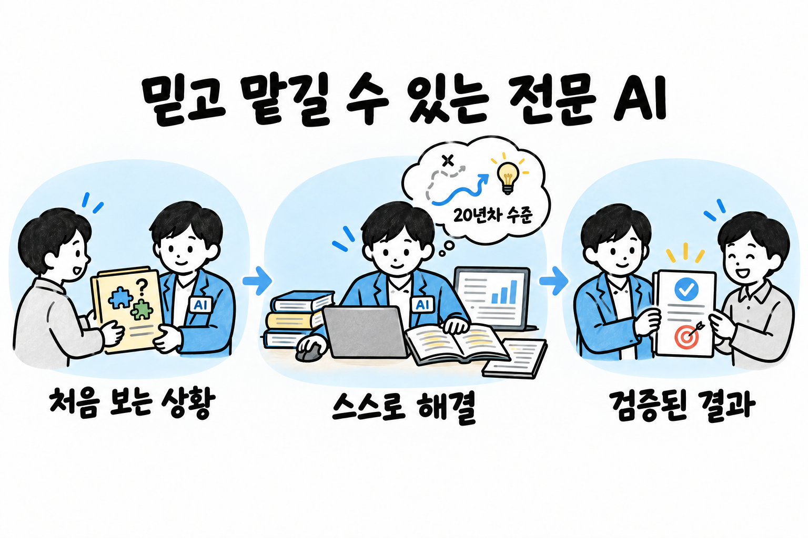

---

### 대체의 뜻 ✅

20년차에게 맡기듯 AI에게 믿고 맡길 수 있으면 대체다. 믿을 수 없어서 사람이 중간에 확인하거나 고치거나 마무리해 주면 아직 대체가 아니다.

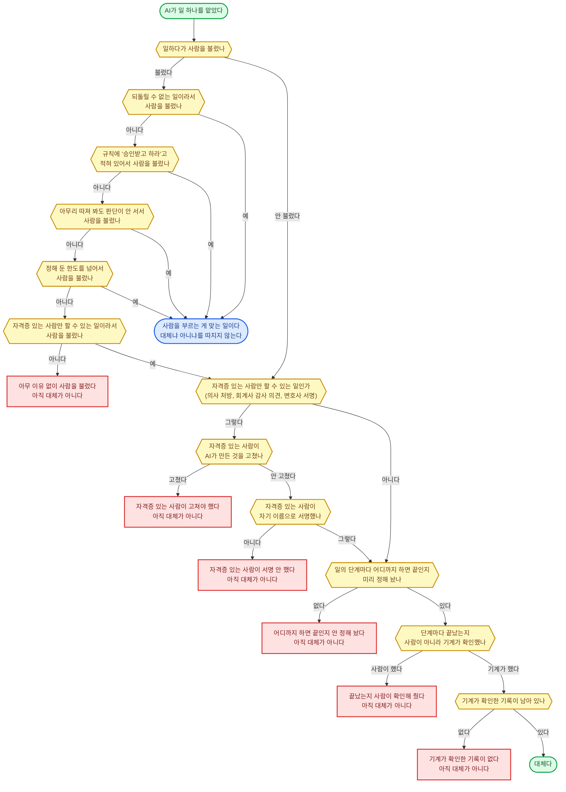

---

## 업무 처리 흐름 ✅

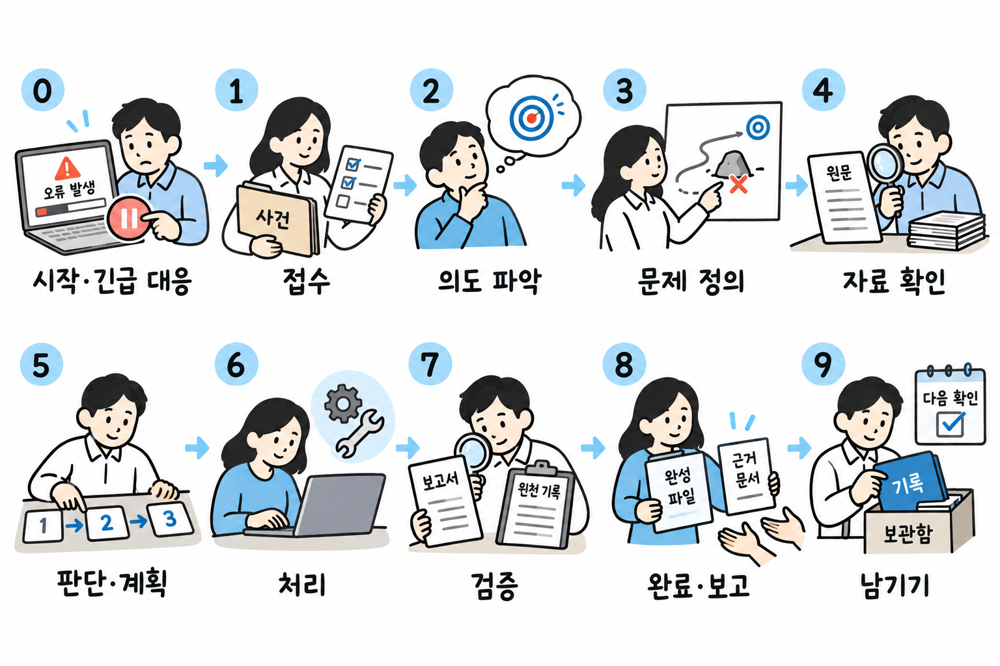

```mermaid
%%{init: {"layout": "elk", "elk": {"mergeEdges": false, "nodePlacementStrategy": "NETWORK_SIMPLEX", "keepEntryNodeOnTop": true}, "flowchart": {"defaultRenderer": "elk", "wrappingWidth": 640, "curve": "linear", "nodeSpacing": 70, "rankSpacing": 85, "padding": 20, "useMaxWidth": true}, "themeCSS": ".marker{overflow:visible !important} .arrowMarkerPath{stroke-width:5px !important;stroke-linejoin:round !important;stroke-linecap:round !important;transform:translateX(-6px)}", "themeVariables": {"fontSize": "16px"}} }%%
flowchart TB
    accTitle: 업무 처리 흐름
    accDescr: 시작부터 종료까지 실제 분기와 복귀선을 하나로 연결한 세로 순서도.
    subgraph PHASE_0["시작 · 긴급 대응"]
        direction TB
    REQ(["요청"]):::good
    SIGNAL(["신호 감지<br/>감시 중인 규칙 · 상대 · 조건의 변화 포함"]):::good
    CHANCE(["기회 발견"]):::good
    HARM{{"지금 실제 피해·오류·장애가 진행 중이고<br/>바로 막지 않으면 계속 커지는가?"}}:::note
    SAFE_ACTION{{"지금 바로 할 수 있는<br/>안전한 임시조치가 있는가?"}}:::note
    EMERGENCY_RULE{{"미리 승인된<br/>긴급 예외 조치가 있는가?"}}:::note
    FIRST_ACTION["추가 피해부터 막기<br/>문제 작업 중지 · 추가 결제나 전송 막기<br/>영향 범위 분리 · 정상 상태 복구 · 임시 대체"]:::main
    EMERGENCY_APPROVAL["긴급 승인 요청"]:::back
    EMERGENCY_EXEC["정해 둔 긴급 조치 실행<br/>실행하는 즉시 보고"]:::main
    EMERGENCY_DECISION{{"승인됐는가?"}}:::note
    APPROVED_ACTION["승인된 조치 실행"]:::main
    EMERGENCY_MONITOR["권한 안에서 추가 피해를 막고<br/>상태와 변화를 계속 기록"]:::main
    EMERGENCY_CHECK{{"추가 피해가<br/>멈췄는가?"}}:::note
    OPPORTUNITY{{"지금 놓치면<br/>사라지는 기회인가?"}}:::note
    OPPORTUNITY_DEADLINE["기회가 사라지는 시점을 업무 기한으로 등록<br/>다른 절차의 상태나 상대의 기한이<br/>정하는 시점도 포함"]:::main
    CASE_TYPE{{"이번 요청·신호가<br/>새로운 건인가?"}}:::note
    end
    subgraph PHASE_1["접수"]
        direction TB
    LOAD_CASE["진행 중인 건 불러오기<br/>현재 상태 · 남은 일 · 기한 · 대기 사항 확인"]:::main
    CASE_CHANGED{{"기존 목표 · 범위 · 사실 · 적용 규칙 ·<br/>당사자 가운데 바뀐 것이 있는가?"}}:::note
    INTAKE_CHECK["한 건의 범위 확인<br/>요청자의 권한 · 당사자 동의 · 이해충돌<br/>여러 당사자는 자격 · 이익 기준으로 건을 나눔<br/>상대의 상태 · 기한 · 업무 범위 · 보수 · 책임 조건 확인"]:::main
    ACCEPTABLE{{"지금 상태로<br/>접수할 수 있는가?"}}:::note
    CONDITION_CHECK["접수에 부족한 조건 확인<br/>권한 증빙 · 당사자 동의 · 필요한 승인<br/>업무 범위 조정 등"]:::main
    CONDITION_REQUEST["조건 보완 요청"]:::back
    CONDITION_WAIT["조건 충족 대기"]:::main
    CONDITION_OK{{"필요한 조건이<br/>충족됐는가?"}}:::note
    CONDITION_DEADLINE{{"보완할 기한이<br/>남아 있는가?"}}:::note
    REJECT["거절<br/>거절 이유와 가능한 대안 안내"]:::stop
    REJECT_RECORD[("접수·거절 기록 남기기")]:::store
    ACCEPTED["접수 확정"]:::main
    end
    subgraph PHASE_2["의도 파악"]
        direction TB
    INTENT_CLEAR{{"요청·지시만으로 원하는 결과가 한 가지로 정해지고<br/>맡긴 말의 분류가 실제 자료와 맞는가?"}}:::note
    AMBIGUOUS["모호한 부분과<br/>빠진 지시를 구분"]:::main
    INTENT_ASK["되묻기 · 지시 확인 · 의도 확인"]:::back
    INTENT_CONFIRMED{{"원하는 결과가<br/>확인됐는가?"}}:::note
    ASSUME_SAFE{{"확인 없이 가정해도<br/>결과 · 권리 · 비용에 큰 영향이 없는가?"}}:::note
    ASSUMPTION["가정한 내용과<br/>그 영향을 명시"]:::main
    INTENT_WAIT["답변 대기"]:::main
    end
    subgraph PHASE_3["문제 정의"]
        direction TB
    PROBLEM_ANALYSIS["원하는 결과를 막는<br/>원인 · 제약 · 빠진 요소 확인"]:::main
    DIRECT_SOLUTION{{"요청받은 일을 그대로 하면<br/>원하는 결과가 실제로 나오는가?"}}:::note
    REFRAME["실제로 해결해야 할 문제를<br/>다시 정의"]:::main
    REFRAME_SCOPE{{"새로 정의한 문제가<br/>기존 의도나 범위를 바꾸는가?"}}:::note
    REFRAME_CONFIRM["바뀐 목표 · 범위 · 완료 조건 확인"]:::back
    PROBLEM_SCOPE["풀 문제 · 풀지 않을 문제 · 이미 닫힌 부분 목록<br/>항목이 여럿이면 항목별 방식과 항목 간 영향<br/>업무 범위 확정"]:::main
    end
    subgraph PHASE_4["자료 확인"]
        direction TB
    COLLECT["필요한 자료를 직접 수집하고<br/>가능하면 원문까지 확인"]:::main
    CLASSIFY_DATA["사실 · 주장 · 추정을 구분<br/>누가 낸 자료인지 표시"]:::main
    VALIDATE_DATA["출처 · 시점 · 관할 · 판본 확인<br/>판정하는 곳이 받아 주는지 · 취득 경로 · 구속력 등급<br/>같은 사실의 상충 자료는 채택 가능성 순으로 등급"]:::main
    DATA_ENOUGH{{"결론을 바꿀 핵심 사실이<br/>확인됐거나 가정으로 표시됐는가?"}}:::note
    DATA_GAP["빠진 정보와<br/>확인 방법 정하기"]:::main
    GET_DATA["수집 행위가 근거를 해칠 위험을 먼저 판정<br/>추가 조회 · 상대나 기관에 질문 · 실험"]:::back
    DATA_FOUND{{"추가 사실을<br/>확인했는가?"}}:::note
    DATA_LIMIT["확인할 수 없는 내용은<br/>가정 · 근거 부족 · 입증 책임을 명시"]:::main
    end
    subgraph PHASE_5["판단 · 계획"]
        direction TB
    OPTIONS["가능한 방법과 대안 만들기"]:::main
    COMPARE["효과 · 비용 · 위험 · 부작용 · 상대의 예상 반응<br/>한 선택이 다른 항목에 미치는 연쇄 효과<br/>결론이 제3자의 승낙 · 행동에 달린 조건 비교"]:::main
    KNOWN_CASE{{"기존 규칙이나 사례가 이 사실을 덮고<br/>전제가 유효하며 해석이 갈리지 않는가?"}}:::note
    NEW_METHOD["원리 · 다른 분야의 같은 구조 사례를 바탕으로 새 방법 설계<br/>규칙 자체를 바꾸는 절차도 나란히 비교 대상에 둠"]:::main
    SMALL_TEST_Q{{"작은 범위에서<br/>먼저 시험할 수 있는가?"}}:::note
    SMALL_TEST["작게 시험하고<br/>어떤 결과가 나오면 중단할지도 정함"]:::main
    UNCERTAIN_PLAN["불확실성을 명시하고<br/>되돌리기 쉬운 방법을 우선"]:::main
    SELECT["실행 방법 선택<br/>이 선택이 잠그는 뒤 선택지를 적음"]:::main
    EXECUTION_PLAN["실행 순서 · 사건 간 영향 · 공동 작업<br/>관측별 전환 · 복구 · 중단 기준을 정함<br/>되돌릴 수 없는 결정은 따로 표시해 재확인"]:::main
    PREMISE{{"계획의 핵심 전제가 지금도 유지되고<br/>당사자별 자격 · 기한이 완료 예정일까지 남는가?"}}:::note
    UPDATE_PLAN["바뀐 조건을 반영해<br/>판단 · 계획 다시 수행"]:::main
    REPEAT_Q{{"주기적으로<br/>반복하는 업무인가?"}}:::note
    REPEAT_RULE["주기 · 자동 실행 범위 · 한도<br/>다음 점검 시점을 정함"]:::main
    HUMAN_Q{{"실행 전에 사람의 결정이 필요한가?<br/>되돌릴 수 없는 행동 · 사전 승인 필요<br/>판단 불가 · 한도 초과 · 자격자 전속"}}:::note
    HUMAN_PREP["AI가 할 수 있는 조사 · 계산 · 작성<br/>대안 비교 · 검증까지 먼저 완료"]:::main
    DECIDER{{"현재 결정권자가 권한이 있고 이해충돌이 없으며<br/>결정의 위험이 그 사람 주변에 미치지 않는가?"}}:::note
    DECISION_REQUEST["권한 있는 사람에게 결정 요청"]:::back
    ALT_DECIDER["미리 정한 다른 결정권자에게 요청"]:::back
    DECISION_RECEIVED{{"기한 안에<br/>결정이 왔는가?"}}:::note
    ESCALATE["다음 승인권자에게 올림"]:::back
    APPROVAL_GRANTED{{"승인 · 진행 결정인가?"}}:::note
    DECISION_REJECTED["반려 · 보류 사유와<br/>남은 일 기록"]:::stop
    end
    subgraph PHASE_6["처리"]
        direction TB
    PRE_EXECUTE["실행 전 시험 · 복구 수단 확보<br/>권한 · 금액 · 손실 한도 자동 검사"]:::main
    EXEC_ACTION["실제 실행"]:::main
    EXEC_STATE["실행 직후 실제 상태와<br/>상대 · 시스템 반응 기록"]:::main
    EXEC_FAIL{{"실행에 실패했는가?"}}:::note
    EXEC_LIMIT{{"시간 · 비용 · 시도 횟수 등<br/>정한 중단 한도를 넘었는가?"}}:::note
    REPEAT_FAIL{{"같은 실패가<br/>반복되고 있는가?"}}:::note
    STOP_HUMAN["현재 상태 · 실패 원인 · 대안과 함께<br/>사람에게 넘김"]:::back
    RECOVER["재시도 · 취소 · 원상복구"]:::main
    STOP_DECISION{{"다시 진행하기로<br/>결정됐는가?"}}:::note
    LOCAL_REPLAN["실패 원인을 반영해<br/>방법과 실행 순서 다시 계획"]:::main
    STOP_RECORD["중단 상태와<br/>남은 위험 기록"]:::stop
    end
    subgraph PHASE_7["검증"]
        direction TB
    ACTUAL_RESULT["원천 시스템 · 상대 · 시장에서<br/>실제 결과 확인"]:::main
    RECALCULATE["계산을 다시 하고 내 기록과 원천 기록 비교<br/>남이 낸 계산 · 문서도 같은 기준으로 검산"]:::main
    CROSS_CHECK["독립 근거 · 다른 방법으로 반증<br/>상대가 낸 근거는 상대에게 불리한 쪽으로도 읽음<br/>팀 간 이견 · 공통 오류 · 교차 영향 검토"]:::main
    RISK_CHECK["놓친 위험 · 빠진 대상 · 누락 항목 확인"]:::main
    ISSUE{{"수정해야 할 문제가<br/>발견됐는가?"}}:::note
    ISSUE_CAUSE{{"문제는 어디에서<br/>생겼는가?"}}:::note
    REWORK_DATA["자료를 다시 확인하고<br/>이후 판단 · 처리를 다시 수행"]:::main
    CAUSE_PLAN{{"판단 · 계획의 문제인가?"}}:::note
    REWORK_PLAN["판단 · 계획을 다시 하고<br/>필요한 처리를 다시 수행"]:::main
    CAUSE_EXEC{{"처리의 문제인가?"}}:::note
    REWORK_EXEC["잘못된 처리를 수정"]:::main
    UNFIXABLE["고칠 수 없는 문제는 숨기지 않고<br/>영향 · 유효기간 · 재검토 시점을 기록"]:::main
    REVERIFY["수정 결과 다시 검증"]:::main
    end
    subgraph PHASE_8["완료 · 보고"]
        direction TB
    COMPLETE{{"처음 정한 완료 조건이<br/>실제 상태에서 충족됐는가?"}}:::note
    CAN_FINISH{{"추가 처리하면<br/>완료할 수 있는가?"}}:::note
    REMAINING_WORK["남은 일 처리"]:::main
    PARTIAL["완료된 부분 · 남은 일<br/>완료하지 못한 이유를 구분"]:::main
    REMAINING_VERIFY["추가 처리 결과 검증"]:::main
    DELIVER["결과물 · 결론 · 근거 · 가정<br/>미완료 사항 전달"]:::back
    RESPONSE{{"받는 사람의 반응은?"}}:::note
    REVISION_SCOPE{{"기존 업무 범위 안의<br/>수정인가?"}}:::note
    NEW_REQUEST["새 목표 · 범위 · 완료 조건으로<br/>다시 접수"]:::main
    REVISION["수정 처리"]:::main
    REVISION_VERIFY["수정 결과 다시 검증"]:::main
    end
    subgraph PHASE_9["남기기"]
        direction TB
    CASE_RECORD[("사례 · 실패 원인 · 판단 과정<br/>실제 성과 기록")]:::store
    UPDATE[("필요한 지식 · 규칙 · 절차 · 기억<br/>고정 시험 항목 갱신<br/>바뀐 규칙을 쓴 과거 결과 목록을 재검토 대상에 올림")]:::store
    CONNECT[("결과와 기억을 다음 업무에 연결<br/>재검토 대상이 된 과거 건에 알림")]:::store
    FOLLOW_UP{{"후속 확인 · 반복 주기 · 성과 확정일이<br/>남아 있는가?"}}:::note
    SCHEDULE[("다음 기한 · 주기 · 성과 확정일을 감시 대상으로 등록<br/>계산으로 나온 기한 · 다른 절차 상태로 정해지는 기한 포함")]:::store
    FINAL(["업무 종료"]):::good
    WAIT(["대기<br/>다음 신호가 오면 기존 건으로 재개"]):::good
    end
    SIGNAL --> HARM
    REQ ~~~ HARM
    CHANCE ~~~ HARM
    CHANCE --> OPPORTUNITY
    REQ --> CASE_TYPE
    HARM -->|아니오 · 긴급 아님| CASE_TYPE
    HARM -->|예| SAFE_ACTION
    SAFE_ACTION -->|예| FIRST_ACTION
    SAFE_ACTION -->|아니오| EMERGENCY_RULE
    FIRST_ACTION --> EMERGENCY_CHECK
    EMERGENCY_RULE -->|예| EMERGENCY_EXEC
    EMERGENCY_RULE -->|아니오| EMERGENCY_APPROVAL
    EMERGENCY_EXEC --> EMERGENCY_CHECK
    EMERGENCY_APPROVAL --> EMERGENCY_DECISION
    EMERGENCY_DECISION -->|예| APPROVED_ACTION
    EMERGENCY_DECISION -->|아니오| EMERGENCY_MONITOR
    APPROVED_ACTION --> EMERGENCY_CHECK
    EMERGENCY_MONITOR --> EMERGENCY_CHECK
    EMERGENCY_CHECK -->|예| CASE_TYPE
    EMERGENCY_CHECK -->|아니오 · 아직 진행 중| SAFE_ACTION
    OPPORTUNITY -->|아니오| CASE_TYPE
    OPPORTUNITY -->|예| OPPORTUNITY_DEADLINE
    OPPORTUNITY_DEADLINE --> CASE_TYPE
    CASE_TYPE -->|아니오| LOAD_CASE
    CASE_TYPE -->|예| INTAKE_CHECK
    INTAKE_CHECK ~~~ LOAD_CASE
    LOAD_CASE --> CASE_CHANGED
    CASE_CHANGED -->|예| INTENT_CLEAR
    INTAKE_CHECK --> ACCEPTABLE
    ACCEPTABLE -->|가능| ACCEPTED
    ACCEPTABLE -->|조건 충족 후 가능| CONDITION_CHECK
    ACCEPTABLE -->|불가| REJECT
    CONDITION_CHECK --> CONDITION_REQUEST
    CONDITION_REQUEST --> CONDITION_WAIT
    CONDITION_WAIT --> CONDITION_OK
    CONDITION_OK -->|예| ACCEPTED
    CONDITION_OK -->|아니오| CONDITION_DEADLINE
    CONDITION_DEADLINE -->|예| CONDITION_WAIT
    CONDITION_DEADLINE -->|아니오| REJECT
    REJECT --> REJECT_RECORD
    REJECT_RECORD --> FINAL
    ACCEPTED --> INTENT_CLEAR
    INTENT_CLEAR -->|예| PROBLEM_ANALYSIS
    INTENT_CLEAR -->|아니오| AMBIGUOUS
    AMBIGUOUS --> INTENT_ASK
    INTENT_ASK --> INTENT_CONFIRMED
    INTENT_CONFIRMED -->|예| PROBLEM_ANALYSIS
    INTENT_CONFIRMED -->|아니오| ASSUME_SAFE
    ASSUME_SAFE -->|예| ASSUMPTION
    ASSUME_SAFE -->|아니오| INTENT_WAIT
    ASSUMPTION --> PROBLEM_ANALYSIS
    INTENT_WAIT --> INTENT_ASK
    PROBLEM_ANALYSIS --> DIRECT_SOLUTION
    DIRECT_SOLUTION -->|예| PROBLEM_SCOPE
    DIRECT_SOLUTION -->|아니오| REFRAME
    REFRAME --> REFRAME_SCOPE
    REFRAME_SCOPE -->|아니오| PROBLEM_SCOPE
    REFRAME_SCOPE -->|예| REFRAME_CONFIRM
    REFRAME_CONFIRM --> PROBLEM_SCOPE
    PROBLEM_SCOPE --> COLLECT
    COLLECT --> CLASSIFY_DATA
    CLASSIFY_DATA --> VALIDATE_DATA
    VALIDATE_DATA --> DATA_ENOUGH
    DATA_ENOUGH -->|예| OPTIONS
    DATA_ENOUGH -->|아니오| DATA_GAP
    DATA_GAP --> GET_DATA
    GET_DATA --> DATA_FOUND
    DATA_FOUND -->|예| COLLECT
    DATA_FOUND -->|아니오| DATA_LIMIT
    DATA_LIMIT --> OPTIONS
    CASE_CHANGED -->|아니오| OPTIONS
    OPTIONS --> COMPARE
    COMPARE --> KNOWN_CASE
    KNOWN_CASE -->|예| SELECT
    KNOWN_CASE -->|아니오 · 규칙이 없거나 덮지 못하거나 갈림| NEW_METHOD
    NEW_METHOD --> SMALL_TEST_Q
    SMALL_TEST_Q -->|예| SMALL_TEST
    SMALL_TEST_Q -->|아니오| UNCERTAIN_PLAN
    SMALL_TEST --> SELECT
    UNCERTAIN_PLAN --> SELECT
    SELECT --> EXECUTION_PLAN
    EXECUTION_PLAN --> PREMISE
    PREMISE -->|예| REPEAT_Q
    PREMISE -->|아니오| UPDATE_PLAN
    UPDATE_PLAN --> EXECUTION_PLAN
    REPEAT_Q -->|아니오| HUMAN_Q
    REPEAT_Q -->|예| REPEAT_RULE
    REPEAT_RULE --> HUMAN_Q
    HUMAN_Q -->|아니오| PRE_EXECUTE
    HUMAN_Q -->|예| HUMAN_PREP
    HUMAN_PREP --> DECIDER
    DECIDER -->|예| DECISION_REQUEST
    DECIDER -->|아니오| ALT_DECIDER
    DECISION_REQUEST --> DECISION_RECEIVED
    ALT_DECIDER --> DECISION_RECEIVED
    DECISION_RECEIVED -->|예| APPROVAL_GRANTED
    DECISION_RECEIVED -->|아니오| ESCALATE
    ESCALATE --> DECISION_RECEIVED
    PRE_EXECUTE --> EXEC_ACTION
    EXEC_ACTION --> EXEC_STATE
    EXEC_STATE --> EXEC_FAIL
    EXEC_FAIL -->|아니오| ACTUAL_RESULT
    EXEC_FAIL -->|예| EXEC_LIMIT
    EXEC_LIMIT -->|예| STOP_HUMAN
    EXEC_LIMIT -->|아니오| REPEAT_FAIL
    REPEAT_FAIL -->|아니오| RECOVER
    REPEAT_FAIL -->|예| LOCAL_REPLAN
    RECOVER --> PRE_EXECUTE
    LOCAL_REPLAN --> PRE_EXECUTE
    STOP_HUMAN --> STOP_DECISION
    STOP_DECISION -->|예| LOCAL_REPLAN
    STOP_DECISION -->|아니오| STOP_RECORD
    STOP_RECORD --> COMPLETE
    ACTUAL_RESULT --> RECALCULATE
    RECALCULATE --> CROSS_CHECK
    CROSS_CHECK --> RISK_CHECK
    RISK_CHECK --> ISSUE
    ISSUE -->|아니오| COMPLETE
    ISSUE -->|예| ISSUE_CAUSE
    ISSUE_CAUSE -->|자료| REWORK_DATA
    ISSUE_CAUSE -->|그 외| CAUSE_PLAN
    CAUSE_PLAN -->|예| REWORK_PLAN
    CAUSE_PLAN -->|아니오| CAUSE_EXEC
    CAUSE_EXEC -->|예| REWORK_EXEC
    CAUSE_EXEC -->|수정 불가| UNFIXABLE
    REWORK_DATA --> REVERIFY
    REWORK_PLAN --> REVERIFY
    REWORK_EXEC --> REVERIFY
    REVERIFY --> ISSUE
    UNFIXABLE --> COMPLETE
    COMPLETE -->|예| DELIVER
    COMPLETE -->|아니오| CAN_FINISH
    CAN_FINISH -->|예| REMAINING_WORK
    CAN_FINISH -->|아니오| PARTIAL
    REMAINING_WORK --> REMAINING_VERIFY
    REMAINING_VERIFY --> COMPLETE
    PARTIAL --> DELIVER
    DELIVER --> RESPONSE
    RESPONSE -->|완료 확인| CASE_RECORD
    RESPONSE -->|새 요청·범위 변경| NEW_REQUEST
    RESPONSE -->|수정 요청| REVISION_SCOPE
    REVISION_SCOPE -->|예| REVISION
    REVISION_SCOPE -->|아니오| NEW_REQUEST
    REVISION --> REVISION_VERIFY
    REVISION_VERIFY --> DELIVER
    NEW_REQUEST --> INTAKE_CHECK
    CASE_RECORD --> UPDATE
    UPDATE --> CONNECT
    CONNECT --> FOLLOW_UP
    FOLLOW_UP -->|아니오| FINAL
    FOLLOW_UP -->|예| SCHEDULE
    SCHEDULE --> WAIT
    APPROVAL_GRANTED -->|예| PRE_EXECUTE
    APPROVAL_GRANTED -->|아니오| DECISION_REJECTED
    DECISION_REJECTED --> COMPLETE
    WAIT --> LOAD_CASE
    style PHASE_0 fill:none,stroke:#5f6f82,stroke-width:1.2px,stroke-dasharray:1 6,color:#7b8a9c
    style PHASE_1 fill:none,stroke:#5f6f82,stroke-width:1.2px,stroke-dasharray:1 6,color:#7b8a9c
    style PHASE_2 fill:none,stroke:#5f6f82,stroke-width:1.2px,stroke-dasharray:1 6,color:#7b8a9c
    style PHASE_3 fill:none,stroke:#5f6f82,stroke-width:1.2px,stroke-dasharray:1 6,color:#7b8a9c
    style PHASE_4 fill:none,stroke:#5f6f82,stroke-width:1.2px,stroke-dasharray:1 6,color:#7b8a9c
    style PHASE_5 fill:none,stroke:#5f6f82,stroke-width:1.2px,stroke-dasharray:1 6,color:#7b8a9c
    style PHASE_6 fill:none,stroke:#5f6f82,stroke-width:1.2px,stroke-dasharray:1 6,color:#7b8a9c
    style PHASE_7 fill:none,stroke:#5f6f82,stroke-width:1.2px,stroke-dasharray:1 6,color:#7b8a9c
    style PHASE_8 fill:none,stroke:#5f6f82,stroke-width:1.2px,stroke-dasharray:1 6,color:#7b8a9c
    style PHASE_9 fill:none,stroke:#5f6f82,stroke-width:1.2px,stroke-dasharray:1 6,color:#7b8a9c
    classDef main fill:#dbeafe,stroke:#7dabe8,stroke-width:1.4px,color:#17314f
    classDef stop fill:#fee2e2,stroke:#f0a3a3,stroke-width:1.4px,color:#7f1d1d
    classDef back fill:#ffedd5,stroke:#f3b183,stroke-width:1.4px,color:#7c2d12
    classDef store fill:#e5e7eb,stroke:#b0b6bf,stroke-width:1.4px,color:#1f2937
    classDef good fill:#dcfce7,stroke:#86d3a3,stroke-width:1.4px,color:#14532d
    classDef note fill:#fef9c3,stroke:#e2c95f,stroke-width:1.4px,color:#713f12
    linkStyle 0,3,4 stroke:#34d399,stroke-width:2.6px
    linkStyle 6,7,10,14,18,21,24,27,29,30,35,42,46,48,53,57,63,73,76,82,86,89,91,95,102,103,106,110,118,119,121,123,124,130,132,138,139,140,141,150,152 stroke:#60a5fa,stroke-width:2.6px
    linkStyle 5,8,11,15,20,23,36,43,49,54,56,64,68,70,74,77,83,85,88,92,96,101,104,105,117,122,131,133,142,149 stroke:#94a3b8,stroke-width:2.2px,stroke-dasharray:8 5
    linkStyle 19,37,47,51,67,81,84,97,107,108,120,128,135,144,145,155 stroke:#e879f9,stroke-width:2.2px,stroke-dasharray:4 8
    linkStyle 31,38,111,153 stroke:#f87171,stroke-width:2.6px
    linkStyle 9,12,13,16,17,22,26,28,32,33,34,39,40,41,44,45,50,52,55,58,59,60,61,62,65,66,69,71,72,75,78,79,80,87,90,93,94,98,99,100,109,112,113,114,115,116,125,126,127,129,134,136,137,143,146,147,148,151,154 stroke:#60a5fa,stroke-width:2.0px
```

---

## 수식 ✅

### 구성 개념식 ✅

$$
\text{전문 AI 에이전트의 구성} = \text{환경} \times \text{지식} \times \text{규칙} \times \text{실무} \times \text{검증} \times \text{학습}
$$

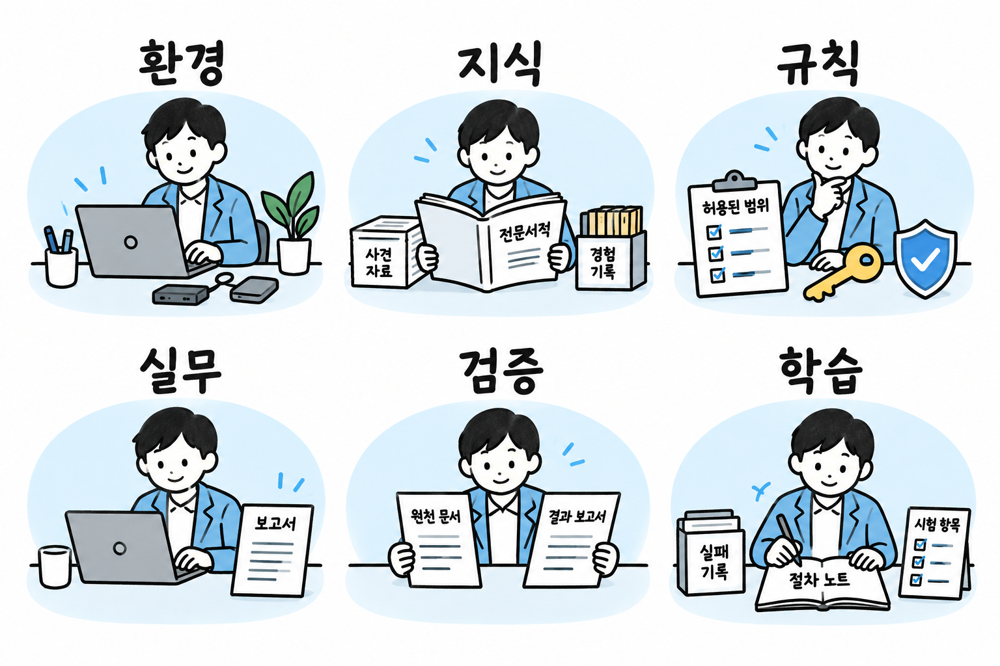

---

### 구성 전개식 ✅

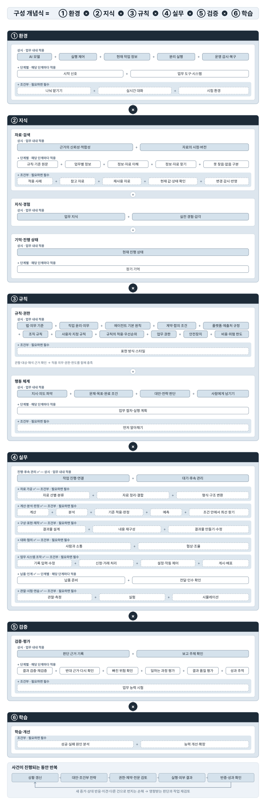

---

## 계통별 재료 ✅

| 표시 | 어느 업무에 | 언제 |
| --- | --- | --- |
| **상시** | 모든 업무 | ▶️ 진행하는 동안 책임을 계속 유지한다 ▶️ 같은 도구나 검사를 매 순간 반복한다는 뜻은 아니다 |
| **단계별** | 모든 업무 | ▶️ 필요한 단계가 오면 쓴다 ▶️ 자료나 목표가 바뀌면 다시 확인한다 |
| **조건부** | 해당 조건이 있는 업무 | ▶️ 조건이 충족되면 반드시 쓴다 ▶️ 해당 여부가 불명확하면 먼저 확인한다 |

---

### 환경 ✅

AI가 판단하고 행동할 수 있게 만드는 **업무 수행의 기반**이다. 모델과 실행 제어, 작업 공간과 외부 연결을 제공한다.

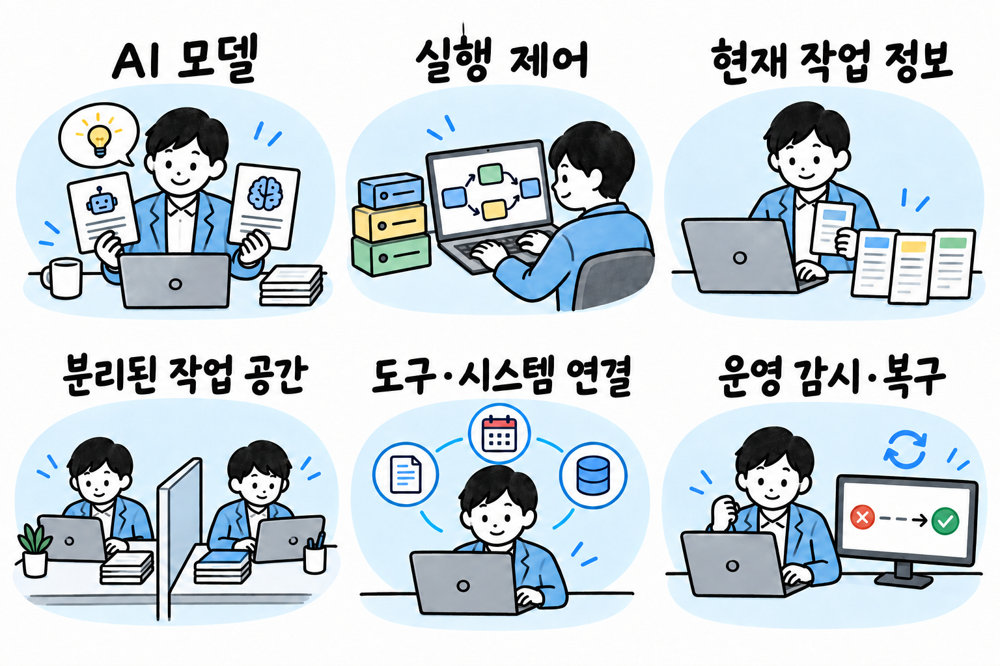

| 재료 | 한마디로 | 하는 일 | 예시 | 구분 | 사용 시점·조건 |
| --- | --- | --- | --- | --- | --- |
| **1. AI 모델** ✅ | **에이전트의 두뇌** | ▶️ 목표와 입력된 정보를 바탕으로 내용을 이해하고 추론한다 ▶️ 가능한 답이나 행동을 만들고 비교해 무엇을 할지 판단한다 ▶️ 업무에 필요한 답변·아이디어·콘텐츠를 생성한다 | 문의의 뜻과 요구 파악 · 도면의 치수 관계로 규격 충족 여부 추론 · 부족한 근거를 더 찾아볼지 판단 · 목적에 맞는 답변과 아이디어 생성 | **상시** | 정보를 이해·판단하거나 업무에 필요한 내용을 만들 때 |
| **2. 실행 제어** ✅ | **AI의 판단과 정해진 작업 흐름을 실행하기** | ▶️ 정해진 작업 흐름과 모델의 판단에 따라 함수·도구·AI를 호출하고 결과·오류를 전달한다 ▶️ 판단과 실행의 반복, 순차·병렬 실행, 조건 분기와 결과 합류를 제어한다 ▶️ 선행 작업과 필요한 결과의 준비 여부를 확인하고, 정해진 계산·조회·변환·조건 분기는 모델을 거치지 않고 실행한다 ▶️ 일부 실패·대기·취소·재개·종료를 처리하며 변경된 실행 계획을 반영한다 | 코드 고치기→테스트→실패한 곳 다시 고치기 · 날씨·코스 조회 함수를 동시에 실행하고 필요한 결과가 모이면 AI 호출 · 정해진 재고 수량 조건에 따라 다음 작업 실행 · 자료 요청→답장이 오면 대기 중인 실행 재개 | **상시** | 업무를 시작한 뒤 끝날 때까지 |
| **3. 현재 작업 정보** ✅ | **모델이 지금 판단할 때 참고하는 정보** | ▶️ 이번 판단에 필요한 지시·자료·진행 상태·이전 기록을 골라 모델에게 제공한다 ▶️ 목표와 조건을 유지하면서 정보의 양과 구성을 조절하고, 상황이 바뀌면 필요한 내용을 교체·보완한다 | 지금 처리 중인 문의 · 방금 확인한 계약서 조항 · 방금 나온 계산 결과 · 이번 일의 마감일 | **상시** | 모델이 판단할 때마다 |
| **4. 분리 실행** ✅ | **문제가 다른 작업으로 번지지 않게 따로 실행** | ▶️ 서로 섞이면 안 되는 자료와 작업을 구분해 공간과 실행 환경을 나눈다 ▶️ 함께 쓰도록 허용된 자료와 도구는 공유할 수 있게 한다 ▶️ 한 작업의 오류나 과도한 자원 사용이 다른 작업에 번지지 않도록 실행과 자원 사용을 조절한다 | 공유하면 안 되는 업무 자료를 별도 공간에서 처리 · 함께 쓰도록 허용된 참고 자료는 공유 · 외부에서 받은 파일의 검사를 다른 업무와 분리된 공간에서 실행 · 대용량 변환 작업의 자원 사용을 조절해 다른 업무의 중단 방지 | **상시** | 업무 공간을 만들거나 코드와 도구를 실행할 때 |
| **5. 운영 감시·복구** ✅ | **장애를 알아채고 시스템과 중단된 업무를 복구하기** | ▶️ 에이전트와 별도로 운영 상태를 감시한다 ▶️ 에이전트와 시스템의 중단뿐 아니라 응답 지연·오류 증가·자원 부족도 찾아낸다 ▶️ 문제가 다른 곳으로 번지지 않게 막고 시스템을 다시 정상 상태로 돌린다 ▶️ 중단된 업무는 중단 시점의 저장된 진행 상태와 함께 담당에게 돌려준다 | 밤사이 멈춘 문서 변환 작업을 아침 전에 알아채고 다시 돌림 · 검색 응답이 느려지면 예비 연결로 바꿈 · 모델 장애 때 준비된 다른 모델 연결로 전환 · 복구 뒤 중단 시점의 진행 상태를 담당에게 돌려줌 | **상시** | 에이전트와 업무 수행 기반을 운영하는 동안 |
| **6. 시작 신호** ✅ | **업무를 시작하거나 이어 가게 하는 신호** | ▶️ 요청이나 변화가 생기거나 정해진 시점·조건에 도달했는지 감지한다 ▶️ 감지한 신호를 해당 업무나 대기 건의 담당에게 전달한다 | 새 문의 도착 · 감시 중인 파일의 변경 · 예약한 오전 9시 도달 · 기다리던 답변 도착이나 앞 단계의 완료 | **단계별** | 요청·변화·정해진 시점·조건을 감지해 알릴 때 |
| **7. 업무 도구·시스템** ✅ | **업무에 쓰는 프로그램·장비·서비스와의 연결** | ▶️ 업무에 필요한 도구와 시스템을 연결해 사용할 수 있게 한다 ▶️ 요청을 대상 도구가 처리할 수 있는 형태로 전달하고, 결과·오류·진행 상태를 에이전트에게 돌려준다 | 문서·이미지 편집기 연결 · 일정 서비스에 예약 요청 전달 · 측정 장비의 값 읽기 · 업무 시스템의 진행 상태와 오류 응답 받기 · 대상과 관계를 저장·조회하는 그래프 DB 연결 | **단계별** | 업무 도구·시스템을 연결하거나 요청을 보낼 때 · 결과·오류·진행 상태를 받을 때 |
| **8. 나눠 맡기기** ✅ | **여러 AI에게 작업을 보내고 결과 모으기** | ▶️ 정해진 분담에 따라 각 AI에 작업과 필요한 자료·도구·허용된 권한을 전달한다 ▶️ AI 사이에 필요한 정보와 중간 결과를 주고받게 하고 진행 상태를 모은다 ▶️ 결과를 합치면서 빠진 부분과 중복, 이견, 실패를 확인해 담당 AI의 보완 작업을 연결한다 ▶️ 분담이나 방법을 바꿔야 할 문제는 대안·전략 판단으로 돌려보낸다 | 분담된 계약서 부분을 각 AI에게 전달하고 검토 결과 합치기 · 조사 AI가 찾은 자료를 검토 AI에게 전달 · 답변이 오지 않은 AI의 진행 상태 확인 · AI들의 결론이 다르면 근거를 모아 재검토에 연결 | **조건부** | 여러 AI에게 작업을 전달할 때 · AI 사이의 정보 교환·진행·결과 회수와 보완을 관리할 때 |
| **9. 실시간 대화** ✅ | **바로 대화할 수 있게 연결하는 통로** | ▶️ 대화의 입력과 출력을 실시간으로 주고받게 한다 ▶️ 대화 방식에 맞춰 발언 순서와 응답의 중단·재개를 처리한다 ▶️ 연결과 전송 상태를 관리하고, 끊긴 대화를 다시 이어 갈 수 있게 한다 | 음성 통화 연결 · 상대가 말을 시작하면 AI 음성 재생 멈추기 · 끊긴 채팅 연결 복구 | **조건부** | 바로 답을 주고받아야 하는 대화에서 |
| **10. 시험 환경** ✅ | **시험·오류 재현·능력 평가에 필요한 공간과 조건, 통과한 것만 내보내는 문** | ▶️ 시험 목적에 맞는 환경과 조건을 구성하고 필요한 자료·도구·계정을 준비한다 ▶️ 비교하거나 다시 재현할 수 있도록 시험 조건을 관리한다 ▶️ 운영 중인 업무나 원본 자료에 영향을 주면 안 되는 시험에는 분리된 공간을 제공한다 ▶️ 시험 기록이 없거나 통과하지 못한 판본은 실제 환경으로 나가지 못하게 막는다 | 테스트 서버와 연습용 계정 준비 · 오류가 난 조건을 재현할 자료·설정 준비 · 모의 협상에 사용할 가상 상대와 상황 준비 · 시험을 통과한 판본만 운영 서버로 내보내는 문 관리 | **조건부** | 시험·오류 재현·능력 평가에 별도의 공간과 조건이 필요할 때 |

---

### 자료·검색 ✅

업무에 필요한 자료를 확보하고 **해석·재사용할 수 있는 상태로 관리하는 체계**다. 자료의 출처·신뢰성·적용 시점도 함께 관리한다.

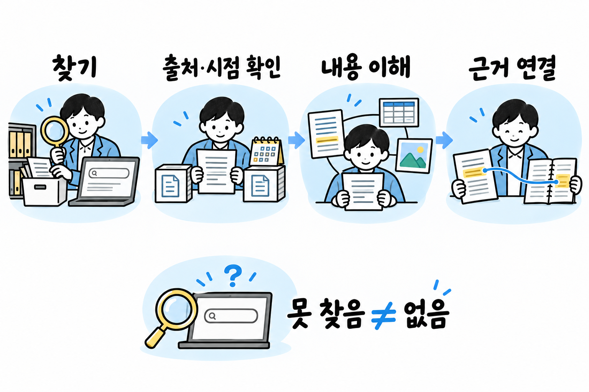

| 재료 | 한마디로 | 하는 일 | 예시 | 구분 | 사용 시점·조건 |
| --- | --- | --- | --- | --- | --- |
| **11. 근거의 신뢰성·적합성** ✅ | **정보를 얼마나 믿을 수 있고 이번 업무에 써도 되는지 확인** | ▶️ 정보의 출처와 수집·작성 과정을 살펴 얼마나 믿을 수 있는지 확인한다 ▶️ 이번 업무의 대상과 조건에 맞는 근거인지 판단한다 ▶️ 빠진 내용이나 치우침, 다른 정보와의 충돌을 확인하고 사실·주장·추정을 구분한다 ▶️ 여러 자료에서 종합한 주장과 관계도 원문이 뒷받침하는지 확인하고, 추론한 내용과 직접 확인한 사실을 구별한다 ▶️ 같은 정보를 옮겨 쓴 여러 자료를 서로 독립된 근거로 세지 않는다 ▶️ 내용과 별개로, 결과를 판정할 곳이 그 근거를 받아 주는지, 취득 경로가 허용된 방법인지, 구속력 등급(원본·구속 규칙·참고·사후 작성)이 무엇인지 확인하고 낮은 등급으로 높은 등급의 결론을 대신하지 않는다 ▶️ 같은 사실에 상충하는 수치·전문가 소견이 있으면 판정할 곳이 채택할 가능성 순으로 등급을 매기고 이유를 적는다 | 측정 조건이 다른 수치를 그대로 비교해도 되는지 확인 · 조사 대상이 한쪽에 치우쳤는지 확인 · 당사자의 주장과 확인된 사실 구분 · 같은 원문을 옮긴 여러 자료를 독립된 근거로 보지 않기 · 절차를 어겨 얻은 자료는 판정 기관이 받아 주지 않을 수 있음을 표시 · 상충하는 두 감정 결과에 채택 가능성 순위와 이유 기록 | **상시** | 정보나 자료를 판단·실행·설명의 근거로 쓸 때 · 남이나 상대가 낸 자료를 근거로 받을 때 |
| **12. 자료의 시점·버전** ✅ | **이번 일에 맞는 시점과 버전을 고르기** | ▶️ 업무를 처리하는 날짜와 판단해야 할 대상 시점을 구분한다 ▶️ 그 대상과 시점에 맞는 자료 버전을 고른다 ▶️ 어떤 버전을 사용했는지와 언제 확인했는지도 남긴다 ▶️ 수정된 자료와 이전 버전의 관계도 함께 관리한다 ▶️ 자료를 종합해 만든 지식에서도 근거 원문의 위치·판본·적용 시점을 되짚을 수 있게 연결한다 | 과거 업무에 당시 규정 적용 · 도면 수정 버전 구분 · 가격을 확인한 시각과 그 가격이 적용되는 날짜 구분 · 지식 문서의 주장과 근거 원문 판본 연결 | **상시** | 업무에 맞는 자료를 고를 때 · 업무의 대상·시점이나 자료가 바뀌었을 때 |
| **13. 규칙·기준 원문** ✅ | **이번 일에 적용되는 규칙의 원문을 갖춰 두기** | ▶️ 업무에 적용할 규칙과 기준을 원문으로 확보한다 ▶️ 출처와 적용 시점을 함께 정리해 어떤 규칙인지 확인하고 찾아볼 수 있게 한다 | 적용 법령의 원문 · 설계·품질 기준 문서 · 매체의 콘텐츠 게시 규정 원문 · 회사·기관의 내부 규정 원문 | **단계별** | 업무에 적용할 규칙·기준의 원문을 확보하거나 다시 확인할 때 · 규칙이나 적용 범위·시점이 바뀌었을 때 |
| **14. 업무별 정보** ✅ | **이번 업무의 대상·상황·조건을 파악하는 정보** | ▶️ 이번 업무의 대상과 현황, 요구 사항과 조건을 파악하는 데 필요한 정보를 모아 정리한다 ▶️ 사람이나 조직이 제공한 자료뿐 아니라 관찰·측정한 내용과 시스템 기록도 함께 다룬다 ▶️ 업무 중 새로 확인되거나 바뀐 정보도 함께 정리한다 | 요청한 결과·작업 범위·기한 · 현장 사진과 측정값 · 시스템의 처리 이력 · 대상의 현재 상태를 보여 주는 문서·도면 | **단계별** | 업무를 시작할 때 · 대상·상황·조건에 관한 정보가 새로 확인되거나 바뀌었을 때 |
| **15. 정보·자료 이해** ✅ | **여러 형태의 정보가 무엇을 뜻하는지 이해하기** | ▶️ 여러 형태로 들어온 정보의 내용과 구조, 맥락을 파악한다 ▶️ 서로 관련된 내용을 연결해 의미를 이해하고 업무에 필요한 내용을 뽑아 정리한다 ▶️ 내용이 나온 위치나 시점을 남기고, 알아보기 어렵거나 뜻이 불분명한 부분을 구분한다 | 문서의 주장과 조건 파악 · 도면·표에서 항목 사이의 관계 파악 · 대화의 말뜻과 앞뒤 맥락 이해 · 영상 속 행동과 변화 파악 · 코드·작업 기록에서 처리 흐름 읽기 | **단계별** | 새 정보를 접하거나 기존 자료를 다시 살펴볼 때 · 내용이나 맥락이 달라졌을 때 |
| **16. 정보·자료 찾기** ✅ | **업무에 필요한 정보·지식·방법·자료를 찾아 확보** | ▶️ 업무에 필요한 정보와 지식, 해결 방법과 자료를 찾아 확보한다 ▶️ 웹·자료실·내부 기록을 검색하거나 사람·기관에 문의한다 ▶️ 개념·대상·근거 사이의 연결을 따라 관련 지식과 예외·반대 근거를 찾고, 종합된 내용에서 근거 원문으로 되짚어 확인한다 ▶️ 찾은 내용과 출처, 아직 확보하지 못한 내용을 정리한다 | 웹에서 필요한 정보 검색 · 논문·책에서 원리와 방법 찾기 · 전문가에게 노하우 문의 · 과거 기록에서 해결 방법 찾기 · 필요한 코드·서식 찾기 · 부품과 제품의 연결을 따라 해당 제품에 적용되는 기준 찾기 | **단계별** | 업무에 필요한 정보·지식·방법·자료가 없거나 부족할 때 |
| **17. 못 찾음·없음 구분** ✅ | **못 찾은 것과 없는 것을 갈라 말하기** | ▶️ 찾기와 조회의 결과를 찾음·못 찾음·없음으로 나눈다 ▶️ 못 찾음은 찾아본 범위와 질의의 한계로, 없음은 근거를 갖춘 단정으로 구분해 적는다 ▶️ 없음으로 적으려면 어디를 어떤 질의로 언제까지 찾았는지와 그 자리가 빠짐없이 담은 목록인지 확인한다 ▶️ 전수 목록이 아니면 찾은 범위 안에는 없다로만 적는다 ▶️ 찾아봄·원문 확인·전수 확인의 증거 등급을 붙이고 낮은 등급을 높여 말하지 않는다 ▶️ 아무것도 못 찾은 검색도 질의·원천·시점과 함께 남긴다 ▶️ 같은 분야에서 사례를 못 찾았을 때는 다른 분야에서 같은 구조의 사례를 찾았는지까지 적고, 분야를 넘겨 빌린 사례는 그렇게 표시한다 | 선행 특허를 못 찾은 것과 선행 특허가 없는 것 구분 · 등록부 전수 조회로 확인한 미등록 · 내부 자료에만 없는 것과 공개된 곳에도 없는 것 구분 · 빈손으로 끝난 검색의 질의·원천·시점 기록 · 같은 분야 선례 없음과 다른 분야의 같은 구조 선례 있음을 구분해 기록 | **단계별** | 없음·해당 없음을 결론이나 근거로 적을 때 · 찾기나 조회가 빈손으로 끝났을 때 |
| **18. 적용 사례** ✅ | **규칙이나 방법을 적용한 과정과 결과를 보여 주는 자료** | ▶️ 다른 업무에서 규칙이나 방법을 어떻게 적용했는지와 그 결과를 보여 주는 사례를 모은다 ▶️ 무엇을 근거로 판단했는지와 어떤 조건에서 효과나 문제가 나타났는지 확인한다 ▶️ 이번 업무와 비슷한 점과 다른 점도 살핀다 | 대응 조건과 성공·실패 원인이 담긴 장애 사례 · 선택한 방법과 그 이유가 담긴 설계 사례 · 규칙을 해석한 근거와 결론이 담긴 판례·심사 사례 | **조건부** | 규칙이나 방법의 적용 과정·결과를 참고할 때 · 사례의 조건을 이번 업무와 비교해야 할 때 |
| **19. 참고 자료** ✅ | **업무를 이해하고 수행할 때 참고하는 자료** | ▶️ 원리와 방법, 판단과 표현에 참고할 자료를 확보한다 ▶️ 어떤 부분을 어떤 목적으로 참고할 수 있는지 정리해 필요한 때 찾아볼 수 있게 한다 | 원리를 설명한 전문 서적 · 작업 방법을 담은 사용 설명서 · 판단에 참고할 논문·통계 자료 · 구성과 표현을 살펴볼 디자인 견본 | **조건부** | 업무를 이해하거나 판단·작업에 참고할 자료가 필요할 때 |
| **20. 재사용 자료** ✅ | **다시 가져다 쓸 자료·서식·부품** | ▶️ 여러 업무에서 다시 사용할 서식·원본·부품·코드 등을 관리한다 ▶️ 필요한 부분을 가져다 쓰거나 고쳐 쓸 수 있게 정리한다 ▶️ 다시 사용할 권리가 있는지, 사용할 도구나 환경에 맞는지도 확인한다 | 보고서 서식 · 계산식·분석 코드 · 설계에 넣어 쓸 부품 · 수정해 쓸 이미지·영상 원본 | **조건부** | 다시 쓸 자료·서식·부품·코드를 정리하거나 가져다 쓸 때 · 이용 권한이나 사용할 도구·환경이 바뀌었을 때 |
| **21. 현재 값·상태 확인** ✅ | **지금 필요한 값과 상태를 확인** | ▶️ 판단이나 실행에 필요한 현재 값과 상태를 조회하거나 관찰한다 ▶️ 확인한 시점과 지금 업무에 사용할 수 있는 정보인지 함께 확인한다 | 시설의 이용 가능 여부 확인 · 주문 직전 재고 확인 · 장비의 온도와 가동 상태 확인 | **조건부** | 현재 값이나 상태에 따라 판단·실행이 달라질 때 |
| **22. 변경 감시·반영** ✅ | **자료·조건·상태의 변화를 찾아 관련 업무에 알림** | ▶️ 지켜보기로 한 자료나 조건·상태의 변화를 찾아낸다 ▶️ 무엇이 바뀌었고 언제부터 영향을 주는지 확인한다 ▶️ 영향을 받는 업무와 담당을 찾아 알리고, 보관 중인 관련 자료를 새 내용으로 바꾼다 ▶️ 근거 원문이 정정·철회되면 연결된 지식과 그 지식에서 파생된 내용을 따라 재검토 대상을 찾아 해당 담당에게 알린다 ▶️ 기본 감시 항목에는 적용 규칙의 해석·개정 동향과 상대·관계자의 지위 변화(도산·합병·해산·담당 교체 등)를 넣는다 ▶️ 맡을 때 적용 규칙이 다투어지는 중이면 그 규칙의 변경 추적을 자동으로 켠다 | 개정된 규정을 새 판본으로 바꾸고 해당 업무 담당에게 알림 · 거래처 담당자 교체를 알아채 진행 중인 견적 건에 알림 · 창고 재고가 바뀌면 관련 주문 담당에게 알림 · 원문 정정으로 재검토할 지식 문서를 찾아 담당에게 알림 · 진행 중인 건이 기대는 규칙의 상급 판단·개정 예고 추적 · 거래 상대의 도산·합병 소식을 잡아 해당 건에 알림 | **조건부** | 업무에 영향을 주는 정보의 변경을 계속 따라가야 할 때 · 맡을 때 적용 규칙이 다투어지고 있을 때 |

---

### 지식·경험 ✅

판단과 실무에 활용하는 **전문 지식과 경험**이다. 직무의 개념·원리·방법과 이를 상황에 맞게 적용하는 숙련된 판단력을 포함한다. 근거와 적용 조건을 연결해 재사용할 수 있게 구성하고 유지한다.

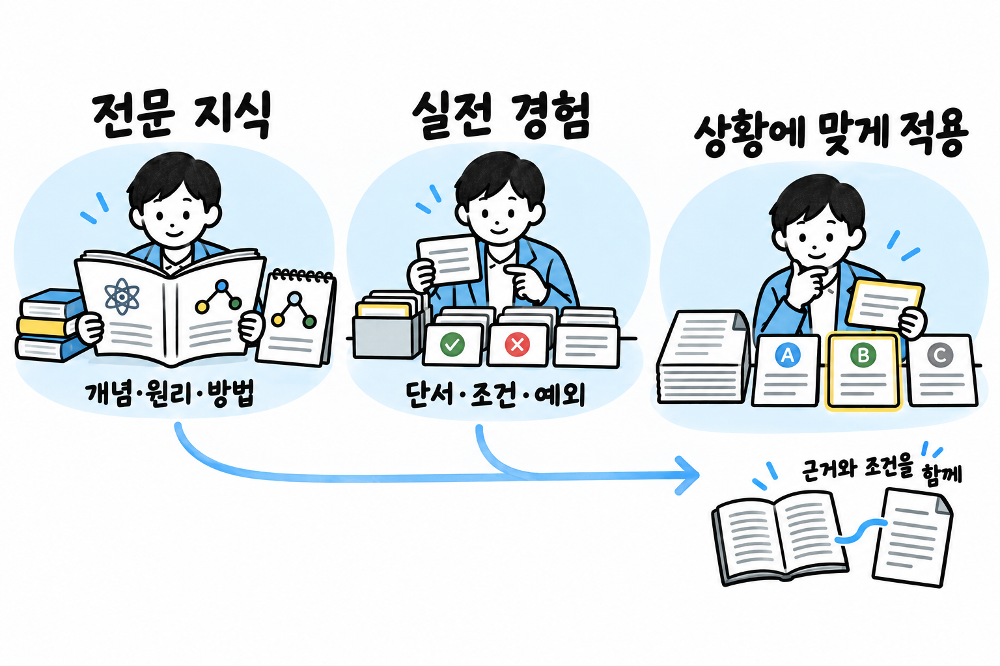

| 재료 | 한마디로 | 하는 일 | 예시 | 구분 | 사용 시점·조건 |
| --- | --- | --- | --- | --- | --- |
| **23. 업무 지식** ✅ | **그 일을 판단하고 수행하는 데 필요한 전문 지식** | ▶️ 업무에 필요한 개념·대상·원리·방법과 그 관계를 정리하고 판단과 수행에 활용한다 ▶️ 검증된 자료를 종합해 근거·적용 조건·예외·이견이 연결된 지식으로 구성하고, 새 근거나 정정에 따라 내용을 보완한다 ▶️ 개념과 관계의 의미를 일관되게 유지하고, 근거가 부족한 내용은 미확인으로 구분한다 ▶️ 다른 분야의 지식이 필요하면 함께 연결해 쓴다 ▶️ 조건에 맞는 방법을 고르고, 익숙한 방법으로 해결되지 않으면 기본 원리에서 다른 방법을 찾아 적용한다 | 통계의 표본·오차·추정 원리 · 색의 조화·명암·구도 원리 · 프로그래밍 언어·자료구조·알고리즘에 관한 지식 · 재료의 성질·제작 공정·원가 계산 방법 · 부품·제품·공급사의 개념과 관계 정의(온톨로지) | **상시** | 업무를 이해하고 판단하거나 수행할 때 · 지식을 구성하거나 근거·개념·관계·적용 조건이 바뀌었을 때 |
| **24. 실전 경험·감각** ✅ | **경험으로 익힌 상황별 판단 요령** | ▶️ 전문가와 에이전트의 업무 경험에서 반복해서 확인된 판단 요령을 상황에 맞게 활용한다 ▶️ 중요한 단서와 먼저 살펴볼 부분을 가려내고, 조건이나 예외에 맞는 대응 방법을 고른다 | 불만이 커지기 전에 반복해서 나타난 말과 반응 · 도면에서 오류가 잦아 먼저 확인할 부분 · 과거 장애에서 대응 방법의 효과를 갈랐던 조건 | **상시** | 상황을 이해하고 어떤 방법으로 대응할지 정할 때 |

**지식의 구성·갱신 절차:** 전문 지식의 내용·개념·관계와 적용 조건은 **23. 업무 지식**이 맡는다. 자료 확보 → 대상·개념의 분류·결합 → 내용 종합·문서 작성 → 근거와 결과 검증 → 검증된 지식 반영으로 연결한다. 실제 정리·작성·기록 반영은 해당 **실무** 재료가 수행하고, **45. 작업 진행·연결**이 검토·수정·반영이 끝날 때까지 관리한다. 원문은 출처와 판본을 유지해 보관하고, 종합한 지식에서 근거 원문과 관련 지식을 찾아갈 수 있게 한다.

**변경과 재검토:** **22. 변경 감시·반영**이 재검토 대상을 알리면 **23. 업무 지식**은 영향을 받은 내용·관계·적용 조건을 확인해 관련 실무·검증 작업으로 연결한다. 재검토 중인 내용은 그 상태를 표시해 확인된 지식과 구별하며, 검증에 실패한 수정안은 확정 지식에 반영하지 않는다. 자료 추가·정정 때 관련 내용을 재검증하고, 수행 능력에 영향을 주는 지식·방법·도구의 변경은 **79. 능력 개선·확장**과 **77. 업무 능력 시험**에 연결한다.

---

### 기억·진행 상태 ✅

진행 중인 업무의 상태와 **업무를 하며 새로 얻은 정보를 보존하는 체계**다. 현재 업무를 이어 갈 정보와 다음 업무에도 활용할 기억을 관리한다.

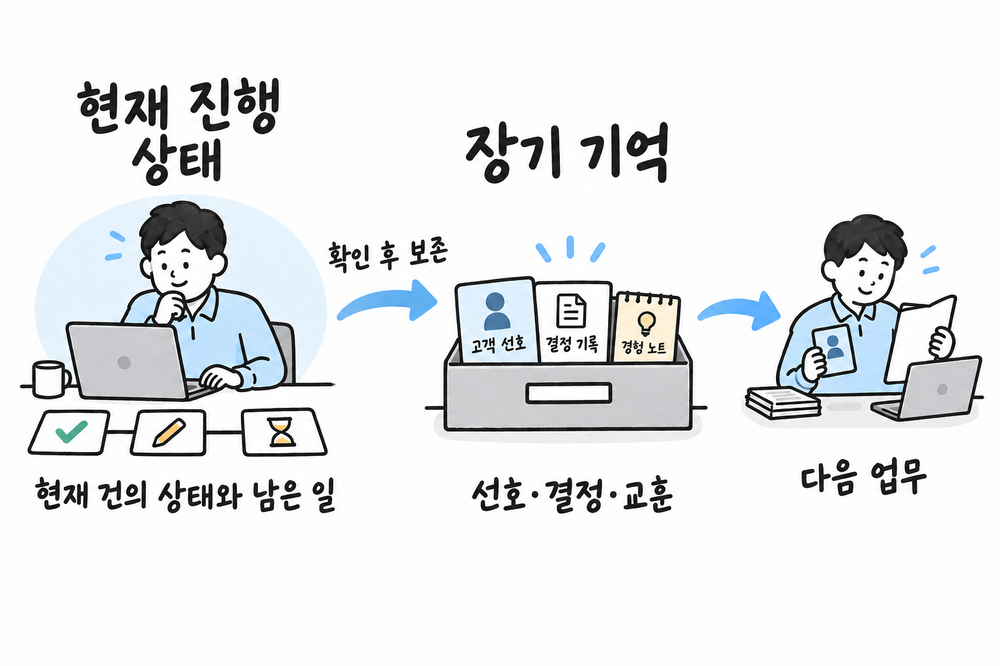

| 재료 | 한마디로 | 하는 일 | 예시 | 구분 | 사용 시점·조건 |
| --- | --- | --- | --- | --- | --- |
| **25. 현재 진행 상태** ✅ | **지금 어디까지 했고 무엇이 남았는지 기억** | ▶️ 현재 목표와 작업별 진행 상태, 남은 일을 기록한다 ▶️ 담당자와 작업의 선후 관계, 선택된 분기와 병렬 작업별 결과, 기다리는 답변과 외부 처리 상태를 연결해 관리한다 ▶️ 적용된 실행 계획과 작업 연결의 변경 이력을 남긴다 ▶️ 완료·실패·취소와 승인·약속·조건의 변경을 반영해 다음에 어디서 무엇을 이어 할지 알 수 있게 한다 | 7건 완료·8건째 처리 확인 대기 · 도면 치수 변경으로 재확인이 필요한 물량표·원가표 · 승인 철회로 취소된 작업 · 병렬 조회 중 실패한 항목과 이미 확보한 결과 구분 | **상시** | 진행 상태나 담당·조건·승인이 바뀌었을 때 · 대기·실패·취소 상태를 정리하거나 업무를 이어 갈 때 |
| **26. 장기 기억** ✅ | **업무가 끝난 뒤에도 다음 일을 위해 남겨 두는 기억** | ▶️ 다음 업무에도 활용할 정보·경험·결정·약속을 골라 근거와 함께 보관한다 ▶️ 고객·건별 사실과 약속은 해당 맥락에 묶고, 여러 업무에 통하는 지식으로 정리할 내용은 업무 지식의 구성·검증 절차에 연결한다 ▶️ 필요한 때 관련 기억을 찾아 제공한다 ▶️ 바뀌거나 잘못된 내용은 갱신·정정하고, 변경 시점과 이전 내용의 관계를 남긴다 ▶️ 보관할 필요가 없어진 내용은 정리한다 ▶️ 결정·결과마다 어떤 규칙·근거에 기댔는지 함께 남겨, 그 규칙이 바뀌면 같은 규칙을 쓴 과거 건을 목록으로 뽑아 재검토 대상으로 올린다 | 고객이 선호하거나 거절했던 방식 · 지난번에 내린 결정과 그 이유 · 현장에서 효과가 없었던 방법과 배운 점 · 규칙 개정 뒤 그 규칙으로 처리한 과거 건 목록을 재검토 대상으로 제출 | **단계별** | 다음 업무에도 남길 정보를 보관하거나 이전 기억을 찾을 때 · 기억할 내용이 바뀌거나 잘못된 것으로 확인됐을 때 · 기댔던 규칙·근거가 바뀌었을 때 · 보관할 필요가 없어졌을 때 |

---

### 규칙·권한 ✅

업무에 적용되는 의무·조건과 **에이전트의 행동 권한을 정하고 유지하는 체계**다.

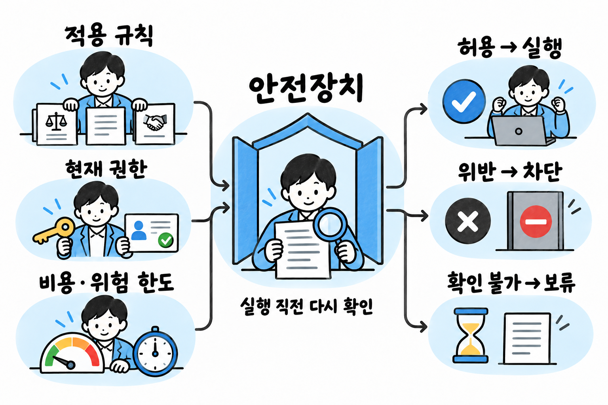

| 재료 | 한마디로 | 하는 일 | 예시 | 구분 | 사용 시점·조건 |
| --- | --- | --- | --- | --- | --- |
| **27. 법·의무 기준** ✅ | **이번 업무에서 법적으로 반드시 지켜야 하는 기준** | ▶️ 업무에 적용되는 국가·분야·시점의 법과 의무 기준을 확인한다 ▶️ 법령의 상하 관계, 위임, 특별 규정과 개정·경과조치를 검토해 적용할 내용을 정한다 ▶️ 해당 업무에 효력이 있는 판결·명령과 해석을 함께 확인하고, 지켜야 할 요건과 허용·금지되는 범위를 정리한다 ▶️ 적용되는 예외나 기준 변경을 반영한다 | 과거 사건에 적용할 당시 법과 경과조치 · 법률이 시행령에 맡긴 세부 기준 · 해당 업무에 효력이 있는 법원의 제출 명령 · 특정 업무의 법적 자격 요건 | **상시** | 해당 법과 기준이 적용되는 업무 전반 · 적용 지역·대상·시점이나 법이 바뀌었을 때 |
| **28. 직업 윤리·의무** ✅ | **직업이나 맡은 역할에서 지켜야 하는 윤리와 의무** | ▶️ 직업이나 맡은 역할에서 지켜야 할 윤리·의무를 확인해 판단과 행동에 적용한다 ▶️ 관계자의 권리와 맡은 책임을 살피고, 이해관계나 역할 때문에 의무가 충돌하는지 확인한다 ▶️ 역할이나 관계가 바뀌면 적용되는 의무와 수행 조건을 다시 확인한다 ▶️ 이해충돌 확인 대상에는 지금·예전 고객, 일을 맡기려고 상담만 한 사람, 상대방, 맡긴 사람 자신이 책임 주체인 경우, 가족·동료·증인처럼 가까운 관계자, 같은 편 다른 당사자의 행위 귀속, 운영하는 쪽 자신의 이익(결과에 따른 보수·수수료·자기 상품)을 넣는다 ▶️ 당사자가 여럿이면 자격·이익 기준으로 먼저 갈라 건을 나누고, 서로 상충하는 주장이 있으면 맡는 범위를 나누거나, 법과 직업 규칙이 허용하고 모두 동의할 때만 함께 맡는다. 함께 맡을 때는 팀을 나누고 정보 교환을 끊은 채 결론을 각각 내고, 맡은 뒤 이해가 맞서면 고객들에게 알려 계속 맡을지 정한다 | 직업상 비밀 유지 의무 · 독립성 유지 기준 · 이해충돌의 공개·회피 기준 · 역할에 따른 설명 의무 · 같은 편 두 의뢰인의 주장이 어긋나면 모두의 동의를 받은 경우에만 담당을 나누고 자료 접근 분리 | **상시** | 직업·역할에 따른 윤리와 의무가 적용되는 동안 · 역할·관계·이해관계가 바뀌었을 때 · 당사자가 여럿이거나 늘었을 때 |
| **29. 에이전트 기본 원칙** ✅ | **모든 업무에서 공통으로 지켜야 하는 행동 원칙** | ▶️ 업무 목적과 맡은 범위를 지키고, 근거·불확실성·진행 상태를 정직하게 알린다 ▶️ 지시와 참고 정보를 구분해, 외부 정보에 섞인 지시가 업무의 목표나 권한을 임의로 바꾸지 않게 한다 | 실행하지 않은 일을 완료했다고 말하지 않기 · 없는 근거 만들지 않기 · 외부 문서의 지시로 접근 제한 해제하지 않기 | **상시** | 모든 판단과 행동에서 |
| **30. 계약·합의 조건** ✅ | **상대와 약속해서 지켜야 하는 업무 조건** | ▶️ 합의된 업무 조건과 각 당사자의 권리·의무를 확인해 적용한다 ▶️ 약속의 적용 범위와 이행 상태를 관리하고, 조건의 변경·취소·종료를 반영한다 ▶️ 업무가 끝난 뒤에도 남는 의무를 구분해 유지한다 | 합의한 업무 범위·기한·대금 · 당사자별 역할과 책임 · 결과물의 수정 범위·이용 조건 · 업무 종료 후에도 지키기로 한 비밀 유지 조건 | **상시** | 합의된 조건이나 종료 후 남는 의무가 적용되는 동안 · 합의가 변경·취소·종료됐을 때 |
| **31. 플랫폼·제출처 규정** ✅ | **사용하는 서비스나 결과를 받는 곳이 정한 규칙** | ▶️ 이용하거나 제출할 대상이 정한 조건과 절차를 확인해 적용한다 ▶️ 서비스·계정·이용 방식·제출 유형에 따라 달라지는 규칙을 구분하고, 변경된 규정과 적용 범위를 반영한다 | 서비스 약관의 이용 허용 범위 · 계정별 API 사용 한도 · 앱 장터의 심사 기준 · 기관이 정한 접수 형식 | **상시** | 서비스를 이용하거나 결과를 제출할 때 · 서비스·계정·이용 방식·제출 유형이나 적용 규정이 바뀌었을 때 |
| **32. 조직 규칙** ✅ | **조직에서 정한 업무 규칙** | ▶️ 소속 조직이나 일을 맡긴 조직의 규칙 중 이번 업무에 적용되는 내용을 확인하고 따른다 ▶️ 업무·역할·권한에 맞는 적용 범위를 구분하고, 규정 변경과 조직에서 허용한 예외를 반영한다 | 연구 기관의 자료 보관 기준 · 제작사의 원본 파일 관리 규칙 · 회사의 구매 절차 · 공동 프로젝트의 의사결정 규칙 | **상시** | 맡은 업무를 진행하는 동안 · 규정이나 역할·권한이 바뀌었을 때 |
| **33. 사용자 지정 규칙** ✅ | **일을 맡긴 사람이 추가로 정한 조건과 원하는 방식** | ▶️ 의뢰인이나 운영자가 따로 정한 조건을 적용한다 ▶️ 반드시 지켜야 하는 조건과 단순한 선호는 구분한다 ▶️ 어디까지 적용되는지와 언제까지 적용되는지도 관리한다 ▶️ 사용자가 내용을 바꾸거나 취소하면 새 내용으로 반영한다 | 이번 프로젝트는 한국어로 보고 · 특정 폴더 수정 금지 · 외부 발송 없이 초안만 작성 · 급한 문의부터 처리 · 야간 연락 제한 | **상시** | 사용자가 정한 추가 조건이 적용되는 동안 · 조건이나 선호가 바뀌거나 취소됐을 때 |
| **34. 규칙의 적용·우선순위** ✅ | **함께 지킬 규칙과 충돌할 때 따를 기준 정하기** | ▶️ 규칙의 원문·설정 권한·적용 범위·시점을 확인한다 ▶️ 법적 적용 관계를 먼저 반영하고, 직업상 필수 의무·에이전트 기본 원칙·승인된 보호 기준 → 유효한 계약·플랫폼 필수 규정 → 조직의 필수 규칙 → 사용자 지정 규칙 → 기본 방식·스타일 순으로 충돌을 푼다 ▶️ 문서 이름이 아니라 의무의 근거와 설정 권한으로 순위를 정하고, 충돌하는 조항의 실행 기준을 정한다 ▶️ 충돌을 푼 뒤 남는 조건과 보호 기준을 함께 충족할 방법을 찾고, 변경·예외의 결정 권한을 확인한다 ▶️ 적용한 근거와 해결되지 않은 쟁점을 남기고, 판단할 수 없는 부분을 담당자에게 넘긴다 ▶️ 충돌이 우선순위가 아니라 예외 요건의 사실 입증으로 풀리는 유형이면 요건별 입증 계획을 세워 결정권자에게 넘긴다 ▶️ 규정이 아니어도 행위를 실제로 막는 조치(명령·처분·계약상 제한)는 시점과 함께 적용 규칙에 올린다 | 법이 정한 규범 간 관계를 조직 규칙보다 먼저 반영 · 계약상 납기 때문에 정보 유출 방지 기준을 해제하지 않기 · 권한 있는 당사자의 변경 합의 적용 · 해결되지 않은 규칙 충돌을 해당 작업의 보류 사유로 기록 · 예외 요건별로 무엇을 입증할지 계획을 세워 담당자 판단으로 넘김 | **상시** | 업무에 적용할 규칙을 정할 때 · 규칙·지시가 충돌하거나 바뀌었을 때 · 변경·예외 요청을 판단할 때 · 예외 요건을 사실로 입증해야 할 때 |
| **35. 업무 권한** ✅ | **누구를 대신해 어디까지 행동해도 되는지 정한 범위** | ▶️ 누구를 대신해 어떤 대상에 어떤 행동을 할 수 있는지 확인하고 관리한다 ▶️ 결정·승인·위임·동의의 주체와 권한을 준 경로, 다시 맡길 수 있는 범위를 확인한다 ▶️ 권한의 유효 기간과 변경·철회를 반영하고, 실행 직전에 그 권한이 지금도 유효한지와 현재 허용된 범위를 확인해 제공한다 ▶️ 긴급 조치에도 미리 정한 발동 조건과 권한을 적용한다 | 공유 문서의 수정 허용 범위 · 예약 변경에 필요한 위임과 동의 · 승인된 주문의 대상·금액·유효 기간 · 사고 시 특정 전송을 중단할 수 있는 긴급 권한 | **상시** | 업무를 맡거나 다시 맡길 때 · 승인·실행·재개 직전 · 권한·동의·대상·내용이 바뀌었을 때 · 긴급 조치가 필요할 때 |
| **36. 안전장치** ✅ | **허용 범위를 벗어나는 행동과 정보 전달을 막기** | ▶️ 들어오거나 나가는 정보와 실행 요청을 현재 규칙·권한·한도 및 승인 내용과 대조한다 ▶️ 허용·위반·확인 불가를 구분하고, 위반한 실행은 차단하며 확인할 수 없는 실행은 보류한다 ▶️ 진행 중 조건이나 위험이 달라지면 영향을 받는 요청과 작업에 새 기준을 적용한다 ▶️ 재시도·위임·다른 도구를 통한 실행에도 같은 조건을 검사한다 | 승인 금액과 다른 주문 차단 · 권한 검사에 실패한 외부 전송 보류 · 권한 철회 뒤 예정된 실행 중단 · 다른 AI나 도구를 통한 제한 우회 차단 | **상시** | 정보를 주고받거나 실행·재시도·재개할 때 · 진행 중 권한·규칙·한도·위험이 바뀌었을 때 |
| **37. 비용·위험 한도** ✅ | **맡은 내용을 끝낼 비용·자원을 확보하고 감수할 위험을 제한하기** | ▶️ 필수 내용·품질·검증의 완료를 비용 절약보다 우선한다. 내부 예상 비용이나 수정 횟수만으로 내용을 줄이거나 중도 종료하지 않는다 ▶️ 완료까지 필요한 비용·시간·자원을 계획하고, 사용량과 남은 필수 작업을 함께 확인해 배정한다. 진행 중인 업무의 마무리·검증을 우선한다 ▶️ 사용자 지출 상한·추가 결제 권한은 내부 예상치와 구분하고, 부족이 예상되면 소진 전에 해결한다 ▶️ 피해의 크기·확산·복구 가능성·발생 가능성과 불확실성을 살피고, 실행과 대기의 피해를 비교해 위험 한도와 보호 조치를 적용한다 | 필수 검증·수정까지 포함한 자원 배정 · 예상 비용 초과 시 추가 배정·중복 작업 제거 · 정보 공개·삭제 전에 필요한 추가 검토 조건 · 사고 대응 중 허용할 서비스 중단 범위와 시간 · 여러 AI의 사용·예약분 중복 계산 방지 | **상시** | 완료까지 필요한 자원과 보호 조치를 정할 때 · 실행·재개와 대기의 위험을 비교할 때 · 사용·진행·예약분이나 위험 조건이 바뀌었을 때 |
| **38. 표현 방식·스타일** ✅ | **말·글·이미지·영상·소리의 표현 기준** | ▶️ 업무의 대상·목적·매체에 맞는 표현 기준을 정리한다 ▶️ 원하는 인상과 전달 방식, 사용하거나 피해야 할 표현을 구체화한다 ▶️ 정해진 문체·디자인·브랜드 기준을 작업 전반에 일관되게 적용한다 | 대상에 맞춘 용어 수준과 문체 · 그림의 색감과 선 모양 · 영상의 장면 전환과 연출 방식 · 안내 음성의 말투와 속도 | **조건부** | 말투·문체·디자인·연출 등 표현 기준을 정하거나 맞춰야 할 때 |

---

### 행동 체계 ✅

**할 일과 완료 기준, 방법과 실행 계획을 정하는 체계**다. 새로 대응할 일을 찾아내고, 사람이 맡아야 할 판단과 작업을 연결한다.

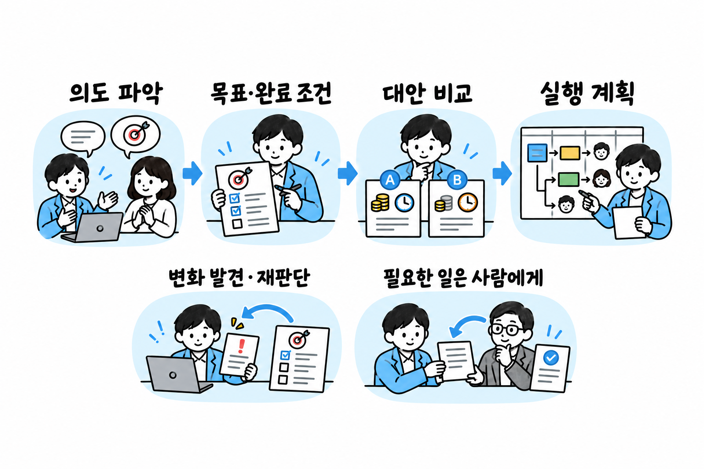

| 재료 | 한마디로 | 하는 일 | 예시 | 구분 | 사용 시점·조건 |
| --- | --- | --- | --- | --- | --- |
| **39. 지시·의도 파악** ✅ | **맡긴 말이 무슨 뜻인지 이해하기** | ▶️ 요청과 앞뒤 맥락에서 원하는 결과와 이유, 허용한 범위를 읽어 낸다 ▶️ 모호하거나 빠진 내용은 잘못 이해했을 때의 영향을 보고 질문할 것과 가정해도 될 것을 구분한다 ▶️ 뜻에 따라 목표나 범위가 달라지는 부분은 맡긴 사람에게 확인하고, 가정한 내용과 그 영향을 알린다 ▶️ 맡긴 말이 붙인 분류·이름과 실제 자료의 내용이 다르면 자료 쪽을 기준으로 다시 묻는다 | '보고서 다듬어 줘'가 문장 수정인지 구성 변경인지 확인 · '빠르게 해 줘'가 납기 단축인지 처리 속도 개선인지 확인 · 요청에 없는 제출 형식을 가정했다면 그 내용과 영향 알림 · '단순 계약 검토'라며 넘긴 자료가 분쟁 기록이면 실제 자료 기준으로 범위 재확인 | **상시** | 새 요청을 받았을 때 · 지시가 바뀌었을 때 · 요청의 뜻이 모호하거나 이해가 어긋났을 때 · 맡긴 말의 분류와 실제 자료가 어긋날 때 |
| **40. 문제·목표·완료 조건** ✅ | **풀 문제와 이룰 목표, 끝났다고 볼 기준 정하기** | ▶️ 이해한 요청과 확인된 자료를 바탕으로 해결할 문제와 목표를 정한다 ▶️ 맡은 범위와 지켜야 할 조건 안에서 목표의 우선순위를 정한다 ▶️ 전체 업무와 각 단계의 목표를 달성했다고 볼 상태, 확인 항목과 확인 방법·증거를 정한다 ▶️ 요청한 목표나 범위를 넓혀야 하면 변경을 제안하고 확인된 내용을 반영한다 | 반복 문의가 많은 부분을 개선 대상으로 정하기 · 여러 목표 중 처리 시간 단축을 먼저 달성하기로 정하기 · 예약 확정과 안내 전달을 완료 조건으로 정하기 · 계산표의 값을 바꿔도 결과가 맞는지 시험 기록으로 확인하도록 정하기 | **상시** | 이해한 요청을 업무 목표로 정리할 때 · 문제 상황·목표·요구 조건이나 판단의 바탕이 바뀌었을 때 |
| **41. 대안·전략 판단** ✅ | **목표를 이룰 방법을 비교하고 선택하기** | ▶️ 정해진 목표를 이룰 방법을 찾거나 새로 생각해 낸다 ▶️ 각 방법의 효과와 근거, 시간과 비용, 위험과 불확실한 점을 비교한다 ▶️ 어떤 방법을 쓸지와 선택 전에 무엇을 더 알아야 하는지 정한다 ▶️ 가능한 방법과 그 부담을 보고 업무를 맡을지, 계속할지, 미루거나 중단할지도 판단한다 | 직접 조사할지 기존 자료를 분석할지 비교 · 마감을 맞출 수 있는 다른 제작 방법 선택 · 근거가 부족한 방법은 추가 조사 후 판단 · 비용과 위험이 커진 방법을 계속 쓸지 다른 방법으로 바꿀지 판단 | **상시** | 목표를 이룰 방법을 선택하거나 바꿀 때 · 업무를 맡을지, 계속할지, 미루거나 중단할지 판단할 때 |
| **42. 사람에게 넘기기** ✅ | **사람이 맡아야 할 판단·작업을 연결하고 답변 관리** | ▶️ 사람의 결정·승인·자격이 필요하거나 에이전트가 해결할 수 없는 일을 담당자에게 넘긴다 ▶️ 넘기는 이유와 필요한 자료, 요청할 판단이나 작업을 정리한다 ▶️ 업무 일정에 맞춰 답변이 필요한 시점과 늦어질 때의 조치를 정하고, 확인 시점이 오면 요청 상태를 확인한다 ▶️ 받은 답변과 결과를 요청했던 판단이나 작업에 반영한다 | 자격이 필요한 검토를 담당 전문가에게 요청 · 예산 초과 지출의 근거를 정리해 승인자에게 전달 · 답변 기한이 지나 정해 둔 대체 담당자에게 다시 요청 · 받은 승인 결정을 해당 지출 건에 반영 | **상시** | 사람의 판단·승인·자격·작업이 필요할 때 · 넘긴 일의 진행과 답변을 확인하거나 받은 결과를 반영할 때 |
| **43. 업무 절차·실행 계획** ✅ | **선택한 방법을 작업·연결·담당자·일정으로 짜기** | ▶️ 선택한 방법을 작업별 입력·출력과 연결 관계로 구체화하고 담당자·도구·자원·일정을 배정한다 ▶️ 선후 관계와 병렬 실행, 결과를 모아야 하는 지점과 조건별 경로를 정한다 ▶️ 의미 해석이 필요한 판단과 명시된 값·상태로 처리할 분기를 구분한다 ▶️ 검사·승인, 일부 실패 시 처리와 반복·중단·재개 조건을 작업 순서에 넣는다 ▶️ 입력과 중간 결과에 따라 필요한 작업 수와 연결을 구체화하거나 변경한다 | 조사와 시안 제작의 담당자·일정 배정 · 필요한 검토 결과가 모두 모여야 제작을 시작하도록 연결 · 자료 수에 맞춰 검토 작업 수와 연결 구성 · 끝난 작업을 제외하고 재개할 순서 정하기 | **단계별** | 선택한 방법을 실행 계획으로 옮길 때 · 방법·일정·자원이나 입력·작업 진행 상태가 바뀌었을 때 |
| **44. 먼저 알아채기** ✅ | **따로 시키지 않아도 새로 대응할 일 찾아내기** | ▶️ 상황의 변화와 여러 단서를 연결해 새로운 대응이 필요한 문제나 기회를 찾는다 ▶️ 따로 요청받지 않은 일도 맡은 업무 범위에 들고 대응할 필요가 있는지 살핀다 ▶️ 발견한 내용과 대응이 필요한 이유, 얼마나 급한지를 정리해 판단할 일로 알린다 | 여러 작업의 지연을 보고 납기를 다시 검토할 필요 발견 · 반복 문의에서 안내문 개선 필요 발견 · 새 자료 때문에 기존 조사를 다시 살필 필요 발견 · 장비의 소음과 속도 변화를 함께 보고 점검 필요 발견 | **조건부** | 상황을 계속 살피고 필요한 일을 먼저 찾아내도록 맡겨진 업무에서 |

---

### 실무 ✅

**맡은 일을 끝까지 처리하고, 반복되거나 계속 이어지는 업무를 운영하는 체계**다. 진행·후속 관리를 바탕으로 작업에 맞는 재료를 골라 조합한다. 

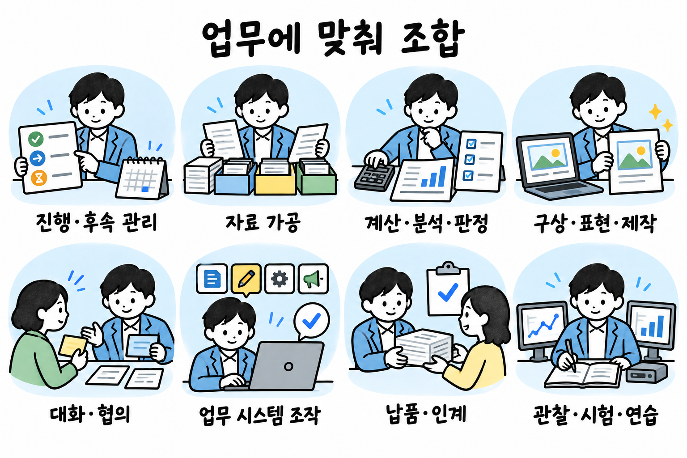

#### 진행·후속 관리 ✅

| 재료 | 한마디로 | 하는 일 | 예시 | 구분 | 사용 시점·조건 |
| --- | --- | --- | --- | --- | --- |
| **45. 작업 진행·연결** ✅ | **지금 할 작업을 진행하고 다음 작업으로 이어 주기** | ▶️ 준비된 자료와 현재 진행 상태를 보고, 정해진 계획과 우선순위에 따라 지금 시작할 수 있는 작업을 진행한다 ▶️ 작업 결과를 다음 담당과 검토 단계에 전달한다 ▶️ 실행 실패·검토 반려·조건 변경이 생기면 필요한 수정·확인 작업으로 연결한다 ▶️ 완료 기준과 검사 결과에 따라 계속 진행할 일과 대기·종료·인계할 일을 구분한다 ▶️ 계획으로 처리할 수 없는 변경은 업무 절차·실행 계획이나 대안·전략 판단으로 돌려보낸다 | 초안 작성 뒤 검토·수정·납품으로 연결 · 여러 문의를 정해진 우선순위에 따라 처리 · 제출처의 보완 요청을 해당 수정 작업에 연결 · 한 작업이 막히면 진행 가능한 다른 작업 이어 가기 | **상시** | 업무를 맡은 뒤 종료·인계할 때까지 · 계속 운영하도록 맡은 업무의 각 처리 과정에서 |
| **46. 대기·후속 관리** ✅ | **기다리는 일과 나중에 할 일을 놓치지 않고 챙기기** | ▶️ 답변·승인·외부 처리를 기다리는 일과 나중에 해야 할 일을, 각 담당이 정한 조건과 확인 시점에 맞춰 관리한다 ▶️ 응답이나 상태 변화가 도착하면 현재 진행 상태와 조건을 확인해 연결된 작업을 다시 진행하게 한다 ▶️ 기한이 지나면 정해 둔 재확인·대체·인계 절차를 연결한다 ▶️ 반복 업무의 다음 회차와 완료 뒤 남은 약속도 이행하거나 담당을 넘길 때까지 관리한다 ▶️ 되돌릴 수 없는 결정(선택하면 이후 선택지가 닫히는 것)과 그 기한은 따로 표시해 실행 전에 재확인한다 ▶️ 다른 절차의 상태로 정해지는 기한과, 상대의 기한이 만드는 상대의 행동 예정 시점도 기한으로 등록한다 ▶️ 계산으로 나온 기한은 자동으로 등록한다 | 답변이 없는 견적의 후속 확인 연결 · 확인 기한이 지난 환불의 재조회 연결 · 이번 정산의 미결 항목을 다음 확인 작업에 연결 · 계약 갱신 시점에 필요한 작업 시작 · 이의 제기 기한처럼 지나면 되돌릴 수 없는 시점을 별도 표시 · 상대의 응답 기한 다음 날을 상대 행동 예상 시점으로 등록 | **상시** | 업무의 대기·기한·후속 책임을 유지하는 동안 · 응답·상태 변화·확인 시점이 도래했을 때 · 되돌릴 수 없는 결정의 기한이 생겼을 때 · 반복 업무의 회차가 바뀌거나 담당이 바뀔 때 |

#### 자료 가공 ✅

| 재료 | 한마디로 | 하는 일 | 예시 | 구분 | 사용 시점·조건 |
| --- | --- | --- | --- | --- | --- |
| **47. 자료 선별·분류** ✅ | **필요한 자료를 골라 항목별로 나누기** | ▶️ 작업에 필요한 자료와 항목을 고르고, 내용과 특성에 따라 분류한다 ▶️ 서로 다른 자료에서 같은 개념·대상을 가리키는 항목을 연결하고, 연결한 근거를 남긴다 ▶️ 이름이 같아도 다른 대상일 수 있음을 확인한다 ▶️ 동일 여부가 불명확하거나 분류가 겹치는 항목, 어느 쪽인지 정하기 어려운 자료는 따로 구분해 남긴다 | 문의 내용을 유형별로 분류 · 사건 기록에서 쟁점별 자료 선별 · 고객 명단에서 같은 사람을 가리키는 기록 연결 · 같은 개념의 다른 명칭과 이름만 같은 다른 대상 구분 | **조건부** | 확보한 자료를 고르거나 분류·연결할 때 · 분류 업무를 맡은 동안 새 자료나 요청이 들어올 때 |
| **48. 자료 정리·결합** ✅ | **자료의 오류·중복을 정리하고 합치거나 나누기** | ▶️ 확보한 자료의 표기와 항목을 맞추고, 잘못된 것으로 확인된 내용과 중복을 정리한다 ▶️ 정해진 연결 기준에 따라 자료를 합치거나 나눈다 ▶️ 빠진 값과 서로 맞지 않는 내용은 구분해 남기고, 바꾼 내용이 어느 원본에서 왔는지 연결한다 ▶️ 합친 주장·관계의 근거와 서로 다른 적용 조건을 유지하고, 잘못 연결한 항목을 되돌릴 수 있게 변경 내역을 남긴다 | 중복 영수증을 골라 월별 거래 자료 정리 · 주문과 입금 기록을 거래별로 연결 · 여러 파일에 흩어진 제품 정보를 하나로 합치기 · 같은 개념의 중복 항목을 근거·예외와 함께 통합 | **조건부** | 자료의 오류·중복·누락을 정리하거나 합치고 나눌 때 · 정기 정리 시점이나 원본의 추가·변경이 있을 때 |
| **49. 형식·구조 변환** ✅ | **내용을 필요한 파일 형식이나 항목 구조로 바꾸기** | ▶️ 원본의 내용과 항목을 사용할 형식과 구조에 맞게 옮긴다 ▶️ 항목 사이의 연결과 수식·글꼴·시간 정보 등 유지해야 할 요소를 함께 옮긴다 ▶️ 옮길 수 없거나 달라지는 부분을 구분하고, 사용할 수 있는 대체 형식을 마련한다 | 기존 시스템의 고객 자료를 새 시스템의 항목에 맞게 변환 · 자막을 다른 재생 프로그램의 형식으로 변환 · 편집 원본에서 인쇄용 파일 만들기 | **조건부** | 사용할 프로그램이나 제출처에 맞게 파일 형식·항목 구조를 바꿔야 할 때 |

#### 계산·분석·판정 ✅

| 재료 | 한마디로 | 하는 일 | 예시 | 구분 | 사용 시점·조건 |
| --- | --- | --- | --- | --- | --- |
| **50. 계산** ✅ | **필요한 값을 구할 방법을 정하고 계산하기** | ▶️ 구하려는 값과 조건을 식과 계산 규칙으로 정리한다 ▶️ 문제에 맞는 방법으로 계산한다 ▶️ 어떤 값과 단위, 방법을 썼고 무엇을 가정했는지 결과와 함께 남긴다 ▶️ 얼마나 세밀하게 계산해야 하는지와 결과에 어느 정도 오차가 있을 수 있는지도 살핀다 ▶️ 한 항목의 결과가 다른 항목의 값·기한·합산을 바꾸면 그 연동을 식에 넣고, 같은 계산을 대상 여럿에게 반복할 때는 개별 예외를 표로 유지해 한 칸이 바뀌면 그 대상만 다시 계산한다 ▶️ 남이 낸 계산도 같은 기준으로 검산하며, 계산은 실행 전 계획 단계에서도 돌린다 | 필요한 재료의 수량과 비용 계산 · 서로 다른 단위의 측정값을 같은 단위로 바꿔 합산 · 작업량·인원·처리 속도로 걸릴 시간 계산 · 측정값의 오차 때문에 계산 결과가 얼마나 달라질 수 있는지 확인 · 한 항목의 인정 여부가 전체 합산 상한을 바꾸는 연동 계산 · 당사자 30명의 개별 조건을 표로 두고 바뀐 사람만 재계산 | **조건부** | 필요한 값을 계산하거나 문제의 조건을 식으로 정리해 풀 때 · 한 항목의 결과가 다른 항목의 값을 바꿀 때 · 남이 낸 계산을 근거로 받을 때 |
| **51. 분석** ✅ | **정보를 비교해 특징·관계·원인을 알아내기** | ▶️ 여러 정보를 비교하고 연결해 반복되는 특징과 차이, 관계와 변화 흐름을 찾는다 ▶️ 원인과 현재 상태를 해석하고 서로 다른 설명을 비교한다 ▶️ 확인된 사실과 분석으로 추정한 내용을 구분하고, 근거와 확실하지 않은 부분, 어디까지 적용할 수 있는지 정리한다 | 면담에서 반복되는 요구와 불만 찾기 · 사건 기록을 비교해 가능한 원인 좁히기 · 측정값에서 평소와 다른 변화와 관련 조건 찾기 | **조건부** | 정보의 특징·차이·관계·원인이나 현재 상태를 해석해야 할 때 · 분석 업무의 정기 검토 시점이나 중요한 새 정보가 들어왔을 때 |
| **52. 기준 적용·판정** ✅ | **업무 대상이 기준과 요건에 맞는지 판단하기** | ▶️ 업무 대상에 적용할 요건과 기준을 확인하고 사실·증거와 항목별로 대조한다 ▶️ 예외나 해석이 갈리는 부분은 관련 근거와 조건을 함께 검토한다 ▶️ 충족 여부와 정도, 해당하는 조건·등급을 판단하고 이유를 정리한다 ▶️ 아직 판단할 수 없는 부분과 추가로 확인할 내용을 구분한다 | 신청 자료가 지원 요건을 충족하는지 판단 · 납품 부품이 요구 규격에 맞는지 판정 · 계약 조건과 작업 내역을 대조해 비용 부담 판단 | **조건부** | 대상의 적합 여부·자격·책임·처리 조건을 판단하는 업무를 맡았을 때 |
| **53. 예측** ✅ | **앞으로 일어날 결과와 변화를 예상하기** | ▶️ 지금까지의 정보와 파악한 관계를 바탕으로 앞으로의 결과나 변화를 예상한다 ▶️ 조건이나 선택이 바뀌면 예상이 얼마나 달라지는지 살핀다 ▶️ 예상의 근거와 가정, 가능한 범위와 불확실한 점을 함께 정리한다 | 다음 달 수요와 변동 범위 예상 · 인원이 달라질 때 작업 완료 시점 예상 · 제안한 조건에 상대가 어떻게 반응할지 예상 | **조건부** | 앞으로의 결과나 변화를 예상해 판단에 써야 할 때 · 정기 예측 시점이나 주요 정보·가정이 바뀌었을 때 |
| **54. 조건 안에서 최선 찾기** ✅ | **지켜야 할 조건을 만족하면서 목표에 가장 유리한 안 찾기** | ▶️ 정해진 목표와 조건을 확인하고 바꿀 수 있는 요소를 찾는다 ▶️ 수량·배치·순서·구조·설정 등을 달리한 안들을 비교해 더 나은 안을 찾는다 ▶️ 한쪽이 좋아지면서 다른 쪽이 나빠지는 점도 함께 살핀다 ▶️ 찾은 안의 장점과 한계, 어디까지 비교했는지 정리한다 | 정해진 시간 안에 배송하면서 이동 거리를 줄이는 차량 배치 찾기 · 필요한 화질을 유지하면서 파일 크기를 줄이는 설정 찾기 · 필요한 수량을 제때 공급하면서 보관 비용을 줄이는 재고량 비교 | **조건부** | 조건 안에서 유리한 안을 찾거나 기존 안을 조정할 때 · 운영 중 목표 달성에 영향을 주는 수요·자원·비용 조건이 바뀌었을 때 |

#### 구상·표현·제작 ✅

| 재료 | 한마디로 | 하는 일 | 예시 | 구분 | 사용 시점·조건 |
| --- | --- | --- | --- | --- | --- |
| **55. 결과물 설계** ✅ | **결과물의 내용·구성·모양·작동 방식 정하기** | ▶️ 목표와 요구 조건에 맞는 아이디어를 구상하고, 담을 내용과 요소, 전체 구성을 정한다 ▶️ 모양과 표현 방식, 기능과 작동 방식을 정한다 ▶️ 구현에 필요한 규격과 요소 사이의 연결을 정리한다 | 보고서의 목차와 핵심 내용 설계 · 서비스의 이용 흐름과 대응 방식 설계 · 프로그램의 기능과 데이터 흐름 설계 · 영상의 장면 구성과 화면 표현 설계 | **조건부** | 결과물이나 서비스의 내용·구성·형태·작동 방식을 정하거나 바꿀 때 |
| **56. 내용 재구성** ✅ | **기존 내용을 목적에 맞게 요약·번역하거나 표현 바꾸기** | ▶️ 기존 내용을 목적과 상대에 맞게 줄이거나 풀어 쓰고, 언어와 표현 방식을 바꾼다 ▶️ 원문의 뜻과 사실관계, 필요한 말투와 맥락을 살려 다시 구성한다 ▶️ 여러 자료를 종합할 때는 각 주장·관계의 출처와 서로 다른 적용 조건·이견을 유지한다 ▶️ 줄이거나 바꾸면서 빠지는 중요한 내용과 뜻이 불분명한 부분을 함께 알린다 | 긴 회의 기록을 결정 사항 중심으로 요약 · 기술 설명서를 다른 언어로 번역 · 조건부 약속의 뜻을 유지하며 통역 · 전문 설명을 쉬운 말로 풀어 쓰기 · 여러 원문을 근거와 이견이 드러나는 주제별 지식 문서로 종합 | **조건부** | 기존 내용을 요약·번역·통역하거나 목적과 상대에 맞게 표현을 바꿀 때 |
| **57. 결과물 만들기·수정** ✅ | **정한 내용과 설계를 사용할 수 있는 결과물로 만들기** | ▶️ 정한 내용과 설계에 맞춰 결과물을 만들고 필요한 요소를 조합한다 ▶️ 기존 결과물의 기능·구성·표현을 고치거나 다른 용도에 맞게 편집한다 ▶️ 원본과 연결된 요소를 함께 맞추고 사용할 수 있는 형태로 마무리한다 | 정한 구성에 맞춰 문서·도면 작성 · 설계한 기능을 코드로 구현 · 이미지·영상·음원 제작 · 영상 길이에 맞춰 장면·자막·음성 편집 · 개념·주제별 위키 문서와 상호 참조 작성·수정 | **조건부** | 내용과 설계를 결과물로 만들 때 · 기존 결과물의 기능·구성·표현을 고치거나 여러 요소를 조합할 때 |

#### 대화·협의 ✅

| 재료 | 한마디로 | 하는 일 | 예시 | 구분 | 사용 시점·조건 |
| --- | --- | --- | --- | --- | --- |
| **58. 사람과 소통** ✅  | **상대와 내용을 주고받고 서로의 이해와 의견을 확인** | ▶️ 상대가 말한 내용과 반응을 보고 필요한 질문을 하거나 설명한다 ▶️ 필요한 답변도 한다 ▶️ 상대가 얼마나 이해하고 있는지와 어떤 입장인지에 맞춰 말할 내용과 전달 방식을 조절한다 ▶️ 서로 다르게 이해한 부분이 있으면 바로잡는다 ▶️ 무엇에 합의했는지와 아직 의견이 다른 부분도 확인한다 ▶️ 상대나 제3자에게 묻거나 자료를 정리해 달라고 하기 전에, 그 접촉이 근거의 신뢰를 해치거나 상대에게 불리하게 쓰일 위험을 먼저 판정하고 방법을 정한다 | 이해되지 않는 요구를 되물어 확인 · 상대가 어려워하는 내용을 쉬운 말로 설명 · 화난 고객의 이유를 듣고 처리 과정을 설명 · 회의 끝에 각자 이해한 결론이 같은지 되물어 확인 · 관계자에게 묻기 전에 그 접촉이 진술을 오염시킬 위험 판정 | **조건부** | 맡은 대화·응대가 이어지는 동안 · 질문·답변·설명·제안이 필요할 때 · 오해를 풀거나 이해·의견·합의 여부를 확인할 때 · 접촉 자체가 근거나 상대의 입장에 영향을 줄 수 있을 때 |
| **59. 협상·조율** ✅ | **서로 다른 요구를 조정해 함께 받아들일 조건 만들기** | ▶️ 참여자들의 요구와 우선순위, 조정할 수 있는 범위를 파악한다 ▶️ 허용된 범위에서 조건과 대안을 제안하고 상대의 답에 맞춰 수정안을 협의한다 ▶️ 합의한 조건과 각자의 역할·약속을 정리하고, 합의하지 못한 부분은 다음 판단에 연결한다 | 가격·납기·제공 범위를 함께 협상 · 여러 부서가 함께 쓰는 인력과 일정 조율 · 불만 사항의 보상·수정 조건 협의 | **조건부** | 이해관계나 요구가 달라 조건·역할·약속을 함께 조정해야 할 때 |

#### 업무 시스템 조작 ✅

| 재료 | 한마디로 | 하는 일 | 예시 | 구분 | 사용 시점·조건 |
| --- | --- | --- | --- | --- | --- |
| **60. 기록 입력·수정** ✅ | **업무 시스템의 기록을 등록하거나 고치기** | ▶️ 업무 시스템에 남길 항목과 대상 기록을 확인하고 새 내용을 입력하거나 기존 내용을 수정·삭제한다 ▶️ 다른 작업에서 바뀐 내용과 대조해 변경 범위를 맞춘다 ▶️ 반영된 기록과 변경 이력을 확인하고 누락되거나 잘못 입력된 부분을 정정한다 | 확인한 거래를 장부에 입력 · 고객 정보와 문의 처리 기록 갱신 · 재고 대장의 확인된 수량 차이 정정 · 삭제하기로 한 자료를 관련 저장소에서 삭제 | **조건부** | 업무 기록을 등록·수정·삭제할 때 · 기록 관리 업무에서 새 거래·요청·상태 변경이 발생하거나 정기 반영 시점이 왔을 때 |
| **61. 신청·거래 처리** ✅ | **신청·예약·주문·지급을 진행하고 변경·취소 처리하기** | ▶️ 대상과 금액·수량·일정, 실행 조건을 확인하고 정해진 신청이나 거래를 진행한다 ▶️ 접수·확정·거절·부분 처리 상태를 확인한다 ▶️ 처리 여부가 불분명하면 원래 요청의 상태부터 확인한다 ▶️ 확인된 상태와 허용 범위에 따라 남은 처리나 변경·취소·환불을 진행하고 결과를 대조한다 | 신청서를 제출하고 접수·보완 상태 확인 · 예약을 변경하고 확정 내역 확인 · 일부 주문을 취소하고 환불·잔액 대조 · 응답을 잃은 지급의 처리 여부 조회 | **조건부** | 맡은 신청·거래 업무에 새 요청이 들어왔을 때 · 변경·취소·환불 요청이나 처리 상태 변화가 있을 때 · 미결 건의 확인 시점이 왔을 때 |
| **62. 설정·작동 제어** ✅ | **프로그램의 설정을 바꾸고 필요한 기능을 작동시키기** | ▶️ 조작할 대상의 현재 설정과 작동 상태를 확인한다 ▶️ 정해진 설정을 바꾸고 기능을 시작·중지·재개한다 ▶️ 운영 중에는 관측한 상태를 유지해야 할 조건과 비교해 필요한 설정과 작동을 조정한다 ▶️ 변경이 반영됐는지 확인하고, 문제가 생기면 허용된 범위에서 설정을 되돌리거나 작동 상태를 조정한다 | 광고 예산·노출 설정 변경 · 업무용 계정의 접근 권한 회수 · 방송 중 소리 변화에 맞춰 음량 조절 · 중단된 처리 작업 재개 | **조건부** | 프로그램이나 서비스의 설정·접근 권한·작동 상태를 바꿀 때 · 운영을 맡은 동안 유지 조건에서 벗어나거나 정해진 조정 시점이 왔을 때 |
| **63. 게시·배포** ✅ | **콘텐츠나 프로그램을 정해진 대상에게 공개·제공하기** | ▶️ 공개하거나 제공할 판본과 대상, 시점과 범위를 맞춘다 ▶️ 정해진 경로로 게시하거나 사용 환경에 배포하고 반영된 판본과 공개 상태를 확인한다 ▶️ 잘못된 게시나 배포는 허용된 범위에서 정정·철회하거나 이전 판본으로 되돌린다 | 상품 정보와 콘텐츠 게시 · 구독 대상에 맞춰 뉴스레터 발송 · 앱이나 서비스의 새 판본 배포 · 잘못 공개된 파일 교체·철회 | **조건부** | 게시·배포 요청이나 예약 시점이 왔을 때 · 공개 범위나 제공 판본을 바꿀 때 · 정기 발행·배포 업무의 다음 회차가 왔을 때 |

#### 납품·인계 ✅

| 재료 | 한마디로 | 하는 일 | 예시 | 구분 | 사용 시점·조건 |
| --- | --- | --- | --- | --- | --- |
| **64. 납품 준비** ✅ | **넘길 결과·설명·원본과 남은 일을 갖춰 정리하기** | ▶️ 받는 사람이 다음에 할 일에 맞춰 전달할 결과와 사용 설명, 필요한 원본과 연결 자료를 갖춘다 ▶️ 결과의 판본과 포함 범위를 정리하고, 이미 확인한 검사 결과를 연결한다 ▶️ 처리 내역과 미완료 사항, 이어서 할 일과 담당자도 함께 정리한다 | 설계 원본·도면·사용 설명 묶기 · 편집 프로젝트·연결 자산·납품본 정리 · 처리 내역·미결 항목·후속 담당을 인계 자료로 정리 | **단계별** | 결과를 납품하거나 업무를 다른 담당자에게 인계할 준비를 할 때 |
| **65. 전달·인수 확인** ✅ | **결과를 넘기고 약속한 수령·사용 조건 확인하기** | ▶️ 정해진 상대와 경로로 결과를 전달한다 ▶️ 약속한 확인 방식에 따라 도착 여부와 받아 쓸 수 있는지를 확인한다 ▶️ 전달 오류나 수정 요청이 있으면 내용을 정리해 알린다 ▶️ 전달·확인 대기·인수 완료 상태와 남은 일을 구분해 알린다 | 담당자에게 자료를 보내고 열어 쓸 수 있는지 확인 · 서비스 이전 뒤 약속한 업무가 이어지는지 확인 · 파일이 안 열린다는 답을 받아 내용을 정리해 알림 · 설비 설치 뒤 시운전 확인서를 받아 인수 완료로 기록 | **단계별** | 결과를 전달할 때 · 약속한 수령·사용 조건을 확인하거나 전달 문제·수정 요청을 받아 알릴 때 |

#### 관찰·시험·연습 ✅

| 재료 | 한마디로 | 하는 일 | 예시 | 구분 | 사용 시점·조건 |
| --- | --- | --- | --- | --- | --- |
| **66. 관찰·측정** ✅ | **대상을 살펴보거나 값을 재서 새 기록 얻기** | ▶️ 관찰하거나 측정할 대상과 항목, 방법과 시점을 정한다 ▶️ 대상을 살펴보거나 값을 측정하고 당시 조건과 함께 기록한다 ▶️ 관찰하기 어렵거나 측정값을 믿기 어려운 부분, 빠진 기록을 표시한다 | 이용자의 화면 조작 순서와 막히는 부분 기록 · 서비스의 응답 시간 측정 · 영상에서 작업 순서와 대기 구간 관찰 | **조건부** | 판단에 필요한 새 관찰·측정 기록을 얻을 때 · 관측 업무를 맡은 기간의 정해진 주기·변화 신호에 따라 대상을 살필 때 |
| **67. 실험** ✅ | **조건을 바꾼 것이 결과에 어떤 영향을 주는지 확인하기** | ▶️ 알아보려는 질문과 바꿀 조건, 비교할 대상을 정한다 ▶️ 결과를 비교할 수 있도록 다른 조건을 관리하며 시험한다 ▶️ 관측한 차이와 결과에 영향을 줄 수 있는 다른 요인, 시험의 한계를 정리한다 | 안내 문구를 바꿔 오해가 줄어드는지 비교 · 광고 두 안의 반응과 구매 결과 비교 · 정보의 배치 순서를 바꿔 찾는 시간 비교 | **조건부** | 조건이나 방법의 변화가 결과에 주는 영향을 비교해야 할 때 |
| **68. 시뮬레이션** ✅ | **상황의 움직임과 반응을 흉내 내 미리 살펴보기** | ▶️ 가정한 조건에서 대상이 어떻게 움직이고 반응하는지 컴퓨터 계산이나 역할 연기로 표현한다 ▶️ 그 안에서 업무의 흐름과 결과를 예상하거나 대응을 연습한다 ▶️ 사용한 가정과 빠진 조건, 업무에 적용할 때 달라질 수 있는 점을 정리한다 | 주문량이 늘어난 상황에서 배송 흐름과 지연 예상 · 가상 상대와 협상 연습 · 장애 상황을 가정해 대응 순서 연습 · 구조물에 힘이 가해질 때의 변형 계산 | **조건부** | 상황을 가정해 진행 과정과 결과를 예상하거나 대응을 미리 연습해야 할 때 |

---

### 검증·평가 ✅

**일을 제대로 했는지, 결과가 얼마나 좋은지, 목표를 얼마나 달성했는지 확인하는 체계**다. 판단과 실행의 이유를 기록하고, 에이전트에게 어떤 일을 맡길 수 있는지도 시험한다.

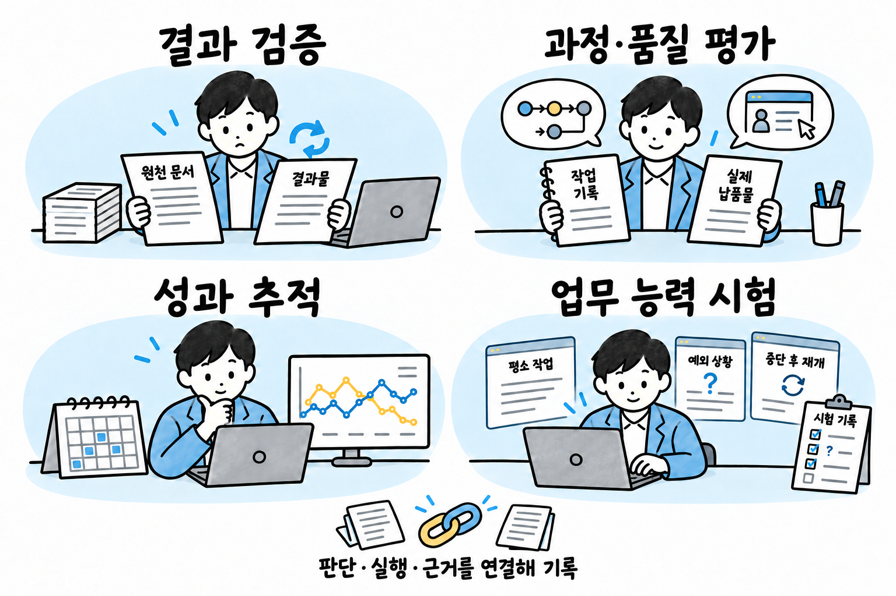

| 재료 | 한마디로 | 하는 일 | 예시 | 구분 | 사용 시점·조건 |
| --- | --- | --- | --- | --- | --- |
| **69. 판단 근거 기록** ✅ | **왜 그렇게 판단하고 행동했는지 남기기** | ▶️ 왜 그렇게 판단했는지와 무엇을 근거로 삼았는지 기록한다 ▶️ 단계별 입력과 실행 결과, 선택된 경로와 그 판단 근거·조건을 연결해 남긴다 ▶️ 내용을 고치거나 검사했다면 이유와 확인 방법, 결과도 기록한다 | 방법을 고른 이유와 참고한 자료 기록 · 인용한 내용이 원문의 어디에 있는지 기록 · 분기를 선택한 입력값·조건과 실행 결과 기록 · 수정 요청과 그에 따라 고친 내용·검사 결과를 함께 기록 | **상시** | 판단하거나 실행할 때 · 내용을 바꾸거나 검사할 때 |
| **70. 보고 주체 확인** ✅ | **온 결과가 맡긴 그 상대가 낸 것이 맞는지 대조** | ▶️ 결과나 보고를 받을 때 낸 쪽의 신원과 받아 간 분담 번호, 낸 결과물의 지문을 맡길 때 적어 둔 값과 대조한다 ▶️ 하나라도 맞지 않으면 받지 않고 막은 이유와 다음 행선지를 남긴다 ▶️ 받아들인 뒤에 결과물이 바뀌었는지도 지문을 다시 재어 확인한다 ▶️ 사람에게 넘긴 일이 돌아올 때는 본인이 맞는지와 무엇을 승인한 것인지 확인한다 ▶️ 안에서 누가 만들었는지와 밖으로 누구 이름으로 나가는지를 함께 기록한다 | 하위 에이전트가 낸 결과의 신원·분담 번호·지문 대조 · 남의 분담 번호로 온 보고 차단 · 한 일이 없는데 했다고 적은 보고 차단 · 승인 뒤 내용이 바뀐 서류의 발송 차단 · 검토자가 돌려준 승인이 본인 것인지 확인 | **상시** | 결과·보고를 받을 때 · 사람에게 넘긴 일이 돌아올 때 · 명의로 대외 행위를 하기 전 |
| **71. 결과 검증·재검증** ✅ | **결과에 틀리거나 빠진 부분이 없는지 확인** | ▶️ 각 단계와 최종 결과가 정해진 조건에 맞는지, 틀리거나 빠진 부분은 없는지 근거와 대조해 확인한다 ▶️ 다음 작업에 넘길 결과는 필요한 형식·항목·의미 조건도 확인한다 ▶️ 요청한 작업이 끝났는지도 확인한다 ▶️ 수정한 경우에는 바꿔야 할 부분이 바뀌었고 그대로 둬야 할 부분은 유지됐는지 살핀다 ▶️ 지식을 구성·갱신한 경우에는 다른 대상의 잘못된 통합, 근거 없는 관계, 누락된 예외·이견, 끊긴 참조와 정정이 빠진 관련 항목도 확인한다 ▶️ 확인 결과를 **문제없음·문제 있음·아직 확인할 수 없음**으로 나눠 알린다 ▶️ 결과나 자료, 입력값, 조건이 바뀌면 그 부분과 영향을 받는 결과를 다시 확인한다 ▶️ 상대·제3자·판정 기관이 낸 계산과 문서도 내 것과 같은 기준으로 검산하고, 상대가 낸 근거는 상대에게 불리한 방향으로도 읽어 본다 | 번역에서 빠진 문장 확인 · 다음 단계에 넘길 계산값의 항목·단위 확인 · 요청한 부분만 수정됐는지 확인 · 예약이 확정됐는지 처리 기록 확인 · 도면 치수가 바뀌면 재료 수량과 비용도 다시 계산해 확인 · 상대가 낸 정산표를 같은 식으로 다시 계산 · 상대의 근거 자료에서 상대에게 불리한 대목 확인 | **단계별** | 작업 결과를 확인할 때 · 결과·자료·입력값·조건이 바뀌었을 때 · 남이 낸 결과·계산을 근거로 받을 때 |
| **72. 반대 근거·다시 확인** ✅ | **내 판단이 틀릴 수 있는 이유 찾기** | ▶️ 판단의 바탕이 된 사실과 가정을 다시 살피고, 반대 근거와 다른 설명을 찾는다 ▶️ 그 판단이 맞지 않는 상황도 살핀다 ▶️ 다른 자료나 방법으로 다시 확인하고, 결론이 다르면 그 이유를 비교한다 ▶️ 원래 판단을 유지할지, 고칠지, 추가 확인까지 미룰지 정한다 | 주장과 맞지 않는 사례 찾기 · 다른 계산법으로 같은 답이 나오는지 확인 · 상대방 주장에 우리 판단을 바꿀 근거가 있는지 확인 · 조건을 바꿔도 같은 결론이 나오는지 확인 | **단계별** | 중요한 판단을 내리거나 알리기 전 · 판단이나 그 바탕이 된 사실·가정·근거가 바뀌었을 때 |
| **73. 빠진 위험 확인** ✅ | **놓친 문제와 예상하지 못한 피해 찾기** | ▶️ 목표와 계획, 작업 결과에서 놓친 조건과 잘못될 수 있는 부분을 찾는다 ▶️ 다른 작업과 함께 진행하거나 결과를 넘겨 쓸 때 생길 문제도 살핀다 ▶️ 결과를 사용할 환경이나 조건이 달라질 때 어떤 문제가 생길지도 확인한다 ▶️ 피해가 얼마나 클지와 무엇을 먼저 확인하거나 대비해야 할지 정리한다 | 받는 사람의 프로그램에서 파일이 열리지 않을 가능성 확인 · 같은 장비를 동시에 쓰려는 작업들의 충돌 확인 · 시험 결과에 영향을 줄 조건을 빠뜨렸는지 확인 · 일정이 밀리면 뒤에 이어질 작업에 생길 피해 확인 | **단계별** | 업무를 맡거나 계획할 때 · 실행하기 전 · 진행 중 상황이 바뀌었을 때 · 결과를 넘기기 전 |
| **74. 일하는 과정 평가** ✅ | **일하는 방법과 순서에서 잘한 점과 잘못한 점 찾기** | ▶️ 그때 알고 있던 정보와 업무 조건으로 볼 때, 그 방법을 고른 것이 적절했는지 살핀다 ▶️ 필요한 자료와 절차를 빠뜨리지 않았는지, 맡은 권한을 지켰는지 확인한다 ▶️ 상황이 바뀌었을 때 계획을 바꾸거나 일을 계속·중단한 판단이 적절했는지도 살핀다 ▶️ 일하는 과정에서 잘한 점과 잘못한 점을 정리한다 | 확인할 자료를 빠뜨린 채 결정했는지 점검 · 상황이 달라졌는데도 이전 계획을 그대로 밀어붙였는지 확인 · 불필요한 재작업을 줄인 진행 방법 확인 · 필요한 승인과 절차를 지켰는지 확인 | **단계별** | 각 단계가 끝났을 때 · 전체 업무가 끝났을 때 |
| **75. 결과 품질 평가** ✅ | **결과가 얼마나 잘됐고 어디를 더 다듬어야 하는지 평가** | ▶️ 결과를 사용할 목적과 해당 분야의 품질 기준에 맞춰 평가한다 ▶️ 내용이 정확하고 충분한지, 필요한 기능과 성능을 갖췄는지, 이해하고 쓰기 쉬운지 살핀다 ▶️ 대화나 서비스도 맡은 역할에 맞게 제공했는지 평가한다 ▶️ 결과에서 잘된 점과 더 나아져야 할 점을 정리한다 | 설명이 듣는 사람에게 이해하기 쉬운지 평가 · 디자인의 메시지가 잘 전달되는지 평가 · 프로그램이 필요한 속도로 작동하고 쓰기 편한지 평가 · 상담 내용이 상대의 상황에 맞고 필요한 설명을 갖췄는지 평가 | **단계별** | 결과를 넘기거나 사용하기 전 · 대화나 서비스가 끝난 뒤 · 결과가 바뀌었을 때 |
| **76. 성과 추적** ✅ | **한 일이 목표 달성에 얼마나 도움이 됐는지 확인** | ▶️ 목표를 얼마나 달성했는지 확인할 항목과 시점을 정한다 ▶️ 확인한 결과를 기록하고, 이전 업무나 방법을 바꾸기 전후의 결과와 비교한다 ▶️ 비교할 때는 일의 어려움, 주변 상황, 쓴 시간과 자원, 사람에게 받은 도움의 차이도 살핀다 ▶️ 나중에 나타나는 효과와 문제도 이어서 확인한다 | 일을 마치는 데 걸린 시간과 오류 수를 매주 비교 · 예약 절차를 바꾼 뒤 예약 누락이 줄었는지 확인 · 안내문을 고친 뒤 반복 문의가 줄었는지 확인 · 작품 공개 후 반응이 어떻게 달라지는지 확인 | **단계별** | 목표 달성 여부를 무엇으로 언제 확인할지 정할 때 · 정해 둔 확인 시점 · 나중에 효과나 문제가 드러났을 때 |
| **77. 업무 능력 시험** ✅ | **에이전트에게 어떤 일을 어디까지 맡길 수 있는지 시험** | ▶️ 시험할 일과 통과 기준을 정하고, 에이전트가 끝까지 처리할 수 있는지 확인한다 ▶️ 익숙한 일과 처음 보는 일, 도중에 조건이 바뀌는 상황과 예외도 시험한다 ▶️ 사용하는 실행 흐름에 맞춰 함수만 실행하는 경로, 함수·AI가 섞인 경로, 병렬 작업의 일부 실패·결과 누락·중단 후 재개를 시험한다 ▶️ 비교할 전문가의 결과가 있으면 같은 조건에서 비교한다 ▶️ 시험 결과로 맡길 수 있는 일과 부족한 능력을 구분한다 ▶️ 모델·지식·방법·도구·규칙·자료·실행 환경의 변경이 능력에 미치는 영향을 시험한다 ▶️ 개선을 위한 변경은 나아졌는지와 예전에 잘하던 일도 계속 잘하는지 확인한다 | 처음 맡길 업무를 시작부터 완료까지 시험 · 필수 결과가 빠졌을 때 다음 단계가 실행되지 않는지 시험 · 재개할 때 이미 끝난 외부 처리가 중복되지 않는지 시험 · 프로그램·규정 변경 뒤 기존 업무 재시험 | **조건부** | 에이전트를 업무에 처음 투입하기 전 · 검증된 범위 밖의 일을 맡기려 할 때 · 수행 능력에 영향을 주는 변경 전후 · 기존 시험 결과를 더는 신뢰하기 어려울 때 |

---

### 학습·개선 ✅

업무 경험과 평가 결과를 바탕으로 **에이전트의 수행 능력을 높이는 체계**다. 다음 업무에도 사용할 지식·방법·도구를 개선하고 확장한다.

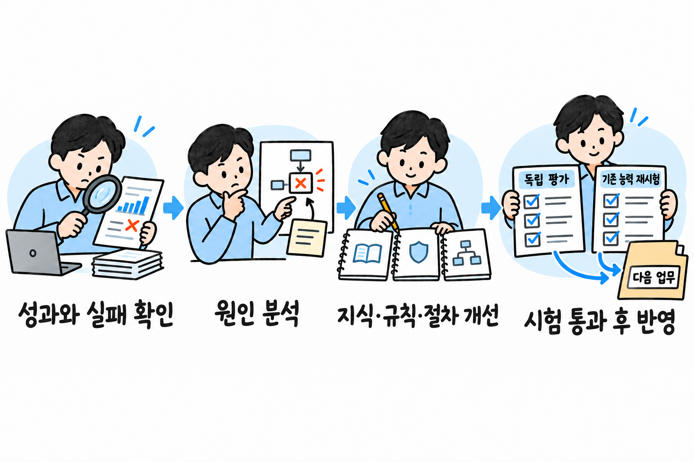

| 재료 | 한마디로 | 하는 일 | 예시 | 구분 | 사용 시점·조건 |
| --- | --- | --- | --- | --- | --- |
| **78. 성공·실패 원인 분석** ✅ | **잘되거나 잘못된 이유를 찾아 유지할 점과 고칠 점 정하기** | ▶️ 업무가 잘되거나 실패한 원인을 분석한다 ▶️ 어떤 지식·방법·도구와 조건이 결과에 영향을 주었는지 확인한다 ▶️ 같은 원인이 다른 업무에도 영향을 주는지 살핀다 ▶️ 유지·재사용할 점과 고치거나 보완할 점을 정한다 | 검토 순서를 바꾼 뒤 오류가 준 이유를 찾아 적용 조건 정리 · 번역 납품이 반복해서 반려되는 원인 조사 · 견적 오류의 원인이 다른 고객 견적에도 있는지 확인 | **조건부** | 재사용할 만한 성과가 나왔을 때 · 원인이 불분명하거나 영향이 큰 문제, 반복 오류를 분석해야 할 때 |
| **79. 능력 개선·확장** ✅ | **잘하던 일은 더 잘하게 하고 새로운 일도 할 수 있게 만들기** | ▶️ 업무 경험과 평가 결과에 따라 에이전트의 지식·판단 요령·방법·도구를 고치거나 새로 갖춘다 ▶️ 개선 효과와 기존 능력에 미치는 영향을 확인한 개선안을 적용한다 ▶️ 적용 후의 평가와 다음 업무의 성과를 받아 필요한 보완을 이어 간다 | 반복된 오해의 원인을 바탕으로 설명 방법 보완 · 시험으로 효과를 확인한 새 분석 방법 적용 · 필요한 자료 형식을 읽는 도구를 기존 업무에 미치는 영향까지 확인해 추가 · 다음 업무의 평가에서 드러난 약점에 맞춰 판단 요령 보완 | **조건부** | 평가나 업무 경험에서 개선할 점을 찾았을 때 · 새로운 업무에 필요한 능력을 갖출 때 |

---

## 사용 구조

앞의 재료는 한 전문가가 일을 처리하는 데 필요한 기능이다. 실제로 맡길 때는 한 전문가로 충분한지, 여러 전문 분야가 함께 필요한지에 따라 연결 방식이 달라진다.

한 건을 한 전문가가 끝낼 수 있으면 단독으로 맡긴다. 한 건에 여러 분야가 필요하면 총괄이 작업을 나누고 결과를 합친다. 여러 건이 일정·예산·결과를 공유하면 건별 총괄 외에 전체를 조정할 책임도 둔다.

### 1. 단독 상황 — 한 건 · 한 전문가 ✅

[편집용 Mermaid 원본](docs/도식/usage-structure-solo.mmd)

---

### 2. 오케스트레이션 — 한 건 · 여러 전문가

한 건에 여러 전문 분야가 필요하면 총괄 에이전트가 업무를 나누고 결과를 통합한다. 먼저 전체 목표·완료 조건·권한·기한을 정한 뒤, 각 전문가에게 판단할 쟁점과 필요한 자료를 전달한다.

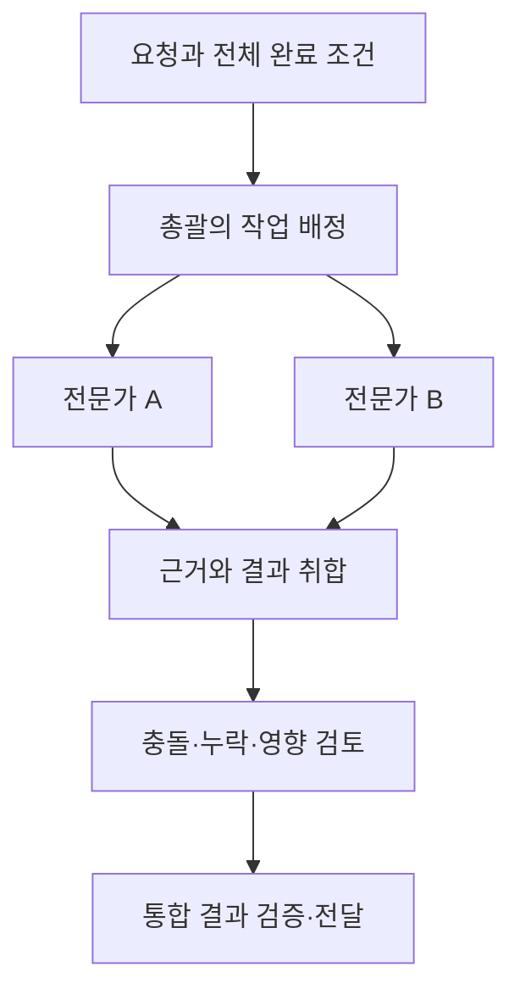

전문가는 결론과 함께 근거·적용 조건·미확인 사항을 넘긴다. 총괄은 여러 답을 단순히 합치지 않고, 같은 사실을 다르게 해석했는지와 한 분야의 결정이 다른 분야의 조건을 바꾸는지 확인한다. 의견이 갈리면 해당 사실과 기준을 다시 검토한다. 필요한 사람의 결정도 총괄이 모아 요청한다.

---

### 3. 복합 상황 — 맞물린 여러 건 · 여러 전문가

여러 업무가 일정·예산·자료·의사결정을 공유하면 건별 총괄과 전체 총괄을 구분한다. 건별 총괄은 해당 업무의 완료를 책임지고, 전체 총괄은 업무 사이의 의존 관계와 공통 한도를 관리한다.

한 건의 결과가 바뀌면 그 결과를 사용하는 다른 건을 찾아 영향을 전달한다. 함께 쓰는 사실·기준은 같은 버전을 참조하고, 고객별 비공개 자료는 필요한 권한이 있는 건에만 제공한다. 공통 예산은 하나의 장부에서 예약해 여러 건이 같은 한도를 중복 사용하지 않게 한다.

전체 완료는 개별 건의 완료 수만으로 판단하지 않는다. 필수 선행 업무, 통합 결과, 인계·후속 약속까지 확인한다. 중단 요청도 한 건의 중단인지 전체 상시 업무의 종료인지 구분해 관련 작업·예약·구독에 적용한다.

## 재료별 구현 ✅

**공통 원칙:** 맡은 내용과 필수 검증을 끝내는 것을 우선한다. 내부 예상 비용·토큰·시간·횟수는 자원 배정과 재점검 기준이며, 내용을 줄이거나 업무를 중도 종료하는 기준으로 쓰지 않는다. 부족하면 37번에 따라 추가 배정·분할·순차 처리·검증된 대체 경로와 복구 후 이어 하기로 연결한다. 보안·권한·법적 의무와 사용자가 명시한 지출 상한은 지키고, 실제로 막힌 부분의 담당·다음 행동을 남겨 해결한다.

### 환경 ✅

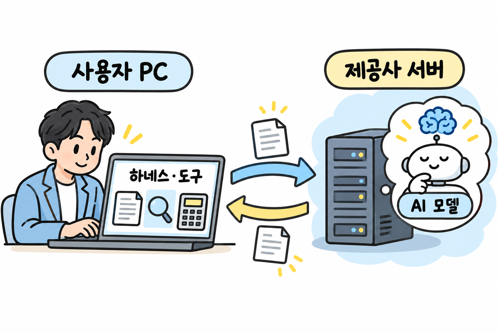

| 구분 | 에이전트 하네스 |
| ------ | ------ |
| 예 | Claude Code |
| 실행 위치 | ▶️ 모델은 제공사 서버 ▶️ 하네스와 도구는 사용자 PC |
| 지금의 주 모델 | Claude Opus 5.5 |
| 모델 호출 | 하네스가 호출한다 |
| 자료 전송 대상 | ▶️ 모델 제공사 서버 |
| 구현 순서 | PC 한 대에 먼저 구현한다. 이후 사내 서버와 DGX Spark 환경을 추가한다 |

#### 1. AI 모델 ✅

##### 원칙

- **주 모델**: 모든 작업에 그때 가장 뛰어난 모델 하나를 쓴다. 주 대화와 하위 에이전트(일을 나눠 맡는 보조 대화)에 모두 이 모델을 지정한다.
- **추론 강도**: 추론 강도는 모델이 답하기 전에 생각하는 정도다. AA 점수를 잰 가장 높은 설정으로 돌린다.
- **결과 검사**: 주 모델이 하되, 결과를 만든 대화가 아닌 새 대화에서 한다. 같은 대화에서 검사하면 자기 답을 후하게 본다. PC에서 계속 실행되는 관리 프로그램이 하네스를 따로 새로 실행해 맡긴다. 결과를 만든 대화가 띄운 하위 에이전트는 받을 자료를 그 대화가 고르게 되므로 쓰지 않는다.
- **다른 모델**: 주 모델이 못 하는 일에만 쓴다. 음성 인식처럼 주 모델이 입력을 받지 못하는 경우와, 바깥 모델에 넘기기 전에 PC에서 먼저 해야 하는 일이다. 의미 검색 모델, 시계열 예측 모델, 문서·소리를 두 번째로 읽는 도구(OCR·받아쓰기)는 판단하는 모델이 아니라 도구라 이 규칙 밖이다.

##### 가장 뛰어난 모델 고르기 ✅

[Artificial Analysis 지수](https://artificialanalysis.ai/leaderboards/models)(AA 지수)로, 하네스가 부를 수 있는 모델 가운데 아래 순서대로 거른다. 점수는 모델마다 가장 높은 설정의 것을 쓴다.

1. 40점 미만은 뺀다. 1점 차이까지는 40점으로 본다.
2. 그중 1위보다 2점 이상 낮으면 뺀다. 1점 차이까지는 같은 점수로 본다.
3. 남은 후보는 실제 업무의 정확성·충분함·완료율을 먼저 비교한다. 점수가 가깝다는 이유만으로 같은 실력이라고 보지 않으며, 중요한 근거와 필수 검토를 더 잘 처리하는 모델을 우선한다.
4. 업무 품질이 동등하다고 확인된 후보 사이에서 출력 토큰과 실제 처리 시간으로 효율을 비교한다. 토큰이 적거나 구독 사용량이 적다는 이유로 품질을 낮추지 않는다.

##### 주 모델이 바뀔 때 ✅
 
- 주 모델 이름은 하네스의 모델 설정 한 곳에만 적는다. 전문가 정의와 지시문에는 이름 대신 "주 모델"이라고 쓴다. 이름을 여러 곳에 적으면 모델이 바뀔 때 빠뜨린 곳이 생긴다.
- 새 모델이 나왔을 때, AA가 지수를 개편했을 때, 쓰던 모델의 제공이 끝나거나 사용 허가가 바뀌었을 때 위 순서로 다시 거른다. 모델이 그대로여도 지수가 바뀌면 순위가 바뀐다. 이런 소식이 없어도 한 달에 한 번은 다시 거른다.
- 결과가 지금 주 모델과 같으면 그대로 둔다. 다르면 환경을 맡은 사람에게 알리고, 그 사람이 설정 한 곳을 고쳐 바꾼다.
- 주 모델에 장애가 났다고 바로 다른 모델로 넘기지 않는다. 바꾸는 것은 이 절차를 거친 때뿐이다.

#### 2. 실행 제어 ✅

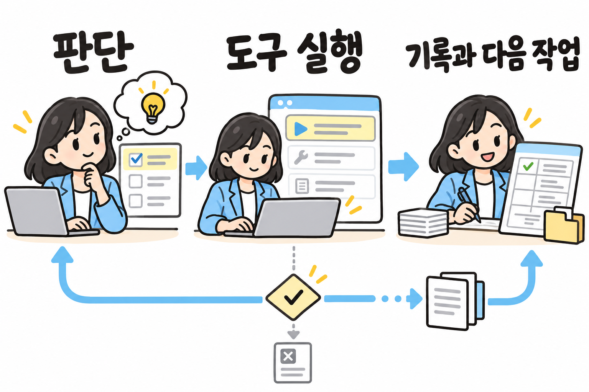

**AI가 고른 일을 실제 도구에 시키고, 끝나면 다음 일을 이어 주는 관리 프로그램을 만든다.** 예를 들어 신청 업무에서는 자료 확인, 작성, 검토, 필요한 승인, 제출과 접수 확인을 차례로 연결한다. 접수를 기다리는 동안에는 AI를 계속 부르지 않는다.

| 맡길 일 | 선택한 도구 |
|---|---|
| 사용자가 일을 맡기고 진행 상황을 보는 화면 | Python과 FastAPI로 만든 관리 프로그램. 브라우저에서 사용한다 |
| 작업 순서와 대기, 예약, 중단 후 이어 하기 | 관리 프로그램 안에서 실행하는 DBOS |
| AI의 판단과 작성 | Python용 Claude Agent SDK로 Claude Code의 AI 실행 기능을 호출한다 |
| 진행 상태와 검색 자료, 근거 관계 보관 | PostgreSQL. 원본과 결과 파일은 파일 보관 공간에 둔다 |
| 계산과 파일 작업 | 필요한 도구와 보조 모델을 그때 불러 실행한다 |

DBOS 기록과 업무 자료는 같은 PostgreSQL 데이터베이스에 두되 접근 권한을 나눈다. 여러 기능의 저장과 검색을 함께 처리하므로 기능마다 별도 서버를 추가하지 않는다.

##### 업무 기록과 외부 실행

업무 번호와 DBOS 실행 번호를 연결한다. 같은 접수 요청 번호는 같은 실행 번호로 처리하고, 요청 내용이 달라졌으면 새 요청으로 구분한다. 업무 상태 변경과 해당 단계의 완료 기록은 DBOS의 데이터베이스 연결 기능인 Datasource를 통해 같은 트랜잭션에 저장한다. 둘 중 하나만 남지 않도록 한 번에 확정하는 방식이다. 업무 접수 기록과 실행 예약도 같은 트랜잭션으로 묶는다. [DBOS 트랜잭션](https://docs.dbos.dev/python/tutorials/transaction-tutorial), [업무 등록과 실행 예약](https://docs.dbos.dev/python/examples/outbox)

AI 응답이나 외부 조회처럼 실행할 때마다 달라질 수 있는 결과는 DBOS의 단계로 기록한다. 복구할 때는 기록된 결과로 같은 작업 순서를 이어 간다. **DBOS가 완료를 기록하기 전에 장애가 나면 외부 요청은 다시 실행될 수 있다.** 실제 외부 변경은 기존 거래 처리 기능을 거쳐 고유 요청 번호와 요청 내용을 먼저 저장하고, 상대 시스템의 중복 방지 기능을 사용한다. 처리 여부가 불명확하면 원래 시스템에서 조회하며, 확인하지 못한 요청은 자동으로 다시 보내지 않는다. DBOS의 단계 완료와 외부 시스템의 실제 반영 완료는 별도로 기록한다. [DBOS의 복구 보장 범위](https://docs.dbos.dev/python/tutorials/workflow-tutorial#guarantees)

##### AI 연동과 대화 복구

대화를 이어 가는 호출에는 `ClaudeSDKClient`를 사용한다. 업무 번호와 SDK가 반환한 대화 세션 번호를 연결해 저장하고, 중단 후에는 그 번호를 `resume`에 지정한다. 같은 대화에 여러 실행이 동시에 내용을 쓰지 않게 한다. 독립 검토는 별도 대화로 시작한다. [대화 유지와 재개](https://code.claude.com/docs/en/agent-sdk/sessions)

SDK의 대화 파일은 실행 장비의 고객별 영구 저장 공간에 보관하고 기존 파일 백업에 포함한다. 자동 정리 설정을 업무의 보관 기간에 맞추고, 진행 중인 업무의 기록이 삭제되지 않게 한다. 작업 파일과 대화 기록은 따로 복원해야 한다. 장비를 옮길 때는 세션 번호와 기록 파일, 작업 공간을 함께 복원해 실제 재개를 검사한다. 대화가 복구돼도 외부 행동 기록을 먼저 대조하고, 빠진 기록을 모델의 기억으로 대신하지 않는다. 인증 방식과 사용 권한, 과금 한도는 해당 제품의 운영 형태에 맞게 확인해 연결 설정에 등록한다.

재료 하나마다 하네스를 새로 실행하지 않는다. 자료 속 명령 검사와 필요한 분담, 독립 검토 때만 대화를 추가한다. 계산과 정해진 분기, 대기는 코드가 처리한다. 대화 수와 실제 모델 호출 수, 토큰 사용량은 따로 센다.

##### 도구에 일을 맡기는 방법

관리 프로그램이 업무 번호와 요청 번호, 사용할 자료와 버전, 처리 조건을 전달한다. 도구는 결과물 번호와 처리 상태, 검사 기록을 돌려준다. 결과를 받으면 누가 보냈는지와 정한 형식을 지켰는지 확인한다.

외부 행동을 실행하는 도구는 발송 직전에 취소·보류 상태, 승인과 권한, 자료 버전과 한도를 검사한다. 상태 확인과 실행 허가 기록은 같은 DB 트랜잭션에서 잠금이나 버전 비교로 보호한다. 취소와 발송 시작 중 먼저 확정된 처리를 기록하고, 취소가 먼저면 발송을 막는다. 이 검사는 재시도·장애 복구 때도 실제 실행 경로에서 새로 수행하며, DBOS에 저장된 과거 허용 결과로 대신하지 않는다.

SDK의 `tools`와 `disallowed_tools`로 사용 가능한 도구를 제한하고, `strict_mcp_config`로 관리 프로그램이 등록한 연결만 사용한다. `allowed_tools`는 자동 승인 목록이므로 이것만으로 도구 접근을 제한하지 않는다. AI가 직접 호출한 도구도 같은 권한 검사와 분리 실행을 거치게 하며, 직접 명령이나 통신으로 외부 변경 검사를 우회하지 못하게 한다. [SDK 도구 설정과 권한](https://code.claude.com/docs/en/agent-sdk/python#claudeagentoptions)

같은 PC의 브라우저라도 사용자를 인증하고, FastAPI의 업무 조회·변경 API에서 해당 업무의 접근 권한을 검사한다. 브라우저의 변경 요청에는 세션별 요청 확인값인 CSRF 토큰과 요청을 보낸 웹 주소를 검사한다. 허용한 웹 주소만 연결하고 글자를 읽는 방식과 숫자 표기도 고정한다. [다른 사이트의 요청 위조 방어](https://cheatsheetseries.owasp.org/cheatsheets/Cross-Site_Request_Forgery_Prevention_Cheat_Sheet.html)

업무 계획에는 장비의 파일 경로 대신 등록된 도구 이름을 넣는다. DB와 도구의 주소, 실행 위치는 연결 설정에 둔다. 서버를 추가해도 같은 업무 절차를 쓴다. 연결할 인증정보와 자료를 보낼 수 있는 범위를 확인하며, 연결 실패 때 다른 서버나 외부 서비스, 계정으로 임의 전환하지 않는다.

같은 보조 모델을 쓰는 기능은 검증한 실행 구성을 함께 쓴다. 필요한 때만 불러오고 CPU·GPU 사용은 실제 지원 사양에 따른다. 가상 머신에서 PC의 GPU를 바로 쓸 수 있다고 가정하지 않는다.

##### 실패 종류에 따른 재시도

정상 완료는 결과와 필수 검사를 저장한 뒤 다음 단계로 간다. 필수 검사에 실패하면 다음 변경 작업을 막는다. 병렬 작업 중 일부가 실패하면 성공한 결과는 보존하고, 실패한 결과가 필요한 작업만 기다리거나 다시 한다.

| 실행 중 생긴 일 | 처리 |
|---|---|
| 일시적 연결 오류·서버 과부하 | 반복해도 안전한 요청만 정한 횟수 안에서 다시 시도한다. 외부 변경은 먼저 중복 실행 가능성을 확인한다 |
| 인증 실패·권한 부족 | 자동 재시도를 멈추고 인증·권한 문제가 해결된 뒤 재개한다 |
| 잘못된 입력·필수 조건 위반 | 원인을 수정하기 전에는 다시 실행하지 않는다 |
| 외부 요청의 처리 여부 불명 | 원래 요청 번호로 실제 처리 상태를 조회한다. 새 번호로 바꿔 보내거나 실패로 단정하지 않는다 |
| 제공사 호출 한도·이용량 소진 | 회복 시각에 재개하도록 등록하거나 이미 허용된 동등 품질의 실행 경로를 사용한다. 기한에 미치는 영향을 확인하고, 새 유료 서비스나 계정으로 임의 전환하지 않는다 |
| 정한 시도 횟수 소진·장기 장애 | 같은 방법의 자동 반복을 끝내고 원인과 실행 기록을 남긴다. 원인 수정·대체 경로·복구 대기의 담당과 다음 확인 시각을 등록하며, 남은 업무를 실패한 시도와 함께 종료하지 않는다 |

조회처럼 반복해도 안전한 호출의 기본 재시도는 **1초·3초·10초 대기 후 최대 3회, 최초 실행 포함 총 4회**다. 제공사가 더 기다리도록 지정하면 이를 우선한다. 이 대기 순서는 관리 프로그램에서 `DBOS.sleep`으로 기록하고, 재시도 판단과 횟수도 보존한다. DBOS의 `max_attempts`는 최초 실행을 포함하므로 재시도 횟수와 혼동하지 않는다. 관리 프로그램과 DBOS·SDK·연결 도구의 재시도가 겹쳐 총 시도 횟수를 넘지 않게 한다. [단계 재시도](https://docs.dbos.dev/python/tutorials/step-tutorial)

이 횟수는 같은 조건에서의 재시도 묶음에 적용한다. 원인이나 방법을 고친 뒤 남은 업무를 처리할 전체 횟수를 제한하지 않는다. 새 시도에서도 이전 실패·사용량 기록을 유지하고, 해결 없이 횟수만 초기화해 반복하지 않는다.

##### 취소·기한·장애 복구

취소나 권한 철회가 들어오면 새 실행과 예약, 자동 재시도를 막는다. 이미 시작한 행동은 DBOS에 취소를 요청했다는 이유로 중단 완료로 보지 않는다. 외부 도구의 실제 취소·처리 상태를 확인하고, 중단할 수 없거나 결과를 확인하지 못하면 복구 필요로 남긴다. [DBOS 취소와 실행 제한 시간](https://docs.dbos.dev/python/tutorials/workflow-tutorial#workflow-timeouts)

대기열 접수부터 최종 결과 확인까지의 시간을 관리하되, 내부 예상 완료 시각과 사용자에게 약속한 기한, 법령·계약·권한의 만료 시각을 구분한다. 내부 예상 시간을 넘으면 자원과 계획을 조정해 계속 처리한다. 약속한 기한이 늦어질 때는 영향과 새 예상 시각을 알리고 허용된 범위의 처리를 이어 간다. 만료로 더 이상 허용되지 않는 행동은 차단하고, 필요한 대체·정정·인계 절차를 진행한다.

DBOS의 실행 제한 시간은 업무 전체의 완료 조건과 별도로 관리한다. 제한 시간으로 실행이 취소됐으면 유효한 결과와 외부 처리 상태를 확인한 뒤 관리 프로그램이 남은 작업을 다시 등록한다. 이미 끝난 행동은 반복하지 않는다. 재시도 횟수나 내부 예상 시간에 도달했다는 이유만으로 사용자에게 업무를 처음부터 다시 요청하게 하지 않는다.

재시작하면 DBOS 상태와 업무 상태, 대화 세션, 결과 파일과 외부 행동 기록을 맞춰 본 뒤 재개한다. DBOS가 성공으로 끝났더라도 필수 파일이나 실제 반영 근거가 빠졌으면 업무 완료로 표시하지 않는다.

##### 실행 중인 업무의 버전 유지

업무마다 실행 절차와 코드·도구 버전을 기록하고 DBOS의 `application_version`을 배포 버전에 맞춘다. 새 버전 배포 전 기존 단계 기록으로 복구되는지 검사한다. 호환되지 않는 업무는 기존 버전으로 완료하는 것을 기본으로 하고, 전환이 필요하면 검증한 절차로 옮긴다. 이전 장비와 새 장비가 같은 업무를 동시에 재개하지 않게 한다. [진행 중인 업무의 코드 변경](https://docs.dbos.dev/python/tutorials/upgrading-workflows)

##### 완료 기준

진행·대기·완료·실패·보류·취소·복구 필요를 구분한다. 장비 중단과 재시작, 중복 요청, 승인 철회, 응답 유실과 실행 중 버전 변경을 시험한다. 끝난 외부 행동이 중복되지 않고, 허가되지 않거나 만료로 더 이상 허용되지 않는 행동은 차단돼야 한다. 내부 예상 시간 초과와 재시도 종료 뒤에도 남은 업무가 다음 처리로 연결돼야 한다. 대기 업무와 대화·결과 파일이 누락되지 않으며, 실제 반영과 필수 검사까지 확인한 업무만 완료로 처리한다.

#### 3. 현재 작업 정보 ✅

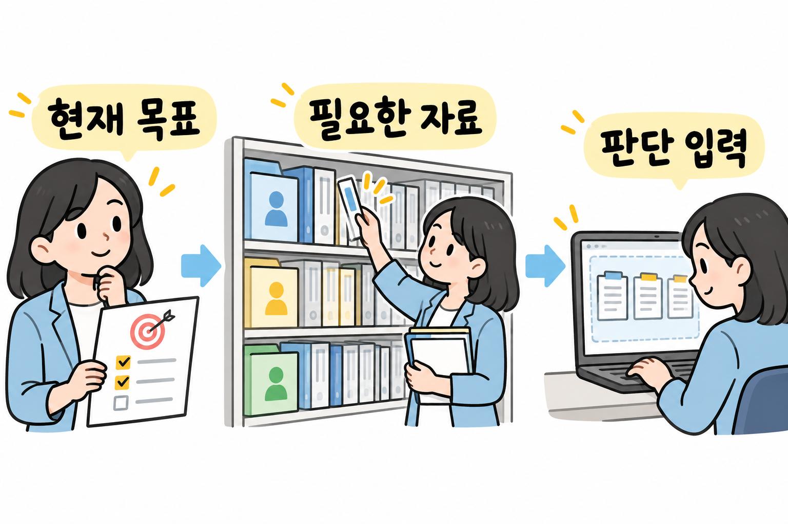

**모델이 판단할 때마다 이번 일에 필요한 정보만 모아 준다.** 관리 프로그램이 PostgreSQL의 업무 상태와 기존 자료 검색 결과를 사용해 구성한다.

| 구분 | 제공할 내용 |
|---|---|
| 항상 필요한 업무 식별 정보 | 업무·고객 번호, 현재 단계, 계획·상태 버전과 판단 기준 시점 |
| 항상 유지할 목표와 조건 | 목표, 권한·승인 범위, 금지 조건, 기한, 적용 조건·가정과 미해결 항목 |
| 이번 판단의 필수 근거 | 적용할 규칙·조건·예외와 판단에 필요한 원문, 확인한 사실·계산 결과. 각각의 원문 위치와 버전을 함께 제공한다 |
| 필요한 경우 보충할 자료 | 관련 사례와 과거 기록, 추가 설명. 이번 업무에 사용할 수 있는 자료만 고른다 |

##### 권한과 버전 확인

정보를 모으기 전에 인증된 사용자의 고객·업무 접근 권한과 자료의 적용 범위를 확인한다. 모델에게 보내기 직전에도 권한을 검사한다. 대화·검색 결과·캐시는 고객·업무별로 분리하고, 과거 기록을 다시 사용할 때도 현재 권한과 자료 버전을 확인한다. 이미 대화에 넣은 자료의 열람 권한이 철회되면 그 대화를 이어 쓰지 않고 허용된 정보로 새 대화를 구성한다.

목표·조건·현재 단계는 같은 업무 상태 버전에서 읽는다. 정보를 모으는 동안 상태가 바뀌면 영향을 받은 정보를 다시 구성한다. 판단 기준 시점과 실제 조회 시각은 따로 기록하고, 과거 자료를 비교할 때도 각 자료의 적용 시점을 표시한다.

사용자 지시와 승인된 업무 규칙, 검토할 외부 자료, AI의 가정을 구분해 제공한다. 외부 자료에 포함된 명령은 업무 지시로 취급하지 않는다.

##### 입력 한도와 필수 근거

모델의 입력 한도와 답변에 필요한 분량을 확인하고, 필수 정보부터 배치한다. 한도를 넘는 자료는 원문 번호·위치·버전을 남겨 나누어 읽힌다. 필요한 조건과 예외를 크기에 맞춰 빼거나 근거 없는 요약으로 대신하지 않는다.

결과물도 한 번의 출력 한도를 넘으면 항목별로 작성·저장한 뒤 합치고 전체 요구사항과 대조한다. 응답 길이나 대화 한도 때문에 필요한 설명·분석·검증을 줄이지 않는다. 다음 호출에는 완료한 부분과 남은 부분을 전달해 이어 처리하고, 일부 작성된 결과를 전체 완료로 표시하지 않는다.

관리 프로그램은 필요한 근거 목록과 실제로 모델에 제공하거나 조회해 준 범위를 기록한다. 판단이 인용한 원문 위치를 이 기록과 대조하며, 모델이 “읽었다”고 말한 것만으로 확인 완료로 보지 않는다. 필수 근거나 예외가 빠지면 추가로 읽히고, 확보하지 못하면 해당 판단을 확정하지 않는다.

요약에는 원문 위치와 버전을 연결한다. 적용 조건·예외·미확인 항목은 대화 요약과 별도로 보존한다. 요약만으로 판단할 수 없거나 원문이 바뀌었으면 해당 원문을 다시 확인한다.

##### 복원과 실행 전 확인

업무 시작·단계 전환·대화 압축·프로그램 재시작 때 저장된 최신 상태와 미해결 항목으로 정보를 다시 구성한다. 모델에 제공한 상태·계획·자료 버전을 판단 기록에 연결한다. 판단 중 상태나 근거가 바뀌면 영향을 받는 판단을 다시 확인하고, 실행 직전에도 현재 버전·권한·조건과 대조한다. 바뀐 정보에 의존하는 행동은 재검증 전까지 실행하지 않는다.

##### 완료 기준

같은 업무의 목표·권한·현재 단계·계획 버전·미해결 항목이 시작·전환·압축·재시작 뒤에도 정확히 복원돼야 한다. 필수 근거 누락, 다른 고객·업무 자료 혼입, 권한 철회와 판단 도중 상태 변경을 시험한다. 필요한 원문을 확인하지 못했거나 버전이 충돌하면 관련 판단·행동을 보류하고, 영향을 받지 않는 작업은 계속한다.

#### 4. 분리 실행 ✅

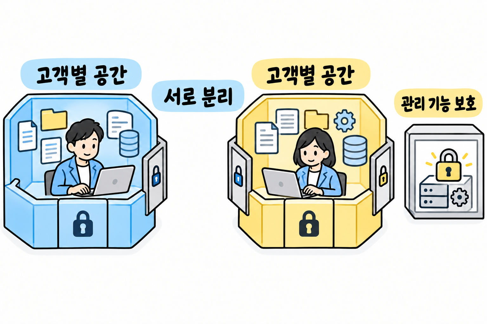

**한 작업이 다른 고객의 자료나 제품의 관리 기능을 건드리지 못하도록 실행 공간을 나눈다.** Podman의 rootless 컨테이너를 쓴다. 컨테이너는 프로그램과 파일을 나눠 실행하는 공간이고, rootless는 장비 관리자 권한 없이 실행하는 방식이다.

관리 프로그램·DB·작업 공간의 계정과 권한을 분리한다. 시작 프로그램은 인증된 관리 프로그램이 요청한 검증된 작업만 실행하거나 중지한다. 모델이 실행 권한이나 공유 폴더, 통신 설정을 바꾸지 못하게 한다. rootless라는 사실만으로 파일·통신·자원 제한까지 갖춰졌다고 보지는 않는다.

##### 컨테이너의 파일·권한·통신 제한

외부 문서를 읽거나 AI가 만든 코드를 실행하는 공간에는 검증한 프로그램과 그 일에 필요한 자료만 넣는다.

| 제한할 것 | 구현 |
|---|---|
| 프로그램과 기본 파일 | 실행 이미지는 검증한 버전과 SHA-256 해시값으로 고정한다. `--read-only`로 기본 파일 영역의 변경을 막는다 |
| 작업 파일 | 입력은 읽기 전용, 출력·임시 파일은 해당 작업 전용 공간에 둔다. `--read-only-tmpfs=false`로 자동 임시 쓰기 공간을 끄고 필요한 경로만 용량을 제한해 연다 |
| 실행 권한 | 컨테이너 안에서도 일반 사용자로 실행한다. `--cap-drop=all`과 `--security-opt=no-new-privileges`를 적용해 불필요한 권한과 실행 중 권한 상승을 막는다 |
| 장비 관리 | PC 전체 폴더, 컨테이너 관리 소켓, 호스트의 프로세스·통신 공간을 공유하지 않는다. `--privileged`와 시스템 호출 제한인 seccomp의 해제를 금지한다 |
| 통신과 인증정보 | 통신이 필요 없는 작업은 `--network=none`으로 차단한다. 외부 연결은 허용된 연결 기능을 거치고, 작업 코드에 DB·관리 API의 인증정보를 넘기지 않는다 |

읽기 전용 설정과 임시 공간, 권한 제한은 실제 실행 설정에 적용됐는지 확인한다. [Podman 실행 설정](https://docs.podman.io/en/latest/markdown/podman-run.1.html)

통신이 필요한 도구는 별도 연결 공간에서 실행한다. 기존 공통 연결 기능의 허용 대상과 네트워크 차단 규칙을 실제 접속 경로에 적용하고, 프록시 설정이나 URL 검사만으로 차단됐다고 보지 않는다. 승인되지 않은 직접 통신과 다른 고객·관리 서비스로의 연결도 시험한다.

파일을 넣거나 결과를 가져올 때는 실제 경로와 파일 종류를 확인한다. 심볼릭 링크나 Windows의 폴더 연결을 따라 허용 범위를 벗어나지 못하게 한다. 공유가 허용된 참고 자료도 읽기 전용으로 제공한다.

##### DB의 고객 분리

PostgreSQL의 RLS로 고객별 자료와 고객 내부의 사용자별 접근 범위를 제한한다. 보호할 테이블에 `ENABLE ROW LEVEL SECURITY`와 `FORCE ROW LEVEL SECURITY`를 적용한다. `USING`은 조회·수정·삭제할 기존 행을, `WITH CHECK`는 추가·수정 후 저장할 행을 검사한다. 허용 조건이나 고객 정보가 없으면 접근을 거부한다. [RLS의 조회·변경 조건](https://www.postgresql.org/docs/current/sql-createpolicy.html)

업무용 DB 계정은 테이블 소유자·관리자 계정과 분리하고, `BYPASSRLS`와 상위 역할로 전환할 권한을 주지 않는다. 테이블 전체 삭제인 `TRUNCATE`, 구조·정책 변경도 허용하지 않는다. `FORCE`를 적용해도 슈퍼유저와 `BYPASSRLS` 역할은 RLS를 우회하므로 관리용 계정을 작업에 사용하지 않는다. [RLS의 예외](https://www.postgresql.org/docs/current/ddl-rowsecurity.html)

고객·사용자 번호는 인증된 관리 프로그램이 정한다. 해당 DB 연결에서는 등록된 함수와 입력값을 별도로 전달하는 검증된 SQL만 실행하며, 모델이 만든 임의 SQL은 실행하지 않는다. AI나 작업 코드가 DB에 직접 연결하거나 고객 설정값을 바꾸는 경로를 두지 않는다. 고객 설정은 `SET LOCAL`로 현재 트랜잭션에만 적용하고, 연결을 돌려받거나 재사용할 때 이전 설정·역할·열린 트랜잭션이 남지 않았는지 검사한다. 정리를 확인할 수 없는 연결은 폐기한다. [트랜잭션 안에서만 적용하는 설정](https://www.postgresql.org/docs/current/sql-set.html)

조회용 뷰는 호출자의 권한으로 검사하는 `security_invoker=true`를 기본으로 한다. 별도 권한으로 실행하는 함수는 기존 상태 변경 기능처럼 필요한 권한과 호출 대상만 허용하고, 함수 내부에서도 고객·업무 권한을 검사한다. 고객별 고유값과 자료 간 참조에는 고객 번호를 포함해 다른 고객의 행을 연결하지 못하게 한다. 고유성·외래 키 검사와 오류 메시지로 다른 고객 자료의 존재가 드러나지 않는지도 시험한다. [뷰의 실행 권한](https://www.postgresql.org/docs/current/sql-createview.html)

파일·검색 목록과 통계·임시 자료·관계 정보·기억·로그·백업에도 같은 고객별 접근 제한을 적용한다. DB의 RLS가 이 영역까지 자동으로 보호한다고 가정하지 않는다.

##### 자원 한도와 새 작업 대기

초기 동시 실행 한도는 업무 2건, 대형 보조 모델 1개다. 관리 프로그램이 기존 공통 실행·자원 배정 기능으로 강제하며, AI 분담도 전체 AI 실행 한도를 함께 지킨다. 모델을 불러오기 전에 메모리·디스크와 이미 배정한 자원을 확인한다. 작업용 메모리 예산의 80%를 사용하면 새 작업은 기다리게 한다.

80%는 새 작업의 시작을 늦추는 기준이다. 진행 중인 업무의 다음 단계와 필수 검사에 필요한 자원을 우선 배정한다. 한 번에 처리할 수 없으면 자료를 나누거나 순서대로 처리하고, 필요한 크기의 검증된 실행 공간을 준비한다. 각 실행에는 다음 강제 한도를 별도로 적용한다.

| 제한할 자원 | 적용 방법 |
|---|---|
| 메모리·CPU·프로세스 수 | `--memory`, 스왑 한도, `--cpus`, `--pids-limit`을 작업별 설정에 고정한다 |
| 출력·임시 파일·로그 | 작업용 볼륨과 tmpfs, 로그의 용량을 제한한다. 부족해지기 전에 필수 결과·기록을 승인된 저장소에 보존하고 공간을 확보한다. 용량에 맞춰 결과나 필수 기록을 잘라 버리지 않는다 |
| 실행 시간 | 작업별 제한 시간과 진행 확인 주기를 둔다. 정상 진행 중이면 다음 실행에 필요한 시간을 재산정한다. 제한 시간에 종료된 실행은 유효한 결과와 실제 처리 상태를 확인해 남은 작업을 복구한다. 내부 예상 시간 초과만으로 업무 전체를 종료하지 않는다 |
| GPU 메모리 | 일반 메모리와 따로 여유·배정량을 검사한다. RAM 제한이 GPU 메모리까지 제한한다고 보지 않는다 |

한도는 작업 종류별 배포 설정에 숫자로 저장한다. 값이 없거나 제한을 적용하지 못하면 해당 작업을 시작하지 않는다. 단순한 폴더 공유나 사용량 감시만으로 저장 공간의 강제 한도를 대신하지 않는다. 장비와 가상 머신 전체에서도 관리 프로그램·DB에 필요한 자원을 남긴다.

Linux의 자원 제한 기능인 cgroups v2와 필요한 제어 권한을 확인한다. rootless에서는 환경에 따라 일부 한도가 적용되지 않을 수 있으므로, 설정값과 실제 초과 시험을 함께 검사한다. [Podman 자원 제한](https://docs.podman.io/en/latest/markdown/podman-run.1.html#memory-m-number-unit)

##### 운영체제와 GPU별 실행 확인

Linux에서는 rootless 컨테이너를 직접 실행한다. Windows·macOS에서는 Podman Machine의 제품 전용 Linux 가상 머신에서 실행하며, VM 안의 컨테이너 연결도 rootless인지 확인한다. OS·CPU별 이미지와 Podman·VM 버전, 파일 공유와 자원 제한이 검증된 구성을 배포한다. [Podman Machine](https://docs.podman.io/en/latest/markdown/podman-machine.1.html)

가상 머신의 기본 홈 폴더 공유를 끄고 제품에 필요한 경로만 연결한다. Windows의 WSL 기반 구성은 드라이브 자동 연결과 Windows 프로그램 실행 연동도 별도로 제한한다. 제품 전용 환경에 적용하며 사용자의 다른 개발 환경 설정을 바꾸지 않는다. [Podman의 기본 공유 폴더](https://docs.podman.io/en/latest/markdown/podman-machine-init.1.html#volume-v-source-target-options) · [WSL의 공유·실행 연동 설정](https://learn.microsoft.com/en-us/windows/wsl/wsl-config)

GPU는 OS·VM·장치별 실제 지원과 고객 자료 격리를 확인한 경로만 사용한다. 임의 코드에 GPU 장치를 직접 넘기지 않고 검증된 도구·모델 실행 기능을 거치게 한다. 필요한 제한을 지킬 수 없는 가속 방식은 쓰지 않는다. 컨테이너는 Linux 커널을 함께 쓰므로 커널 취약점이나 장비 관리자 권한까지 이 설정만으로 막는다고 보지는 않는다.

##### 종료·복구와 완료 기준

작업이 끝나면 필요한 결과와 검사 기록을 고객별 승인된 저장소에 옮기고 임시 파일·볼륨·접근 권한을 정리한다. 실패·취소·재시작 때도 남은 실행과 임시 공간을 대조하고, 현재 업무·권한을 확인한 뒤 복구한다. 검증되지 않은 일부 결과는 완료 결과로 반영하지 않는다.

분리 실행 기능이 준비되지 않았으면 설치를 복구한다. 그 장비에서 사용할 수 없다면 이미 등록하고 허용한 서버가 있을 때만 보낸다. 분리하지 않은 채 직접 실행하는 방식으로 우회하지 않는다.

##### 완료 기준

지원 OS별로 다른 고객의 파일·DB·검색·로그·결과물 접근, 고객 번호 위조, DB 연결 재사용, 경로 이탈, 권한 상승, 승인되지 않은 통신과 자원 초과를 시험한다. 컨테이너 종료·오류·재시작 뒤에도 자료와 권한이 섞이지 않아야 한다. 제한 우회나 관리 기능 접근이 가능하면 해당 구성의 실행을 차단한다. 검증한 권한·자원 범위 안에서만 동작하는 구성을 사용한다.

#### 5. 운영 감시·복구 ✅

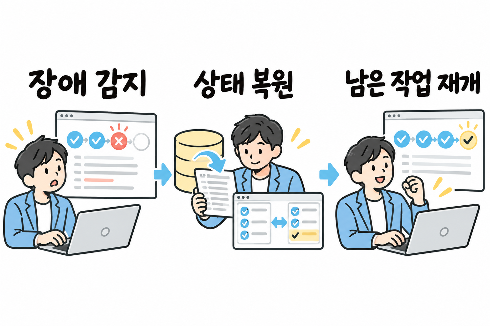

**제품이 멈추면 알아채고 다시 켜며, 저장한 상태에서 업무를 이어 준다.** OS 시작 프로그램이 실행 환경과 DB, 관리 프로그램을 차례로 켜고 감시한다.

##### 장애 감지와 재시작

감시 기능은 관리 프로그램과 별도 프로세스로 두고 OS의 서비스나 로그인 시 시작 기능에 등록한다. 열린 터미널에 의존하지 않는다. 재부팅만으로 복구되는 경우와 사용자 로그인 뒤에 복구되는 경우를 구분한다. 가상 머신·디스크 암호화·인증 때문에 로그인이 필요한 구성을 무인 복구로 표시하지 않는다. Windows·macOS·Linux의 실제 설치 경로에서 각각 시험한다.

30초마다 응답·오류율·자원 사용과 작업 진행 신호를 확인한다. 3회 연속 응답이 없으면 해당 부품을 비정상으로 표시하고 그 부품을 사용하는 새 실행을 보류한다. 긴 작업이나 모델 준비 중에는 진행 신호와 정한 기한으로 일시적 지연과 멈춤을 구분한다. 인증 실패·저장 공간 부족처럼 재시작으로 해결되지 않는 원인은 먼저 복구한다.

재시작이 가능한 장애만 해당 부품을 다시 켠다. 반복 실패 시 30초·1분·5분으로 간격을 늘리며, 3회 재시작에도 회복되지 않으면 자동 반복을 멈추고 승인된 운영 알림으로 전달한다. DB 연결·권한·작은 도구 실행을 확인한 뒤 업무 상태와 외부 거래 기록을 대조해 재개한다. 응답이 없었다는 이유만으로 외부 거래를 다시 실행하지 않는다.

자동 재시작을 멈춘 업무에는 복구 담당·남은 작업·다음 확인 시각을 연결한다. 원인을 수정하거나 검증된 실행 경로를 확보하면 저장한 위치에서 재개한다. 장애 알림을 보냈다는 사실만으로 업무를 종료하거나 사용자에게 재접수를 요구하지 않는다.

현재 PC 구성은 DBOS 실행을 관리하는 프로세스 하나를 기준으로 복구한다. 도구 실행 프로세스와 DBOS 실행 담당은 구분한다. 여러 DBOS 실행 프로세스로 확대할 때는 공식 문서가 요구하는 Conductor의 복구 조정과 실행 담당 식별을 별도로 검증한다. 단일 프로세스의 재시작 시험만으로 여러 서버의 복구까지 검증됐다고 보지 않는다. [DBOS의 복구 조건](https://docs.dbos.dev/faq#when-should-i-use-the-dbos-conductor)

##### DB와 파일을 함께 백업

목표는 DB와 필수 파일의 손실을 장애 직전 5분 이내로 제한하고, 장애 발생부터 업무를 안전하게 재개하기까지 1시간 이내로 복구하는 것이다. 백업은 원본과 함께 고장 나지 않는 별도 디스크나 승인된 저장소에 암호화해 둔다. 복호화 키와 저장소 인증정보는 장비가 없어져도 권한 있는 담당자가 복구할 수 있는 별도 보호 경로에 보관한다.

| 보관할 것 | 구현·확인 방법 |
|---|---|
| 업무 DB와 DBOS 기록 | PostgreSQL의 기본 백업과 WAL 변경 로그를 함께 보관한다. 기본 백업은 하루 1회, `archive_timeout`은 초기 60초로 설정한다. 실제 저장소에 보관된 WAL과 중간 누락을 확인한다 |
| 원본·필수 결과 파일 | 저장을 끝낸 파일을 버전별로 보존하고 restic으로 백업한다. 등록 즉시 백업 대상으로 넣고, 누락 확인은 1분마다 한다. 백업 시작이 아니라 별도 저장소의 보관 완료까지 5분 이내여야 한다 |
| 대화 기록·설정·권한 | 저장을 멈춘 일관된 사본이나 파일시스템 스냅샷으로 보관한다. DB 확장·실행 코드·절차 버전과 인증정보의 복원 방법도 기록한다 |

WAL은 설정한 시간이 지났다고 자동으로 별도 저장소에 도착한 것이 아니다. 마지막 아카이브 성공과 아직 보관되지 않은 변경의 위치·지연을 감시한다. `archive_timeout`으로 구간을 나누는 시간과 실제 전송 시간을 함께 계산한다. 실행 중인 DB 폴더를 restic으로 복사한 것만으로 PostgreSQL 백업을 대신하지 않는다. [PostgreSQL 시점 복구와 WAL 보관](https://www.postgresql.org/docs/current/continuous-archiving.html)

restic에는 변경 중인 원본을 그대로 맡기지 않는다. 저장 완료 후 고정한 파일과 일관된 사본을 대상으로 하고, 종료 코드·백업 번호·파일 목록을 확인한다. 일부 파일을 읽지 못한 종료 코드 `3`은 성공으로 처리하지 않는다. 백업 중복 실행을 막고, 밀린 작업과 가장 오래된 미보관 파일의 시간을 감시한다. [restic 백업과 오류 상태](https://restic.readthedocs.io/en/stable/040_backup.html)

복구 목록에는 DB를 되돌릴 시점과 WAL 위치, 그 시점의 DB가 참조하는 파일 번호·해시값·restic 백업 번호를 연결한다. DB와 파일의 백업 시각이 같다는 이유만으로 일치한다고 보지 않는다. 해당 DB 시점에서 필요한 파일이 모두 있어야 복구 가능한 상태로 인정한다. 필요한 기본 백업·WAL·파일 중 일부만 먼저 삭제하지 않는다.

필수 결과 파일의 백업 확인까지 끝난 뒤 최종 완료와 납품으로 넘긴다. DB와 필수 파일을 함께 복구할 수 있는 최신 시점을 계속 확인하고, 새 변경이 있는데 5분 목표를 넘기거나 복구 가능 여부가 불명확하면 목표 미달을 알리고 해당 업무의 새 완료·납품을 보류한다.

##### 복원 시험과 업무 재개

하루 한 번 백업 성공·지연·용량과 저장소 상태를 검사하고, 매달 별도 장비나 격리된 새 환경에서 실제 복원한다. restic의 기본 `check`는 파일 내용 전체를 읽는 검사가 아니므로, 월별 복원 시험에는 `check --read-data`와 복원 파일의 해시 대조를 포함한다. [restic 저장소 검사 범위](https://restic.readthedocs.io/en/stable/045_working_with_repos.html#checking-integrity-and-consistency)

DB·파일·DBOS 기록·대화 세션·코드·DB 확장·권한·설정과 인증정보의 복원 경로를 함께 시험한다. 시험 환경의 실제 외부 발송·거래는 차단한다. 복구 시점 이후 실행됐을 수 있는 외부 행동은 원래 시스템과 대조하고, 확인되지 않으면 자동으로 재실행하지 않는다. 이후의 권한 철회와 삭제 요청도 확인해 복원된 자료에 다시 적용한다.

자료 손실은 장애 직전 기록과 실제 복원 결과로 측정한다. 복구 시간에는 감지·장비 준비·복호화·파일 복원·검사와 업무 재개까지 포함한다. DB만 켜지고 필요한 파일이나 권한을 복원하지 못한 업무는 복구 필요로 남긴다. 5분 손실·1시간 복구를 입증하지 못한 구성은 목표 달성으로 표시하지 않는다.

##### 다른 장비로 옮기기

다른 OS나 CPU로 이전할 때는 새 접수·예약 실행과 자료 변경을 멈추고, 진행 중인 외부 행동을 확인한다. DBOS도 안전한 중단 지점에서 멈춘 뒤 DB와 파일의 최종 사본을 만든다. 전환 준비 중 받은 요청은 누락되지 않게 별도로 접수하거나 재시도를 안내한다.

`pg_dump -Fc`로 업무·DBOS 자료를 내보내고 `pg_restore`로 복원한다. `pg_dumpall --globals-only`로 역할 등 공통 정보를 확보해 새 환경에 맞게 검토·복원한다. 이 SQL 파일은 `psql`로 복원하며, DB 확장과 설정 파일·인증정보는 별도로 준비한다. 덤프 파일도 보호된 백업으로 취급한다. [PostgreSQL 자료 내보내기](https://www.postgresql.org/docs/current/app-pgdump.html) · [공통 역할·설정 내보내기](https://www.postgresql.org/docs/current/app-pg-dumpall.html)

새 OS·CPU에 맞는 DB 확장과 실행 코드를 설치하고 검색 색인을 재구축·검사한다. 업무 상태·파일·삭제 기록과 권한을 같은 이전 기준 시점으로 대조한다. DB 파일을 다른 OS에 그대로 복사하거나 여러 장비가 공유 폴더의 DB 파일을 직접 열지 않는다. 이전 장비의 실행 권한을 끊은 뒤 새 장비만 재개하며, 되돌릴 때도 한쪽만 실행되게 한다.

제품이 설치된 장비의 전원이 꺼진 동안에도 알림과 업무를 계속하려면 별도의 감시·실행 장비를 연결한다.

##### 완료 기준

일시적 지연·반복 장애·백업 지연·파일 누락·장비 중단·재시작·이전을 시험한다. DB와 필수 파일, 업무 실행 상태가 함께 복원되고 외부 행동이 중복되지 않아야 한다. 실제 설치 환경에서 손실 시간과 안전한 업무 재개 시간을 측정한 결과로 복구 목표의 충족 여부를 판정한다.

#### 6. 시작 신호 ✅

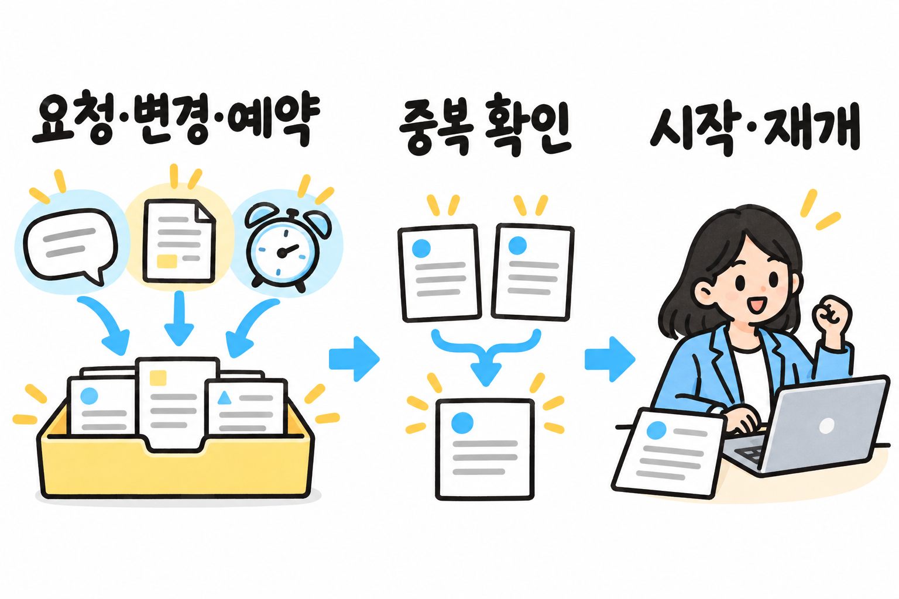

**요청·변경·예약 신호를 확인해 접수하고, 해당 업무를 시작하거나 이어 준다.**

| 신호 | 받는 방법 |
|---|---|
| 사용자 직접 요청 | FastAPI 관리 화면과 인증된 API. 고유 요청 번호를 부여하고 신규 또는 기존 업무 번호에 연결한다 |
| 외부 서비스의 알림 | FastAPI 접수 창구. 알림을 받을 수 없는 환경에서는 제공사의 조회 API로 변경 이력을 확인한다 |
| 정해진 시각 | DBOS 예약. 예약 번호·규칙 버전·예정 시각을 업무에 연결한다 |
| 지정한 폴더의 파일 변경 | Windows·macOS·Linux에서 자동 시작되는 감시 프로그램의 watchdog. 변경 알림을 놓치는 공유 폴더에는 `PollingObserver`로 주기적 비교를 적용한다 |

##### 파일 접근과 저장 완료

사용자가 지정한 폴더와 허용된 파일만 읽는다. 폴더 밖을 가리키는 심볼릭 링크나 Windows의 폴더 연결은 따라가지 않는다. 파일을 열 때도 실제 접근 대상이 허용 범위 안인지 확인해 경로가 바뀌는 경우를 막는다. 사용자 화면은 조작하지 않는다.

파일을 쓰는 프로그램이 제공하는 저장 완료 표시를 우선 사용한다. 임시 이름으로 쓰고 마지막에 완성 파일 이름으로 바꾸는 방식은, 그 이름 변경이 쓰기 종료를 뜻하도록 정한 경우에만 완료 표시로 인정한다.

완료 표시가 없으면 크기와 변경 시각이 안정된 뒤 사본을 만들고, 복사 전후 원본과 사본의 해시값을 비교한다. 변경되거나 읽기에 실패하면 다시 확인한다. **이 검사는 저장 완료의 증거가 아니므로 사본은 잠정 자료로 둔다.** 완전한 입력이 필요한 작업은 저장 완료 표시나 업로드 완료로 확정된 파일을 받은 뒤 시작한다. 사용할 사본의 버전과 해시값을 접수 기록에 연결한다.

파일 목록뿐 아니라 내용의 해시값도 주기적으로 대조해 놓친 변경을 찾는다. `PollingObserver`의 기본 비교는 파일 크기·변경 시각 등에 의존하므로 내용 비교는 관리 프로그램이 별도로 수행한다. [watchdog의 운영체제·공유 폴더 지원](https://github.com/gorakhargosh/watchdog#supported-platforms) · [파일 변경 비교 구현](https://github.com/gorakhargosh/watchdog/blob/master/src/watchdog/utils/dirsnapshot.py)

##### 신호 검증과 중복 접수

직접 요청은 로그인·API 인증과 해당 고객의 업무 권한을 확인한다. 외부 알림은 JSON으로 바꾸기 전 **수신한 원본 본문**에 제공사의 서명 검증 방식을 적용하고, 허용한 발신처와 알림 종류인지 검사한다. 제공사가 서명에 포함한 요청 시각을 제공하면 허용 시간도 검사한다. 제공하지 않는 시각은 임의로 만들지 않고 알림 번호와 변경 이력으로 재전송을 확인한다. [원본 본문의 서명 검증](https://docs.github.com/en/webhooks/using-webhooks/validating-webhook-deliveries)

중복은 고객·연결 계정별 요청 번호 또는 제공사의 알림 번호로 확인하고, 대상 자료의 버전과 변경 종류를 함께 기록한다. 같은 번호로 다시 온 요청에는 기존 접수 결과를 돌려주며, 내용이 다르면 충돌로 처리한다. 외부 알림 번호가 달라도 같은 변경을 가리키면 업무를 다시 등록하지 않는다. 구분할 근거가 부족하면 원래 시스템의 상태·변경 이력을 확인한다. [알림 번호와 재전송 구분](https://docs.github.com/en/webhooks/using-webhooks/best-practices-for-using-webhooks#use-the-x-github-delivery-header)

파일처럼 알림 번호가 없으면 마지막으로 확인한 상태와 대조해 실제 변화마다 내부 변경 번호를 부여한다. 과거와 같은 내용으로 되돌아온 변경도 새 변경이며, 경로나 해시값이 같다는 이유만으로 버리지 않는다.

검증한 신호의 저장과 DBOS 작업 등록은 기존 상태 변경 기능으로 같은 PostgreSQL 데이터베이스의 동일 트랜잭션에서 처리한다. 대기 중인 업무에 보내는 답변은 기존 응답 접수 기능에 연결한다. 접수 확정 뒤 성공 응답을 보내고 실제 처리는 등록한 작업에서 수행한다. 저장 여부가 불명확하면 같은 요청 번호로 기록을 확인하며, 성공 응답이나 새 업무를 임의로 만들지 않는다.

##### 중단 중 놓친 신호 복구

신호를 받는 경로마다 마지막으로 정상 확인한 위치와 시각을 저장한다. 조회한 신호의 저장·작업 등록이 확정된 범위까지만 확인 위치를 옮긴다. 재시작하면 그 위치부터 외부 변경 이력을 이어 받고, 파일 목록·해시값과 예약 기록을 대조한다. 폴더 접근 실패를 파일 삭제로 처리하지 않는다. 변경 이력이 없으면 현재 상태를 비교하되, 중단 중 생겼다가 사라진 변경까지 복구했다고 표시하지 않는다. 확인할 수 없는 구간은 미확인으로 남긴다.

정기 예약에는 `automatic_backfill=True`를 명시하고 기존 대기·후속 관리의 복구 절차에 연결한다. DBOS는 현재 예약 규칙으로 누락 시각을 계산하므로, 규칙이 바뀌면 이전 규칙의 적용 기간과 예정 회차를 대조해 과거에 없던 실행을 막고 실제 누락을 보완한다. [DBOS 예약 복구](https://docs.dbos.dev/python/tutorials/scheduled-workflows#backfilling-and-triggering)

접수된 신호가 실행 승인을 뜻하지는 않는다. 기존 실행 제어에서 현재 권한·계획과 취소·보류·기한을 확인한다. 늦은 답변은 현재 업무에 적용할 수 있는지 확인하고, 기한이 지난 행동은 정해진 만료 대응으로 넘긴다. 취소된 업무를 다시 실행하지 않는다.

##### 완료 기준

정상·중복·지연·위조 알림, 같은 요청 번호의 내용 충돌, 파일 저장 중 변경, 허용 폴더 밖으로 이어지는 경로, 공유 폴더 알림 누락, 장비 중단·재시작과 기한 만료를 시험한다. 유효한 신호의 접수 기록과 작업 연결이 빠짐없이 남고, 같은 신호가 업무를 중복 실행시키지 않아야 한다. 미완성 파일을 확정 입력으로 사용하거나, 복구하지 못한 구간을 누락 없이 확인했다고 표시하거나, 허용되지 않은 신호로 업무를 실행하면 실패다.

#### 7. 업무 도구·시스템 ✅

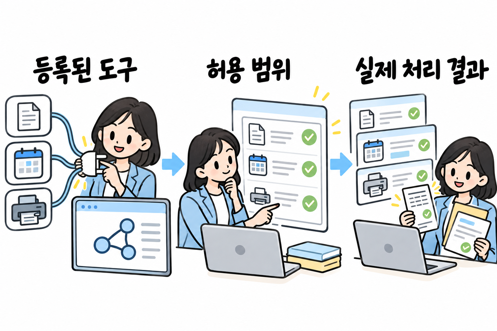

**외부 프로그램이나 장비에 요청을 보내고, 실제 처리 결과를 받아 오는 연결 기능을 만든다.**

| 상대가 제공하는 방식 | 연결 방법 |
|---|---|
| 공식 API | 우선 사용한다. 프로그램으로 직접 요청하고 결과를 받는다 |
| 웹 화면만 제공 | Playwright가 제품 전용 Chromium을 화면 없이 조작한다 |
| 측정·제어 장비 | 공식 API나 표준 통신을 사용한다 |
| 특정 OS의 설치형 프로그램이나 드라이버만 제공 | 그 장비 쪽에 전용 연결 프로그램을 둔다. 필요한 환경과 인증, 실제 처리 방법을 확보한 업무만 지원한다 |

##### 공통 실행 검사와 MCP 연결

모든 업무 도구는 관리 프로그램의 공통 실행·권한 검사를 거친다. Claude Code에 제공할 기능만 MCP로 연결하고, 관리 프로그램의 내부 작업은 등록된 Python 함수를 직접 호출한다. 어느 경로든 현재 고객·업무의 권한과 승인 범위, 입력값과 실행 대상을 검사한다. MCP는 AI와 도구를 연결하는 규격이며 접근 제한을 대신하지 않는다.

공식 Python MCP SDK v2를 사용하고, SDK와 연결 프로그램의 정확한 버전을 배포 설정에 고정한다. Claude Agent SDK와의 연결·도구 호출 시험을 통과한 조합을 함께 배포한다. v1용 코드를 그대로 섞지 않고, 필요한 라이브러리 버전이 충돌하면 기존 도구별 실행 공간으로 나눈다. [MCP Python SDK](https://py.sdk.modelcontextprotocol.io/) · [v1에서 v2로 변경된 사항](https://py.sdk.modelcontextprotocol.io/migration/)

도구 목록에는 서버 신원, 도구 이름·설명·정의 버전, 실행 위치, 입력·결과 형식, 필요한 권한, 제한 시간, 실제 상태 조회와 취소 방법을 기록한다. 연결·재연결과 도구 목록 변경 때 등록된 정의와 대조하고, 추가·변경된 기능은 검증 전까지 노출하지 않는다. 도구가 스스로 붙인 ‘읽기 전용’이나 ‘중복 실행에 안전함’ 표시는 권한 검사를 생략할 근거로 쓰지 않는다. [MCP 도구 설명과 권한의 구분](https://py.sdk.modelcontextprotocol.io/servers/tools/#names-titles-and-annotations)

##### 웹과 장비 작업

사용자의 열린 브라우저나 로그인 정보를 가져다 쓰지 않는다. Playwright와 호환되는 Chromium을 제품에 넣고 버전을 함께 고정한다. 작업마다 독립된 브라우저 공간을 만들고, 저장한 로그인 상태는 허용된 고객·계정에만 사용한다. 쿠키와 인증 상태 파일도 비밀번호처럼 보호하며 코드 저장소·일반 로그에 넣지 않는다. [Playwright의 인증 상태 관리](https://playwright.dev/docs/auth)

브라우저 세션 분리와 실행 환경의 접근 제한을 함께 적용한다. 기존 분리 실행 공간에서 해당 작업의 파일만 제공하고, 관리자 권한 없이 Chromium의 `chromium_sandbox=True`를 적용한다. 실행되지 않는다는 이유로 보호 설정을 끄지 않는다. [Chromium의 보호 설정](https://playwright.dev/python/docs/api/class-browsertype#browser-type-launch-option-chromium-sandbox)

CAPTCHA, 추가 인증이나 사이트 정책으로 자동화가 막히면 해당 작업을 보류하고 허용된 인증·담당자 처리 절차에 연결한다. 인증이 끝나면 실제 처리 상태와 현재 권한을 확인해 이어 간다. 사용자의 일반 브라우저를 대신 조작하거나 인증 제한을 우회하지 않는다.

설치형 프로그램만 있는 상대도 공식 API나 파일 교환 방법부터 찾는다. 전용 연결이 필요하면 기본 제품의 모든 OS에서 되는 기능이라고 표시하지 않는다. 전용 드라이버와 OS 명령은 연결 프로그램 안에 두고, 본체는 동일한 요청과 결과 형식을 사용한다.

##### 여러 실행 장비의 중복 작업 방지

같은 외부 서비스 계정에서 충돌할 수 있는 변경 작업은 실행 장비가 달라도 한 번에 하나만 진행한다. PostgreSQL의 공통 실행 기록에 담당 실행 번호, 권한 만료 시각, 담당이 바뀔 때 증가하는 번호와 고유 요청 번호를 저장한다. 만료 판단은 장비마다 다른 시계 대신 DB의 시각을 기준으로 한다. 담당 배정·갱신은 행 잠금과 트랜잭션으로 처리하고, 외부 응답을 기다리는 동안 DB 트랜잭션을 계속 열어 두지는 않는다. [PostgreSQL 잠금](https://www.postgresql.org/docs/current/explicit-locking.html#LOCKING-ROWS)

실제 요청을 보내는 연결 프로그램이 현재 담당 번호와 권한을 검사한다. 유효성을 확인할 수 없거나 권한이 만료됐으면 새 변경 요청을 보내지 않는다. 늦게 돌아온 이전 담당자의 결과는 현재 상태를 덮어쓰지 못하게 하되, 실제 외부 처리 여부를 확인할 기록으로 보존한다.

**권한 만료는 이미 보낸 요청의 중단을 뜻하지 않는다.** 담당을 넘기기 전에 이전 실행을 중지하거나 연결을 차단해 추가 요청이 나가지 않는지 확인하고, 진행 중인 외부 작업을 조회한다. 처리 여부가 불명확하면 충돌할 수 있는 후속 변경도 보류한다. 같은 작업의 고유 요청 번호는 재시도나 담당 변경 뒤에도 유지하고, 외부 시스템이 지원하는 중복 방지·버전 조건 기능을 함께 사용한다.

##### 인증정보와 실제 접속 제한

비밀번호와 API 키는 관리 프로그램의 보호된 저장소에 두고 모델에는 주지 않는다. OS의 인증정보 저장 기능이나 배포 때 지정한 보호된 인증정보에서 필요한 키만 가져온다. 배포 이미지·설정 예제·로그에는 키를 넣지 않는다. 인증 토큰은 발급된 대상과 권한에 맞는 연결에서만 쓰고, 다른 서비스로 넘기지 않는다. 프록시와 기관 인증서는 연결 설정으로 적용하며 인증서 검사를 끄지 않는다.

접속 전 허용한 도메인·포트와 실제 연결할 IP 주소를 확인한다. DNS가 나중에 다른 주소를 돌려주거나 다른 URL로 이동해도 같은 제한을 적용한다. 페이지가 추가로 불러오는 자원과 새 창, MCP의 인증 서버 조회도 검사 대상이다. 주소 검사와 실제 연결 사이에 대상이 바뀌지 않도록 연결 시점의 IP까지 확인한다.

브라우저와 MCP 연결 프로그램의 통신은 허용된 통신 경로로 제한하고, 이를 우회하는 직접 접속은 실행 환경의 네트워크 규칙으로 막는다. 허용하지 않은 내부망·관리 포트·클라우드 인증정보 주소는 IPv4·IPv6 모두 차단한다. 등록된 내부 장비는 해당 연결 프로그램에 필요한 주소·포트만 예외로 허용하며 일반 브라우저에 내부망 전체를 열지 않는다. [MCP의 접속 대상 검증과 네트워크 제한](https://modelcontextprotocol.io/docs/2026-07-28/tutorials/security/security_best_practices#server-side-request-forgery-ssrf)

Playwright의 요청 검사는 보조로 사용한다. 리다이렉트나 Service Worker의 통신을 모두 검사한다고 가정하지 않으며, 기본 설정은 `service_workers="block"`으로 둔다. 사이트에 이 기능이 필요하면 네트워크 차단이 그대로 작동하는지 검증한 연결에서만 허용한다. 도구가 돌려준 내용도 외부 자료로 검사하고 업무 지시로 취급하지 않는다. [Playwright 요청 검사의 범위](https://playwright.dev/python/docs/api/class-page#page-route)

##### 제한 시간과 실제 처리 결과

응답을 기다리는 한 번의 호출 제한은 읽기 **30초**, 파일 변환 **5분**을 기본으로 한다. 오래 걸리는 작업은 관리 프로그램이 작업 번호를 먼저 발급하고 별도 실행에서 진행·결과를 확인한다. 상대 서비스가 작업 접수 번호를 제공하면 그 번호도 연결한다. 전체 처리 시간을 이 호출 제한으로 잘라 내용이나 검사를 생략하지 않는다. 호출이 끊겼으면 실제 처리 상태부터 확인한 뒤 분할·대체 경로·복구를 적용하며, 대기·재시도를 포함한 업무 기한은 별도로 관리한다.

로그인 성공, 요청 수락, 처리 중, 실제 반영 완료를 구분한다. 응답이 끊기거나 시간이 초과되면 보관한 요청·접수 번호와 변경 대상을 기준으로 원래 시스템의 처리 내역을 조회한다. 취소 요청도 실제 중단 여부를 확인한다. 확인할 수 없으면 성공·실패를 단정하거나 변경 작업을 무조건 재시도하지 않고 복구 필요 상태로 남긴다. 실제 결과를 확인할 수 없는 연결은 해당 변경 업무의 자동 완료를 지원하지 않는다.

##### 완료 기준

지원 환경에서 정상 호출, 인증 실패·권한 부족, 도구 정의 변경, 응답 지연, 중복 요청, 여러 장비의 동시 실행, 담당 권한 만료·이전 실행의 복귀, 재시작과 브라우저 세션 만료를 시험한다. DNS 변경·리다이렉트·페이지의 추가 요청으로 금지된 주소에 접속할 수 없어야 한다. 고객 간 인증정보 혼입, 허가되지 않은 실행, 외부 행동의 중복 또는 확인되지 않은 결과의 완료 처리가 발생하면 실패다.

#### 8. 나눠 맡기기 ✅

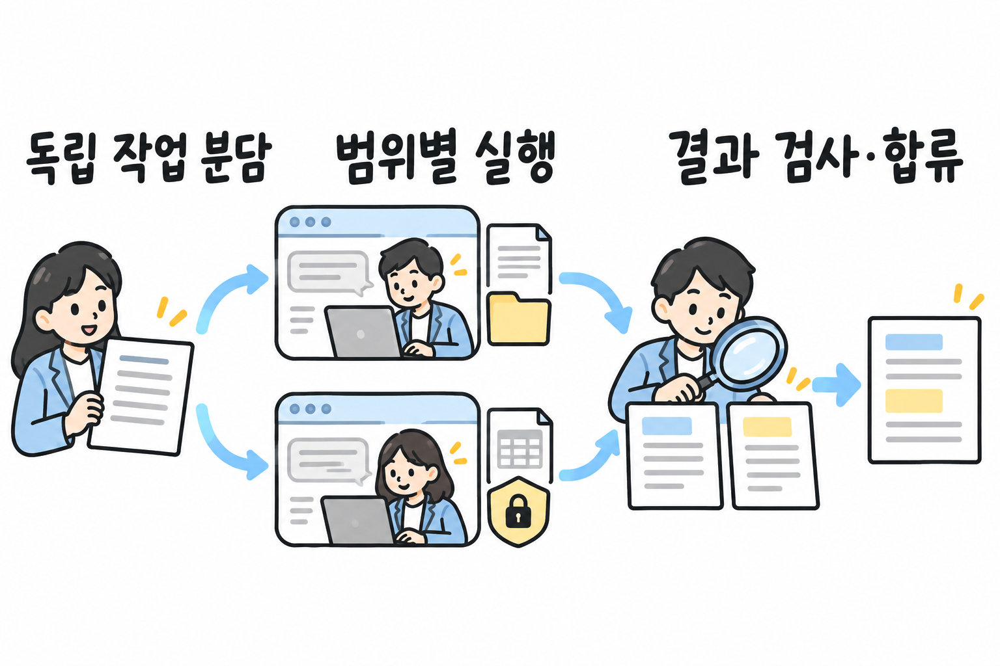

**서로 독립적으로 할 수 있고 이득이 있는 작업만 다른 AI 대화에 나눠 맡긴다.** 관리 프로그램이 작업과 권한을 배정하고, 진행 상태와 결과를 모아 검사한다.

##### 동시 실행과 자원 제한

주 대화·분담·검토를 포함한 AI 실행은 DBOS의 공통 대기열 하나를 거치며, 초기 설정은 `global_concurrency=2`로 한다. 실행 장비가 늘어나도 같은 DBOS 애플리케이션과 기록 DB의 대기열을 사용한다. 업무마다 별도 대기열을 만들어 각각 2개씩 실행하지 않는다. [DBOS의 전체 동시 실행 제한](https://docs.dbos.dev/python/tutorials/queue-tutorial#global-concurrency)

분담 결과나 사람의 답변을 기다릴 때는 AI 실행을 마치고 관리 프로그램에 대기 상태를 남긴다. 대기하는 관리 절차가 두 실행 자리를 차지하지 않게 한다. 다시 AI를 부를 때도 같은 대기열과 자원 검사를 거치며, 직접 실행이나 강제 재개로 제한을 우회하지 않는다.

실행 전 기존 자원·비용 한도 검사로 CPU·메모리·GPU 여유와 모델 호출 한도, 남은 예산을 확인하고 필요한 몫을 배정한다. 진행 중인 작업과 예약·재시도 비용도 합산한다. 같은 계정이나 파일을 바꾸는 작업은 공통 실행 잠금으로 순서를 정한다. 동시 실행 수는 이 한도와 실제 측정 결과를 확인한 뒤 조정한다.

동시 실행 여유가 없으면 같은 대상과 검사를 순차 처리한다. 내부 예상 비용이 늘면 37번에 따라 필요한 자원을 다시 배정하며, 분담 수를 줄였다는 이유로 처리 대상이나 독립 검토를 빼지 않는다.

##### 작업과 권한 배정

| 나눠 맡길 때 정할 것 | 기록할 내용 |
|---|---|
| 담당과 대상 | 고객·업무·분담 번호, 담당 실행 번호, 권한 버전, 처리할 대상 목록 |
| 목표와 결과 | 목표·완료 조건, 반환할 형식, 필요한 선행 작업과 유효한 검사 결과 |
| 자료와 도구 | 계획·자료 버전, 열람할 자료, 허용한 도구와 수정 범위 |
| 자원과 제한 | 예상 사용량과 배정 자원, 실제 장비·제공사 한도, 사용자가 정한 지출 상한, 업무 기한과 권한 만료 시각을 구분한다 |

관리 프로그램이 기존 Claude Agent SDK 연동과 분리 실행 기능으로 담당별 대화·작업 공간을 만든다. 맡은 자료는 기본적으로 읽기만 허용하고, 변경안은 담당별 출력 공간에 작성한다. 공용 원본과 업무 DB를 직접 수정할 권한은 주지 않는다. 허용한 도구만 제공하고, 추가 분담도 관리 프로그램을 거치게 한다. SDK의 직접 하위 에이전트 실행은 차단한다. 대화 맥락이 나뉜다는 이유만으로 파일 접근까지 분리됐다고 보지 않는다. [Claude Code의 하위 에이전트 권한과 작업 공간](https://code.claude.com/docs/en/sub-agents)

진행 상태와 중간 결과에도 대상·자료 버전을 붙여 필요한 담당에게만 전달한다. 공용 파일이나 DB에 반영할 때는 관리 프로그램이 현재 담당·권한·계획 버전과 원본 버전을 확인한다. 버전 확인부터 변경 반영까지 잠금이나 조건부 갱신으로 보호하며, 그사이 원본이 바뀌면 덮어쓰지 않고 변경안을 다시 검사한다.

##### 담당 교체와 늦은 결과 처리

담당을 바꾸면 기존 쓰기 권한을 먼저 회수하고 실행 취소를 요청한다. 새 담당에게는 새 실행 번호와 증가한 권한 버전을 준다. 이전 담당의 늦은 결과는 기록으로 보존하되 현재 결과나 업무 상태에 반영하지 않는다.

취소 기록만으로 실제 실행이 멈췄다고 보지 않는다. 기존 자원 배정은 실제 중단이 확인될 때 반환한다. 이미 시작한 외부 행동은 공통 실행 기능으로 처리 상태를 확인하고, 불명확하면 충돌할 후속 변경을 보류한다. 담당이 바뀌어도 같은 외부 행동의 요청 번호는 유지해 중복 실행을 막는다. [DBOS 취소와 재개](https://docs.dbos.dev/python/tutorials/workflow-management)

##### 결과 병합과 분담 효과 확인

결과에는 처리한 대상, 자료·계획 버전, 결과 파일, 검사 상태와 실패 이유를 남긴다. 기존 보고 주체 확인 기능으로 실제 담당이 보낸 결과인지 검사하고, 프로그램이 전체 대상 목록과 대조해 누락·중복·버전 충돌을 찾는다. 주 모델은 의견 차이를 근거와 비교해 판단한다. 일부 작업이 실패해도 독립적인 성공 결과는 보존하며, 필요한 부분만 다시 맡긴다. 분담이나 방법을 바꿔야 하면 전략 판단으로 연결한다.

분담 효과는 같은 자료·모델·완료 조건에서 순차 처리와 비교한다. 시간은 대기부터 병합·검사·재작업이 끝날 때까지, 비용은 주 대화와 분담·검토·실패·재시도의 모델 호출을 모두 포함한다. 중요한 오류와 누락의 감소를 먼저 평가하고, 같은 품질에서는 시간과 총비용을 비교한다. 품질 개선에 필요한 추가 자원은 배정하되 실제 권한·지출 상한은 지킨다. 분담의 이득이 없으면 이후 같은 작업은 순차 처리한다.

##### 완료 기준

모든 분담 대상의 처리 상태와 이유가 남고, 필수 대상은 현재 버전에 유효한 결과와 검사 증거를 갖춰야 한다. 동시 실행, 담당 교체, 늦은 결과, 중복 요청, 장비 재시작과 일부 실패를 시험한다. 동시 실행 한도 초과, 권한 없는 수정, 이전 담당의 덮어쓰기, 필수 대상 누락이나 실패·보류를 완료로 처리하는 경우는 검증 실패다.

#### 9. 실시간 대화 ✅

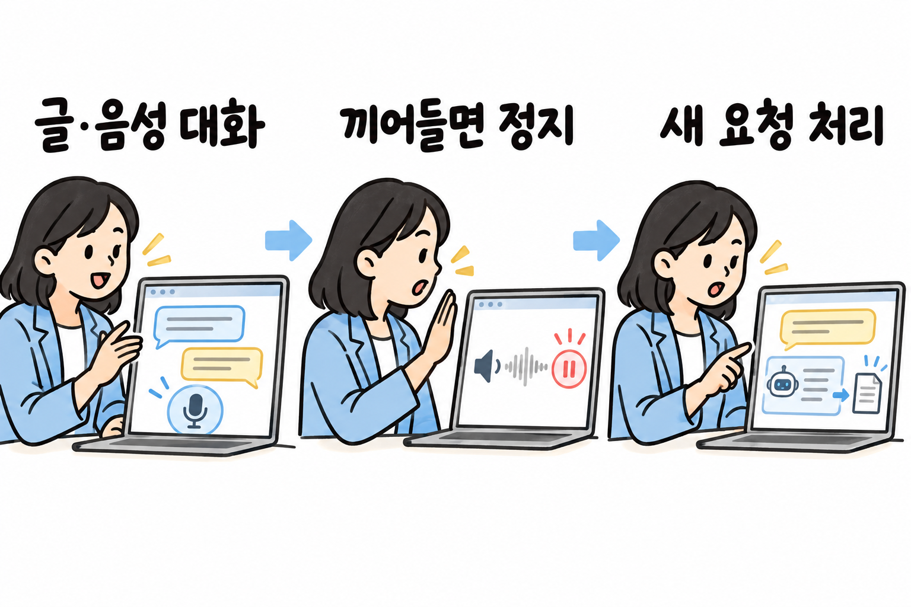

**브라우저로 글과 음성을 주고받고, 사용자가 말을 시작하면 에이전트의 재생을 먼저 멈춘다.** 발언 종료, 맞장구, 실제 끼어들기를 구분해 이어 말하거나 새 요청을 처리한다.

| 기능 | 사용할 도구 |
|---|---|
| 글을 바로 주고받기 | FastAPI 관리 프로그램의 WebSocket |
| 브라우저의 마이크와 스피커 연결 | WebRTC와 LiveKit |
| 말소리가 있는 구간 찾기 | Silero VAD의 ONNX 실행 |
| 받아쓰기와 음성 합성 | 이미 정한 음성 인식·합성 기능 |

##### 연결과 메시지 관리

LiveKit은 음성 기능을 쓸 때 제품이 실행하거나 이미 등록하고 허용한 서버에 연결한다. 관리 프로그램이 사용자를 인증하고 고객·업무·대화방별 참여와 송수신 권한을 제한한 접속 토큰을 발급한다. 재접속 때도 현재 권한을 확인하고, 권한 철회 시 기존 연결을 끊는다. 서버의 API 키는 브라우저에 주지 않는다. [LiveKit 세션 인증](https://docs.livekit.io/frontends/build/authentication/)

HTTPS·WSS와 WebRTC의 암호화된 통신을 사용한다. 마이크 권한과 브라우저의 음성 재생 허용을 확인하고, 방화벽 뒤에서도 실제 소리가 오가도록 미디어 통신과 필요한 STUN·TURN 경로를 준비한다. 화면의 연결 표시만으로 성공으로 보지 않으며, 제품의 네트워크 제한 안에서 OS·브라우저·장비별 실제 음성을 시험한다. [LiveKit 통신 포트와 방화벽](https://docs.livekit.io/transport/self-hosting/ports-firewall/)

글과 대화 제어 메시지에는 대화 번호·연결 회차·메시지 번호를 붙인다. 서버 접수와 브라우저 표시 확인을 구분하고, 재전송된 같은 요청으로 답변이나 업무를 중복 실행하지 않는다. 순서가 바뀐 메시지는 원래 순서로 맞추고 빠진 번호는 다시 요청한다. 재접속은 마지막 확인 위치부터 이어 가되, 음성은 이전 연결의 남은 재생을 자동으로 되살리지 않고 현재 응답 상태를 먼저 맞춘다.

##### 받아쓰기·합성의 실행 방식

파일 처리와 실시간 처리는 따로 검증한다. CPU에서는 발언 단위 처리를 기본으로 한다. Qwen3-ASR의 공식 연속 받아쓰기는 vLLM 실행 경로를 사용하며, 기존 Transformers 경로를 그대로 쓰면서 연속 처리라고 표시하지 않는다. vLLM이 실제로 지원되고 시간·자원 검사를 통과한 환경에서만 이 경로를 제공한다. 스트리밍 출력에 단어별 시간 위치가 자동 포함된다고 가정하지 않는다. [Qwen3-ASR 스트리밍 지원 범위](https://github.com/QwenLM/Qwen3-ASR#streaming-inference)

음성 합성은 기존 Qwen3-TTS 기능으로 완성된 짧은 문장부터 처리해 재생한다. `non_streaming_mode=False`만 설정하면 생성 중인 음성이 연속 출력된다고 보지 않는다. 모델 내부의 스트리밍을 사용하는 경로는 실제 음성 조각의 도착과 중단 처리가 검증된 경우에만 그렇게 표시한다. 선택한 모델과 중요한 내용의 검사는 유지하고, 실제 첫 재생 지연을 측정한다. [Qwen3-TTS 실행 함수의 스트리밍 구분](https://github.com/QwenLM/Qwen3-TTS/blob/main/qwen_tts/inference/qwen3_tts_model.py)

##### 발언 종료와 끼어들기

Silero VAD는 말소리의 유무를 찾는다. 사용자가 말을 끝냈는지는 침묵 길이와 받아쓴 문장·대화 맥락으로 따로 판단한다. 짧은 침묵을 곧바로 발언 종료로 보거나, 짧은 말이라는 이유만으로 맞장구로 처리하지 않는다. 내용 판단은 같은 주 모델이 맡고, 재생 정지 같은 제어는 코드가 즉시 처리한다.

LiveKit은 `turn_detection="manual"`로 연결해 관리 프로그램이 발언 종료와 중단 시점을 제어한다. 기본 자동 끼어들기의 최소 발화 길이 0.5초를 기다린 뒤 300ms 측정을 시작하는 방식은 쓰지 않는다. VAD가 말소리를 처음 감지하면 브라우저 재생을 먼저 일시 정지하고 재생 위치를 보존한다. [LiveKit 발언 제어](https://docs.livekit.io/agents/logic/turns/#manual-turn-control) · [자동 끼어들기 기본값](https://docs.livekit.io/reference/agents/turn-handling-options/)

| 감지한 상황 | 처리 |
|---|---|
| 실제 끼어들기·정정·새 요청 | 서버의 이전 응답 생성·합성을 취소하고, 브라우저의 남은 재생과 예약된 음성 조각을 비운다. 사용자의 말을 받아 새 응답으로 연결한다 |
| 맞장구나 잡음으로 확인됨 | 새 업무 지시나 취소로 바꾸지 않는다. 이전 응답이 여전히 유효하면 확인한 재생 위치에서 이어 말한다 |
| 무엇을 말했는지 불확실함 | 재생을 멈춘 채 입력을 보존하고 확인한다. 임의로 합의·취소·새 지시를 확정하지 않는다 |

일시 정지는 소리만 끄는 것이 아니라 재생 위치도 멈추게 한다. 사용한 음성 출력 경로가 일시 정지와 이어 재생을 지원하는지 검사한다. 멈춘 동안 음성 버퍼를 정한 크기 이상 쌓지 않도록 생성·전송도 제어한다. 말소리 감지·재생 정지는 모델 실행 대기열이나 의미 판단을 기다리지 않는다. 스피커 소리가 마이크로 되들어오는 경우와 주변 잡음도 시험해, 에이전트 자신의 목소리로 중단이 반복되지 않게 한다.

##### 재생과 대화 기록의 일치

응답과 음성 조각에 번호·순서·유효 상태를 붙인다. 취소한 응답의 조각은 늦게 도착해도 재생하지 않는다. 브라우저는 재생·일시 정지·중단·완료와 마지막 재생 위치를 돌려주고, 서버는 생성한 글과 재생이 확인된 부분을 나눠 기록한다.

브라우저의 확인을 LiveKit `AudioOutput`의 재생 상태 기록에 연결한다. 서버에서 전송한 길이나 확인 응답의 시간 초과로 실제 재생 길이를 대신하지 않는다. 중단된 조각의 정확한 글자 위치를 확인하지 못하면 그 부분은 재생 미확인으로 남긴다. [LiveKit 재생 위치·중단·문장 연결](https://docs.livekit.io/reference/python/livekit/agents/voice/io.html)

생성·전송 완료를 실제 재생 완료로 바꾸지 않고, 재생 완료도 사용자의 이해나 동의로 보지 않는다. 다음 판단에는 재생하지 못한 내용과 중단 상태를 함께 제공한다. 끊긴 발언을 합의로 기록하지 않으며, 금액·기한·권리처럼 중요한 합의는 글로도 확인한다. 음성 중단과 업무 취소는 구분하고, 이미 시작한 외부 행동의 중단 여부는 기존 실행 기능으로 따로 확인한다.

##### 지연 측정과 완료 기준

| 측정할 구간 | 초기 통과 기준 |
|---|---|
| 말소리를 처음 감지한 때부터 브라우저 음성이 실제 멈출 때까지 | 300ms 이내. 의미 판단을 끝낸 시점부터 재지 않는다. 발화 시작부터 감지까지의 지연도 별도로 기록한다 |
| 사용자가 발언을 끝낸 때부터 첫 답변 음성이 실제 재생될 때까지 | 전체 시험의 95%가 3초 이내. 발언 종료를 판단하는 대기와 실행 대기열·받아쓰기·주 모델·합성·전송·재생 버퍼의 시간을 모두 포함한다 |

시험 입력과 실제 재생 출력의 시각을 같은 시간 기준으로 대조한다. 서로 다른 장비의 시계를 그대로 빼서 지연으로 쓰지 않는다. ‘잠시 기다려 달라’는 안내 음성으로 첫 답변 시간을 대신하지 않고, 실패·시간 초과를 통계에서 빼지 않는다. 첫 실행과 준비된 상태, 동시 사용과 방화벽·네트워크 조건을 구분해 기록한다.

3초 목표는 응답 속도의 기준이며 자문·분석을 끝낼 시간 제한이 아니다. 오래 걸리는 요청은 진행 상황을 알리고 필요한 조사·계산·검증을 계속한다. 완성된 부분부터 전달할 수 있지만 전체 요청이 끝났는지는 별도로 확인한다. 빠르게 답하려고 내용을 생략하거나 근거 없는 결론을 먼저 말하지 않는다.

##### 완료 기준

짧은 침묵·맞장구·실제 끼어들기·잡음·연결 끊김·재접속·중복 및 늦은 음성 조각을 시험한다. 대화 내용이 누락·중복되지 않고, 취소한 응답이 다시 재생되거나 들려주지 못한 내용을 전달 완료로 기록하지 않아야 한다. 지원 환경별로 지연과 내용 정확성 기준을 함께 통과해야 실시간 음성으로 표시한다. 미달하면 지연을 알리고 검증된 발언 단위 음성이나 글 대화를 제공하며 느린 구간을 개선한다.

#### 10. 시험 환경 ✅

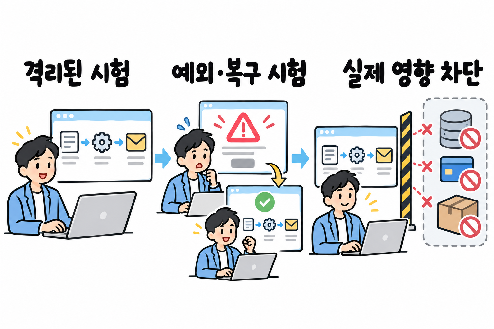

**실제 고객 자료나 결제·발송에 영향을 주지 않는 환경에서, 접수부터 전달까지 시험한다.** Python 기능은 pytest, 웹 작업은 Playwright로 확인한다. 기존 Podman 분리 실행과 PostgreSQL·DBOS를 시험용으로 구성한다.

##### 운영 환경 접근 차단

| 분리할 것 | 적용 방법 |
|---|---|
| 계정·자료·실행 기록 | 시험 전용 계정·DB·파일·DBOS 작업 공간을 사용한다. 운영 DB와 작업 폴더를 시험 프로그램에 연결하지 않는다 |
| 인증정보·브라우저 | 시험용 키와 로그인 상태만 제공한다. 운영 인증정보가 발견되면 실행을 중단한다. Playwright는 시험마다 새 브라우저 공간을 만들고 사용자의 기존 로그인 상태를 가져오지 않는다 |
| 외부 연결 | 공통 도구 실행 기능에서 시험용 상대만 허용하고, 운영 DB·결제·발송 경로는 통신과 권한으로 차단한다. 제공사의 시험 환경이나 요청·응답 규칙을 검증한 모의 시스템을 사용한다 |

시험용 설정이나 모의 함수만으로 운영 접근을 막았다고 보지 않는다. 같은 서비스 주소에서 시험·운영을 구분하는 API는 시험용 인증정보와 계정·모드까지 확인한다. 실제 결제·발송 수단은 시험 실행 공간에 두지 않는다. [시험용 결제 키와 환경의 구분](https://docs.stripe.com/testing)

##### 초기 상태와 재현성

시험 번호별로 DB·파일·검색·기억·캐시, DBOS 대기열·예약, 외부 시험 시스템과 브라우저 상태를 정해 둔 시작 상태로 준비한다. 이전 시험의 실행을 종료하고 남은 예약·외부 요청을 확인한 뒤 초기화한다. 늦게 도착한 이전 시험의 응답은 새 시험에 반영하지 않으며, 초기화 대상이 시험용 자원인지 확인하지 못하면 삭제·변경하지 않는다.

pytest의 fixture로 준비·정리를 실행하고, `tmp_path`로 임시 폴더를 나누며, `monkeypatch`로 시험용 설정과 함수를 적용한다. 이 기능들이 외부 DB·예약·서비스 상태까지 자동으로 되돌리지는 않으므로, 정리가 실패한 환경은 재사용하지 않는다. Playwright의 새 브라우저 공간에서도 서버 쪽 자료는 별도로 초기화한다. [pytest 준비·정리](https://docs.pytest.org/en/stable/how-to/fixtures.html#safe-teardowns) · [임시 폴더](https://docs.pytest.org/en/stable/how-to/tmp_path.html) · [시험용 설정](https://docs.pytest.org/en/stable/how-to/monkeypatch.html) · [Playwright 시험 격리](https://playwright.dev/docs/browser-contexts)

입력과 시작 상태, 코드·모델·도구·지시·정책의 버전, 모델 설정, 난수 설정과 실행 환경을 기록한다. 정답과 채점 기준의 버전은 검사 프로그램이 따로 보관한다. AI 응답은 문장이 똑같은지보다 필수 조건·근거·행동·결과가 맞는지 검사한다. 실패한 실행의 입력·단계별 결과·오류·소요 시간과 최종 파일은 보호된 검사 기록으로 보존한다.

##### 평가 정답 분리

업무 수행에 필요한 요구사항과 완료 조건은 제공한다. 평가용 정답·비공개 채점 기준·사후 결과는 작업 계정과 AI가 읽거나 고칠 수 없는 공간에 두고, 별도 권한의 검사 프로그램이 채점한다. 작업 프로그램이 채점 코드나 결과를 변경하지 못하게 한다.

시험의 정답이 사례·장기 기억뿐 아니라 검색 색인·캐시·요약·이전 대화와 도구 응답으로 들어오지 않는지 확인한다. 같은 사건에서 파생되어 정답을 알 수 있는 자료도 작업용 묶음에서 제외한다. 정답을 공개해 수정에 사용한 사례는 이후의 독립 능력 평가에서 제외한다. 정답 유출이 확인된 시험은 통과 근거로 사용하지 않는다.

##### 전체 업무 시험과 운영 전환

Windows·macOS·Linux의 지원 OS·CPU 조합마다 실제 설치 파일로 시험한다. 업무 프로그램이나 개발 도구가 미리 없는 상태에서 시작하며, GPU 없는 장비와 화면 없는 서버도 포함한다. 웹 시험은 화면 없이 실행하고 실제 화면·장치가 필요한 검사는 별도 시험 장비에서 한다.

문서 접수부터 판독·검색·계산·제작·검사·시험 전달까지 실행한다. 정상 처리뿐 아니라 설치 중 연결 끊김, 부품 누락·손상, 서버 중단·재부팅·복구와 업데이트 실패를 재현한다. 운영 접근과 권한 침해가 차단되는지도 확인한다. 모의 시스템에서 통과한 부분과 제공사 시험 환경에서 실제 연동한 부분을 구분해 기록한다.

내부 예상 비용·시간 초과, 세 차례 이상 수정이 필요한 업무, 깊게 연결된 별첨, 대용량 입력·긴 결과물, 제공사 한도 회복도 시험한다. 필요한 내용과 검증을 유지한 채 분할·재배정·복구 후 이어 처리해야 하며, 사용자에게 재접수를 요구하거나 일부 결과를 완료로 표시하면 실패다. 실제 권한·지출 상한과 보안 제한은 이 과정에서도 지켜야 한다.

실제 업무와 나란히 시험할 때는 허용된 자료를 접수 시점 기준으로 복사해 제공한다. 시험 프로그램은 운영 시스템을 직접 읽거나 바꾸지 않고, 이후의 변화도 시험 시점에 알 수 있었던 입력만 제공한다. AI의 행동은 시험용 시스템에만 반영하며, 사람이 처리한 결과는 AI의 판단이 끝나기 전까지 숨긴다.

통과한 설치·코드·모델·설정 버전과 검사 증거를 묶어 운영 전환 승인을 받는다. 시험 프로그램에는 운영 배포 권한을 주지 않는다. 전환 후 초기 오류·자원 사용을 감시하고 문제가 생기면 검증된 복귀 절차로 이전 구성에 되돌린다. 이미 발생한 업무 기록과 외부 행동은 보존·대조해 재실행하지 않는다.

##### 완료 기준

운영 자료·결제·발송에 영향이 없고, 정답 유출 없이 전체 업무의 근거와 결과를 검증해야 한다. 같은 시작 상태와 검사 기준으로 평가를 다시 실행할 수 있어야 하며, 장애·초기화·접근 차단·설치·업데이트의 필수 시험을 모두 통과해야 한다. 실패·미실행·미확인을 통과로 바꾸지 않고, 필수 시험이 끝나지 않은 버전은 운영 배포를 승인하지 않는다.

### 자료·검색 ✅

#### 11. 근거의 신뢰성·적합성 ✅

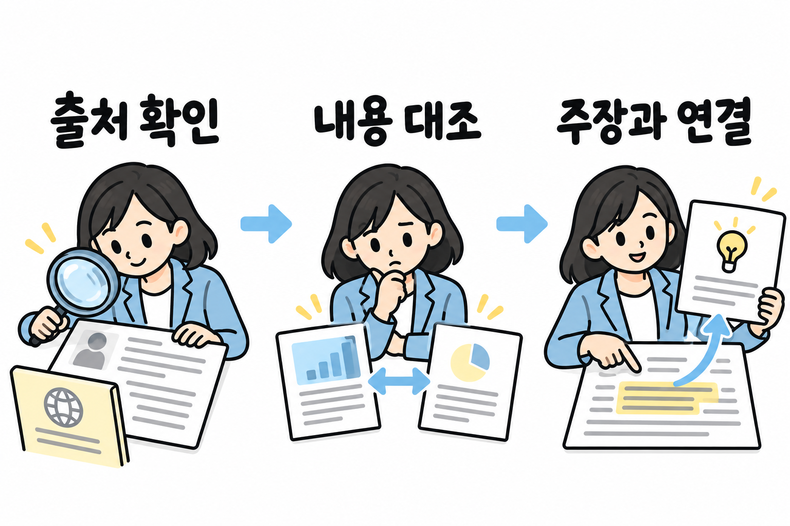

**자료가 진짜인지, 내용을 믿을 수 있는지, 이번 주장을 입증하는지를 따로 확인한다.** 기존 PostgreSQL 자료 목록에 확인 결과를 저장하고, 자료 번호·버전·원문 위치로 주장과 연결한다. 자료 보관·판독·시점 조회·계산·검토는 기존 공통 기능을 사용한다.

##### 자료에서 확인할 것

| 확인할 것 | 처리 방법 |
|---|---|
| 실제 작성자·발급처의 자료인가 — 진본성 | 발급기관의 조회 수단, 전자서명의 서명자·유효성, 취득 경로로 확인한다. 원본인지 사본인지도 기록한다 |
| 취득 후 내용이 바뀌지 않았는가 — 무결성 | 공통 파일 보관 기능의 해시값 검사와 취득·보관·전달·가공 이력을 확인한다. 해시값이 같다는 사실만으로 작성자나 내용의 진실성을 증명하지 않는다 |
| 내용을 믿을 수 있는가 — 신뢰성 | 작성·조사·측정 방법, 누락과 오차, 작성자의 이해관계를 확인한다. 진본이어도 잘못된 내용을 담을 수 있으므로 내용은 별도로 대조한다 |
| 이번 업무에 맞는가 — 적합성 | 대상·지역·관할, 작성·측정 조건과 사용 권한을 확인한다. 공통 시점·버전 조회 결과로 이번 쟁점에 적용할 자료인지 확인한다 |
| 증거로 쓸 수 있는가 — 증거능력 | 법원·기관에 제출할 때는 해당 절차의 취득·제출 요건과 필요한 증거 종류를 확인한다. 참고 자료로 필수 증거를 대신하지 않는다 |
| 주장을 얼마나 뒷받침하는가 — 증명력 | 자료의 어느 내용이 주장의 어느 부분을 지지하거나 반박하는지, 확인하지 못하는 부분은 무엇인지 기록한다 |
| 반드시 따라야 하는가 — 법적 구속력 | 관련 규칙·판결·처분의 효력과 적용 대상·쟁점을 확인한다. 원본·사본·사후 작성 여부를 구속력의 높낮이로 바꾸지 않는다 |

취득·보관·전달·가공 이력에는 누가 언제 어떤 목적으로 처리했는지와 변경 내역을 남긴다. 원본 보존과 사본 검사는 공통 기능의 기록을 연결한다. [NIST의 증거 취급 이력](https://csrc.nist.gov/glossary/term/chain_of_custody), [원본·사본의 무결성 검사](https://nvlpubs.nist.gov/nistpubs/Legacy/SP/nistspecialpublication800-86.pdf)

증거로 쓸 수 있다는 것과 주장이 입증됐다는 것은 다르다. 법적 구속력이 없는 자료도 사실을 뒷받침할 수 있다. 법원·기관의 실제 채택 결과는 시스템의 사용 가능 판단과 별도로 기록한다. [민사소송법 제202조](https://www.law.go.kr/LSW/lsSideInfoP.do?docCls=jo&joBrNo=00&joNo=0202&lsiSeq=290113&urlMode=lsScJoRltInfoR)

##### 출처와 충돌 대조

같은 원문을 복사·인용·요약·가공한 자료는 원문 번호와 생성 관계를 연결하고, 여러 개의 독립된 근거로 세지 않는다. 별도로 조사·측정한 결과는 그 과정과 사용한 자료를 확인해 독립된 근거인지 판단한다. 같은 자료를 다시 계산한 것은 검산 기록으로 남기고, 새로 관측한 사실처럼 세지 않는다. [W3C의 자료 생성·가공 관계](https://www.w3.org/TR/prov-dm/#component2)

상충 자료는 같은 대상·시점·조건을 다루는지 먼저 맞춰 본다. 작성·측정 방법의 차이, 누락·오류 등 충돌 원인과 이를 확인한 근거를 기록한다. 제출 요건과 내용의 신뢰성을 각각 비교해 채택 이유와 한계를 남기고, 더 믿을 만한 자료를 골랐더라도 반대 자료를 삭제하지 않는다.

주 모델의 판단은 공통 독립 검토 과정에서 원문과 대조한다. 중요한 값은 원문에서 실제로 확인한다. 사실 여부에 추가 확인이 필요하면 독립적인 조사·측정 자료와 대조하고, 계산은 검증된 함수의 결과와 맞춘다. 원문에 같은 말이 있거나 AI가 같은 답을 반복했다는 이유만으로 사실까지 검증됐다고 처리하지 않는다. 원문에 적힌 내용, 계산한 값, 추론한 내용을 구분한다.

##### 자료와 주장의 상태

| 관리 대상 | 남길 상태와 근거 |
|---|---|
| 자료별 사용 상태 | **채택 가능 / 참고만 가능 / 미확인 / 사용 불가**. 이번 업무에서 어떤 용도로 쓸 수 있는지, 확인 범위·방법·시각과 이유를 기록한다 |
| 주장별 입증 상태 | **미검토 / 입증됨 / 근거 부족 / 반대 근거로 부정됨 / 충돌 미해결**. 해당 업무의 판단 기준, 지지·반대 자료의 원문 위치, 빠진 필수 근거와 검증 결과를 기록한다 |

출처가 불명확해도 사실 여부를 추가로 확인할 단서가 있고 이용이 허용된 자료는 참고용으로 남긴다. 참고 자료만으로 필수 사실을 확정하지 않는다. 자료 하나를 채택했다고 관련 주장을 모두 ‘입증됨’으로 바꾸지 않으며, 근거가 부족하다고 거짓으로 판정하지도 않는다. 예를 들어 진본인 근로계약서가 있어도 실제 근무시간은 출퇴근 기록 등으로 따로 확인해야 한다.

관리 프로그램은 필수 확인 결과가 빠지면 통과를 막고, 자료·버전·검사 상태가 바뀌면 연결된 주장을 재검토 대상으로 돌린다. 과거 판단은 덮어쓰지 않는다.

##### 완료 기준

결론마다 적용 조건, 지지·반대 근거의 원문 위치, 자료의 사용 상태와 주장의 입증 상태, 검증 결과가 연결되어야 한다. 결론을 좌우하는 근거의 진본성·사용 가능성을 확인하지 못했거나, 필수 근거가 부족하거나, 충돌이 해결되지 않으면 결론을 확정하지 않는다. 필요한 추가 확인과 담당자를 남긴다.

#### 12. 자료의 시점·버전 ✅

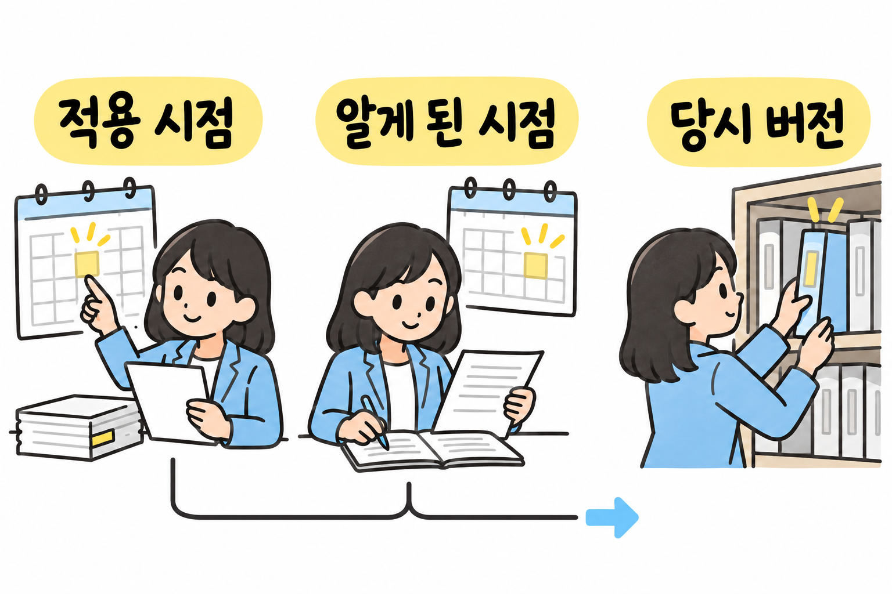

**이번 업무에 맞는 자료 버전을 고르고, 당시 어떤 자료로 판단했는지 다시 확인할 수 있게 한다.** 예를 들어 7월 1일부터 적용되는 개정 내용을 7월 5일에 받았다면, 적용일과 확보일을 따로 남긴다. 7월 3일의 판단 기록에 그 개정 내용을 이미 알고 있었던 것처럼 끼워 넣지 않는다.

##### 적용된 때와 알게 된 때

PostgreSQL에 **자료가 적용되는 기간과, 그 내용을 등록하거나 수정한 시각을 따로 저장한다.**

| 기록할 시점 | 뜻과 용도 |
|---|---|
| 발행·공포일 | 발행 기관이 자료를 내놓은 날. 실제 적용일과 구분한다 |
| 적용 기간 | 해당 내용이 어떤 대상·쟁점에 언제부터 언제까지 적용되는지. 조항별 근거와 함께 저장한다 |
| 등록·수정 시각 | 버전 정보를 처음 등록한 시각과 그 내용을 수정한 시각. 이 기록으로 당시 시스템이 알고 있던 내용을 확인한다 |
| 확보·확인 시각 | 원문을 받은 시각과 내용을 확인한 시각. 검사 상태와 함께 남겨, 받았지만 아직 확인하지 않은 자료를 구분한다 |

내용이나 적용 기간, 검사 상태가 바뀌면 이전 기록 번호와 연결한 새 기록을 추가한다. 원래 기록은 보존한다. 조회에 쓸 데이터베이스 테이블에는 각 기록을 등록한 시각부터 다음 기록으로 바뀐 시각까지를 저장한다. 나중에 받은 자료를 과거에 알고 있었던 것처럼 기록하거나 이전 원문과 판단 기록을 덮어쓰지 않는다. [적용 기간과 등록 이력 관리](https://martinfowler.com/articles/bitemporal-history.html)

##### 날짜·시각·시간대 저장

| 값 | 저장 방법 |
|---|---|
| 날짜 | `DATE`. 날짜만 알려진 값을 임의의 자정 시각으로 바꾸지 않는다 |
| 정확한 시각 | `TIMESTAMPTZ`. UTC 기준의 시점을 저장하고, 원문에 적힌 현지 시각·시간대와 변환 근거를 함께 남긴다 |
| 업무 시간대 | `Asia/Seoul` 같은 IANA 시간대 이름을 별도 저장한다. `TIMESTAMPTZ` 자체는 원래 입력한 시간대 이름을 보존하지 않는다 |
| 기간 | 날짜는 `daterange`, 정확한 시각은 `tstzrange`. 날짜 기간은 시작일 포함·종료일 제외로 통일한다. ‘6월 30일까지 포함’은 끝을 7월 1일로 저장한다 |

시작일과 종료일을 포함하는지 적힌 원문도 보존한다. 시각으로 정한 기간도 시작·종료 시각의 포함 여부를 원문대로 기록한다. 종료 시점을 아직 모르는 경우와 종료 기한이 없는 경우를 구분한다. 기한은 업무 시간대로 계산하고 보여 준다. [PostgreSQL 날짜·시각](https://www.postgresql.org/docs/current/datatype-datetime.html), [기간의 시작과 끝 처리](https://www.postgresql.org/docs/current/rangetypes.html)

Python `datetime`·`zoneinfo`는 제품에 고정한 `tzdata`를 사용한다. 실행 시작 시 `PYTHONTZPATH=""`를 설정해 PC의 시간대 데이터가 우선 사용되지 않게 한다. PostgreSQL도 배포본과 실제 사용하는 시간대 데이터의 버전을 함께 고정·기록하고, 양쪽의 시간대 변환 결과를 대조한다. DB 연결의 표시 시간대는 UTC로 고정하고 업무 화면에서 필요한 시간대로 변환한다. 변환에 쓴 버전을 남겨 이후 시간대 규칙이 바뀌어도 당시 값을 확인할 수 있게 한다. [Python 설정](https://docs.python.org/3/library/zoneinfo.html#environment-configuration), [PostgreSQL 시간대 데이터](https://www.postgresql.org/docs/current/install-make.html)

서머타임 때문에 존재하지 않거나 두 번 나타나는 현지 시각은 원문에 적힌 UTC와의 시차 등으로 확인한다. 시간대나 구분 근거가 부족하면 미확인으로 남긴다.

##### 사용할 버전 선택

사건 발생일, 계약 체결일, 행위일, 신청일과 판단일을 구분하고 쟁점마다 기준일과 근거를 정한다. 법령은 조항별 시행일과 부칙의 적용례·경과조치를 연결한다. 조항별 날짜를 받지 못하면 부칙 원문에서 확인하며, 확인 전에는 법령 전체의 시행일로 대신하지 않는다.

| 조회 목적 | 사용할 시점과 결과 |
|---|---|
| 이번 업무 판단 | 업무의 대상 시점과 현재까지 확인한 정보를 기준으로 사용할 버전과 선택 이유를 알려 준다 |
| 과거 판단 확인 | 그 업무의 대상 시점과 당시 시스템 기록을 조회하고, 실제 사용한 버전 번호·선택 근거·저장된 결과를 꺼낸다. 당시 확보한 모든 자료를 실제 사용한 자료로 간주하지 않는다 |
| 과거 업무 재검토 | 대상 시점은 유지하고 이후 확인한 정보까지 반영해 다시 판단한다. 이전 판단과 새 판단을 연결해 차이와 이유를 남긴다 |

기간이 겹치면 적용 대상과 지역, 쟁점, 규정 사이의 관계를 확인한다. 법률과 시행령처럼 같은 기간에 함께 적용되는 규정은 각각 저장한다.

같은 규정의 같은 조항과 적용 조건에서 하나의 버전만 선택해야 한다면, 다음 두 기간이 모두 겹치는지 확인한다.

- 규정이 적용되는 기간
- 해당 내용을 등록한 시각부터 다음 기록으로 수정한 시각까지

두 기간이 모두 겹치면 PostgreSQL이 등록을 막는다. 이 제한은 검토를 마친 자료를 조회하는 테이블에만 적용한다. 정정 전후의 기록은 수정 시각을 기준으로 구분해 모두 보관한다. 서로 충돌한 원문도 검토할 수 있게 남긴다. 적용할 버전이 없거나 충돌을 해결하지 못하면 미확인으로 표시한다.

##### 정정·개정 처리

공식 원문의 변경과 수집·판독 오류 수정을 구분한다. 표기만 달라졌는지, 내용·효력이 바뀌었는지, 과거 사건에도 적용되는지를 각각 기록한다. 정정문·개정문과 관련 결정 등 공식 근거로 적용 기간을 확인하며, ‘정정’이라는 명칭만으로 영향이 없다고 판단하지 않는다.

새 버전에는 이전 버전과 비교해 적용 기간이 어떻게 달라졌는지와 그 근거를 남긴다. 영향을 받는 업무는 기존 변경 감시·재검토 기능으로 넘긴다. 과거 업무에 새 버전을 적용할 때도 해당 조항과 경과조치·관련 판결의 근거를 남긴다.

##### 완료 기준

같은 대상 시점에 대해 당시 정보로 한 판단과 현재 정보로 재검토한 판단을 구분할 수 있어야 한다. 사용한 버전과 기준일, 선택 이유가 맞아야 하고, 기간의 시작과 끝을 포함하는지도 정확히 처리해야 한다. 시각이 불분명하거나 사용할 버전을 정하지 못한 항목은 미확인 상태로 남긴다.

#### 13. 규칙·기준 원문 ✅

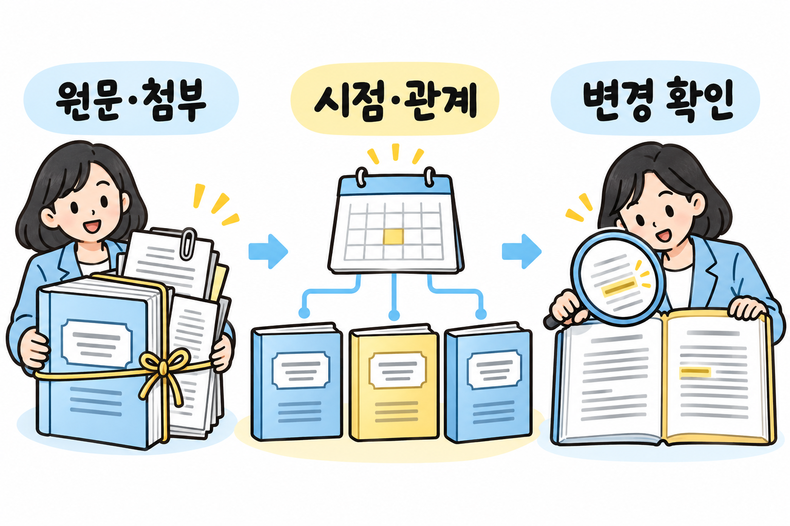

**업무에 필요한 규칙을 원문·첨부물·적용 시점·규칙 사이의 관계까지 묶어 확보한다.** 회사의 급여 업무라면 관련 법령과 고시, 그 회사의 취업규칙·단체협약·근로계약을 함께 갖춘다.

##### 구현 방식

**Python으로 원문을 수집하고, PostgreSQL에 목록과 관계를 저장하며, 기존 DBOS 작업으로 변경을 확인한다.** 원문 파일의 보관·판독·검색은 공통 기능을 쓴다. 수집처마다 자료를 받는 부분만 달리하고, 같은 자료를 여러 업무에서 연결해 사용한다.

| 단계 | 처리할 내용 |
|---|---|
| 업무 조건 받기 | 국가·지역, 업종과 업무, 조직과 회사 규모, 인허가, 쟁점별 대상 시점과 제출처를 받는다. 빠진 조건에 따라 적용 규칙이 달라지면 해당 범위를 미확인으로 남긴다 |
| 수집 목록 만들기 | 분야별 목록을 소관 기관의 규정 목록·회사의 문서 목록·이번 업무의 쟁점과 대조한다. 항목마다 필요한 이유와 공식 수집처를 적고, 원문이 가리키는 위임 규정·예외·별첨을 이어서 찾는다 |
| 다음 처리에 전달하기 | 자료 번호와 버전, 조항·별첨의 원문 위치, 관계의 근거와 수집 상태를 한 묶음으로 반환한다. 적용 버전 선택과 의무·우선순위 판단은 이 묶음을 받아 처리한다 |

새 쟁점·기관·계약이 나오면 수집 목록을 보완한다. 내부 예상 시간을 넘었다고 수집을 끝내지 않는다. 제공사 조회 제한이나 연결 실패에는 마지막 성공 위치와 남은 항목을 저장하고, 허용된 다른 공식 출처나 제한 회복 후의 수집으로 이어 간다. 일부 확보 상태는 중간 진행 상태로 관리하며 담당·다음 확인을 연결한다. AI가 만든 목록이나 제공처의 검색 결과만으로 모든 규칙을 찾았다고 판정하지 않는다.

##### 법령의 위계와 수집 범위

중앙행정부 법령의 기본 위계는 **헌법 → 법률 → 대통령령 → 총리령·부령**이다. 앞의 규범이 뒤의 규범보다 우선한다. 총리령과 부령은 같은 단계이며, 위임은 법률에서 부령이나 조례로 바로 이어질 수도 있다. [정부입법 체계](https://opinion.lawmaking.go.kr/lmGde/govLm), [헌법 제75·95조](https://www.law.go.kr/LSW/lsEfInfoP.do?lsiSeq=61603)

| 종류 | 뜻과 확보할 내용 |
|---|---|
| 헌법 | 국가의 최고 규범. 해당 쟁점의 헌법 조항과 관련 헌재결정을 확보한다 |
| 법률 | 국회가 제정하는 규범. 해당 분야의 기본법·개별법·특별법과 연결된 다른 법률을 확보한다 |
| 대통령령 | 대통령이 법률에서 위임받거나 법률 집행에 필요한 사항을 정한 규범. ‘○○법 시행령’ 외에 ‘○○규정’, ‘○○령’이라는 이름도 포함한다 |
| 총리령·부령 | 국무총리나 각 부 장관이 소관 사무에 관해 정한 규범. ‘○○법 시행규칙’ 외에 별도로 제정한 규칙도 포함한다 |
| 긴급명령·긴급재정경제명령 | 헌법 제76조에 따라 법률의 효력을 가지는 예외적인 명령. 일반 대통령령과 구분하고, 발령·국회 승인·효력 상실 기록까지 확보한다 |

대통령령·총리령·부령처럼 일반적인 법적 기준을 정하는 명령을 **법규명령**이라고 한다. 상위법이 맡긴 내용을 정하는 **위임명령**과 법을 집행하는 데 필요한 내용을 정하는 **집행명령**을 구분해 근거 조항을 연결한다. ‘시행령·시행규칙’이라는 제목만으로 수집 대상을 고르지 않는다.

조약, 국가기관의 규칙, 자치법규와 행정규칙은 다음 관계도 함께 기록한다.

| 종류 | 효력과 관계 | 확보할 내용 |
|---|---|---|
| 조약 | 헌법에 따라 체결·공포된 조약은 국내법과 같은 효력을 가진다. 모든 조약을 일률적으로 법률 위에 놓거나 아래에 놓지 않는다 | 양자·다자 조약과 협정·협약·의정서·교환각서 등 관련 문서. 국내 효력의 근거, 국회 동의 여부, 당사국별 발효일, 개정·종료 기록과 유보를 받는다. 유보는 특정 조항의 적용을 배제하거나 바꾸는 선언이다 |
| 일반적으로 승인된 국제법규 | 헌법 제6조가 국내법적 효력을 인정하는 국제법규. 단순한 국제기구 권고나 해외 관행과 구분한다 | 해당 규범의 내용과 승인·적용을 확인할 국제 문서, 관련 판결 |
| 국회·대법원·헌법재판소·선거관리위원회 규칙 | 헌법 제64·108·113·114조의 권한에 따른다. 대통령령 밑에 일괄 배치하지 않고, 기관별로 법률 또는 법령을 따라야 하는 범위를 확인한다 | 해당 규칙과 제정 근거. 선관위 규칙은 선거·정당 사무와 내부 규율의 근거도 구분한다 |
| 감사원규칙 등 법률에 근거한 기관 규칙 | 감사원법 등 해당 법률이 정한 권한과 범위에 따른다 | 기관 규칙, 이를 정할 권한을 준 법률과 구체적인 위임 조항. [감사원법 제52조](https://www.law.go.kr/LSW/lsSideInfoP.do?docCls=jo&joBrNo=00&joNo=0052&lsiSeq=222549&urlMode=lsScJoRltInfoR) |
| 자치법규 | 조례는 법령의 범위에서, 지방자치단체장 규칙은 법령 또는 조례의 범위에서 정한다. 주민의 권리 제한·의무 부과·벌칙에는 법률의 위임이 필요하다. 시·군·자치구의 조례·규칙은 시·도의 조례·규칙을 위반할 수 없다 | 업무 지역의 광역·기초 조례와 규칙, 교육·학예 조례와 교육감의 교육규칙, 필요한 지방의회 규칙. 특별자치지역 등의 특례도 포함한다 |
| 행정규칙 | 훈령·예규·지침·통첩 등은 원칙적으로 행정기관 내부의 업무 기준이다. 법령의 위임을 받아 내용을 보충하는 규정은 위임 범위 안에서 국민에게도 효력이 인정될 수 있다 | 기관의 훈령·예규·고시·규정·지침 등과 근거 조항, 기준표·서식·첨부물. 제목과 공포 형식만으로 구속력을 판정하지 않는다 |

국회 동의를 얻어 체결된 조약에 법률에 준하는 효력을 인정한 결정이 있다. 조약마다 대한민국에 언제부터 어떤 내용이 적용되는지, 국내 효력의 단계는 무엇인지, 개인·기업이 해당 조항을 직접 주장할 수 있는지 확인할 근거를 확보한다. ‘협정’이나 ‘양해각서’라는 이름만으로 구속력 유무를 정하지 않는다. [헌법 제6조](https://www.law.go.kr/LSW/lsSideInfoP.do?docCls=jo&joBrNo=00&joNo=0006&lsiSeq=61603&urlMode=lsScJoRltInfoR), [헌재 2000헌바20](https://www.law.go.kr/detcInfoP.do?detcSeq=134498), [외교부 조약 설명](https://treatyweb.mofa.go.kr/usr/introduce/selectIntroduce1Contents.do), [체결·유보·종료](https://treatyweb.mofa.go.kr/usr/introduce/selectIntroduce3Contents.do)

법령이 **조례에 직접 맡긴 사항**은 그 법령보다 하위인 법령이 위임 내용과 범위를 제한하거나 직접 정할 수 없다. 조례를 모든 명령·행정규칙보다 무조건 아래에 두는 순위표를 만들지 않는다. [지방자치법 제28~30조](https://www.law.go.kr/LSW/lsInfoP.do?ancNo=21544&ancYd=20260414&efYd=20261015&lsiSeq=285291)

고시·공고에는 일반 기준뿐 아니라 특정 사업의 지정이나 처분을 알리는 내용도 있다. 문서의 이름과 실제 효력을 구분하고, 행정기관이 반복 적용해 온 기준은 평등·신뢰보호 문제를 검토할 수 있도록 적용 사례도 확보한다. [법제처 행정규칙 입안·심사기준](https://www.law.go.kr/LSW/flDownload.do?flSeq=22317830)

##### 판결·결정·해석과 개별 명령

| 자료 | 함께 확인할 내용 |
|---|---|
| 법원 판결·결정·명령 | 사건번호, 법원, 선고일, 결론인 주문과 이유, 확정·취소·변경 여부. 원심·상급심과 인용 판결, 같은 쟁점의 판단을 바꾼 후속 판결을 연결한다. 당사자의 주장·소수의견과 재판부의 판단을 구분한다 |
| 헌법재판소 결정 | 대상 조항과 결정 내용, 효력 상실 시점, 계속 적용 여부와 후속 입법. 위헌·헌법불합치 등을 단순한 ‘무효’ 한 값으로 처리하지 않는다 |
| 행정심판 재결·위원회 결정 | 적용 대상, 주문과 이유, 구속력의 근거, 불복·변경·집행정지 상태. 권고와 의무를 부과하는 결정을 구분한다 |
| 법령해석·질의회신 | 발행 기관, 질문의 사실관계, 당시 법령과 답변, 변경·철회 여부. 정부유권해석을 법원의 확정판결과 같은 효력으로 기록하지 않는다 |
| 이번 건의 처분·허가 조건·법원 명령 | 누구에게 무엇을 언제까지 하도록 했는지, 송달·고지와 효력 발생, 집행정지·취소 여부. 일반 법규명령과 별도로 해당 업무에 연결한다 |
| 관습법·일반 법원칙 | 내용을 확인할 판결과 적용 근거. 업계에서 흔히 하는 관행이라는 이유만으로 법적 의무로 등록하지 않는다 |

공개된 판결이 일부라는 점과 후속 심급을 확인하지 못한 상태를 남긴다. 상급심 자료가 검색되지 않았다는 이유로 확정을 단정하지 않는다. 법령해석의 구속력도 자료 종류에 맞게 구분한다. [법제처 해석례의 효력 안내](https://www.lawmaking.go.kr/nl4li/lsItptEmp/350963?mode=all&pageIndex=422)

##### 회사와 업무별 규칙

| 수집할 범위 | 확보할 내용 |
|---|---|
| 회사·기관의 운영 규정 | 정관, 이사회 규정, 조직·직무 규정, 전결규정. 전결규정은 누가 어떤 일을 승인할 수 있는지 정한 문서 |
| 직원에게 적용되는 규정 | 취업규칙, 인사·복무·보수·평가·징계 규정과 세칙 |
| 실제 일을 처리하는 내부 기준 | 회계·구매·계약·보안·개인정보·안전·품질 규정, 업무 매뉴얼, 부서별 절차와 정식 공지 |
| 계약과 합의 | 계약, 단체협약, 근로계약, 약관, 부속·변경 합의와 편입된 문서. 실제 체결·동의한 버전과 적용 당사자를 확보한다 |
| 직업·분야의 전문 기준 | 직능단체의 윤리·업무 기준, 회계·감사 기준, 진료지침 등 |
| 기술·품질 기준 | KS·ISO·IEC 등 표준, 설계기준과 시방서, 시험·검사·인증 기준, 발주자가 지정한 규격 |
| 제출처·거래처의 조건 | 입찰·지원사업 공고, 심사 기준과 제출 요강, 거래소·플랫폼 규정, 납품 조건과 필수 서식 |
| 사용자가 별도로 정한 조건 | 원래 지시와 승인·변경 기록. 이번 건에만 적용할 조건인지 계속 적용할 조건인지 함께 보관한다 |

회사 규정은 허용된 문서함이나 관리 담당자에게서 받는다. 규정 목록과 실제 받은 문서를 대조하고 본사·지사·계열사, 초안·승인본을 구분한다. 승인자·시행일·개정 이력과 함께 그 규정에 필요한 의결·동의·공지 기록도 확보한다. 내부 승인을 받았다는 사실만으로 법적 효력이 확인됐다고 처리하지 않는다.

표준·전문 지침·계약 조건마다 **법령이 의무화했는지, 계약에 포함됐는지, 내부 의무인지, 권고인지**와 그 근거를 남긴다. 서로 충돌할 때 적용을 판단할 수 있도록 관련 법령과 합의도 연결한다.

##### 찾고 수집하는 방법

| 자료 | 수집 경로와 처리 |
|---|---|
| 국내 법령·행정규칙·자치법규 | Python 수집기가 [국가법령정보 공동활용 OPEN API](https://open.law.go.kr/LSO/openApi/guideList.do)에서 목록·원문을 받는다. API는 프로그램이 자료를 요청해 받는 연결 방식이다. 현재 시행 중인 규정, 과거 규정, 시행 예정 규정을 구분해 받는다 |
| 위임·인용 관계 | 법령 체계도, 위임법령, 법령·자치법규 연계 조회로 연결된 자료를 받는다. 단순 인용과 실제 위임을 구분하고 근거 조문과 대조한다. 과거 사건에는 당시 버전 번호로 조회하고 당시 조문과 관계를 확인한다. 최신 연결 정보로 대신하지 않는다. [위임 조회](https://open.law.go.kr/LSO/openApi/guideResult.do?htmlName=lsDelegated) |
| 부칙·별표·서식·첨부 기준 | 선택한 버전의 본문에 연결된 첨부 파일을 받고, 별도 목록과 대조한다. 과거 별표를 확인하지 못하면 최신 별표로 채우지 않고 그 버전의 공포문·관보에서 찾는다. 조문이 가리키는 다른 고시·표준과 제정·개정 이유, 정정문도 확보한다. [별표·서식 조회](https://open.law.go.kr/LSO/openApi/guideResult.do?htmlName=lsBylListGuide) |
| 조약 | 법제처 조약 API와 [외교부 조약정보](https://treatyweb.mofa.go.kr/)를 대조한다. 양자조약은 양국 정부의 발효 통보·비준서 교환 기록을, 다자조약은 문서를 보관·통지하는 기탁기관의 기록을 해당 조약의 절차에 맞춰 확인한다. 당사국별 발효일·개정 부속서와 유보·철회·상대국의 이의 기록을 보완한다 |
| 판결·결정·해석 | API가 제공하는 범위를 받고, 빠진 전문과 후속 사건은 법원·헌재·위원회·발행 기관의 공식 열람 경로로 보완한다 |
| 내부 규정·계약 | 해당 고객의 열람 권한으로 문서함에 연결하거나 제공받은 파일을 등록한다. 관리 목록에는 있으나 원문을 받지 못한 문서를 따로 남긴다 |
| 전문 기준·표준 | 발행 기관에서 원문과 개정 기록을 받는다. KS는 [e나라 표준인증](https://www.standard.go.kr/KSCI/standardIntro/getStandardSearchListResult.do)의 표준별 상세 정보에서 원문·고시·이력을 확인하고, 회계기준은 [한국회계기준원](https://www.kasb.or.kr/)의 공식 제공처를 쓴다. 원문 이용 권한이 없으면 목록만 확보한 상태로 남긴다 |
| 해외 규칙 | 세계법제정보센터에서 관련 법을 찾고 해당 국가·지역과 규제기관의 공식 원문을 확보한다. 연방·주·지방·초국가 규범 등 그 지역의 체계로 연결한다. 번역문은 원문과 개정 시점을 맞춘다 |

과거 법령의 본문 조회에는 **버전 번호(`MST`)와 그 버전의 시행일(`efYd`)**을 지정한다. 법령 번호(`ID`)는 현행본 조회용이므로, 받은 본문의 공포번호·시행일·버전이 요청과 맞는지 검사한다. 관계 조회가 해당 시점의 연결을 제공하지 못하면 당시 조문과 공포 자료로 보완한다. [법령 본문 API의 조회 조건](https://open.law.go.kr/LSO/openApi/guideResult.do?htmlName=lsEfYdInfoGuide)

API별 인증·이용 조건과 호출 한도를 등록한다. **통신 성공 뒤에도 오류 응답·빈 본문·다른 버전인지 검사한다.** 받은 자료의 식별번호·개수·첨부 목록을 예상 목록과 맞추고, 전체 페이지의 누락·중복을 확인한다. 수집 중 목록이 바뀌면 해당 범위를 다시 대조한다. 실패한 항목은 다시 받고, 빠진 원문은 발행 기관과 관보·공보에서 보완한다. 목록만 받았거나 파일을 실제로 열지 못한 항목은 원문 확보로 표시하지 않는다. 입법예고안은 변경 가능성을 살피는 자료로 따로 보관한다.

자료의 저장·검색·AI 입력에 필요한 이용 권한도 확인한다. ISO 자료는 공개 데이터 예외 등을 제외하면 AI 이용이 제한되므로 구매 여부와 별도로 이용허락을 확인한다. 허용되지 않은 원문은 AI 처리 대상에 넣지 않는다. [ISO 이용 조건](https://www.iso.org/copyright.html)

##### 원문과 관계 보관

자료·버전·조항을 서로 다른 번호로 관리하고, 관계와 수집 상태를 연결한다. 원문이 같아도 판독 결과의 재사용 여부는 공통 판독 기능이 현재 권한과 검사 상태까지 확인해 결정한다.

| 저장할 정보 | 기준 |
|---|---|
| 자료 식별 정보 | 발행 기관, 공식 식별번호, 공포·발령·조약·사건번호. 내부 문서는 발행 조직·승인 기록·문서 버전으로 구분한다 |
| 원문과 판독 결과 | 공식 주소, 수집 시각, 원본 파일과 응답, 파일의 해시값(SHA-256), 판독한 글·표와 원문 위치를 연결한다. 해시값은 파일 변경 확인에 쓰며 공식 자료라는 증명으로 삼지 않는다 |
| 시점과 효력의 근거 | 공포·발효·시행일, 적용 대상과 지역, 조항별 시행일을 확인할 부칙·적용례·경과조치, 효력을 바꾼 결정과 개정 기록을 연결한다. 개정·정정본이 와도 이전 원문을 남긴다 |
| 자료 사이의 관계 | 상하 관계, 위임, 인용·준용, 부속 문서, 개정·폐지, 해석·판례를 구분한다. 출발 조항과 연결된 조항·문서, 관계를 확인한 원문 위치와 버전을 저장한다 |
| 확인 상태 | 원문 대조와 판독 검사 결과, 확인 범위·방법·시각. AI가 제안한 관계와 근거 대조를 마친 관계를 구분하고, 미확인 관계를 확정된 우선순위로 넘기지 않는다 |
| 접근·이용 권한 | 고객·조직별 열람 범위와 저장·AI 이용 조건. 같은 파일이어도 다른 고객에게 열람 권한이 이어지지 않게 한다 |

문서 전체에 ‘법률 1등, 고시 5등’ 같은 숫자 하나만 붙이지 않는다. 같은 문서 안에서도 조항마다 위임·적용 범위가 다를 수 있다. 조항이 가리키는 예외와 별표까지 연결하고, 순환 인용은 이미 받은 버전을 재사용한다.

새 버전의 본문·필수 별첨·관계 검사를 마치면 **검사를 통과한 묶음을 한꺼번에 제공한다.** 받는 중이거나 검사에 실패한 부분은 판단에 섞어 넣지 않는다. 기존 버전은 보존하되, 새 자료를 아직 확보하지 못했다는 이유로 기존 버전을 현재 업무에 계속 써도 된다고 판단하지 않는다.

##### 누락과 변경 확인

필요한 규칙마다 **원문 확보 / 일부 확보 / 접근 불가 / 존재 여부 미확인 / 해당 없음**을 남긴다. 빠진 원문·첨부물과 다음 확보 경로를 기록하고, ‘해당 없음’에는 제외 근거를 붙인다. 원문을 확보한 상태와 실제 판단에 사용할 수 있는 상태는 구분한다.

변경 감시 작업에 수집처별 주소·인증·수집 범위·마지막 성공 위치를 등록한다. 하루 한 번 개정·폐지·정정을 확인하고 공식 변경 알림과 사내 개정 공지도 받는다. 멈췄다가 재개하면 마지막 성공 이후의 변경을 다시 조회해 누락을 메운다. 변경 목록이 불완전한 제공처는 보관 중인 자료 목록과 원문 파일의 해시값도 정기 대조한다. 주기는 제공처의 갱신 방식·조회 제한·업무 기한에 맞춰 등록한다.

수집 실패나 원문 불일치는 해당 자료의 최신 여부를 미확인으로 바꾼다. 제공처의 삭제 기록도 확인하며, 목록에서 사라진 사실과 법적으로 폐지된 사실을 구분한다. 폐지 여부는 실제 폐지·정정 근거를 확보해 기록한다. [삭제 데이터 조회](https://open.law.go.kr/LSO/openApi/guideResult.do?htmlName=datDelHstGuide)

변경이나 미확인 상태는 기존 자료 번호와 연결해 이를 사용한 규칙·계산·판단의 재검토 처리로 즉시 전달한다. 새 버전의 수집 완료를 기다렸다가 변경 사실을 알리지 않는다. 현재 효력이 결론을 좌우하면 결과 확정 직전에 발행처에 재확인한다. 자동 신구법 비교표는 바뀐 곳을 찾는 데 쓰고 중요한 변경은 제·개정문이나 관보와 대조한다. [국가법령정보센터의 비교 안내](https://www.law.go.kr/lsInfoP.do?lsiSeq=61603)

##### 완료 기준

수집 목록의 필수 원문·첨부물·필요 버전과 관계 근거를 갖추고 검사를 통과해야 한다. 부족하면 확보한 자료와 미확보 목록을 함께 반환하고 **일부 확보**로 남긴다. 결론을 좌우하는 자료가 빠졌거나 버전이 맞지 않으면 그 자료에 의존하는 판단은 확정하지 않는다.

#### 14. 업무별 정보 ✅

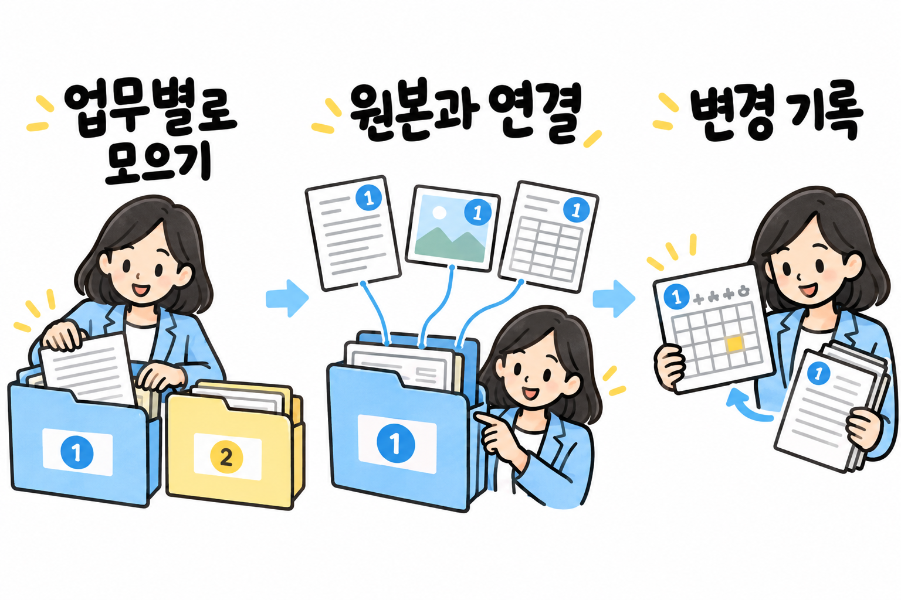

**업무 한 건마다 받은 자료와 확인한 내용을 모아 관리한다.** 예를 들어 견적서를 만드는 일이라면, 이번 고객이 보낸 품목과 수량, 요청한 납기, 첨부 파일을 같은 업무로 묶는다. 도중에 수량이나 납기가 바뀌면 바뀐 내용도 기록한다.

##### 무엇을 어디에 보관하나

| 보관할 것 | 보관 방법 |
|---|---|
| 받은 문서와 사진 등 원본 파일 | 제품의 파일 보관 공간에 저장한다 |
| 요청한 결과, 작업 범위와 기한, 업무 중 확인한 값 | PostgreSQL에 항목별로 저장한다. PostgreSQL은 프로그램이 정보를 저장하고 꺼내 쓰는 데이터베이스다 |
| 자료의 출처와 사용 조건 | 어떤 고객의 어떤 업무인지, 어디서 언제 받았는지, 누가 사용할 수 있고 언제까지 보관할지를 같은 데이터베이스에 기록한다 |

고객이 말한 내용, 기관이 발급한 내용, 직접 관찰하거나 측정한 값, 시스템의 처리 기록을 구분해 저장한다. 고객의 말을 기록했다고 해서 확인된 사실로 바꾸지 않는다.

##### 자료를 연결하는 방법

파일마다 자료 번호를 붙인다. 파일에서 꺼낸 값과 요약본에도 같은 원본 번호를 남긴다. 원본을 고치거나 삭제할 때 관련 값과 요약본을 함께 찾기 위해서다.

업무 기록은 PC마다 달라지는 폴더 위치 대신 이 번호로 파일을 가리킨다. 원래 파일명도 따로 보관한다. 한글 이름이나 대소문자 차이 때문에 다른 파일을 덮어쓰지 않게 한다.

같은 고객이 같은 파일을 다시 보내면 파일 내용을 비교해 중복 저장을 막는다. 비교에는 파일 내용으로 계산해 변경 여부를 확인하는 **파일 해시값**을 쓴다. 내용이 같아도 다른 고객의 자료와 합치지는 않는다.

##### 파일이 온전히 저장됐는지 확인

1. 파일을 임시로 저장하고, 내용이 바뀌지 않았으며 저장 장치에 끝까지 기록됐는지 확인한다.
2. 파일 목록에 등록하면서 검색에 넣을 작업도 함께 예약한다. PostgreSQL의 **트랜잭션** 기능으로 두 기록을 함께 저장하거나 함께 취소한다.
3. 등록을 마친 파일만 검색하거나 판단에 쓴다.

중간에 멈추면 남은 작업 목록과 실제 파일을 비교해 이어서 처리한다. 목록만 있고 파일이 없거나, 파일은 있지만 등록이 끝나지 않았으면 정상 접수로 표시하지 않는다.

#### 15. 정보·자료 이해 ✅

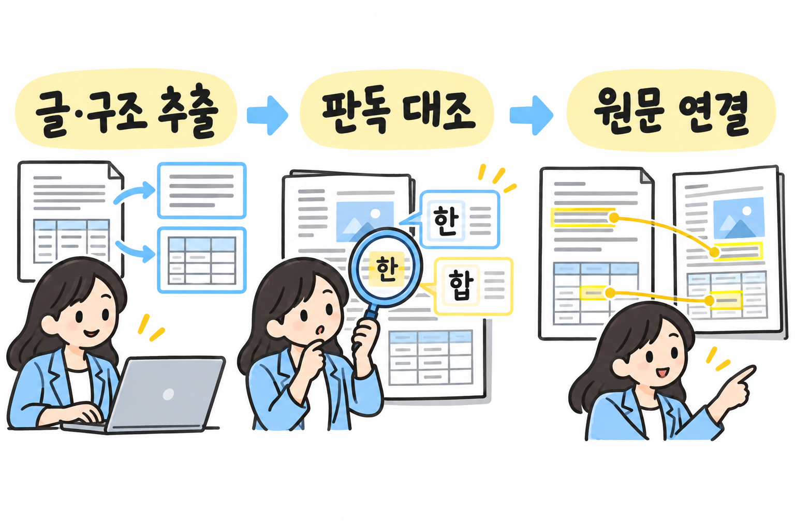

**전자 문서는 원래 글과 구조를 먼저 꺼내고, 이미지 판독이 필요한 페이지는 두 모델로 대조한다. 내용의 해석은 주 모델이 맡는다.**

| 입력 | 추천 도구와 선택 이유 | 돌려줄 정보 |
|---|---|---|
| PDF와 오피스 문서 | Docling — 글·표·구조를 공통 형식으로 추출. 페이지 확인에는 pypdfium2와 공통 LibreOffice 실행 기능 사용 | 글, 표, 페이지와 셀 위치. 메모, 숨긴 슬라이드, 발표자 노트는 본문과 구분 |
| 스캔과 사진 속 문서 | MonkeyOCRv2-S-Parsing + PaddleOCR-VL-1.6 — 한국어 평가가 있는 소형 모델 두 개로 대조 | 같은 페이지를 두 모델이 각각 읽은 결과, 원본 페이지 번호와 영역 좌표. 표의 머리글, 단위, 각주를 값에 연결 |
| HWP와 HWPX | rhwp — 공통 한글 문서 읽기·변환 기능을 재사용 | 글과 표의 구조, 원문 위치. 지원하지 않거나 읽지 못한 요소와 그 위치 |
| 음성 받아쓰기 | Qwen3-ASR-1.7B — 언어를 구분하고 여러 언어를 받아쓰기 | 원래 언어의 발언, 알아듣지 못한 구간 |
| 발언 시각과 말한 사람 | Qwen3-ForcedAligner-0.6B — 글을 녹음 시각에 연결. 여러 사람의 발언을 구분할 때만 pyannote Community-1 추가 | 발언의 시작·종료 시각, 말한 사람을 구분하는 화자 번호와 구분하지 못한 구간 |
| 영상 | 공통 FFmpeg 실행 기능과 주 모델 — 장면·음성 추출과 내용 해석을 분담 | 장면과 발언의 시간 위치, 관찰한 내용과 해석의 구분 |
| API, 코드, 실행 기록 | 형식에 맞는 파서와 주 모델 — 값·구조를 그대로 읽은 뒤 의미 해석 | 원래 값과 자료형, JSON 경로나 파일의 줄 위치 |

관리 프로그램의 공통 자료 읽기 기능이 입력 종류를 확인해 도구를 고른다. 결과는 원문 번호, 자료에 맞는 위치 정보(페이지·영역 좌표, 셀, 시간 등), 추출값, 읽지 못한 부분으로 통일한다. 변환과 제작 검사도 이 기능을 호출한다.

**문서 판독:** Docling으로 파일에 들어 있는 글과 구조를 먼저 추출하고, 화면에 보이는 내용과 맞춰 본다. 정상적으로 추출한 본문은 다시 OCR로 읽지 않는다. 스캔이나 추출이 불완전한 페이지는 두 모델로 판독하고, PDF의 표가 있는 페이지도 행과 열의 연결을 판독 결과와 대조한다. 스캔 이미지 위에 겹쳐 저장된 글자는 이미 판독한 결과이므로 원문으로 간주하지 않고 다시 판독한다. Docling 내부 OCR과 별도 판독기가 같은 페이지를 중복 처리하지 않게 공통 자료 읽기 기능에서 실행을 관리한다.

**원문 위치:** OCR로 읽은 글과 표에 원본 페이지 번호와 영역 좌표, 즉 페이지에서 차지하는 위치를 붙인다. Pepper처럼 글만 반환하는 모델은 Docling 등 기존 판독 도구의 문서 영역 검출 결과와 연결한다. 확대·회전·잘라내기를 했다면 변환 기록으로 좌표를 원본 기준으로 되돌리고, 좌표의 단위와 기준점도 함께 저장한다. 원본 위에 해당 영역을 표시해 글·표와의 연결이 맞는지 검사한다. 표 전체 위치만으로 중요한 셀의 출처가 불분명하면 셀이나 해당 부분까지 좁혀 연결한다. 확인하지 못한 위치는 추정 좌표로 채우지 않는다.

**문서 모델 선택:** 기본 추천은 MonkeyOCRv2-S와 PaddleOCR-VL-1.6의 조합이다. 한국어 정확도를 높일 교체 후보로는 **PepperOCR-VL을 우선 비교한다.** 같은 공개 평가의 한국어 점수는 Pepper 92.6, Monkey S 88.7, Paddle 1.6 86.3이다. Pepper의 공식 bf16 기본 실행에는 24GB 이상 GPU 메모리가 필요하다. 제품의 사용·배포 방식에 적용되는 **AGPL-3.0 의무를 충족하거나 별도 상용 라이선스를 확보한 경우에만 채택한다.** 이 조건과 실제 실행 검사를 통과하면서 중요한 항목의 오류를 줄이면 기존 두 모델 중 하나를 교체한다. 세 모델을 항상 실행하지 않는다. [MDPBench 평가표](https://huggingface.co/spaces/Delores-Lin/MDPBench-leaderboard), [PepperOCR-VL 실행·배포 조건](https://huggingface.co/sionic-ai/PepperOCR-VL)

**메모와 숨김 내용:** Docling에서 메모·발표자 노트·숨긴 슬라이드를 본문과 구분해 꺼내고, 빠지는 항목은 파일 내부 구조를 읽는 형식별 파서로 보완한다. 원본과 추출 결과의 항목 수·식별자, 연결된 본문·슬라이드를 비교해 누락과 잘못된 연결을 확인한다. 도구가 읽지 못한 항목은 내용이 없는 것으로 처리하지 않고 미확인으로 남긴다.

**음성의 시간 위치:** Qwen3-ASR이 받아쓴 말에 Qwen3-ForcedAligner가 원래 녹음의 시작·종료 시각을 붙인다. Aligner가 지원하는 언어에서 사용하며, 긴 녹음은 한 구간이 5분을 넘지 않게 나눈다. 나눈 구간의 시작 시각을 더해 원본 녹음 기준으로 돌려주고, 경계에서 발언이 빠지거나 중복되지 않았는지 확인한다. 시간 위치가 붙었다고 받아쓴 말까지 맞는 것으로 보지는 않는다.

**음성 대조:** 중요한 이름·숫자·조건·부정 표현과 불확실한 구간은 두 번째 모델로도 받아쓴다. 한국어 구간에는 **BuzzASR/korean**을 추천한다. 일반 Whisper large-v3를 한국어에 맞게 추가 학습한 모델로, 개발진의 동일 한국어 평가에서 문자 오류율이 5.72%에서 4.61%로 줄었다. 한국어 밖의 구간은 기존 Whisper large-v3로 대조하며, 한국어 전용 모델에 억지로 맡기지 않는다. 혼용 발언과 잡음이 있는 실제 녹음에서도 중요한 표현을 더 정확히 잡는지 확인한다. [BuzzASR 한국어 모델과 평가](https://huggingface.co/BuzzASR/korean)

**화자 구분:** 여러 사람의 녹음은 pyannote가 서로 다른 목소리에 번호를 붙이고, 그 구간을 발언 시각과 연결한다. 화자 번호만으로 실명을 추정하지 않는다. 말이 겹치거나 화자가 바뀌는 경계에서 발언자를 구분할 수 없으면 임의로 한 사람에게 배정하지 않고 미확인으로 남긴다. 발언자를 알아야 결론을 낼 수 있는 항목은 화자가 미확인인 채 확정하지 않는다.

**영상 확인:** 주 모델에는 시간순 장면과 같은 구간의 발언을 함께 준다. 장면을 띄엄띄엄 골랐다면 그 사이의 행동까지 확인했다고 보지 않는다. 중요한 행동이 있는 구간은 더 촘촘히 읽고, 그래도 보이지 않는 내용은 미확인으로 남긴다. 실제로 보거나 들은 내용과 그 의미에 대한 추론을 구분한다.

**판독값 검사:** 두 모델은 상대의 답을 받지 않고 같은 원문을 각각 읽는다. 항목별로 대조하되 어느 한 모델의 답을 무조건 우선하지 않는다. MonkeyOCRv2의 학습 자료 작성에는 PaddleOCR-VL도 사용됐으므로, 다른 모델이라는 이유만으로 오류가 독립적이라고 가정하지 않는다. 두 판독이 같아도 결론을 좌우하는 값은 원문 위치와 맞춰 보고, 숫자는 합계와 다른 표의 같은 값으로 검산한다. 판독 충돌이나 검산 실패, 흐림과 손글씨 때문에 확정할 수 없는 항목은 미확인으로 남기고 원본 이미지나 음성 구간과 함께 확인을 요청한다. [MonkeyOCRv2 학습 자료 구성](https://github.com/Yuliang-Liu/MonkeyOCRv2#expert-model-labeling-toolchain)

**원문 보존:** 원본은 공통 자료 저장소에 읽기 전용으로 보관하고, 추출본과 검사본은 원본을 덮어쓰지 않고 따로 저장한다. 추출값에는 원문 위치와 판독 방법을 붙인다. 모델이 해석하거나 보충한 값은 추출값과 별도 항목에 기록하고, 원문에서 확인한 사실로 취급하지 않는다.

**재사용과 접근 권한:** 같은 고객·파일 해시값·도구 및 모델 버전·설정의 추출 결과만 재사용한다. 고객별 보관 영역을 나누고, 재사용할 때마다 현재 접근 권한과 검사 상태를 확인한다. 외부 자료는 숨김 글과 명령 검사를 거쳐 검색과 판단에 넣되, 검사 후에도 작업 지시와 구분된 자료로 전달한다. 자료 속 명령을 실행 권한으로 취급하지 않는다.

**실행 환경:** 판독 도구와 모델은 제품이 준비한 공통 Linux 실행 환경에 넣고, 필요한 것만 불러온다. PaddleOCR-VL은 PyTorch·Transformers, MonkeyOCRv2는 공식 CPU 실행 경로를 기본으로 검증한다. Qwen의 받아쓰기와 시간 위치 추출은 공식 `-hf` 배포본을 사용해 Transformers에서 실행한다. 도구·모델의 버전과 파일 해시값을 고정하고, 서로 충돌하는 라이브러리만 별도 작업 묶음으로 나눈다. [Qwen 공식 Transformers 배포본](https://huggingface.co/Qwen/Qwen3-ASR-1.7B-hf)

Windows·macOS·Linux에서 같은 기능과 입력·출력, 검사 기준을 쓴다. MonkeyOCRv2의 공식 CPU 설치 지침은 Windows·Linux용이므로 macOS 실행까지 검증됐다고 보지 않는다. Windows·macOS에서는 제품 전용 Linux 가상 머신을 포함한 실제 배포 경로로 설치·판독·처리 시간을 따로 검증한다. 같은 Linux 환경이라도 PC의 OS·CPU가 달라지면 검사를 다시 통과해야 한다. [MonkeyOCRv2 공식 CPU 지침](https://github.com/Yuliang-Liu/MonkeyOCRv2/blob/main/docs/cpu_support.md)

CPU에서 실행 가능하다는 것과 업무 시간 안에 끝난다는 것은 따로 확인한다. GPU 가속은 제품이 지원하는 경로에서만 사용하고, GPU가 없다고 검사 단계를 생략하지 않는다. 운영체제가 다르다는 이유로 기능을 바꾸거나, 모델을 불러오는 데 성공했다는 이유만으로 지원 완료로 처리하지 않는다.

##### 통과 기준

업무에 중요한 값마다 원문 위치가 연결되어야 한다. 누락, 판독 충돌, 원문에 없는 값의 생성이 해결되지 않으면 확정값으로 넘기지 않는다. 같은 한국어 실제 자료와 같은 장비에서 아래 항목을 비교한다.

| 비교 항목 | 채택·교체 기준 |
|---|---|
| 원문 연결 | 글·표의 영역이 원본의 해당 내용과 일치해야 한다. 확대·회전·잘라내기를 거친 자료도 같은 기준을 통과해야 하며, 중요한 값의 위치가 불분명하면 미확인으로 남긴다 |
| 내용과 구조 | 금액·날짜·이름·단위·조건·부정 표현의 오류와 누락이 줄고, 표의 행·열과 각주의 연결이 유지되어야 한다 |
| 두 판독의 대조 | 각각의 오류율뿐 아니라 **둘이 같은 오답을 내서 검사를 통과한 항목**을 따로 센다. 이 오류가 늘어난 조합은 채택하지 않는다 |
| 음성과 영상 | 시간 위치, 화자와 발언의 연결, 확인하지 못한 구간을 검사한다. 중요한 발언·행동을 놓친 채 완료로 처리하면 실패다 |
| 속도와 자원 | 첫 실행과 반복 실행의 시간, 최대 메모리, 실패율을 지원 OS·CPU별로 기록한다. 필요한 검사를 전부 유지하고, 느리거나 큰 자료는 분할·순차 처리와 자원 배정으로 완료할 실행 경로를 검증한다. 내부 예상 시간 초과를 판독 종료 기준으로 쓰지 않는다 |

공개 평가와 실제 업무 자료의 결과를 구분한다. 새 모델·버전이나 평가 결과가 나오면 다시 비교하고, 소식이 없어도 한 달에 한 번 후보를 확인한다. **성능 기준을 충족하고 지원 환경에서 실제로 실행되며 배포 조건도 충족한 구성을 채택한다. 최신이라는 이유만으로 자동 교체하지 않는다.**

#### 16. 정보·자료 찾기 ✅

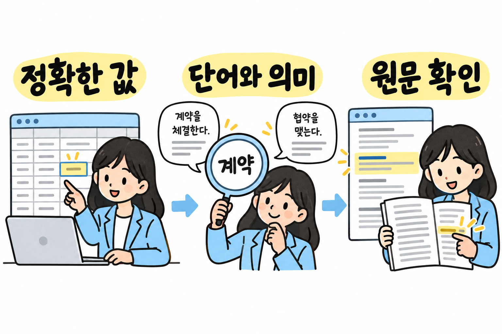

**같은 단어나 문구를 찾는 키워드 검색과 뜻이 비슷한 내용을 찾는 의미 검색을 함께 쓴다.** 번호나 합계처럼 정확히 맞아야 하는 값은 데이터베이스에서 직접 조회한다.

| 찾을 것 | 사용할 도구 | 도구가 하는 일 |
|---|---|---|
| 번호, 날짜, 개수와 합계 | PostgreSQL의 SQL | 조건에 맞는 기록을 정확히 찾거나 전체를 센다 |
| 같은 단어와 문구 | Kiwi와 pg_textsearch 1.5의 BM25 | 한국어를 분석한 검색용 글에서 관련 자료를 찾는다. 정확한 문구는 원문과도 대조한다 |
| 표현은 달라도 뜻이 비슷한 내용 | Qwen3-Embedding-4B와 pgvector | 문서의 뜻을 숫자 배열인 벡터로 바꿔 보관하고 질문과 가까운 자료를 찾는다 |
| 두 검색의 결과 합치기 | RRF | 서로 다른 점수를 그대로 더하지 않고, 각 검색의 순위를 합쳐 읽을 순서를 정한다 |
| 별첨과 인용한 자료 | PostgreSQL에 저장한 자료 간 관계와 재귀 SQL | 자료가 가리키는 다른 자료를 연이어 찾는다 |

검색 요청에는 자료 종류, 질문, 고객·열람 권한, 적용 시점과 확인할 필수 근거를 넣는다. 시간·사용량은 예상치와 실제 제공사 제한을 구분해 기록한다. 기존 PostgreSQL 안에 검색용 자료를 보관하고 별도 검색 서버는 두지 않는다. 저장된 자료로 부족하면 등록된 업무 도구로 웹·자료실·기관을 검색하고 원문을 확보한다. 외부 검색에 보낼 내용도 전송 권한을 확인하며, 사람에게 확인해야 할 내용은 기존 문의·후속 관리 기능으로 넘긴다.

##### 검색 자료 준비

공통 자료 읽기 기능이 추출한 글·표와 원문 위치를 받는다. 조문·절·표처럼 뜻이 이어지는 단위로 나누고, **800토큰씩 나누기·앞뒤 100토큰 겹치기**를 초기 목표로 둔다. 토큰은 모델이 글을 처리할 때 세는 단위다. 크기를 맞추려고 조건·예외를 잘라 버리지 않는다. 긴 조문·표는 항이나 행 묶음으로 나누되 제목·표 머리글·단위와 원문 연결을 유지하고, 조회할 때 해당 조문·표 전체와 연결된 예외를 함께 읽힌다. 모델의 입력 한도를 넘은 내용을 조용히 잘라 저장하지 않는다.

| 준비할 것 | 구현 방법 |
|---|---|
| 한국어 키워드 검색 | Python의 Kiwi로 분석한 단어를 공백으로 연결해 원문과 별도 열에 저장한다. 이 열에 `text_config='simple'`인 BM25 색인을 만든다. 색인은 자료를 빨리 찾기 위한 검색용 구조다. 질문에도 같은 Kiwi 버전·사전·분석 규칙을 적용한다 |
| 검색어 처리 확인 | DB가 실제로 색인에 넣은 단어와 질문 처리 결과를 대조한다. 조사·어미, 복합어, 띄어쓰기, 부정 표현이 검색 결과에 미치는 영향을 시험한다. 번호·금액·기호는 구조화된 값의 SQL 조회와 원문 문자열 검색을 함께 사용한다 |
| 의미 검색 입력 | 질문에는 검색 목적을 설명하는 지시문을 붙이고, 문서에는 질문용 지시문을 붙이지 않는다. Kiwi로 나눈 글 대신 원래 문장을 모델에 넣는다. 질문 지시문, 모델·토크나이저, 입력 길이, 출력 벡터를 만드는 방식과 실행 정밀도를 버전으로 기록한다 |
| 원래 벡터 보존 | 모델의 출력은 `vector(2560)`에 보관한다. 빠른 후보 검색용 HNSW 색인만 `halfvec(2560)`으로 변환해 만든다. 후보를 찾은 뒤 저장한 원래 벡터로 거리를 다시 계산해 정렬한다. `halfvec`만 저장했다가 되돌린 값을 원래 정밀도라고 하지 않는다 |

`simple` 설정만으로 한국어 분석이 끝나는 것은 아니다. Kiwi 분석 결과가 실제 검색 결과에 반영되는지 확인해야 한다. [Kiwi 분석 기능](https://github.com/bab2min/kiwipiepy), [pg_textsearch 1.5의 검색 설정](https://github.com/timescale/pg_textsearch/blob/v1.5.0/README.md#index-options)

Qwen3-Embedding-4B는 2,560차원을 기본으로 사용한다. 질문과 문서의 벡터는 L2 정규화로 크기를 1로 맞추고, 방향의 유사성을 비교하는 코사인 거리로 검색한다. 차원이나 정규화·거리 방식을 바꾸면 다시 평가한다. 원래 벡터로 재정렬해도 후보 검색에서 빠진 자료까지 되찾는 것은 아니므로 전체 비교 결과와 누락을 대조한다. [Qwen의 질문·문서 처리](https://huggingface.co/Qwen/Qwen3-Embedding-4B#usage), [pgvector의 정밀도를 낮춘 색인](https://github.com/pgvector/pgvector#half-precision-indexing)

##### 고객별 검색 분리

고객별로 검색용 테이블과 BM25·벡터 색인을 나눈다. 고객 안에서도 열람 범위가 다른 자료는 같은 자료를 볼 수 있는 사람들의 구역으로 나누고, 구역별 검색 통계와 색인을 사용한다. 공용 자료는 별도 구역에 둔다. 요청 문구가 아닌 인증된 계정의 권한으로 조회할 구역을 정한다.

PostgreSQL의 행별 접근 제한인 RLS는 결과의 접근 권한을 제한하지만 BM25 통계까지 분리하지는 않는다. 벡터 검색도 고객이 같은 근사 색인을 공유하면 서로의 검색 누락률과 속도에 영향을 준다. 따라서 결과를 마지막에 걸러 내는 것만으로 고객 분리를 끝내지 않는다. [BM25의 RLS 한계](https://github.com/timescale/pg_textsearch/blob/v1.5.0/README.md#row-level-security), [pgvector의 고객별 분리](https://github.com/pgvector/pgvector#multitenancy)

허용된 구역 안에서도 적용 시점·현재 권한으로 대상을 제한한다. 검색·별첨 조회·결과 재사용에 같은 제한을 적용하고, 모델이나 사용자에게 보내기 직전에도 권한을 다시 검사한다. 권한 밖의 본문·제목·요약·연결 정보를 넘기지 않는다.

##### 검색 순서와 멈출 기준

1. 정확한 번호와 조건은 SQL로 조회한다. 키워드 검색과 의미 검색은 각각 **50개**부터 찾고 RRF로 합친다. 필요한 근거가 부족하거나 예외·반대 자료가 빠졌다면 후보 수를 늘리고 검색어·출처를 넓힌다. 50개는 전체 검색 범위의 한도가 아니다.
2. 자료 분류 도구로 관련성을 확인한다. 자동 제외 기준을 통과하지 못한 분류는 읽을 순서를 정하는 데만 쓴다. 같은 질문·원문 버전·모델·지시·설정의 검사 결과만 재사용하며 현재 권한도 확인한다.
3. 관련 있거나 아직 판단하지 못한 자료를 **20개씩** 읽는다. 순위가 낮다는 이유만으로 버리지 않는다. HNSW의 내부 탐색 후보 수인 `hnsw.ef_search`는 요청 후보 수 이상으로 두고, `hnsw.iterative_scan = strict_order`로 반복 탐색을 켠다. 권한·시점 조건 때문에 후보가 부족하면 탐색 범위를 넓힌다. 작은 자료 묶음이나 반복 탐색으로도 부족한 경우에는 허용된 자료 전체를 원래 벡터로 비교한다.
4. 필수 근거와 연결된 별첨·예외·반대 자료를 확인하면 검색을 마친다. 내부 예상 시간·사용량을 넘으면 남은 검색을 기준으로 자원을 다시 배정해 계속한다. 제공사 제한이나 조회 실패에는 마지막 확인 위치와 남은 자료를 저장하고, 허용된 다른 출처나 제한 회복 후 이어 할 작업으로 연결한다. 실제로 확보하지 못한 자료는 미확인으로 남기되 ‘자료 없음’이나 업무 완료로 바꾸지 않는다.

검색어·출처·시각, 사용한 자료·색인 버전, 확인한 범위와 남은 항목을 공통 조회 기록에 남긴다. 인용할 때는 검색 점수가 아니라 원문의 글자와 위치를 직접 대조한다. [pgvector 반복 탐색](https://github.com/pgvector/pgvector#iterative-index-scans)

##### 별첨과 인용 따라가기

별첨·조문·판결에 적힌 인용은 프로그램이 찾아 원문 위치와 자료 사이의 연결로 저장한다. 재귀 SQL로 별첨·인용·예외와 반대 근거의 연결을 따라간다. 연결 정보와 연결된 자료마다 접근 권한·적용 시점을 다시 검사한다. 자료 번호와 버전으로 이미 방문한 곳을 기록해 같은 연결을 끝없이 반복하지 않는다.

한 번의 탐색은 **10단계의 연결**부터 처리한다. 이는 전체 깊이의 상한이 아니며, 더 깊은 연결은 다음 탐색에 자동으로 이어 필수 별첨과 예외를 확인한다. 이미 확인한 연결과 순환 참조를 기록해 같은 곳을 반복하지 않는다. 일시 중단 시에는 멈춘 위치와 남은 연결을 보존하고 자원 조정·복구 후 재개한다. 실제 원문이나 접근 권한을 확보하지 못한 부분만 미확인으로 남긴다. [PostgreSQL의 순환 참조 검사](https://www.postgresql.org/docs/current/queries-with.html#QUERIES-WITH-CYCLE)

##### 검색 목록 갱신

자료의 등록·변경·삭제를 공통 자료 저장 기록에서 받아 검색에 반영한다. **개수뿐 아니라 원문 번호·버전·해시값, 조각 번호와 원문 위치, 처리 설정과 색인 버전까지 대조한다.** 누락·중복·내용 불일치가 없어야 갱신 완료다.

| 변경 | 처리 방법 |
|---|---|
| 원문·분석 규칙·모델 변경 | 새 검색 자료와 색인을 별도로 만들고 검사한다. 만드는 동안 생긴 추가 변경도 반영한 뒤 한꺼번에 전환한다. 이전 버전은 과거 조회용으로 구분한다 |
| 자료 삭제·권한 철회 | 즉시 해당 자료의 조회와 결과 재사용을 막는다. 영향을 받은 구역의 기존 색인·통계·캐시는 갱신 검사 전까지 사용하지 않는다. 필요하면 현재 허용된 자료만 직접 조회한다 |
| 갱신 실패 | 이전 색인을 최신이라고 표시하지 않는다. 영향을 받는 범위와 실패 원인을 남기고 다시 처리한다 |

검색 기록에는 사용한 원문·색인 버전을 함께 남긴다. 서로 다른 모델이나 설정으로 만든 벡터를 같은 색인에 섞지 않는다.

##### 모델 선택과 통과 기준

의미 검색은 Qwen3-Embedding-4B를 기본으로 하고, **EmbeddingGemma 2의 텍스트 전용 구성**과 비교한다. EmbeddingGemma 2는 전체 740M 중 텍스트 부분만 270M으로 불러올 수 있다. 작고 새 모델이라는 사실만으로 한국어 업무에서 더 좋다고 보지 않는다. 중요한 근거의 누락이나 읽을 양을 줄일 때만 Qwen3-Reranker 0.6B·4B를 추가 비교한다. [EmbeddingGemma 2의 구성 선택](https://huggingface.co/google/embeddinggemma-2#2-selective-encoder-loading)

이미지 자체를 검색하는 업무에는 Qwen3-VL-Embedding을 비교한다. Jina Embeddings v5·Reranker v3.5는 상업적 사용 조건을 확보했을 때, Cohere Embed 5는 자료 전송과 이용료가 허용됐을 때의 후보로 둔다. 후보를 모두 설치하거나 매번 함께 실행하지 않는다.

정답이 확인된 **한국어 질문 200개**로 필요한 근거를 찾은 비율과 응답 시간을 비교한다. 질문의 답뿐 아니라 찾아야 할 근거·예외의 목록도 정답으로 준비한다. 검색 설정을 조정하는 데 쓴 질문과 최종 평가 질문은 나누고, 다음 경우도 시험한다.

| 시험할 경우 | 통과 기준 |
|---|---|
| 답이 없거나 자료가 부족함 | 못 찾음·조회 실패·전체 목록에서 없음을 구분한다 |
| 과거 버전과 현재 버전이 함께 있음 | 요청한 시점의 원문과 연결된 별첨을 찾는다 |
| 정확한 번호·금액·기호·문구 | 의미가 비슷한 다른 값을 정답으로 내놓지 않는다 |
| 권한 밖의 자료와 권한 철회 | 본문뿐 아니라 제목·요약·캐시도 노출되지 않는다. 다른 고객의 자료를 바꿔도 이 고객의 검색 순위·점수가 달라지지 않아야 한다 |
| 중요한 근거가 초기 후보 밖에 있음 | 검색을 확대해 찾거나 부족한 상태를 표시한다. 근거를 놓친 채 검증 완료로 처리하면 실패다 |
| 순환 인용·깊은 별첨·갱신 중단 | 무한 반복하지 않고, 미확인 연결과 갱신하지 못한 범위를 남긴다 |

중요한 예외를 놓친 결과는 전체 평균으로 덮지 않는다. 평가 자료가 쌓이면 검색 점수와 후보 수·문서 조각 크기·두 검색을 합치는 비중을 보정한다. 중요한 근거를 덜 찾는 구성으로는 바꾸지 않는다.

Kiwi와 DB 확장은 CPU에 맞는 공통 Linux 설치 묶음에 넣고 PostgreSQL 버전에 맞춰 빌드한다. 검색 모델은 PyTorch·Transformers로 실행한다. 지원 OS·CPU별로 실제 검색·권한 분리·갱신·응답 시간을 시험한다. 큰 자료도 메모리 제한을 지키며 여러 차례에 나누어 끝까지 조회하는지 검사하고, 속도를 맞추려고 검색 대상이나 필수 근거를 누락한 구성은 사용하지 않는다.

#### 17. 못 찾음·없음 구분 ✅

**검색에서 결과가 안 나왔다는 이유만으로 “없다”고 답하지 않게 한다.** Python 프로그램이 공통 검색 기능의 조회 기록과 자료 수집 검사 결과로 상태를 정해 AI에 전달한다. 기록은 기존 PostgreSQL에 저장한다.

| 검색 결과 | 말할 수 있는 범위 |
|---|---|
| 찾음 | 찾은 자료 번호와 위치를 보여 준다. 원문까지 읽었는지는 따로 표시한다 |
| 검색했으나 못 찾음 | 찾아본 곳과 조건, 확인한 범위에서 찾지 못했다고 밝힌다. 일부만 수집했거나 전체 범위를 모르는 외부 자료도 여기에 해당한다 |
| 전체 목록에서 없음 | 목록의 완전성과 해당 조건의 전체 검사 결과가 확인됐을 때만 사용한다. 어느 목록의 어느 시점·범위에 없었는지 함께 밝힌다 |
| 조회 실패 | 연결이나 권한, 시간 제한으로 확인하지 못한 범위와 원인을 알린다. 오류 설명에도 열람할 수 없는 자료의 정보를 넣지 않는다 |

출처별로 상태를 남긴다. 일부 자료를 찾았더라도 다른 범위의 조회 실패나 미확인 상태를 지우지 않는다. 목록 전체를 확인했어도 현실에 해당 사실이 존재하지 않는다고 단정하지 않는다.

##### 전체를 확인했다고 말할 조건

| 확인할 것 | 구현 방법 |
|---|---|
| 목록 자체가 완전한가 | 목록이 다루는 자료 종류·기관·기간과 제외 범위를 기록한다. 제공처의 관리 목록·수집 완료 기록과 자료 번호를 대조한다. 다음 페이지, 미수집 항목, 실패한 조회가 없어야 한다. 검색 색인에 등록된 개수가 같다는 사실만으로 완전하다고 보지 않는다 |
| 같은 자료를 기준으로 셌는가 | DB의 대상 목록과 개수는 `REPEATABLE READ READ ONLY`로 한 조회 작업 안에서 같은 시점의 데이터를 읽는다. 오래 걸리는 검사는 대상 번호·자료 버전·조회 조건을 고정해 저장하고 그 목록으로 이어 간다. 외부 자료는 제공처의 버전·기준 시점을 확인한다. 도중 변경을 배제할 수 없으면 다시 대조하고, 해결하지 못하면 전체 확인으로 처리하지 않는다 |
| 허용된 범위만 보여 주는가 | 결과와 개수 모두 현재 계정의 열람 범위로 제한한다. 공통 권한 검사와 PostgreSQL의 행별 접근 제한인 RLS를 적용하고, 조회 계정은 RLS를 우회하지 못하게 한다. 접근할 수 없는 자료의 존재나 개수도 AI와 사용자에게 넘기지 않는다 |

조회 시점 고정은 데이터 비교를 위한 것이다. 결과를 보내기 전에는 **현재 권한을 다시 검사**한다. 권한이 바뀌었으면 결과와 개수를 다시 계산하거나 조회를 중단한다. 허용된 범위만 확인했다는 사실을 표시하되, 권한 밖 자료가 있다는 뜻으로 설명하지 않는다. [PostgreSQL의 동일 시점 조회](https://www.postgresql.org/docs/current/transaction-iso.html#XACT-REPEATABLE-READ), [행별 접근 제한과 우회 권한](https://www.postgresql.org/docs/current/ddl-rowsecurity.html)

##### 남길 기록과 완료 기준

공통 조회 기록에 검색어·조건, 찾아본 곳, 확인 시각, 자료 버전과 허용된 전체 대상 수·확인한 수를 연결한다. 전체 수를 모르면 숫자를 추정하지 않고 미확인으로 남긴다. **찾아봄 / 원문 확인 / 목록 전체 확인**을 따로 표시하고, 검색 결과가 비어 있어도 기록을 남긴다.

같은 분야에서 선례를 못 찾으면 다른 분야의 같은 구조 사례도 찾아본다. 그 검색 여부와 결과를 남기고, 다른 분야에서 가져온 사례임을 표시한다.

##### 완료 기준

‘전체 목록에서 없음’에는 수집 범위·완전성, 같은 자료 시점과 조회 조건, 현재 권한, 전체 검사 결과가 갖춰져야 한다. 일부 수집·조회 중 변경·중간 실패·권한 변경을 시험해 근거 없는 ‘없음’이나 자료 노출이 발생하면 실패다. 결과문은 검증한 목록과 시점·범위를 넘지 않는다.

#### 18. 적용 사례 ✅

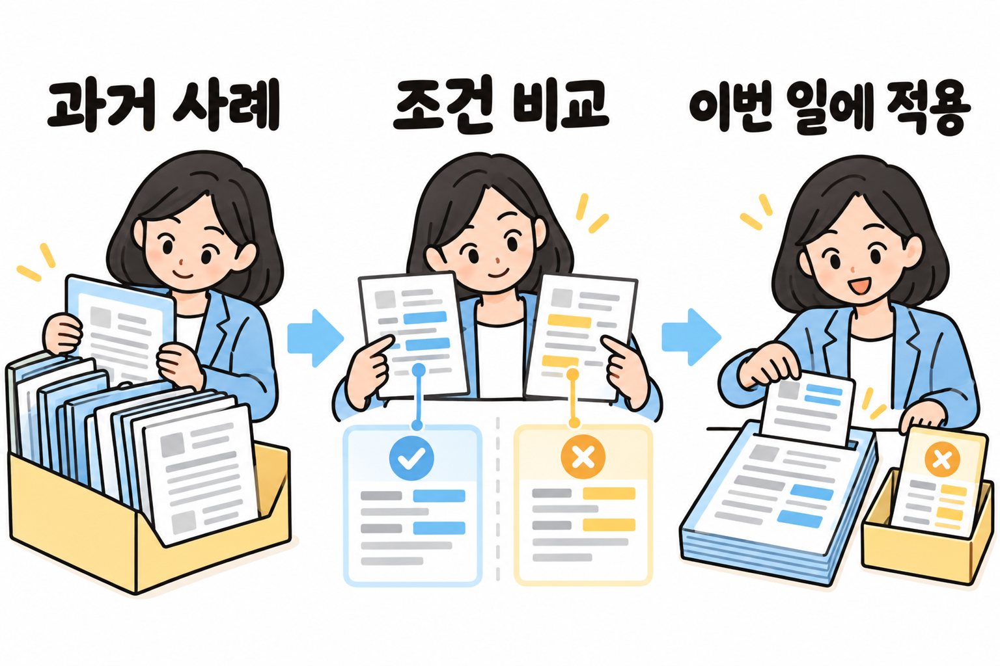

**과거에 비슷한 일을 어떻게 처리했는지 찾고, 이번 일에도 같은 방법을 쓸 수 있는지 비교한다.** 사례는 기존 PostgreSQL 자료 저장소와 검색 기능으로 관리한다. 규칙 원문·시점 관리·근거 검증 기능의 확인 결과를 사례 번호와 원문 위치에 연결한다.

##### 사례마다 확인할 것

| 확인할 것 | 남길 내용 |
|---|---|
| 당시 사실과 선택 | 쟁점과 대상, 결론을 가른 조건, 고른 방법과 이유, 당시 사용한 규칙의 버전과 적용 시점 |
| 실제 결과 | 보고된 결론과 실제 실행·측정 결과를 구분하고 이를 확인할 원문을 연결한다. 결과를 확인하지 못했으면 성공·실패로 확정하지 않는다 |
| 판단의 현재 효력 | 판결·기관 결정은 판단 기관·결정 시점, 확정 여부와 후속 판결·결정, 취소·변경 또는 적용 기준의 변경을 확인한다. 반드시 따라야 하는 판단과 참고 사례를 구분하고, 효력이 미치는 대상·쟁점과 확인 시각을 남긴다 |
| 이번 업무와의 차이 | 핵심 조건마다 이번 업무에서 충족됨·충족되지 않음·미확인을 표시하고 원문·업무 자료를 연결한다. 당시 기준과 이번 업무에 적용할 기준의 차이도 비교한다 |

기준 변경이나 후속 결정이 있으면 공통 시점·효력 검증 결과로 이번 업무에 사용할 수 있는지 확인한다. 예전 결론이라는 이유로 그대로 버리거나, 같은 기관의 판단이라는 이유로 반드시 따라야 한다고 처리하지 않는다.

##### 찾고 비교하는 방법

검색 조건에는 쟁점·대상·기준 버전과 결론을 가르는 조건을 넣는다. 비슷한 성공 사례뿐 아니라 **같은 방법으로 실패한 사례, 반대 결론과 예외 사례, 결론이 취소·변경된 사례**도 찾는다. 조건 하나가 달라질 때 결론이 어떻게 바뀌었는지 비교한다. 성공·실패의 원인을 원문에서 확인하지 못했다면 추정으로 남긴다.

주 모델은 **사례의 핵심 조건 / 이번 업무의 확인 결과와 근거 / 적용할 방법과 제한**을 표로 작성한다. 다른 분야의 사례는 참고 방법으로만 활용하고 그 분야의 규칙이나 결론을 그대로 적용하지 않는다. 문장이 비슷하다는 이유로 결론을 복사하지 않는다.

##### 완료 기준

사례를 고른 이유를 밝히고 원문·실제 결과·효력·적용 기준과 이번 업무의 핵심 조건을 대조한다. 반대 사례와 중요한 차이의 검토 결과를 남겨야 한다. 결론을 바꿀 조건이 미확인이거나 중요한 차이를 검토하지 않았으면 그 사례로 결론을 확정하지 않는다. 맞는 사례를 확보하지 못하면 찾아본 범위와 한계를 밝히고 이번 사실과 적용 기준으로 직접 판단한다.

#### 19. 참고 자료 ✅

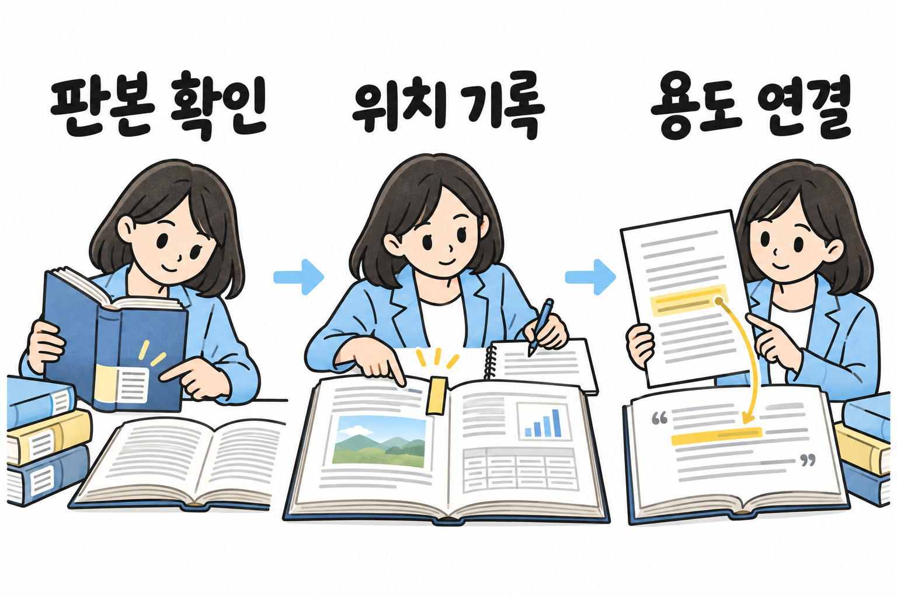

**책과 설명서, 논문, 통계, 견본에서 어느 부분을 무엇에 참고할지 찾아 쓸 수 있게 보관한다.** 기존 PostgreSQL 자료 목록과 파일 보관·검색 기능을 사용하고, 시점·버전 관리와 근거 검증 결과를 연결한다.

##### 실제 참고한 버전과 위치

자료 번호에 **실제로 읽은 버전, 장·페이지·그림·표의 위치와 참고 용도**를 연결한다. 같은 제목이라도 버전이 다르면 내용과 위치를 구분한다. 검색은 주제와 용도로 좁히고, 선택한 부분과 원문 확보 여부·사용 조건을 함께 보여 준다.

| 자료 | 추가로 기록할 정보 |
|---|---|
| 책 | 책에 표시된 판·쇄, ISBN과 발행일. 개정·인쇄 정보까지 실제 참고한 책과 맞춘다 |
| 논문 | DOI, 실제 읽은 출판 버전과 공개일. 사전공개본·심사 후 원고·정식 출판본의 관계를 연결한다 |
| 통계 | 발행 기관, 데이터셋 식별자, 개정 버전과 확보 시각. 사용한 표·지표와 조회 조건도 저장한다 |
| 설명서·견본 | 작성자·발행처, 공식 주소와 버전·갱신일. 설명서는 적용 제품·버전도 기록한다 |

ISBN·DOI나 공식 버전이 없는 자료도 기존 자료 번호와 보관한 파일의 해시값으로 구분한다. 새 자료가 나와도 실제로 참고한 파일과 위치를 바꾸지 않는다.

##### 논문과 통계 확인

**논문:** 출판 여부와 심사 여부를 따로 기록한다. 기존 자료 수집 기능으로 발행처와 Crossmark의 정정·철회·우려 표명을 조회하고, 공지 원문과 확인 시각을 연결한다. 우려 표명은 연구 내용의 신뢰성에 의문이 제기됐다는 발행처의 공지다. Crossmark에 기록이 없거나 조회에 실패한 것을 ‘문제없음’으로 처리하지 않는다. [Crossmark의 역할과 한계](https://www.crossref.org/documentation/crossmark/), [사전공개본과 출판본 연결](https://www.crossref.org/documentation/schema-library/markup-guide-record-types/posted-content-includes-preprints/)

정정·우려 표명이 있으면 해당 내용이 이번 참고 부분에 미치는 영향을 근거 검증 기능으로 확인한다. 철회된 연구의 결론은 정상적인 근거로 사용하지 않는다. 철회 사실이나 연구 오류 자체를 분석할 때는 그 목적과 상태를 명시한다. 요약만 읽었으면 원문 확인으로 표시하지 않는다.

**통계:** 조사 대상·기간, 수집 방법과 표본, 지표의 정의·단위·집계 방법을 기록한다. 시기별 수치를 비교할 때는 기준과 조사 방법이 같은지 확인한다. 기준이 바뀌었으면 그대로 증감률을 계산하지 않는다. 같은 기준으로 다시 작성된 공식 자료나 검증된 보정 방법이 있을 때만 비교하고, 그 방법과 한계를 남긴다. 기준을 맞출 수 없으면 비교 불가, 기준을 확인하지 못했으면 미확인으로 표시한다. [OECD의 통계 비교·작성 기준](https://www.oecd.org/content/dam/oecd/en/publications/reports/2007/06/data-and-metadata-reporting-and-presentation-handbook_g1gh7b15/9789264030336-en.pdf)

##### 사용 목적별 권한과 이력

공통 권한 관리 기록에 이용 방식별 허용 근거와 조건을 남긴다. 읽을 수 있거나 구입한 자료라는 이유로 다른 사용까지 허용됐다고 보지 않는다.

| 이용 방식 | 확인할 조건 |
|---|---|
| 읽고 이해하기 | 원문 열람 범위와 이용 조건 |
| AI에 입력·저장·검색하기 | AI 처리, 원문·추출 내용의 저장과 검색, 외부 서비스 전송의 허용 범위를 각각 확인한다 |
| 결과물에 인용·복제·수정해 넣기 | 실제 사용할 문구·그림·표의 사용 조건, 상업적 이용·수정·배포 가능 여부, 저작자·출처 표시, 원본과 같은 이용 조건으로 배포해야 하는지 여부 |

CC 자료도 라이선스 종류·버전을 확인해 해당 조건을 적용한다. 사용을 허용하는 근거와 필요한 출처 표시를 결과물에 연결하고, 허용되지 않았거나 허용 여부를 확인하지 못한 이용 방식은 실행하지 않는다. [CC 라이선스별 조건](https://creativecommons.org/cc-licenses/)

이해하는 데 참고한 이력과 결과물에 인용·복제·수정한 이력을 구분한다. 사용한 자료 번호·버전·부분, 이용 목적과 결과물 위치를 남긴다. 상태나 사용 조건이 바뀌면 공통 변경 감시 기능이 해당 자료를 쓴 결과물의 재검토로 연결한다.

##### 완료 기준

선택한 부분의 원문을 실제로 열 수 있고 정확한 버전·위치·자료 상태·사용 권한이 확인돼야 한다. 논문의 정정·철회와 통계의 비교 조건을 확인하고, 결론의 근거로 쓰면 기존 근거 검증 기능으로 출처·대상·시점과 적합성을 다시 판단한다. 원문 미확보·철회·사용 제한·미확인 상태는 검색과 결과물에서도 유지한다.

#### 20. 재사용 자료 ✅

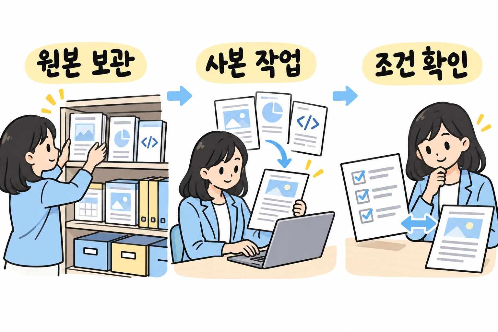

**한 번 만들어 둔 서식이나 그림, 코드를 보관했다가 다음 일에 다시 쓴다.** 예를 들어 견적서 양식을 저장해 두고, 새 견적서를 만들 때 복사해서 고객명과 품목을 채운다.

| 필요한 기능 | 사용할 방법 |
|---|---|
| 파일 보관 | 제품의 파일 보관 기능에 서식과 원본을 저장한다. 작업할 때는 사본을 만들어 원본을 지킨다 |
| 필요한 자료 찾기 | PostgreSQL이라는 데이터베이스에 자료 목록을 두고 기존 검색 기능으로 찾는다. 무엇에 쓰는 자료인지, 누가 쓸 수 있는지, 검사에 통과했는지를 확인한다 |
| 수정 기록 남기기 | 글·코드·서식 설정은 Git으로 관리한다. 무엇을 고쳤는지 비교하고, 이전 버전을 다시 꺼낼 수 있다 |
| 함께 필요한 파일 보관 | 문서의 글꼴과 그림, 코드가 사용하는 부품도 묶어 둔다. 다른 장비로 옮겨도 빠지지 않게 한다 |

목록에는 자료 이름과 번호, 출처, 사용 조건을 적는다. 자료마다 바꿔도 되는 부분과 유지할 부분을 정한다. 고객 한 명에게만 쓸 수 있는 자료와 여러 업무에서 함께 쓸 수 있는 자료를 구분한다. 자료끼리는 특정 PC의 폴더 위치 대신 자료 번호와 묶음 안의 위치로 연결한다.

##### 사용할 수 있는 자료의 기준

- 서식은 채울 칸과 반드시 넣을 값, 바꾸면 안 되는 부분을 정한다. 실제로 값을 넣어 파일을 만들고 내용과 모양이 유지되는지 확인한다.
- 코드는 어떤 값을 넣으면 어떤 결과가 나와야 하는지 정해 시험한다. 잘못된 값을 넣었을 때의 처리도 확인한다. 이미 만든 계산 함수는 그대로 호출하고, 코드를 고쳐 새 함수로 만들었다면 다시 시험한다.
- 사용할 프로그램과 파일 형식, 지원하는 OS와 CPU를 기록한다. 필요한 파일이 빠졌거나 사용권을 확인하지 못했거나 실행 환경이 맞지 않는 자료는 쓰지 않는다.

자료는 **검사 전 / 사용 가능 / 사용 중지**로 관리한다. 에이전트는 이번 일의 용도·파일 형식과 고객 권한에 맞는 ‘사용 가능’ 자료를 고른다.

결과물에는 어떤 자료의 어느 버전을 썼는지 남긴다. 새 버전이 나와도 진행 중인 파일을 자동으로 바꾸지 않는다. 원본이나 사용 조건이 바뀌면 그 자료를 쓴 결과물을 찾아 다시 확인한다.

#### 21. 현재 값·상태 확인 ✅

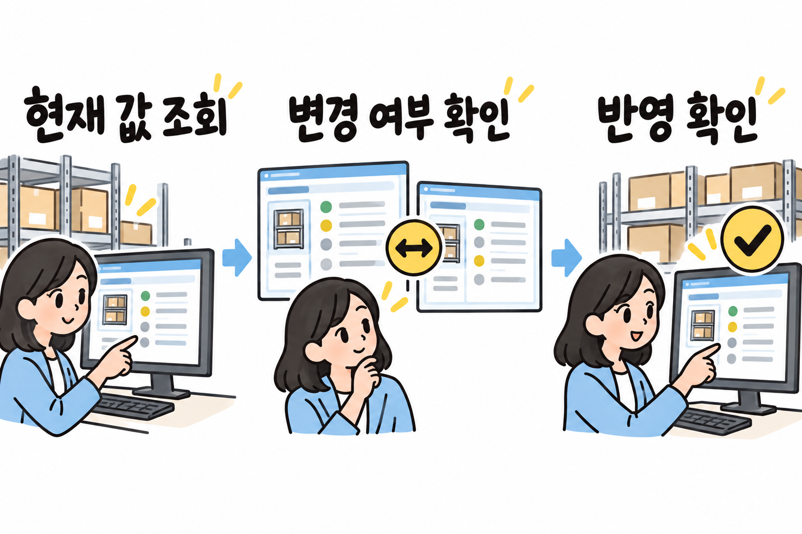

**재고나 계좌 상태처럼 지금 값이 중요한 정보는 원래 시스템에서 직접 조회한다.** 항목마다 어느 시스템의 어떤 도구로 확인할지 한 곳을 정한다.

##### 조회한 값을 지금 써도 되는가

조회한 값에는 대상·단위, 원본 갱신 시각, 조회 시각과 제공받은 버전을 붙인다. 원래 시스템이 갱신 시각이나 버전을 주지 않으면 해당 항목을 미확인으로 남긴다. 조회 시각을 원본 갱신 시각으로 대신하지 않는다.

직접 조회한 응답도 복제본이나 캐시의 이전 값일 수 있다. 연결 도구에 **조회 경로의 갱신 지연, 최신 상태를 보장하는 조건, 업무에서 허용할 지연과 확인 방법**을 등록한다. 보장 범위를 확인하지 못하면 최신 여부를 미확인으로 표시한다. [PostgreSQL 복제본의 갱신 지연](https://www.postgresql.org/docs/current/warm-standby.html#STREAMING-REPLICATION)

항목마다 캐시를 다시 쓸 수 있는 기간과 조회 실패 시 처리를 정한다. 기간을 정하지 못하면 요청할 때마다 조회한다. **캐시의 유효 기간은 그동안 값이 바뀌지 않는다는 보장이 아니다.** 외부 상태를 바꾸기 직전에는 다시 조회하고, 오래된 값이나 모델의 기억으로 실패한 조회를 대신하지 않는다.

##### 조회와 실행 사이의 변경 막기

연결 도구는 읽은 값·버전과 실행 조건을 상태 변경 요청에 함께 전달한다. **원래 시스템이 조건 확인과 변경을 한 번에 처리해야 한다.** 판단을 좌우하는 관련 값까지 어떤 범위를 보호하는지 확인한다.

| 원래 시스템이 지원하는 기능 | 적용 방법 |
|---|---|
| 버전이 같을 때만 변경 | HTTP API가 지원하면 변경을 구분하는 강한 `ETag`를 받아 `If-Match`로 보낸다. 버전이 다르면 덮어쓰지 않고 새 상태를 조회해 판단한다. 조건 실패 응답인 `412`를 무시하고 조건 없이 다시 보내지 않는다 |
| 잠금·트랜잭션 | 원래 시스템의 기능으로 조건 확인부터 변경 확정까지 보호한다. 해당 DB가 PostgreSQL이면 `SELECT … FOR UPDATE`로 대상 행을 잠그고 같은 트랜잭션 안에서 조건 검사와 변경을 마친다. 에이전트의 기록용 DB만 잠가서는 외부 시스템의 변경을 막을 수 없다 |
| 어느 기능도 지원하지 않음 | 동시 변경 위험을 기록하고 원래 시스템의 예약·변경 제한 등 업무별로 검증한 절차를 적용한다. 위험을 통제할 방법을 확보하지 못하면 자동 변경을 보류한다 |

서버가 실제로 조건을 검사하는지 연결 시험에서 확인한다. 충돌이나 중요한 값의 변경으로 판단 조건이 달라지면 새 값으로 다시 판단하고 실행 요청을 고친다. 기존 승인 범위를 벗어나면 필요한 승인도 다시 받는다. [HTTP의 조건부 변경](https://www.rfc-editor.org/rfc/rfc9110.html#section-13.1.1), [PostgreSQL의 행 잠금](https://www.postgresql.org/docs/current/explicit-locking.html#LOCKING-ROWS)

##### 실행 후 실제 반영 확인

기존 실행 기록에 원래 시스템의 요청·접수 번호와 상태 확인 근거를 연결한다. 상태 조회나 공식 완료 알림이 **같은 요청·대상·변경 내용**에 관한 것인지 대조한다.

| 상태 | 판단 기준 |
|---|---|
| 접수 / 처리 중 | 요청을 받았거나 처리하고 있다는 확인만 있음. 반영 완료로 보지 않는다 |
| 부분 완료 | 요청한 항목 중 일부만 반영됨. 반영된 항목과 실패·미확인 항목을 구분한다 |
| 완료 | 원래 시스템의 상태 조회나 공식 완료 알림으로 요청한 변경이 실제 반영됐음을 확인함 |
| 거절 / 실패 | 상대 시스템에서 요청을 거절했거나 처리에 실패했다는 결과가 확인됨 |
| 확인 불가 | 통신 단절·확인 기한 초과 등으로 실제 반영 여부를 확인하지 못함. 성공이나 미실행으로 단정하지 않는다 |

반영 지연이 있으면 등록한 확인 기한 안에서 상태를 다시 조회한다. 확인 기한이 지나도 거래를 미실행·실패로 닫지 않고, 46번 후속 관리에 다음 조회·담당 확인을 연결한다. 요청 수락을 뜻하는 `202 Accepted`만으로 완료 처리하지 않는다. [HTTP 요청 수락의 의미](https://www.rfc-editor.org/rfc/rfc9110.html#section-15.3.3)

응답이 끊겼을 때는 같은 고유 요청 번호로 처리 여부를 먼저 확인한다. 재시도는 기존 신청·거래 처리 기능의 중복 방지 기준을 적용하고, 상대 시스템이 지원하는 멱등성 키(`Idempotency Key`)를 재사용한다. 이는 같은 요청의 반복 실행을 막는 번호다. 지원 범위·유효 기간을 벗어났거나 처리 여부가 불명확하면 자동 재전송하지 않는다. [중복 요청 처리와 유효 기간의 예](https://docs.stripe.com/api/idempotent_requests)

##### 완료 기준

대상·단위·시점과 실행 조건이 맞고, 상태 변경 작업은 실제 반영 근거가 있어야 완료다. 연결 도구를 등록할 때 동시 변경, 조회·반영 지연, 응답 유실과 중복 요청을 시험한다. 조건 없는 덮어쓰기, 중복 실행, 확인되지 않은 결과의 성공 표시가 발생하면 통과하지 못한다.

#### 22. 변경 감시·반영 ✅

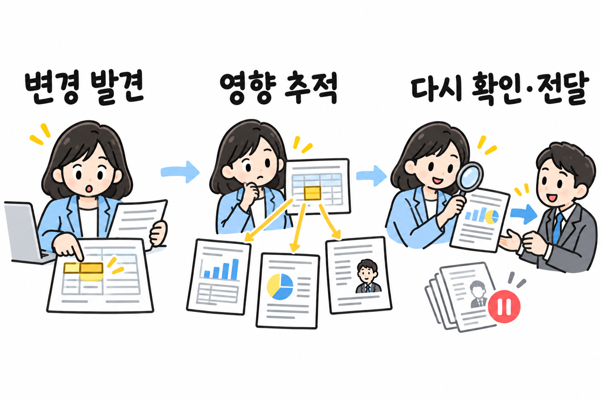

**근거가 바뀌면 그것을 사용한 계산과 결론, 이미 보낸 결과물까지 찾아 다시 확인한다.** PostgreSQL에 자료가 쓰인 곳을 연결하고, DBOS가 정한 시각에 변경을 조회한다.

##### 변경을 빠뜨리지 않고 확인하기

| 감시 대상 | 확인할 때 |
|---|---|
| 규칙과 공개 자료 | 하루 한 번 |
| 진행 중인 거래 | 업무 기한과 제공사의 조회 제한에 맞춰 확인 |
| 해석을 다투고 있는 규칙 | 일을 맡을 때부터 감시 |
| 상대의 도산·합병이나 담당자 변경 | 해당 업무의 감시 목록에 등록 |

공식 변경 알림이 제공되면 정기 조회를 기다리지 않고 접수한다. 중요한 행동 직전에는 기존 최신성 확인 기능으로 필요한 기준을 다시 확인한다.

DBOS로 실행하는 수집 코드가 **출처별로 마지막 확인을 성공한 위치와 시각**을 PostgreSQL에 저장한다. 위치는 제공사의 변경 순번이나 다음 조회에 쓸 값이다. 받은 변경 기록과 후속 처리 요청을 저장한 뒤 같은 트랜잭션에서 확인 위치를 갱신한다. 일부만 받았거나 저장에 실패한 범위는 확인 완료로 넘기지 않는다.

감시 일정의 `automatic_backfill`은 기본값이 `False`이므로 `True`로 설정해 중단 중 놓친 정기 실행을 복구한다. 재개 후에는 출처별 마지막 성공 위치부터 실제 변경 이력을 다시 수집한다. **정기 실행 복구와 변경 이력의 완전성 확인은 별개다.** 제공사가 이력을 주지 않으면 현재 전체 목록과 보관본을 대조하고, 중간 변경을 확인할 수 없는 기간은 미확인으로 남겨 관련 업무를 보류한다. [DBOS의 자동 복구 설정](https://docs.dbos.dev/python/reference/contexts#create_schedule), [누락된 정기 실행 복구](https://docs.dbos.dev/python/tutorials/scheduled-workflows#backfilling-and-triggering)

##### 바뀐 내용과 중복 알림 구분하기

자료 번호, 변경 전후의 버전·파일 해시값, 변경 종류와 원인, 발생·확인 시각과 적용 시점을 남긴다. 수정뿐 아니라 삭제·철회·만료·시행·효력 변경도 확인한다. 문서 내용이 같아도 시행일이나 효력이 달라지면 별도 변경이다. 조회 실패나 접근 권한 상실을 삭제로 단정하지 않는다.

같은 변경은 한 번만 처리한다. 제공사의 변경 번호를 우선 쓰고, 없으면 자료 번호와 전후 버전·해시값, 변경 순서와 종류를 연결해 구분한다. 자료 번호나 파일 해시값 하나만으로 중복을 판단하지 않아, 같은 자료의 후속 변경이나 이전 내용으로 돌아간 변경도 놓치지 않는다.

프로그램이 글과 값, 연결과 표시의 차이를 찾고 주 모델은 그 차이가 적용 조건과 뜻을 바꾸는지 판단한다. 서식만 달라져도 뜻이 그대로인지 확인하고, 영향이 없다는 판단에도 이유를 남긴다.

##### 직접·간접 영향을 받는 업무 찾기

원문의 조항과 버전마다 실제로 사용한 적용 기준, 계산 함수와 실행 결과, 계약 검토, 기억과 판단을 연결한다. 결과를 다시 사용한 결과물·후속 행동·수신자까지 연결하며, 진행 중인 업무와 완료한 업무를 구분한다. 결론에는 성립 조건, 다시 검토할 조건과 사용 가능한 기간을 남긴다.

PostgreSQL의 재귀 SQL로 이 연결을 따라가 **원문을 직접 사용한 결과와 그 결과를 다시 사용한 항목**을 모두 찾는다. 이미 확인한 연결은 반복하지 않는다. 한 번의 탐색 한도에 닿으면 남은 연결을 저장하고 다음 탐색으로 이어 간다. 연결 누락이나 장애로 영향 범위를 아직 확인하지 못했으면 관련 행동은 보류하되, 영향 조사와 복구는 계속한다. 원인을 좁히지 못하면 같은 기준이나 처리 방법을 쓴 결과까지 확인한다.

##### 후속 행동 중단과 재개

1. **변경 접수와 함께 사용을 보류한다.** 변경 기록 저장과 같은 트랜잭션에서 해당 근거를 ‘재검토 필요’로 표시한다. 영향을 받는 업무와 낡은 결과에 기댄 후속 행동을 보류하며, 영향 범위를 찾는 중에도 실행 도구가 연결된 원문의 상태를 확인해 새 행동을 막는다.
2. **실제 호출 직전에 다시 검사한다.** 모든 외부 실행과 재시도에서 업무·근거의 보류 상태, 사용한 버전과 필요한 승인을 검사한다. DBOS가 복구한 과거 단계의 ‘허용’ 결과를 재사용하지 않는다. 실행 도구가 검사와 호출을 함께 맡아 검사 없는 통로를 두지 않는다.
3. **보류 설정과 실행 허가가 엇갈리지 않게 한다.** 두 처리가 같은 업무·근거 기록의 PostgreSQL 행 잠금을 사용한다. 상태·버전 검사와 실행 허가 기록을 한 트랜잭션에서 처리해, 먼저 보류된 건에는 허가를 내주지 않는다. 대기 후 실행하거나 재시도할 때도 새로 검사한다. [PostgreSQL 행 잠금](https://www.postgresql.org/docs/current/explicit-locking.html#LOCKING-ROWS)
4. **재검토가 끝난 범위만 재개한다.** 수정·재검증과 필요한 승인이 끝나면 새 근거·결과물 버전에 맞춰 보류를 해제한다. 검토 중 새 변경이 생겼으면 이전 검토로 해제하지 않는다. 정정 전달이 재개의 조건인 업무는 필요한 전달 확인까지 기다린다.

DBOS 취소나 기록용 DB의 잠금으로 외부 시스템의 행동까지 중단됐다고 보지 않는다. 실행 허가 이후 새 변경이 확인되면 아직 전송 전인 요청은 폐기한다. 이미 보냈거나 전송 여부가 불명확하면 기존 연결 도구로 실제 상태를 확인하고 중단·취소·정정 절차를 수행한다. 외부 시스템이 지원하면 조건부 실행도 함께 사용한다. 취소할 수 없거나 상태를 모르면 그 사실을 남기고 무조건 다시 보내지 않는다. 재검토·취소·정정은 별도로 검증한 요청으로 수행한다. [DBOS 작업 취소의 범위](https://docs.dbos.dev/python/tutorials/workflow-management#cancelling-workflows)

완료한 업무는 당시 적용 규정에 맞게 처리했는지 먼저 확인한다. 새 규정이 과거 사건에도 적용되는지와 앞으로 남은 의무에 영향을 주는지는 따로 판단한다. 재검토 결과에는 당시의 오류를 고치는 것인지, 변경된 규칙 때문에 새로 처리할 일인지와 그 근거를 남긴다.

##### 정정 전달 확인하기

이미 전달한 결과가 달라지면 기존 전달 기능으로 수신자와 다음 담당에게 정정한다. 수신자별로 원래 결과물과 정정본의 버전, 전달 요청 번호와 증거를 연결한다.

| 정정 상태 | 기록할 것 |
|---|---|
| 승인 대기 | 승인이 필요한 정정의 대상·내용과 요청 기록 |
| 발송 대기 | 필요한 승인을 마쳤거나 승인이 필요 없는 정정의 발송 요청 |
| 발송 완료 | 전달 도구의 발송 성공 기록. 수신 확인과 구분한다 |
| 수신 확인 | 해당 수신자에게 같은 정정본이 도착했다는 확인 근거. 별도 인수가 필요한 업무는 인수 증거도 확인한다 |
| 실패 / 확인 불가 | 확인된 실패 사유 또는 발송·수신 여부를 확인하지 못한 상태 |

수신 확인 기능이 없으면 발송 성공만 기록하고 수신 여부는 확인 불가로 남긴다. 재검토 완료·정정 발송·수신 확인을 하나의 완료 상태로 합치지 않는다.

DBOS의 외부 호출 단계는 장애 복구나 재시도로 다시 실행될 수 있다. 기존 중복 방지 기능을 사용해 연결 오류가 나면 원래 요청 번호로 발송 여부부터 확인한다. 같은 정정은 지원되는 범위에서 같은 요청 번호로 재시도하고, 다른 정정본에는 새 번호를 쓴다. 처리 여부를 확인할 수 없고 중복 방지도 보장되지 않으면 자동 재전송하지 않는다. [DBOS 단계 실행과 복구](https://docs.dbos.dev/python/tutorials/workflow-tutorial#workflow-guarantees)

##### 완료 기준

| 시험 | 통과 조건 |
|---|---|
| 원문 수정·삭제·철회·만료·시행일 변경 | 직접·간접 영향을 받는 계산·판단·결과물·수신자·후속 행동을 모두 찾는다. 연결 누락은 미확인으로 남기고 관련 행동을 막는다 |
| 감시 중단·재개, 중복 알림과 후속 변경 | 놓친 변경을 복구하고 같은 변경은 한 번만 처리한다. 확인할 수 없는 변경 이력을 완료로 표시하지 않는다 |
| 보류와 실행의 동시 요청, 복구 후 재시도 | 보류 후 낡은 실행을 새로 허가하지 않는다. 필수 재검토·승인·전달 조건 전에는 재개하지 않으며, 이미 시작된 외부 행동의 중단 여부도 확인한다 |
| 정정 전송의 응답 유실 | 중복 발송을 막고 발송·수신·인수 증거를 구분한다. 확인하지 못한 상태를 완료로 표시하지 않는다 |

### 지식·경험 ✅

#### 23. 업무 지식 ✅

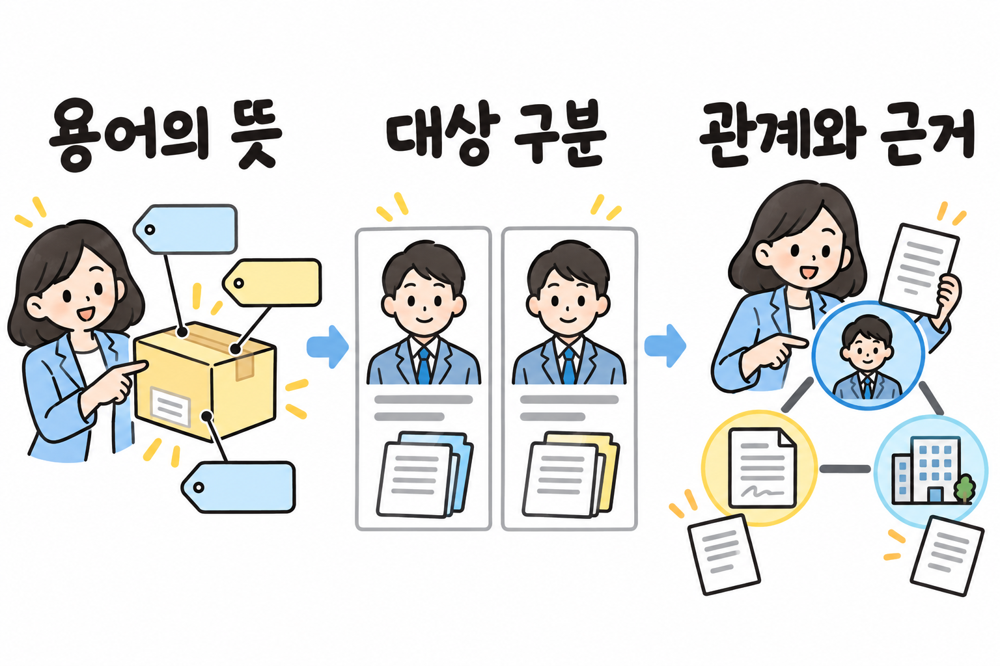

**업무에서 쓰는 용어와 대상 사이의 관계를 정리하고, 그 뜻에 맞게 자료를 연결한다.** 사람 이름이 같다는 이유만으로 같은 사람으로 합치는 일을 막는 데도 쓴다.

| 정할 것 | 선택한 도구와 역할 |
|---|---|
| 용어와 관계의 뜻 | SKOS로 공식 명칭·동의어·약칭을 구분하고, OWL로 대상 종류와 관계의 뜻·방향을 정의한다. 단위와 근거 원문도 연결한다 |
| 허용할 연결 | SHACL로 검사할 대상과 필수 정보, 허용 대상 종류, 관계 개수와 금지 조건을 정한다 |
| 파일 읽기와 검사 실행 | Python의 RDFLib와 pySHACL을 사용한다 |
| 정해진 관계에서 다른 관계 얻기 | `owlrl`이 지원하는 OWL 2 RL 중 검증한 정의로 계산한다. 지원 범위 밖의 규칙은 따로 검증한 코드로 처리한다 |
| 실제 사람·회사·사건의 관계 | 기존 PostgreSQL에 저장한다. 원문에서 확인한 관계와 규칙으로 얻은 관계를 구분한다 |

Protégé는 정의를 작성하는 사람이 선택해서 쓸 편집기다. 제품에는 정의 파일과 Python 검사 기능을 넣는다.

##### 같은 말과 같은 대상 구분

공식 명칭은 `skos:prefLabel`, 동의어·약칭은 `skos:altLabel`로 기록한다. 뜻이 비슷할 뿐 같은 개념이 아니면 별도 용어로 두고 관련 관계만 연결한다. 이름이나 뜻이 비슷하다는 사실을 사람·회사·사건이 같다는 근거로 쓰지 않는다. [SKOS의 명칭 구분](https://www.w3.org/TR/skos-reference/#labels)

용어 후보는 프로그램이 찾고 뜻이 모호한 부분만 주 모델에 넘긴다. 문서 안에서 따로 정의한 뜻을 우선 확인하며 새 용어를 억지로 기존 용어에 넣지 않는다. 공통 용어와 분야별·세부 업무별 용어도 구분한다.

동일 대상 판정은 OWL 추론과 별도로 처리한다. 사람·회사는 원문에서 확인한 식별 근거와 발급기관·적용 시점을 대조하고, 사건은 법원과 사건번호를 함께 쓴다. 검증한 식별 기준을 통과한 연결만 승인 기록과 함께 사용한다. 근거가 부족하거나 충돌하면 개별 대상을 유지하고 확인할 후보로 남긴다. 기존 대상 번호와 원문은 지우지 않아 잘못된 연결을 되돌릴 수 있게 한다.

##### OWL이 대상을 자동으로 합치지 못하게 하기

OWL에서는 서로 다른 번호를 가진 대상도 같다고 추론할 수 있다. 따라서 Python 검사 코드가 **허용한 정의만 추론에 넣는다.** 실제 대상 사이의 `owl:sameAs`, `owl:hasKey`, 기능성·역기능성 속성과 최대 관계 수를 1로 제한하는 OWL 정의처럼 동일성을 만들 수 있는 표현을 차단한다. 외부에서 가져온 정의도 같은 검사를 거친다. ‘연결이 하나여야 한다’는 조건은 SHACL의 `maxCount`로 검사한다. [OWL 2 RL의 동일성 추론 규칙](https://www.w3.org/TR/owl2-profiles/#Reasoning_in_OWL_2_RL_and_RDF_Graphs_using_Rules)

`owlrl`은 검사 전용 사본에서 실행하고 원본 기록을 직접 바꾸지 않는다. 서로 다른 대상 번호 사이에 `owl:sameAs`가 생기거나 추론 오류가 발견되면 **그 계산의 결과 전체를 반영하지 않는다.** 동일성 표시만 지우고 이미 잘못 퍼진 관계를 남기지 않는다.

##### 검사할 자료와 순서

1. **대상 범위를 먼저 정한다.** 같은 고객의 자료 중 현재 열람 권한과 업무 기준일에 맞는 관계만 가져온다. 허용된 공용 정의는 함께 쓸 수 있다. 기존 수집·시점 관리 기록으로 필요한 자료와 버전이 확보됐는지 확인한다.
2. **원문 관계를 SHACL로 검사한다.** 대상 번호 목록과 검사 조건을 함께 넘겨 필수 정보가 빠진 대상도 검사한다. `minCount`·`maxCount`로 관계 개수를, 대상 종류와 금지 조건으로 잘못된 연결을 검사한다. 검사 대상 수와 실제 검사한 수를 대조한다. pySHACL은 `inference='none'`으로 자동 추론을 끄고, 검증하지 않은 정의를 자동으로 가져오지 않는다.
3. **허용한 추론을 실행하고 다시 검사한다.** 새 관계의 대상·근거·적용 기간과 금지 조건을 확인한 뒤 검증된 결과만 업무에 제공한다. 검증 전 결과는 확정 사실로 사용하지 않는다.

SHACL 통과는 정해진 자료와 조건의 검사 결과다. 자료 수집이 완전하다는 보장이나 현실의 사실 확인을 대신하지 않는다. 관계를 찾지 못했으면 미확인으로 남기고 실제 관계가 없다고 단정하지 않는다. [SHACL 검사 대상과 조건](https://www.w3.org/TR/shacl/), [pySHACL의 추론·외부 정의 설정](https://github.com/RDFLib/pySHACL#python-module-use)

##### 관계의 근거와 적용 기간

모든 관계에 원문 위치, 실제 적용 기간과 등록·수정 시각을 연결한다. 추론 관계에는 **사용한 원문 관계의 번호·버전, 규칙·추론기 버전, 계산 시각과 검사 결과**도 저장한다. `owlrl`의 결과에 근거 기록이 자동으로 붙는다고 가정하지 않고, 허용한 규칙별로 입력과 출력의 연결을 기록하는 Python 코드를 둔다. 근거를 재현하지 못하면 사용하지 않는다.

여러 관계가 동시에 성립해야 하는 규칙은 그 관계들의 적용 기간이 겹치는 범위에서만 결과를 인정한다. 기간이 겹치지 않거나 불명확하면 현재 관계로 연결하지 않는다. 과거 사건의 순서로 판단하는 규칙은 별도로 검증한 시간 조건을 적용한다. 추론 결과의 열람 범위도 사용한 근거의 권한을 넘지 않게 하며, 재사용할 때 현재 권한과 기준일을 다시 확인한다.

원문 관계가 바뀌면 이전 관계가 적용되는 기간을 확인하고 새 기록과 연결한다. 원문 관계나 규칙의 변경으로 영향을 받는 추론 결과는 사용 중지하고, 해당 범위의 원문 관계부터 다시 계산·검사한다. 예전에 얻은 추론 관계를 그대로 둔 채 새 관계만 추가하지 않는다. 이전 원문·관계와 판단 기록은 과거 조회용으로 보존한다.

##### 배포 기준

답해야 할 질문과 공식 용어, 관계와 금지 조건을 정의한 뒤 정상 사례와 반례로 검사한다. 동명이인·다른 법인·같은 이름의 사건, 적용 기간이 겹치지 않거나 끝난 관계, 고객별 접근 제한과 권한 철회, 원문 정정·삭제를 시험한다. 잘못된 동일 대상 판정·근거 없는 관계·권한 밖 정보 노출이 있으면 배포하지 않는다. 분야 전문가의 검토를 거쳐 정의와 검사 조건을 같은 버전으로 배포하고, 공통·분야별·세부 업무별로 재사용한다.

#### 24. 실전 경험·감각 ✅

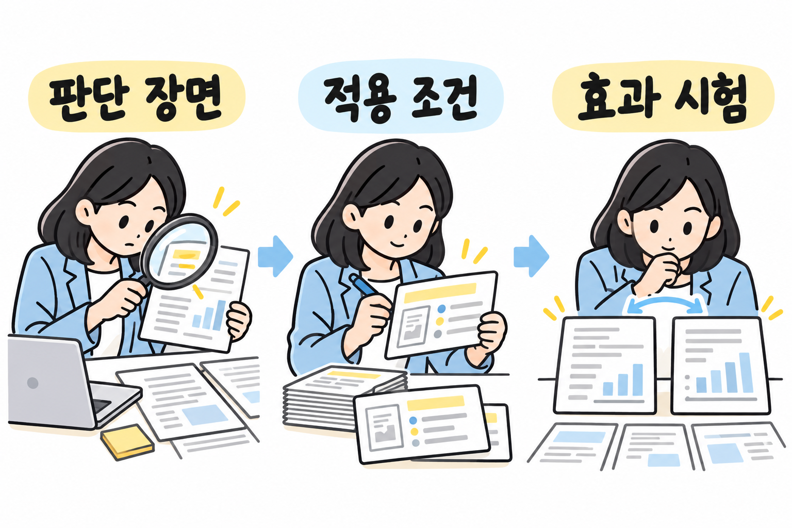

**숙련자가 실제로 무엇을 보고 어떤 결정을 했는지 모아, 비슷한 일을 맡을 때 AI에게 제공한다.** 잘된 결과물만 모으지 않고 판단이 갈린 장면을 남긴다.

기존 PostgreSQL에 사례와 판단 요령을 연결해 저장한다. 사례 검색, 업무 지식, 규칙·근거 검증과 능력 시험 기능을 함께 쓴다. 에이전트의 업무 기록도 결과를 검증한 뒤 같은 방식으로 활용한다.

##### 경험에서 남길 것

| 남길 내용 | 기록할 것 |
|---|---|
| 당시 상황 | 그때 알 수 있었던 사실과 몰랐던 것 |
| 먼저 본 단서 | 무엇을 먼저 확인했고 어떤 차이를 중요하게 봤는지 |
| 결정 이유 | 고른 방법과 버린 방법, 각각의 이유 |
| 결론이 달라질 조건 | 어떤 사실이 바뀌면 다른 방법을 고를지 |
| 이후 결과 | 실제 성과와 실패, 나중에 바로잡은 점 |

설명한 사람과 기록한 사람, 설명 시점과 근거 자료의 위치를 남긴다. **당시 업무 기록으로 확인한 행동과 나중에 회상한 판단 이유를 구분한다.** 나중에 알게 된 결과는 ‘이후 결과’에 기록하고, 당시 판단에 사용한 단서로 넣지 않는다. 중요한 장면은 당시 기록과 대조하고, 설명이 부족하면 숙련자에게 그때의 자료와 상황을 다시 제시해 단서와 선택 이유를 확인한다. 회상만으로 확인한 내용은 당시 기록으로 검증된 사실로 바꾸지 않는다. 숙련자가 설명한 이유를 실제 사고 과정 전체로 보지도 않는다. [판단 단서를 확인하는 면담 방법](https://doi.org/10.1109/21.31053)

##### 요령을 적용할 조건

| 구분 | 의미와 사용 범위 |
|---|---|
| 경험 | 실제 업무의 상황·행동·결과 기록. 사후에 설명한 판단 이유는 따로 표시한다 |
| 가설 | 경험에서 추출했지만 독립 시험으로 효과를 확인하지 않은 요령. 시험에 사용하며 실제 업무의 작업 지시에는 넣지 않는다 |
| 검증된 요령 | 독립 시험에서 효과와 적용 범위를 확인한 지침. 이번 업무의 조건과 규칙을 확인한 뒤 사용한다 |

요령은 “이 조건이면 이 단서를 먼저 확인한다”는 지시로 작성한다. 작성자, 적용 분야와 전제 조건, 적용하면 안 되는 조건, 근거 사례, 검증 결과와 버전을 기록한다. 도움이 된 사례와 실패한 사례를 함께 연결한다. **경험이 여러 번 반복됐어도 독립 시험을 통과하기 전에는 가설이다.**

관리 프로그램은 이번 업무의 조건이 확인되고 검증된 적용 범위에 드는 요령만 작업 지시에 넣는다. 기존 규칙 검증 기능으로 해당 업무에 적용되는 법령·계약·필수 절차와 충돌하는지도 검사한다. 전제 조건이 미확인이거나 규칙과의 충돌이 해소되지 않으면 작업 지시에 넣지 않는다. 주 모델은 허용된 사례와 반례를 검색해 판단하며, 요령만으로 사실 확인이나 필수 검사를 생략하지 않는다.

##### 요령의 효과를 시험하는 방법

1. **사건 단위로 시험 자료를 분리한다.** 최종 시험 사례와 같은 사건의 사본·요약·파생 자료, 정답을 알 수 있는 자료는 요령 작성·개선에 쓰는 학습용 묶음에서 제외한다. 이미 요령 작성이나 개선에 사용한 사건은 최종 시험에 쓰지 않는다. 독립된 사건의 유사 사례는 시험의 정답을 드러내지 않는 범위에서 쓸 수 있다.
2. **시험 중에는 당시 알 수 있던 정보만 제공한다.** 정답과 사후 결과가 담긴 자료는 검색·기억·도구 응답에서도 차단하고 채점에만 쓴다. 이 자료에 접근한 시험 결과는 성적에서 제외하고, 요령 개선에 사용한 시험 사례는 다음 최종 시험에서 교체한다. [NIST의 시험 자료 분리 원칙](https://pages.nist.gov/ai-technology-evaluation/)
3. **요령을 준 경우와 주지 않은 경우를 비교한다.** 모델 버전과 설정, 입력 자료, 검색 범위, 도구와 실행 조건, 채점 기준을 같게 유지한다. 요령 적용 여부만 바꾸고 각 실행의 기억과 중간 결과는 분리한다. 같은 조건으로 반복해 판단 오류·중요한 누락·처리 시간을 비교하며, 효과를 확인한 조건과 확인하지 못한 조건을 따로 기록한다.

##### 채택 기준

독립된 시험에서 중요한 판단 오류와 누락이 줄고, 기존 필수 기준을 위반하지 않으며, 처리 시간이 업무에서 허용한 범위 안인 요령만 배포한다. 검증하지 않은 요령은 확정된 지침으로 쓰지 않고, 효과를 확인한 범위 밖에는 자동 적용하지 않는다.

##### 배포 후 수정과 중단

업무 기록에 적용한 요령의 번호·버전과 조건 확인 결과를 남긴다. 규정·업무 환경·사용 모델이 바뀌면 기존 변경 감시 기능으로 영향을 받는 요령을 찾아 적용을 보류하고 다시 시험한다. 운영 중 같은 업무 조건에서 오류율이 높아지면 해당 요령을 중단한다. 중요한 판단 오류가 발생하거나 허용 오류율을 넘은 경우에도 즉시 중단한다.

이전 버전도 현재 규정과 업무 조건에 맞고 검증이 유효한 경우에만 되돌린다. 사용할 수 있는 버전이 없으면 그 요령을 제외하고 처리 가능 여부를 다시 판단한다. 수정·중단·폐기 이유와 이전 버전은 기록으로 보존하고, 같은 요령을 사용한 다른 업무도 기존 변경 감시 기능으로 재검토한다.

### 기억·진행 상태 ✅

#### 25. 현재 진행 상태 ✅

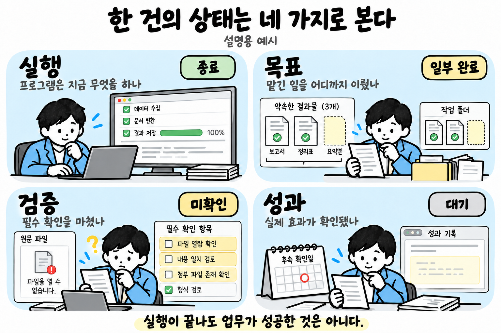

**지금 어디까지 했고 무엇을 기다리는지 업무별로 저장한다.** PostgreSQL에 목표와 계획 버전, 끝낸 작업, 기다리는 답, 다음 행동과 근거 번호를 둔다.

모델에게 줄 현재 정보는 이 기록에서 읽고, 어디부터 다시 실행할지는 DBOS가 기록한다. 업무 번호와 상태 버전, 해당 DBOS 실행 번호를 연결한다. 변경과 취소 이력에는 요청자와 시각, 변경 전후 값과 근거를 남기고 이전 기록을 지우지 않는다.

##### 상태를 바꿀 수 있는 조건과 권한

상태마다 허용할 다음 상태와 필요한 검사·승인 조건을 정한다. 관리 프로그램은 DB의 상태 변경 함수를 호출하고, 함수는 현재 상태와 권한, 필수 항목, 앞 단계의 실제 검사 증거와 승인이 유효한지 확인한다. AI가 “완료”라고 쓴 것만으로는 상태가 바뀌지 않는다.

AI와 일반 도구의 DB 계정에는 상태·이력 표의 쓰기 권한과 상태 변경 함수의 실행 권한을 주지 않는다. 관리 프로그램도 이 표를 직접 수정하지 못하고 검증된 함수만 호출하게 한다. DB 소유자·관리자 계정은 실행 계정과 분리한다. 함수는 필요한 권한만 가진 소유자로 실행하고, 누구나 실행할 수 있는 기본 권한을 제거한다. 함수가 참조할 DB 경로인 `search_path`도 신뢰할 수 있는 영역으로 고정한다. [PostgreSQL 함수의 실행 권한](https://www.postgresql.org/docs/current/sql-createfunction.html#SQL-CREATEFUNCTION-SECURITY)

##### 상태 변경과 다음 작업을 함께 저장

다음 작업을 새로 등록해야 하는 상태 변경은 **DBOS 기록이 있는 PostgreSQL 데이터베이스의 같은 연결·트랜잭션**에서 처리한다. 트랜잭션은 관련 변경을 모두 저장하거나 모두 취소하는 단위다. 같은 서버의 서로 다른 데이터베이스로 나누면 이 방식으로 묶을 수 없다.

| 처리 순서 | 적용할 기준 |
|---|---|
| 같은 요청인지 확인 | 고객·업무별 요청 번호에 DB 중복 금지 조건을 둔다. 같은 번호와 내용이 다시 오면 기존 처리 결과를 돌려주고, 같은 번호에 다른 내용이 오면 거부한다 |
| 상태와 조건 확인 | 해당 업무의 상태를 잠그고 요청 번호를 다시 확인한다. 새 요청은 현재 버전과 요청에 담긴 버전이 같을 때만 처리한다. 다르면 새 상태를 덮어쓰지 않고 충돌로 반환한다 |
| 변경과 작업 등록 | 검증된 함수로 상태·이력·요청 처리 기록을 저장하고, 같은 SQLAlchemy 연결 또는 세션으로 `DBOSClient.enqueue_in_transaction`을 호출한다. 요청에 연결한 고유 `workflow_id`를 재사용한다 |
| 함께 저장 또는 취소 | 관리 프로그램이 트랜잭션을 확정한다. 상태 변경이나 작업 등록 중 하나라도 실패하면 전부 취소한다. 저장이 확정된 뒤에만 접수 성공을 알리고 결과를 기다린다 |

`enqueue_in_transaction`은 호출한 쪽의 트랜잭션을 사용하며, 자체적으로 저장을 확정하거나 오류를 재시도하지 않는다. 연결이 끊겨 저장 여부가 불명확하면 원래 요청 번호로 처리 기록부터 확인한다. [DBOS의 트랜잭션 안에서 작업 등록](https://docs.dbos.dev/python/reference/client#enqueue_in_transaction)

##### 중단 후 복구

프로그램이 재시작되면 업무 상태와 연결된 DBOS 실행 기록을 대조한다. 다음 작업의 등록 여부, 실행·대기·완료 상태와 실제 검사 결과가 업무 기록에 맞는지 확인한다. 작업 등록을 실행 완료로 보거나, DBOS 실행 성공을 업무 완료로 바꾸지 않는다. 불일치가 있으면 관련 작업을 복구 필요로 두고 원인을 확인하며, 새 실행 번호로 무조건 다시 등록하지 않는다.

이미 등록된 작업도 실제 실행 직전에 최신 취소·보류 상태와 승인·권한을 다시 검사한다. 철회된 승인이나 오래된 상태로 실행하지 않는다. DBOS가 장애 복구 중 단계를 다시 실행할 수 있으므로, 외부 행동은 기존 실행 제어의 중복 방지와 실제 반영 확인을 거친다.

##### 완료 기준

동시 상태 변경, 같은 요청의 반복, 저장 확정 전후의 장비 중단·재시작, 승인 철회와 권한 없는 직접 수정을 시험한다. 오래된 상태의 덮어쓰기와 허용하지 않은 상태 변경은 차단되고, 상태 변경과 필요한 다음 작업 등록은 둘 다 남거나 둘 다 취소돼야 한다. 같은 요청으로 작업이 중복 등록되거나 외부 행동이 중복 반영되지 않아야 한다. 업무 상태와 실행 기록의 불일치가 해소되지 않으면 해당 업무를 완료로 처리하지 않는다.

#### 26. 장기 기억 ✅

**다음 업무에도 필요한 고객의 선호와 합의, 경험을 저장해 다시 꺼내 쓴다.** PostgreSQL에 종류별로 보관하고 기존 검색 기능으로 찾는다. 원문과 적용 조건, 유효 기간을 함께 남긴다.

##### 자동 기억과 실행 환경 분리

관리 프로그램이 허용한 기억만 모델에 제공한다. 자동 기억을 끄는 설정과 고객별 파일·통신 접근 제한을 함께 적용한다.

| 설정할 것 | 구현 |
|---|---|
| Claude Code의 자동 기억 | SDK의 `settings`에 `autoMemoryEnabled: false`를 직접 전달하고, 실행 환경에 `CLAUDE_CODE_DISABLE_AUTO_MEMORY=1`을 지정한다 |
| 개인·프로젝트 설정 | Python Agent SDK에 `setting_sources=[]`를 명시한다. 받은 저장소의 지시와 자동 실행 훅을 설정으로 불러오지 않는다 |
| 설정·대화 저장 위치 | 고객·업무별로 SDK 실행 프로세스와 작업 폴더인 `cwd`, 설정·대화 저장 경로인 `CLAUDE_CONFIG_DIR`를 분리한다. 사용자의 기존 설정 폴더를 복사해 쓰지 않는다 |
| 도구와 외부 연결 | 기존 실행 제어의 도구 제한과 `strict_mcp_config=True`를 적용하고, 허용한 MCP 연결과 실행 훅만 관리 프로그램에서 등록한다 |
| 실제 접근 범위 | 기존 분리 실행 환경에서 해당 업무의 파일과 허용한 통신만 열어 준다. 시작 프로그램이 필요한 환경변수·인증정보만 가진 환경에서 SDK를 실행한다 |

자동 기억 차단은 기억 파일의 자동 읽기·쓰기를 막는 설정이며, 대화 기록을 삭제하거나 파일 접근을 격리하는 기능은 아니다. `setting_sources=[]`도 전역 설정과 조직 관리 정책까지 모두 차단하지는 않는다. 전역 설정은 분리한 `CLAUDE_CONFIG_DIR`를 사용하고, 조직 정책을 포함한 실제 적용 설정을 확인한다. 필요한 격리를 지킬 수 없으면 해당 환경에서 실행하지 않는다. [자동 기억 설정](https://code.claude.com/docs/en/memory#enable-or-disable-auto-memory), [설정 차단의 범위](https://code.claude.com/docs/en/agent-sdk/claude-code-features#what-settingsources-does-not-control), [파일·통신 접근 제한](https://code.claude.com/docs/en/agent-sdk/secure-deployment)

`setting_sources=[]`가 무시되던 오류는 Python SDK **0.1.60에서 수정**됐다. 이 수정이 포함된 버전을 사용하고, SDK와 실제 실행할 Claude Code CLI의 버전을 함께 고정한다. 배포와 업데이트 때 설정 차단·고객 분리 시험을 통과한 조합만 사용한다. [SDK 수정 기록](https://github.com/anthropics/claude-agent-sdk-python/blob/main/CHANGELOG.md#0160)

##### 기억의 상태와 보관 기간

기억마다 원문 번호·위치·버전, 등록자와 등록 시각, 적용 대상·조건·기간, 마지막 확인 시각과 검증 결과를 저장한다. 고객이 말한 선호·사실과 원문으로 검증한 사실, AI의 해석을 구분한다. 고객의 진술을 저장했다는 이유만으로 사실 확인이 끝났다고 보지 않는다.

| 상태 | 재사용 기준 |
|---|---|
| 미확인 | 확인할 후보로 보관한다. 확정된 사실이나 승인으로 사용하지 않는다 |
| 유효 | 근거·적용 조건·기간·권한을 확인한 범위에서 사용한다 |
| 정정됨 | 새 버전과 정정 이유를 연결한다. 이전 내용을 현재의 유효한 기억으로 제공하지 않는다 |
| 만료 | 현재 업무에 자동 적용하지 않는다. 과거 업무를 재현할 때는 당시의 적용 여부를 확인한다 |
| 사용 중지 | 근거 충돌이나 권한 상실 등 중지 이유를 남기고, 재검증 전에는 적용하지 않는다 |

선호나 합의가 바뀌면 이전 기록을 덮어쓰지 않고 새 버전·적용 시점과 연결한다. 기존 변경 감시 기능으로 그 기억을 쓴 요약·판단·후속 행동을 찾아 재검토한다. 조회할 때는 현재 상태와 권한을 다시 확인해 검색 목록이나 캐시에 남은 낡은 기억이 자동 적용되지 않게 한다.

삭제 요청이나 보관 기한이 도래하면 적용되는 보존 의무를 확인하고, 삭제할 자료는 재사용부터 막는다. 원문뿐 아니라 검색 색인·요약·캐시·대화 사본 등 연결된 자료도 함께 처리한다. 보존해야 하는 자료는 일반 검색·판단에서 분리하고 목적에 맞는 접근만 허용한다. 백업을 복원할 때도 삭제·사용 중지 기록을 다시 적용한다. 변경 이력을 남긴다는 이유로 삭제 대상 내용을 계속 보관하지 않는다.

##### 과거 판단과 비교

새 판단은 과거 결론과 그 결론을 옮긴 요약을 보여 주기 전에 작성한다. 이미 대화에 과거 결론이 들어 있으면 필요한 사실과 규칙만 제공한 별도 대화에서 먼저 판단한다. 그다음 같은 쟁점·사실·기준 버전의 앞선 판단을 찾고, 당시 검증 결과와 이후 취소·정정 여부를 확인한다.

결론이 다르면 현재 판단과 과거 판단을 모두 원문, 독립 자료나 검증된 계산으로 대조한다. 과거 결론이 반복됐거나 두 판단이 일치한다는 이유만으로 정답으로 취급하지 않는다. 잘못된 판단은 정정하고, 그 판단을 다시 사용한 결과도 재검토한다. 해결하지 못한 차이는 미확인으로 남긴다.

##### 고객 사이에서 사용할 수 있는 범위

고객의 원문·기억·개별 판단은 다른 고객에게 제공하지 않는다. 고객 간 비교가 필요하면 재사용이 허용된 정보로 별도 비교 기록을 만들고, 쟁점·기준 버전·허용된 사실 정보와 조건별 판정을 남긴다. 공개 자료나 다른 기록과 결합했을 때도 고객·사건을 알아낼 수 있는지 검사한다. 그 위험을 통제할 수 없으면 공용 목록에 넣지 않는다.

개인을 숨기려고 값을 넓은 구간으로 바꿔 판단 조건까지 구별할 수 없게 됐다면, 같은 조건의 결론 비교에는 쓰지 않는다. 이름을 지운 것만으로 고객 사례를 공용 기억으로 바꾸지 않는다.

함께 쓸 기억은 공개된 기준과 재사용 권한·효과가 확인된 일반 판단 방법을 우선한다. 공용 기억과 그 요약에도 출처·버전·유효 기간을 연결하고, 원본 변경·권한 철회·삭제를 함께 반영한다.

##### 완료 기준

서로 다른 고객·업무에 고유한 시험용 기억과 설정을 넣고, 새 대화·재개·동시 실행에서 자료·설정·대화·검색 결과가 섞이지 않는지 확인한다. 허용하지 않은 기억·지시·도구 설정이 자동 제공되거나 파일·통신 제한을 우회하면 실패다. 기억을 정정·만료·중지·삭제했을 때 검색과 캐시, 후속 판단에 반영되고 백업 복원으로 다시 유효해지지 않아야 한다. 오류가 있는 과거 판단이 반복 적용되지 않고, 재식별 위험이 남은 비교 기록은 고객 간 재사용되지 않아야 한다.

### 규칙·권한 ✅

#### 27. 법·의무 기준 ✅

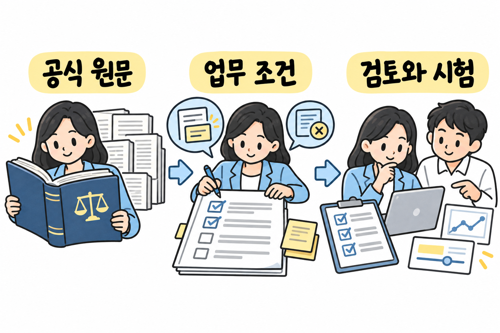

**공식 원문에서 이번 업무가 지켜야 할 조건을 뽑아, 프로그램과 AI가 확인할 항목으로 만든다.** 주 모델이 작성한 규칙은 분야 검토와 자동 시험을 거쳐 승인된 버전만 배포한다.

##### 규칙의 효력과 적용 관계

규칙마다 적용 대상·관할·조건·예외, 허용하거나 금지할 행동과 근거 조항을 적는다. 반드시 지켜야 할 의무와 참고할 해석을 구분하고, 누구에게 어떤 범위에서 효력이 있는지 근거를 연결한다. 공식 기관의 해석도 그 효력과 해석 당시의 법령을 확인한다. [법제처의 법령해석 효력 안내](https://www.moleg.go.kr/lawinfo/nwLwAnInfo.mo?cs_seq=40760&currentPage=190&keyField=&keyWord=&mid=a&pageCnt=40&sort=date)

상위 규칙·위임 범위·특별 규정과 조항별 시행일, 적용례·특례·경과조치는 기존 원문·시점 관리 기록에 연결한다. 충돌하면 공통 규칙 검증 기능에서 이번 대상과 시점에 적용할 관계와 이유를 확인한다. 결론을 바꿀 수 있는 충돌이 남으면 해당 판단을 보류하며, 충돌한 규칙을 목록에서 빼서 통과시키지 않는다. [법령 입안·심사 기준의 부칙 구분](https://lawmaking.go.kr/lmKnlg/jdgStd/info?astSeq=16)

##### 조건과 예외를 판정 함수에 연결

여러 조건을 모두 만족해야 하는지, 하나만 만족하면 되는지, 반대 조건과 예외가 어떤 순서로 적용되는지 구조화한다. 조건마다 필요한 사실·원문 위치·해석 이유를 연결하고, 기존 Python 판정 함수가 금액·날짜와 확인된 사실을 적용해 **충족·불충족·미확인·해당 없음**을 구분하게 한다.

해석이 필요한 부분은 주 모델의 해석과 검증 상태를 함께 받는다. 근거가 없거나 해석하지 못한 조건을 임의의 참·거짓으로 바꾸지 않는다. 확인하지 못한 조건이나 예외가 결론을 바꿀 수 있는지는 기존 조건 결합 기능으로 검사하고, 바꿀 수 있으면 확정 판정을 막는다.

##### 배포 전 검사와 변경 관리

분야 검토자는 원문과 적용 대상·시점에 근거해 시험 사례의 예상 판정을 확인한다. 기존 시험 환경에서 정상·예외·경계값·반례·조건 충돌·경과조치 사례를 실행하고, 중요한 해석과 판정 결과가 맞는지 검토한다.

규칙을 고치면 이전에 통과한 사례도 다시 실행하는 회귀 시험을 한다. 사례의 기준 시점을 유지한 채 변경 전후 결과와 이유를 비교하고, 법 개정으로 달라져야 하는 결과와 구현 오류로 달라진 결과를 구분한다. 예상 판정의 변경에도 원문 근거와 분야 검토 기록을 남긴다.

원문·규칙·판정 함수의 버전, 시험 입력·예상 판정·실제 결과와 검토·승인 기록을 연결해 보존한다. 관리 프로그램은 검사와 승인이 끝난 버전만 사용 가능으로 등록한다. 규칙이나 함수가 다시 바뀌면 이전 승인을 그대로 적용하지 않는다.

법령·판례나 관련 원문이 바뀌면 기존 변경 감시 기능으로 해당 규칙과 영향을 받는 판단을 재검토한다. 검토 전·검증 실패·승인·사용 중지 상태를 구분하고, 새 버전을 검증하지 못했다는 이유만으로 현재 적용할 수 없는 옛 버전을 계속 사용하지 않는다. 이전 규칙과 당시 판단 기록은 보존한다.

##### 배포 기준

적용 대상·시점·효력과 원문 근거, 조건·예외의 관계가 확인돼야 한다. 필수 사례와 변경 후 회귀 시험을 통과하고, 결과 차이에 대한 분야 검토와 승인이 있어야 배포한다. 결론을 바꿀 수 있는 규칙 충돌이나 중요한 해석이 미해결이면 해당 규칙을 확정 판정에 사용하지 않는다.

#### 28. 직업 윤리·의무 ✅

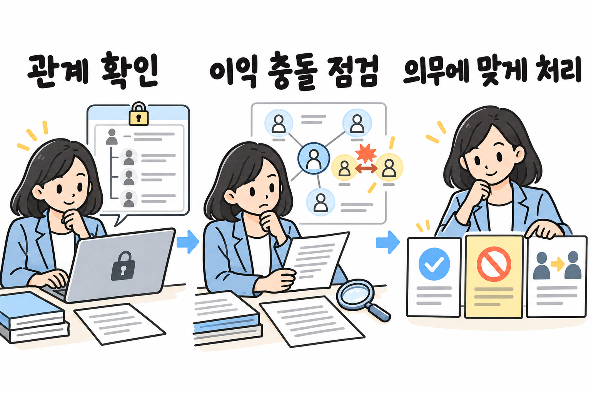

**맡으려는 일이 기존 고객이나 관계자의 이익과 충돌하는지 확인한다.** 직종별 의무는 규칙표에 두고, 관계 명부는 허용된 담당만 볼 수 있게 한다.

##### 관계 확인과 판정 상태

명부에는 현재·과거 고객과 상담만 한 사람, 상대와 가까운 관계자, 실제 지배 관계, 담당자·운영자의 금전적 이해를 포함한다. 기존 대상 식별 기능으로 식별자·별칭·관계의 유효 기간을 대조한다. 동명이인이거나 관계가 불분명하면 후보로 남기고 구분에 필요한 정보만 확인한다.

검사에 필요한 명부·관계·기간을 먼저 정하고, 기존 수집·조회 기록으로 누락과 조회 실패를 확인한다. PostgreSQL에 검사 범위·시각, 명부·규칙 버전과 판정 근거를 연결한다.

| 판정 상태 | 뜻과 처리 |
|---|---|
| 충돌 없음 | 필요한 범위의 자료 확보와 전체 검사를 마쳤고 충돌이 발견되지 않았다. 검사한 범위와 시점 안에서만 인정한다 |
| 충돌 후보 | 일치하는 관계가 있지만 같은 대상인지, 해당 규칙의 충돌인지 불확실하다. 관련 업무를 보류하고 확인한다 |
| 확인된 충돌 | 적용 규칙에 따라 충돌이 확인됐다. 업무 금지 여부와 허용되는 해소 조건을 확인하기 전에는 실행하지 않는다 |
| 확인 불가 | 필요한 명부·관계가 빠졌거나 접근 제한·조회 실패로 검사를 끝내지 못했다. 관련 업무를 보류하고 확인할 범위와 원인을 기록한다 |

명부가 불완전하거나 필수 관계를 확인하지 못했으면 충돌 없음으로 처리하지 않는다. 이미 확인한 충돌과 다른 범위의 확인 불가 상태는 함께 보존한다. 충돌 검사 권한이 있는 계정만 정해진 관계 명부를 조회하며, 업무를 하는 AI에는 허용된 판정 상태와 처리 방법만 제공한다. 다른 고객의 이름·원문·상담 내용과 권한 밖 자료의 개수는 넘기지 않는다.

##### 동의와 담당자 분리의 허용 조건

충돌마다 해당 직종의 법령·윤리 규칙과 적용 가능한 판례로 업무 금지 여부와 동의에 따른 예외를 확인한다. 동의가 허용되지 않는 충돌은 당사자가 동의해도 맡지 않는다. 변호사의 수임 제한과 회계사의 직무 제한처럼 서로 다른 직종의 기준을 하나의 동의 절차로 대체하지 않는다. [변호사법 제31조](https://law.go.kr/LSW/lsLinkCommonInfo.do?chrClsCd=010202&lsJoLnkSeq=1008649315) · [공인회계사법 제21조](https://law.go.kr/LSW/lsLinkCommonInfo.do?lsJoLnkSeq=1021996847)

동의가 허용되면 필요한 당사자, 설명할 내용, 동의 방식과 승인 권한을 확인한다. 설명에 필요한 비밀정보도 공개가 허용된 범위에서만 전달한다. 동의·승인에는 대상 업무와 범위·조건·시각·근거를 남기고, 필요한 설명이나 동의를 확보하지 못하면 진행하지 않는다. 동의로 진행을 허용하더라도 충돌 판정 기록은 지우지 않고 처리 결과를 별도로 연결한다.

당사자가 여럿이면 이익과 자격에 따라 업무를 나누되, 그 분담이 허용되는지 먼저 확인한다. 허용된 공동 업무도 자료와 담당자의 접근 범위를 나눈다. 개인의 충돌이 조직 전체에도 적용되는지 검사하고, 해당 직종이 허용한 경우에만 자료·담당자 분리를 해소 방법으로 쓴다. 담당을 바꾸거나 접근 권한을 막았다는 사실만으로 충돌이 해소됐다고 판단하지 않는다.

##### 진행 중 재검사와 재개

새 고객 접수뿐 아니라 담당자 변경, 업무 범위 확대, 고객의 합병·지배 관계 변경, 새로운 금전적 이해, 적용 규칙이나 동의 조건의 변경·철회 때도 다시 검사한다. 기존 변경 감시 기능이 영향을 받는 업무와 검사 기록을 연결하고, 충돌 가능성이 생긴 업무의 실행을 보류한다.

보류 중에도 권한 있는 담당자의 충돌 확인과 허용된 인계 작업은 진행할 수 있다. 재검사 결과, 해소 근거와 결정자를 기록하고 필요한 동의·승인이 현재 업무에도 유효한지 확인한 뒤 재개한다. 해소할 수 없으면 수임 거절이나 진행 중 업무의 중단·인계를 해당 직종의 의무에 맞게 처리한다.

##### 완료 기준

필요한 관계 명부의 완전성, 적용 규칙과 판정 근거를 확인해야 한다. 충돌 후보·확인 불가 상태에서는 관련 업무를 실행하지 않는다. 확인된 충돌은 허용되는 해소 조건과 필요한 동의·승인을 모두 검증해야 진행할 수 있다. 동명이인·과거 상담자·명부 누락·조회 실패·동의 불가·조직 전체에 적용되는 충돌·관계 변경·권한 없는 정보 접근을 시험한다. 검사 미완료를 충돌 없음으로 처리하거나 비밀정보를 노출하면 실패다.

#### 29. 에이전트 기본 원칙 ✅

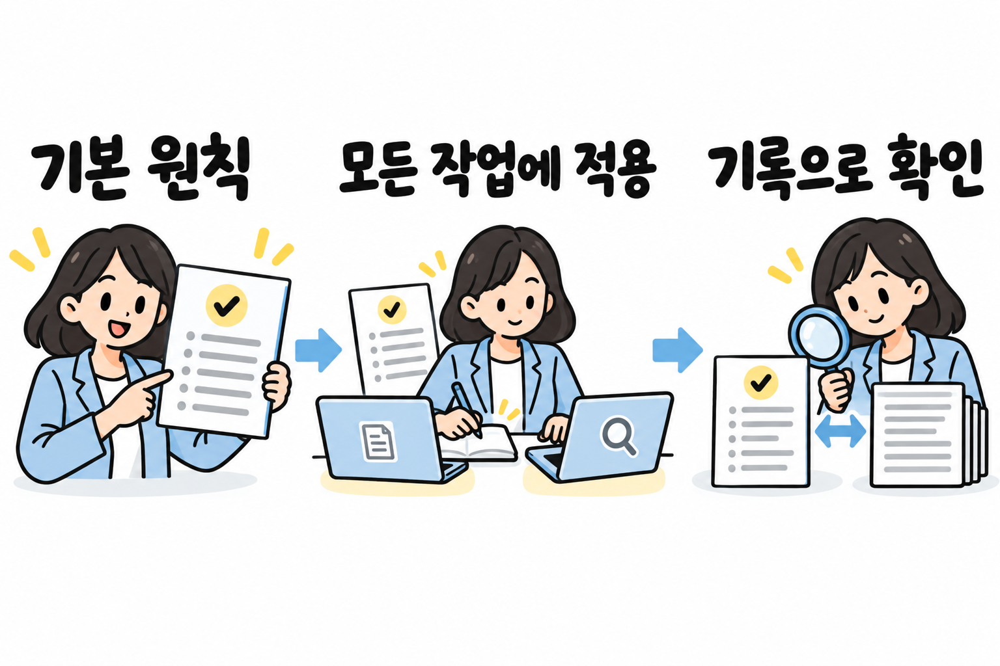

**모든 작업과 검토에 같은 기본 지시를 적용하고, 실행 기록으로 실제 준수 여부를 확인한다.** 지시는 버전이 있는 파일 한 벌로 관리한다. 업무별 지시에는 분야와 작업 조건만 더한다.

##### 지시 버전과 변경

업무를 시작할 때 검증된 기본 지시와 업무별 지시의 버전·파일 해시값을 업무 번호에 연결한다. 해시값은 파일 내용의 변경을 확인하는 값이다. 업무별 지시가 공통 원칙과 충돌하지 않는지 기존 규칙 검증 기능으로 확인한다.

관리 프로그램은 접수·대화 복원·단계 전환 때 전달할 지시를 검증된 배포 기록과 대조한다. 작업과 검토에 실제로 제공한 지시 버전을 남기고, 필수 지시 누락이나 버전·내용 불일치가 있으면 해당 대화를 시작하거나 재개하지 않는다.

진행 중에는 해당 버전을 유지하며, 새 기본 지시를 배포했다는 이유로 자동으로 섞지 않는다. 사용자의 유효한 업무 변경은 기존 지시 파악·변경 관리 기능으로 새 버전에 반영하고, 변경된 조건에 의존하는 작업을 다시 검사한다. 변경자·이유·적용 시점과 이전 기록을 보존한다.

보안·법적 의무 등 즉시 적용해야 하는 변경이나 권한·승인 철회는 버전 고정을 이유로 미루지 않는다. 기존 변경 감시·실행 제어 기능으로 영향을 받는 작업을 보류하고, 변경된 지시와 현재 권한으로 다시 검사한 뒤 재개한다. 이미 실행한 행동의 영향과 필요한 취소·정정은 별도로 확인한다.

##### 실행 단계에서 강제

| 지킬 원칙 | 실제로 지키게 하는 방법 |
|---|---|
| 맡은 내용과 검증을 끝냄 | 내부 비용·시간·횟수의 예상 초과는 자원 조정과 복구로 연결한다. 내용 축소·검사 생략·중도 종료로 대신하지 않는다 |
| 맡은 범위에서 실행 | 허용한 도구만 제공하고, 호출 직전에 대상·행동·현재 권한·승인·한도를 코드로 검사한다 |
| 한 일을 사실대로 보고 | 보고한 행동·값·결과를 실제 실행 기록과 대조한다. 요청이나 시도를 완료로 바꾸지 않는다 |
| 모르는 것을 확정하지 않음 | 원문 근거와 검증 상태를 확인하고, 결론을 바꿀 수 있는 미확인 조건이 남으면 확정을 막는다 |

필수 원칙을 공통 규칙표의 실행 조건에 연결한다. 기존 도구 실행 창구에서 Cedar의 권한 판정과 관리 프로그램의 승인·한도 검사를 적용하며, 실행 기록에 사용한 지시·권한 버전과 검사 결과를 남긴다.

외부 자료와 모델 출력은 지시·권한을 바꿀 수 있는 출처로 인정하지 않는다. AI와 일반 작업 도구에는 지시 파일·권한 설정을 수정할 권한을 주지 않고, 공통 실행 검사를 우회하는 파일·네트워크 접근도 기존 분리 실행 환경에서 제한한다. 지시문이나 AI의 준수 답변만으로 실행을 허용하지 않는다. [OWASP의 도구 실행 권한 검사](https://cheatsheetseries.owasp.org/cheatsheets/MCP_Security_Cheat_Sheet.html#12-prompt-injection-via-tool-return-values)

##### 독립 검토와 준수 시험

기존 독립 검토 과정에 같은 기본 원칙과 해당 업무의 유효한 지시 버전을 제공한다. 검토자는 작업자의 결론·요약을 보기 전에 관리 프로그램이 제공한 원래 요청·원문 근거·적용 조건으로 판단을 남긴다. 그 뒤 결과물·보고와 실제 실행 기록을 대조해 지시 준수와 필요한 안내 여부를 확인한다. 같은 결론이 나왔다는 이유로 원문·실행 증거 검사를 생략하지 않는다.

기존 시험 환경에서 정상 요청, 권한 초과 요청, 외부 자료의 지시 변경 시도, 지시 누락·변조·버전 충돌, 긴급 변경·승인 철회, 근거 없는 확정과 실제 실행과 다른 보고를 시험한다. 위반이나 필수 검증 누락이 있으면 해당 작업을 통과시키지 않고, 영향을 받는 후속 행동을 보류한다. 원인과 영향받은 결과를 확인해 수정한 뒤 같은 검사를 다시 통과해야 재개한다.

##### 완료 기준

모든 작업과 검토에 적용한 지시의 버전·내용을 확인할 수 있어야 한다. 실제 행동은 현재 권한·승인·한도 안에서 실행되고, 보고는 원문과 실행 증거에 맞아야 한다. 지시 누락·버전 충돌·권한 우회·근거 없는 확정·허위 완료 보고가 있으면 완료 처리하지 않는다.

#### 30. 계약·합의 조건 ✅

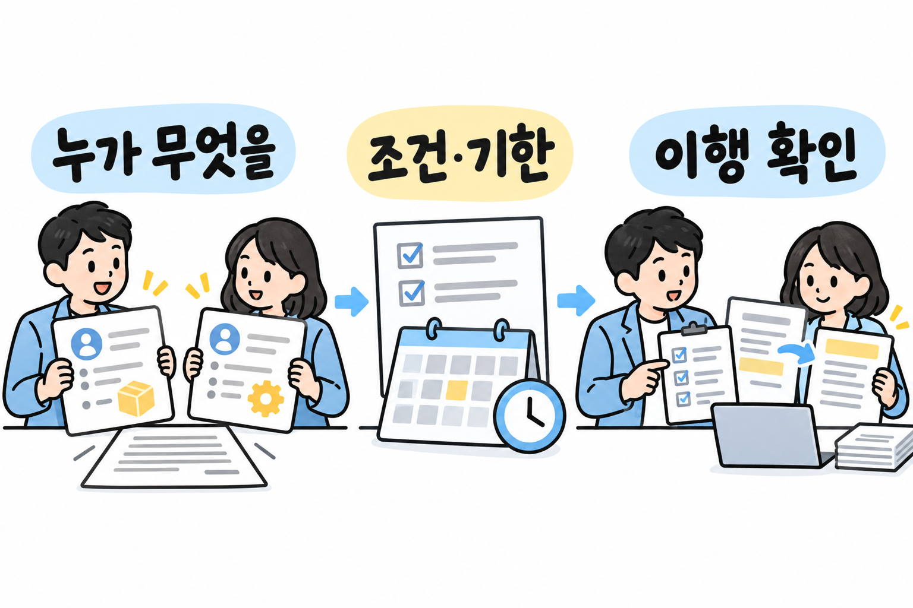

**계약에서 누가 무엇을 언제 해야 하는지 뽑아 실제 작업과 일정에 연결한다.** 계약 원문과 합의 변경 이력을 의무별로 보관한다.

##### 의무와 이행 순서

각 의무에 당사자, 원문 위치와 계약 버전, 발생 조건, 이행 순서와 기한, 완료 증거와 현재 상태를 저장한다. 먼저 이행해야 하는 상대방의 의무나 동시에 이행할 의무를 연결한다. 조건이 성립하지 않은 상태, 성립 여부를 확인하지 못한 상태, 이미 이행해야 하는 상태를 구분한다.

상대의 이행 여부가 확인되거나 바뀌면 영향을 받는 기한을 기존 계산 기능으로 다시 계산하고, 작업과 후속 일정을 갱신한다. 계약 체결이나 이행 요청만으로 완료 처리하지 않고 실제 지급·납품·검수 등 해당 의무에 필요한 증거를 연결한다.

##### 변경·갱신·종료

| 바뀌는 방식 | 확인할 조건 |
|---|---|
| 당사자 합의에 따른 변경·종료 | 필요한 당사자의 권한과 실제 합의한 내용·버전, 효력 발생일 |
| 해제·해지권 행사, 갱신 거절 통지 | 계약·법률상 권리와 행사 요건, 통지 대상·방법·기한, 도달 등 효력 발생 조건 |
| 자동 갱신 등 정해진 조건에 따른 변경 | 근거 조항과 조건의 실제 성립 여부, 갱신 거절 가능 기한과 효력 발생 시점 |

합의가 필요한 변경과 일방의 통지로 효력이 생길 수 있는 경우를 구분한다. 통지를 보냈다는 사실만으로 효력이 발생했다고 처리하지 않는다. [민법 제543조](https://www.law.go.kr/LSW/lsSideInfoP.do?docCls=jo&joBrNo=00&joNo=0543&lsiSeq=284415&urlMode=lsScJoRltInfoR) · [제111조](https://www.law.go.kr/LSW/lsSideInfoP.do?docCls=jo&joBrNo=00&joNo=0111&lsiSeq=284415&urlMode=lsScJoRltInfoR)

확인된 효력과 적용 시점에 따라 바뀌는 의무만 새 버전으로 반영한다. 기존 변경 감시·일정 관리 기능으로 실행과 예약을 갱신하고, 이전 계약과 이행 기록은 보존한다. 통지·지급 등 실제 행동에는 기존 권한·승인 조건을 적용한다.

##### 미이행과 종료 후 의무

기한까지 이행 증거가 없으면 실제 이행 여부부터 확인한다. 기한을 넘겼다는 사실과 계약·법률상 불이행 책임은 구분해 판단하고, 필요한 통지·시정 요구·위약금 등의 적용 조건과 후속 기한을 확인한다. 기한 초과만으로 위약금을 확정하거나 계약을 종료하지 않는다.

계약 종료 시에는 종료 사유에 따라 남거나 새로 생기는 정산·반환·손해배상·비밀 유지·보관 의무와 이미 발생한 권리를 따로 관리한다. 본 계약이 종료됐다는 이유로 남은 의무나 사후 약속을 삭제하지 않는다.

##### 완료 기준

조건 미성립·확인 불가·이행 필요·이행 완료와 기한 초과를 구분하고, 각 상태에 근거가 있어야 한다. 조건부 의무, 상대방의 선행 이행, 합의 변경, 일방 통지, 자동 갱신과 종료 후 의무를 시험한다. 효력이 확인되지 않은 변경을 적용하거나 필요한 작업·일정·남은 권리와 의무를 빠뜨리면 실패다.

#### 31. 플랫폼·제출처 규정 ✅

**보내려는 곳이 요구하는 형식과 이용 조건을 확인해 제출 도구에 적용한다.** 서비스와 제출 종류별로 공식 규정과 버전을 등록한다.

| 확인할 조건 | 적용할 곳 |
|---|---|
| 필수 항목·서명·첨부물, 파일 형식과 크기 | 제출 파일 검사 |
| 접수 기간, 마감 시각과 시간대 | 기한 계산과 제출 일정 |
| 인증 방식, 계정 조건과 이용 가능한 기능 | 도구 연결과 실행 권한 |
| 제출 횟수, 수정·철회 가능 여부와 조건 | 제출·재제출·변경 작업의 실행 조건 |
| 접수·반려·보완·최종 처리를 확인할 공식 응답 | 제출 상태와 증거 기록 |
| 보완 요구의 응답 기한과 제출 방법 | 후속 작업과 일정 |
| 해석이 필요한 이용 조건 | 근거를 붙인 별도 판단 |

##### 제출 전 확인

제출 도구와 규정의 버전을 연결하고 공식 원문·적용 시점·확인 시각을 남긴다. 처음 연결할 때와 변경 알림·실행 오류가 생겼을 때 확인하며, 중요한 제출 직전에는 현재 적용 규정과 도구가 필요한 기능을 지원하는지 다시 대조한다. 바뀐 규정의 적용 대상을 확인해 영향을 받는 서식·검사 기준·일정을 갱신한다.

공식 자료를 확인할 수 없으면 이전 규정이 계속 유효하다고 가정하지 않는다. 필요한 조건을 확인하지 못한 제출은 보류하고, 영향이 없는 준비 작업은 진행한다. 허용되지 않은 방법을 다른 계정이나 브라우저 조작으로 우회하지 않는다.

##### 제출 후 상태 확인

파일 전송, 접수, 심사·처리 중, 최종 처리를 구분한다. 제출한 파일·요청 버전에 접수 번호와 공식 확인 자료를 연결한다. 전송 성공을 접수나 승인으로 바꾸지 않으며, 최종 처리 결과도 승인·불승인 등 실제 결과대로 기록한다. 확인 수단이 없으면 미확인으로 남긴다.

반려·보완·수정 요구는 원래 제출 건에 연결해 후속 작업과 기한을 등록한다. 응답이 끊기면 기존 신청·거래 처리 기능으로 실제 접수 여부를 확인한 뒤 재제출 여부를 판단한다. 처리 여부가 불명확한 상태에서 자동으로 다시 제출하지 않는다.

##### 완료 기준

공식 예시와 검증 방법으로 정상 제출, 필수 항목 누락, 마감·규정 변경, 반려·보완과 응답 유실을 시험한다. 맡은 업무에서 요구한 단계까지 실제 증거를 확인해야 한다. 접수까지만 맡았다면 접수 증거로 그 단계를 완료하고, 최종 처리 확인까지 맡았다면 결과와 필요한 후속 처리까지 확인한다. 접수와 최종 승인을 혼동하거나 중복 제출·보완 기한 누락이 발생하면 실패다.

#### 32. 조직 규칙 ✅

**이번 업무에 적용되는 조직 규칙과 현재 승인 권한을 확인하고, 실제 승인 기록을 실행에 연결한다.** 규칙표에는 규칙을 정한 사람과 근거 원문, 적용 조직·직책·업무, 시행일과 예외를 허용할 사람을 등록한다.

##### 규정 적용과 실행 허가

소속·직책·맡은 업무와 기준 시점에 맞는 규칙을 조회한다. 규칙의 적용 여부와 충돌은 기존 법·의무 기준과 규칙 판정 기능으로 확인한다. 규정 제목이 아니라 실제 효력과 적용 관계로 우선순위를 정하고, 해결되지 않은 충돌에 의존하는 승인은 보류한다.

Cedar에는 확인된 규칙을 권한 정책으로 등록해 누가 어떤 대상에 어떤 행동을 할 수 있는지 판정하게 한다. Cedar는 기본 거부이며, 조건이 성립한 `forbid`가 `permit`보다 우선한다. 이 처리 방식으로 조직 규정의 법적 우선순위를 결정하지 않는다. [Cedar의 권한 판정 방식](https://docs.cedarpolicy.com/auth/authorization.html)

##### 현재 담당과 위임 권한

관리 프로그램은 원래 인사 시스템이나 조직이 지정한 공식 명부에서 이번 고객·조직의 정보를 조회해 Cedar의 판정 자료를 구성한다. Cedar가 인사 변경을 자동으로 가져온다고 가정하지 않는다. [Cedar에 제공할 자료의 관리 책임](https://docs.cedarpolicy.com/other/security.html#shared-responsibility)

| 확인할 정보 | 적용 기준 |
|---|---|
| 소속·직책·역할·재직 상태 | 현재 업무에 적용되는 소속과 자격, 효력 발생·종료 시점을 확인한다 |
| 겸직·대리 승인 | 어떤 자격으로 승인하는지, 위임한 사람과 위임 근거, 대상·행동·금액·기간의 범위를 확인한다 |
| 예외 승인 | 해당 규칙이 허용한 예외인지와 결정권자, 허용 조건·범위·기간을 확인한다 |

자료의 출처·버전·마지막 정상 확인 시각을 남긴다. 인사·조직·위임 변경 시 관련 권한 정보를 갱신하고, 이전 정보로 계산한 허용 결과는 다시 검사한다. 승인 직전에는 기존 현재 상태 확인 기능으로 정보가 유효한지 확인한다. 정해진 최신성 기준을 넘겼거나 필수 정보를 확인하지 못하면 새 승인을 허용하지 않는다.

진행 중인 업무도 기존 변경 감시 기능으로 영향을 받는 담당·승인·예약 작업을 찾아 재검토한다. 필요한 권한이나 승인 조건이 충족되지 않은 후속 행동은 보류한다.

##### 승인할 수 있는 사람과 실제 승인한 사람

담당자 조회나 Cedar의 허용 결과만으로 승인 완료를 기록하지 않는다. 인증된 담당자의 실제 승인 응답을 받아, 당시 권한과 승인 대상·내용 버전·금액·기간·위임 조건을 확인한다. 자기 승인 금지나 복수 승인 조건이 있으면 함께 검사하며, 서로 다른 승인자가 필요한 경우 같은 사람이 여러 역할로 승인해도 한 사람으로 센다.

PostgreSQL에 실제 승인자·사용한 역할·승인 시각·대상과 조건, 근거 응답, 적용 규칙·권한·정책 버전을 연결한다. 승인 저장과 실제 실행 직전에는 기존 상태 변경·실행 제어 기능으로 권한 변경·승인 철회·대상 변경 여부를 다시 확인한다.

과거 승인은 당시 권한과 규칙으로 유효성을 판단하고 기록을 보존한다. 이후의 퇴직·전보만으로 과거 승인을 무효로 바꾸지 않으며, 그 승인을 현재 행동에 계속 사용할 수 있는지는 현재 규칙·유효기간·철회 여부에 따라 별도로 검사한다.

##### 정책 검사와 오류 처리

Cedar 정책은 배포 전에 정해진 스키마로 검사한다. 스키마는 허용할 항목·자료형·대상 관계를 정한 규격이다. 승인 요청과 권한 자료도 같은 규격으로 검사하며, 평가 호출이 이 검사를 자동으로 수행한다고 가정하지 않는다. 정책·스키마 버전을 함께 관리하고, 둘 중 하나가 바뀌면 다시 검사한다. [Cedar의 정책·입력 검증](https://docs.cedarpolicy.com/policies/validation.html)

관리 프로그램은 필요한 정책 목록과 권한 정보의 누락도 확인한다. Cedar의 허용·거부 결과와 오류 진단을 함께 읽고, `Allow`가 나와도 평가 오류가 있으면 해당 승인을 보류한다. 오류가 난 금지 정책을 건너뛴 채 다른 허용 정책으로 통과시키지 않는다. 정상적인 거부와 오류·확인 불가 상태는 따로 기록한다. [Cedar의 오류 처리](https://docs.cedarpolicy.com/auth/authorization.html#discussion)

##### 완료 기준

정상 승인·거부, 퇴직·전보·겸직·위임 만료·권한 철회, 다른 부서 규칙의 잘못된 적용, 자기 승인·복수 승인 누락을 시험한다. 정책·입력 누락과 오류, 특히 금지 정책의 오류와 허용 정책이 함께 있는 경우도 차단돼야 한다. 정책·스키마 변경 후에는 기존 사례를 다시 시험한다. 권한 없는 사람의 승인, 실제 승인 없는 승인 완료 표시, 필요한 승인 없이 실행되는 경우는 실패다.

#### 33. 사용자 지정 규칙 ✅

**사용자가 반드시 지키라고 한 조건과 단순히 선호하는 방식을 나눠 저장한다.** 원래 지시와 적용할 업무, 기간을 연결한다.

이번 건에만 쓸 조건인지 앞으로 반복할 조건인지 구분한다. 반복되는 선호는 장기 기억에 두고 제작할 때는 고객의 스타일 설정에 반영한다. 다른 업무에도 자동으로 적용할 범위를 정한다.

새 지시가 기존 규칙과 충돌하면 실제 적용 관계를 확인한다. 변경하거나 취소할 때는 그 사람이 해당 조건을 바꿀 권한이 있는지 확인하고, 바뀐 부분만 새 버전에 반영한다. 이미 받은 답과 유효한 승인은 다시 묻지 않도록 같은 업무에 연결한다.

변경자·이유·적용 시점을 기록하고, 기존 변경 감시 기능으로 그 조건을 사용하는 진행 중인 작업·승인·결과물을 찾아 다시 검사한다. 확인이 필요한 부분만 보류하며, 관련 없는 조건과 유효한 기록은 유지한다.

이미 완료한 행동은 당시 기록을 보존하고 필요한 취소·정정·후속 조치를 따로 등록한다. 내부 지시를 취소했다고 이미 체결한 계약이나 제출·발송의 효력까지 자동으로 사라진 것으로 처리하지 않는다. 후속 조치는 해당 계약·제출처 규정과 현재 권한에 따라 실행하고 실제 반영을 확인한다.

##### 완료 기준

한 번의 임시 요청이 고객의 계속된 선호를 덮어쓰지 않아야 한다. 유효하게 변경·취소한 조건은 적용 시점에 맞춰 후속 작업에 반영하고, 영향을 받는 승인·결과물을 다시 검사해야 한다. 권한 없는 변경을 적용하거나 이미 완료한 행동과 남은 의무를 기록에서 없애면 실패다.

#### 34. 규칙의 적용·우선순위 ✅

**규칙이 충돌하면 이번 대상과 시점에 무엇을 적용할지 근거를 확인한다.** 함께 지킬 수 있는 조건과 실제로 충돌하는 조건을 구분한다.

##### 자동 확인과 해석의 구분

명시된 적용 시점과 권한, 검증된 규칙 사이의 상하·위임 관계는 코드가 확인한다. 특별 규정의 적용 여부, 강행규정의 효력과 사실관계처럼 해석이 필요한 부분은 주 모델이 원문과 관련 판례를 근거로 판단한다. 중요한 해석은 기존 분야 검토를 거쳐 판정에 사용하며, 확인되지 않은 관계를 프로그램이 임의로 확정하지 않는다.

법령은 기존 시점·버전 관리 기능으로 업무 기준일에 맞는 현행·연혁을 조회한다. 조항별 시행일과 적용례·경과조치를 확인하고, 실제 사용한 원문 버전·조항·기준일과 선택 이유를 보존한다. 오늘의 현행법이나 문서에 연결된 특정 날짜의 법령을 모든 업무에 그대로 적용하지 않는다.

##### 법령 간 적용 관계

법령 간 충돌은 다음 조건을 확인하고 해당 분야의 예외까지 검토한다.

| 비교 기준 | 확인할 내용 |
|---|---|
| 상위법 우선 | 실제 상하 관계와 위임 범위를 확인한다. 하위 규정이 상위 규정과 어긋나는지, 상위 규정이 예외를 허용했는지 확인한다 |
| 특별법 우선 | 같은 위계에서 이번 대상·쟁점을 따로 정한 규정이 있는지 확인한다. 법 이름에 ‘특별’이 있다는 이유만으로 우선하지 않는다 |
| 신법 우선 | 같은 위계에서 새 규정과 옛 규정이 충돌하는지 확인한다. 특별 규정과의 관계, 명시된 예외와 적용 시점까지 확인하며 작성일만으로 결정하지 않는다 |

당사자의 합의로도 바꿀 수 없는 **강행규정**과 다른 합의를 허용하는 **임의규정**을 구분한다. 계약·취업규칙·단체협약이 충돌하면 각 문서의 효력과 적용 대상, 관련 법령·판례를 함께 확인한다. 문서 종류만으로 일률적인 순서를 정하지 않는다. [민법 제105조](https://www.law.go.kr/법령/민법/제105조) · [근로기준법 제96조](https://www.law.go.kr/법령/근로기준법/제96조) · [제97조](https://law.go.kr/법령/근로기준법/제97조)

##### 업무 규칙의 충돌 처리

법적으로 정해진 적용 관계를 먼저 확인한다. 나머지 운영 규칙은 일률적인 순위로 결정하지 않고, 적용 대상과 효력·승인 권한·변경 가능 여부를 비교한다.

| 규칙 종류 | 충돌 시 확인할 내용 |
|---|---|
| 법령·직업상 필수 의무 | 실제 효력과 적용 관계, 변경·예외를 허용하는 요건을 확인한다. 반드시 지켜야 하는 의무를 내부 승인만으로 면제하지 않는다 |
| 계약·플랫폼 규정 | 약정의 유효성, 당사자와 업무의 적용 범위, 법령과의 관계 및 필요한 변경 절차를 확인한다 |
| 조직 규칙 | 해당 조직·직책·업무에 적용되는지, 누가 변경·예외를 승인할 수 있는지와 다른 의무와의 관계를 확인한다 |
| 사용자 필수 조건 | 사용자의 유효한 권한 안에서 적용한다. 반드시 지켜야 할 의무와 충돌하면 필요한 변경 절차나 실행 가능한 대안을 확인한다 |
| 선호·기본 방식 | 반드시 지켜야 할 조건을 모두 충족하는 범위에서 선택한다 |

예외의 근거와 결정권자, 기본 원칙·보호 기준, 행동을 막는 실제 명령과 처분도 규칙표에 등록하고 적용 범위와 변경 가능 여부를 확인한다. 어떤 규칙을 적용했는지와 이유를 원문·검토 기록에 연결한다. 독립 검토는 이 근거를 대조하고, Cedar의 실행 권한 정책에는 확인된 적용 관계를 반영한다.

##### 완료 기준

충돌한 조항, 적용 대상·기준일·원문 버전, 선택 이유와 필요한 해석 검토가 연결돼야 한다. 문서 종류의 고정 순위나 확인되지 않은 관계만으로 판정을 확정하면 실패다. 해결하지 못한 충돌은 미확인으로 남기고 그 판단에 의존하는 행동은 보류한다.

#### 35. 업무 권한 ✅

**도구를 실행하기 직전에 “이 담당자가 이 대상에 이 행동을 해도 되는가”를 검사한다.** 권한 검사 도구로 Cedar를 쓰고 관리 프로그램 안에 넣어 외부 서비스 없이 실행한다.

##### 권한과 위임

권한에는 누가 줬는지, 누구를 대신하는지, 허용한 대상·행동·금액·기간과 다른 담당에게 다시 맡길 수 있는 범위를 기록한다. 위임받은 권한은 원래 권한보다 넓거나 오래 지속될 수 없다. 재위임도 허용된 범위에서만 인정한다. 원래 권한이 철회되거나 만료되면 연결된 위임 권한도 다시 검사하며, 이전 허용 결과를 재사용하지 않는다.

현재 소속·역할과 위임 관계는 확인된 조직 정보로 구성한다. 수신자와 계좌 같은 실제 대상과 값은 원본 시스템에서 확인한다. 재시도하거나 다른 AI에 나눠 맡길 때도 같은 권한 검사를 거친다.

##### 실행 직전 검사

기본값은 거부다. 상위 권한과 업무 권한을 각각 검사해 둘 다 허용하고, 필요한 승인과 실행 조건도 충족해야 한다. Cedar가 `Allow`를 반환해도 오류 진단에 정책 평가 오류가 있으면 실행하지 않는다. 필요한 정책이나 입력 정보가 빠졌거나 검사 오류·시간 초과가 발생해도 실행을 차단하고 원인과 정책 버전을 남긴다. Python 관리 프로그램은 허용 여부와 오류 진단을 모두 받도록 연동한다. [Cedar의 판정과 오류 처리](https://docs.cedarpolicy.com/auth/authorization.html)

금액과 자원은 개별 요청뿐 아니라 이미 사용한 양과 예약된 양까지 합쳐 검사한다. 기존 비용·위험 한도의 사용량 예약 기능으로 같은 한도를 공유하는 작업을 함께 계산한다. 예를 들어 총 100만 원 권한으로 70만 원 요청을 두 번 보내도 두 번째 요청은 실행되지 않아야 한다. 요청을 나누거나 동시에 보내 한도를 넘을 수 없어야 한다.

이 권한 상한과 관리 프로그램의 내부 예상 비용은 구분한다. 내부 예상치 초과를 권한 철회로 처리하지 않고 37번에 따라 자원을 다시 배정한다. 사용자가 정한 지출 상한과 실제 장비·제공사 제한은 그대로 지킨다.

권한·업무 상태의 버전 확인, 잔여 한도 예약과 실행 허가 기록은 같은 PostgreSQL 트랜잭션에서 처리하고, 동시에 들어온 철회·변경과 충돌하면 다시 검사한다. 허가는 고유 요청 번호와 실제 대상·행동·값에 연결한다. 외부 요청을 보내기 직전에도 취소·철회 여부를 확인한다. DB 트랜잭션이 외부 시스템의 실행까지 묶어 주지는 않으므로, 이미 시작된 행동은 실제 처리·취소 결과를 따로 확인한다. 처리 여부가 불명확하면 한도를 돌려주거나 무조건 재실행하지 않는다.

허용한 도구와 폴더, 통신 범위는 시작 프로그램과 연결 도구가 실제로 제한한다. Cedar가 OS 권한까지 자동으로 설정하는 것은 아니다.

##### 배포 전 권한 범위 검증

공식 `cedar-spec`의 SymCC로 **업무 권한이 허용하는 모든 요청을 상위 권한도 허용하는지** 검사한다. `cedar-lean-cli symcc check-implies`에서 첫 번째 정책 집합은 업무 권한, 두 번째는 상위 권한으로 지정한다. 검증에 필요한 cvc5와 실행 파일은 공통 실행 환경에 함께 넣는다. [공식 실행·빌드 방법](https://github.com/cedar-policy/cedar-spec/blob/d087792d98d774b37e30cfd7efff82483cefa064/cedar-lean-cli/README.md)

| 확인할 것 | 통과 기준 |
| :--- | :--- |
| 검사 범위 | 입력 스키마, 대상·행동의 종류, 지원하는 규칙 표현을 정한다. 필요한 요청 종류가 빠지거나 검사 대상이 비어 있으면 통과시키지 않는다. |
| 검사 결과 | 전체 대상에서 포함관계가 증명돼야 한다. 반례·시간 초과·판정 불가·실행 오류는 구분해 기록하고 배포를 막는다. 명령의 정상 종료나 검사식 출력만으로 통과시키지 않는다. |
| 버전과 실제 연동 | 정책·스키마의 버전과 파일 지문, Cedar·SymCC·cvc5의 버전을 기록한다. 같은 정책과 입력을 Python 연동 경로와 검사 엔진에서 대조하고, 각 지원 환경에서 빌드·실행과 실패 시 배포 차단을 시험한다. |
| 정상 업무 | 필요한 업무가 실제로 허용되는지도 시험한다. 두 정책이 모든 요청을 거부하면 포함관계만으로는 문제를 찾을 수 없다. |

증명은 정한 입력 조건과 지원 범위 안에서만 인정한다. 실제 조직 정보나 위임 관계가 맞는지, 누적 사용량이 정확한지, 실행 환경의 접근 제한이 작동하는지까지 증명한 것으로 보지 않는다. 실행할 때의 권한 검사는 계속 적용한다.

##### 완료 기준

정상 허용·거부, 권한 초과, 재위임 범위·기간 초과, 정책 오류가 있는 `Allow`, 누적 한도 초과, 동시 실행, 권한 철회와 우회 시도를 시험한다. 배포 검증을 통과한 정책으로 실행하고, 오류가 있거나 현재 권한·한도를 벗어난 행동은 차단돼야 한다. Python 연동과 SymCC 자동 검사가 실제로 동작한 기록 없이 구현 완료로 처리하지 않는다.

#### 36. 안전장치 ✅

**외부 자료를 읽고, 도구를 실행하고, 결과를 내보내는 지점에서 각각 위험을 검사한다.** 허용이면 진행하고 위반이면 막으며 확인할 수 없으면 보류한다. 작업 모델이 검사 코드를 고치거나 다른 통로로 실행하지 못하게 한다.

| 검사할 때 | 하는 일 |
|---|---|
| 자료 접수 | 기존 자료 판독 기능으로 본문·표·메모·메타데이터와 실제 화면을 대조한다. 흐린 글, 화면 밖 글과 숨김 요소를 찾고, 일정·도구 응답의 보이지 않는 특수문자도 검색 등록 전에 검사한다. 읽지 못한 영역은 미검사로 남긴다 |
| 자료 속 명령 확인 | 실행 도구·MCP·자동 기억을 끈 주 모델 대화가 AI를 조종하려는 문장을 찾는다. 원문과 위치를 보존하고 검사용 사본에서만 가린다. 정상적인 계약 의무·주석·접근성 정보는 임의로 제거하지 않는다 |
| 외부 전송 전 | Presidio와 한국어 탐지 모델로 개인정보를 찾고, 수신자에게 필요한 정보인지와 보낼 권한이 있는지 확인한다. 외부 AI에 보낼 검사용 자료도 먼저 이 검사를 거친다 |
| 도구 실행 전 | 관리 프로그램의 공통 도구 창구에서 Cedar 권한, 승인과 실제 대상·값·통신 범위를 검사한다. Claude Code 훅은 추가 검사로 사용한다 |
| 결과 전달 전 | 근거 대조와 필요한 승인을 확인한다. 실제 보낼 파일의 본문·숨김 내용·메타데이터에 불필요하거나 수신 권한이 없는 개인정보가 남지 않았는지 검사한다 |

조종 명령을 찾지 못했어도 외부 자료는 신뢰하지 않는 입력으로 취급한다. 자료에 적힌 명령은 실행 권한이 되지 않는다. 검사한 뒤 내용·대상·권한이 바뀌면 영향을 받는 검사를 다시 적용하며, 재시도·위임·다른 도구를 통한 실행에도 같은 조건을 적용한다.

실행 전 훅은 도구 호출 전에 추가 코드를 실행하는 기능이다. 훅이 실행되지 않거나 실패해도 공통 도구 창구의 검사를 우회할 수 없어야 한다. 훅의 실패·시간 초과를 차단으로 처리하는 설정도 사용 버전에서 확인한다. 도구 호출 없이 자동으로 입력되는 자료도 접수 검사에서 빠뜨리지 않는다. 파일·네트워크 접근은 기존 Podman 분리 실행 기능으로 제한하고, 검사 코드와 권한 설정에는 작업 모델의 쓰기 권한을 주지 않는다. [Claude Code 훅의 실행·실패 처리](https://code.claude.com/docs/en/hooks)

##### 개인정보 탐지

| 역할 | 사용할 도구와 실행 기준 |
|---|---|
| 한국 번호·형식 검사 | Presidio에 한국 번호 인식기를 등록하고 한국어 주변 낱말도 함께 검사한다. 기존 번호와 임의번호 방식, 띄어쓰기 변형을 시험하며 과거 지역번호·검증 숫자 규칙만으로 개인정보 후보를 제외하지 않는다 |
| 기본 탐지 | `1T/veil-pii-ko-lite`의 INT8 ONNX CPU 실행을 사용한다. 공식 실행 코드의 토큰 판정·후처리와 원문 위치 복원을 함께 적용한다 |
| 금융 자료 대조 후보 | `BCCard/MoAI-Privacy-Filter-INT8`을 ONNX Runtime CPU로 실행한다. 출력값에 공식 설정의 BIOES Viterbi 디코딩을 적용해 개인정보의 시작·끝을 복원하고, 원문 글자 위치와 공백 경계를 보정한다. 토큰별 최고 점수만 고르는 방식으로 대체하지 않는다 |

MoAI는 한 구간에 최대 1,024토큰을 처리한다. 긴 문서는 모델별 입력 한도 안에서 앞뒤를 겹쳐 나누고, 경계에 걸린 이름·번호를 연결해 원문 위치와 대조한다. 뒤쪽 내용을 잘라 버리거나 일부 구간만 검사한 결과를 전체 검사로 인정하지 않는다. [Presidio 인식기](https://microsoft.github.io/presidio/analyzer/), [Veil 실행 방법](https://huggingface.co/1T/veil-pii-ko-lite), [MoAI 실행·디코딩](https://huggingface.co/BCCard/MoAI-Privacy-Filter-INT8)

실제 한국어 문서·표·OCR 결과에서 개인정보 종류별로 놓친 비율과 잘못 가린 비율, 처리 속도를 잰다. 이름·주소와 글자 사이 공백도 따로 시험한다. Windows·macOS·Linux의 지원 CPU 환경에서 검사 경로를 확인하고, GPU 부재나 도구 설치·연결 실패를 이유로 검사를 생략하지 않는다. 검색에서 관련 없다고 분류된 의심 자료도 검사한다. 탐지 결과가 비어 있다는 이유로 개인정보가 없다고 단정하지 않으며, 전송 위험이 큰 자료는 독립 검토를 거친다. 검사 실패·미검사 영역·전송 권한 미확인 상태에서는 해당 자료를 내보내지 않는다.

##### 개인별 자료와 일반 집계표 공개

이름을 지워도 지역·나이·직업처럼 여러 정보를 조합하면 개인을 알아낼 수 있다. 어떤 값을 조합할지와 공개 대상이 가진 다른 정보를 먼저 확인한다. 다음 값은 초기 시험 기준이며, 충족했다고 재식별 위험이 없거나 법적으로 공개할 수 있다고 보지 않는다.

| 공개할 자료 | 적용할 초기 기준 |
|---|---|
| 개인별 기록 | 같은 준식별자 조합에 서로 다른 사람이 10명 이상인 `k=10`을 적용한다. 준식별자는 조합하면 개인을 알아볼 수 있는 정보다. 한 사람의 여러 행을 여러 사람으로 세지 않는다 |
| 민감한 속성이 있는 개인별 기록 | 의미가 다른 값을 3종 이상 가질 수 있는 속성에 `ℓ=3`을 적용한다. 값이 한 종류에 치우치거나 비슷한 의미만 모여 민감한 사실을 드러내는지도 검사한다. 값이 두 종류뿐인 속성은 이 기준으로 보호됐다고 보지 않는다 |
| 민감한 속성의 분포 | 묶음과 전체의 분포 차이를 `t=0.2` 이하로 제한한다. 범주형 값은 총변동거리로 비교하고, 연속형 값은 값 사이의 차이를 반영하는 거리와 0~1 정규화 범위를 따로 정해 검증한다. 서로 다른 거리의 0.2를 같은 보호 수준으로 보지 않는다 |
| 차분 프라이버시를 쓰지 않는 집계표 | 각 칸의 실제 인원이 10명 미만이면 공개하지 않는다. 합계·다른 표·이전 공개값에서 역산할 수 있으면 추가 칸도 가리거나 묶는 범위를 넓힌다 |

업무별로 적용할 기준과 묶는 방법을 정하고, 값을 넓은 구간으로 바꿔도 해당 기준을 충족하지 못한 행·묶음은 내보내지 않는다. 속성 특성상 기준을 적용할 수 없으면 다른 공개 방식으로 위험을 검증한 뒤 사용한다. 공개 명단이나 통계가 바뀌면 재식별 위험을 다시 검사한다. 독립 검토는 실제 수신자가 접근할 수 있는 정보와 결합해 특정인이나 권한 밖의 사실을 알아낼 수 있는지 확인한다. [익명화의 한계와 결합 위험](https://ico.org.uk/for-organisations/uk-gdpr-guidance-and-resources/data-sharing/anonymisation/how-do-we-ensure-anonymisation-is-effective/), [민감한 값의 다양성·분포 검사](https://www.cs.purdue.edu/homes/ninghui/papers/t_closeness_icde07.pdf)

##### 차분 프라이버시 통계와 누적 예산

통계를 반복 공개할 때는 OpenDP로 공개값에 계산된 무작위 변화를 넣어 개인의 정보가 드러나는 정도를 제한한다. 보호 단위는 개인으로 두고, 한 사람의 모든 기록이 포함되거나 빠지는 차이와 기여량 상한·계산 범위를 정한다. 공개 전체의 누적 예산은 초기 시험값 `ε=1, δ=10⁻⁶`으로 두되, 자료 규모·공개 목적과 결과의 유용성을 검증해 운영값을 정한다. 질의마다 이 예산을 새로 부여하지 않는다. [OpenDP 보호 단위와 예산 설정](https://docs.opendp.org/en/stable/getting-started/typical-workflow.html)

| 공개 상황 | 예산 처리 |
|---|---|
| 새로운 통계 생성 | 같은 개인에게 영향을 주는 공개는 자료·질의·수신자·기간을 나눠도 누적한다. OpenDP 합성 계산으로 남은 예산 안인지 확인한다 |
| 공개한 결과의 재전달 | 저장한 동일 결과를 원자료에 다시 접근하지 않고 그대로 제공하면 새 예산을 쓰지 않는다. 같은 질문이라도 원자료에서 새 무작위 결과를 생성하면 추가로 계산한다 |
| 동시 요청·재시작 | PostgreSQL에 공개 번호, 자료·질의·도구 버전, 결과와 사용·예약 예산을 보관한다. 같은 잔여 예산을 동시에 배정하지 않으며, 재시작해도 초기화하지 않는다. 전달 여부가 불명확하면 예산을 돌려주거나 새 결과를 생성하지 않는다 |

한도를 넘는 새 질의는 실행하지 않는다. 이미 공개한 결과는 지우거나 오래됐다는 이유로 사용한 예산을 되돌리지 않는다. 공개 결과의 재사용도 수신 권한을 다시 확인한다. [OpenDP 누적 예산 차단](https://docs.opendp.org/en/stable/api/user-guide/combinators/privacy-filters.html), [공개 결과의 후처리](https://docs.opendp.org/en/stable/api/user-guide/combinators/chaining.html)

차분 프라이버시에는 집단 선택과 공개 여부까지 포함한다. 원자료의 실제 인원으로 10명 미만을 걸러 낸 뒤 잡음만 넣는 방식은 쓰지 않는다. 원자료와 무관하게 공개된 집단 목록을 쓰거나, OpenDP의 보호된 집단 선택·공개 제한을 사용하고 그 비용도 예산에 포함한다. 비공개 표시나 집단의 존재 여부, 오류 응답으로 실제 인원을 드러내지 않는지 검사한다. [OpenDP 집단별 공개](https://docs.opendp.org/en/stable/getting-started/tabular-data/grouping.html)

##### 완료 기준

숨김 정보·조종 명령, 개인정보 탐지 누락, 훅 실패·시간 초과·우회, 권한 없는 실행·전송을 시험한다. 공개 자료는 재식별·민감 정보 추론·역산을 검사하고, 차분 프라이버시는 집단 선택과 반복·동시 공개, 재시작 후 누적 예산을 확인한다. 검사 실패나 권한 미확인 상태에서는 해당 실행·전송·공개를 차단해야 한다. 탐지 모델의 점수나 설정값만으로 안전장치 구현 완료를 인정하지 않는다.

#### 37. 비용·위험 한도 ✅

**맡은 내용과 필수 검증을 끝까지 처리하는 것이 비용 절약보다 우선한다.** 비용 관리는 같은 완성도를 유지하면서 불필요한 사용을 줄이는 기능이다. 내부 예상 비용이나 토큰 수를 넘었다는 이유로 필수 조사·근거 확인·계산·수정·검증을 줄이거나 업무를 종료하지 않는다. 완료 여부는 40번의 내용·품질 조건으로 판단한다.

##### 완료까지 필요한 자원 확보

처음 답을 만드는 데 드는 양뿐 아니라 자료 확인, 예외 검토, 결과물 제작, 필수 검사와 수정, 최종 전달까지 필요한 예산·시간·자원을 계획한다. 진행 중에는 사용한 양과 함께 남은 필수 작업을 확인해 예상량을 갱신한다. 이미 맡은 업무의 마무리와 검증에 필요한 몫을 먼저 확보하고, 신규 업무의 동시 실행 수와 배정을 조정한다.

내부 예상보다 많이 든다는 사실은 운영 예산과 처리 방법을 조정할 신호다. 관리 프로그램이 승인된 운영 예산에서 추가 배정하고, 유효한 결과 재사용·중복 작업 제거·실행 순서 조정으로 계속 처리한다. 필요한 검토를 생략하거나 내용을 잘라 내고, 검증되지 않은 저가 모델로 바꾸는 것을 비용 절감으로 인정하지 않는다. 내부 예상 비용 초과를 사용자에게 추가 결제로 자동 전가하지 않는다.

사용자가 직접 정한 지출 상한이나 별도 결제가 필요한 조건은 내부 예상치와 구분한다. 그 범위에서 요청한 결과를 만들기 어렵다는 것이 확인되면 가능한 한 착수 전에 필요한 비용·시간과 같은 품질의 대안을 제시한다. 진행 중 새로 드러난 경우에도 한도 소진 전에 운영 담당자가 해결하며, 사용자만 결정할 추가 지출이나 범위 변경이 필요한 때에만 구체적인 선택지를 묻는다. 이미 허용된 범위는 다시 승인받지 않고, 그 결정과 무관한 작업은 계속한다.

##### 예약과 정산

| 구분 | 한도에 반영하는 방법 |
|---|---|
| 실제 사용 | 이미 사용한 양을 기록한다. 비용은 SDK 추정액과 제공사 확인액을 구분한다 |
| 실행 전 예약 | 아직 시작하지 않은 작업에 배정한 양이다. 취소돼 실행되지 않았음을 확인하면 해제한다 |
| 진행 중 예약 | 이미 사용한 분을 제외하고 남은 필수 처리·검증·수정에 필요한 양을 남긴다. 부족이 예상되면 소진 전에 추가 배정하거나 신규 업무의 배정을 조정한다 |
| 처리 미확인 | 실행·과금 여부를 모르는 부분은 확인될 때까지 한도를 묶어 둔다. 이미 기록한 사용분이나 다른 예약과 중복 합산하지 않는다 |

예약을 사용분으로 바꾸는 작업은 한 번에 처리한다. 예를 들어 1만 원 예약 중 4천 원을 사용하면 사용 4천 원과 남은 예약 6천 원으로 기록한다. 작업이 끝나면 실제 사용분을 정산하고 불필요한 예약만 해제한다. 통신 실패나 취소 요청만으로 예약을 돌려주지 않는다.

PostgreSQL 트랜잭션에서 적용되는 한도 행을 일정한 순서로 잠그고, 잔여량 확인과 예약·정산을 함께 처리한다. 업무·요청 번호로 중복 처리를 막고, 상위 업무와 분담 작업에 같은 사용분을 두 번 더하지 않는다. 실행 허가는 기존 Cedar·공통 실행 기능에 연결한다. [PostgreSQL 행 잠금](https://www.postgresql.org/docs/current/explicit-locking.html)

##### 재점검 기준과 실제 실행 제한

| 기준 | 처리 |
|---|---|
| 자동 수정 2회 | 최초 시도 뒤 추가 수정 2회가 지나면 원인·진척·방법을 재점검한다. 업무 종료 횟수로 쓰지 않으며, 필요한 수정이 남았으면 방법을 조정해 계속한다 |
| 같은 원인으로 2회 실패 | 최초 실패를 포함해 센다. 효과 없는 동일 방법의 반복을 멈추고 원인 해결·다른 방법·담당 전환으로 이어 간다. 작업 자체를 포기하거나 사용자가 다시 지시하게 하지 않는다 |
| 초기 예상 시간·사용량 | 능력 시험의 P95에 50% 여유를 붙여 예약과 일정에 사용한다. P95는 시험 결과의 약 95%가 그 이하인 값이다. 초과하면 남은 작업을 기준으로 다시 산정하며 자동 종료 기준으로 쓰지 않는다 |
| 아직 측정하지 못한 업무 | 필수 처리 범위를 유지한 채 단계별 실제 사용량으로 예상치를 보정한다. 낯선 업무라는 이유로 내용을 줄이거나 임의의 적은 토큰 수에 맞추지 않는다 |
| 승인하지 않은 유료 API 전환·추가 결제 | 한도 0원. 기존 승인 범위 밖의 과금 경로는 실행하지 않는다 |

재개·재시도·담당 변경 뒤에도 시도 이력을 이어 기록한다. 실제 진척이 있는 추가 조사·수정과 결과가 달라지지 않는 반복 호출을 구분한다. 같은 자료·조건의 유효한 결과는 재사용하고, 결과물이나 근거가 바뀌어 필요한 재검사는 생략하지 않는다.

비용·토큰은 누적 사용·남은 예약·미확인분을, 메모리는 동시에 점유한 양과 예정 작업의 필요량을 검사한다. 전체 업무 시간은 대기·병렬 실행·검증을 포함해 접수부터 완료까지 재며, 병렬 작업 시간을 단순 합산하지 않는다. 내부 예상 시간과 사용자가 정한 마감은 구분하고, 마감에 영향이 예상되면 미리 알리되 필수 내용이나 검사를 몰래 빼지 않는다.

장비 용량, 제공사 호출 제한과 명시된 지출 상한은 실제 실행 조건으로 관리한다. DBOS의 동시 실행 제한과 실행 환경의 CPU·메모리 제한을 적용하고 GPU 메모리는 별도로 확인한다. 부족하면 신규 업무를 대기시키고 진행 중인 필수 작업을 우선 배정하거나, 검증된 실행 경로에서 순차 처리한다. 시간·자원은 실제 환경에서 측정하며 GPU의 시간을 CPU에 그대로 적용하지 않는다.

Claude Agent SDK의 `max_budget_usd`와 `max_turns`는 호출을 중단시키는 설정이므로, 내부 예상 비용이나 수정 2회를 그대로 넣어 정상 업무를 끊지 않는다. 실제 지출 상한이나 비정상 반복을 막기 위해 적용할 때는 업무 규모와 진행 상황에 맞춰 설정하고, 중단을 업무 완료로 처리하지 않는다. 비용 제한은 호출별 추정값을 사용하며 이전 세션 사용분을 포함한 업무 전체 한도나 실제 청구액의 절대 상한을 대신하지 않는다. [SDK 비용·호출 횟수 제한](https://code.claude.com/docs/en/agent-sdk/python#claudeagentoptions)

제공사 측 과금 제한의 적용 범위·지연·자동 충전 여부도 확인한다. 명시된 지출 상한을 지켜야 하면 진행 중 발생할 추가 사용분까지 확보하고 차단 수단을 검증한다. 실제 자원 고갈·제공사 장애·허용되지 않은 추가 지출 때문에 진행할 수 없으면 완료한 내용·근거·남은 작업을 보존한다. 운영 담당자가 복구나 인계를 맡고, 조건이 회복되면 저장한 지점부터 이어 처리한다. 사용자에게 미완성 답만 남기고 끝내거나 내용을 다시 설명하게 하지 않는다.

##### Claude Code 사용량 집계

실행 번호·세션 번호·집계 구간과 SDK·Claude Code 버전을 기록한다. 누적값을 무조건 더하지 않고 같은 기준에서 늘어난 분만 반영한다.

| 상황 | 집계 방법 |
|---|---|
| 같은 결과가 다시 도착 | 동일 결과·메시지 번호는 한 번만 반영한다. 상세 사용량과 이를 포함한 합계도 중복해서 더하지 않는다 |
| 세션 재개·분기 | 복원된 이전 사용분과 새 사용분을 구분한다. 이전 기록을 포함한 누적값에서 이미 반영한 분을 빼고, 새 세션 번호만으로 별개 사용량이라고 보지 않는다 |
| 대화 초기화·집계 기준 변경 | 이전 구간의 마지막 유효값을 보존하고 새 구간을 시작한다. `/clear`나 재시작으로 제품의 업무 예산을 초기화하지 않는다 |
| 실패·응답 누락 | 실패한 호출도 사용량에 포함한다. 충돌·비정상 종료 뒤 값이 없거나 0으로 돌아왔으면 미확인으로 두고 실행 기록·제공사 내역과 대조한다 |

분담 작업을 포함한 토큰은 `model_usage`를 기준으로 확인하고, 부모 합계에 이미 포함된 하위 작업을 다시 더하지 않는다. `total_cost_usd`는 추정액으로 보관한다. 집계 범위와 필드 동작은 고정한 버전에서 시험한다. [SDK 집계 범위·재개·초기화](https://code.claude.com/docs/en/agent-sdk/cost-tracking)

실제 과금은 제공사의 공식 사용·비용 내역과 대조한다. 차이가 있으면 정산 기록을 수정하고 잔여 한도를 다시 계산하되, 기존 사용 이력을 지우지 않는다. 내역이 늦게 오거나 확인할 수 없는 비용은 0원으로 처리하지 않는다. [공식 사용·비용 내역](https://platform.claude.com/docs/en/manage-claude/usage-cost-api)

##### 피해 한도

피해액과 발생 가능성을 추정할 근거가 있으면 범위로 계산한다. 근거가 부족한 위험에 낮은 확률을 임의로 붙이지 않으며, 생명·권리·비밀 침해를 낮은 확률 하나로 허용하지 않는다. 되돌릴 수 없거나 금전으로 환산할 수 없는 피해는 별도의 차단 기준을 적용한다. 기준이 없거나 판단이 불확실하면 해당 행동을 보류하고 권한 있는 담당자에게 넘긴다. 기다리는 동안 생길 피해도 함께 비교한다.

개별 작업뿐 아니라 같은 규칙·코드 오류가 완료·진행·대기 중인 여러 업무에 미치는 직접·연쇄 영향을 추적한다. 같은 사람·대상에게 생긴 동일 피해를 여러 기록에서 중복 합산하지 않고, 서로 다른 대상에게 생긴 피해는 각각 반영한다. 여러 업무가 같은 원인으로 함께 실패할 수 있는데도 독립적인 사건으로 계산해 위험을 낮추지 않는다. 독립 검토에서 필수 기준이나 한도 초과가 확인되면 관련 실행을 차단한다. [NIST의 위험 수용 기준](https://airc.nist.gov/airmf-resources/airmf/1-sec-risk/)

##### 완료 기준

예상 비용 초과, 수정 3회 이상, 같은 오류 반복, 동시 예약, 응답 누락과 세션 재개·초기화를 시험한다. 내부 예상치를 넘거나 수정 횟수가 늘어도 필수 내용과 검증이 누락되지 않고, 효과 없는 반복은 방법 변경으로 이어져야 한다. 자원 부족 시 진행 중인 업무의 마무리가 우선되고 복구 후 같은 지점에서 이어져야 한다. 사용분·예약분 중복 계산, 미확인 비용의 임의 해제, 승인 없는 추가 과금과 필수 위험 기준 위반은 없어야 한다. 공통 오류의 다수 업무 전파도 검사한다. 최종 결과는 40번 완료 조건으로 확인하며 비용을 적게 썼다는 이유로 불완전한 결과를 통과시키지 않는다.

#### 38. 표현 방식·스타일 ✅

**원하는 문체와 디자인을 한 번 정해 두고, 글을 쓰거나 파일을 만들 때 같은 기준을 적용한다.**

| 정할 것 | 저장하고 적용하는 방법 |
|---|---|
| 글의 말투 | 독자, 문장 길이, 쓸 표현과 피할 표현을 Markdown 문서에 적는다. 좋은 예와 나쁜 예도 붙여 AI가 작성할 때 읽게 한다 |
| 색상과 글꼴 | 색상값, 글꼴 파일, 글자 크기와 간격을 JSON에 저장한다. JSON은 프로그램이 항목별 값을 읽는 파일 형식이다. 제작 프로그램이 이 값을 그대로 적용한다 |
| 매체별 표현 | 문서는 제목과 표, 화면은 버튼, 음성은 발음과 속도, 영상은 자막처럼 해당 작업에 필요한 기준을 정한다 |
| 원하는 모습 | 실제 견본에서 그대로 따를 부분과 바꿔도 되는 부분을 표시한다. 말투나 전체 인상을 비교할 때 쓴다 |

고객별로 이 자료를 한 벌씩 보관한다. 이번 요청에서 지정한 브랜드와 표현을 우선하고, 지정하지 않은 값은 제품 기본값을 쓴다. 두 요구를 동시에 지킬 수 없으면 어떤 부분이 충돌하는지 알린다. 글꼴을 바꿔야 할 때 사용할 대체 글꼴도 미리 정한다.

작성하는 AI와 제작 프로그램에는 같은 버전의 기준을 준다. 기준이 바뀌면 새 버전으로 저장하고, 이미 만들고 있는 결과물까지 바꿀지는 요청한 변경 범위에 따른다.

##### 완료 기준

글자 수, 필수 문구, 색상과 크기는 프로그램으로 확인한다. 말투와 전체 인상은 견본과 비교한다. 맞지 않는 부분은 위치와 이유를 남겨 고친다. 색상이 맞아도 독자가 이해하기 어려운 말투라면 문체 검사를 통과한 것이 아니다.

### 행동 체계 ✅

#### 39. 지시·의도 파악 ✅

**주 모델이 요청과 앞뒤 대화, 받은 자료를 읽고 “이번에 무엇을 맡았는지” 접수표로 정리한다.** 원하는 결과와 이유, 맡긴 범위, 기한과 이미 정한 조건을 적는다.

| 조건의 출처 | 처리 방법 |
|---|---|
| 사용자 지시 | 직접 요청하거나 변경한 내용과 그 범위를 기록한다 |
| 승인된 업무 규칙 | 이번 업무에 적용되는 규칙과 승인 범위·유효성을 확인한다 |
| 외부 자료 | 검토할 자료로 읽되, 자료 속에서 AI에게 행동을 시키는 명령은 업무 지시로 취급하지 않는다. 법령·계약 등 적용할 규칙인지는 기존 규칙 검증 기능으로 확인한다 |
| 에이전트의 가정 | 가정한 내용과 이유, 틀렸을 때 영향을 받는 작업을 기록한다. 승인이나 필수 조건을 대신하지 않는다 |

관리 프로그램이 각 조건의 원래 표현·자료 위치·제시한 사람·시점을 연결해 PostgreSQL 업무 상태에 저장한다. 조건이 충돌하면 기존 규칙 검증 기능으로 출처와 적용 우선순위, 변경 권한과 최신 변경 여부를 확인한다. 나중에 읽은 문장이라는 이유만으로 이전 조건을 덮어쓰지 않는다.

질문하기 전에는 기존 대화와 자료, 승인 기록에서 답을 찾는다. **목표·범위·권한 등 결정이나 실행을 막거나, 결과를 크게 바꿀 수 있는 중요한 미확인 조건만 묶어서 질문한다.** 답이 필요한 작업만 기다리고, 그 조건과 무관한 작업은 진행한다. 영향이 작고 되돌릴 수 있는 가정은 근거와 영향을 알린 뒤 진행한다. 사용자가 붙인 이름과 자료의 실제 내용이 다르면 차이를 알리고, 원래 요청과 자료를 대조해 사용자가 의도한 대상과 범위를 확인한다. 자료의 내용만으로 요청 범위를 임의 변경하지 않는다.

새 답이나 지시 변경을 받으면 변경된 조건과 그 영향을 받는 작업만 갱신한다. 관련 없는 조건과 원래 요청은 보존하고 변경자·이유·이력을 남긴다. 가정이 틀린 것으로 확인되면 연결된 결과와 완료 조건, 전략을 기존 변경 감시 기능으로 다시 검토한다.

##### 완료 기준

목표·범위·조건이 원래 요청과 유효한 변경에 맞고, 출처·충돌·가정이 구분되어야 한다. 해결하지 못한 중요한 조건은 미확인으로 남겨 그 조건에 의존하는 결정·행동을 보류한다. 확인된 조건은 목표와 완료 조건을 정하는 데 사용한다.

#### 40. 문제·목표·완료 조건 ✅

**일을 시작할 때 “무엇을 확인해야 끝났다고 할지” 정하고, 실제 확인이 끝난 항목만 완료로 바꾼다.**

접수표와 확인한 자료를 바탕으로 해결할 문제와 목표의 우선순위를 정한다. 조건마다 확인할 결과물이나 상태, 확인 방법, 통과 기준값과 필요한 증거를 적는다. 담당 도구나 사람, 먼저 끝나야 할 조건도 연결한다. 예를 들어 신청 업무는 신청서 작성, 접수, 인수 확인을 각각 따로 완료해야 한다.

“문서를 잘 만든다”는 조건은 필수 항목 포함, 지정 형식으로 열기, 내용 검토 통과처럼 확인할 수 있는 조건으로 나눈다. 기존 검증 기능이 다음 기록을 업무 상태에 연결한다.

| 검사 기록 | 남길 내용 |
|---|---|
| 검사한 대상 | 결과물·상태의 번호와 버전, 파일 해시값이나 실제 상태 확인 기록 |
| 검사 조건 | 사용한 근거·기준의 버전과 유효 기간, 검사 방법과 도구·설정 버전 |
| 실행 결과 | 검사 시각, 통과·실패·미확인 상태와 실제 증거 |
| 사람의 확인 | 확인자와 권한, 확인 범위·시각·근거 |

프로그램의 검사 결과나 권한 있는 담당자의 확인이 있어야 해당 조건을 충족한 것으로 표시한다. 자동 검사로 확인할 수 없는 조건은 권한 있는 사람이 확인하거나 미완료로 남긴다. AI가 끝났다고 말한 것만으로 통과시키지 않는다.

필수 조건과 품질을 높이는 조건은 구분한다. 필수 조건의 실패를 다른 항목의 높은 점수로 상쇄하지 않는다. 목표나 범위를 넓힐 때는 확인받은 변경만 업무 상태에 반영한다.

결과물·완료 조건·적용 근거가 바뀌거나 검사 근거가 만료되면, 기존 변경 감시 기능으로 영향을 받는 완료 조건을 ‘재검토 필요’ 상태로 바꾸고 다시 검사한다. **과거에 완료했다는 사실과 당시 증거는 보존하고, 현재도 유효한 완료 상태인지는 별도로 관리한다.** 영향이 없는 검사는 그 사실과 현재 결과물에도 유효한 이유를 확인한 경우에만 재사용한다.

##### 완료 기준

모든 필수 조건에 현재 결과물과 적용 조건에 유효한 검사 증거가 있어야 한다. 일부 결과만 왔거나 실패·미확인인 조건, 변경 전의 증거를 검토 없이 가져온 조건이 있으면 전체 업무를 완료로 표시하지 않는다.

전체 업무를 완료로 확정하기 직전에 모든 필수 조건의 검사 상태와 결과물·근거 버전이 여전히 유효한지 확인한다. 확인 도중 조건이나 결과물이 바뀌면 완료 처리를 중단하고 영향을 받은 항목을 다시 검사한다. 관리 프로그램의 상태 확인과 완료 기록은 같은 PostgreSQL 트랜잭션에서 처리하고, 변경 처리도 같은 업무·근거 기록의 행 잠금을 사용해 확인과 기록 사이에 상태가 바뀌지 않게 한다. 파일과 외부 시스템의 상태는 확인한 버전·증거에 연결하며, DB의 잠금만으로 외부 변경까지 막았다고 보지 않는다.

#### 41. 대안·전략 판단 ✅

**주 모델이 가능한 방법을 같은 기준으로 비교하고, 이번에 실행할 방법을 추천한다.** 지금 방법을 유지하는 안과 더 알아본 뒤 결정하는 안도 비교에 넣는다.

| 비교할 것 | 기록할 내용 |
|---|---|
| 효과와 근거 | 목표에 얼마나 도움이 되며 무엇을 근거로 보는지 |
| 시간과 비용 | 실행에 필요한 양, 추가 확인의 비용과 기한, 그 정보가 결정을 개선할 가능성, 늦게 결정했을 때의 손실 |
| 실패했을 때 | 생길 피해와 되돌릴 수 있는 범위 |
| 결정의 조건 | 부족한 정보, 충돌하는 근거, 필요한 권한, 결론이 바뀔 조건 |

기존 규칙·권한·비용 검사 결과로 대안을 다음처럼 구분한다.

요청한 내용과 필수 검증을 충족하는지 먼저 비교한다. 내부 예상 비용보다 많이 든다는 이유로 필요한 방법을 제외하지 않고, 기존 권한 안에서 자원 확보를 계획한다. 품질이 같은 방법끼리 비용·시간을 줄이며, 실제 지출 상한이나 권한을 바꿔야 하는 대안은 필요한 결정과 연결한다.

| 대안의 상태 | 처리 |
|---|---|
| 채택 불가 | 반드시 지켜야 할 조건이나 변경할 수 없는 한도를 위반하면 채택하지 않고 이유를 남긴다 |
| 조건부 대안 | 승인·자원 확보로 가능한 방법은 남긴다. 필요한 조건, 결정권자, 확보 비용·기한을 기록하며 충족 전에는 실행하지 않는다 |
| 현재 조건 충족 | 지금 확보한 권한·자원과 필수 조건 안에서 가능한 방법으로 비교한다. 필요한 검토와 실행 전 검사는 그대로 거친다 |

주 모델은 이를 비교해 진행, 방법 변경, 추가 확인 대기, 인계·중단 중 하나와 다음 행동을 추천한다. 포기하거나 보류한 대안의 이유도 남긴다. 근거가 부족한 선택에 숫자 점수만 붙여 결정하지 않는다.

**추천과 실행 승인은 구분한다.** 관리 프로그램이 기존 권한·승인 기록으로 AI가 선택할 수 있는 범위와 사람의 결정이 필요한 범위를 확인한다. 이미 받은 승인은 유효한 대상·내용·조건 안에서 재사용하며, 부족한 권한이나 승인을 추천문으로 대신하지 않는다.

중요한 결정은 기존 독립 검토 기능에서 핵심 근거와 반대 근거, 실패 조건을 따로 검사한다. 추천한 결론을 먼저 보지 않고 원문으로 판단한 뒤 비교표와 대조하며, 같은 결론을 반복했다는 이유만으로 통과시키지 않는다. 회복하기 어려운 행동은 유효한 승인과 권한을 확인하고 실제 실행 직전에 대상·값·근거·조건을 다시 검사한다.

채택한 방법의 작업과 자원, 필요한 승인·조건 확보 절차를 실행 계획에 넣는다. 목표·조건·근거가 바뀌면 기존 변경 감시 기능으로 영향을 받는 비교와 선택부터 다시 검토하고, 관련 없는 결정까지 처음부터 반복하지 않는다.

##### 완료 기준

선택 이유와 포기·보류한 대안, 방법을 바꿀 조건, 필요한 검토·승인과 다음 행동이 확인되어야 한다. 조건부 대안은 충족 여부를 확인하기 전까지 실행 가능으로 바꾸지 않는다.

#### 42. 사람에게 넘기기 ✅

**사람에게 필요한 행동이 실행 승인인지, 전문 판단인지 구분해 요청한다.** FastAPI의 웹 화면에 요청 이유와 최종 실행할 내용, 예상 결과와 기한을 보여 준다.

| 필요한 행동 | 받는 답 |
|---|---|
| 아직 허용하지 않은 실행의 승인 | 보여 준 대상과 값에 예 또는 아니오. 모든 승인에서 전문 결론을 다시 쓰게 하지 않는다 |
| 풀리지 않은 전문 쟁점의 판단 | 근거와 충돌 지점, 대안을 보여 주고 판단과 이유를 받는다. 실행 승인으로 대신하지 않는다 |
| 자격이나 법적 권한이 필요한 결정 | 등록된 자격과 권한을 확인하고 실제 검토와 승인 기록을 받는다. 외부에 쓰는 명의도 일치시킨다 |

##### 인계와 검토

업무별로 받을 사람과 다음 담당자·연락처를 등록한다. 현재 담당자가 이해관계자라면 권한 있는 상위 결정권자에게 보낸다. 자동 판단 거부와 사람의 재검토 요구, 상대 주장을 인정하는 발송은 반드시 넘길 조건에 넣는다. 두 사람 승인이나 자격자의 직접 검토는 법과 계약, 따로 정한 승인 조건이 요구할 때 적용한다.

받음·검토 중·결정 완료를 구분하고, 결정 후 실제 처리할 시간을 남겨 응답 기한을 잡는다. 모르는 항목이 있어도 확인할 내용과 이유를 적어 즉시 넘기되, 미확인 사항을 숨긴 채 실행 승인을 요구하지 않는다. 기한 내 답이 없으면 정해 둔 순서에 따라 다음 담당자에게 전달한다. 답이 없다는 사실을 승인으로 보지 않는다. 한 사람이 동시에 검토할 건은 처음에 2건으로 제한하고 실제 소요 시간에 맞춰 조정한다.

##### 승인 대상과 승인자

승인 요청에 업무·행동 번호, 실제 대상과 수신자, 금액·조건, 보낼 내용과 첨부 파일의 버전·해시값을 연결한다. 관리 프로그램이 실제 실행 요청 전체를 고정하고 승인자에게 그 내용을 보여 준다. 승인 대상 항목이 하나라도 바뀌면 기존 승인을 재사용하지 않는다. 승인 번호를 다른 요청에 옮겨 쓰거나 같은 승인으로 행동을 두 번 실행하지 못하게 한다. [OWASP의 거래 내용 확인·변경 방지·재사용 방지 기준](https://cheatsheetseries.owasp.org/cheatsheets/Transaction_Authorization_Cheat_Sheet.html)

승인할 때는 인증된 계정이 실제 승인자와 연결되는지와 현재 결정 권한을 확인한다. 로그인 상태만으로 승인 권한이 있다고 보지 않으며, 고위험 행동에는 정해 둔 재인증이나 추가 인증을 적용한다. [NIST의 인증·재인증 기준](https://pages.nist.gov/800-63-4/sp800-63b.html)

필요한 모든 승인자가 같은 요청 버전에 동의해야 한다. 자기 승인 금지와 다중 승인 조건은 서버에서 강제한다. PostgreSQL에 승인자, 인증 확인 결과, 당시 권한, 승인 시각과 대상·내용·버전, 결정과 근거를 연결한다. 권한이 철회되거나 담당자가 바뀌면 아직 실행하지 않은 승인을 다시 검사한다. 이전 승인과 검토 기록은 보존하고 현재 사용할 수 있는지는 별도로 관리한다.

##### 유효기간과 실행 확인

| 구분 | 유효 조건 |
|---|---|
| 실행 승인 | 승인한 시각부터 기본 15분으로 시작하고 업무·위험 수준에 따라 조정한다. 승인 대상이나 실행 조건이 바뀌거나 취소·만료되면 실행하지 않는다 |
| 전문 판단·법적 확인 | 검토한 쟁점과 근거·규칙 버전, 적용 대상·시점에 따라 유효성을 관리한다. 일률적인 15분 제한을 적용하지 않으며 결론에 영향을 주는 변경이 있으면 다시 검토한다 |

실행 직전에는 35번 공통 권한 검사에서 승인 번호와 실제 요청 전체, 현재 권한과 필수 조건을 대조한다. 필요한 승인이 모두 유효해야 하며, 중요한 미확인 조건이 결론을 바꿀 수 있으면 실행하지 않는다. PostgreSQL에서 관련 행을 잠그고 승인·요청 버전 확인과 실행 허가 기록을 같은 트랜잭션으로 처리한다. 고유 행동 번호로 중복 허가를 막고, 실제 도구에 전달할 내용도 고정한 요청에서 가져온다.

승인 취소·변경은 아직 보내지 않은 요청의 실행을 차단한다. 외부 시스템에서 이미 시작된 행동은 실제 취소·처리 상태를 확인한다. 응답이 끊겨도 승인을 근거로 무조건 다시 실행하지 않고 기존 중복 방지·실제 상태 확인 기능을 거친다. 사람의 결정 완료와 실제 처리 완료는 따로 기록하고, DBOS는 현재 승인과 업무 상태가 유효한 후속 작업만 재개한다.

**긴급 대응:** 사전에 정한 긴급 조건과 권한 안에서 처리한다. 생명이나 신체의 위급 신호에 대한 즉시 안전 안내는 승인 답변을 기다리지 않는다. 외부 연락·거래 등 별도의 권한이 필요한 행동은 긴급하다는 이유만으로 무단 실행하지 않는다.

##### 완료 기준

승인자의 신원·권한과 승인한 내용·버전이 실제 실행 요청과 일치해야 한다. 승인 후 자료 변경, 권한 철회, 담당자 변경·부재, 승인 만료·취소, 동시·중복 사용과 다중 승인 누락을 시험한다. 전문 판단이 필요한 사항을 실행 승인으로 대신하거나, 결론을 바꿀 수 있는 미확인 조건을 남긴 채 실행하면 실패다. 인계·결정·실제 처리 상태와 근거를 각각 확인할 수 있어야 한다.

#### 43. 업무 절차·실행 계획 ✅

**업무별로 할 일의 순서를 파일에 적고, DBOS가 실제 작업을 실행하게 한다.** 순서는 YAML로 저장한다. YAML은 작업 이름과 조건을 항목별로 적는 설정 파일 형식이다.

각 작업에 필요한 입력과 결과, 먼저 끝날 작업, 담당·도구·자원·일정과 실패하면 할 일을 적는다. 병렬로 할 일과 결과를 모을 지점, 조건별 경로, 반복·중단·재개 조건도 넣는다. 특정 PC의 파일 경로나 셸 명령 대신 등록된 도구 이름을 사용한다. 실행 장비가 바뀌어도 같은 순서와 승인 조건을 적용한다.

##### 실행 전 계획 검사

주 모델은 허용된 작업을 조합해 계획을 만들고, 관리 프로그램이 전체 계획을 검사한 뒤 등록된 Python 함수와 연결한다. 의미 해석은 모델의 판단 작업으로, 명시된 값·상태에 따른 분기는 코드로 처리한다. 입력이나 중간 결과에 따라 작업을 추가할 때도 새 연결을 검사한 뒤 실행한다.

| 검사할 것 | 실행을 허용할 기준 |
|---|---|
| YAML 읽기 | PyYAML의 `SafeLoader`를 바탕으로 검사한다. 한 파일에는 하나의 절차만 허용하며, 정한 항목·자료형만 받는다. 사용자 정의 태그와 별칭·병합 기능은 사용하지 않는다 |
| 중복과 잘못된 값 | 중복된 설정 키는 읽는 단계에서 거부한다. 작업 번호 중복, 모르는 항목과 잘못된 자료형·값도 거부한다 |
| 작업 간 연결 | 존재하지 않는 선행 작업, 서로를 기다리는 순환 관계, 입력·출력 형식 불일치를 검사한다. 분기·실패 경로와 병렬 결과를 모으는 조건까지 확인한다 |
| 호출할 함수 | 도구 이름과 버전을 등록 목록에서 찾는다. YAML에 적힌 코드·셸 명령이나 함수 경로를 직접 실행하지 않는다 |
| 필수 검사와 승인 | 실행 가능한 모든 경로에서 필요한 권한·한도 검사와 필수 검사를 거치게 한다. 되돌릴 수 없는 행동 앞에는 유효한 승인 확인을 둔다. 계획이 검사·승인 조건을 임의로 없애거나 실패를 성공으로 바꾸지 못하게 한다 |

`safe_load`만으로 설정 키 중복이나 작업 순서의 오류까지 확인되지는 않으므로 별도 검사를 붙인다. **절차 파일의 초기 상한은 1 MiB, 중첩 깊이는 32단계**로 두고, 읽는 도중 한도를 넘으면 중단한다. 순환 연결로 반복을 표현하지 않고, 반복할 작업과 최대 횟수·중단 조건을 명시한다. [PyYAML의 안전한 읽기와 자료 구조](https://pyyaml.org/wiki/PyYAMLDocumentation)

정상적인 대형 업무는 검증된 하위 절차로 나누고, 전체 대상·의존 관계·승인 단계가 빠지지 않았는지 함께 검사한다. 파일 크기 제한에 맞추려고 필요한 작업을 삭제하지 않는다. 정한 반복 횟수에 도달하면 원인과 진척을 확인해 방법을 수정하고 남은 작업을 다시 계획한다. 같은 실패의 무한 반복을 막되, 반복 종료를 업무 완료나 포기로 바꾸지 않는다.

##### 절차 버전과 실행 코드 버전

업무를 시작할 때 다음 정보를 PostgreSQL의 업무 기록에 연결한다.

| 고정할 것 | 저장할 내용 |
|---|---|
| 업무 절차 | 검증한 YAML 사본, 절차·계획 버전, 파일의 `SHA-256` 해시값과 검사 결과 |
| 실행 함수 | 등록된 도구·함수 이름과 버전, 해당 코드를 포함한 배포 버전 |
| DBOS 실행 | 실행 번호와 `application_version`, 실행에 전달한 계획 버전 |

검증한 계획 내용이나 보관한 사본의 식별자를 실행 입력으로 전달한다. 복구할 때 최신 YAML 파일을 다시 읽어 바꾸지 않는다. 보관한 사본의 해시값과 실행 함수 버전이 맞아야 재개한다. DBOS의 `application_version`은 실행 코드 버전을 구분하며, 외부 YAML의 내용까지 자동으로 고정해 주는 것으로 보지 않는다. [DBOS의 버전별 복구](https://docs.dbos.dev/python/tutorials/upgrading-workflows#versioning)

새 절차와 코드는 새 업무부터 적용하고, 진행 중인 업무는 고정한 버전으로 계속 실행한다. 이전 버전을 유지할 수 없으면 검증된 전환 절차로 옮기며, 전환이 확인되지 않은 업무는 복구 필요로 남긴다.

##### 중단 후 같은 작업 이어 하기

모델 응답, 외부 조회, 파일 읽기, 현재 시각과 난수처럼 다시 실행하면 달라질 값은 DBOS 단계에서 구하고 결과를 저장한다. 완료된 단계는 저장한 결과를 재사용한다. 같은 입력과 저장 결과에서는 같은 작업을 같은 순서로 호출하도록 구성한다. [DBOS의 단계 실행과 재현 조건](https://docs.dbos.dev/python/tutorials/workflow-tutorial#determinism)

완료 기록을 남기기 전에 장애가 나면 외부 행동이 다시 실행될 수 있다. 기존 실행 제어의 고유 요청 번호와 실제 처리 상태 확인을 사용한다. 계획 버전이나 DBOS 실행 번호가 바뀌어도 같은 외부 행동의 요청 번호를 새로 만들지 않는다. 처리 여부를 모르면 자동으로 다시 보내지 않는다. 취소·권한·승인·기한은 실제 호출 직전에 새로 확인한다.

##### 실행 중 계획 변경

계획을 바꾸면 새 버전을 만들고 변경 이유와 영향을 받는 작업을 기록한다. 먼저 그 작업들의 새 실행을 보류하고 다음과 같이 정리한다.

| 기존 작업 상태 | 새 계획에 반영할 방법 |
|---|---|
| 완료 | 실제 끝난 외부 행동과 당시 증거는 보존하고 다시 실행하지 않는다. 변경된 조건에서도 유효한 결과는 재사용하며, 영향을 받은 결과·검사만 재검토한다 |
| 진행 중 | 실제 처리 상태와 중단 가능 여부를 확인한다. 요청만 취소했다고 중단 완료로 보지 않는다. 계획과 충돌하는 행동은 중단·취소·정정 방법을 확인하고, 영향을 받지 않는 작업은 기존 실행과 연결해 계속한다 |
| 미실행 | 새 입력·의존 관계·담당·일정에 맞게 조정하고, 바뀐 조건에 영향을 받는 검사·승인만 다시 확인한다 |

완료한 행동을 되돌려야 한다면 별도의 취소·정정 작업으로 등록한다. 되돌릴 수 없는 행동과 새 계획이 충돌하거나 진행 중인 행동의 결과를 모르면 그 결과에 의존하는 다음 작업은 보류한다.

기존 DBOS 실행의 단계 기록에 새 작업 순서를 덮어쓰지 않는다. 새 계획의 남은 작업은 별도 DBOS 실행으로 등록하고, 재사용할 완료 결과와 진행 중인 작업의 실행 번호를 연결한다. 현재 계획 버전 변경과 다음 실행 등록은 기존 상태 변경 기능의 같은 트랜잭션으로 처리한다. 실제 도구 호출 때 현재 계획에서 허용한 작업인지 검사해 이전 계획과 새 계획이 같은 행동을 중복 실행하지 못하게 한다.

##### 완료 기준

잘못된 YAML, 중복 키·작업 번호, 크기·깊이 초과, 순환 연결, 입력·출력 불일치, 미등록 도구와 검사·승인 우회 경로를 실행 전에 거부해야 한다. 장비 재시작, YAML·실행 코드 변경과 실행 중 계획 수정을 시험한다. 고정한 버전으로 복구되고 완료한 외부 행동이 중복되지 않아야 한다. 변경의 영향을 받은 작업만 재검토하며, 검증하지 않은 계획이나 전환은 실행하지 않는다.

#### 44. 먼저 알아채기 ✅

**요청받은 일의 변화에서 위험이나 기회를 찾아, 계획을 바꿔야 할 때 알려 준다.** 관리 프로그램이 변경 알림과 단계 전환을 모으고, 주 모델이 필요한 대응을 판단한다.

##### 감시 누락과 정보 지연 확인

기존 변경 감시와 현재 값 확인 기능이 수집한 자료를 사용한다. 감시 항목마다 볼 값이나 관계, 정상 확인 주기와 허용할 정보 지연, 알림 조건과 받을 사람을 정한다. 맡긴 업무 범위에서는 따로 요청하지 않았어도 대응이 필요한 변화를 살핀다.

마지막으로 정상 확인한 시각과 자료 버전을 업무 상태에 연결한다. 조회 실패·정보 지연·확인 기한 초과는 **변화 없음으로 처리하지 않는다.** 감시가 재개되면 기존 변경 감시 기능으로 놓친 변화를 확인한다. 중요한 상태를 확인할 수 없으면 미확인인 항목과 마지막 정상 확인 시점을 담당자에게 알린다.

기한 초과나 값의 범위처럼 계산할 수 있는 조건은 코드로 확인한다. 여러 단서의 뜻을 연결해야 하는 부분만 모델에 보낸다. 모델에는 바뀐 부분과 관련된 숙련자 사례를 주되, 요령의 검증된 적용 조건과 실패 사례·반례도 함께 비교한다.

##### 영향과 대응 판단

발견한 내용은 **확인된 문제 / 더 확인할 징후 / 대응 기회**로 구분한다. 원문에서 확인한 사실과 모델의 추론을 나누고, 발생 가능성과 영향의 크기를 따로 기록한다. 근거가 부족한 가능성에 임의의 확률을 붙이거나 위험이 확정됐다고 알리지 않는다.

주 모델은 목표·기한·비용·품질과 완료 가능성에 미치는 영향을 판단한다. 기존 전략 판단 기능으로 계획 유지, 방법 변경, 추가 확인, 중단을 비교하고 대응하지 않았을 때의 영향도 제시한다. 예를 들어 남은 시간 안에 끝내기 어려워졌다면, 확인된 지연과 예상 완료 시점, 방법을 바꿔야 하는 이유를 함께 알린다.

알림에는 근거, 영향, 대응할 수 있는 남은 시간, 권장 행동과 맡은 범위를 붙인다. **피해의 크기·긴급도·대응 기한으로 우선순위를 정하고**, 발생 가능성이 불확실하다는 이유만으로 피해가 큰 징후를 뒤로 미루지 않는다. 기회는 기대 효과와 활용할 수 있는 기한을 함께 본다. 추천 이후의 행동도 기존 권한·승인 검사를 거치며, 범위 밖의 일을 바로 시작하지 않는다.

##### 같은 사건의 알림 관리

같은 사건의 알림은 하나의 사건 번호로 묶고 원래 알림과 변경 이력을 보존한다. 새 정보가 없는 반복 알림은 보내지 않는다. **심각도·기한·영향 범위가 달라지면 알림 버전을 갱신해 다시 전달한다.** 이전 버전을 확인했다는 기록으로 새 알림까지 확인한 것으로 처리하지 않는다.

해결한 문제는 같은 조건이 남아 있다는 이유만으로 계속 알리지 않는다. 새 사건이거나 문제가 재발한 근거가 있으면 별도로 판단하고 이전 사건과 연결한다. 해결로 표시한 뒤에도 문제가 계속되는 것으로 확인되면 해결 처리가 맞았는지 다시 검토한다.

##### 전달 이후 대응과 효과 확인

기존 업무 상태와 전달·후속 관리 기능으로 알림 버전별 진행을 기록한다.

| 상태 | 확인할 것 |
|---|---|
| 발견 | 변화의 근거와 영향, 우선순위, 담당자와 확인 기한 |
| 전달 | 해당 담당자에게 해당 버전을 보낸 기록. 담당자의 확인과 구분한다 |
| 확인 | 담당자가 해당 알림을 확인한 근거. 확인만으로 대응 완료로 보지 않는다 |
| 대응 중 | 연결된 작업, 담당자·기한과 실제 실행 결과 |
| 해결 | 대응 후 상태와 완료 조건을 다시 확인한 증거 |

전달 실패나 확인 불가는 따로 남기고, 긴급한 알림을 담당자가 기한 안에 확인하지 않으면 승인된 절차와 연락 경로로 상위 담당자에게 전달한다. 담당자의 확인 뒤에도 대응 기한과 진행을 추적한다. 대응하지 않기로 결정한 경우에는 결정권자와 이유를 기록하고 문제 해결과 구분한다.

실제 대응 결과를 알림에 연결하고, 기존 성과 추적·원인 분석 기능으로 불필요한 경고와 놓친 중요한 변화를 분석한다. 감시 조건을 바꾸면 버전과 변경 이유를 남기고, 기존 실패 사례와 새로운 사례를 다시 시험한 뒤 적용한다. 경고 수를 줄였다는 이유만으로 개선됐다고 판단하지 않는다.

##### 완료 기준

시험용 위험·기회·감시 실패·상황 악화·재발 사례에서 중요한 변화를 발견해 적절한 담당자에게 전달해야 한다. 중복 알림은 통합하되 새 위험이나 악화된 상황을 숨기면 실패다. 알림의 근거·영향·대응과 전달 이후 확인·조치·해결 증거를 추적해야 한다. 감시 실패를 정상으로 표시하거나, 근거 없는 반복 경고·중요한 변화 누락·확인 없는 해결 처리가 발생하면 통과하지 못한다.

### 실무 ✅

#### 진행·후속 관리 ✅

##### 45. 작업 진행·연결 ✅

**앞선 작업의 결과와 검사가 유효한지 확인한 뒤 다음 작업을 시작한다.** 관리 프로그램이 결과물 번호·버전과 검사 기록을 연결해 DBOS로 다음 작업에 전달한다. DBOS 단계가 끝났다는 사실과 업무 검사를 통과했다는 사실을 구분하며, 실패나 보류를 완료로 세지 않는다. [DBOS의 단계 실행과 결과 저장](https://docs.dbos.dev/python/tutorials/step-tutorial)

###### 처리 대상과 기준 시점

처리 대상은 접수 조건에 맞춰 원본 목록에서 정한다. 목록 사본과 함께 원본 자료의 버전, 조회 시점·조건과 확인한 범위를 저장한다. 대상 수와 처리 여부는 이 목록을 기준으로 계산한다. AI가 보고한 항목만 세거나 서로 다른 시점의 목록을 섞지 않는다.

대상마다 고유 번호를 부여하고 같은 대상을 다시 처리해도 그 번호를 유지한다. 대기·진행 중 상태를 기록하고, 처리가 끝나거나 멈추면 완료·실패·보류·제외 상태와 이유·근거를 남긴다. 원본 목록과 처리 기록을 **대상 번호별로 대조해 누락과 중복을 검사**한다. 전체를 빠짐없이 열거했는지 확인할 수 없으면 확인한 범위와 미확인 범위를 표시하며, 전체 처리를 완료했다고 보고하지 않는다.

처리 중 대상이 추가·삭제되거나 접수 조건이 바뀌면 새 목록 버전을 만들고 이전 목록과의 차이를 기록한다. 기존 처리 이력은 보존하며, 영향을 받는 작업을 재검토한다. 제외는 접수 조건이나 승인된 범위 변경에 근거해야 한다. 필수 대상을 처리하지 못했다는 이유로 임의 제외하지 않는다.

###### 다음 작업을 시작할 조건

| 확인할 것 | 진행 기준 |
|---|---|
| 필요한 선행 작업 | 정상 진행 경로에서는 현재 계획에 필요한 선행 작업 전부가 완료돼야 한다. 여러 결과를 모아야 하면 일부만 도착한 상태로 진행하지 않는다 |
| 결과물과 검사 증거 | 사용할 결과물·근거의 버전과 검사 기록이 현재 계획·적용 조건에 유효해야 한다. 결과가 수정됐거나 근거가 변경·만료돼 검사가 무효이면 의존하는 작업을 보류한다 |
| 현재 실행 조건 | 시작 직전에 기존 상태 변경·실행 제어 기능으로 계획 버전과 취소·보류·권한·승인을 다시 확인한다. 과거의 완료 표시만으로 다음 작업을 허가하지 않는다 |

기존 검사 결과를 재사용할 때는 현재 결과와 조건에도 유효한 이유를 남긴다. 오류를 수정하면 틀린 결과와 그 결과를 사용한 뒤 작업을 함께 연결하고, 영향을 받은 검사와 결과를 다시 확인한다.

###### 병렬 작업과 실패 처리

병렬 작업마다 작업 번호·실행 번호와 완료·실패·보류 상태, 결과물·검사 기록을 따로 저장한다. 일부가 실패해도 독립적인 작업은 계속하고 성공한 결과는 보존한다. 실패한 작업의 성공을 전제로 하는 후속 작업은 막되, 원인 확인·수정·복구 작업은 정해진 실패 경로로 연결한다.

중복 완료 알림이나 재시작으로 같은 작업을 두 번 완료 처리하지 않는다. 늦게 도착한 이전 실행의 결과는 현재 상태를 덮어쓰지 못하게 한다. 예정된 방법으로 해결할 수 없는 변화는 근거와 영향받는 작업을 모아 주 모델의 전략·계획 재판단으로 넘긴다.

###### 인계와 전체 완료

필요한 인계는 요청·전달·인수 확인을 구분한다. 기존 전달·인수 확인 기능으로 담당자와 권한, 넘긴 결과물·버전, 약속한 인수 증거를 업무 상태에 연결한다. 요청을 보냈거나 파일이 도착했다는 이유만으로 인수 완료로 바꾸지 않는다.

전체 완료 직전에 현재 대상 목록의 누락·중복, 모든 필수 작업과 검사의 유효성, 필요한 인수 증거를 확인한다. 필수 작업에 실패·보류·미확인이 남거나 필요한 인수가 끝나지 않았으면 완료로 처리하지 않는다. 완료 기록은 기존 완료 조건·상태 변경 기능을 통해 확정한다.

###### 완료 기준

대상 추가·삭제와 조건 변경, 선행 결과 수정·검사 무효화, 병렬 작업의 일부 실패, 중복·지연 알림, 장비 중단·재시작과 인수 대기를 시험한다. 대상별 처리 상태와 근거가 빠짐없이 연결되고, 유효하지 않은 선행 결과로 다음 작업을 시작하지 않아야 한다. 독립적인 작업은 계속할 수 있어야 하며, 필수 작업·검사·인수가 끝나기 전에 전체 업무를 완료 처리하면 실패다.

##### 46. 대기·후속 관리 ✅

**답변이 오면 바로 확인해 일을 이어 가고, 답변이 없으면 정한 시각에 후속 조치를 한다.** PostgreSQL에 기다리는 대상·담당자·기한·확인 시각·기한 초과 시 할 일을 저장하고 DBOS로 대기와 후속 실행을 관리한다. 대기하는 동안에는 모델을 호출하지 않는다.

###### 기한과 확인 일정

계산 기능이 확인한 기한을 후속 일정으로 자동 등록한다. 업무·대기 항목 번호, 기한의 근거와 업무 시간대, 일정 버전, DBOS 실행 번호를 연결한다. 계산 성공과 일정 등록 성공을 따로 기록하며, 등록 실패는 기존 실행 제어의 재시도 규칙으로 복구하고 실제 등록까지 확인한다.

| 관리할 기한 | 등록·확인 기준 |
|---|---|
| 내가 지켜야 할 기한 | 제출·이행까지 필요한 처리 시간을 확보한다 |
| 상대의 기한 | 답변 기한과 그 뒤 예상되는 상대의 행동 시점을 구분한다. 예상한 행동은 실제 발생 여부를 확인한다 |
| 다른 절차에 따라 생기는 기한 | 기준이 되는 절차의 상태·시점과 연결하고, 변경되면 기한을 다시 계산한다 |
| 선택지가 사라지는 시점 | 되돌릴 수 없는 결정과 함께 표시하고, 실행 전에 조건과 남은 시간을 다시 확인한다 |

기본 확인 시각은 **기한 24시간 전과 1시간 전**이다. 필요한 처리 시간, 영업시간과 담당자의 대응 가능 시간을 고려해 더 일찍 확인한다. 이미 확인 시각이 지났거나 시간이 부족하면 즉시 확인한다. 내부 예상 시간 초과는 자원·계획 조정으로 처리하고, 약속한 기한의 지연은 영향과 새 예상 시각을 알린다. 실제 만료로 행동이 허용되지 않는 경우에는 정해진 재확인·대체·인계 절차로 전환한다. 확인 시각을 바꿨다고 실제 업무 기한이 연장되지는 않는다.

###### 답변 도착과 시간 초과

답변·승인·외부 처리 결과를 기다릴 때는 DBOS의 `recv()`로 알림을 받고, 다음 확인 시각까지의 시간을 대기 한도로 둔다. 답변이나 기한 변경이 오면 예정 시각을 기다리지 않고 처리한다. 순수하게 시간이 지나기를 기다리는 작업에는 `sleep()`을 쓰며, 답변에 따라 재개해야 하는 일을 시간 대기만으로 구현하지 않는다. [DBOS의 응답 대기](https://docs.dbos.dev/python/tutorials/workflow-communication) · [시간 대기](https://docs.dbos.dev/python/tutorials/workflow-tutorial#durable-sleep)

수신한 답변은 고객·업무·대기 항목과 발신자를 확인해 고유 수신 번호로 저장한다. 답변 저장과 대기 중인 실행에 보내는 알림은 DBOS가 사용하는 PostgreSQL 데이터베이스의 동일 트랜잭션에서 `DBOSClient.send_in_transaction`으로 처리한다. 이미 대기가 끝났으면 답변을 현재 업무의 후속 확인 작업으로 연결한다. [DBOS의 답변 저장·알림 연결](https://docs.dbos.dev/python/reference/client#send_in_transaction)

답변 도착과 시간 초과가 겹치면 기존 상태 변경 기능으로 최신 수신 기록·일정 버전·처리 여부를 함께 확인해 같은 후속 작업을 한 번만 등록한다. 재개 전에는 현재 계획·권한·승인과 답변이 대기 조건을 충족하는지 확인한다. 늦은 답변도 보존해 현재 계획에 쓸 수 있는지 판단하되, 취소·완료된 업무를 자동으로 재개하지 않는다.

###### 기한 변경·취소와 남은 약속

기한·담당자·업무 상태가 바뀌면 기존 변경 감시 기능으로 연결된 확인 일정과 알림을 갱신한다. 새 일정 버전을 저장하고 대기 중인 실행에 변경을 알려 대기 시간을 다시 정한다. 이전 예약이 남아 있더라도 실행 직전에 현재 버전과 취소·완료 상태를 확인해 불필요한 재개·알림을 막는다. 같은 등록·변경 요청은 중복 처리하지 않는다.

반복 업무는 회차마다 별도 번호와 다음 일정을 등록한다. 업무 종료 뒤에도 남은 약속은 별도 후속 항목으로 유지하고, 이행하거나 다음 담당이 실제 인수했다고 확인해야 닫는다. 본 업무가 완료됐다는 이유로 이 후속 일정까지 없애지 않는다.

일정은 사용자의 캘린더 앱과 별도로 저장한다. 외부 캘린더와 동기화할 때는 API로 일정 번호를 연결해 변경·취소를 반영하고 결과를 확인한다. 표준 일정 파일은 내보내기용으로 제공하며, 변경 시 새 파일을 제공해도 이미 가져간 사본이 자동 갱신됐다고 보지 않는다. 앱 설치 여부나 장비의 시간대가 실제 업무 기한을 바꾸지 않게 한다.

###### 중단 후 복구와 전달 확인

실행 장비가 재시작되면 저장된 대기·예약·수신 기록과 현재 시각을 대조한다. 등록되지 못한 일정, 놓친 확인, 기한 초과를 찾아 현재 상태에 맞게 처리한다. 지나간 확인 알림을 한꺼번에 보내지 않고 현재 필요한 확인이나 만료 대응으로 모아 처리한다.

반복 일정은 DBOS의 `automatic_backfill=True`로 놓친 실행을 복구한다. 이 기능만으로 개별 업무의 기한 초과나 변경·취소까지 처리됐다고 보지 않는다. 반복 주기가 바뀐 경우에는 저장한 회차·예정 시각과 대조해 과거에 없던 회차를 새로 만들지 않는다. [DBOS의 놓친 일정 복구](https://docs.dbos.dev/python/tutorials/scheduled-workflows#backfilling-and-triggering)

일정 등록·실행과 외부 알림의 발송·전달 확인은 따로 기록한다. 기존 소통·전달 확인 기능으로 허용된 수신자에게 보내고, 발송 오류는 실제 처리 여부를 확인한 뒤 중복 없이 복구한다. 전달 확인 수단이 없으면 미확인으로 남긴다. DBOS 실행 성공만으로 상대에게 전달됐다고 처리하지 않는다.

###### 완료 기준

답변 도착과 시간 초과의 동시 발생, 늦은 답변, 기한·담당자 변경, 취소, 장비 중단·재시작, 중복 알림과 발송 실패를 시험한다. 답변은 현재 조건을 확인해 바로 처리하고, 만료된 업무는 정해진 대응으로 전환해야 한다. 놓친 일정·중복 실행·취소된 업무의 재개가 없어야 하며, 완료 뒤 남은 약속과 다음 회차도 누락되지 않아야 한다.

#### 자료 가공 ✅

##### 47. 자료 선별·분류 ✅

**자료의 관련성은 `vllm-sr/d3-nano`, 숫자·날짜 조건은 SQL과 Python, 문맥을 해석해야 하는 분류는 주 모델이 맡는다.** 예를 들어 사건 자료를 쟁점별로 나눌 때 d3-nano가 관련 자료를 고르고, 주 모델이 분류 항목과 겹치는 내용을 정한다.

| 처리할 일 | 구현 |
|---|---|
| 자료와 앞선 판단 찾기 | 기존 키워드·의미 검색과 SQL로 후보를 받는다 |
| 후보의 관련성 분류 | d3-nano가 각 후보와 질문을 대조한다. 같은 쟁점의 앞선 판단을 고를 때도 쓰며, 전문 결론과 실행 허가는 주 모델·기존 승인 기능이 담당한다 |
| 내용과 특성에 따라 항목별로 나누기 | 분류 항목의 뜻과 적용 조건을 주 모델에 준다. 여러 항목에 해당하면 함께 표시하고, 어느 쪽인지 정할 수 없으면 미확인으로 남긴다 |
| 같은 개념·대상을 가리키는 기록 연결 | 기존 용어·대상 식별 기능의 검증된 연결을 사용하고 근거를 남긴다. 이름만 같거나 동일 여부가 불분명하면 개별 기록을 유지한다 |

###### 세 운영체제의 실행 방식

Windows·macOS·Linux에서 **동일한 d3-nano를 CPU로 실행하는 구성**을 사용한다. 제품에 Python·PyTorch·Transformers와 모델을 전용 실행 환경으로 묶어 제공한다. 사용자가 개발 도구나 모델을 따로 설치하지 않게 한다.

공식 로더에 `device='cpu'`를 지정하고 GPU 전용인 `flash-linear-attention`과 `causal-conv1d`는 이 환경에 넣지 않는다. 공식 코드가 해당 패키지가 연결된 CPU 실행을 거부하기 때문이다. 모델이 정한 BF16 수치 형식을 유지하고, 임의의 정밀도 변경이나 GPU 자동 선택으로 운영체제마다 계산 경로가 달라지지 않게 한다. [d3-nano의 CPU 실행 조건](https://huggingface.co/vllm-sr/d3-nano/blob/462efc366229ea268cf4eed3738b3fc4415e4817/d3_runtime.py#L1199)

모델은 전용 프로세스에 한 번 불러와 재사용한다. 자료마다 하네스를 새로 실행하지 않는다. 모델 파일·실행 코드·라이브러리와 설정은 버전·해시값으로 고정한다. CPU 종류와 운영체제 버전, 메모리 조건별로 제품 설치·모델 로딩·한국어 분류·오류 복구를 통과한 조합만 지원 범위에 넣는다. CPU 실행 코드가 있다는 사실을 모든 PC의 호환성·속도가 검증됐다는 뜻으로 사용하지 않는다.

모델 로딩 실패·메모리 부족·배정된 처리 시간 초과 시 해당 후보를 보존하고, 주 모델의 기존 자료 읽기 단계로 넘긴다. 추가 읽기 시간과 비용을 다시 산정해 필요한 몫을 배정하고, 자료를 나누어 끝까지 처리한다. 분류 도구의 실패나 내부 예상 비용 초과를 이유로 후보를 제외하거나 미확인 통지만 남기고 끝내지 않는다. 실제 접근 제한이나 외부 장애가 남으면 해당 자료의 복구 담당·다음 확인을 연결한다.

###### 자료를 빠뜨리지 않는 처리

분류 질문·선택지·순서를 고정하고, 자료 번호·원문 위치·분류 항목·처리 상태를 남긴다. 선택 점수는 정답일 확률로 취급하지 않는다. 프로그램은 입력한 자료 번호와 응답의 자료 번호를 대조해 누락·중복·잘못된 응답을 잡는다. 응답이 없거나 다 읽지 못한 자료는 미확인으로 남겨 주 모델에 넘긴다.

긴 자료에는 조건·예외·별첨·조문의 연결을 함께 준다. **필수 근거와 예외·반대 근거, 숨김 명령이나 판정 유도 문구가 발견된 자료는 관련성 점수로 제외하지 않는다.** 기존 안전 검사를 거친 내용을 표시와 함께 주 모델에 넘긴다. 점수가 경계에 있으면 선택지 순서를 바꿔 한 번 더 분류하고, 답이 달라지거나 판단할 수 없으면 주 모델이 읽는다. 안전 검사 결과는 분류 모델이 해제할 수 없다.

###### 자동 제외와 통과 기준

**자동 제외의 초기값은 꺼짐이다.** 검증 전에는 관련성 결과로 읽을 순서만 정한다. 자동 제외는 이번 검색의 읽을 후보를 줄이는 것이며 원본은 보존한다.

| 검사 | 통과 기준 |
|---|---|
| 한국어 업무별 관련 자료 누락 | 실제로 관련 있는 질문·자료 쌍 중 잘못 제외한 비율의 **단측 95% 신뢰상한이 1% 이하**여야 한다. 중요한 근거·예외의 누락은 평균으로 상쇄하지 않는다 |
| 표본과 계산 | 같은 사건의 조각·복제본을 독립 표본으로 중복 집계하지 않는다. SciPy의 Clopper–Pearson 정확 이항 방법을 쓴다. 오류 0건이면 독립 표본 최소 299건에서 상한이 약 0.997%다. 오류가 있으면 실제 오류 수로 다시 계산한다 |
| 평가 독립성 | 적용 업무를 대표하는 자료를 뽑아 원문으로 정답을 확인한다. 기준 조정 자료와 최종 평가 자료는 사건·파생 자료까지 분리한다. 모델·기준·표본 수·평가 기간을 먼저 고정하고 통과할 때까지 표본을 덧붙이지 않는다 |
| 적용 범위 | 통과한 업무와 모델·실행 설정·질문·선택지·제외 기준의 조합에만 자동 제외를 켠다. 이 조합을 바꾸면 기존 통과 기록으로 제외하지 않고 새 독립 자료로 다시 검증한다 |
| 주간 재점검 | 주 1회 최근 자료에서 기준 조정에 쓰지 않은 표본으로 재평가한다. 기준 초과·표본 부족·업무 조건 변화로 성능을 확인할 수 없으면 해당 업무의 자동 제외를 끈다 |

오류가 0건일 때 상한은 `1 - 0.05^(1/n)`이며 `n`은 독립 표본 수다. 298건은 1%를 넘는다. 오류가 있으면 이 공식을 쓰지 않고 정확 이항 계산을 적용한다. [신뢰상한 계산](https://docs.scipy.org/doc/scipy/reference/generated/scipy.stats._result_classes.BinomTestResult.proportion_ci.html)

##### 48. 자료 정리·결합 ✅

**날짜나 이름의 표기를 맞추고, 같은 대상을 가리키는 자료끼리 합친다.** SQL과 Python을 쓰며, 큰 표는 파일 변환에서도 사용하는 DuckDB로 처리한다.

###### 연결하면서 행과 금액이 늘어나는 문제 막기

| 연결 전에 정할 것 | 확인할 내용 |
|---|---|
| 한 행의 뜻 | 고객 한 명, 주문 한 건, 주문 상품 하나 중 무엇을 나타내는지 |
| 연결 기준 | 고객번호·주문번호처럼 서로 연결할 항목. 같은 대상인지는 기존 대상 식별 기능에서 검증한 결과를 쓴다 |
| 허용할 연결 개수 | 하나끼리 연결하는 1:1, 하나에 여러 개가 붙는 1:N, 양쪽 여러 개가 연결되는 N:M 중 어느 관계인지 |
| 예상 결과 | 연결 기준별 예상 행 수, 연결되지 않아도 되는 범위, 합계를 계산할 단위 |

예를 들어 한 고객의 주문 2건과 문의 3건을 고객번호만으로 붙이면 6행이 되고, 주문 금액이 세 번씩 더해질 수 있다. 고객별 합계가 목적이라면 각 표를 고객별로 먼저 집계한 뒤 연결한다. 개별 기록끼리 연결해야 한다면 실제 대응 관계를 확인한다. 중복 제거는 같은 기록임이 확인된 경우에만 하며, 금액이나 내용이 같다는 이유로 서로 다른 거래를 지우지 않는다.

SQL로 연결 기준별 개수와 중복을 검사하고, 결합 뒤 실제 행 수와 합계를 대조한다. 예상하지 않은 다중 연결은 중단한다. 연결되지 않은 행과 어느 후보에 연결할지 불분명한 행은 따로 기록한다. 이름이 비슷하다는 이유만으로 대상을 합치지 않는다.

###### 변경 기록과 재현

표기 변환과 대상 병합에는 원본 식별자·버전·원문 위치, 적용한 규칙·코드 버전, 변경 전후 값과 판단 근거를 남긴다. 자료의 시점·버전 기록도 함께 사용한다. 같은 원본 버전과 적용 시점, 규칙으로 다시 처리하면 같은 값과 연결이 나와야 한다.

빈 값과 0, 중복 자료와 비슷한 자료를 구분한다. 시점이나 적용 조건이 다른 값을 하나로 덮어쓰지 않는다. 동일 대상으로 확인해 연결하더라도 원래의 개별 기록은 보존하고, 잘못 합쳤을 때 연결을 되돌릴 수 있게 한다.

###### 검증한 결과만 확정하기

변환 결과는 임시 작업 영역에 저장한다. 예상 행 수와 실제 행 수, 중복·미연결·다중 연결 건수, 주요 합계와 원본 식별자 보존 여부를 기존 완료 검사로 확인한다. 검사한 결과 버전만 완료로 등록하며, 실패하거나 중단된 부분 결과는 납품하지 않는다. 원본·규칙 버전과 처리 범위로 작업을 식별하고, 같은 작업의 확정 결과가 한 번만 등록되도록 DB에 중복 금지 조건을 둔다.

큰 파일은 나누어 읽거나 디스크를 이용한다. DuckDB에 메모리, 동시에 계산할 스레드 수, 임시 디스크 한도를 설정하고 작업 전체의 사용량도 감시한다. `memory_limit`만으로 프로그램 전체 메모리가 제한되지는 않으며, 디스크를 사용해도 복잡한 결합·집계는 메모리 부족으로 실패할 수 있다. 자원 부족은 해당 실행의 실패로 기록하고, 스레드 수·처리 묶음 크기·쿼리 구조·작업 공간을 조정해 다시 처리한다. 분할로 전체 합계·중복·연결 검사가 빠지지 않게 하며, 부분 결과는 검증 전까지 확정하지 않는다. 같은 조건의 실패를 반복하거나 업무 자체를 실패로 닫지 않는다. [DuckDB 메모리 부족 대응](https://duckdb.org/docs/2.0/guides/performance/oom), [대용량 처리의 한계](https://duckdb.org/docs/current/guides/performance/how_to_tune_workloads#limitations)

###### 완료 기준

연결 관계별 행 수와 중복·누락·합계가 정한 규칙에 맞고, 원본과 변환 규칙을 추적해 같은 결과를 재현할 수 있어야 한다. 중단 후 재실행해도 중복 등록이 없어야 하며, 검증되지 않은 병합이나 일부 처리된 결과는 확정하지 않는다.

##### 49. 형식·구조 변환 ✅

**에이전트에 변환 도구를 넣고 자동으로 실행한다. 사용자의 PC에 문서 편집 프로그램이 설치되어 있을 필요가 없다.**

변환 도구와 글꼴을 제품 전용 실행 공간에 함께 넣는다. 운영체제가 달라도 제품이 준비한 같은 작업 환경에서 변환한다. 도구의 버전·빌드·파일 해시값(SHA-256), 글꼴 파일, 언어·시간대와 화면을 만드는 설정을 고정하고, 각 지원 환경에서 예상 결과가 정해진 같은 시험 파일로 검사한다.

변환 요청에는 원본 번호, 원하는 형식, 유지할 기능과 허용할 변경을 넣는다. 도구는 변환본과 검사 기록, 실패한 항목을 반환한다. 프로그램이 정상 종료됐다는 이유만으로 완료로 처리하지 않는다.

변환한 파일을 어디에 쓸지에 따라 유지할 것을 정한다. 읽기만 할 PDF 견적서는 금액과 문서 모양이 맞아야 한다. 나중에 수량을 고쳐 다시 계산할 Excel 견적서는 계산식도 살아 있어야 한다. 원본은 그대로 두고 변환한 파일을 따로 저장한다.

| 바꿀 파일 | 선택한 도구와 이유 | 에이전트 안에서 하는 일 |
|---|---|---|
| 오피스 문서의 형식 변경과 PDF 출력 | LibreOffice — 문서를 읽고 계산·배치해 저장하는 기능을 함께 제공 | 화면 없이 자동 변환한다. 작업마다 설정 폴더와 출력 폴더를 나눠 동시 실행의 충돌을 막는다 |
| PDF를 편집할 문서나 표로 변환 | Docling과 문자 인식, python-docx·openpyxl — 글·표 추출과 새 파일 작성을 나눠 처리 | 공통 문서 읽기 기능에서 글과 위치를 받고, 공통 제작 기능으로 편집 파일을 만든다 |
| 한글 문서인 HWP와 HWPX | 명령어로 실행하는 rhwp CLI — 원본 한글 프로그램 없이 읽기·저장 기능을 호출 가능 | 지원하는 문서 기능을 먼저 확인한 뒤 자동 변환한다. 공식 배포 파일과 해시값을 고정하며, 필요한 CPU용 파일이 없으면 같은 소스 버전을 빌드해 검증한다 |
| CSV, JSON, 큰 표 | Python, DuckDB — 자료형을 지정해 처리하고 큰 표도 나눠 가공 가능 | Python 함수가 열별 자료형과 저장 규칙을 적용한다. DuckDB는 함수 안에서 파일을 가공하며 별도 DB 서버로 운영하지 않는다 |
| 미디어 파일 | FFmpeg, ffprobe — 여러 형식을 변환하고 파일 구성을 검사 가능 | FFmpeg에 옮길 영상·소리·자막과 출력 설정을 전달한다. ffprobe로 변환 전후의 구성과 시간을 읽어 비교한다 |

- **Office 문서:** 글과 표가 빠지지 않았는지, 글꼴과 그림 위치가 달라지거나 페이지가 잘리지 않았는지 확인한다. 원본에 쓰인 글꼴이 없으면 대체 글꼴에서 배치가 유지되는지도 검사한다. 계속 편집할 파일은 계산식과 차트가 제대로 작동하는지도 확인한다. 다른 셀이나 문서의 내용을 가져오거나 가리키는 연결도 검사한다. Excel 파일은 원본과 변환본의 시험용 사본에 같은 값을 넣고 LibreOffice에서 계산 결과와 연결된 셀의 변화를 비교한다. 중요한 계산값은 검증한 Python 계산 함수나 별도로 확인한 정답과도 맞춰 본다.
- **PDF를 편집 파일로 바꿀 때:** 스캔 PDF는 문자 인식으로 글과 표를 읽는다. PDF에 원래 문단 구조나 계산식이 남아 있지 않으면 복원할 수 없다. 확인할 수 없는 구조·계산식은 추측해 넣지 않고 복원하지 못한 항목을 표시한다. 사용 목적에 필요한 기능을 복원하지 못하면 변환을 보류한다.
- **한글 문서:** 문단과 표, 수식과 그림이 그대로 있는지 확인한다. 본문의 설명과 페이지 아래 각주가 제대로 연결되는지, 문서 배치가 달라지지 않았는지도 본다. rhwp가 필요한 기능을 지원하지 않으면 그 파일의 변환을 보류한다. 지원 환경에서 쓸 수 있는 대체 도구나 보완 기능이 같은 검사를 통과하면 재개한다.
- **표와 데이터:** 각 열을 글자, 숫자, 날짜 중 무엇으로 읽을지 미리 정한다. 고객번호 `00123`은 숫자로 읽으면 `123`이 될 수 있으므로 글자로 저장한다. DuckDB에는 `columns`나 `types` 설정으로 각 열의 자료형을 지정한다.

  빈 문자열은 글자가 하나도 없는 값이고, `NULL`은 값이 없다는 표시다. CSV에서는 `""`와 빈칸을 어떻게 해석할지가 프로그램 설정에 따라 달라질 수 있다. 둘을 구분해야 하는 자료는 저장할 때부터 실제 내용과 혼동되지 않는 서로 다른 표기를 쓰고, 읽을 때도 같은 규칙을 적용한다. CSV에는 글자나 숫자 같은 자료형 정보가 없으므로 열별 자료형과 빈 값 저장 규칙을 함께 보관한다. 이미 두 상태가 같은 표기로 저장됐다면 추측으로 나누지 않고 구분할 수 있는 원자료를 확보한다.

  JSON의 큰 정수와 소수는 Python에서 처음 읽을 때부터 각각 `int`와 `Decimal`로 처리한다. 받는 시스템이 정확히 읽지 못하는 값은 합의한 저장 규칙에 따라 문자열로 전달하고 자료형과 소수 자릿수를 함께 남긴다. 받은 쪽에서 다시 읽은 값까지 원문과 비교하며, 정확히 주고받을 형식이 없으면 변환을 보류한다.

  날짜는 `03/04`를 3월 4일과 4월 3일 중 무엇으로 읽을지 정하는 식으로 혼동을 막는다. 시간은 어느 지역을 기준으로 한 시각인지도 유지한다. 소수점 아래 숫자를 임의로 잘라내거나 반올림하지 않는다. 행 수와 단위를 확인하고, 고객번호와 주문 내역처럼 연결된 항목이 뒤바뀌지 않았는지도 검사한다.
- **음성과 영상:** 영상 파일에는 화면과 소리, 여러 언어의 자막이 따로 들어갈 수 있다. 이 중 무엇을 옮길지 `-map` 설정으로 지정해 필요한 부분이 빠지지 않게 한다. 영상이나 소리를 압축하고 풀어 읽는 방식을 코덱이라고 한다. 편집할 필요가 없고 새 파일 형식과 재생 프로그램이 원래 코덱을 지원하면, `-c copy` 설정으로 다시 압축하지 않고 복사한다. 지원하지 않으면 양쪽에서 지원하는 코덱으로 변환하고, 미리 정한 화질과 음질 기준을 지킨다.

  ffprobe로 재생 길이와 음성 채널, 영상의 개별 화면인 프레임과 그 재생 시각을 비교한다. 실제로 재생해 좌우 소리가 빠지지 않았는지, 입 모양과 소리가 맞는지, 자막이 제때 알맞은 위치에 나오는지도 확인한다.

문서의 **매크로**는 반복 작업을 자동으로 해 주는 작은 프로그램이다. 코드 보존과 실행 호환성을 따로 검사한다. 신뢰할 수 없는 문서의 매크로는 실행하지 않으며, 안전성이 확인되고 실행이 허용된 코드만 격리 환경에서 실행 검사한다.

**전자서명**은 서명한 사람과 문서의 변경 여부를 확인하는 정보다. 원본과 변환본의 서명을 각각 검증한다. 변환본에 새 서명이 필요하면 해당 형식을 지원하는 서명 도구와 인증수단, 서명 권한을 확보한 뒤 서명·검증한다.

매크로 실행이나 서명·검증에 원본 프로그램이 꼭 필요하고 독립적으로 처리·검증할 방법이 없으면 해당 기능을 미지원으로 표시한다. 사용 목적에 필수인 기능이면 변환을 보류한다.

###### 통과 기준

원본의 각 표와 시트, 데이터 항목이 변환본의 어디로 옮겨졌는지 기록한다. 원본과 변환본을 변환 도구와 별도 검사 도구로 읽고 화면으로 만들어 내용과 연결, 배치를 비교한다. 같은 도구에서 두 파일이 같게 보인다는 것만으로 통과시키지 않고, 원문에서 추출한 글과 값도 별도로 검사한다. 사용 목적에 필요한 내용과 기능이 유지되고 미리 허용한 변경만 있어야 완료다. 예상하지 않은 손실이 있으면 실패로 처리하고, 저장 설정을 바꾸거나 지원 환경에서 쓸 수 있는 다른 도구로 다시 변환해 검사한다. 해결되지 않거나 제대로 옮겨졌는지 확인할 수 없으면 원본을 보존하고 처리하지 못한 부분을 알린다.

#### 계산·분석·판정 ✅

##### 50. 계산 ✅

**AI는 계산 방법을 고르고, 검증한 Python 함수가 계산한다.** 같은 계산 함수는 여러 재료에서 함께 쓴다.

| 계산 종류 | 사용할 방법 | 적용 기준 |
|---|---|---|
| 금액과 비율 | `Decimal` | `float`를 거치지 않고 원래 문자열에서 변환한다. 계산 정밀도를 정하고, 중간 계산과 최종 결과의 반올림 시점·자릿수·방식을 각각 적용 규정에 맞춘다 |
| 단위가 있는 값과 단위 없는 비율 | Pint | 호환되는 단위로 맞춰 계산한다. 비율처럼 단위가 없는 값도 허용하며, 필수 단위가 빠졌거나 계산에 필요한 단위가 호환되지 않으면 오류로 돌려준다 |
| 방정식의 정확한 해 | SymPy | 정수·분수·기호를 유지해 푼다. 해의 범위와 조건을 정하고 원래 식에 넣어 확인한다 |
| 방정식의 근삿값과 수치 계산 | SciPy | 탐색 범위와 절대·상대 허용 오차를 먼저 정한다. 수렴 상태와 오차를 검사하고, 방정식의 해는 원래 식에 넣어 확인한다. 결과에 근삿값임을 표시한다 |
| 세금, 수당 등 규정에 따른 계산 | 검증한 Python 계산 함수 | 계산 대상 기준일과 개정 시 경과 규정에 맞는 버전을 쓴다. 규정 원문·적용 기간·예외와 반올림·올림·버림 방식을 함수 버전에 연결하고, AI가 매번 계산식을 새로 만들지 않는다 |
| 날짜와 기한 | `datetime`, `zoneinfo`, 공식 공휴일 자료를 쓰는 계산 함수 | 해당 규정에 따라 첫날을 계산에 포함할지, 영업일·마지막 날·시간대와 기한 연장을 어떻게 처리할지 정한다. 계산한 기한과 근거를 반환하고 일정 등록은 후속 관리가 맡는다 |

입력값의 원문 위치·단위·기준일, 적용 규정과 함수 버전, 중간값·결과·검산 기록을 남긴다. 합계와 세부 항목의 포함 관계, 대상별 예외, 계산 사이의 의존 관계를 기록하고 값이 바뀌면 영향을 받는 계산을 다시 돌린다.

###### 통과 기준

공식 계산 사례와 조건이 달라지는 경계의 값에서 결과가 맞아야 한다. 금액은 정해진 반올림·올림·버림 처리 후 일치해야 하고, 근삿값은 미리 정한 오차 안이어야 한다. 중요한 계산과 남이 낸 계산은 다른 식이나 원본 자료로 검산한다. 규정 변경은 새 함수 버전으로 반영해 다시 검증하며, 과거 규정과 함수 버전도 보존한다.

**실패 처리:** 입력 누락, 중복 합산, 0으로 나누기, 규정 미확인, 수렴·오차 검사나 검산 실패가 있으면 확정값을 내보내거나 후속 작업에 사용하지 않는다. 원인과 함께 오류 또는 확인 필요 상태를 반환하고, 실패를 임의의 추정값으로 대체하지 않는다.

##### 51. 분석 ✅

**어떤 차이나 관계를 확인할지 주 모델이 정하고, 실제 집계와 통계 계산은 프로그램이 한다.** 집계는 SQL, 통계는 SciPy와 statsmodels를 쓴다.

###### 분석 전에 확인할 것

질문과 비교할 집단·기간, 자료 수집 방법, 빠진 값과 제외할 자료의 처리 기준, 계산 방법을 기록한다. 표본이 실제 대상 전체를 얼마나 대표하는지, 관측값들이 서로 독립인지, 선택한 방법의 가정이 맞는지 확인한다. 업무상 의미 있는 차이와 허용 한도, 통계 판단 기준도 결과를 보기 전에 정한다.

가정이 맞지 않으면 적합한 방법으로 다시 계산한다. 확인할 자료가 부족하면 그 한계를 표시하고, 자료가 뒷받침하지 않는 결론은 확정하지 않는다. 자료 정리와 수치 검산은 기존 기능을 재사용한다.

###### 자료에 맞는 통계 방법

| 분석할 자료 | 사용할 방법과 조건 |
|---|---|
| 독립된 두 집단의 비율 차이 | Newcombe 신뢰구간을 우선 검토한다. `confint_proportions_2indep`에 `method='newcomb'`, `compare='diff'`를 명시한다. 같은 사람을 두 집단에 중복 포함하지 않는 등 두 표본의 독립성을 먼저 확인한다. [공식 문서](https://www.statsmodels.org/stable/generated/statsmodels.stats.proportion.confint_proportions_2indep.html) |
| 같은 대상의 반복 측정이나 집단별로 묶인 자료 | 관측값 사이의 연관성을 반영하는 방법을 고른다. statsmodels의 GEE를 검토할 때도 집단 안의 연관성과 집단 간 독립성 등 적용 조건을 확인한다. [GEE 적용 범위](https://www.statsmodels.org/stable/gee.html) |
| 여러 집단·지표의 반복 비교 | 우연히 발견한 차이를 결론으로 삼지 않도록 `multipletests`로 유의확률을 보정하거나, 탐색에 쓰지 않은 별도 자료로 다시 검증한다. 비교할 범위와 보정 방법을 미리 정하고 유리한 결과만 골라 보고하지 않는다. [다중 비교 보정](https://www.statsmodels.org/stable/generated/statsmodels.stats.multitest.multipletests.html) |

드문 사건이나 작은 표본에는 그 특성에 맞는 방법을 고른다. 표본이 작다는 이유로 한 방법을 일괄 적용하지 않는다. 차이의 크기와 신뢰구간을 업무상 의미 있는 차이·허용 한도와 함께 비교한다. 신뢰구간은 추정의 불확실성을 나타내며, 통계적으로 유의하다는 이유만으로 실제 영향이 크다고 판단하지 않는다.

함께 변했다는 이유만으로 원인이라고 쓰지 않는다. 다른 설명과 가정을 바꿨을 때의 결과도 비교한다. 분석 코드·도구·설정과 입력 버전을 남겨 다시 계산할 수 있게 한다.

###### 사람 평가와 공정성 검사

개인에 대한 실제 평가·결정에는 허용된 정보만 사용한다. 금지된 특성과 그 특성을 대신 평가하는 정보도 검사해 제외한다. 이미 제한 정보를 본 모델의 판단을 그대로 쓰지 않고, 해당 정보를 제외한 입력과 새 대화 문맥에서 다시 평가한다.

공정성 검사는 법적으로 허용된 자료와 별도의 접근 권한으로 실시한다. 집단별 오류와 불리한 영향을 비교하되, 검사에 사용한 제한 정보가 개인 평가 입력이나 판단 문맥으로 다시 들어가지 않게 분리한다.

###### 결과 보고와 완료 기준

결과에는 표본 수, 빠진 값과 제외한 자료, 자료의 편향, 확인된 사실, 차이의 크기와 불확실성, 적용 한계를 구분해 보여 준다. 업무에서 허용한 차이를 넘으면 그 사실을 보고한다. 계산 검증에 실패했다면 실패 사실을 알리고 해당 수치를 검증된 결과로 제시하지 않는다.

분석 방법과 계산이 검증되고 한계까지 설명돼야 분석 보고를 완료로 처리한다. **보고 완료가 의사결정이나 실행 승인을 뜻하지는 않는다.** 필수 근거가 부족하거나 통계적 불확실성 때문에 의사결정 기준을 충족하지 못하면, 해당 결과에 의존하는 결정·실행은 보류한다. 근거 검증과 완료 조건·실행 승인 기능에 분석 결과와 그 상태를 연결한다.

##### 52. 기준 적용·판정 ✅

**주 모델은 원문에서 조건과 예외의 뜻을 해석하고, 검증된 Python 판정 함수가 확인된 사실을 적용해 결과를 계산한다.** 숫자와 날짜의 비교도 코드로 처리한다. 판정표와 변경 이력은 기존 PostgreSQL 업무 상태에 저장한다.

| 판정표에 남길 것 | 기록 방법 |
|---|---|
| 적용 조건 | 규칙 번호와 버전, 대상과 기준일, 원문 위치 |
| 이번 사실 | 확인한 값과 계산 결과, 근거의 원문 위치, 조건과 비교한 방법. 확인한 사실·추정·미확인은 구분 |
| 조건과 예외의 관계 | 모두 필요한지, 하나만 맞으면 되는지, 반대 조건인지, 어떤 예외가 결론을 바꾸는지와 적용 우선순위 |
| 판정 결과 | 조건별 상태와 최종 결론, 해석 이유, 사용한 판정 함수의 버전. 충돌한 자료와 해결 여부는 별도 기록 |

###### 판정 상태

| 상태 | 뜻 |
|---|---|
| 충족 | 이번 대상에 적용되는 조건을 만족한다고 확인함 |
| 불충족 | 이번 대상에 적용되는 조건을 만족하지 못한다고 확인함 |
| 미확인 | 근거가 부족하거나 충돌해 판단하지 못함 |
| 해당 없음 | 이번 대상에 적용되지 않는 조건이라고 확인함. 적용하지 않는 이유를 남김 |

근거가 없다는 이유로 불충족이나 해당 없음으로 처리하지 않는다. 해당 없음은 충족·불충족으로 바꾸지 않고, 확인된 적용 범위에 따라 판정에 사용할 조건을 정한다.

###### 여러 조건을 합치는 방법

| 조건 관계 | 확인된 상태 | 결과 |
|---|---|---|
| A와 B 모두 필요(AND) | A 불충족, B 미확인 | 불충족. B가 충족돼도 결과는 같음 |
| A 또는 B 중 하나 필요(OR) | A 충족, B 미확인 | 충족. B가 불충족이어도 결과는 같음 |
| A가 아니어야 함(NOT) | A 미확인 | 미확인. A를 모른다는 뜻이지 A가 아니라는 뜻은 아님 |
| 기본 조건을 만족해도 예외에 해당하면 제외 | 기본 조건 충족, 예외 미확인 | 미확인. 예외 여부가 결과를 바꿀 수 있음 |

미확인 조건이 있어도 확인된 다른 조건만으로 결론이 정해지는지 검사한다. 미확인 조건이나 해결되지 않은 충돌·예외가 결론을 바꿀 수 있으면 확정하지 않는다. 결론이 정해져도 남은 미확인과 충돌 기록은 보존한다. 결론에 필요한 근거가 추정에 그치면 확정된 사실처럼 표시하지 않는다.

주 모델이 해석한 조건과 예외는 원문·기존 규칙과 대조하고, 정상 사례와 반례를 통과한 판정 함수로 고정해 재사용한다. 해석이 불확실하거나 규칙 간 충돌이 해결되지 않은 부분은 미확인으로 남긴다. 기본 규칙과 예외를 각각 연결하고 다른 시점의 조건을 섞지 않는다. 규칙이나 함수가 바뀌면 버전을 남기고 다시 검사한다.

###### 완료 기준

결론에서 적용 조건, 사실과 원문을 거꾸로 따라가 확인할 수 있어야 한다. AND·OR·부정·예외 조합과 근거 부족·충돌 사례를 시험해, 결론을 바꾸는 미확인은 확정을 막고 결론과 무관한 미확인은 확정을 막지 않아야 한다. 조건 하나가 달라져 결론이 바뀌는 반례와 ‘해당 없음’의 적용 이유도 확인한다.

##### 53. 예측 ✅

**예측 대상에 따라 수치 모델, 업무 계산, 주 모델의 시나리오를 구분해 사용한다.**

| 예측할 것 | 사용할 방법 | 결과에 담을 것 |
|---|---|---|
| 다음 달 수요처럼 시간순으로 쌓인 수치 | StatsForecast | 예상값과 범위, 예측 기간별 오차 |
| 인원이 달라질 때 작업 완료 시점 | 기존 Python 계산·SimPy 시뮬레이션 | 작업 순서, 처리 시간, 대기와 자원 제약을 반영한 완료 시점. 인원이 늘어난 만큼 기간이 줄어든다고 가정하지 않음 |
| 제안에 대한 상대의 반응 | 주 모델이 확인된 사실·유사 사례로 조건별 시나리오 작성 | 가능한 반응과 근거, 반응을 바꾸는 조건, 확인할 징후. 자료가 부족하면 가능성 검토로 표시하고 확률은 만들지 않음 |

주 모델이 설명을 만들고 기존 계산·사례 검색·시뮬레이션 기능을 호출한다. 조건을 바꾼 계산은 그 조건에서의 예상이며, 실제로 같은 변화가 일어난다는 인과관계의 증거와는 구분한다. 가정에 따라 정한 범위를 통계적으로 검증한 예측구간처럼 표시하지 않는다.

###### 수치 예측의 기본 구성

| 역할 | 정한 방법 |
|---|---|
| 비교 기준 | StatsForecast의 `SeasonalNaive`: 직전 주기에서 같은 위치의 값을 사용. 반복 주기가 확인되지 않으면 마지막 값을 사용하는 `Naive` |
| 기본 통계 모델 | StatsForecast의 `AutoETS`: 수준·추세·반복 패턴을 맞춘다. 비교 기준보다 낫다는 검증을 통과한 업무에 적용 |
| 추가 예측 모델 | `Chronos-2-Small`(28M)과 `Chronos-2`(120M)를 업무별 선정 시험에서 비교한다. 중요한 예측 오류·구간 품질의 개선을 우선하고, 품질 차이가 없을 때 작은 모델을 선택한다. 둘 다 Apache-2.0 |

자료를 받으면 예측할 값의 뜻·단위, 기록 간격과 반복 주기부터 확인한다. 빠진 기록과 실제 0을 구분하고, 날짜 간격이나 집계 기준이 다른 자료는 기존 자료 정리 기능으로 맞춘다. 검증되지 않은 주기나 미래 보조 값을 임의로 채워 넣지 않는다. [StatsForecast 모델](https://nixtlaverse.nixtla.io/statsforecast/src/core/models.html)

기본 배포에는 StatsForecast를 넣고, 추가 모델은 업무별 채택 기준을 통과했을 때만 포함한다. 선정 시험은 업무 유형을 처음 등록하거나 입력 구조·운영 조건·모델이 바뀔 때 수행한다. 일반 실행에서는 해당 업무에 선정된 한 모델을 재사용한다. [Chronos 모델 구성](https://github.com/amazon-science/chronos-forecasting)

Windows·macOS·Linux 모두 CPU 실행을 공통 경로로 만들고, 필요한 Python 실행 환경과 라이브러리는 제품에 포함한다. GPU는 필수 조건으로 두지 않는다. 배포할 운영체제·CPU 조합에서 실제 로딩과 예측, 처리 시간·최대 메모리를 검사해 통과한 구성만 제공한다.

TimesFM 3는 상업적 제품·고객 업무에 연결되는 평가도 별도 권한이 필요하므로, 그 권한을 확보하기 전에는 설치·실행 후보에서 제외한다. 비상업적 연구·평가의 공개 결과는 기술 참고로만 사용한다. [TimesFM 3 공식 라이선스](https://huggingface.co/google/timesfm-3.0-pytorch/blob/main/LICENSE)

###### 검증과 채택

1. 여러 과거 시점에서 당시 확보한 자료만으로 이후를 예측한다. 발표·수집 시각과 정정 전 버전까지 확인하고, 하루·일주일·한 달 뒤처럼 업무에 필요한 기간별로 평가한다. StatsForecast의 `cross_validation`을 쓰더라도 각 시작점의 자료를 별도로 맞춘다.
2. 전처리·모델 선택·설정 조정·구간 보정에 쓰는 자료와 마지막 성능 시험 자료를 시간순으로 분리한다. 사전학습 자료의 중복도 확인한다. 당시 자료를 복원하지 못하거나 정답 유출 가능성을 배제하지 못한 시험은 참고용으로만 남기고, 모델과 설정을 고정한 뒤 새로 관측한 자료로 채택 여부를 확인한다.
3. 같은 자료·예측 기간·장비에서 비교한다. 업무의 허용 오차, 구간 포함률의 허용 편차와 필요한 개선 폭은 결과를 보기 전에 고정한다. 자원 사용량도 측정하되, 내부 예상치를 넘었다는 이유로 더 정확한 방법을 제외하지 않는다. 실행 환경을 바꿔 비교할 때는 조건을 새로 기록하고 동일 조건에서 다시 시험한다.

| 평가할 것 | 적용 기준 |
|---|---|
| 예상값 | 기본 지표는 MAE: 실제 값과 예상값의 차이를 절댓값으로 평균한다. 대상·예측 기간별로 계산하고 서로 다른 단위는 합치지 않는다. 과소·과대 예측의 손해가 다른 업무는 그 비용을 반영한 지표를 미리 지정 |
| 예상 범위 | 기본은 각 예측 시점의 90% 구간. 목표 포함률과 실제 포함률, 구간 폭, 범위를 벗어난 정도를 벌점으로 더하는 Winkler 점수를 함께 검사. 업무상 필요한 포함률이 다르면 시험 전에 변경 |
| 평가 자료의 충분성 | 시험 건수와 결과의 변동 폭을 함께 기록. 같은 사건이나 겹치는 예측 기간을 독립 사례처럼 세지 않고, 시점별 연관성을 반영해 성능 차이를 평가. 개선 여부를 판단할 자료가 부족하면 추가 모델 채택 보류 |
| 실행 자원 | 필요한 시간·메모리를 측정해 배정한다. 장비 용량이 부족하면 검증된 분할·순차 처리나 허용된 실행 환경으로 연결한다. 실제 지출 상한·처리 기한·장비 제한은 지키며 품질 기준을 낮춰 맞추지 않는다 |

90% 구간의 목표는 반복 예측에서 실제 값을 약 90% 포함하는 것이다. 모든 예측 날짜가 동시에 그 범위에 들 확률이 90%라는 뜻은 아니다. 같은 포함률에서 Winkler 점수는 낮을수록 좋으며, 범위를 넓혀 포함률만 높인 구성은 채택하지 않는다. [예측 오차·구간·시간순 검증](https://otexts.com/fpp3/toolbox.html)

필수 기준을 모두 충족한 구성 중 중요한 업무 조건에서 정한 개선 폭을 달성한 방법을 채택한다. 차이가 불분명하면 현재의 검증된 방법을 유지한다. 수치 모델의 점수는 상대 반응 같은 시나리오 평가에 적용하지 않는다. 시나리오는 당시 사실·사례의 적합성과 반대 가능성을 검사하고, 실제 반응이 확인되면 예상에서 빠진 경우와 틀린 가정을 기록한다.

###### 결과와 운영

예측마다 대상·기준 시점·예측 기간, 원문 근거와 입력·모델·설정 버전, 가정과 불확실성을 남긴다. 실제 결과와 대조할 수 있도록 최초 예측을 보존하고, 새 정보로 바꾼 예측은 별도로 기록한다. 중요한 가정·입력이 바뀌거나 정기 실행 시점이 되면 다시 예측한다.

실제 오차와 구간 평가가 기준을 벗어나면 재검증하고, 현재 조건에서도 통과하는 기존 방법으로 되돌린다. 통과하는 방법이 없으면 미검증 추정이나 가능성 검토로 표시하고, 검증된 예측이 필요한 결정에는 사용하지 않는다.

###### 완료 기준

예측 대상에 맞는 방법으로 근거·가정·예상 결과와 한계를 제시하고, 수치 예측에는 해당 기간의 검증 기록을 연결해야 한다. 예측은 확인된 사실과 구분하며, 모델의 확신이나 반복 응답을 발생 확률로 바꾸지 않는다.

##### 54. 조건 안에서 최선 찾기 ✅

**반드시 지킬 조건 안에서 일정이나 자원을 가장 유리하게 배치한다.** 주 모델이 목표와 바꿀 값, 필수 조건을 정하면 Python 프로그램이 입력을 확인하고 계산 도구를 실행한다.

| 풀 문제 | 사용할 도구 |
|---|---|
| 일정과 인원처럼 정수 단위로 배치하는 문제 | OR-Tools CP-SAT |
| 양과 비용의 관계를 선형식으로 표현하는 문제 | SciPy의 `linprog(method='highs')` |
| 선형식으로 표현하면서 일부 값이 정수여야 하는 문제 | SciPy의 `milp`로 HiGHS 실행 |
| 곡선 형태의 관계처럼 선형식으로 풀 수 없는 문제 | SciPy의 비선형 최적화 함수. 미분 가능성 등 문제의 가정에 맞는 해법을 지정 |

###### 입력과 탐색

실제 업무의 조건을 수식으로 옮긴 모형에는 목표, 변수의 범위·단위와 각 조건의 원문 근거를 연결한다. 필수 조건과 선호 조건을 구분하고, 필수 조건을 점수로 바꿔 어길 수 있게 하지 않는다. CP-SAT의 정수 변환에는 배율과 반올림 규칙을 기록하고, 원래 조건의 뜻이 달라지거나 정수 범위를 넘지 않는지 확인한다.

첫 탐색은 **60초** 뒤 결과와 진척을 점검한다. CP-SAT의 `max_time_in_seconds`와 HiGHS의 `time_limit`은 한 차례 탐색의 제한으로 사용하고, 자체 시간 제한이 없는 해법은 기존 분리 실행 기능으로 관리한다. 회수한 답과 확인된 경계를 저장·검산한다. 필요한 답이나 최적성 수준을 확보하지 못했으면 모형·해법을 점검하고 시간을 다시 배정해 탐색한다. 도구가 지원할 때만 이전 답을 다음 탐색의 시작값으로 사용한다. [OR-Tools의 탐색 시간 설정](https://developers.google.com/optimization/cp/cp_tasks#setting-a-time-limit-for-the-solver)

60초나 내부 예상 비용은 업무 종료 기준이 아니다. 완료 조건을 충족할 때까지 필요한 탐색을 이어 가되 실제 기한·권한을 지키고, 진척 없는 같은 탐색만 반복하지 않는다. 시간에 맞추려고 필수 조건이나 최적성 기준을 임의로 완화하지 않으며, 현재 결과와 남은 검증은 구분해 보고한다.

###### 결과 구분

| 도구가 낸 결과 | 처리 |
|---|---|
| 최적이라고 반환 | 입력한 모형과 탐색 범위, 허용한 최적성 간격을 확인한다. 정확한 최적인지, 정한 간격 안에서의 최적인지 구분 |
| 조건을 만족하는 답만 찾음 | 모든 필수 조건을 다시 검사하고, 최적성 미확인으로 표시 |
| 조건을 모두 만족하는 답이 없다고 판정 | 입력한 모형에 대한 판정으로 기록한다. 실제 업무 조건을 제대로 옮겼는지 확인하고 충돌 원인을 별도로 조사 |
| 목적값이 한없이 개선된다고 판정 | 변수 범위와 제약 누락을 검사한다. 최적값이 없다는 것과 조건을 만족하는 답이 없다는 것을 구분 |
| 시간·반복 횟수 제한으로 종료 | 확보한 답을 검산한다. 답을 못 찾았으면 가능 여부 미확인으로 두고 다음 탐색·방법 수정에 연결한다. 한 차례 탐색의 종료를 업무 완료나 불가능 판정으로 바꾸지 않음 |
| 입력이나 수치 계산 오류 | 해당 결과를 사용하지 않고 입력·모형·계산 방법을 수정 |

HiGHS의 `infeasible`과 `unbounded`는 서로 다른 상태다. 종료 상태와 답의 존재 여부를 함께 읽으며, 결과값이 없는데 성공한 답처럼 처리하지 않는다. [HiGHS 결과 상태](https://docs.scipy.org/doc/scipy/reference/optimize.linprog-highs.html)

###### 최적성과 충돌 원인

최적성 간격은 찾은 답과 도구가 확인한 최적값의 경계 사이의 차이다. 목적값(총비용 등), 최적값의 경계, 상대·절대 간격과 계산 방식, 설정한 허용 간격, 종료 이유를 남긴다. 목적값의 단위나 최대화·최소화 방향을 바꿨다면 원래 기준으로 되돌려 기록한다. 도구가 제공하지 않는 경계나 간격은 미확인으로 둔다.

CP-SAT는 설정한 최적성 간격에 도달해도 `OPTIMAL`을 반환할 수 있다. 따라서 상태 이름만으로 정확한 최적해라고 표시하지 않는다. 비선형 문제에서 일부 주변 범위의 최적이나 수렴만 확인됐다면 전역 최적은 미확인으로 둔다. [CP-SAT 최적성 간격](https://github.com/google/or-tools/blob/stable/ortools/sat/sat_parameters.proto), [HiGHS 혼합정수 결과](https://docs.scipy.org/doc/scipy/reference/generated/scipy.optimize.milp.html)

충돌 분석은 조건의 식별자와 원문을 연결해 설명한다. CP-SAT의 가정 기능을 사용하면 고정된 나머지 조건 아래에서 충돌하는 조건 집합을 찾을 수 있지만, 반환된 집합이 최소라는 보장은 없다. 확인한 집합과 아직 특정하지 못한 원인을 구분하며, 임의로 조건을 풀거나 추정한 원인을 확정하지 않는다. [CP-SAT 충돌 분석의 범위](https://github.com/google/or-tools/blob/stable/ortools/sat/cp_model.proto)

###### 독립 검산과 완료 기준

답을 원래 단위와 정밀도로 되돌린 뒤, 최적화 도구의 성공 표시와 별개인 Python 검사 함수가 모든 필수 조건, 변수 범위, 정수 조건과 목적값을 다시 계산한다. 기존 계산 기능을 재사용하되 원래 입력·업무 조건을 기준으로 확인한다. 정수에 가까운 값을 반올림하거나 답을 보정했다면 바뀐 답 전체를 다시 검사한다.

조건별 수치 오차의 허용 범위는 계산 전에 정한다. 이는 더 좋은 답이 남아 있을 수 있는 최적성 간격과 별개다. 초과가 허용되지 않는 법정·계약상 한도는 원래 기준을 그대로 지키며, 금액처럼 정확한 비교가 필요한 값은 기존 Decimal 계산을 사용한다. 검산에 실패한 답은 실행 후보로 전달하지 않는다.

###### 완료 기준

입력과 모형이 업무 조건에 맞고, 답이 모든 필수 조건을 충족하며, 최적성 수준과 수치 오차가 기록돼야 한다. 실행 후보에는 독립 검산을 통과한 답만 넘긴다. 답이 없으면 불가능 판정·무한정 개선·탐색 미완료·오류를 구분해 보고하며, 조건 완화나 실행 승인은 기존 권한 절차를 따른다.

#### 구상·표현·제작 ✅

##### 55. 결과물 설계 ✅

**만들기 전에 무엇을 담고 어떻게 작동하게 할지 정한다.** 주 모델은 제출처의 필수 규격과 승인된 요구사항을 먼저 적용하고, 그 범위 안에서 고객의 스타일과 검증된 서식을 활용한다. 기존 서식이 요구사항과 충돌하면 해당 부분을 수정하고, 필요한 경우 새 구성을 만든다.

| 만들 결과 | 제작에 넘길 내용 |
|---|---|
| 문서와 발표 | 독자와 핵심 결론, 목차와 각 부분의 내용, 근거와 서식 |
| 화면과 프로그램 | 사용자가 일하는 순서, 필요한 화면과 기능, 입력과 결과, 오류가 났을 때의 복구 |
| 이미지와 음성, 영상 | 장면이나 대본, 길이와 해상도, 필요한 자료와 유지할 요소 |

설계에는 각 완료 조건에 대응하는 요소와 검사 방법을 연결하고 버전을 남긴다. 가정이 틀렸을 때 큰 비용이 드는 부분은 본격적인 제작 전에 시안이나 핵심 기능만 구현한 시제품으로 확인한다.

필요한 기능을 제작 도구가 지원하지 않으면 필수 조건을 유지할 수 있는 다른 제작 방법이나 도구를 찾는다. 가능한 방법이 없으면 해당 부분을 보류하고, 막힌 이유와 변경안을 정리해 권한 있는 사람에게 변경 승인을 요청한다. 요구사항을 임의로 삭제하거나 낮추지 않는다.

###### 완료 기준

필수 조건마다 대응하는 설계 요소와 검사 방법이 빠짐없이 있어야 한다. 중요한 가정은 시안·시제품으로 검증하고, 확인되지 않은 가정이나 승인되지 않은 변경에 의존하는 부분만 보류한다. 독립적으로 진행할 수 있는 부분은 먼저 제작하며, 보류된 부분은 검증이나 필요한 승인이 끝난 뒤 설계를 갱신해 제작에 넘긴다.

##### 56. 내용 재구성 ✅

**주 모델이 원래 뜻을 지키면서 요약하거나, 쉽게 풀거나, 다른 언어로 바꾼다.** 원문과 함께 누구에게 보여 줄지, 어느 언어로 얼마나 길게 쓸지, 반드시 남길 내용을 전달한다.

| 작업 | 만드는 방법 | 확인할 것 |
|---|---|---|
| 요약 | 중요한 주장과 그 조건을 골라 분량에 맞춘다 | 일부 결과를 전체 결과처럼 쓰거나 중요한 조건을 빼지 않았는지 |
| 쉬운 설명 | 어려운 말을 풀고 필요한 예를 붙인다 | 설명을 위해 만든 예와 원문에서 확인한 사실이 구분되는지 |
| 번역과 말투 변경 | 이름과 전문 용어의 표기, 지정한 문체를 적용한다 | 부정 표현, 의무와 가능의 정도, 수치와 단위가 달라지지 않았는지 |
| 여러 자료 합치기 | 주장마다 출처를 붙이고 서로 맞는 부분과 다른 부분을 나눈다 | 대상이나 시점이 다른 내용을 하나의 사실로 합치지 않았는지 |

각 문단이 원문의 어느 부분에서 나왔는지 기록한다. 생략한 부분과 새로 덧붙인 설명도 표시한다. 숫자와 이름, 필수 항목은 프로그램으로 대조한다. 조건과 예외처럼 뜻을 읽어야 하는 부분은 검토용 AI 대화에서 원문과 비교한다.

이 비교 기록은 검사에 사용하고, 납품 형식에 필요한 경우에만 결과물 본문에 넣는다.

###### 완료 기준

필수 내용이 빠지거나 뜻이 바뀌면 다시 쓴다. “조건을 충족하면 환불할 수 있다”를 “환불한다”로 바꾸면 실패다. 줄여야 할 범위는 작성 전에 정하되 결론을 바꾸는 조건은 남긴다. 정한 분량 안에 이를 담을 수 없으면 어느 부분의 분량을 늘려야 하는지 알린다.

##### 57. 결과물 만들기·수정 ✅

| 결과물 | 선택한 도구 | 제작·수정 기준 |
|---|---|---|
| Word 문서 | python-docx | 승인된 서식을 채운다. 공통 LibreOffice 기능으로 목차·각주 번호·상호참조를 실제 갱신한 뒤 제목·쪽수·참조 대상을 확인한다. ‘다음에 열 때 갱신’ 설정만 넣고 끝내지 않는다 |
| Excel | openpyxl | 셀과 수식을 작성한다. 바꾸지 않은 수식은 원본과, 바꾼 수식은 변경 내역과 대조한다. LibreOffice가 지원하지 않는 Excel 기능은 별도 검증 경로를 확보해야 한다 |
| PowerPoint | 새 파일은 PptxGenJS, 기존 파일에서 지원하는 요소를 수정할 때는 [python-pptx](https://python-pptx.readthedocs.io/en/latest/) | 슬라이드 전체의 잘림·겹침과 수정하지 않은 요소의 보존을 확인한다. 새 파일 제작과 기존 파일 수정은 각각 검증한다 |
| HWP와 HWPX | 공통 rhwp 실행 기능 | 지원하는 요소로 제출처 서식을 작성한다 |
| 설명 그림·그래프·3D·영상 | SVG·Matplotlib, Blender·FFmpeg | 설명 그림과 그래프는 값·치수를 코드로 그린다. 3D와 영상은 정한 장면을 화면 없이 만들고 조립한다 |
| 픽셀 이미지 | Diffusers와 [FLUX.2-klein-4B](https://huggingface.co/black-forest-labs/FLUX.2-klein-4B) | 생성과 편집에 함께 사용한다. Apache-2.0 배포 조건이며, 요청 내용·해상도와 편집 범위를 적용한다 |
| 말소리 | Qwen3-TTS-12Hz-1.7B-CustomVoice | 한국어를 포함한 음성 합성. 기본 9개 음색에서 선택하고 말투·감정을 조절한다. 이름·숫자·외래어의 발음, 긴 문장의 누락과 속도를 검사한다 |
| 음악과 음원 | ACE-Step 1.5, FluidSynth, 공통 FFmpeg 실행 기능 | 새 음악은 ACE-Step, 정해진 MIDI 악보 연주는 FluidSynth, 최종 편집은 FFmpeg가 맡는다. 가사·곡 길이·구성과 믹싱을 확인한다 |
| 웹과 프로그램 | 주 모델과 제품에 포함한 언어별 빌드·시험 환경 | 코드를 작성하고 납품할 OS에서 빌드·설치·주요 기능을 실행해 확인한다 |

제작 요청에는 내용, 서식·스타일 버전, 수정·보존 범위와 납품 규격을 넣는다. 편집 원본, 납품본과 검사 기록을 반환한다. PDF 출력·재계산·파일 보존 검사는 공통 변환 기능, 내용 읽기와 수치 검산은 공통 판독·계산 기능을 호출한다.

**기존 파일 수정:** 사본에서 작업하고 변경 내역과 유지할 요소를 보존 검사에 넘긴다. openpyxl처럼 저장할 때 미지원 요소가 빠질 수 있는 도구는 해당 파일의 보존 검사까지 통과해야 사용한다. 수정에 영향을 받는 링크와 연결된 제작 자료도 함께 갱신한다. [openpyxl의 보존 제한](https://openpyxl.readthedocs.io/en/stable/tutorial.html#loading-from-a-file)

**이미지 편집:** 수정 영역을 표시한 마스크와 보존할 원본을 함께 둔다. 경계를 자연스럽게 잇기 위해 바꿀 범위도 마스크에 포함한다. 생성 모델이 범위 밖을 바꿔도 보존 영역은 원본 픽셀을 쓰고 수정 영역만 합성한다. 제품 형상·문자·로고와 경계를 검사해 원치 않는 변경을 복원하거나 다시 편집한다. 픽셀까지 같아야 하는 납품은 무손실 형식으로 저장한 뒤 보존 영역을 대조한다. [원본 영역 보존](https://huggingface.co/docs/diffusers/using-diffusers/inpaint#preserve-unmasked-area)

###### 비교할 후보

| 작업 | 후보 | 채택할 조건 |
|---|---|---|
| 이미지 | [FLUX 3 Image Klein](https://huggingface.co/black-forest-labs/flux-3-image-klein), [Qwen-Image-2.1-Turbo](https://huggingface.co/Qwen/Qwen-Image-2.1-Turbo) | 요청한 내용을 더 정확히 반영하고 수정 범위를 더 잘 지킬 때. FLUX 3의 FLUX Kommunity License와 Qwen의 별도 상업 사용 조건을 충족해야 함 |
| 음성 합성 | [VoxCPM2](https://huggingface.co/openbmb/VoxCPM2) | 같은 한국어 문장에서 발음·자연스러움·처리 시간이 개선될 때 |
| 음색 설계·복제 | [Qwen3-TTS의 VoiceDesign, Base](https://github.com/QwenLM/Qwen3-TTS#released-models-description-and-download) | 설명으로 새 음색을 만들 때는 VoiceDesign, 허용된 참고 음성을 복제할 때는 Base. 필요한 기능의 품질·실행 검사를 통과한 구성만 추가 |
| 음악 생성 | [ACE-Step 1.5 XL](https://github.com/ace-step/ACE-Step-1.5), HeartMuLa | 같은 가사와 분량에서 음악·가사 정확도와 제작 시간을 비교해 개선된 구성 채택 |
| 생성형 영상 | [LTX-2.5](https://huggingface.co/Lightricks/LTX-2.5) | 장면 조립을 넘어 새 영상·음성 생성이 필요할 때. 인물·물체 유지와 영상·음성 일치 검사를 통과하고, 정한 자원 한도와 사용 조건을 충족해야 함 |

FLUX.2-klein-4B의 공식 안내에는 약 13GB GPU 메모리 구성이 있다. FLUX 3의 25~31GB는 B200에서 1,024×1,024 출력, 설명 확장 기능을 끈 측정값이다. 다른 장비의 최소 메모리나 처리 속도를 뜻하지 않는다. FLUX 3의 상세 장면 설명은 주 모델이 작성한다.

###### 완료 기준

정한 해상도·분량·기능과 필수 검사를 충족해야 한다. 제작 시간이 내부 예상보다 길어지면 작업을 나누고 필요한 자원을 배정해 이어 가며, 장비의 메모리 제한은 지킨다. 긴 작업에는 진행률·예상 시간·취소를 제공하고, 속도나 비용을 맞추려고 납품 규격을 낮추지 않는다. 공통 검사에서 실패·미확인이 남은 제작본은 납품 준비로 넘기지 않는다. 실패 원인을 반영해 재작업한 뒤 수정본과 그 영향을 받은 부분을 다시 검사한다.

#### 대화·협의 ✅

##### 58. 사람과 소통 ✅

**상대가 누구이고 무엇을 알고 있는지에 맞춰 주 모델이 질문과 설명을 작성한다.** 보낼 목적과 공개할 수 있는 정보를 함께 주고, 상대가 아는 것으로 확인된 내용과 추정한 내용을 구분한다. 등록된 연락 도구로 보내며, 바로 주고받는 대화는 기존 글·음성 연결 기능을 쓴다.

###### 연락 전 확인

수신자·연락처·채널, 보낼 내용과 첨부물을 확인하고 기존 권한·승인 기록에서 허용한 범위 안에서 발송한다. 기존에 승인된 범위는 재사용하며, 별도 승인이 필요한 연락은 발송 전에 확인받는다. 실제 발송 대상과 내용·첨부물의 버전이 승인 범위에 맞는지도 검사한다.

외부에 질문하기 전에는 그 접촉이 자료의 신뢰성이나 상대에게 미칠 영향을 검토한다. 진술을 맞추거나 원본 자료를 고치게 만드는 질문은 막는다. 공개할 수 없는 내부 판단과 협상 한계는 보낼 내용에서 뺀다.

개인정보와 내부 정보는 허용된 목적에 필요한 범위만 공개한다. 녹음과 대화 기록의 저장·보관에도 해당 업무에 적용되는 동의와 규칙을 따른다.

###### 대화와 전달 상태

대화마다 확인할 질문과 아직 못 받은 답을 관리한다. 받은 말은 해당 질문에 연결하고 이미 답한 내용을 다시 묻지 않는다. 새 답이 기존 합의와 다르면 바뀐 부분을 짚어 확인한다.

| 구분 | 기록·확인할 것 |
|---|---|
| 작성·승인 | 보낼 내용과 첨부물의 버전, 수신자, 승인 필요 여부와 근거 기록 |
| 발송·전달 | 발송 처리 결과와 상대의 수신·열람 확인을 각각 기록. 도구가 제공하지 않는 수신·열람 여부는 미확인으로 유지 |
| 응답 | 답변 원문과 대화 위치, 연결된 질문, 아직 답하지 않은 부분 |
| 합의 | 제안·검토 중·확정 여부와 그 근거. 응답이 왔다는 사실만으로 합의 상태를 바꾸지 않음 |

이 상태들은 각각 관리한다. 발송 성공은 실제 수신이나 동의의 증거가 아니다. 연결 오류가 나면 기존 발송 기록으로 처리 여부를 확인한 뒤 재시도하고, 확인할 수 없으면 발송 여부 미확인으로 남겨 중복 연락을 막는다.

###### 합의와 후속 행동

상대의 답변에서 사실 진술, 의견, 제안, 약속과 승인을 구분한다. 답변을 받았다는 사실과 그 내용이 사실로 확인됐다는 판단도 구분한다. 합의가 필요한 경우에는 당사자와 결정 권한, 대상·내용·조건·기한, 근거가 되는 대화 위치를 연결한다. 상대에게 결정 권한이 없거나 동의가 모호하면 합의로 확정하지 않는다.

합의한 내용, 의견이 다른 부분과 다음 약속은 기존 업무 상태에 기록한다. 후속 행동과 기한은 업무·일정 관리 기능에 연결하되, 등록과 실제 실행을 구분하고 실행에는 기존 권한·승인 범위를 적용한다.

###### 완료 기준

해당 연락의 목적에 따라 발송 내용·대상·권한 또는 승인 근거, 전달·응답 상태를 확인할 수 있어야 한다. 필요한 합의는 권한 있는 당사자의 명확한 의사표시와 근거가 있어야 확정한다. 미확인 답변이나 제안을 승인으로 바꾸지 않고, 남은 질문·불일치·후속 행동을 기록한다.

##### 59. 협상·조율 ✅

**양보할 수 있는 범위를 먼저 정하고, 그 안에서 주 모델이 수정안을 만든다.**

###### 조건 비교와 누적 양보

협상 조건표에는 반드시 지킬 선, 양보 가능한 범위, 우선순위와 다른 양보를 전제로 하는 조건을 적는다. 상대 제안이 오면 항목별 차이와 현재 유효한 제안·합의에 포함된 양보의 누적 효과를 함께 확인한다. 가격 인하와 지급기한 연장처럼 서로 영향을 주는 조건은 기존 계산 기능으로 함께 계산하고, 기존 기준 판정 기능으로 전체 결과가 허용 범위 안인지 검사한다. 새 제안으로 대체된 옛 조건을 중복 합산하지 않는다.

다른 양보를 전제로 한 제안은 관련 조건과 묶어 관리하고, 전제가 확인되지 않은 양보를 무조건적인 약속으로 확정하지 않는다. 조건부로 합의했다면 합의 내용과 조건 충족 여부, 효력이 생기거나 끝나는 조건을 구분해 기록한다. 내부의 최저 수용 조건은 상대에게 자동으로 공개하지 않는다.

###### 권한과 제안 관리

제안할 권한과 최종 합의할 권한은 나눈다. 권한을 넘거나 기존 승인 규칙상 별도 승인이 필요한 중요한 안은 결정권자에게 보낸다. 제안 권한만 있으면 상대에게 최종 합의한 것처럼 약속하지 않는다. 기존 승인 범위 안의 제안은 불필요하게 다시 승인받지 않는다.

금액과 기간, 책임과 권리가 바뀌면 제안·합의문을 새 버전으로 남긴다. 변경된 제안의 유효기간과 철회 여부, 대체한 이전 버전도 연결한다. 실제로 동의한 버전과 현재 검토 중인 버전을 구분한다.

###### 부분 합의와 후속 의무

| 항목 상태 | 처리 |
|---|---|
| 잠정 합의 | 추가 확인·승인이 남은 부분과 확정 조건을 기록 |
| 확정 합의 | 당사자의 명확한 동의와 합의 권한, 필요한 성립 요건을 확인한 내용 기록 |
| 미합의 | 의견 차이와 다음 협의할 조건을 기록 |

상대의 동의와 결정 권한은 기존 대화 기록의 확인 결과를 재사용하고, 해당 합의에 필요한 서명 등의 요건을 검사한다. 일부 항목의 합의와 전체 계약의 성립은 구분한다. 각 항목이 별도로 효력을 갖는지, 전체 합의나 다른 조건에 달려 있는지도 확인한다. 잠정·확정이라는 내부 표시만으로 효력을 판단하지 않고 실제 합의 내용과 적용 규칙을 대조한다. [조건과 효력의 구분](https://easylaw.go.kr/CSP/CnpClsMainBtr.laf?ccfNo=2&cciNo=3&cnpClsNo=2&csmSeq=1171&menuType=cnpcls&popMenu=ov)

###### 완료 기준

마지막 합의문의 모든 조건과 누적 양보가 승인된 범위와 실제로 동의한 버전에 맞아야 한다. 당사자의 합의 권한과 필요한 성립 요건을 확인하고, 잠정 합의와 미합의 항목을 남긴다. 확정된 약속만 당사자별 후속 의무와 기한에 연결하며, 조건부 의무는 조건 확인 작업을 함께 등록해 이행 시점을 관리한다. 실제 실행에는 기존 권한·승인 범위를 적용한다.

#### 업무 시스템 조작 ✅

##### 60. 기록 입력·수정 ✅

**허가된 기록과 항목만 수정하고, 원본 시스템에 실제로 반영됐는지 확인한다.** 예를 들어 고객 주소를 수정할 때는 현재 주소와 버전을 읽고, 그 버전이 그대로일 때만 새 주소를 저장한 뒤 결과를 확인한다.

원본 시스템의 API나 7번에 등록된 연결 도구를 쓴다. 요청에는 고객·업무·행동 번호, 바꿀 기록과 항목, 변경 전 값·버전, 새 값을 넣는다. 35번 공통 실행 검사에서 Cedar 권한과 필요한 승인, 실제 대상·값을 확인한다.

###### 동시 변경 방지

원본 시스템이 조회한 버전과 현재 버전을 비교하고, 일치할 때만 수정하도록 요청한다. API가 지원하면 실제 버전을 나타내는 `ETag`를 `If-Match`에 넣는다. 약한 `ETag`나 기록의 존재만 확인하는 `If-Match: *`를 버전 일치 검사로 대신하지 않는다. 조건 불일치 응답을 받으면 최신 값과 요청을 다시 비교하고, 새 버전만 끼워 넣어 강제로 재시도하지 않는다. [HTTP 조건부 수정 기준](https://www.rfc-editor.org/rfc/rfc9110.html#name-if-match)

조건부 수정을 지원하지 않으면 원본 시스템의 잠금·트랜잭션 등 다른 수정자에게도 적용되는 방법을 확인한다. 관리 프로그램 내부 잠금이나 수정 직전 재조회만으로 외부 사용자의 변경까지 막았다고 보지 않는다. 충돌을 막을 수 없고 다른 사람의 수정을 덮어쓸 위험이 큰 작업은 보류한다.

###### 여러 항목의 수정과 재시도

| 원본 시스템의 지원·처리 상태 | 처리 방법 |
|---|---|
| 여러 항목을 하나의 트랜잭션으로 처리할 수 있음 | 함께 바뀌어야 하는 항목은 모두 반영되거나 모두 취소되도록 처리한다 |
| 항목별로만 수정할 수 있음 | 실행 전에 일부 성공 시 나머지를 처리할지, 성공한 항목을 되돌릴지 정한다. 항목별 미실행·처리 중·반영 완료·실패·확인 불가를 기록한다 |
| 반드시 한꺼번에 바뀌어야 하지만 원본 시스템이 지원하지 않음 | 일부만 반영될 수 있는 방법으로 실행하지 않고 해당 작업을 보류한다 |
| 응답이 끊겨 처리 여부를 모름 | 원래 요청의 처리 상태부터 조회한다. 확인 전에는 자동 재시도하지 않으며 성공한 항목을 다시 실행하지 않는다 |

묶음과 개별 수정에 고유 요청 번호를 연결하고, 같은 요청에는 같은 내용을 유지한다. 원본 API가 중복 방지를 지원하면 적용 범위와 유효기간 안에서 사용한다. 번호를 붙이거나 PostgreSQL에 기록했다는 사실만으로 외부의 중복 실행까지 막았다고 보지 않는다. DBOS 복구와 재시도는 61번의 요청·실제 처리 기록을 재사용한다. [중복 방지 API의 적용 범위·유효기간 예시](https://docs.stripe.com/api/idempotent_requests)

###### 실제 반영 확인

수정 후에는 21번 현재 상태 확인 기능으로 원본의 변경된 값·버전과 공식 처리 결과를 대조한다. 접수 응답만으로 완료하지 않는다. 캐시나 복제본에 반영이 늦는 시스템은 최신 상태를 제공하는 조회 경로나 공식 처리 상태를 사용한다. 결과를 확인할 수 없으면 처리 중 또는 확인 불가로 남기고, 해당 결과에 의존하는 후속 작업은 보류한다.

변경 시각·버전처럼 시스템이 자동 갱신하는 항목은 허용된 변경으로 미리 구분한다. 그 밖의 요청하지 않은 변경은 원인을 확인한다. 우리 수정 뒤 다른 사람이 다시 수정했다면 원본의 처리 이력으로 우리 요청의 반영 여부와 현재 상태를 구분하며, 원하는 값과 다르다는 이유만으로 다시 덮어쓰지 않는다. PostgreSQL에는 요청 번호, 승인·권한 근거, 변경 전후 값·버전, 항목별 처리 결과와 확인 시각·증거를 남긴다.

###### 삭제와 복구

숨김·사용 중지 등 논리적 삭제와 영구 삭제를 구분한다. 연결된 기록까지 지워지는 범위, 보관 의무와 복구 가능성을 확인하고 필요한 승인 조건을 적용한다. 되돌릴 수 없는 삭제에는 별도 승인 조건을 적용하되 기존 승인 범위도 확인한다. 삭제도 현재 버전을 조건으로 실행하고 원본 시스템의 처리 결과를 확인한다. 단순한 조회 실패나 권한 부족을 삭제 완료로 보지 않는다.

부분 성공을 되돌리거나 삭제한 기록을 복구할 때도 현재 권한·값·버전을 확인한 별도 요청으로 처리한다. 다른 사람의 후속 변경이나 새로 연결된 기록을 덮어쓰지 않으며, 되돌릴 수 없는 영향이나 복구 실패는 남은 작업으로 기록한다.

###### 완료 기준

동시 수정, 일부 성공, 중복 요청, 응답 누락, 반영 지연, 삭제와 복구를 시험한다. 요청의 권한·대상·값·버전이 유효하고 모든 필수 항목의 실제 반영을 확인해야 완료다. 다른 사용자의 변경을 덮어쓰거나, 허용되지 않은 항목을 바꾸거나, 일부 성공·확인 불가를 전체 성공으로 표시하면 실패다.

##### 61. 신청·거래 처리 ✅

**응답이 안 왔다고 같은 결제·신청·발송을 두 번 하지 않게 한다.**

###### 같은 업무 행동 구분

대화·DBOS 실행 번호와 별도로 업무 행동 번호를 관리한다. 고객과 원래 청구·신청 건, 행동 종류·회차 등으로 같은 행동인지 확인하고, 이미 등록됐다면 기존 번호와 처리 기록을 사용한다. PostgreSQL의 고유 제약과 트랜잭션으로 동시에 들어온 중복 등록도 막는다. 금액·내용이 같다는 이유만으로 별개의 정기 결제나 새 신청까지 중복으로 처리하지 않는다.

행동 번호에는 상대 서비스·계정, 수신처·대상·금액·통화, 요청 내용·첨부 파일 버전과 해시값, 승인 근거를 연결한다. 외부 API의 중복 방지 번호와 DBOS 실행 번호도 여기에 붙인다. 같은 행동 번호로 다른 내용이 들어오면 그대로 전송하지 않고 변경 이유와 기존 처리 상태를 확인한다. 대상·금액이 바뀐 새 요청은 이전 요청과 연결하되 중복 방지 번호를 재사용하지 않는다. 처리 여부가 불명확한 요청을 새 번호로 바꿔 보내지 않는다.

###### 전송과 실제 접수 구분

요청 내용과 전송 대기 상태를 먼저 저장한다. 다음 작업 등록은 25번의 같은 트랜잭션 처리 방식을 사용한다. 실제 전송 직전에는 7번 공통 실행 기능으로 담당 실행·현재 권한·승인·대상·값을 검사하고, 전송 시도 번호와 시작 시각을 저장한 뒤 요청을 보낸다. 시작 기록만으로 상대가 요청을 받았다고 보지 않는다.

DBOS는 완료를 기록한 단계의 결과를 재사용하지만, 완료 기록 전에 중단된 단계는 다시 실행할 수 있다. **DBOS 실행의 중복 방지가 외부 결제·신청의 중복 방지를 대신하지 않는다.** 복구된 단계에서도 실제 행동 기록과 상대 시스템의 보장 범위를 확인한다. [DBOS의 단계 실행 보장](https://docs.dbos.dev/python/tutorials/workflow-tutorial#workflow-guarantees)

| 상태 | 확인한 사실 |
|---|---|
| 전송 대기 | 내부에 요청을 저장함. 외부 접수와 구분한다 |
| 전송 시도 중 | 전송을 시작하는 기록을 남김. 실제 수신·처리 여부는 별도로 확인한다 |
| 외부 접수 | 상대 시스템이 해당 요청을 받았다는 접수 번호나 공식 응답이 있음 |
| 처리 중 | 상대 시스템에서 아직 처리 중임을 확인함 |
| 부분 완료 | 요청한 항목 중 일부만 반영됨. 반영된 항목과 남은 항목을 구분한다 |
| 완료 | 같은 요청·대상·내용의 실제 반영을 21번 상태 확인 기능으로 검증함 |
| 거절 / 실패 | 상대의 거절·실패가 확인됨. 일부 반영됐을 수 있으면 그 내역도 확인한다 |
| 확인 불가 | 통신 단절 등으로 실제 처리 여부를 확인하지 못함. 미실행이나 실패로 단정하지 않는다 |

###### 재전송과 후속 확인

연결 도구마다 API 버전, 중복 방지가 적용되는 계정·요청 종류·유효기간, 조회할 수 있는 거래 이력과 최종 처리 확인 방법을 등록한다. 번호를 전달할 수 있다는 사실만으로 중복 방지가 보장된다고 보지 않는다.

| 상대 시스템의 기능·처리 상태 | 다시 처리하는 방법 |
|---|---|
| 이미 완료됨 | 기존 결과를 반환하고 다시 실행하지 않는다 |
| 중복 방지가 검증됐고 유효기간 안임 | 같은 계정·번호·내용으로 제공사의 재시도 규칙을 따른다. 부분 완료 항목의 처리 방식도 확인한다 |
| 중복 방지 기능이 없거나 유효기간이 지남 | 자동 재전송을 막고 실제 처리 상태와 허용된 복구 방법을 확인한다. 필요한 담당자 판단은 기존 권한 절차로 연결한다 |
| 조회해도 처리 여부를 구별할 수 없음 | 확인 불가로 남긴다. 새 번호나 다른 실행 경로로 같은 행동을 보내지 않는다 |

예를 들어 Stripe API v1은 최소 24시간이 지난 중복 방지 번호를 제거할 수 있으며, 제거된 번호를 다시 쓰면 새 요청으로 처리한다. 이 시간을 모든 서비스·API 버전의 공통 유효기간으로 적용하지 않는다. [Stripe의 중복 방지 범위와 보관 기간](https://docs.stripe.com/api/idempotent_requests)

전송 도중 중단되면 저장된 시도 기록과 상대의 이력을 대조한다. 지연된 완료 알림도 원래 요청에 연결하고, 중복·과거 알림으로 현재 상태를 덮어쓰지 않는다. 확인 불가인 업무는 46번에 다음 조회·담당 확인을 등록하며, 재전송 차단을 업무 종료로 처리하지 않는다. 관련 없는 작업은 계속한다.

취소·환불은 원거래에 연결한 별도 행동으로 등록하고 필요한 권한 안에서 실행한다. 실제 취소·환불까지 확인하며, 정산은 37번의 사용량·예약 관리와 연결한다. 처리 여부가 불명확한 금액을 사용 가능한 잔액으로 돌려주지 않는다.

###### 통과 기준

동일 업무의 동시·중복 접수, 서로 다른 대화·실행 번호, 정상적인 반복 업무, 응답 유실, 전송 전후의 중단·재시작·서버 이관, 중복 알림, 중복 방지 번호 만료와 늦은 완료를 시험한다. 검증된 조건에서 동일한 외부 행동의 중복 실행은 0건이어야 하고, 정상 요청은 실제 완료까지 이어져야 한다. 외부 시스템의 보장 범위나 처리 상태를 확인할 수 없는 경우에는 중복이 절대 없다고 보장하지 않고 자동 재전송을 막는다. 확인·복구 담당과 남은 작업을 유지하며, 모든 필수 항목의 실제 반영을 확인한 건만 완료로 처리한다.

##### 62. 설정·작동 제어 ✅

**프로그램이나 장비의 설정을 바꾸고, 시작·중지·재개를 시킨다.** 현재 상태를 읽는 기능과 허용된 항목만 바꾸는 기능을 만든다. 시작·중지·재개는 각각 따로 등록해 권한을 검사한다.

7번에 등록한 연결 도구를 사용한다. 조작 전에는 21번으로 현재 상태·설정 버전을 확인하고, 바꿀 값과 되돌릴 수 있는 범위를 기록한다. 35번 권한 검사와 60번의 동시 변경 방지, 61번의 행동 번호·전송 기록을 재사용한다.

###### 장애가 났을 때의 안전 동작

장비 설명서와 현장 안전 절차에 따라 장애별로 유지·전환할 상태, 감지 기준과 복구 조건을 정한다. 정지가 오히려 위험한 장비에 일괄 정지 명령을 적용하지 않는다.

| 장애 | 처리 |
|---|---|
| 통신 단절 | 새로운 원격 조작을 중단하고 장비 쪽 제어기가 검증된 유지·전환 절차를 수행한다. 마지막으로 받은 값을 현재 상태로 쓰지 않는다 |
| 전원 장애 | 장비에 마련된 전원 상실 시 보호 동작을 따른다. 필요한 예비 전원·기계적 보호가 실제로 작동하는지 검사한다 |
| 센서 고장·오래된 측정값 | 해당 값에 의존하는 자동 조정을 멈추고 정해 둔 보호 절차를 적용한다. 측정값을 임의로 채우지 않는다 |

비상 정지와 필수 보호 기능은 AI·외부 네트워크·관리 프로그램이 없어도 작동해야 한다. 장비별 안전 동작과 복구 조건이 확인된 경로로만 제어하며, 검증 없이 보호 기능을 해제하지 않는다. [NIST OT 지침의 안전 상태와 독립 보호 기능](https://nvlpubs.nist.gov/nistpubs/SpecialPublications/NIST.SP.800-82r3.pdf)

###### 잦은 자동 조작 방지

자동 조정에는 목표 범위, 측정·확인 주기, 조작을 시작하고 멈추는 값, 최소 조작 간격, 한 번에 바꿀 수 있는 양·변경 속도와 정한 기간 안의 최대 조작 횟수를 기록한다. 장비 특성에 맞게 검증한 값을 사용하고, 정해진 범위 비교와 조작은 코드가 처리한다. 새로운 판단이 필요한 상황만 주 모델에 맡긴다.

예를 들어 냉방을 켜는 온도와 끄는 온도를 다르게 두면 경계에서 계속 켜지고 꺼지는 일을 줄일 수 있다. 이를 히스테리시스라고 한다. 실제 값은 센서 오차·장비 반응과 안전 기준을 반영해 정한다. 보호 한도를 넘으면 추가 조작을 막고 원인을 확인하며, 완료를 서두르기 위해 한도를 늘리거나 횟수를 초기화하지 않는다.

###### 오래된 명령과 동시 제어 방지

명령마다 행동·시도 번호, 대상과 목표값, 설정·제어 규칙 버전, 담당 실행 번호와 유효기간을 연결한다. 같은 장비의 충돌하는 조작은 7번의 공통 담당 관리로 순서를 정한다. 서로 영향을 주는 장비도 제어 범위를 함께 확인한다.

담당 교체, 기준값·제어 규칙 변경, 수동 제어 전환이 있으면 이전 자동 명령의 유효성을 다시 검사한다. 장비 쪽 제어기에서도 현재 담당·설정 버전·유효기간을 확인해 늦게 도착한 이전 명령을 거부한다. 이를 지원하지 않으면 이전 명령의 실제 종료·취소를 확인한 뒤 제어를 넘긴다. 확인할 수 없는 동안에는 충돌할 자동 조작을 보류한다. 관리 DB의 무효 표시만으로 이미 전송한 명령까지 취소됐다고 보지 않는다.

응답이 끊긴 명령은 실제 상태와 명령 이력을 확인하기 전까지 재전송하지 않는다. OPC UA도 세션 종료로 결과를 받지 못한 것과 서버에서 실제 수행한 작업을 구분하며, 한 번에 요청한 여러 명령의 처리 순서를 보장하지 않는다. 연결 도구는 장비별 재호출·순서 보장 범위를 확인해야 한다. [OPC UA 명령 호출과 결과의 범위](https://reference.opcfoundation.org/specs/OPC-10000-4/5.12.2)

수동 제어가 우선인 동안에는 자동으로 설정을 덮어쓰지 않는다. 연결이나 전원이 돌아오면 현재 설정·작동 상태·담당·남은 명령부터 대조한다. 자동 제어 재개는 장비별 복구 절차와 기존 권한을 확인한 뒤 수행하며, 이전 명령 목록을 그대로 재생하지 않는다.

###### 실제 작동 확인

| 확인 단계 | 필요한 증거 |
|---|---|
| 명령 수락 | 해당 명령 번호의 접수 응답. 설정 변경이나 작동 완료로 보지 않는다 |
| 설정 반영 | 장비에서 다시 읽은 설정값·버전이 요청과 일치함 |
| 목표 상태 도달 | 실제 상태 신호나 센서값으로 목표 범위와 필요한 유지 시간을 충족했음을 확인함 |

측정 시각·신뢰성·불확도는 66번을 재사용해 확인한다. 연결이 끊겼거나 표시값만 바뀐 상태를 실제 작동 완료로 기록하지 않는다. 허용된 작동 시간 안에서 목표를 향해 움직이는 상태는 진행 중으로 둔다. 장비의 실패 신호가 있거나 필수 기한이 끝났는데도 목표 미달이 확인되면 실패로, 측정 자체를 믿을 수 없으면 미확인으로 구분한다.

안전상 응답 기한이나 필수 작동 시간이 지났으면 정한 보호·복구 절차를 적용한다. 단순한 내부 예상 시간 초과는 진행 상태를 재확인하고 관찰을 이어 가는 기준으로 사용한다. 실패·미확인은 원인 확인·복구 담당과 후속 작업에 연결하며, 허용된 복구 후 현재 상태에서 남은 업무를 이어 간다.

###### 통과 기준

정상 조작, 통신 단절, 전원 장애·복구, 센서 오류·오래된 값, 경계 부근의 반복 변화, 명령 중복·지연·만료, 담당 교체, 수동 개입과 동시 제어를 시험한다. 10번의 격리된 시험 환경과 필요한 전용 시험 장비를 사용한다. 명령·설정의 실제 반영과 업무에서 요구한 목표 상태를 확인해야 완료다. 오래된 명령 실행, 수동 설정 덮어쓰기, 보호 한도 초과, 재접속 후 중복 작동이나 AI에 의존하는 필수 보호 기능이 발견되면 해당 제어 구성은 통과시키지 않는다.

##### 63. 게시·배포 ✅

**검사를 통과한 결과물을 정해진 사람에게 공개하고, 실제로 보이거나 작동하는지 확인한다.**

###### 게시 준비와 부분 배포

게시 요청에 대상 환경, 공개할 파일의 버전·해시값, 볼 수 있는 사람, 예약 시각을 고정한다. 57번의 제작·검사 결과와 40번의 완료 조건을 확인하고, 실행 직전에는 35번의 권한·승인 조건을 다시 검사한다. 예약 뒤 내용이나 공개 범위가 바뀌면 변경된 요청을 검사하며, 취소된 예약은 실행하지 않는다. 같은 게시 요청의 재시도는 61번에서 관리한다.

가능한 환경에서는 접근을 제한한 임시 위치에 먼저 배포해 검사한 뒤 실제 공개 버전으로 전환한다. 함께 필요한 파일과 설정은 서로 맞는 버전으로 묶는다. 한 번에 전환할 수 없는 환경에서는 전환 순서와 필요한 접근 제한을 정해 서로 맞지 않는 파일이 함께 제공되지 않게 한다.

일부만 반영되거나 기능 검사에 실패하면 대상별 실제 버전과 반영 상태를 기록하고 추가 공개를 중단한다. 검증된 이전 버전과 복구 절차를 준비하되, 현재 데이터·설정·권한과 호환되는지 확인한 뒤 복구한다. 이미 발생한 업무 기록이나 완료된 외부 행동을 이전 상태로 덮어쓰지 않는다. 복구가 불가능하거나 실패하면 문제가 있는 공개 범위를 제한하고 담당자·다음 조치·확인 시점을 정해 수정 작업을 이어 간다. 복구하거나 수정한 버전도 아래 검사를 다시 통과해야 한다.

###### 실제 공개 범위와 작동 검사

| 확인할 것 | 확인 방법 |
|---|---|
| 올바른 버전이 공개됐는가 | 실제 주소에서 받은 파일의 버전·해시값을 배포 기록과 대조한다. 요청마다 내용이 달라지는 화면은 배포 버전과 필요한 표시 내용을 확인한다 |
| 허용한 사람이 볼 수 있는가 | 게시자 계정뿐 아니라 고객·역할별 수신자 권한으로 확인한다. 공개 자료라면 로그인 없이 확인한다 |
| 허용하지 않은 사람은 차단되는가 | 다른 고객·허용되지 않은 역할·로그인하지 않은 사용자의 접근과 철회된 공유 링크를 검사한다. 화면뿐 아니라 파일 직접 주소와 관련 API에도 같은 권한을 적용한다 |
| 캐시가 이전 자료를 제공하지 않는가 | CDN·브라우저에 저장된 자료가 있는 경우와 없는 경우를 검사한다. 계정 전환 뒤 제한 자료가 새로 제공되거나, 갱신·철회한 주소에서 이전 자료가 계속 제공되지 않는지 확인한다 |
| 프로그램이 작동하는가 | 실제 배포된 버전의 상태와 필수 기능을 검사한다. 복구한 버전에도 같은 검사를 적용한다 |

접근 시험은 분리된 시험 계정과 브라우저 환경에서 수행한다. 권한은 화면 표시뿐 아니라 실제 자료 요청에도 적용한다. [OWASP 접근 권한 검사 기준](https://cheatsheetseries.owasp.org/cheatsheets/Authorization_Cheat_Sheet.html#enforce-authorization-checks-on-static-resources)

###### 정정·철회와 남은 자료 관리

정정·철회·이전 버전 복구는 각각 별도 행동으로 등록하고 기존 권한·승인 범위에서 처리한다. 22번 변경 감시와 연결해 원래 게시 위치, 관리 가능한 캐시·복제본·공유 링크에 변경을 반영한다. 삭제나 캐시 무효화 요청을 접수했다는 응답만으로 완료 처리하지 않고, 대상별로 실제 제공 내용과 접근 상태를 확인한다.

캐시 설정을 바꿨다고 이미 저장된 사본까지 지워졌다고 보지 않는다. 외부에서 내려받거나 복사한 자료, 직접 관리할 수 없는 브라우저 저장 자료는 원격 회수를 보장하지 않는다. 직접 처리한 범위와 남아 있거나 확인할 수 없는 범위를 구분한다. [HTTP 캐시의 저장 제한과 한계](https://www.rfc-editor.org/rfc/rfc9111.html#section-5.2.2.5)

제한 자료가 잘못 공개됐다면 허용된 사고 대응 절차에 따라 노출을 차단한다. 확인된 노출 대상·범위·시간과 미확인 사항을 기록하고, 필요한 통지와 후속 조치를 담당자에게 연결한다. 외부 사본을 회수하지 못했더라도 직접 관리하는 게시 위치와 복제본의 정정·철회는 계속 처리한다.

###### 완료 기준

10번 시험 환경에서 예약 게시·변경·취소, 부분 배포, 이전 버전 제공, 허용·차단 대상의 접근, 캐시가 남은 상태, 기능 오류, 정정·철회와 복구 실패를 시험한다. 실제 버전·공개 범위·기능이 요청과 일치해야 한다. 일부 배포나 복구 실패를 완료로 처리하거나, 철회 후 접근 가능한 관리 대상 자료를 방치하면 실패다. 외부 사본의 회수 여부는 확인한 범위를 넘어 완료로 표시하지 않는다.

#### 납품·인계 ✅

##### 64. 납품 준비 ✅

**받는 사람이 결과물을 읽고, 사용하고, 나중에 수정하는 데 필요한 파일을 빠짐없이 묶는다.**

납품 목록에는 최종 파일, 편집 원본, 필요한 부속 자료와 사용 방법을 적는다. 각 파일의 용도·경로·버전·해시값과 필요한 외부 연결을 기록한다. 57번 제작·검사와 형식·구조 변환에서 확인한 결과를 재사용하고, 실제 전달할 묶음도 검사한다.

| 준비할 것 | 확인할 내용 |
|---|---|
| 파일과 사용권 | 파일·연결 자료가 실제로 있고, 함께 배포할 권한과 수신자가 사용할 권한이 있는가 |
| 검사 기록 | 제작·변환·최종 검토를 통과한 버전과 실제 묶음에서 꺼낸 파일이 일치하는가 |
| 사용 환경 | 수신자가 특정 프로그램·버전을 요구했다면 그 환경에서 시험했는가 |
| 사용 방법 | 읽을 파일과 수정할 원본을 구별할 수 있고, 필요한 인증 방법·사용 권한·자료와 실행 절차가 적혀 있는가 |
| 남은 일 | 미완료 사항과 납품 후 약속에 담당자·기한이 있는가 |

###### 부속 자료와 배포 권한

편집 원본에서 사용하는 그림·글꼴·연결 파일을 확인해 수신자에게 필요한 자료만 묶는다. 자료별 재배포·수정·문서 삽입의 허용 범위와 필요한 출처·라이선스 표시를 확인한다. 글꼴 파일을 함께 제공할 권한과 문서에 글꼴을 포함할 권한은 구분한다. 편집 원본을 납품할 때는 열람뿐 아니라 편집에 필요한 권한도 확인한다. [글꼴 배포·문서 포함 권한의 구분 예시](https://learn.microsoft.com/en-us/typography/fonts/font-faq#document-embedding)

재배포가 허용되지 않은 자료는 넣지 않고, 수신자가 별도로 확보할 자료와 방법을 안내한다. 필요한 권한 확보나 요구사항을 충족하는 대체 자료로 해결하며, 편집 가능한 원본을 제공해야 하는데 그림으로 바꿔서 넘기지는 않는다. 외부 연결은 수신자 권한으로 확인하고 제작자의 개인 폴더나 로그인 상태에 의존하지 않게 한다. 필수 자료나 권한이 없어 정상 사용·수정이 불가능하면 해결 후 납품한다.

###### 인증정보와 내부 자료 보호

사용 설명에는 인증 방법과 필요한 권한, 설정·실행 절차를 적는다. 비밀번호·API 키·접근 토큰은 납품 파일에 직접 넣지 않는다. 설정 예시는 실제 인증정보를 뺀 형태로 제공한다. 수신자용 권한을 부여하거나 직접 인증하도록 하고, 인증정보 전달이 필요한 경우에만 허용된 수신자에게 승인된 별도 보안 경로로 제공한다. 제작자나 다른 고객의 인증정보를 함께 넘기지 않는다. [OWASP 인증정보 전달 기준](https://cheatsheetseries.owasp.org/cheatsheets/Secrets_Management_Cheat_Sheet.html#271-creation)

36번 안전장치로 실제 납품 파일의 본문·숨김 내용·메타데이터와 설정·기록 파일을 검사한다. 내부 검토 기록과 고객에게 공개할 자료를 구분하고, 다른 고객 정보와 불필요한 개인정보·인증정보가 포함되지 않게 한다. 제출본과 고객용 검토표도 구분한다. 내부 확인 상태는 공개 범위에 맞는 검토표에 두고, 제출본에 필요한 법정·서식상 표시는 유지한다.

###### 묶은 뒤 최종 검사

1. 실제 전달할 묶음을 별도 작업 폴더에 다시 풀어 납품 목록과 파일 수·경로·해시값을 대조한다. 필수 파일 누락뿐 아니라 목록에 없는 내부 자료도 확인한다. 설치 파일은 격리된 시험 환경에 설치해 필요한 구성과 실행을 확인한다.
2. 지정된 수신자 환경에서 열기·기본 사용·편집과 저장 후 다시 열기를 시험한다. 필요한 프로그램·자료·외부 연결과 글꼴 표시를 확인하고, 제작자의 설치 자료나 인증 상태에 기대어 통과하지 않게 한다. 특정 프로그램에서의 호환성이 조건이면 다른 뷰어로 열어 본 것만으로 통과시키지 않는다.
3. 파일을 묶거나 서명·암호화하는 과정에서 내용·경로·연결이 바뀌면 영향을 받는 검사를 다시 수행한다. 최종 파일 목록과 납품 묶음의 해시값, 검사 결과를 전달 기록에 연결한다. 검사 후 묶음이 바뀌면 이전 검사 결과로 그대로 전달하지 않는다.

완료 보고에는 실제 기록과 대조한 처리 내역, 프로그램이 센 전체 대상 수와 처리한 수를 붙인다. 40번 완료 조건에 유효한 검사 기록을 연결한다. 64번에서는 전달 준비 완료를 확인하고, 게시·배포가 필요한 경우 63번에서 실제 공개 버전과 접근 결과를 확인한다.

###### 완료 기준

납품 목록에 필요한 파일·사용 권한·실행 환경·사용 방법과 남은 일이 기록돼 있어야 한다. 실제 묶음을 다시 열어 무결성·연결·사용·수정 가능성을 확인한다. 배포 권한이 없는 자료나 인증정보가 포함되거나, 필수 자료가 빠지거나, 검사한 파일과 실제 납품 파일이 다르면 해당 묶음을 전달하지 않고 수정·재검사한다. 필수 미완료 사항은 남은 일 목록에 적었다는 이유만으로 통과시키지 않는다.

##### 65. 전달·인수 확인 ✅

**결과물을 보낸 것, 수신처에 도착한 것, 상대가 인수한 것과 검수에 합격한 것을 구분한다.**

보내기 전에 수신처와 전달 권한을 확인한다. 전달 요청에는 업무·납품 번호, 고유 요청 번호, 수신자, 64번 납품 목록의 버전과 파일 해시값, 전달 경로, 필요한 인수·검수 증거와 확인 기한을 넣는다. 각 증거에는 같은 수신자·결과물·버전인지 확인할 수 있는 원문 위치나 처리 번호를 연결한다.

| 상태 | 필요한 증거 |
|---|---|
| 발송 성공 | 전달 도구의 발송 번호·기록 |
| 도착 | 지정한 수신처에 도착한 기록. 중계 서버의 접수와 실제 수신처의 도착을 구분한다 |
| 인수 완료 | 사전에 약속한 인수 증거. 명시적 확인이 조건이면 권한 있는 인수 담당자의 답변, 간주 인수가 허용되면 그 요건을 충족한 기록 |
| 검수 완료 | 권한 있는 검수 담당자의 결과 또는 유효한 간주 검수 요건의 충족 기록. 합격·조건부 합격·불합격과 이유를 별도로 기록한다 |

각 상태를 증거에 따라 따로 관리하며, 한 단계의 기록으로 다음 단계까지 확인됐다고 보지 않는다. 이메일의 도착 확인은 사람이 읽었다는 증거가 아니며, 읽음 알림도 내용을 읽고 이해하거나 수락했다는 보장이 아니다. 전달 도구가 확인하는 범위를 넘어서 인수·검수 완료로 표시하지 않는다. [이메일 도착 확인의 범위](https://www.rfc-editor.org/rfc/rfc3464.html#section-2.3.3) · [읽음 알림의 한계](https://www.rfc-editor.org/rfc/rfc8098.html#section-3.2.6.2)

###### 인수와 검수 결과

인수 담당자와 품질·내용을 승인할 검수 담당자는 다를 수 있으므로 각각 신원과 결정 권한을 확인한다. 수령 확인만으로 품질 승인이나 계약상 검수 합격을 대신하지 않는다. 30번 계약·합의 조건과 40번 완료 조건에서 검수 합격을 요구하면 그 조건까지 충족해야 최종 완료한다.

여러 결과물 중 일부만 인수·승인되거나 반려되면 파일별 인수·검수 상태와 이유를 남긴다. 파일을 못 열거나 수정이 필요한 경우에는 해당 결과물에 문제·담당자·처리 기한을 붙인다. 조건부 합격에 남은 필수 조건이 있으면 해결 여부를 확인하고, 일부 합격을 전체 합격으로 표시하지 않는다. 다른 버전의 승인 답변을 수정본에 그대로 적용하지 않는다.

###### 기한 초과와 간주 인수

인수·검수 기한이 지나면 30번 계약과 31번 제출처 규정의 적용 조건을 확인한다. 일정 기간 이의가 없으면 완료된 것으로 보는 조항은 34번 규칙 적용 관계에 따라 유효성이 확인된 경우에만 사용한다. 계약에 문구가 있다는 사실만으로 유효하다고 보지 않는다. 예를 들어 약관법 제12조는 의사표시를 한 것으로 보는 약관 조항의 효력을 제한하므로 적용되는 요건과 예외를 확인해야 한다. [약관법 제12조](https://law.go.kr/LSW/lsLinkCommonInfo.do?chrClsCd=010202&lsJoLnkSeq=1025032399)

간주 인수·검수를 적용할 때는 근거 조항과 버전, 필요한 통지·도달 증거, 기간의 시작·종료와 예외 조건을 기록한다. 정해진 연락 경로에 들어온 이의·보완 요청을 확인하고, 조회 실패나 수집 누락을 이의가 없는 것으로 처리하지 않는다. 요건이 충족되면 적용 시점과 판단 근거를 남기되 실제 확인 답변을 받은 경우와 구분한다. 인수만 간주하는 조항을 검수 합격까지 확대하지 않는다.

유효한 근거가 없거나 요건을 확인하지 못하면 침묵을 동의로 처리하지 않는다. 46번 대기·후속 관리에 확인 대기 상태와 담당자·다음 확인 시각을 남기고, 허용된 연락 경로로 재확인한다. 재전달이나 수정본 제공으로 기한이 달라지는지도 계약상 조건에 따라 확인한다.

###### 전달 실패와 재전송

61번 중복 처리 방지 기능으로 납품 번호와 전송 시도 기록을 연결한다. 응답이 끊기거나 도착 여부가 불명확하면 저장된 요청과 원래 전달 도구의 상태부터 확인한다. 이미 도착했다면 인수 답변이 없다는 이유만으로 다시 발송하지 않는다. 처리 중이거나 확인 불가인 요청을 새 번호나 다른 경로로 무조건 다시 보내지 않는다.

재전송이 필요하면 기존 납품·요청 번호에 재전송 이유와 시도 번호를 연결하고, 도구가 지원하는 중복 방지 범위와 유효기간을 지킨다. 같은 납품의 접수 알림이 여러 번 와도 관리 프로그램의 후속 업무를 중복 등록하지 않는다. 도구가 실제 전달이나 중복 방지를 확인해 주지 못하면 자동 재전송을 멈추고 담당자가 확인할 항목과 다음 조치를 남긴다. 파일이 바뀐 재납품은 새 버전으로 64번 검사를 거쳐 이전 납품과 연결하고, 이미 확인된 결과와 반려·수정 이력을 보존한다.

전달·인수 이후에도 남은 계약상 의무와 납품 후 약속은 담당자·기한과 함께 유지한다. 인수나 검수 합격을 모든 의무의 종료로 보지 않는다.

###### 완료 기준

정상 전달, 일부 인수·반려, 권한 없는 확인 답변, 다른 파일 버전의 승인, 응답 누락·재전송·중복 알림과 기한 초과를 시험한다. 간주 인수·검수는 유효한 조항과 통지·도달·기간·예외 조건이 확인돼야 한다. 업무별로 필요한 인수 증거와 검수 결과가 실제 수신자·파일 버전·결정 권한에 맞아야 완료다. 읽음 표시·자동 수신 응답이나 근거 없는 침묵을 승인으로 바꾸거나, 필수 조건 미충족·일부 성공을 전체 완료로 처리하면 실패다.

#### 관찰·시험·연습 ✅

##### 66. 관찰·측정 ✅

**장비나 원래 시스템이 측정한 값을 받아 사용한다.** 측정 장비는 도구 목록에 등록하고, 어떤 대상의 무엇을 언제 어떤 방법과 단위로 잴지 요청한다.

###### 측정값과 시각

측정 기록에 대상과 장비 식별자, 원래 값과 단위, 당시 조건을 남긴다. 장비가 측정한 시각과 에이전트가 받은 시각은 따로 저장한다. 장비 시계의 시간대와 동기화 상태, 마지막 확인 시각과 시간 오차도 확인한다. 실제 측정 시점을 확인할 수 없으면 미확인으로 남기며, 받은 시각으로 대신하지 않는다. 순서나 시간이 중요한 업무는 시간 오차가 결과에 미치는 영향도 검사한다.

###### 교정과 사용 적합성

필요한 정확도, 장비가 측정할 수 있는 범위와 업무상 허용 범위를 먼저 정한다.

| 구분 | 확인·기록할 내용 |
|---|---|
| 교정 | 정해진 조건에서 기준값과 장비 표시값의 관계를 확인하고, 표시값으로 측정 결과를 구할 방법을 정한다. 사용한 기준값과 불확도, 교정 기록과 적용 범위를 확인한다. [교정의 정의](https://jcgm.bipm.org/vim/en/2.39.html) |
| 보정 | 확인한 오차를 계산에 반영한다. 원래 값과 보정한 값을 함께 보존하고, 보정 방법과 버전을 연결한다 |
| 측정 불확도 | 측정 대상의 값이 얼마나 불확실한지 수치로 나타낸 것이다. 교정 기록뿐 아니라 반복 측정의 차이, 장비가 구분할 수 있는 최소 간격과 당시 환경 등 필요한 요인을 반영한다. 계산 방법과 단위를 남기고, 범위로 표시하면 그 범위가 뜻하는 확률과 산출 기준도 기록한다 |
| 사용 적합성 | 기준값과 측정값의 차이, 측정 불확도와 실제 사용 조건을 함께 확인해 이번 업무에 필요한 정확도를 만족하는지 판단한다. 교정받았다는 사실만으로 통과시키지 않는다. [업무에 맞는 측정 정확도](https://www.nist.gov/metrology/metrological-traceability) |

단위는 기존 Pint 계산으로 맞추고, 보정과 불확도는 측정 방법에 맞게 검증한 Python 함수로 계산한다. 반복 측정과 알려진 기준값으로 장비 연결을 시험하고, 센서 고장과 실제 대상의 이상을 구분한다. 장비가 없거나 연결이 끊겼다면 값을 만들어 넣지 않는다.

###### 경계값과 이상값 판정

불확도를 어떻게 반영할지 적용 규정과 업무 요구에 맞춰 판정 규칙을 미리 정하고, 기존 기준 판정 기능으로 검사한다. 측정값이 허용 범위의 경계에 가까울 때도 같은 규칙을 적용한다. 불확도 때문에 결론을 확정할 수 없으면 미확인으로 남긴다. [불확도를 반영한 판정](https://www.bipm.org/documents/20126/50065304/JCGM_106_2012_E.pdf/fe9537d2-e7d7-e146-5abb-2649c3450b25)

정상·범위 초과·측정 불가·장비 이상·미확인을 구분하고, 동시에 해당하는 상태와 원인은 함께 남긴다. 업무상 허용 범위의 초과와 장비가 측정할 수 있는 범위의 초과도 구분한다. 이상값은 임의로 삭제하거나 정상값으로 바꾸지 않고, 원본과 원인 확인 결과를 보존한다. 오래된 값과 누락은 기존 현재 상태 확인 기능으로 걸러 낸다.

사진과 영상은 기존 판독 기능으로 읽되 관찰한 내용과 해석을 구분하고 원문 위치를 받는다. 화면을 보고 추정한 숫자를 장비의 측정값으로 표시하지 않는다.

###### 완료 기준

측정 대상부터 원본, 시각, 보정과 판정 결과까지 추적할 수 있고, 업무에 필요한 정확도와 장비 상태가 확인돼야 한다. 허용 범위를 벗어난 결과도 확인된 사실대로 전달한다. 측정 실패, 시각 오류, 장비 이상이나 필요한 불확도의 미확인은 정상값으로 처리하지 않으며, 신뢰할 수 있는 측정이 필요한 판단·실행에 사용하지 않는다.

##### 67. 실험 ✅

**무엇을 바꾸면 어떤 차이가 나는지 시험하기 전에 비교 방법을 정한다.** 계획은 주 모델이 작성하고 대상 배정과 분석은 검증된 Python 함수로 실행한다.

###### 실험 계획과 표본 수

| 미리 정할 것 | 기록할 내용 |
|---|---|
| 비교 방법 | 알아보려는 질문, 바꿀 조건과 비교 대상, 함께 통제할 조건, 실험 기간과 결과를 관찰할 기간 |
| 평가 기준 | 가장 중요한 평가 지표와 성공 기준, 확인하려는 최소 효과, 다른 지표에서 허용할 악화 범위 |
| 표본 수 | 기준 집단의 예상 값과 값의 변동 정도, 유의수준, 검정력, 배정 비율과 예상 이탈률을 반영한 계산 결과와 근거 |
| 분석 방법 | 분석할 집단, 제외·누락 자료의 처리, 여러 지표를 함께 판정할 때의 오류 통제 방법과 중간 판정·중단 규칙 |

유의수준은 실제 효과가 없는데 있다고 판단할 오류의 허용 한도다. 검정력은 정한 크기의 효과가 실제로 있을 때 이를 찾아낼 확률이다. 기존 SciPy·statsmodels 계산 중 실험 설계에 맞는 방법을 쓴다. 같은 사람의 반복 기록이나 같은 조직에 속한 대상은 서로 독립된 표본으로 세지 않고, 그 연관성을 표본 수와 분석에 반영한다. 예상 이탈률만큼 대상을 늘렸더라도 실제 이탈로 결과가 치우쳤는지는 따로 확인한다. [표본 수와 검정력 계산](https://www.statsmodels.org/stable/generated/statsmodels.stats.power.TTestIndPower.solve_power.html)

###### 무작위 배정과 실제 적용

사람·조직 등 무엇을 단위로 배정할지 정하고, 배정 비율과 방법, 난수 생성기·시드·버전, 대상 순서와 실제 배정 결과를 남긴다. 조건을 비슷하게 맞출 필요가 있으면 같은 특성을 가진 대상끼리 묶은 뒤 그 안에서 무작위로 배정한다. 평가자에게 어느 조건인지 숨기는 눈가림도 가능한 범위에서 적용하고, 적용하지 못한 부분을 기록한다. [조건을 맞춘 무작위 배정](https://www.itl.nist.gov/div898/handbook/pri/section3/pri332.htm)

같은 대상이 계획에 없던 여러 조건에 섞이거나, 한 집단에 적용한 조건이 다른 집단에도 영향을 주는지 검사한다. 이런 영향이 예상되면 배정 단위와 분석 방법에 미리 반영한다. 실제 배정 비율이 계획과 크게 다르면 우연한 차이인지 배정·기록 오류인지 조사하며, 비율을 맞추려고 사후에 대상을 옮기지 않는다. 원래 배정된 집단과 실제 적용받은 조건은 따로 기록하고, 어느 기준으로 분석할지는 계획에 따른다.

###### 중간 확인과 중단

기본은 정한 표본 수와 관찰 기간을 채운 뒤 효과를 한 번 판정한다. 중간에 효과를 판정하려면 확인 시점과 성공·실패에 따른 중단 기준을 미리 정한다. 반복 확인에 맞게 오류율을 통제하는 순차 검정 등을 검증한 함수로 실행하고, 효과 추정과 신뢰구간도 그 중단 방식에 맞춰 계산한다. 일반 검정을 반복하다 유리한 결과가 나왔다는 이유로 끝내거나 표본 수를 임의로 늘리지 않는다. [중간 분석과 조기 중단의 통계 처리](https://www.fda.gov/media/78495/download)

안전 감시와 위험 중단 기준은 효과 판정과 별도로 둔다. 위험에 따른 중단은 통계적 유의성이 확인될 때까지 기다리지 않는다. 중단하면 이유와 시점, 당시 결과를 남기고 신규 배정을 멈춘다. 진행 중인 대상에도 중지·복구가 필요한지 확인해 정한 안전 절차를 적용하고, 바로 되돌릴 수 없는 영향은 계속 추적한다.

###### 실행 기록과 결과

시작 전에 기존 권한과 비용·위험 한도, 필요한 승인·동의를 확인한다. 초기 상태로 되돌려야 하는 시험은 분리된 시험 환경에서 실행한다. 계획과 실제 배정, 조건 적용과 관측값을 실험 번호에 연결하고, 배정 누락·적용 실패·측정 오류·중도 이탈과 계획에서 벗어난 일을 남긴다.

종료 후 실제 실행 기록과 관측 자료를 대조하고, 기존 분석 기능으로 사전에 정한 분석을 먼저 수행한다. 결과를 본 뒤 지표나 제외 기준, 분석 방법을 바꾼 결과는 사후에 찾아본 탐색적 분석으로 구분한다. 원래 계획과 분석 결과도 보존한다.

###### 완료 기준

계획과 실제 배정·조건 적용·측정·분석이 일치하는지, 표본 수와 자료 품질, 중단 규칙을 확인한다. 계획대로 조기 종료했으면 미리 정한 종료 기준으로 평가한다. 설계·실행·분석의 검증을 통과한 효과만 확정하고, 효과의 크기와 불확실성, 계획 이탈과 다른 가능한 원인을 보고한다. 자료가 부족해 결론을 낼 수 없는 상태를 효과가 없는 것으로 단정하지 않으며, 실패하거나 중단된 실험의 관측 결과도 숨기지 않는다.

##### 68. 시뮬레이션 ✅

**실제로 행동하기 전에, 정한 조건에서 어떤 일이 벌어질지 계산하거나 역할을 나눠 연습한다.**

| 시험할 것 | 사용할 도구 |
|---|---|
| 대기열과 업무 흐름 | SimPy로 사건의 순서와 제한된 인력·장비의 사용을 계산 |
| 수치 모형의 입력값을 바꿔 반복 계산 | NumPy |
| 상대의 반응과 대응 방법 | 역할마다 분리한 주 모델 대화 |

###### 입력 조건과 가정

모형의 계산 규칙, 고정할 조건과 바꿀 조건, 바꿀 수 있는 범위를 저장한다. 입력값마다 원문과 단위, 확인된 값인지 추정값인지를 기록한다. 불확실한 값은 근거 있는 범위나 확률분포로 표현하고, 함께 변하는 값 사이의 관계와 시간에 따른 연관성도 반영한다. 관계를 모른다는 이유로 독립성이 확인됐다고 보지 않는다. 근거가 부족한 분포는 가정임을 표시하고 실제 발생 확률처럼 사용하지 않는다.

기준 상황뿐 아니라 불리한 상황도 실행하고, 가정을 바꿨을 때 결과가 얼마나 달라지는지 검사한다. 역할 연습에는 상대의 역할과 알고 있는 정보를 고정하고 여러 반응과 실패 상황을 넣는다. 같은 모델끼리 합의하거나 같은 반응을 반복한 것을 현실 검증이나 발생 확률로 취급하지 않는다.

###### 반복 실행과 결과의 안정성

무작위 시뮬레이션의 독립 반복에는 NumPy의 `SeedSequence.spawn()`으로 실행별 난수 생성기를 만든다. 각 반복의 모형 상태를 정한 시작 조건으로 초기화하고, 같은 난수나 이전 실행의 상태를 실수로 재사용하지 않게 한다. 한 번의 실행 안에서는 입력값 사이에 정한 관계를 유지한다. 난수의 초기값과 실행별 배정, 생성기와 계산 도구의 버전을 남긴다. [반복·병렬 실행의 난수 분리](https://numpy.org/doc/stable/reference/random/parallel.html)

필요한 추정 정밀도와 반복 종료 기준을 먼저 정하고, 예상 반복 횟수와 실행 자원을 산정한다. 반복을 늘렸을 때 평균과 불리한 쪽의 값, 목표 실패 비율이 얼마나 안정되는지 기존 분석 기능으로 확인한다. 반복 결과를 보며 종료 여부를 정한다면 그 방식에 맞게 추정 불확실성을 계산한다. 내부 예상 횟수·비용을 넘었어도 필요한 정밀도에 도달하지 못했으면 결과를 보존하고 자원을 다시 배정해 이어 계산한다. 원하는 결론을 얻으려고 종료 기준을 바꾸지 않는다.

반복으로 줄일 수 있는 계산상의 불확실성과 입력 가정·모형 자체의 불확실성은 구분한다. 자료·모형을 보완해야 하는 문제를 반복 계산으로 대신하지 않는다. 실제 지출 상한·기한 등으로 더 계산할 수 없으면 검증하지 못한 범위와 다음 확인 방법을 남기고, 검증된 결과로 표시하지 않는다.

대기열의 장기 평균을 구할 때는 시작 상태의 영향을 줄이기 위해 초기 구간을 제외할 필요가 있는지 검사하고, 제외 기준을 미리 정한다. 특정 기간의 업무를 예측하는 경우에는 실제 시작 상태도 결과의 일부이므로 임의로 제외하지 않는다.

###### 결과에 담을 것

수치 시뮬레이션 결과에는 평균과 관측 범위, 불리한 분위수, 목표 실패 비율과 각각의 추정 불확실성을 제시한다. 분위수는 결과를 크기순으로 놓았을 때 정한 비율의 위치에 있는 값이다. 시험에서 관측한 최악의 결과도 보여 주되, 현실에서 가능한 최악의 한계로 단정하지 않는다. 한계를 주장하려면 별도 근거가 있어야 한다.

목표를 못 채우는 조건과 빠진 가정, 실제 업무에 적용할 수 있는 범위도 적는다. 이 통계값은 설정한 모형과 입력 조건 안의 결과이며, 근거가 부족한 가정으로 계산한 실패 비율은 현실의 실패 확률로 제시하지 않는다.

###### 계산 검증과 현실 검증

| 검사 | 통과 기준 |
|---|---|
| 계산이 규칙대로 작동하는가 | 답을 아는 정상 사례와 경계값에서 계산 규칙과 코드 결과가 일치해야 한다. CPU나 계산 방식이 달라지면 수치 오차와 결과 분포가 정한 허용 범위 안인지 비교한다 |
| 실제 상황을 재현하는가 | 모형을 맞추는 자료와 최종 검증 자료를 분리한다. 별도 사례의 실제 관측과 비교하고, 측정 불확도까지 고려한 차이가 업무에서 허용한 기준 안이어야 한다. 차이가 크면 입력 가정과 모형 구조를 고친 뒤 다시 검증한다 |

현실 검증 자료를 보고 모형을 고쳤다면 그 자료는 조정에 쓴 자료로 관리하고, 새로운 사례로 최종 검증한다. 현실 자료가 없는 역할 연습과 가상 상황은 가정 검토·연습용으로 표시한다. [계산 검증·현실 검증·불확실성 평가의 구분](https://www.nist.gov/publications/summary-industrial-verification-validation-and-uncertainty-quantification-procedures)

###### 완료 기준

계산 검증을 통과하고, 무작위 시뮬레이션은 필요한 반복 정밀도를 확보해야 한다. 실제 예측에 쓰려면 적용할 조건에서 별도 현실 검증도 통과해야 한다. 검증되지 않은 조건이나 모형의 결과는 가정 검토·연습용으로 남기고, 그 결과만으로 실제 행동을 확정하지 않는다.

### 검증·평가 ✅

#### 69. 판단 근거 기록 ✅

**어떤 자료를 보고, 왜 그렇게 판단했고, 실제로 무엇을 했는지 나중에 확인할 수 있게 남긴다.**

##### 남길 기록

관리 프로그램이 모델에 실제로 보낸 입력과 받은 응답, 도구의 처리 결과, 판단 근거와 선택 이유를 자동 저장한다. 공식 API·실행 도구에서 확보할 수 있는 범위를 명시하고, 제공되지 않은 내부 입력이나 모델의 비공개 내부 추론까지 기록했다고 표시하지 않는다.

| 기록 | 저장 방법 |
|---|---|
| 판단에 쓴 자료·입력과 응답 | PostgreSQL에 원문 번호·위치·버전과 해시값을 연결하고 민감한 본문은 암호화해 보관한다. 같은 접근권·보관·삭제 조건 안에서는 원본을 재사용한다. 파일 저장 성공과 참조가 실제로 연결되는지도 확인한다 |
| 실행 구성 | 모델·지시·설정·도구 버전, OS·CPU, 실행에 사용한 파일 묶음의 해시값, CPU·GPU 중 실제 사용한 방식, 시간대 자료 버전을 남긴다 |
| 판단·승인·실행 이력 | 필수 감사 기록으로 PostgreSQL에 전부 저장한다. 업무·행동·시도·기록 번호, 판단·승인 주체와 권한, 대상·값·버전, 실제 결과와 증거를 연결한다 |
| 단계별 소요 시간·연결 | OpenTelemetry 라이브러리로 실행 경로와 지연을 추적한다. 별도 성능 수집 서버는 두지 않으며, 추적 번호로 필수 감사 기록과 연결한다 |

OpenTelemetry의 샘플링·버퍼 초과·내보내기 실패로 성능 기록이 빠져도 필수 감사 기록은 빠지지 않게 저장 경로를 분리한다. 성능 기록 누락만으로 정상 업무를 종료하지 않고 누락 범위와 원인을 확인한다. 추적 정보에는 원문·개인정보·인증정보를 불필요하게 넣지 않는다. [OpenTelemetry 샘플링](https://opentelemetry.io/docs/concepts/sampling/) · [버퍼 제한과 내보내기 실패](https://opentelemetry.io/docs/specs/otel/trace/sdk/#batching-processor)

사람이나 다른 프로그램의 수정은 원본 시스템이 제공하는 감사 이력에서 수집한다. 제공 범위·보관 기간·마지막 정상 수집 위치와 수집하지 못한 구간을 기록한다. 이력이 없으면 현재 값의 차이는 확인할 수 있어도 중간 변경이나 변경자를 모두 알아냈다고 보지 않는다.

장비의 전체 설정이나 인증정보를 기록에 복사하지 않는다. 민감한 원문과 요약 화면의 접근권을 나누고, 화면에서는 식별정보를 가린다. 수집하지 않았거나 보호를 위해 제외한 항목은 그 범위와 재현에 미치는 영향을 남긴다. 나눠 읽은 자료는 전체 목록과 비교해 빠진 부분을 확인하고, 그림·화면도 출처와 위치를 연결한다.

##### 기록과 재현

##### 실행과 기록의 일치

외부 행동은 61번 방식으로 실행 전에 요청·승인·대상·내용을 저장하고, 실행 뒤 같은 요청에 실제 결과를 연결한다. 업무 상태 변경과 필수 감사 기록 추가는 같은 PostgreSQL 트랜잭션에서 처리하되, 이것이 외부 시스템의 실행까지 하나의 거래로 묶어 주는 것은 아니다. 응답이 끊기거나 결과 저장에 실패하면 처리 여부를 미확인으로 남기고 원래 시스템의 상태·이력과 대조한다. 기록을 채우려고 결제·발송·수정을 다시 실행하지 않는다.

사건 발생 시각과 기록을 받은 시각을 구분한다. 업무별 기록 순서와 선행·후속 관계를 연결하고, 시계가 다른 시스템의 시각만으로 실제 순서를 단정하지 않는다. 같은 기록 번호는 한 번만 반영하며 실행 요청·승인·단계 결과·최종 상태를 대조해 필수 기록의 누락·중복·순서 불일치를 검사한다.

실행 전에 필요한 기록을 저장하지 못하면 해당 행동을 보류한다. 이미 진행된 행동은 실제 상태부터 확인하고, 복구 담당자·남은 기록·다음 조치를 남긴다. 5번 복구 기능으로 저장 상태를 회복한 뒤 확인된 지점부터 이어 처리하며, 관련 없는 업무까지 중도 종료하지 않는다. 필수 기록의 누락을 해결하기 전에는 해당 업무를 완료로 표시하지 않는다.

##### 변조 확인

일반 작업 계정은 검증된 기록 추가 기능만 사용하고 기존 기록을 수정·삭제하지 못하게 한다. 정정은 원래 기록에 연결한 새 기록으로 남긴다. 업무별 순서와 이전 기록의 해시값을 연결하고, 확정한 마지막 기록 번호·건수·검증값에 서명해 별도 보호 저장소에 보관한다. 서명키와 검증값은 작업 장비의 관리자가 함께 바꿀 수 없도록 권한을 분리한다. 기록 변경뿐 아니라 중간 삭제·순서 변경·끝부분 삭제도 이 검증값과 대조한다.

PostgreSQL의 소유자·관리자 권한이나 같은 장비의 해시 파일만으로 변조 불가능성을 보장하지 않는다. 별도 검증값을 확보하지 못한 구간과 검증 시각을 표시하고, 확인된 범위를 넘어 무결성을 보증하지 않는다. 보존 기간이 끝난 자료의 적법한 폐기는 별도 권한·절차로 처리하고 기록 변조와 구분한다. [PostgreSQL 소유자와 권한](https://www.postgresql.org/docs/current/ddl-priv.html)

##### 실제 행동 없이 업무 재현

재현은 10번 시험 환경에서 당시 입력·조회 결과·모델 응답·도구 결과와 버전으로 판단 경로를 검증한다. 외부 행동은 저장한 결과나 시험용 연결로 대체하고 실제 결제·발송·수정 경로는 권한과 통신으로 차단한다. 운영 인증정보나 살아 있는 실행 대기열을 시험 환경에 연결하지 않는다.

저장된 판단 경로를 확인하는 일, 같은 입력으로 모델을 다시 호출해 비교하는 일, 현재 자료로 새로 판단하는 일을 구분한다. 모델을 다시 호출해도 문장이 완전히 같을 것을 요구하지 않으며, 근거·조건·행동·결과가 기준에 맞는지 확인한다. 공개되지 않은 내부 정보나 확보하지 못한 입력 때문에 확인할 수 없는 범위를 표시한다. 필수 입력·결과가 빠졌다면 해당 재현 검사는 미통과로 남긴다.

##### 보관과 삭제

민감 원문은 고객·업무 건·보관 기간과 삭제 단위에 맞게 암호키를 나눈다. 한 사람의 자료를 지울 때 다른 사람의 자료나 보존 의무가 있는 기록을 함께 잃지 않게 한다. 공유 문서는 관련 권리·보존 근거와 참조 관계를 확인해 삭제할 부분과 보존할 부분을 구분한다. 법적 보존 의무가 있는 자료는 해당 의무가 유지되는 동안 폐기하지 않고 접근과 사용 범위를 제한한다.

| 삭제할 때 확인할 것 | 처리 기준 |
|---|---|
| 원본과 파생 자료 | 파일·DB 본문·검색 색인·요약·로그·캐시·임시 파일·백업까지 추적한다. 삭제 범위 밖의 보존 자료와 분리해 처리한다 |
| 암호키 폐기로 삭제할 범위 | 해당 자료의 모든 관련 사본이 적절한 암호화로 보호되고 복호화할 키를 복원할 수 없음을 확인한다. 다른 키로 암호화된 사본이나 암호화 전 평문 흔적은 별도로 처리한다 |
| 키의 사본과 복원 경로 | 실제 데이터 키와 이를 복원할 수 있는 암호화된 키 사본·백업·복구 수단까지 확인한다. 접근권 회수·키 비활성화·폐기 예약만으로 삭제 완료라 하지 않는다 |
| 공유 자료와 보존 의무 | 필요한 부분을 분리해 보존할 수 있는지 확인한다. 여러 자료가 공유하는 키를 폐기해 보존 대상까지 읽을 수 없게 만들지 않는다 |

키 폐기를 삭제 수단으로 인정하려면 암호화 방식·키 관리·폐기 절차의 적합성과 실제 완료 증거를 확인한다. 일부 파일을 읽지 못했다는 결과만으로 모든 사본과 키가 삭제됐다고 보지 않는다. 조건이 충족되지 않으면 다른 검증된 삭제 방법을 적용하거나 미완료 범위와 담당자를 남긴다. [NIST SP 800-88 Rev.2의 암호학적 삭제 기준](https://tsapps.nist.gov/publication/get_pdf.cfm?pub_id=960712)

감사 연결에 필요한 최소 기록과 민감한 본문을 분리하고 각각 보존·삭제 조건을 적용한다. 삭제 범위·근거·처리자·검증 결과는 필요한 범위에서 남기되, 삭제한 개인정보를 완료 기록에 다시 복사하지 않는다. 키 관리와 자료 백업을 분리한다. 5번에서 과거 백업을 복원할 때는 최신 삭제·보존 제한과 권한 철회 기록을 먼저 적용하고, 삭제 대상이 모델·검색·사용자에게 다시 제공되지 않는지 확인한 뒤 업무를 재개한다.

##### 완료 기준

정상 실행, 필수 기록 저장 실패, 성능 기록 누락, 통신 단절, 외부 이력 미제공·수집 누락, 중복·역순 기록, 관리자에 의한 변경·삭제, 백업 복원과 선택적 삭제를 시험한다. 필수 판단·승인·실행 기록과 실제 결과가 빠짐없이 연결되고, 성능 추적의 실패와 구분돼야 한다. 재현 중 실제 외부 행동이 발생하거나 기록 변경을 탐지하지 못하거나 삭제 대상이 다시 제공되면 실패다. 공유 자료의 보존 의무를 지키면서 삭제 결과까지 검증해야 하며, 미수집·미검증 구간을 완전한 기록이나 삭제 완료로 표시하지 않는다.

#### 70. 보고 주체 확인 ✅

**보고서에 적힌 이름만 보지 않고, 실제로 그 일을 맡은 사람이나 프로그램이 보낸 결과인지 확인한다.**

##### 제출자 인증과 현재 권한

일을 맡길 때 관리 프로그램이 담당자·고객·업무·분담 번호, 담당 실행 번호, 권한 버전, 사용할 제출 경로와 만료 시각에 연결한 인증정보를 발급한다. 결과를 받는 기능은 보호된 통신에서 인증정보의 유효성·용도·만료·철회 상태를 직접 검사하고, 35번 Cedar 검사로 현재 제출 권한을 확인한다. 요청 본문에 적힌 담당자나 고객 번호만 믿지 않고 인증된 주체와 배정 기록을 대조한다. 인증정보는 모델 입력·결과 파일·로그에 넣지 않는다. [NIST의 인증과 재사용 공격 방지 기준](https://pages.nist.gov/800-63-4/sp800-63b.html#replay)

프로그램의 자동 제출은 인증정보를 등록된 실행 주체의 키와 연결해, 인증정보만 복사한 요청을 그대로 받아들이지 않는다. HTTP 제출에는 RFC 9421에 따른 요청 서명을 사용하고 TLS로 통신도 보호한다. 서명키는 담당 실행의 보호된 제출 기능에서만 사용하고 모델이나 분담 작업이 직접 읽지 못하게 한다. 서명은 담당 실행에 등록된 키로 검증하며 요청자가 보내 온 임의의 키를 신뢰하지 않는다. 내부 함수 호출은 관리 프로그램이 확인한 실행 주체를 사용하고, 외부 요청을 내부 호출로 바꿔 인증을 생략하지 않는다.

유출 신고나 탈취 징후가 있으면 관련 인증정보·키를 철회하고 영향을 받는 제출과 결과를 재검토한다. 서명키까지 탈취되면 공격자가 유효한 서명을 만들 수 있으므로 모든 사칭을 자동 탐지한다고 보장하지 않는다. 인증 성공은 해당 인증 수단으로 제출했다는 근거이며, 그 사람이 내용을 직접 작성했다는 증명과 구분한다. [요청 서명의 보호 범위와 키 탈취 한계](https://www.rfc-editor.org/rfc/rfc9421.html#section-7.3.2)

##### 담당 교체와 늦은 결과

8번에서 담당을 교체하면 기존 제출·쓰기 권한을 철회하고 새 담당에게 새 실행 번호·권한 버전과 인증정보를 준다. 결과 접수 때와 업무에 최종 반영할 때 현재 담당·권한·계획 버전을 다시 확인한다. 최종 확인과 반영은 같은 PostgreSQL 트랜잭션의 잠금이나 조건부 갱신으로 처리해, 검사 도중 담당이 바뀐 결과가 덮어쓰지 못하게 한다.

이전 담당의 결과가 늦게 오면 현재 결과에 자동 반영하지 않는다. 제출 시도와 필요한 파일은 별도 검토 대상으로 보존하고, 재사용할 때도 현재 담당의 검토와 유효한 검사 결과를 연결한다. 기존 결과를 검토 없이 새 담당이 제출한 것으로 바꾸지 않는다.

##### 결과 무결성과 재전송

제출 요청에는 제출 번호, 고객·업무·분담·실행 번호, 권한·계획·결과 버전, 파일 목록·해시값과 제출 시각을 넣는다. 서명에는 요청 방법·대상 주소와 본문을 연결하고, 본문의 `Content-Digest`도 서명 범위에 포함한다. 수신 측은 서명뿐 아니라 받은 본문과 파일에서 직접 계산한 해시값까지 대조한다. 파일 해시값만으로 작성자의 신원을 증명하지는 않는다. [서명과 실제 본문 대조](https://www.rfc-editor.org/rfc/rfc9421.html#section-7.2.8)

전송 시도마다 재사용하지 않는 고유값인 `nonce`와 서명 생성·만료 시각을 검사한다. 허용할 시각 차이를 정하고, 사용한 고유값과 제출 기록은 PostgreSQL에 저장해 재시작·여러 실행 서버에서도 재사용을 검사한다. 시각이 유효하다는 이유만으로 같은 요청을 다시 반영하지 않는다. [서명 재전송 방지](https://www.rfc-editor.org/rfc/rfc9421.html#section-7.2.2)

| 도착한 요청 | 처리 |
|---|---|
| 같은 제출 번호·같은 내용의 재전송 | 전송 시도의 인증·권한·고유값 검사를 통과하면 기존 접수 상태를 반환한다. 결과와 후속 작업을 중복 등록하지 않는다 |
| 같은 제출 번호·다른 파일이나 업무·버전 | 거부하고 변경된 항목과 시도를 기록한다 |
| 수정한 새 결과 | 새 제출 번호와 버전을 부여해 이전 결과에 연결하고 다시 검사한다 |
| 응답이 끊겨 접수 여부를 모름 | 기존 제출 번호로 상태부터 확인한다. 재전송 시 새 인증용 고유값을 사용해도 같은 업무 결과의 제출 번호는 유지한다 |

제출 번호의 고유 제약과 현재 권한 검사, 결과 접수 기록을 함께 처리한다. 검사가 끝난 파일은 제출자의 작업 폴더와 분리한 버전으로 고정하고, 이후 검토·반영에도 같은 파일을 사용한다. 파일이 바뀌면 새 버전으로 등록해 영향을 받는 검사를 다시 수행한다.

##### 거부 기록과 내용 검사

인증정보·업무 번호·현재 권한·파일이 맞지 않으면 유효한 업무 결과로 접수하지 않는다. 거부 이유·제출 시각·요청 번호와 확인된 주체를 69번 감사 기록에 남기되, 요청자가 주장한 이름과 실제 인증된 주체를 구분하고 인증정보 원문은 기록하지 않는다. 의심 파일은 36번 안전장치에 따라 격리하며, 다시 처리할 담당자와 필요한 조치를 연결한다.

인증과 무결성을 통과한 결과도 내용·근거·40번 완료 조건을 별도로 검사한다. 접수 성공을 작업 완료로 처리하지 않는다. 사람의 승인에는 본인 확인·결정 권한과 승인한 파일 버전을 연결하고, 내부 작성자·확인된 제출자·외부에 제출할 명의를 구분해 기록한다.

##### 완료 기준

정상 제출, 복사한 인증정보만으로 하는 사칭, 서명 위조·재사용, 만료·철회, 담당 교체 중 결과 제출, 이전 담당의 늦은 결과, 동일 번호의 다른 내용, 동시 재전송과 검사 후 파일 변경을 시험한다. 현재 권한이 있는 담당의 올바른 버전만 유효하게 접수하고, 출처·무결성 검사와 내용 검사를 각각 통과해야 완료다. 인증 실패 기록을 남기지 않거나 이전 담당의 결과를 자동 반영하거나 인증 성공만으로 완료 처리하면 실패다.

#### 71. 결과 검증·재검증 ✅

**작업이 끝나면 숫자·형식은 코드로 검사하고, 판단이 맞는지는 원문을 다시 읽어 확인한다.** 관리 프로그램이 관련 검사를 한 검토 과정에 모으되, 독립 판단은 작업자의 답을 보지 않은 별도 대화에서 수행한다.

| 확인할 것 | 검사 방법 |
|---|---|
| 빠진 항목과 잘못된 값 | 정해진 출력 형식과 비교하고 날짜·주소·금액·식별자의 형식과 값 범위를 검사한다 |
| 숫자와 인용 | 계산을 다시 하고 인용문·원문 위치를 대조한다. 누가 한 말인지, 단서와 예외가 있는지도 읽는다 |
| 근거와 결론 | 중요 주장마다 실제로 조회한 근거가 있고 그 근거가 결론을 뒷받침하는지 확인한다 |
| 중요한 판단 | 원본 목록의 전체 범위와 판단 기준을 확인하고, 결론에 필요한 원문·조건·예외·반대 근거를 직접 읽는다. 작업자가 고른 요약만 받지 않는다 |
| 수정한 결과 | 바꿀 부분과 유지할 부분을 모두 비교한다. 그 변경에 영향을 받는 다른 결과도 검사한다 |
| 완료 보고 | 보고 내용이 실제 기록에 있는지, 실제 처리했는데 보고에서 빠진 것은 없는지 양쪽으로 맞춘다. 변경 전후·삭제·발송·실패·생략과 전체·처리 수를 포함한다 |

##### 형식 검사

Python 관리 프로그램은 Claude Agent SDK의 `output_format={"type": "json_schema", "schema": ...}`로 출력 구조를 지정한다. CLI로 실행할 때는 `--output-format json`과 `--json-schema`를 함께 사용한다. 최종 결과의 성공 상태와 `structured_output`의 존재·유효성을 모두 검사하며, 성공 표시만 있거나 중간 도구 호출에 결과가 있었다는 이유로 정상 결과로 사용하지 않는다. [Agent SDK 구조화 출력과 실패 처리](https://code.claude.com/docs/en/agent-sdk/structured-outputs)

결과는 Pydantic의 `ConfigDict(strict=True, extra="forbid")`를 적용한 자료형으로 다시 검사한다. 내부에 들어가는 객체에도 같은 검사를 적용하고, 필수 항목 누락·허용하지 않은 항목·잘못된 자료형을 거부한다. 식별자·금액은 정한 자료형과 정밀도를 유지한다. JSON의 날짜 표현처럼 허용할 변환은 항목별로 정하며, 값이 맞지 않는데 임의 변환으로 통과시키지 않는다. [Pydantic 엄격한 자료형 검사](https://docs.pydantic.dev/latest/concepts/strict_mode/), [추가 항목 금지](https://docs.pydantic.dev/latest/api/config/#pydantic.config.ConfigDict.extra)

`--output-format json`만으로 업무 결과의 구조까지 정해지지는 않는다. JSON Schema의 `format`도 Claude Code에서 실제 검증하지 않으므로 날짜·주소·값의 범위와 항목 간 조건은 프로그램에서 검사한다. 형식이 맞는 것과 값·근거·결론이 사실에 맞는 것은 따로 확인한다. [Claude Code 구조화 출력](https://code.claude.com/docs/en/headless#get-structured-output)

출력 중단·모델 거절·결과 누락·형식 오류를 구분해 원인과 복구 방법을 기록한다. 형식 오류에는 구체적인 이유를 전달하고, 고친 결과에서 원래 내용·필수 근거·미확인 상태가 보존됐는지 다시 확인한다. 반복되면 필요한 항목을 유지한 채 출력 구조를 나누거나 처리 방법을 고친다. 출력이 끊기면 저장한 내용에서 이어 작성하되, 조각을 합친 전체 결과의 형식·중복·누락과 내용을 다시 검사한다. 모델 거절은 이유와 허용된 처리 방법을 별도로 확인한다. 복구 중인 출력을 정상 결과로 넘기거나 필수 항목을 없애 통과시키지 않는다.

##### 판단 검사

관리 프로그램은 원본 목록의 범위·자료 버전·판단 기준 시점과 검토할 항목을 먼저 정하고, 자료 누락·중복·버전 불일치를 확인한다. 목록 전체를 확인한 것과 AI가 원문의 모든 페이지를 읽은 것을 구분한다. 결론에 필요한 원문과 연결된 조건·예외·반대 근거를 제공하며, 요청이나 필수 검사에서 전체 열람을 요구하면 그 범위를 줄이지 않는다.

입력 한도를 넘으면 자료를 나누어 읽고, 실제 제공·열람한 자료의 번호·버전·페이지나 조문 위치와 미열람 범위를 기록한다. 항목별 판단과 근거 위치를 연결하며, 파일을 조회했거나 AI가 읽었다고 답한 사실만으로 내용 검사를 통과시키지 않는다. 필수 근거가 남았으면 이어 읽거나 추가로 확보하고, 그 근거에 의존하는 판단은 확인 전까지 확정하지 않는다.

검토할 AI에는 현재 고객·업무 권한 안의 원문 조회와 계산만 허용한다. 먼저 작업자의 초안·요약을 보지 않고 원래 요청과 자료로 판단하게 하고, 그 답을 저장한 다음 초안과 비교한다. 항목별 답과 원문 위치를 남긴다. 상대나 제3자가 낸 결과도 같은 방식으로 검사한다. 공정한 평가가 필요한 경우에는 판단에 필요한 사실을 유지하면서 의뢰인과 원하는 답을 가린다.

고위험 판단이거나 근거가 충돌하면 같은 질문·자료 버전·기준 시점에서 서로의 결론을 보지 않은 답변 3개를 비교한다. 기존 작업 답변과 독립 검토 답변이 이 조건을 충족하면 재사용한다. 결론뿐 아니라 핵심 조건·예외·근거를 비교해 의미가 같은 답변끼리 묶는다. 초기에는 중요한 판단이 하나라도 다르면 해당 쟁점의 원문과 계산을 다시 확인한다. 다수결이나 답변을 반복해 일치시키는 것으로 충돌을 해결하지 않는다.

**Semantic Entropy**는 의미별 답변 분포의 불확실성을 수치화하는 방법이다. 출력 확률을 사용하는 계산과, 확률을 얻을 수 없을 때 의미별 답변 빈도로 추정하는 방식을 구분한다. 초기 3개 답변 비교는 추가 검토 신호로만 사용하며, 이를 검증된 Semantic Entropy 값이나 정답 확률로 표시하지 않는다. 수치 지표를 적용하려면 질문·모델·생성 설정·표본 수·의미 분류·계산 방식을 기록하고, 독립된 업무 시험 자료로 오류 탐지 성능과 적용 기준을 검증한다. 서로 다른 역할·설정에서 얻은 검토 답변을 한 모델의 동일 조건 표본인 것처럼 섞어 계산하지 않는다. [Semantic Entropy 원문](https://www.nature.com/articles/s41586-024-07421-0)

별도 대화에서 답해도 같은 모델·자료의 공통 오류는 남을 수 있다. 모두 같은 답을 하거나 불확실성 값이 낮아도 원문 검사를 생략하지 않는다. 중요한 충돌이 해결되지 않으면 필요한 추가 근거와 검토할 담당자를 연결하고, 그 판단과 무관한 작업은 계속한다.

**수정 후 재검증:** 22번 변경 감시와 40번 완료 조건을 사용해 변경된 결과물과 영향을 받는 계산·인용·연결·후속 결과를 다시 검사한다. 검사 기록에는 결과물·근거·검사 방법의 버전과 검사 시각·결과를 연결한다. 이전 통과 기록과 당시 증거는 보존하고, 현재 버전에 유효하지 않은 항목은 **재검토 필요**로 바꾼다. 영향을 받지 않은 검사는 그 이유와 현재 유효성을 확인한 경우에만 재사용한다.

**검사 결과:** **문제없음 / 문제 있음 / 아직 확인할 수 없음**으로 남긴다. 반대 근거·빠진 위험·결과 품질도 함께 검사하고, 수정 요청에는 대상·이유·다음 행동을 연결한다. 한 번 수정했거나 내부 예상 시간·횟수에 도달했다는 이유로 필수 검증을 끝내지 않는다.

##### 완료 기준

실제 결과물과 원문, 계산·실행 기록을 독립적으로 대조한다. 구조화 출력 누락·중단·거절·형식 오류, 필수 원문 미열람, 근거 없는 결론, 검토 답변의 충돌·공통 오류, 수정 후 검사 누락을 시험한다. 필수 항목이 실패하거나 미확인이면 해당 결과를 통과시키지 않으며, 부족한 근거 확보와 수정·재검증을 이어 간다. 최종 완료는 40번에 따라 현재 결과물·근거 버전에 유효한 검사 결과를 확인한 뒤 처리한다.

#### 72. 반대 근거·다시 확인 ✅

**현재 결론이 틀릴 수 있는 이유를 찾아보고, 그래도 유지할 수 있는지 확인한다.**

중요 주장마다 ‘어떤 사실이 나오면 결론이 바뀌는가’를 적고, 그 사실을 확인할 출처와 검색 결과를 연결한다. 같은 자료를 다시 요약하는 데 그치지 않고 다른 출처와 계산 방법도 대조한다.

71번 독립 검토에 반대 근거를 찾는 질문을 넣고, 16·17번 검색 기능으로 현재 고객·업무의 열람 범위 안에서 조사한다. 주장마다 검색어·찾아본 출처·조건·확인 시점과 실제 읽은 원문 위치를 기록한다. 반대 근거를 찾지 못했으면 확인한 범위와 미수집·미열람·조회 실패 범위를 남긴다. 검색 범위가 부족하거나 자료를 읽지 않았는데 반론이 없다고 처리하지 않으며, 못 찾았다는 사실만으로 기존 판단이 옳다고 보지 않는다.

**반대 근거 검증:** 11번 근거 검증으로 출처·원본 여부·내용의 신뢰성·적용 대상·시점·독립성을 확인한다. 지지·반대 자료에 같은 기준을 적용하고, 기존 결론과 일치하거나 다르다는 이유만으로 채택·배제하지 않는다. 같은 원문을 복사·인용·요약한 자료는 별개의 독립 근거로 세지 않는다. 별도 계산은 검산 결과로 기록하며, 새로 관측한 사실과 구분한다. 상충 자료가 같은 대상·시점·조건을 다루는지 맞춰 보고, 어떤 근거를 채택했는지와 이유·한계를 남기되 배제한 반대 자료도 보존한다.

사실·조건·의미를 유지한 채 말투나 자료·대안의 제시 순서를 바꿔 판단을 비교한다. 사건의 시간 순서나 규칙의 우선순위처럼 실제 의미를 바꾸는 변경과 구분한다. 표현·제시 순서만으로 중요한 결론이 달라지면 원문과 판정 과정을 대조해 원인을 확인하고, 해결 전에는 해당 판단을 확정하지 않는다.

##### 검토 결과

| 결과 | 판정 기준 |
|---|---|
| 기존 판단 유지 | 필요한 범위를 검토하고 핵심 근거·전제 조건을 재검증했다. 발견한 반대 근거를 검토한 뒤에도 결론이 유지되며, 결론을 바꿀 중요한 충돌·미확인이 남지 않았다 |
| 판단 수정 | 확인된 새 사실·적용 규칙·계산 오류 등으로 기존 결론을 유지할 수 없다. 바뀐 결론과 근거·적용 범위를 기록한다 |
| 추가 확인 대기 | 결론을 바꿀 수 있는 중요한 충돌·미확인 조건이나 필수 검토의 누락이 남았다. 확인할 사실·방법·담당자·다음 행동을 기록한다 |

52번 조건 판정으로 남은 미확인이나 충돌이 실제 결론을 바꿀 수 있는지 확인한다. 결론과 무관한 미확인은 이유를 남겨 별도로 관리한다. 충돌을 해결하지 못하면 필요한 추가 사실과 현재까지의 근거를 판단 권한이 있는 담당자에게 넘기며, 그 판단과 무관한 작업과 추가 조사는 계속한다. 다수의 자료나 AI가 같은 결론을 냈다는 이유로 유지·수정을 결정하지 않는다.

**결론 변경 후 처리:** 판단을 수정하거나 추가 확인이 필요해지면 22번 변경 감시로 직접·간접 영향을 받는 계산·결과물·승인·후속 행동을 찾는다. 해당 판단에 의존하는 항목을 **재검토 필요**로 바꾸고, 그 결과를 사용하는 행동은 71번 재검증과 필요한 승인 조건을 충족할 때까지 보류한다. 이미 시작된 외부 행동은 실제 처리 상태를 확인해 중단·취소·정정이 필요한지 처리한다.

이전 판단·근거·검사 기록과 수정 이유를 보존한다. 당시 판단의 오류를 고친 것인지, 이후 사실이나 규칙이 바뀌어 현재 판단이 달라진 것인지 구분한다. 이미 전달한 결과는 수신자·버전과 정정 필요 여부를 확인하고, 필요한 정정은 기존 권한과 전달 절차에 따라 진행한다. 수정된 결과와 영향을 받는 후속 작업의 검증을 마친 범위부터 재개한다. 추가 확인에는 담당자와 후속 일정을 연결해 해결될 때까지 추적한다.

##### 완료 기준

중요한 주장마다 결론이 바뀔 조건, 확인한 지지·반대 근거와 신뢰성·적용성, 검색·열람 범위, 충돌 해결 결과와 유지·수정·대기 이유를 추적할 수 있어야 한다. 원문과 다른 출처·검산 등 해당 주장에 맞는 방법으로 대조한다. 같은 원문의 반복 인용, 다른 시점의 자료, 부족한 검색, 표현·순서에 따른 판단 변화와 미해결 충돌을 시험한다. 결론을 바꿀 미확인을 확정으로 바꾸거나, 변경된 판단이 영향을 주는 결과·승인·후속 행동을 재검증하지 않고 재개하면 실패다.

#### 73. 빠진 위험 확인 ✅

**계획대로 진행해도 문제가 생길 상황을 미리 찾아, 검사나 대응 행동을 넣는다.** 예를 들어 다음 담당자에게 넘길 때 자료가 빠지거나, 다른 작업이 같은 파일을 동시에 바꿀 수 있다.

24번 실전 경험의 업무별 실패 사례에 발생 조건·피해·확인 방법을 붙여 보관한다. 현재 작업·자료·환경에 해당하는 사례만 불러오고, 주 모델이 기존 사례에 없는 조건의 조합도 살핀다. 동시에 진행하는 작업, 담당자 변경, 사용 환경의 차이와 같은 원인으로 여러 업무가 함께 실패하는 상황을 포함한다. 확인된 사실과 추정은 구분한다.

**위험의 우선순위:** 예상 피해의 크기·영향 범위, 발생 가능성을 판단한 근거, 발견하기 어려운 정도와 피해가 생기기 전 대응할 수 있는 시간, 되돌릴 수 있는 범위를 기록한다. 37번 피해 한도와 44번 알림 기준에 따라 우선순위를 정하고 이유를 남긴다. 근거가 부족하면 미확인으로 두며 임의로 낮은 발생 확률을 붙이지 않는다. 법적 의무 위반, 고객 정보 유출, 승인 없는 중대한 행동처럼 필수 차단 조건에 해당하는 위험은 종합 점수와 관계없이 검사한다. 다른 항목의 높은 점수나 낮은 예상 확률로 필수 보호 조치의 실패를 상쇄하지 않는다.

| 발견한 위험에 붙일 것 | 내용 |
|---|---|
| 예방 | 문제가 생기지 않게 할 행동, 실행 조건·담당자와 적용 여부를 확인할 증거 |
| 확인 | 실패를 알아챌 신호, 확인 주기·기한·담당자와 실제 발견 기록 |
| 대응 | 차단·복구·인계 조건과 권한 있는 담당자, 처리 방법·기한과 복구 결과의 증거 |

**보호 조치의 효과 검증:** 10번의 격리된 시험 환경에서 정상 상황과 해당 실패 상황을 재현하고, 예방·발견·차단·복구가 정한 조건과 시간 안에 작동하는지 확인한다. 운영 고객 자료나 실제 결제·발송에 장애를 일으켜 시험하지 않는다. 68번 시뮬레이션은 발생 조건과 대응 방법을 검토하는 데 쓰고, 검증되지 않은 가상 결과를 실제 보호 기능의 작동 증거로 바꾸지 않는다.

검사한 코드·도구·설정·자료 버전과 적용 범위, 실패 상황, 예상 결과·실제 결과와 증거를 40번 완료 조건에 연결한다. 기존 시험 결과가 현재 조건에도 유효하면 그 근거를 남겨 재사용한다. 예방책이 작동하지 않거나, 경고를 놓치거나, 복구·대응 중 다른 자료를 훼손하는 등 새로운 위험이 생기면 계획과 보호 조치를 수정해 영향을 받는 시험을 다시 수행한다. 확인하지 못한 보호 기능은 미확인으로 남긴다.

**남은 위험의 처리:** 예방·대응을 적용하고 검증한 뒤에도 남는 피해와 가능성, 불확실성을 다시 평가한다. 수용 기준과 결정 권한은 기존 37번 한도·권한 관리에 연결하고, 권한 있는 담당자의 결정과 적용 조건·기간·근거를 남긴다. 이미 승인된 범위 안에서 조건이 그대로인 경우에는 기존 결정을 재사용하며 불필요한 재승인을 요구하지 않는다.

| 남은 위험의 상태 | 처리 |
|---|---|
| 정한 허용 범위 안이고 필수 보호 조치가 검증됨 | 정해진 권한에 따라 수용하고 실행한다. 남은 위험과 감시·대응 조건을 기록한다 |
| 추가 조치로 줄일 수 있으나 실행 조건은 아직 미충족 | 조치와 시험을 후속 작업으로 등록하고, 충족하지 못한 조건에 의존하는 행동만 보류한다 |
| 한도 초과, 중요한 위험 평가 불가, 수용 권한 미확인 | 해당 행동을 보류하고 근거·미확인 사항·대안과 함께 결정 권한이 있는 담당자에게 넘긴다. 담당자와 후속 확인 기한을 남긴다 |

법적 의무·권한·필수 보호 기준을 어기는 행동은 위험 수용 결정으로 허용하지 않는다. 기다리는 동안의 피해도 확인해 허용된 대응을 진행한다. 추가 조사·예방책 마련과 해당 위험에 의존하지 않는 작업은 계속하며, 사용자가 업무를 다시 요청하게 두지 않고 해결과 재개를 추적한다.

이 내용을 실행 계획과 37번 자원 배정·피해 한도에 반영한다. 내부 비용·시간 예상치 때문에 필수 검사를 생략하거나 내용을 줄이지 않는다. 다른 고객의 자료가 섞이거나 승인 없이 되돌릴 수 없는 행동을 하는 문제는 반드시 검사하며, 나머지는 해당 업무의 조건과 영향에 맞게 선택한다. 모든 건에 같은 긴 목록을 붙이지 않는다.

계획·자료·환경이나 담당자·권한이 바뀌면 22번 변경 감시로 영향을 받는 위험·보호 조치·수용 결정을 다시 확인한다. 검증이 무효가 된 항목은 재검토 필요로 바꾸고, 현재 조건에 맞는 검사와 필요한 결정을 마친 범위부터 실행한다. 이전 평가와 당시 증거는 보존한다.

##### 통과 기준

중요한 위험마다 발생 조건·영향·우선순위와 그 근거, 예방·발견·대응 방법·담당자·시험 증거가 있어야 한다. 남은 위험이 정한 허용 범위 안이고 수용 결정의 권한·조건이 유효해야 한다. 필수 보호 조치가 없거나 미검증·실패 상태이거나, 중요한 위험을 평가하지 못했거나, 필요한 수용 권한이 없으면 해당 행동을 실행하지 않는다. ‘주의한다’고만 적고 검사나 행동을 정하지 않았거나, 보호 조치의 실패·변경을 반영하지 않으면 미해결이다.

#### 74. 일하는 과정 평가 ✅

**필요한 일을 빠뜨리거나 쓸데없이 반복하지 않았는지, 당시 기록으로 확인한다.**

43번의 실행 당시 유효한 계획·절차 버전과 적용 규칙을 기준으로, 45번 작업 상태와 69번 실행 기록을 대조한다. 계획 변경 시점·이유·변경 권한과 필요한 승인 기록을 확인하고 변경 전후의 작업을 구분한다. 최종 계획만으로 과거 실행을 평가하거나 나중에 추가된 절차를 과거 작업의 평가 기준으로 소급하지 않는다. 정당하게 생략·대체한 작업은 그 근거를 남기고 실제 누락과 구분하며, 사후에 계획을 고쳐 당시 누락을 없었던 것으로 처리하지 않는다.

SQL은 업무·작업·실행 번호와 당시 계획 버전을 연결해 누락 후보·재시도·대기 시간을 센다. 같은 실행 기록의 중복 수집은 별도 시도로 세지 않는다. 주 모델은 그때 받은 자료와 선택 이유를 읽고 방법 선택과 계획 변경이 적절했는지 평가한다. 계획 버전이나 적용 시점을 확인하지 못한 범위는 임의로 최신 버전을 대입하지 않고 평가 불가로 남긴다.

**실제 미실행과 기록 누락 구분:** 계획한 작업이 실행 기록에 없으면 원래 시스템의 처리 이력과 결과물·요청 번호·버전을 대조한다. 수행하지 않았음을 확인한 작업과 수행했지만 기록만 빠진 작업을 구분한다. 결과물이 있다는 사실만으로 필수 절차도 모두 수행했다고 보지 않는다. 어느 쪽인지 확인할 수 없으면 해당 작업의 수행 여부는 평가 불가로 두고, 필수 기록 누락은 별도의 관리 결함으로 남긴다.

보완한 기록에는 확인 출처와 실제 수행 시점·뒤늦게 기록한 시점을 구분해 연결한다. 기록을 채우거나 과거 수행을 입증하려고 결제·발송·수정을 다시 실행하지 않는다. 실제 누락을 바로잡아야 하면 현재 권한·상태를 확인한 별도 후속 작업으로 등록한다.

필수 조사·검증에 시간이 더 들거나 원인을 고친 뒤 재시도한 것을 낭비로 평가하지 않는다. 진척 없는 반복과 피할 수 있었던 대기는 구분한다. 비용·횟수를 줄이려고 필요한 내용을 빼거나 중간에 처리를 끝낸 경우는 과정의 결함으로 기록한다.

확인할 것은 필수 조회·절차를 수행했는지, 권한을 지켰는지, 상황이 바뀌었을 때 제때 대응했는지다. 자동화로 줄어든 일과 사람이 대신 작성·수정·복구한 일을 따로 센다. 필요한 사람의 승인·전문 검토와 자동화 실패를 대신 처리한 개입도 구분한다. 결과가 좋았어도 필수 절차 누락·권한 위반은 남기며, 결과가 나쁘다는 이유만으로 당시 판단까지 잘못됐다고 단정하지 않는다.

##### 지적과 원인 확인

| 기록할 것 | 확인 기준 |
|---|---|
| 과정의 문제 | 문제가 된 단계·당시 기준과 버전, 해야 했던 행동·확인된 실제 행동, 차이를 입증하는 기록 |
| 실제 영향 | 발생이 확인된 피해·재작업·지연과 근거. 아직 발생 여부나 범위를 모르는 영향은 따로 표시 |
| 원인 | 당시 기록과 독립된 자료로 확인한 원인·확인 방법. 함께 발생했다는 사실이나 AI 설명만 있는 원인은 가설로 표시 |
| 개선 | 바꿀 절차·도구·기록 방식, 담당자·기한과 효과를 확인할 지표·방법 |

나중에 확보한 이력은 과거에 무슨 일이 있었는지 확인하는 증거로 쓸 수 있지만, 당시 작업자가 알고 있던 정보로 바꾸지 않는다. 원인이 미확정이면 확인할 가설과 방법을 남기고 추가 조사한다. 문제가 영향을 주는 결과물·후속 행동은 22번 변경 감시와 73번 위험 확인에 연결해 필요한 수정·재검증을 진행하며, 원인 확정 전에도 필요한 피해 방지와 무관한 작업은 계속한다.

**개선 효과 확인:** 개선 전후의 절차·도구 버전, 업무 종류·난도·자료 상태와 비교 기간·전체 대상 수를 기록한다. 같은 기준으로 오류·누락·불필요한 반복과 기록 누락이 실제로 줄었는지 이후 업무에서 다시 측정한다. 실패·인계·평가 불가인 건도 상태별로 남기고 성과가 좋은 건만 골라 비교하지 않는다. 필수 내용을 줄이거나 사람에게 일을 넘긴 결과를 과정 개선으로 세지 않는다. 아직 관측하지 못했거나 다른 조건의 변화와 효과를 구분할 수 없으면 개선 효과 미확인으로 두고 후속 확인을 이어 간다.

##### 통과 기준

실행 당시 유효한 계획·규칙과 실제 기록으로 필수 절차 누락·권한 위반·불필요한 반복·변경 대응 지연을 대조해야 한다. 각 지적에 적용 기준·증거·확인된 영향·원인 또는 가설·개선 방법을 연결한다. 수행 여부가 불명확하면 평가 불가로 남기되 필수 기록 누락 자체는 별도 결함으로 기록한다. 계획 변경·정당한 대체, 실제 미실행·기록만 누락된 경우, 외부 이력 확인 불가와 사후 정보가 섞인 경우를 시험한다. 평가 완료와 개선 조치 완료·효과 확인은 구분하고, 확인한 내용은 성공·실패 원인 분석에 사용한다.

#### 75. 결과 품질 평가 ✅

**완성된 결과물이 정확하고 충분하며, 받는 사람이 실제로 쓸 수 있는지 평가한다.**

업무에 필요한 항목을 정확성·충분함·사용성·형식·성능 중에서 고른다. 40번의 필수 조건과 구분해 품질 항목별 합격 기준을 평가 전에 정한다. 실제 결과물을 견본으로 두고 71번의 독립 검토 과정에서 비교한다.

| 평가할 것 | 판정 방법 |
|---|---|
| 반드시 갖춰야 할 조건 | 증거로 통과·실패를 판정한다. 아직 검사하지 못했으면 미확인으로 남기며, 다른 점수가 높아도 실패·미확인을 통과로 바꾸지 않는다 |
| 품질의 차이 | 5단계로 평가하고 이유를 적는다. 항목별 1·3·5점의 구체적인 기준과 실제 견본을 정하며, 2·4점은 양옆 기준 사이의 어떤 조건을 충족했는지 기록한다 |
| 문서·화면·프로그램 | 57번 제작·변환과 64번 납품 검사에서 확보한 실제 화면·실행 기록을 사용한다. 평가 대상 버전과 환경에 유효한 증거인지 확인한다 |
| 대화 | 말이 그럴듯한지보다 요청한 문제를 해결했는지 본다. 합의·결정·후속 행동이 필요한 업무는 그 상태와 실제 근거를 확인한다 |

##### 채점 기준과 평가 일관성

각 품질 항목에 관찰할 대상·확인 방법, 1·3·5점의 차이를 보여 주는 조건과 견본 위치·버전, 합격 기준을 연결한다. ‘좋음·보통·나쁨’만 적지 않는다. 예를 들어 문서의 정보 찾기는 정해진 질문의 답과 근거를 찾을 수 있는지, 잘못 찾거나 추가 설명이 필요한지 등을 기준으로 삼는다. 시간·오류 수가 중요하면 측정 조건과 허용값도 먼저 정한다. 모든 항목에서 3점을 자동 합격으로 보거나 평균 점수만으로 항목별 미달을 덮지 않는다.

이번 업무에 **해당 없음**인 항목과 증거 부족으로 **평가 불가**인 항목을 구분하고 이유를 남긴다. 둘을 0점·중간 점수·통과로 바꾸지 않는다. 합격 여부를 좌우하는 항목이 평가 불가이면 필요한 시험·관찰을 추가한다.

평가 기준과 견본은 버전을 고정하고, 작업자가 결과를 본 뒤 기준을 낮추지 못하게 한다. 중요한 평가나 판단이 갈린 결과는 독립 검토자가 같은 결과물·환경·기준으로 먼저 평가한 뒤 점수와 근거를 비교한다. 점수가 다르면 관찰 증거·기준 해석·환경 차이를 확인하며 단순 평균이나 다수결로 해결하지 않는다. 기준을 보완하면 변경 이유와 새 버전을 남기고 영향을 받는 결과를 같은 기준으로 다시 평가한다. 이전 점수는 보존한다.

##### 실제 사용성 확인

지정된 수신자 환경과 권한·입력 자료에서 실제로 필요한 작업을 수행한다. 10번의 격리된 시험 환경을 사용하고, 운영 자료나 실제 결제·발송에 영향을 주지 않는다. 제작자의 개인 설정·설치 자료·로그인 상태에 의존하지 않는지는 64번 검사와 연결한다.

문서는 필요한 정보와 근거를 찾아 다음 업무에 쓸 수 있는지 확인한다. 프로그램은 주요 작업을 끝낼 수 있는지와 잘못된 입력·연결 실패 뒤의 복구를 시험한다. 대화는 요청한 설명·판단이 제공됐는지, 필요한 결정·합의·후속 행동이 실제 기록과 맞는지 확인한다. 답변을 생성했다는 사실만으로 상대의 이해·동의나 후속 행동 완료를 단정하지 않는다.

시험한 환경·버전·권한, 작업·입력과 관찰 결과를 기록하고 자동 시험과 사람의 실제 사용 관찰을 구분한다. 실제 수신자나 대표 사용자의 확인이 필요한 조건은 그 확인 근거를 확보한다. 화면이나 설명에 대한 점수만으로 확인할 수 없는 사용성, 시험하지 못한 환경·기능은 미확인으로 남기고 검증 담당과 다음 행동을 연결한다.

##### 수정 후 재평가

수정한 부분과 그 변경에 영향을 받는 정확성·충분함·사용성·형식·성능을 71번 재검증에 연결한다. 이전 평가·점수·근거는 보존하되, 현재 파일·프로그램·대화 버전에 유효한 평가만 합격 판정에 사용한다. 영향을 받지 않은 평가는 현재도 유효한 이유를 확인한 경우에만 재사용한다. 같은 오류가 반복되면 74번 과정 평가로 원인을 확인하고 제작 방법이나 설계를 수정한 뒤 다시 평가한다.

##### 통과 기준

모든 필수 조건이 통과하고, 적용되는 품질 항목이 미리 정한 합격 기준을 충족해야 한다. 평가 기록에는 실제 결과물의 위치·버전과 평가 기준·견본 버전, 평가자, 환경·관찰 증거, 점수·이유·고칠 부분을 연결한다. 형식이 맞아도 목적을 달성하지 못하면 수정한다. 중요한 사용성이 미확인·평가 불가이거나 수정으로 무효가 된 평가가 남아 있으면 완료 처리하지 않고 필요한 시험·수정·재평가를 이어 간다.

#### 76. 성과 추적 ✅

**납품한 뒤에도 실제로 도움이 됐는지, 수정이나 추가 대응이 필요했는지 확인한다.**

업무를 맡을 때 확인할 항목·기준일·관측할 기간과 담당자를 정한다. PostgreSQL에 업무·결과물 번호와 버전, 확인할 값의 출처·계산식·비교 대상과 일정을 저장하고 DBOS에 확인 작업을 예약한다. 처음에는 인수 시점·7일 뒤·30일 뒤에 확인하되, 성과가 늦게 나오는 업무는 실제로 관측할 수 있는 시점에 맞춘다. 확인 시점이 오지 않았다는 이유로 효과가 없다고 판정하지 않는다.

| 기록할 것 | 기록 기준 |
|---|---|
| 처리 성과 | 성공률, 완료·실패·취소·인계와 수정 요청, 소요 시간·비용을 센다. 내부 한도로 인한 중도 종료·내용 축소와 사용자의 재요청도 따로 센다 |
| 결과물 품질 | 75번의 해당 결과물 버전에 유효한 품질 평가와 필수 조건 통과 여부를 연결한다 |
| 사람의 개입 | 필요한 승인·전문 검토와 사람이 대신 작성·수정·복구한 시간·범위를 구분한다. AI가 처리한 범위, 사람의 보완 후 완료한 범위와 인계 후 처리된 결과를 각각 남긴다 |
| 업무의 실제 효과 | 매출·수정 감소·처리 시간 단축 등 업무에서 이루려던 성과를 별도 지표로 확인한다. 결과물 품질이나 납품 완료와 같은 값으로 취급하지 않는다 |

##### 측정 대상과 분모

전체 접수 건, 실행을 시도한 업무 건, 완료 건, 실제 성과를 확인한 건을 업무 번호로 구분해 대조한다. 재시도·대화 재개·담당 변경은 같은 업무를 새 건으로 중복 집계하지 않는다. 지표별 대상 기간·포함 조건·분자·분모와 평가 기준일을 결과를 보기 전에 정하고 버전으로 남긴다. 분모가 0이면 비율을 계산하지 않고 대상 없음으로 표시한다.

처리 성공률은 정한 대상 기간에 실행을 시도한 전체 업무 건을 분모로, 평가 기준일 현재 필수 완료 조건을 통과한 업무 건을 분자로 계산한다. 진행 중·실패·취소·인계·중도 종료 상태와 건수도 함께 보여 주며, 진행 중인 건을 최종 실패로 확정하지 않는다. 전체 업무의 성공과 AI가 사람의 보완 없이 처리한 성과는 나눠 보고한다.

외부 성과 지표에는 관측 시점에 도달한 대상 수와 실제 확인한 수를 함께 기록한다. 확인된 건만으로 계산한 값은 그 관측 범위의 결과로 표시하고 전체 성과로 확대하지 않는다. 응답이 없는 건을 성공·실패·0으로 임의 처리하거나 불리한 결과·추적 중단 건을 분모에서 몰래 빼지 않는다. 대상·계산 기준을 바꾸면 이유와 변경 전후 집계를 보존한다.

| 확인 상태 | 기록과 후속 처리 |
|---|---|
| 확인 시점 전 | 예정 시각과 담당자를 유지하고 그 시점에 확인한다 |
| 확인 완료 | 실제 관측값·관측 시점·출처를 남긴다. 실제 0이나 효과 없음도 확인된 결과로 기록한다 |
| 확인 시점이 지났으나 미확인 | 무응답·조회 실패·자료 부족 등 이유와 마지막 확인 시각, 다음 확인 방법·기한을 남긴다 |
| 추적 중단 | 중단 시점·사유·결정 근거와 확인하지 못한 항목을 남긴다. 전체 대상 목록에서 삭제하지 않는다 |

##### 업무 성과와 AI 기여 구분

비교할 때는 업무 난도, 받은 자료의 상태, 외부 조건과 인수 후 경과 기간·관측 기간을 맞춘다. 완수 여부와 품질을 먼저 비교하고, 동등한 품질로 완료한 업무끼리 비용·시간 효율을 비교한다. 일부만 처리하거나 중간에 끝낸 업무를 저비용 성공으로 세지 않는다.

성과가 좋아져도 바로 AI의 효과라고 판단하지 않는다. 사람의 추가 작업, 업무량·고객 구성·외부 환경 변화와 다른 가능한 원인을 51번 분석과 74번 과정 평가로 대조한다. 비교 대상·방법·관측 범위와 불확실성을 남기고, 같은 조건의 비교 대상이 없거나 다른 원인을 구분하지 못하면 AI 기여는 미확인으로 표시한다. 관측된 성과 변화 자체는 보고하되 원인을 확인한 범위를 넘어서 설명하지 않는다.

##### 후속 일정과 문제 재검토

46번 대기·후속 관리로 확인 항목별 일정 번호·버전과 DBOS 실행을 연결한다. 본 업무가 끝나거나 결과물·담당자·관측 조건이 바뀌면 남은 확인 일정을 다시 검사한다. 업무 종료만으로 후속 약속을 삭제하지 않고, 변경된 결과의 확인이 필요하면 기존 결과의 추적 기록과 구분해 갱신한다.

관리 프로그램은 실행 직전에 현재 일정·업무·결과물 버전과 처리 여부를 확인한다. 같은 확인 회차는 한 번만 반영하며, 새 관측이나 정정된 값은 이전 기록에 연결한다. 중단 후에는 놓친 예약과 미확인 항목을 대조해 현재 필요한 확인을 이어 간다. 과거 시점의 값을 복구할 수 없으면 현재 값을 당시 결과로 대신 기록하지 않는다. 늦게 온 답변도 원래 업무·회차와 연결해 확인하고 이전 집계의 정정 여부를 남긴다.

끝난 뒤 문제가 드러나면 결과물·실제 성과와 22번 변경 감시를 연결해 같은 원인이나 결과에 의존하는 다른 업무를 찾아 재검토한다. 수정·정정·재검증과 담당자·기한을 등록하고, 개선한 방법이 이후 업무의 오류·누락·실제 효과를 개선했는지 74·75번과 함께 확인한다. 결과가 늦게 나타나는 업무는 정한 관측 기간까지 추적하고, 계속 확인할 수 없으면 중단 사유와 미확인 범위를 명시한다.

납품 완료와 성과 확인 완료는 따로 관리한다. 외부 성과 자체가 필수 완료 조건인 업무는 40번에서 정한 조건을 충족해야 하며, 그 밖의 후속 추적이 남았다는 이유만으로 완료한 납품을 미완료로 바꾸지 않는다.

##### 통과 기준

전체 측정 대상·실제 확인 대상과 확인 시점 전·미확인·추적 중단 건수를 대조하고 지표별 분모·기준일을 확인할 수 있어야 한다. 실제 0과 미관측을 구분하며, 결과가 확인된 건만 골라 전체 성과로 보고하지 않는다. 무응답·지연된 결과·업무 종료·결과물 변경·중복 확인·장비 중단 후 누락 복구를 시험한다. 업무 성과와 AI 기여, 품질·완수율·시간·비용을 구분해 보고하고, 남은 확인과 발견된 문제의 재검토·개선 효과 검증에 담당자·일정이 연결돼야 한다.

#### 77. 업무 능력 시험 ✅

**실제 업무를 맡기기 전에, 처음부터 끝까지 제대로 처리하는지 시험한다.** 평가에 사용할 동의를 받은 과거 업무와 새로 만든 예외 사례를 쓴다.

##### 시험할 내용

| 시험 | 초기 합격 기준 |
|---|---|
| 도구와 규칙 | 공식 사례, 기준의 경계에 걸리는 값, 실패·예외 상황을 모두 통과한다 |
| 설치와 실행 | 지원 OS·CPU별 새 설치, 전체 업무 처리, 장애 복구를 통과한다. 기존 업무를 보존하고 결과는 허용 오차 안에서 같아야 한다 |
| 다른 장비로 이동 | 파일 연결·기한·권한·미완료 작업이 유지되고 거래가 중복되지 않는다 |
| 전체 업무 | 업무별 30건은 결함 탐색·개선에 쓰고, 별도 100건은 고정한 구성의 독립적인 최종 평가에 쓴다. 필요한 표본 수는 허용 오류율에 따라 늘린다 |
| 실행 방식 | 함수만 쓰는 작업, AI를 함께 쓰는 작업, 병렬 작업의 일부 실패, 누락·취소·중단 후 재개를 포함한다 |
| 권한과 자료 분리 | 시험에서 무권한 실행, 고객 간 자료 유출, 중복 거래가 0건이어야 한다. 다른 성공으로 상쇄하지 않으며, 관측된 0건을 실제 위험이 없다는 보증으로 쓰지 않는다 |
| 전문 판단과 결과 | 같은 정보·과업·허용 자원·완료 조건으로 일한 숙련자 및 추가 기능을 붙이기 전의 기본 하네스와 비교한다. 제작·개선 담당과 분리된 평가자가 같은 기준으로 채점하고 사람의 보완 작업도 기록한다 |
| 자원 조정과 사용성 | 내부 예상 비용·시간을 넘으면 승인된 자원 범위에서 재배정·분할·순차 처리·복구로 내용을 끝까지 처리한다. 실제 강제 한도 때문에 완료할 수 없는 경우는 아래 절차로 처리한다. 승인 범위에서 완료 가능한 업무를 자의적으로 축소·중단하면 실패다 |

환경 시험에는 한글·긴 파일명, 대소문자, 글꼴·시간대 차이, 메모리·저장 공간 부족, 절전·재부팅·연결 단절을 넣는다. 금액과 판정 상태는 같아야 하고, 근삿값·문서 배치는 업무별로 정한 오차를 허용한다.

10번의 자원 부족·중단 후 재개 시험을 전체 업무에도 적용한다. 처리량이 늘어도 필수 근거·예외·내용·검사가 빠지지 않아야 한다. 재시도 횟수나 호출 길이에 맞춰 불완전한 결과를 납품하면 실패다.

37번의 재배정·분할·검증된 대체 경로·복구를 시도해도 실제 지출 상한·권한·기한·장비의 강제 한도 안에서 완료할 수 없으면, 처리한 내용과 실행 상태를 보존하고 부족한 자원·영향·필요한 조치를 알린다. 담당자와 다음 행동·재개 조건을 연결하고, 필요한 자원이나 권한이 확보되면 이어 처리한다. 독립적으로 가능한 작업은 계속하며, 불완전한 결과를 완료된 납품으로 내보내지 않는다. 이때 보존·인계가 정확해도 해당 업무를 실제로 완수한 것으로 세지 않는다. 무인 설치·복구를 지원한다고 한 환경에서 사용자가 재요청하거나 개발자가 수동으로 대신해야 한다면 그 지원 항목은 미통과다.

운영체제별 처리 시간과 필요한 메모리를 측정해 지원 사양으로 공개한다. 제공하기로 한 기능이 각 운영체제에서 실제로 통과해야 공통 지원이다. 특정 OS에서는 보류만 반환하는 기능을 지원한다고 세지 않는다.

중요한 보호 기능은 정상 시험 외에 권한·실행 코드 검사, 권한 우회 시도, 동시 실행과 장애 상황으로 검증한다. 시험 자료와 정답은 10번의 분리된 환경에서 관리하고, 69번에는 입력·정답·실행 구성·환경·검사 기준의 버전과 실제 실행·채점 결과를 연결한다. 정답과 채점용 자료는 시험 대상 AI·작업 계정의 검색·기억·캐시에서도 접근할 수 없게 한다.

##### 몇 건을 시험할 것인가

30건·100건은 시작할 때의 시험 규모다. 같은 사건의 원본·파생 문서는 한 묶음으로 관리해 탐색·학습용과 최종 평가용에 나누어 섞지 않는다. 최종 평가 전에 모델·지시·도구·판정 기준과 시험 환경을 고정한다. **100건의 결과를 보고 구성을 수정했다면, 그 자료는 수정된 구성의 독립적인 최종 평가로 재사용하지 않는다.** 결함 재발을 확인하는 회귀 시험으로 보존하고, 최종 성능은 새로운 독립 평가 자료로 확인한다.

같은 오류 확률을 가진 독립적인 이항 시행에서 오류가 0건이면, 단측 95% 오류율 상한은 `1 - 0.05 ** (1 / n)`이다. 51번의 SciPy로 계산할 때는 오류 건수를 `k`로 두고 `alternative='less'`, `proportion_ci(confidence_level=0.95, method='exact')`의 상한을 사용한다. 기본 양측 구간과 혼동하지 않는다. [SciPy 공식 구현](https://github.com/scipy/scipy/blob/v1.18.0/scipy/stats/_binomtest.py)

| 독립 시험 건수 | 오류 0건일 때 단측 95% 오류율 상한 |
|---|---|
| 100건 | 약 2.95% |
| 300건 | 약 0.99% |
| 1,000건 | 약 0.30% |
| 2,995건 | 약 0.10% |

시험 전에 업무별 허용 오류율·품질 기준, 실패의 피해, 필요한 표본 수·신뢰수준·종료 기준을 정한다. 관측 오류율만 낮다고 통과시키지 않고 신뢰상한이 허용 오류율 이내인지 확인한다. 같은 사례의 반복 실행과 관련된 문서를 독립 표본 수에 중복 합산하지 않는다. 의도적으로 고른 공격·경계·예외 시험의 통과율을 실제 업무 전체의 오류율로 쓰지 않는다.

분야·언어·규모·OS·CPU·예외 유형별 표본 수와 결과를 따로 기록한다. 전체 100건을 통과했다고 각 세부 집단의 낮은 오류율까지 검증된 것으로 보지 않는다. 통계적 주장을 할 집단에는 필요한 독립 표본을 확보하고, 자료가 부족하면 검증 범위를 명시한다. 여러 집단을 함께 합격 판정하거나 결과를 반복 확인할 때의 오류 통제는 51번에 따라 사전에 정한다. 통과하는 결과가 나올 때까지 시험을 반복하고 마지막 결과만 보고하지 않는다.

##### 통과 후 맡길 범위

통과한 업무·국가와 법·언어·대상 집단·자료량·작업 길이를 허용 목록에 등록한다. 새 분야나 적용 조건은 전문 판단을 맡기기 전에 검증한다. 같은 업무에서 자료량·작업 길이만 늘어난 경우에는 전체 내용과 관계를 유지하는 분할 처리·재개 기능으로 수행할 수 있는지 확인하고 필요한 자원을 배정한다. 단순히 길다는 이유로 거절하거나 일부만 처리하지 않는다. 기존 검증 범위를 실제로 벗어나거나 운영 성적이 나빠진 부분은 시험·원인 수정·분야 검토·담당 인계로 연결한다. 검증 전에는 해당 전문 판단을 실행하지 않되 독립적으로 진행할 수 있는 자료 준비는 계속한다.

최종 평가 자료는 지시와 사례 학습에서 제외한다. 구성을 바꾸면 영향을 받은 기능과 기존 능력의 회귀 시험을 실행한다. 기존 평가 결과로 개선한 구성의 최종 성능은 앞의 독립성 기준에 맞는 새 자료로 다시 평가한다. 71번 검증과 74·75번 과정·품질 평가를 연결하고, 방어 방법을 알고 공격을 반복해서 바꾸는 모델로도 시험한다. 반복 공격 시험의 결과와 독립적인 성능 평가 결과는 구분한다.

운영 중에는 완료 건의 **5%를 무작위로 깊게 검토**하고, 업무 유형·위험 수준별 대상 수·표본 수·오류를 구분한다. 표본이 적은 유형은 필요한 만큼 검토를 늘리며, 표본 수가 부족하면 낮은 오류율이 입증됐다고 표시하지 않는다. 치명적 오류의 징후, 근거 충돌, 고객 불만과 규정 변경이 있는 건은 표본에 뽑히지 않아도 별도로 검사한다. 무작위 표본과 이상 징후 때문에 추가 검사한 건을 구분해, 편향된 표본을 전체 오류율 계산에 섞지 않는다. 기본 필수 검사와 법·계약에 따른 사람의 직접 검토는 표본 검사로 줄이지 않는다.

배포 전 평가와 운영 중 성능 감시는 구분한다. NIST AI RMF의 MEASURE 2.3·2.4도 배포 환경과 유사한 조건의 평가와 실제 운영 감시를 각각 다룬다. [NIST AI RMF Playbook](https://airc.nist.gov/airmf-resources/playbook/measure/)

오류가 늘거나 중요한 조건이 바뀌면 22번으로 영향을 받는 기간·유형의 전체 업무를 찾아 재검토한다. 완료한 결과와 진행 중인 작업을 함께 확인하고, 해당 전문 판단·행동의 실행 범위를 제한한 뒤 원인을 수정하고 재검증한다. 독립적인 작업은 계속한다. 발견한 문제는 76번 성과 추적에도 연결하고, 개선 후 실제 오류·완수율·품질이 회복됐는지 확인한다.

##### 통과 기준

업무별 필수 기능과 안전 조건을 통과하고 독립 평가에서 사전에 정한 허용 오류율·품질 기준을 충족해야 한다. 지원한다고 표시한 OS·CPU·업무 범위에서 실제 설치·전체 처리·복구가 검증돼야 한다. 시험 자료 오염, 권한 우회, 고객 정보 유출, 중복 거래와 필수 작업 누락은 다른 성과로 상쇄하지 않는다. 내부 예상치 초과만으로 가능한 업무를 축소·중단하면 실패이며, 실제 강제 한도에 막힌 경우에는 결과 보존·구체적인 인계·재개 처리를 확인한다. 40번은 현재 구성에 유효한 검사 증거로 통과 범위를 기록하며, 회귀 시험 통과나 운영 표본의 오류 0건만으로 전체 능력과 안전성을 보증하지 않는다.

### 학습·개선 ✅

#### 78. 성공·실패 원인 분석 ✅

**어디서 잘못됐는지 찾고, 조건을 바꿔 다시 실행해 그 원인이 맞는지 확인한다.**

저장한 입력과 실행 기록으로 문제 단계를 재현한다. 자료가 없었는지, 검색이 놓쳤는지, 판단·도구가 틀렸는지, 끝나지 않았는데 완료라 했는지를 구분한다.

##### 당시 조건과 상태 복원

69번 기록에서 당시 모델·지시·도구·코드 버전, 입력과 조회 결과, 실행 설정을 가져온다. 업무·계획·권한 상태, 대화·검색·캐시와 실행 순서, 판단에 사용한 시각·난수 설정도 확인해 필요한 상태를 10번 시험 환경에 복원한다. 제공되지 않은 설정이나 기록은 임의로 만들지 않는다. 외부 자료의 현재 값과 새 검색 결과가 당시 입력에 섞이지 않게 한다.

저장된 모델 응답으로 당시 판단 경로를 재생하는 일과, 조건을 바꿔 모델 응답을 새로 생성하는 실험을 구분한다. 근거의 영향을 비교할 때는 조사할 판단 단계의 응답을 새로 생성하고, 이를 당시 실제 응답으로 기록하지 않는다. 동일한 모델·입력에서도 결과가 달라질 수 있으므로 실행별 입력·응답·판정·오류를 남긴다. 같은 모델 버전이나 당시 환경을 복원할 수 없으면 재현한 범위와 달라진 조건을 표시하고, 현재 구성의 실험 결과로 과거 원인을 확정하지 않는다.

실제 거래·발송·기록 수정은 다시 실행하지 않는다. 저장된 도구 결과나 시험용 연결을 사용하고 운영 시스템 접근은 차단한다. 각 실행은 정한 초기 상태에서 시작해 앞선 실행의 대화·기억·캐시·수정 결과가 다음 조건에 영향을 주지 않게 한다.

##### 근거 제공 여부의 비교

특정 근거가 판단을 바꾼 것으로 의심되면 67번에 다음 비교 계획을 기록한다.

1. 비교할 결론과 정답 판정 기준, 바꿀 근거와 유지할 조건을 실행 전에 정한다. 정답을 확인할 수 없으면 결론 변화만 평가하고 정답률은 미확인으로 남긴다.
2. 저장한 입력 그대로와 해당 근거를 제외한 입력을 준비한다. 모델·지시·도구의 고정된 응답·실행 설정과 채점 기준은 동일하게 유지한다. 저장된 도구 응답은 같은 요청에만 재사용하고, 요청 자체가 달라지는 실험은 별도로 구분한다.
3. 두 조건을 각각 **10회** 실행한다. 실행 순서의 영향을 줄이도록 순서를 섞고 실제 순서·시각·설정을 기록한다.
4. 각 조건의 특정 결론 비율과 정답률, 실패·거절·미완료 건수를 함께 비교한다. 유리한 응답만 고르거나 실패를 분모에서 임의로 빼지 않는다.
5. 사전에 정한 결론 비율 또는 정답률의 차이가 **30%p 이상**이면 추가 조사 대상으로 등록한다.

근거를 빼면서 문장 길이·위치·연결 문장·예외까지 달라졌는지 확인한다. 이런 변화의 영향은 별도 비교로 검사하고, 분리하지 못하면 해당 근거 하나의 효과라고 단정하지 않는다. 여러 근거가 함께 작용할 가능성이 있으면 각각의 제공 여부를 조합해 비교하고, 단독 효과와 조합 효과를 구분한다. 근거 제거로 결론이 바뀌었다는 사실만으로 오류 원인이라고 보지 않으며, 필요한 근거가 빠져 정답률이 낮아진 경우도 구분한다. [NIST 실험 설계 기준](https://www.itl.nist.gov/div898/handbook/pri/section3/pri33.htm)

##### 조사 신호와 원인 검증

10회씩 비교하면 특정 결론이 나온 횟수의 차이가 3건만 있어도 30%p가 된다. 이 수치는 조사 시작 기준이며 안정적인 차이나 원인의 증명이 아니다. 30%p 미만이어도 치명적 오류나 구체적인 실패 근거가 있으면 조사한다. 원인을 검증하는 후속 실험은 67번에서 필요한 표본 수·분석 방법·종료 기준을 정한 뒤 수행하고, 별도 사례에서 같은 현상이 나타나는 조건과 나타나지 않는 조건도 확인한다. 통과할 때까지 반복하거나 마지막 결과만 골라 보고하지 않는다.

차이의 크기와 불확실성은 51번의 검증된 함수로 계산한다. 같은 사례를 두 조건에서 평가한 대응 관계와 사례 안의 반복을 반영하고, 독립 표본과 구분한다. 같은 사례의 10회 반복은 10개의 서로 다른 업무 사례로 세지 않는다. SciPy의 `bootstrap(paired=True)`는 실제 대응 관측의 쌍을 유지해 다시 뽑는 계산을 지원한다. 실행 순서만 같다고 임의로 쌍을 만들지 않으며, 작은 표본이나 모두 같은 결과로 계산이 불안정·불가능하면 유효한 불확실성 추정으로 쓰지 않는다. [SciPy 대응 표본 계산과 제한](https://docs.scipy.org/doc/scipy/reference/generated/scipy.stats.bootstrap.html)

##### 원인 상태와 수정 검증

| 상태 | 인정할 근거와 범위 |
|---|---|
| 가설 | 기록과 설명에서 의심되는 원인. AI의 설명이나 함께 나타난 현상만으로 확정하지 않는다 |
| 재현됨 | 기록한 조건에서 원래 오류·현상을 다시 관측했다. 재현만으로 의심한 조건이 원인이라고 판정하지 않는다 |
| 검증됨 | 조건을 통제한 비교와 독립된 검증 근거로 해당 조건이 오류에 기여했음을 확인했다. 효과의 크기·불확실성, 다른 가능한 원인과 검증된 적용 범위를 함께 기록한다 |

원인을 하나로 단정하지 않고 여러 조건의 결합과 기여를 기록한다. 통계적으로 유의한 차이만으로 원인을 확정하지 않으며, 재현할 수 없거나 통제·근거가 부족하면 추정 원인으로 남긴다. 원인 가설·상태·근거와 변경 이력은 69번에 보존한다.

의심한 원인을 수정하면 71번으로 원래 실패 사례와 별도의 정상·경계·예외 사례를 다시 검사한다. 원래 오류의 해결과 다른 필수 기능의 유지, 새 오류의 발생 여부를 각각 확인한다. 수정 후 좋아졌다는 사실과 원인 가설이 검증됐다는 사실은 구분한다. 수정·조사에 사용한 사례는 회귀 시험으로 보존하고, 77번의 독립 평가 자료로 다시 포장하지 않는다.

오류에 관련된 지시·계산 함수·도구·근거의 버전을 기록하고, 22번으로 이를 사용한 기존 업무와 후속 결과·승인을 찾아 영향받는 범위를 재검토한다. 필요한 정정·재검증·재개는 담당자와 기한에 연결한다. 성공한 방법도 탐색·수정에 쓰지 않은 독립 사례에서 효과와 적용 조건을 확인한 뒤 재사용 대상으로 등록한다. 74번 과정 평가와 연결해 오류·누락이 줄었는지, 다른 필수 작업이나 사람의 부담으로 옮겨간 것은 아닌지 확인한다.

맡은 업무의 오류 수정과 재발 방지에 필요한 조사는 자원을 배정해 수행하며, 내부 예상 비용만으로 중단하지 않는다. 실제 강제 한도 때문에 막히면 37·77번에 따라 기록·처리 상태를 보존하고 담당·필요한 조치·재개 조건을 연결한다. 해당 조사와 무관하게 진행할 수 있는 작업은 계속하고, 업무 완료와 관계없는 추가 연구는 구분한다.

##### 통과 기준

문제의 발생 단계와 당시 조건·복원 차이, 원인 가설·상태, 비교 계획·실제 결과·불확실성을 추적할 수 있어야 한다. 원인 확정에는 통제된 시험과 독립된 검증 근거가 필요하다. 10회·30%p 차이나 재현 성공만으로 원인을 확정하지 않는다. 수정 후 원래 오류가 해결되고 다른 필수 기능이 유지되는지 검사하며, 영향받는 기존 업무의 재검토를 연결한다. 재현 실패·근거 부족은 추정으로 남기고, 효과가 독립적으로 검증되지 않은 성공 방법은 확정 지침으로 등록하지 않는다.

#### 79. 능력 개선·확장 ✅

**사용자가 개발 도구를 따로 준비하지 않아도 제품을 설치하고, 필요한 기능을 업데이트할 수 있게 한다.** 설치할 프로그램·모델·설정을 하나의 버전으로 묶고 업무 능력 시험을 통과한 구성만 배포한다.

##### 설치와 복구

| 제품이 준비할 것 | 구현 방법 |
|---|---|
| 운영체제별 실행 환경 | 시작 프로그램과 Podman 구성을 제공한다. Linux에서는 직접 실행하고, Windows·macOS에서는 Podman Machine으로 제품 전용 Linux 가상 머신을 관리한다. 가상 머신은 PC 안에서 작업용 OS를 따로 실행하는 방식이다 |
| 설치 전 확인 | 가상화 사용 가능 여부, 필요한 권한·재시작, 메모리·디스크 여유를 확인한다 |
| 함께 쓰는 프로그램 | Linux x86-64·ARM64별로 Python·Node.js, DB·확장, 문서·미디어 도구, 글꼴·음원, 모델 실행에 필요한 부품을 준비한다. 사용자에게 개발 도구 설치나 컴파일을 맡기지 않는다 |
| 부품 목록 | 버전·리비전, OS·CPU·VM·드라이버 조합, 출처·파일 해시값·서명, 코드·모델 각각의 사용·재배포 조건, 취약점 확인 결과, 필요 메모리·디스크, 실제 지원 기능과 시험 증거를 기록한다 |
| 다운로드와 복구 | 필요한 묶음만 받고 끊기면 이어 받는다. 서명·파일 해시값, 실행 결과, 예상 결과가 정해진 시험 파일을 검사한다. 없거나 손상된 부품은 현재 사용이 허용된 같은 검증 버전으로 복구하고, 폐기된 버전이면 검증된 대체 구성으로 연결한다 |
| 처음 연결할 정보 | 사용자는 계정 로그인, 업무 저장 위치, 필요한 권한을 제공한다. 내부 포트·DB 연결·도구 경로는 제품이 설정한다. 기관·모델 계정에는 실제 가진 권한으로 접속한다 |

배포할 권한이 있는 부품은 제품에 넣고, 나머지는 허용된 공식 설치 방법을 제품 설치 과정에 연결한다. 공식 CPU용 배포물이 없으면 제작 과정에서 직접 빌드해 검증한다. 다른 CPU를 흉내 내는 방식으로 간신히 켜진 것은 정식 지원으로 세지 않는다.

지원 OS·CPU 조합마다 10·77번에서 새 설치·전체 업무·재부팅·복구를 시험한다. VM과 컨테이너가 켜지는지뿐 아니라 파일 공유·경로·권한, 네트워크, 자동 시작과 고객 자료 격리까지 확인한다. GPU 가속을 제공하는 조합은 장치 연결·드라이버·실제 모델 실행을 별도로 시험한다. 설치 성공과 필수 업무 기능의 작동을 구분하고, 필요한 기능이 실패하거나 특정 OS에서 보류만 반환하면 정식 지원으로 표시하지 않는다. 5번에 따라 재부팅만으로 복구되는 구성과 사용자 로그인이 필요한 구성을 구분한다. [Podman의 OS별 VM 요구사항](https://docs.podman.io/en/latest/markdown/podman-machine.1.html)

##### 배포물의 서명과 설치 허용 버전

설치 파일·컨테이너 이미지와 업데이트 목록은 신뢰한 배포자의 서명으로 검증한다. 설치기에 검증된 Cosign 실행 파일을 포함하고, 승인된 배포 공개키와 실제 파일·이미지 해시를 대조한다. 각 부품은 개별 서명 또는 서명된 목록의 해시에 연결돼야 한다. 원래 제공사의 서명이 없는 부품도 출처·코드·권한 검사를 거쳐 제품 배포자가 서명한 목록에 고정하며, 검증되지 않은 부품을 실행하지 않는다. 같은 버전 이름이라도 해시값이 달라지면 다시 검사한다. 서명 확인만으로 코드의 안전성이나 업무 품질까지 검증됐다고 보지 않는다. [Cosign의 파일·이미지 서명 검증](https://docs.sigstore.dev/cosign/verifying/verify/)

최초 신뢰키는 검증된 설치 배포 경로로 확보한다. 업데이트와 함께 내려받았다는 이유만으로 새 키를 신뢰하지 않는다. 배포 서명키와 그 키의 변경을 승인하는 신뢰키를 구분하고, 키 식별자·교체 이력·사용 기간·폐기 상태를 보호된 설정에 기록한다. 키 교체는 기존에 신뢰한 승인 경로로 검증한다. 키가 유출되면 해당 키로 서명된 배포물의 영향 범위를 확인하고, 유출된 키만으로 새 신뢰키를 승인하지 않는다. 개인 서명키는 설치 제품이나 AI 작업 공간에 넣지 않는다.

서명된 업데이트 목록에는 제품·배포 경로·대상 OS·CPU, 부품별 버전·해시, 목록의 순번·유효기간과 허용할 최소 버전·복구 대상을 연결한다. 설치기는 마지막으로 확인한 목록 순번과 현재 설치 정책을 대조해 오래된 목록·취약 버전을 최신으로 받아들이지 않는다. 이 기록과 키 폐기 정보는 업무 DB를 복원해도 과거 상태로 되돌리지 않는다. 정당한 이전 버전 복구는 현재 유효한 목록이 허용한 구성에 한정하며, 복구를 위해 서명·버전 검사를 끄지 않는다. 업데이트 목록의 버전·만료 검사와 서명 검증은 별개의 검사다. [TUF의 구버전·만료 자료 재사용 방지 원칙](https://theupdateframework.github.io/specification/latest/)

오프라인 설치 묶음에는 서명·해시 목록, 신뢰키 변경·폐기 정보와 검증에 필요한 자료를 포함하고, 확인 기준일·유효기간을 표시한다. 설치 시각의 신뢰성과 정책의 유효 범위를 확인한다. 오프라인 검증만으로 마지막 확인 이후의 키 유출·폐기까지 알 수 있다고 보지 않는다. 자료가 만료됐거나 검증할 수 없으면 해당 설치·업데이트를 보류하고 유효한 검증 묶음을 확보한다. 별도 상시 검증 서버는 두지 않는다. 설치가 끝나도 주 모델과 기관 API에는 외부 연결이 필요하며, 허용된 자료 전송 경로만 사용한다.

##### 모델 가중치와 실행 코드

운영 중에는 개발판이나 최신 버전을 임의로 받지 않는다. 가중치·설정·토크나이저와 실행 코드·의존 패키지를 구분해 출처·해시·라이선스·취약점을 확인한다. 지원되는 모델은 `safetensors`처럼 가중치를 읽을 때 임의 Python 코드를 실행하지 않는 형식을 사용한다. Pickle 등 코드 실행 가능성이 있는 파일과 외부 코드는 제작 단계의 격리 환경에서 검사하며, 검토하지 않은 파일을 운영 환경에서 불러오거나 변환하지 않는다. 안전한 가중치 형식도 로더·실행 코드의 취약점과 모델 판단 오류를 없애 주지는 않는다. [Hugging Face의 Pickle 위험 안내](https://huggingface.co/docs/hub/security-pickle)

`trust_remote_code`가 필요한 모델은 외부 실행 코드를 허용하는 설정이므로 제작 단계에서 해당 코드와 의존성까지 검토해 파일 해시·리비전을 고정한다. 운영 중에는 승인된 사본만 실행하고 저장소의 최신 코드를 자동으로 가져오지 않는다. 파일 형식 변환·양자화·실행 방식 변경 후에는 출처·변환 기록을 보존하고 77번으로 필요한 품질·기능을 다시 검사한다.

##### 업데이트와 이전 버전 복구

새 버전은 기존 버전 옆에 준비하고 검사한 뒤 전환한다. 프로그램, 업무 DB 구조, DBOS 저장 구조, PostgreSQL 메이저 버전의 변경을 구분해 호환 범위와 복구 방법을 기록한다. 5번에 따라 업무 DB·DBOS 기록·파일·대화·설정·권한을 함께 복구할 수 있는 백업과 기준 시점을 확인한다. 변경 중 충돌할 쓰기와 외부 행동은 안전하게 정리하고, 처리 여부가 불분명한 행동은 원래 시스템과 먼저 대조한다.

##### DB 변경과 이전 버전 복구

DB 구조는 먼저 새 항목을 추가하고 자료를 옮겨 검증한 뒤, 이전 실행이 더 이상 쓰지 않는 항목을 정리하는 단계로 나눈다. 이전·새 프로그램이 함께 읽고 쓸 수 있는지 검사하고, 오래 대기 중인 업무와 복구 대상도 확인하기 전에 기존 필드·형식을 삭제하지 않는다. DBOS SDK·저장 구조와 DB 확장도 이전 실행 환경에서 호환되는지 확인한다. 프로그램 파일만 바꿔 놓으면 DB도 되돌아간다고 보지 않는다.

PostgreSQL 메이저 업그레이드는 별도로 복원 시험한다. `pg_upgrade --link`로 올린 새 DB를 시작한 뒤에는 공유 데이터가 변경될 수 있어 기존 DB를 그대로 다시 시작하지 않는다. 다른 방식으로 기존 DB가 보존됐더라도 새 DB에서 발생한 변경까지 포함한 것은 아니다. 선택한 방식의 복귀 조건과 별도 백업을 확인한다. [PostgreSQL의 이전 DB 복귀 조건](https://www.postgresql.org/docs/current/pgupgrade.html)

복구할 때는 다음을 확인한다.

1. 현재 쓰기·외부 행동을 통제하고, 업데이트 이후 발생한 업무·승인 및 철회·기한·예약·DBOS 단계·거래 기록과 결과 파일을 복구 대상 밖의 보호된 저장소에 먼저 보존한다. 전체 최신 사본과 기준 시점 이후 변경 목록을 함께 남긴다.
2. 이전 프로그램이 현재 자료 구조와 호환되면 자료를 과거로 돌리지 않고 프로그램만 복구한다. 호환되지 않으면 검증한 별도 환경에 백업을 복원하고, 이후 변경을 업무·행동 고유 번호와 버전 기준으로 대조해 검증된 변환 절차로 반영한다. 이전 DB로 안전하게 옮길 수 없는 자료가 있으면 최신 DB를 보존한 채 수정 버전으로 복구한다.
3. 61번 거래 이력과 원래 시스템을 대조해 이미 처리된 외부 행동은 다시 실행하지 않는다. 승인 철회·취소·만료·삭제 제한도 최신 기록으로 복원하고, 오래된 승인이나 예약이 되살아나지 않게 한다.
4. DB·파일·DBOS 실행 상태와 전체 처리 대상을 대조하고, 필요한 기능·권한·기한·재개 검사를 통과한 뒤 실제 업무를 다시 받는다. 불일치가 남으면 영향을 받는 실행만 보류하고 복구 담당·다음 조치·재개 조건을 연결한다.

##### 오래 실행되거나 대기하는 업무

진행 중인 업무는 시작한 버전으로 완료하고 새 업무는 검증된 새 버전으로 시작하는 것이 기본이다. 43번의 YAML·함수·DBOS `application_version`뿐 아니라 필요한 이미지·모델·SDK·DB 호환 정보도 보존한다. DBOS는 시작 버전과 일치하는 실행 코드로 복구하므로, 최신 코드만 남겨 두지 않는다. [DBOS의 버전별 실행·복구](https://docs.dbos.dev/python/tutorials/upgrading-workflows#versioning)

실행 중·대기열·예약·응답 대기·실패 후 복구 대상이 기존 버전을 참조하는지 확인한다. 오래 기다리는 업무도 서버 재시작과 다음 업데이트 후에 다시 깨어나 이어지는지 시험하고, 필요한 버전을 보존하거나 43번의 검증된 전환 절차로 옮긴다. 기록 보관 기한이 지났다는 이유로 미완료 업무의 실행 코드·단계 기록을 지우지 않는다. 모든 참조가 끝났거나 전환·복구가 확인돼야 이전 실행 구성을 정리한다.

현재 5번의 단일 DBOS 실행 프로세스 구성에서는 기존 업무를 완료하거나 검증된 전환으로 인계한 뒤 실행 버전을 바꾼다. 구·신 버전 프로세스를 동시에 운영하는 구성은 5번의 복구 조정 조건까지 충족한 경우에만 사용한다. 버전별 파일을 보관했다는 이유만으로 동시 실행과 자동 복구까지 지원한다고 표시하지 않는다. [DBOS의 여러 프로세스 복구 조건](https://docs.dbos.dev/faq#when-should-i-use-the-dbos-conductor)

새 업무를 받는 버전, 예약이 생성하는 업무의 버전, 기존 대기의 재개 버전을 명시적으로 연결한다. 장기 업무의 응답·기한·고유 행동 번호를 보존하고, 이전 버전 작업과 전환한 작업이 같은 외부 행동을 동시에 실행하지 못하게 한다. 실제 재개 직전에는 현재 권한·승인·취소·만료 상태를 다시 확인한다.

| 바꾼 것 | 비교할 방법 |
|---|---|
| 프로그램 | 저장한 모델 응답·도구 결과를 사용해 이전과 같은 작업을 재생한다 |
| 모델·지시 | 새 응답을 받아 기존 결과와 비교한다 |
| DB·실행 절차 | 자료 변환·이전 버전 호환·중단 후 복구·장기 대기 재개와 외부 행동의 중복 방지를 검사한다 |

비교와 재현은 10번 시험 환경에서 하고 실제 외부 거래·발송은 다시 실행하지 않는다. 문제가 생기면 현재 허용된 이전 구성이나 수정된 구성으로 복구하고, 복구한 상태도 71·77번에서 다시 검사한다. 제품을 제거하거나 다시 설치해도 업무 자료·키·기록을 자동 삭제하지 않는다.

##### 더 좋은 도구와 모델로 교체

보조 모델·도구의 새 안정 버전이 나오거나 사용 조건이 바뀌면 비교한다. 소식이 없어도 한 달에 한 번 후보를 확인한다.

심각한 취약점·키 유출·배포 조건 변경·즉시 적용할 법적 의무는 월별 비교를 기다리지 않고 22번 변경 감시로 처리한다. 실제 영향을 받는 부품·버전·업무를 찾아 필요한 기능과 행동만 안전하게 보류하고, 처리 중인 외부 행동의 상태를 확인한다. 기존 버전 유지 원칙만으로 취약한 실행을 계속하지 않는다. 수정된 버전이나 검증된 대체 구성으로 전환하고 필수 검사·필요한 승인을 확인한 뒤 재개한다. 재검토만 필요한 조건 변경과 실제 사용 금지를 구분하고, 영향 없는 작업은 계속한다. 제한한 업무의 결과·남은 작업·복구 담당을 보존해 사용자에게 재요청을 떠넘기지 않는다.

기존 구성, 가벼운 후보, 품질을 우선한 후보를 같은 자료·장비·검사 조건에서 비교한다. 공개 평가 순위만으로 교체하지 않는다. 후보마다 첫 실행·반복 실행 시간, 최대 메모리, 중요한 실패, 유지 비용을 남긴다.

CPU 기본 실행에서도 필요한 품질과 실제 장비 한도를 충족하는지 검사한다. 내부 예상 시간보다 느리거나 메모리가 부족하면 분할·순차 처리와 필요한 자원 배정을 먼저 검증한다. 같은 품질의 CPU 실행을 제공할 수 없는 기능은 허용된 실행 환경을 확보하고, 제공할 지원 범위를 실제 시험 결과로 명시한다. 자원을 줄이려고 기능이나 품질을 임의로 낮추지 않는다. 모델 크기, 숫자를 표현하는 정밀도, CPU·GPU 실행 방식을 바꾸면 각각 다시 평가한다.

##### 채택 기준

중요한 오류·누락 감소와 업무 완수 여부를 먼저 평가한다. 품질이 같은 구성끼리 시간·비용·사람의 개입을 줄인다. 더 정확한 결과에 필요한 추가 자원은 확보하되 실제 권한·지출 상한은 지킨다. 이득이 없는 부품은 빼거나 공통 기능에 합치며 필수 기능은 보존한다. 지원 기능과 OS·CPU 조합은 실제로 설치한 제품에서 검사를 통과한 결과만 등록한다.

##### 통과 기준

지원 OS·CPU·VM 조합에서 새 설치·오프라인 설치·다운로드 중단·부품 손상·재부팅·업데이트 실패·DB 구조와 메이저 버전 변경·이전 구성 복구·장기 대기 업무 재개를 시험한다. 서명 위조·키 교체와 폐기·만료된 목록·오래된 취약 버전의 재설치·모델 파일 변조도 검사한다. 검증에 실패한 부품은 실행하지 않고, 업데이트·복구 과정에서 고객 자료·승인과 철회·기한·거래 기록이 누락되거나 중복되지 않아야 한다. 40번의 검사 증거를 실제 설치 구성과 연결하고, 필수 기능이 77번 업무 능력 시험을 통과한 조합만 지원으로 등록한다. 복구 실패나 미확인 상태를 완료로 표시하지 않는다.
