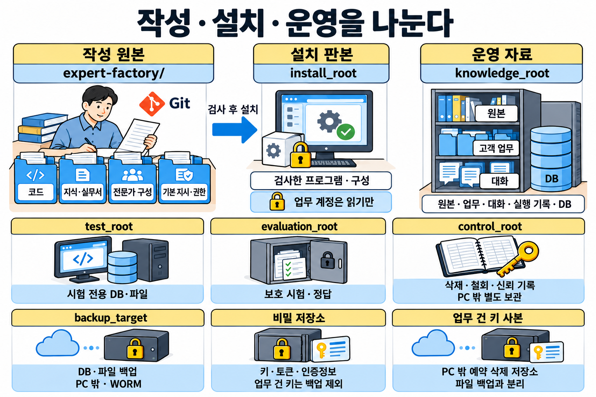
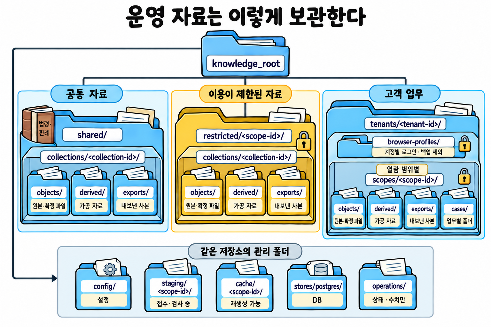
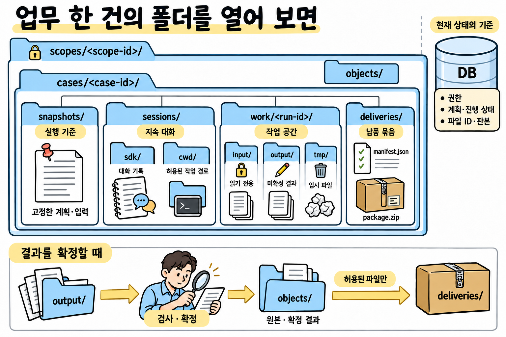

# 전문가 지식·원본과 업무 자료의 파일·폴더 구조

**전문가는 공통 판단 시스템이 가공하고 선별한 근거로 판단한다. 원본, 정제한 본문, 온톨로지, 지식 그래프, 검색 색인과 판단 입력은 역할에 맞는 파일·DB에 나눠 보관하고 서로 연결한다. 고객 자료는 볼 수 있는 사람과 쓸 수 있는 목적에 따라 나눈다. 업무 상태는 DB가 관리한다.**

원본, 지식, 업무 자료를 어디에 두고 어떻게 보존하는지 정하는 구조안이다. 코드 배치는 다루지 않는다. 실제 자료 이전과 운영 프로그램 변경은 아직 하지 않았다.

## 1. 먼저 정할 것

| 질문 | 결정 |
|---|---|
| 법령과 판례를 전문가마다 가지고 있는가? | ▶️ 아니다. 법령과 판례는 한곳에 모아 두고 모든 전문가가 함께 쓴다<br>▶️ 전문가는 조회 도구로 필요한 조문과 판결을 찾아 읽는다<br>▶️ 받는 글은 숨긴 글을 본문과 구분해 표시한 조문 글이고, 적용 시점과 출처가 붙어 있다<br>▶️ 원본 파일은 판독과 대조를 맡은 기능만 읽는다 |
| 세무, 회계, 마케팅 지식은 어디에 쌓는가? | ▶️ 지식 한 건은 그 내용을 주로 다루는 분야 하나에만 쌓고, 다른 분야는 ID와 버전으로 참조한다<br>▶️ 전문가는 쓰는 분야와 그 버전을 `knowledge.lock`에 고정한다<br>▶️ 세무 지식은 조문을 복사하지 않고 공통 자료실의 조문 ID와 적용 시점으로 참조한다<br>▶️ 분야로 나눴다고 공개해도 된다는 뜻은 아니다 |
| 고객 한 명이면 폴더 하나로 충분한가? | 아니다. 같은 고객 안에서도 사건, 팀, 이해 충돌에 따라 볼 수 있는 사람이 다르므로 `scopes/` 아래에 범위를 따로 만든다 |
| 보존 기한이 다른 자료도 범위를 나누는가? | 나누지 않는다. 보존 기한과 삭제 조건은 자료마다 DB에 붙인다 |
| 업무마다 원본을 복사하는가? | ▶️ 아니다. DB의 자료 ID와 버전으로 연결한다<br>▶️ 원본은 판독·대조 기능이 읽고, 판단 모델에는 자료 관문을 통과한 자료만 조회 도구로 제공한다<br>▶️ 확정한 납품 묶음은 따로 만든다 |
| 지금 진행 상태는 어디서 고치는가? | ▶️ PostgreSQL의 검증된 상태 변경 함수에서 고친다<br>▶️ 업무 폴더의 JSON을 고쳐서 상태를 바꾸지 않는다 |
| 79개 재료마다 폴더를 만드는가? | 만들지 않는다. 재료는 공통 저장·실행 기능에 연결한다 |
| 모든 폴더를 처음부터 만드는가? | 아니다. 자료실, 고객, 업무, 버전이 실제로 생길 때 필요한 경로만 만든다 |

### 전문가가 실제로 받는 자료

**전문가의 판단 모델은 원본 파일을 직접 읽지 않는다. 검색 도구가 질문에 맞는 근거를 찾아 판단 입력으로 넘기고, 판단 모델은 그것을 읽고 판단한다.**

| 판단 입력에 들어가는 것 | 내용 |
|---|---|
| 검색된 원문 | 계약서 조항과 법령 조문의 원문 텍스트. 원본의 쪽과 위치를 함께 붙인다 |
| 앞뒤 문맥 | 조항만 떼어 읽어 뜻이 바뀌지 않을 만큼 앞뒤 글 |
| 효력 기간 | 그 조항이 언제부터 언제까지 효력이 있는지 |
| 관계 | 시간축 지식 그래프에서 가져온 관계. 어느 특약이 어느 조항을 바꾸는지, 어느 조항이 어느 별첨을 참조하는지 |
| 메타데이터 | 출처, 검증 상태, 아직 확인하지 못한 사항 |
| 업무 기준과 진행 기록 | 이 업무를 판단하는 기준과 절차, 지금까지 확인한 것 |

고객이 볼 권한이 없는 자료는 넣지 않는다. 프롬프트 인젝션 문장은 가리고 위치만 표시한다. 계약 의무, 주석, 접근성 정보는 가리지 않는다.

| 단계 | 하는 일 | 저장 위치 |
|---|---|---|
| 1. 원본 저장 | ▶️ 받은 계약서, 법령, 판례를 원본 그대로 저장한다<br>▶️ 인용, 추출값, 수정본을 검증할 때 이 원본과 대조한다 | 범위별 `objects/`, DB의 원문 ID, 버전, 해시 |
| 2. 문서 파싱 | ▶️ 원본에서 텍스트를 추출하고 조항 번호와 쪽 위치를 보존한다<br>▶️ 숨긴 텍스트와 메모는 본문과 구분해 표시한다 | 범위별 `derived/`, DB의 검사 기록 |
| 3. 지식 그래프 구축 | ▶️ 문서 사이의 관계와 유효 기간을 원문 위치와 함께 시간축 지식 그래프에 저장한다<br>▶️ 관계의 종류, 단위, 검사 규칙은 온톨로지가 정한다<br>▶️ 그래프는 관련 조항을 찾는 데 쓰고, 판단은 원문 텍스트로 한다 | 온톨로지 파일, PostgreSQL의 관계 테이블 |
| 4. 검색과 관련성 판정 | ▶️ 하이브리드 검색(키워드 검색과 벡터 검색)으로 후보를 찾는다<br>▶️ GraphRAG로 그래프의 관계를 따라 연결된 조항과 별첨을 더한다<br>▶️ 접근 권한을 확인한 뒤 Decision Model이 관련성을 분류한다<br>▶️ 관련성이 애매한 자료도 버리지 않고 넘긴다 | PostgreSQL의 검색 색인, 검색 기록 |
| 5. 판단 입력 저장 | ▶️ 고른 원문과 위의 정보를 판단 입력 하나로 묶어 스냅샷으로 저장한다<br>▶️ 판단 모델에 실제로 보낸 요청도 그대로 남긴다 | DB의 `ContextSnapshot`, 업무의 `snapshots/`, 실제 요청은 `traces/` |
| 6. 판단과 검증 | ▶️ 판단 모델이 업무 기준과 절차에 따라 조건과 예외를 적용한다<br>▶️ 계산은 코드로 하고, 출력 가드레일이 인용과 추출값을 원본과 대조한다<br>▶️ 별도 대화에서 독립 재판단해 결과를 비교한다<br>▶️ 근거, 기준, 관계가 바뀌면 영향받은 판단과 결과물을 다시 검토한다 | DB의 판단, 검사, 의존 관계, 후속 기록, 확정 결과는 `objects/` |

**예시: 계약을 해지할 수 있는지 묻는 업무**

1. 원본 저장: 고객이 준 계약서, 특약서, 별첨 PDF를 그대로 저장한다.
2. 문서 파싱: 조항 번호와 쪽 위치를 보존해 텍스트를 추출한다. 별첨 여백의 숨긴 메모는 본문과 구분해 표시한다.
3. 지식 그래프 구축: "특약 3조가 본계약 12조(해지)를 변경한다", "12조가 별첨 2를 참조한다"를 저장한다.
4. 검색과 관련성 판정: "해지"로 12조를 찾고, GraphRAG로 특약 3조와 별첨 2를 더한다. 해지는 상대방에 대한 의사표시로 한다는 민법 제543조는 로컬 법령 데이터베이스에서 찾는다.
5. 판단 입력 저장: 12조, 특약 3조, 별첨 2, 민법 제543조를 앞뒤 문맥, 효력 기간, 출처와 함께 저장한다.
6. 판단과 검증: 특약으로 바뀐 해지 요건을 적용해 해지할 수 있는지, 계약이 정한 통지 기한이 언제인지 판단한다. 출력 가드레일이 인용한 조항 글자를 원본과 대조한다.

## 2. 작성하는 곳과 운영하는 곳



처음에는 PC 한 대와 PostgreSQL 하나로 시작한다. 표의 위치는 역할과 권한이 나뉘는 경계이며, 서버나 저장소를 처음부터 따로 둔다는 뜻이 아니다.

| 위치 | 내용 | 관리 원칙 |
|---|---|---|
| 현재 설계 문서 프로젝트 | 전문가 에이전트 정의 문서, 공장 구현 설계, 이 구조안, 조사와 검토 기록 | ▶️ 지금 문서 경로를 유지한다<br>▶️ `docs/`의 과거 실험 기록을 운영 지식으로 자동 등록하지 않는다 |
| 제작 프로젝트 `expert-factory/` | 코드, DB 변경 이력, 작성 원본(작은 지식 정의, 실무서, 전문가 구성, 기본 지시, 권한 정책) | Git으로 변경을 관리한다 |
| `install_root` | 검사를 마친 프로그램, 전문가 구성, 도구, 모델의 설치 버전 | ▶️ 관리 계정만 쓴다<br>▶️ 업무 실행은 읽기만 한다 |
| `knowledge_root` = `전문가 지식 저장소/` | 원본, 파생물, 고객 업무, 대화, 실행 기록, DB, 운영 기록 | 소스 Git과 분리한다 |
| `test_root` | 시험 전용 DB, 파일, DBOS 작업 공간과 실패한 시험의 기록 | 운영 DB와 운영 작업 폴더를 연결하지 않는다 |
| `evaluation_root` | 보호된 능력 시험의 입력, 정답, 채점 자료, 사후 결과, 회귀 시험, 담당자와 나란히 돌린 시험, 무작위 감사 대상 | ▶️ 평가 계정만 쓴다<br>▶️ 업무 실행 계정과 AI는 읽거나 고칠 수 없다 |
| `control_root` | 삭제와 권한 철회 기록, 업데이트 신뢰 상태, 감사 확인점 | ▶️ 관리 계정으로 보호한다<br>▶️ 업무 DB를 복원해도 이곳은 최신 상태를 유지한다<br>▶️ 같은 내용을 PC 밖 저장소에도 둔다 |
| `backup_target` | DB 기본 백업과 DB 변경 기록인 WAL, 파일 백업, 복구 목록 | ▶️ 업무 DB와 파일 백업, 평가 백업, 보호 이력과 감사 확인점의 PC 밖 사본을 각각 다른 저장 위치에 둔다<br>▶️ 그중 하나는 운영 PC가 지우거나 덮어쓸 수 없게 한다<br>▶️ 같은 디스크의 다른 폴더는 백업으로 치지 않는다 |

`knowledge_root`, `install_root`, `test_root`, `evaluation_root`, `control_root`는 경로 설정 이름이다. 폴더 이름만 나눈 것을 고객 격리나 정답 보호가 끝난 것으로 보지 않는다. OS 계정은 관리, 업무 실행, 시험, 평가, 감시 다섯으로 시작한다. 감시 계정은 `operations/`, DB 상태 조회, 백업 저장소의 마지막 도착 시각만 읽고 고객 자료는 읽지 못한다. 관리 프로그램과 DBOS는 업무 실행 계정으로 돌며 `knowledge_root`에 쓰고, 격리 실행에는 그 실행에 필요한 경로만 마운트한다. 업무 실행 계정은 `control_root`와 `evaluation_root`를 읽을 수 없고 `install_root`는 읽기만 한다. 보호 이력 기록, 감사 확인점 서명, 설치는 관리 계정으로 도는 별도 관리 기능만 하고, 업무 실행 계정은 이 기능에 정해 둔 요청만 보낸다. 시험 계정은 `test_root`만, 평가 계정은 `evaluation_root`만 쓴다. 평가와 시험 사이에는 한 방향으로만 넘기는 받는 폴더와 내보내는 폴더를 둔다. 평가 계정은 받는 폴더에 쓰기만 하고, 시험 계정이 그것을 읽는다. 시험 계정은 내보내는 폴더에 쓰기만 하고, 평가 계정이 그것을 읽는다.

비밀키, API 토큰, 고객 인증정보는 운영 PC의 비밀 저장소 한 곳에 사무소, 고객, 용도별 이름으로 둔다. 관리 프로그램이 실행마다 필요한 비밀만 환경 변수나 실행이 끝나면 지우는 임시 파일로 넘긴다. 비밀은 `knowledge_root`, `install_root`, 대화 기록, 운영 설정과 그 백업에 파일로 남기지 않는다. 비밀 저장소는 PC 밖의 보호된 복구 경로에 암호화해 따로 백업하고, 그 복구 키는 업무 백업과 다른 곳에 둔다. 그래서 PC를 잃어도 백업 저장소와 PC 밖 보호 이력에 다시 접속할 수 있다. 업무 건 키(감싼 형태 포함)는 운영 PC 안에서는 비밀 저장소에만 두고, DB, DB 백업, 파일 백업에 넣지 않는다. 비밀 저장소 백업에도 넣지 않는다. 업무 건과 보유 기간마다 둔 키의 PC 밖 사본은 예약 삭제 저장소에 따로 둔다. 이 저장소는 운영 PC가 바로 지울 수 없고, 삭제를 요청받은 날부터 정한 날수가 지나야 실제로 지운다. PC 밖 감시가 삭제 예약을 보호 이력의 삭제 사건과 매일 대조한다. 사건 없는 예약이나 정한 수를 넘는 예약은 운영자에게 알리고, 실제 삭제 전에 취소할 수 있게 한다.

## 3. 운영 저장소의 목표 구조



```text
전문가 지식 저장소/                         # knowledge_root
├── config/
│   ├── storage.yaml                      # 자료실 ID → 위치, 용량, 백업 대상
│   ├── retention.yaml                    # 자료 종류별 보존 기간과 그 기간을 세기 시작하는 사건, 삭제 조건, 직역별 법정 보존 목록, 백업 보관 기간
│   ├── sources.yaml                      # 원천, 수집 범위, 갱신 일정
│   ├── connections.yaml                  # DB와 도구 주소, 실행 위치, 인증 방식, 과금 한도. 비밀은 이름으로만 가리킨다
│   └── record-owners.yaml                # 업무 종류마다 항목별로 어느 시스템이 원본인지
├── shared/
│   └── collections/<collection-id>/       # 예: legal-kr, standards, references
│       ├── objects/sha256/ab/<hash>        # 받은 원본과 확정 파일
│       ├── derived/<source-version>/<recipe-id>/<result-id>/   # 추출 결과와 숨긴 글을 구분해 표시한 판단용 본문
│       └── exports/<export-id>/           # 고정 목록, 허용된 지식 내보내기
├── restricted/<scope-id>/                 # 운영자가 구독·계약으로 쓸 권리를 가진 자료, 범위를 모르는 격리 자료
│   └── collections/<collection-id>/       # 아래에 objects/, derived/, exports/를 shared와 같은 구조로 둔다
├── tenants/<tenant-id>/
│   ├── browser-profiles/<account-id>/     # 고객 계정별 브라우저 로그인 상태. 암호화하고 파일 백업에서 뺀다
│   └── scopes/<scope-id>/                 # 고객 안에서 볼 수 있는 사람과 목적이 같은 묶음
│       ├── objects/<key-id>/sha256/ab/<hash>   # 고객 원본, 고객이 알려 준 말, 확정 결과. 암호화 키마다 폴더를 나눈다
│       ├── derived/<source-version>/<recipe-id>/<result-id>/
│       ├── exports/<export-id>/           # 이 범위의 지식·기억 스냅샷
│       └── cases/<case-id>/
│           ├── snapshots/<snapshot-id>/   # 실행에 고정한 계획, 지시, 판단 입력, 실행 환경
│           ├── sessions/<conversation-id>/
│           │   ├── sdk/                   # 해당 대화의 설정과 지속 대화 기록
│           │   └── cwd/                   # 그 대화에 허용한 작업 디렉터리
│           ├── traces/<run-id>/           # 모델에 넣은 입력 전체와 응답, 도구 호출과 결과. 관리 프로그램만 쓴다
│           ├── work/<run-id>/
│           │   ├── input/                 # 허용한 버전을 읽기 전용으로 연결
│           │   ├── output/                # 아직 확정하지 않은 제작·수정 파일
│           │   ├── tmp/                   # 이번 실행의 임시 파일
│           │   └── logs/                  # 도구 출력과, 관리 프로그램이 받아 적은 SDK 출력 로그
│           └── deliveries/<delivery-id>/
│               ├── manifest.json         # 확정 납품 대상, 버전, 해시, 사용 조건, 남은 일
│               └── package.zip           # 필요할 때 만드는 고정 전달 묶음
├── joint-scopes/<scope-id>/               # 여러 고객에 걸친 범위. 아래 구조는 scopes/<scope-id>/와 같다
├── offices/<office-id>/
│   └── browser-profiles/<account-id>/     # 세무대리인처럼 사무소가 여러 고객에 쓰는 계정의 로그인 상태. 수임 등록과 납세자 동의가 확인된 고객만 조회한다. 암호화하고 파일 백업에서 뺀다
├── stores/postgres/                      # PostgreSQL만 직접 여는 DB 볼륨. macOS와 Windows에서는 VM 안 볼륨에 둔다. 다른 폴더와 공간을 나눠 쓰지 않는다
├── staging/<scope-id>/<ingest-id>/         # 접수·검사 중인 자료. 검색에서 제외
├── cache/<scope-id>/                      # 다시 만들 수 있고 근거로 쓰지 않은 것
└── operations/                           # 상태 보고와 운영 수치. ID, 상태, 수치만 쓴다
```

`<scope-id>`는 관리 프로그램이 발급한, 전체에서 겹치지 않는 범위 번호다. 범위는 볼 수 있는 사람과 쓸 수 있는 목적이 같은 자료의 묶음이다. 고객 전체가 함께 보는 범위도 따로 만든다. 공통 자료실과 제한 자료실도 자료실마다 범위 번호를 하나 받고, 그 번호를 `staging/`과 `cache/`의 폴더 이름으로 쓴다. 한 업무가 여러 범위의 자료를 쓰면 DB에서 참조마다 검사한다. 같은 `case_id`가 여러 범위에 보여도 업무를 복제한 것이 아니다. 그 업무의 보호된 자료를 범위별로 나누어 보관한 것이다.

`<tenant-id>`는 업무를 맡은 쪽(자격이 필요한 업무는 수임 자격자 또는 그 법인, 그 밖의 업무는 운영 책임자)이 계약을 맺은 고객 한 명(개인 또는 법인)이다. 공장 운영 쪽은 업무를 맡은 쪽에게서 자료 처리를 다시 맡는 쪽이고, 자격이 필요 없는 업무에서는 두 쪽이 같다. 같은 사람이 업무를 맡은 두 쪽의 고객이면 `tenant-id`도 둘이다. 대표 개인과 그 법인처럼 여러 고객에 함께 걸친 자료는 `joint-scopes/`에 두고 관련 고객을 DB에 모두 적는다. 그중 한 고객이 떠나면 떠난 고객의 접근을 끊는다. 남은 고객의 법정 보존·분쟁 대비 기록에 든 자료는 남은 고객 범위에 보존하고, 나머지만 지운다. 이미 전달하거나 제출한 결과는 다시 만들지 않고, 진행 중인 결과만 지운 자료를 빼고 다시 만든다.

새 고객 자료는 들어온 경로마다 미리 정한 범위로 들어간다. 업무 화면에서 올린 자료는 그 업무의 범위로, 고객 공용 수신 경로로 들어온 자료는 그 고객 안의 가장 좁은 기본 범위로 들어간다. 경로로 범위를 정할 수 없거나 한 묶음에 여러 범위의 자료가 섞여 오면 그 고객의 분류 대기 범위에 둔다. 이 범위는 분류 담당만 보고, 검색과 모델 입력에서 빠진다. 분류 담당은 묶음 안의 파일마다 범위를 정해 나눠 접수한다. 기본 범위보다 더 많은 사람이 보는 범위로 접수할 때만 업무를 맡은 쪽이 승인한다.

카카오톡 개인 대화는 고객이나 직원이 내보낸 파일(txt, zip)을 올려 받는다. 카카오톡 비즈니스 채널 상담은 공식 딜러사의 상담톡 API로 받는다. 상담톡으로 바꾸면 기존 채팅 이력을 더 볼 수 없으므로, 바꾸기 전에 기존 이력을 따로 보관한다.

범위는 합치거나 나누지 않는다. 볼 수 있는 사람이 바뀌면 그 범위의 권한 목록만 바꾼다. 자료 일부만 따로 막아야 하면 새 범위를 만들어 그 자료를 새로 접수하고 기존 범위에서 지운다. 두 범위를 함께 봐야 하는 사람에게는 두 범위 권한을 함께 준다.

**여러 범위의 자료를 합쳐 만든 결과는 모든 입력의 제한을 이어받는다.** 예외는 여러 고객의 판단을 같은 쟁점끼리 맞춰 보려고 고객을 알아볼 수 없게 걸러 올린 앞선 결론 목록 하나뿐이다. 볼 수 있는 사람은 입력마다 허용된 사람 중 공통인 사람으로 줄어든다. 이 명단은 복사해 두지 않고 조회할 때마다 입력 범위들의 현재 권한으로 계산한다. 같은 입력 범위 조합에는 그 범위들을 모두 볼 수 있는 사람만 보는 보호 범위를 하나만 만들어 다시 쓴다. 사용, 보존, 삭제 조건도 함께 검사한다. 공통 원문과 비공개 고객 자료를 합친 요약을 `shared/`에 저장하지 않는다. 맞는 범위가 없으면 보호 범위를 새로 등록하거나 작업을 나눈다. 조건이 충돌하면 풀리기 전에는 결과를 공개하지 않는다. 파생물, 지식, 임베딩(글을 숫자로 바꾼 검색용 값), 판단 입력, 대화, 캐시, 평가 자료, 납품 묶음에도 같은 규칙을 적용한다.

`shared/collections/legal-kr/`는 한국 법령, 판례, 공식 해석을 실제로 받아 보관하는 **공통 로컬 법률 저장소의 파일 영역**이다. 이 저장소는 국가법령정보 API와 공개 판결, 공식 기관이 공개한 해석 원문으로만 채운다. 판결 본문도 상용 DB에서 대량으로 복제하지 않는다. 판결 자체는 누구나 쓸 수 있어도, DB의 일부라도 반복하거나 체계적으로 복제하면 그 DB의 상당한 부분을 복제한 것으로 보기 때문이다(저작권법 제93조②). 원본은 `objects/`에, 원문 위치를 보존한 추출 결과와 자료 관문을 통과한 판단용 본문은 `derived/`에 둔다. PostgreSQL에는 자료·조문·판결의 ID와 버전, 적용 기간과 효력, 검색 색인, 검증한 대상·관계와 문서 참조를 연결한다. 법률 전용 PostgreSQL을 하나 더 띄우거나 전문가마다 원문과 색인을 복제하는 구조가 아니다.

이 파일 영역과 PostgreSQL의 색인·관계·효력 정보를 근거 공급 기능이 함께 사용해 판단 입력을 만든다. 전문가는 관리 프로그램이 등록한 도구로 자료를 요청하고 그 입력을 받는다. 운영자가 구독·계약으로 쓸 권리를 가진 자료는 `restricted/`에, 고객이 가진 자료는 그 고객의 `scopes/`에 두고 조회할 때와 결과를 합칠 때 권한을 검사한다. 구독한 상용 DB와 주석서는 약관에 따라 '저장 가능', '조회만', '목록만'으로 나눈다. 로앤비 같은 상용 법률 DB와 주석서는 약관이 자동 수집, 저장, AI 학습을 막으므로 '조회만'이다. '조회만'인 자료는 사람이 열람하고 원문을 저장하지 않으며, 필요한 구절과 조회 화면 증거만 인용 기록으로 그 업무의 범위에 남긴다. `standards`의 회계기준과 감정평가 실무기준도 법령처럼 원천, 갱신 주기, 적용 연도를 붙여 받는다. 개정 전후의 결산이 겹치면 결산 연도마다 적용되는 버전을 고른다.

원본과 확정 결과의 파일 내용은 `objects/`가 보관한다. 업무별 목록은 자료 ID와 버전을 가리킨다. `snapshots/`에는 실행 당시의 계획과 판단 입력을 고정해 둔다. `exports/`는 DB에서 뽑은 읽기 전용 사본이다. 납품 묶음에는 전달하려고 파일이 다시 들어갈 수 있지만, 그 묶음을 내부 원본으로 쓰지 않는다. 운영 PC와 자료 디스크는 전체 디스크를 암호화한다. 고객 본문이 들어가는 `knowledge_root` 아래 모든 폴더(`objects/`, `derived/`, `sessions/`, `traces/`, `staging/`, `work/`, `snapshots/`, `deliveries/`, `exports/`, `cache/`)는 업무 건 키로 암호화해 쓰고, 분류 대기 자료는 그 범위의 키로 암호화해 쓴다. 같은 건 안에서도 보유 기간이 다른 정보는 다른 키로 암호화한다. 업무 건에 묶이지 않은 범위 공용 자료는 범위와 보유 기간마다 키를 따로 둔다. 급여대장처럼 여러 사람의 정보가 든 파일은 파일마다 키를 따로 둔다. 보존 기간이 바뀐 자료는 새 기간의 키로 다시 암호화하고 옛 키로 된 사본을 지운다. SDK는 `sessions/`에 대화를 평문으로 쓰므로, 세션 기록은 대화마다 업무 건 키로 연 암호화 볼륨(`sessions/…/sdk/`)에 두고 그 대화를 띄울 때만 연다. 다시 실행할 때 그 기록에서 이어 간다.

사람이 자료를 찾을 때는 해시 폴더를 뒤지지 않는다. 관리 화면에서 `공통 자료 → 한국 법률 → 법령·판례`, `분야 → 실무서·지식`, `고객 → 업무 → 받은 자료·결과·납품` 순서로 찾아가고, 원래 이름과 버전, 지금 쓸 수 있는지를 함께 본다. 같은 파일이 여러 목록에 나와도 파일을 복사하지 않는다. 파일을 직접 받아야 할 때만 허용된 항목을 이름 붙인 내보내기로 만든다.

## 4. 분야 지식·온톨로지·전문가 구성

온톨로지·실무서·판단 기준·전문가 구성의 작성 파일은 제작 프로젝트에 두고, 검사한 버전을 설치한다. 운영 저장소의 원본·가공 자료·관계·검색 정보는 공통 판단 시스템이 관리한다. 전문가는 사용할 기준과 지식 버전을 지정하며, 실제 업무에는 해당 버전과 현재 권한으로 구성한 판단 입력을 받는다. 분야 ID는 전문성 역설계 프로젝트의 분야 ID를 그대로 쓰고, 옛 `P01` 등은 그 분야로 이어지는 옛 번호로 남긴다.

```text
expert-factory/                            # 제작 프로젝트
├── principles/                           # 모든 작업과 검토에 쓰는 기본 지시 한 벌
├── policies/                             # Cedar 권한 정책과 스키마
├── knowledge/
│   ├── core/ontology/                    # 공통 개념, 관계, 제약
│   ├── collections/legal-kr/ontology/    # 법률 개념과 공통 개념의 대응
│   └── domains/<domain-id>/
│       ├── domain.yaml                   # 범위, 의존하는 자료실, 공통 개념
│       ├── ontology/                     # ontology.ttl, shapes.ttl, mappings.ttl
│       ├── manuals/                      # 조건별 판단, 예외, 실패, 복구
│       ├── skills/                       # 등록된 도구를 쓰는 절차
│       ├── examples.yaml                 # 사례와 자산의 ID·버전 참조
│       └── style/                        # 문체 기준과 tokens.json
└── experts/<expert-id>/
    ├── profile.yaml                      # 업무 범위, 필요한 분야와 기능, 기본 지시 참조
    ├── playbook.yaml                     # 업무 종류마다 결과물 항목과 합격 기준, 조사할 곳과 깊이, 기본값, 감수할 위험의 기본값, 값 재조회 기간, 피해 금액 재는 법과 금액으로 잴 수 없는 피해의 판정 기준, 검토자 한 명이 맡을 건수, 고위험 영역 여부와 필수 검토자 자격, 고영향 인공지능 해당 여부와 그 근거, 해당하면 제34조①의 조치(위험관리, 결과 설명, 이용자 보호, 사람의 관리와 감독, 조치 문서 보관), 기한이 검증보다 앞설 때 할 행동(기한 연장 신청, 결론이 확정된 부분만 제출, 자격자에게 넘기기 가운데 하나), 필수 자료 목록
    ├── workflows/                        # 업무별 YAML 절차와 완료 조건
    ├── tools.yaml                        # 등록 도구 ID, 버전, 이미지 지문, 입출력, 필요한 권한
    ├── knowledge.lock                    # 적용 지식, 규칙, 실무서의 정확한 버전
    └── evaluation.yaml                   # 평가 항목과 보호 시험의 참조 ID
```

`release.json`은 검증과 조립 때 만들어 설치 버전에만 넣는다. 여기에는 호환되는 코드, 도구, 절차, 실무 기준, 평가 버전과 각 파일 해시, 시험과 지원 범위를 적는다. 업무를 시작할 때 쓴 기본 지시와 권한 정책의 버전과 해시를 업무 기록에 연결한다.

| 구분 | 기준이 되는 곳과 쓰는 법 |
|---|---|
| 개념의 뜻, 관계, 제약 | ▶️ OWL, SKOS, SHACL 같은 작은 정의 파일을 Git에서 관리한다<br>▶️ 일반 개념, 공통 자료실 개념, 분야 개념이 차례로 어디에 기대는지 적어 둔다 |
| 실제 사실, 주장, 관계 | ▶️ DB에 버전을 붙여 둔다<br>▶️ 출처, 원문 위치, 적용 기간, 등록과 수정 시각, 확인 상태, 접근 범위를 연결한다 |
| 실무서와 실행 절차 | ▶️ 작성 원본을 검토하고 시험한 뒤 배포한다<br>▶️ 근거 지식과 도구 버전을 참조한다 |
| 고객 기억과 경험 | ▶️ 고객 권한이 붙은 DB 기록이다<br>▶️ 기억마다 나온 고객과 업무 건을 적고, 그 고객만의 값과 조건, 계획을 다른 업무에도 쓸 방법과 요령, 공개된 사실과 나눠 담는다<br>▶️ 다른 업무에는 쓸 방법과 요령, 공개된 사실만 들이고, 공개된 사실은 원문으로 다시 확인한 뒤에 쓴다<br>▶️ 기억을 꺼내 쓴 판단을 이어 두어, 기억이 틀리면 그 판단을 찾아 다시 검토한다 |
| 서식, 그림, 폰트, 코드, 좋고 나쁜 견본 | ▶️ 공통 또는 제한 자료실에 등록한다<br>▶️ ID, 버전, 출처, 사용 조건으로 참조한다<br>▶️ 감각을 익힐 견본은 채택한 것과 기각한 것, 수정 전과 후를 짝지어 그 이유와 함께 둔다<br>▶️ 글, 코드, 서식 설정은 Git으로 변경을 비교하고 이전 버전을 꺼낸다<br>▶️ 고객 전용 자료의 저장소는 그 고객의 `scopes/` 안에 둔다 |

온톨로지나 SHACL 검사를 통과했다고 내용이 사실이 되지는 않는다. 실제 지식은 원문 검토와 업무 시험을 따로 통과해야 한다. 이름이 같은 사람, 회사, 개념을 무조건 합치지 않는다. 합치고 나누고 바로잡은 일과 추론의 근거를 남긴다. 추론에는 적용한 정의, 규칙, 입력 관계의 버전과 허용 기간을 연결한다.

분야는 공개 범위가 아니다. 고객 전용 실무서, 스타일, 지식은 해당 `scopes/`에 보호된 버전으로 등록하고, 여러 고객에게 배포할 제작 Git에는 넣지 않는다. 경험으로 얻은 요령도 후보, 검증, 배포 순서를 거친다. 익명화했다는 이유만으로 공통 지식으로 올리지 않는다.

세무사와 회계사는 같은 회계 지식과 법률 근거 공급 기능을 함께 쓸 수 있다. 업무별 기준과 절차에 따라 필요한 근거를 선별해 각각의 판단 입력을 만든다. 전문가는 구성의 단위이고, 분야는 전문 지식을 모으는 단위다. 전문가 프로필에 적은 자료실은 필요한 자료의 목록일 뿐, 실제 고객 권한을 주지 않는다.

**같은 지식을 분야마다 복사하지 않는다.** 지식 한 건은 분야 하나가 정본으로 갖고, 다른 분야와 전문가는 그 ID와 버전을 참조한다.

| 경우 | 규칙 |
|---|---|
| 여러 분야에 걸친 지식 | ▶️ 그 내용을 주로 다루는 분야가 정본을 갖는다<br>▶️ 법인세 세무조정은 세무 분야가 정본을 갖는다<br>▶️ 세무조정이 출발하는 회계 처리는 회계 분야의 정본을 참조한다 |
| 전문가가 분야를 쓸 때 | ▶️ 쓰는 분야와 그 버전을 `knowledge.lock`에 고정한다<br>▶️ 분야 지식의 버전이 바뀌면 그 버전을 고정한 전문가를 찾아 다시 확인한다<br>▶️ 전문성 역설계 프로젝트의 직무와 분야도 이 방식으로 잇는다 |
| 법령과 판례가 필요할 때 | 분야 지식에 조문을 옮겨 적지 않고, `legal-kr`의 조문 ID와 적용 시점으로 참조한다 |
| 출처의 성격 | ▶️ 공식 원문, 전문가 설명, 직접 관찰, 여러 결과물의 공통점, 추론을 나눠 적는다<br>▶️ 성격이 다른 출처를 섞어 확정 사실 하나로 만들지 않는다 |
| 분야끼리 내용이 다를 때 | ▶️ 세법과 회계기준처럼 원래 기준이 다른 것은 오류가 아니라 적용 조건의 차이로 적는다<br>▶️ 시간에 따른 변화, 진짜 이견, 추출 오류와는 따로 구분해 적는다 |
| 자주 바뀌는 지식 | ▶️ 마케팅 플랫폼 규칙처럼 자주 바뀌는 지식에는 다시 확인할 주기와 그대로 써도 되는 기한을 붙인다<br>▶️ 기한이 지나면 다시 확인하기 전에는 쓰지 않는다 |
| 책, 강의, 유료 자료 | ▶️ 원문을 복제하지 않고 요령과 절차로 바꿔 쓴다<br>▶️ 원문은 `restricted/`에 두고 '저장 가능', '조회만', '목록만' 가운데 그 자료의 사용 조건을 따른다 |
| 전문성 역설계 프로젝트에서 얻은 지식 | ▶️ 그 프로젝트에서 얻고 검증한 분야 지식은 제작 프로젝트의 `knowledge/domains/<domain-id>/`로 들어온다<br>▶️ 검사를 마친 버전만 설치한다<br>▶️ 분야 ID는 두 프로젝트가 같은 것을 쓴다 |

## 5. 무엇을 DB에 두고 무엇을 파일에 두는가

| 내용 | 운영에서 기준이 되는 곳 | 파일의 역할 |
|---|---|---|
| 자료, 출처, 버전, 권한, 보존 기한, 삭제 조건, 정보주체, 처리 지위(정보주체, 고객, 업무를 맡은 쪽, 공장 운영 쪽으로 이어지는 단계마다 누가 누구에게서 맡았는지) | DB | ▶️ 원본과 확정 파일은 `objects/`에 둔다<br>▶️ 원래 이름과 물리 위치는 DB 목록이 가진다<br>▶️ 맡아서 처리하는 자료의 삭제 요구는 맡긴 고객에게 넘기고 그 지시에 따른다<br>▶️ 여러 사람이 든 파일에서 한 사람만 지워야 하면 그 사람 부분을 가린 새 버전을 새 키로 등록하고, 옛 파일의 키를 폐기한다 |
| 지식, 관계, 경험, 장기 기억 | DB | `exports/`는 검사와 이동에 쓰는 고정 사본이다 |
| 목표, 완료 조건, 계획, 현재 상태, 작업 배정 | DB | `snapshots/`는 실행에 쓴 정확한 계획과 입력의 사본이다 |
| 진행 기록: 대상, 기준일, 근거 원문 번호와 해시, 기준 버전, 전제, 찾아본 곳과 못 찾은 곳, 조건별 판정과 이유, 반대 근거와 받아들이지 않은 이유, 비교한 방안과 고른 이유, 미확인 사항 | 그 항목이 기댄 자료의 범위에 둔 덧붙이기 전용 DB 기록 | ▶️ 이미 적은 항목은 고치거나 지우지 않고, 바로잡는 글과 까닭을 덧붙인다<br>▶️ 모델에게는 덧붙이는 도구만 준다<br>▶️ 정해 둔 칸이 비었거나 가리킨 구절이 원문에 없으면 기록을 받지 않는다<br>▶️ 항목 본문은 업무 건 키로 암호화해 따로 둔다<br>▶️ 앞 항목의 해시를 이은 기록과 서명 확인점에는 본문의 해시만 넣는다<br>▶️ 본문은 보존 기한이 지나면 키를 폐기해 지운다<br>▶️ 이렇게 지워도 해시를 이은 검증은 깨지지 않는다 |
| 실행 기록: 모델에 넣은 입력 전체와 응답, 도구 호출과 결과, 원본 시스템의 변경 기록 | 그 실행이 읽은 자료의 범위에 둔 보호된 DB 기록 | ▶️ 본문은 `traces/<run-id>/`에 암호화해 둔다<br>▶️ 관리 프로그램만 쓰고, 모델과 도구 실행자는 읽거나 고치거나 지울 수 없다<br>▶️ 기록을 남기지 못하면 그 실행을 하지 않는다<br>▶️ 사람이 보는 화면에서는 개인 식별 정보를 가린다 |
| 승인, 위임, 규칙 적용, 예산 예약, 정산 | DB | 승인 대상 파일, 원문, 검사 증거를 ID와 해시로 연결한다 |
| 신호, 예약, 대기, 후속 약속, 운영 회차 | 업무 DB와, 같은 DB 안의 DBOS 기록 | ▶️ 폴더가 있다거나 파일 수정 시각이 바뀐 것으로 예약이나 완료를 판단하지 않는다<br>▶️ DBOS 작업 입력과 단계 결과에는 고객 값 대신 자료 ID와 지문만 넣는다 |
| 외부 행동, 전송, 접수, 실제 반영, 인수 상태 | DB | ▶️ 실제 요청, 응답, 접수증의 보존 파일을 참조한다<br>▶️ 변경 기록이 없는 시스템에 행동할 때는 행동 전후의 상태를 그 업무의 범위에 보존해 비교한다 |
| 고객에게 받은 실물 원본(계약서, 인감증명서 등) | DB | ▶️ 보관 위치, 받은 날, 돌려준 날, 주고받은 사람을 적는다<br>▶️ 스캔본은 `objects/`에 원본으로 등록하고 실물 기록과 잇는다 |
| SDK 대화 내용 | 보호된 `sessions/` 파일 | ▶️ 고객, 업무, 세션 ID와 보관 기한은 DB에서 연결한다<br>▶️ 고객이 대화나 메일로 알려 준 사실은 받은 그대로 `objects/`에 원문으로 등록하고, 근거로 쓸 때는 그 자료 ID와 해시를 붙인다<br>▶️ 전화로 들은 말은 받아 적은 사람, 적은 시각, 고객이 그 내용을 확인했는지를 함께 등록한다 |
| 이해 충돌 관계자 목록: 지금과 예전 고객, 상담만 한 사람, 상대방과 관계자, 지배 관계와 대표자, 건마다 어느 편에서 만든 결과물, 담당자와 운영자가 돈으로 얽힌 관계, 관계의 유효 기간, 책임자 판정과 받은 동의 | 고객 자료와 분리하고 업무를 맡은 쪽마다 나눈 전용 DB 기록 | ▶️ 충돌 검사 기능만 조회하고, 업무를 맡은 다른 쪽의 목록과는 대조하지 않는다<br>▶️ 모델에게는 충돌이 있는지 없는지만 돌려준다<br>▶️ 겹친 건의 내용은 업무를 맡은 쪽만 본다<br>▶️ 검색과 관계 탐색은 이 기록을 따라가지 않는다<br>▶️ 수임 전 상담 자료는 수임 전 범위에 둔다<br>▶️ 이 자료는 충돌을 판정하는 사람 말고는 열람할 수 없고, 검색과 모델 입력에서 뺀다<br>▶️ 수임을 거절하면 충돌 검사에 필요한 이름과 관계만 이 목록에 남기고 상담 자료는 지운다 |
| 앞선 결론 목록 | 여러 고객의 판단을 같은 쟁점끼리 맞춰 보는 전용 DB 기록 | ▶️ 쟁점, 기준 버전, 허용값으로만 옮긴 사실, 조건별 충족 여부, 결론만 적는다<br>▶️ 고객 이름과 그 고객만의 값과 조건은 적지 않는다<br>▶️ 항목과 고객의 연결은 관리 프로그램만 읽는 별도 기록에 둔다 |
| 검사, 품질, 성과, 능력 평가, 배포 이력 | DB | 검사한 파일과 원문 대조, 렌더, 시험 증거를 연결한다 |
| 감사 이력 | 권한을 제한한 DB 기록 | ▶️ 서명한 확인점은 `control_root`에 둔다<br>▶️ 운영 로그와 구분한다<br>▶️ 사람이 원문을 열람, 복호화, 내려받은 접속 기록은 본문 없이 2년 이상 보존한다 |
| 검색 색인, 임베딩 | DB의 조회용 데이터 | 원본이 아니다. 만든 버전, 범위, 지금 쓰는 색인이 어느 것인지를 DB에 기록한다 |
| 삭제와 권한 철회의 복원 방지 기록 | `control_root`의 보호 이력 | ▶️ 보호 이력을 먼저 확정하고 DB가 따라 반영한다<br>▶️ DB는 현재 적용 상태와 처리 순번을 유지한다 |

앞선 결론 목록에는 이 목록에 올려도 된다는 조항이 계약에 있는 고객의 판단만 올린다. 쟁점, 기준 버전, 사실 값이 모두 같은 항목의 고객 수가 정해 둔 수보다 적으면, 사실 값을 더 넓은 구간으로 바꿔 그 수를 넘긴 뒤에 올린다. 업종, 지역, 규모처럼 고객을 다시 알아볼 수 있는 값도 사실 값과 함께 묶어 센다. 올리기와 대조는 관리 프로그램만 한다. 모델은 이번 판단을 기록한 뒤에만 대조 결과를 받는다. 틀린 결론은 지우지 않고 바로잡는 글을 덧붙인다.

업무 기록과 DBOS는 같은 PostgreSQL 데이터베이스 안의 서로 다른 스키마에 둔다. 업무 상태를 바꾸는 일과 다음 작업을 등록하는 일을 한 트랜잭션에서 처리한다. 트랜잭션은 모두 성공하거나 모두 취소되는 DB 처리 한 번이다. 파일과 외부 API까지 이 트랜잭션에 들어가지는 않으므로, 등록 상태를 두고 다시 맞춰 보는 절차를 둔다.

운영 DB를 손으로 고치거나, 내보낸 JSON으로 현재 상태를 덮어쓰지 않는다. 모델이 "완료"라고 말해도 관리 프로그램이 완료 조건과 지금 유효한 증거를 확인해야 상태가 바뀐다. 소스 Git의 `tests/`에는 합성 자료나 공개 자료로 만든 시험만 둔다. 실제 고객 자료, 대화, 평가 정답, DB 파일은 넣지 않는다.

`config/*.yaml`은 검사하고 버전을 관리하는 운영 설정이다. `retention.yaml`의 기본 보존 기한과 삭제 조건은 접수할 때 관리 프로그램이 자료마다 DB에 붙이고, 그 뒤의 판단은 DB 값만 따른다. 보존 기한은 날짜 하나가 아니라 기간을 세기 시작하는 사건(법정신고기한, 감사 종료 등)과 기간으로 붙인다. 그 사건이 생기거나 기간이 늘어나면 관리 프로그램이 기한을 다시 계산한다. 조사, 소송, 심판, 배상 청구가 걸린 자료에는 법적 보류를 걸어, 풀릴 때까지 자동 삭제를 멈춘다. 현재 수집 상태, 용량 사용량, 권한 부여, 삭제 처리 결과는 DB에 둔다. 설정 파일과 DB를 사람이 따로 고쳐서 기준이 되는 곳이 둘이 되게 하지 않는다. 실행에 적용한 설정 버전은 DB와 스냅샷에 연결한다.

| 쓰는 주체 | 허용하는 변경 |
|---|---|
| 자료 등록·확정 기능 | 범위를 검사한 뒤 원본, 파생물, 산출물과 DB 참조를 등록한다 |
| 격리된 도구 실행 | ▶️ 이번 실행의 `output/`, `tmp/`, `logs/`에만 쓴다<br>▶️ DB 자격증명과 공통 원본 쓰기 권한은 없다 |
| 해당 SDK 프로세스 | ▶️ 대화마다 따로 띄운 격리 실행 환경 안에서 그 대화의 `sdk/`와 `cwd/`만 본다<br>▶️ 다른 세션과 다른 고객에는 접근할 수 없다 |
| 업무 관리 기능 | ▶️ 검증된 함수로 상태, 권한, 승인을 바꾸고 실행 기록을 쓴다<br>▶️ 업무 DB 계정은 테이블 소유자나 접근 제한을 우회하는 계정과 분리한다 |
| 충돌 검사 기능 | ▶️ 이해 충돌 관계자 목록을 등록하고 조회한다<br>▶️ 업무 관리 기능은 새 고객, 상담, 상대방의 등록만 요청하고, 판정과 동의는 업무를 맡은 쪽이 적는다 |
| 평가 담당 | ▶️ 보호 시험, 정답, 채점 기록을 쓴다<br>▶️ 일반 실행자는 배정된 시험 입력만 받는다 |
| 관리 계정의 관리 기능 | ▶️ 설치, 백업, 복원, 보호 이력 기록, 감사 확인점 서명을 맡는다<br>▶️ 감사 확인점 사본은 서명한 즉시 PC 밖 보존 잠금 저장소에 올린다<br>▶️ 그래서 서명 키를 가진 운영자도 이미 올린 확인점을 바꾸거나 지울 수 없다 |

OS 권한과 마운트, DB의 행 단위 접근 제한을 함께 적용한다. 누가 어느 범위를 볼 수 있는지는 DB 권한 목록이 정하고, Cedar 정책은 할 수 있는 행동의 종류만 정한다. 어느 고객과 범위의 요청인지는 DB 처리 한 번 안에서만 유지되는 값으로 정하고, 처리가 끝나면 사라지게 한다. 고객, 범위, 자료를 잇는 DB 연결에도 소속을 확인한다. 여러 고객에 걸친 변경 영향 조회는 고객 값은 못 읽고 의존 관계만 읽는 DB 계정으로 한다. 도구와 SDK의 출력 로그는 고객 본문이 섞일 수 있으므로 그 실행의 `logs/`에 두고 그 범위의 보존과 삭제 조건을 따른다. `operations/`에는 ID, 상태, 수치만 쓰고 `retention.yaml`에 정한 기간이 지나면 지운다. 필수 감사 기록은 빠짐없이 남기고, 성능 관측용 로그처럼 일부만 뽑아 남기는 방식과 구분한다.

## 6. 이름·ID·버전·접수 규칙

| 식별자 | 구분하는 것 |
|---|---|
| `collection_id` / `scope_id` | 자료실의 목적 / 볼 수 있는 사람과 쓸 수 있는 목적의 묶음 |
| `source_id` / `source_version_id` | 논리적인 원문 / 받은 특정 버전 |
| `artifact_id` / `artifact_version_id` | 산출물 / 검사하고 승인할 특정 버전 |
| `case_id` / `plan_version` | 맡은 업무 / 그 업무의 실행 계획 버전 |
| `run_id` / `conversation_id` | 실행 시도 / 지속 대화 |
| `action_id` | ▶️ 외부에 영향을 주는 업무 행동 하나<br>▶️ 재시도, 세션 교체, 계획 변경으로 새로 발급하지 않는다 |
| `sha256` | ▶️ 파일 내용의 지문<br>▶️ 출처, 진본성, 권한, 검사 통과를 대신하지 않는다 |

경로에는 관리 프로그램이 발급한 ID를 쓴다. 원래 한글 파일명, 제목, 확장자는 목록에 보존하고 내려받을 때 보여 준다. 제목을 바꾸거나 디스크에서 옮겨도 자료 ID는 바뀌지 않는다. 경로를 직접 입력받아 열지 않고, ID를 현재 위치로 바꿔서 연다. `..`, 절대경로, 바로가기 파일(심볼릭 링크)로 범위를 벗어나는 경로, 대소문자와 Unicode 정규화로 생기는 이름 충돌, 너무 긴 파일명도 검사한다.

정확한 시각은 UTC로 저장하고, 원문의 현지 시각, `Asia/Seoul` 같은 시간대 이름, 변환에 쓴 시간대 자료 버전을 함께 남긴다.

접수는 다음 순서로 한다.

1. 접수 번호를 DB에 '받는 중'으로 먼저 등록하고, 그 번호의 `staging/` 폴더에 자료를 쓴다. 크기, 형식, 압축 해제 상한, 해시, 출처, 사용 조건을 확인한다.
2. 검사를 통과한 파일을 `objects/` 아래에 새로 쓴다. 고객 자료는 해당 키로 암호화해 암호화 키 번호와 해시로 정한 `objects/<key-id>/sha256/` 위치에 새로 쓴다. 그 뒤 DB에 파일 참조를 등록하고 접수 상태를 '등록됨'으로 바꾼다.
3. `derived/`에 본문, 표, 자막, 페이지 좌표, 셀, 시간, 코드 줄 같은 추출 결과를 두고 원문 위치와 연결한다. 읽지 않은 부분, 읽지 못한 부분, 추정한 부분은 구분한다.
4. 원문과 위치는 보존하고, 추출 결과의 숨긴 글, 메모, 보이지 않는 특수 문자를 본문과 구분해 표시한 판단용 본문을 `derived/`에 따로 만든다. AI에게 내리는 명령 문장은 판단용 본문에서 가리고 가린 자리를 표시한다. 정상적인 계약 의무, 주석, 접근성 정보는 빼지 않는다. 이 단계에서 주민등록번호 같은 고유식별정보와 건강, 범죄 경력 같은 민감정보도 찾아 표시한다. 판단용 본문, 색인, 임베딩에는 그 값 대신 대체값을 넣고, 원래 값은 암호화한 원본에만 남긴다. 민감정보는 별도 동의를 확인하기 전에는 판단에 쓰지 않는다. 색인, 관계 추출, 모델 입력에는 이 판단용 본문만 쓴다. 실행 중에 검색이나 도구로 새로 받은 자료도 같은 검사를 거친 뒤에 모델에 넘긴다.
5. 검토한 지식과 관계를 DB에 등록한다. 새로 만든 색인 한 벌을 검사한 뒤 공개 대상을 바꾼다. 나눈 조각 수와 색인된 조각 수가 다르면 그 자료를 검색 대상으로 올리지 않는다.
6. 미완료나 사용 중지 자료가 검색되지 않는지 확인한다.

`staging/`에서 `objects/`로는 이름만 바꾸지 않는다. 해당 키로 암호화해 새로 쓴 뒤 해시를 다시 맞추고 나서 `staging/` 사본을 지운다. 관리 프로그램은 시작할 때와 매시간, 정한 시간보다 오래 '받는 중'인 접수의 파일만 찾아 다시 처리하거나 격리하고 운영자에게 알린다. DB 참조가 없는 파일은 주 1회 저장소 전체를 훑어 같은 방법으로 처리한다.

같은 키로 암호화하는 자료 안에서 파일 내용이 완전히 같을 때만 파일을 한 번만 보관하고, 출처, 취득, 동의, 접수 이력은 따로 남긴다. 그 파일을 가리키는 마지막 기록이 삭제될 때 파일을 지운다. 다른 범위나 다른 키의 파일은 해시가 같아도 합치지 않는다. PDF나 영상의 원본을 손실 압축본이나 OCR 텍스트로 바꾸지 않는다. 공식 XML·JSON 응답은 그 응답 그대로를 원본으로 보관한다.

`recipe-id`는 입력 지문, 처리기, 모델, 설정, 분할 방법, 필요한 온톨로지 버전을 묶은 처리 식별자다. 이 값이 같다고 바로 재사용하지 않는다. **현재 권한, 적용 시점, 검사 결과, 사용 중지 여부**도 확인한다. 다시 만들면 달라질 수 있는 모델 응답, 판독 결과, 판단에 쓴 중간물은 단순 캐시로 다루지 않는다.

같은 처리법으로 다시 실행해도 출력이 달라질 수 있으므로 `result-id`를 따로 발급한다. 확정한 파생 결과는 덮어쓰지 않는다. DB에서 채택한 결과를 가리키게 하고, 실제 판단은 그 결과 ID와 해시에 연결한다. 여러 원문을 합친 결과는 입력 집합과 산출물 ID로 등록한다. 그 결과를 어느 한 원문의 추출물처럼 붙이지 않는다.

스냅샷, 내보내기, 배포, 납품 목록은 용도별로 나누되 모두 `schema_version`, 목록 ID, 고객과 범위, 생성 시각, 작성 주체를 기록한다. 자료 ID와 버전과 해시, 생성 입력과 처리법, 검사 참조도 함께 기록한다. 파일만 있고 DB 등록이 끝나지 않았으면 사용 가능 상태로 올리지 않는다.

## 7. 검색·법률 갱신·변경 전파

[전문 판단의 신뢰성](<전문 판단의 신뢰성.md>)의 해결책 6에 따라, 국가법령정보 공동활용 OPEN API가 제공하는 법령, 행정규칙, 자치법규, 판례, 헌재결정례, 법령해석례, 행정심판례, 조세심판원 같은 특별행정심판례, 중앙부처 법령해석을 로컬 저장소에 받아 두고 날마다 변경분을 받는다. 바뀌기 전 버전도 남긴다. API에 없는 판결 가운데 근거로 쓸 판결과 그 상급심 판결은 별도로 확보해 등록하며, 검색 결과에는 실제 수집·조회한 범위를 표시한다. 모든 판결을 확보했다고 표시하지 않는다. 국세청과 재정경제부 법령해석은 API가 목록만 주므로, 본문은 국세법령정보시스템 같은 공식 원천에서 따로 받아 같은 방식으로 등록한다.

법령, 시행령, 시행규칙, 부칙, 판례, 공식 해석, 별첨을 원천과 버전으로 연결한다. 공포, 시행, 적용 기간과 부칙의 경과조치를 관리한다. 조항마다 위헌이나 헌법불합치 결정과 개정 시한에 따른 지금 효력, 법령 위계와 시행일을 함께 저장한다. 판례는 법원, 선고, 확인 상태를 관리하고, 하급심 판결마다 상급심에서 파기되거나 취소됐는지, 확정 여부를 모르는지 표시한다. 입법예고안은 `legal-kr` 안에서 시행 법령과 구분된 예고 자료로 등록하고 판단 근거로 쓰지 않는다. 최신으로 내려받았다고 해서 이번 업무에 적용되는 버전이라는 뜻은 아니다. 적용 시점이 계약일, 잔금일, 등기일 가운데 무엇인지처럼 시점 자체가 쟁점이면 버전 하나를 골라 넘기지 않는다. 후보 시점마다 적용되는 버전과 부칙의 경과조치를 함께 판단 모델에 넘긴다.

저장한 원본, 검색에 쓸 자료, 판단 모델에 줄 자료는 구분한다. 자료 관문을 통과한 본문을 조·항·별첨 단위로 나누고, 조각마다 원문 위치를 붙여 색인한다. 같은 본문에서 온톨로지 기준에 맞춰 확인한 대상·관계와 유효 기간을 DB에 넣고, 문서에 적힌 참조 관계도 연결한다. 해결책 3·4에 따라 하이브리드 검색으로 근거를 찾고 GraphRAG로 연결된 조문·별첨·판결을 보탠다. 작은 조각으로 찾더라도 판단할 때는 그 조각이 속한 조 전체와 필요한 문맥을 함께 제공한다. 그래프로 보탠 자료 때문에 기본 검색의 근거가 빠지지 않게 한다.

검색 후보는 권한 검사 후 해결책 5의 Decision Model로 관련성을 분류한다. 관련 있는 자료를 순위만으로 버리지 않고, 기준 점수 근처와 판단 못 함도 판단 모델에 넘긴다. 숨긴 글이나 AI에게 내리는 명령 문장이 발견됐던 자료는 판단용 본문과 발견 표시를 함께 남긴다. ‘관련 없음’이라는 이유로 조용히 빼지 않는다. 이 모델은 근거를 선별하며 업무 결론은 내리지 않는다.

관리 프로그램은 선택한 정제 본문·사실·관계·유효 기간을 원문 및 파생 결과 ID·버전·검사 상태와 묶어 `ContextSnapshot`을 만든다. 적용한 온톨로지·검색·관련성 판정 버전과 찾아본 범위, 미확인 사항도 연결한다. 이것이 판단 모델과 독립 검토에 공급하는 자료의 기준이다. 해결책 24에 따라 법령·판례·해석례는 이 저장소의 조회 도구를 통해 공급하고, 조회·가공·선별 기록과 결론을 이어 둔다.

인용 대조와 원문 옮겨 붙이기는 보존한 원본을 기준으로 검사 프로그램이 수행한다. 변경 이력 API는 법령에만 있다. 판례, 행정규칙, 해석례는 목록을 날마다 앞 목록과 비교하고, 근거로 쓴 본문은 정한 주기로 해시를 다시 대조해 정정과 비공개 전환을 찾는다. 갱신이 실패하면 최신 여부를 미확인으로 표시하고, 결론을 좌우하는 조문은 공식 원천과 대조한다. 한 원천의 갱신이 정한 날수 넘게 실패하면 운영자에게 알리고, 그보다 긴 날수를 넘기면 그 원천을 근거로 쓴 결론의 확정을 보류한다. 피해가 감수할 위험을 넘을 수 있는 결론은 일일 갱신 뒤의 변경도 공식 원천에서 다시 확인한다. 이때 확보한 자료도 버전과 조회 기록을 저장소에 등록해 같은 경로로 제공한다.

원문의 발행·정정 시점, 실제 적용 기간, 시스템이 확보하고 기록한 시점은 나누어 보관한다. 공식 원문의 정정이나 개정과 우리 쪽 수집·판독 오류 수정을 구분해 기록하고, 정정 전후 기록은 수정 시각과 함께 모두 보관한다. 과거 판단에는 당시 쓴 버전을 남긴다. 지금 하는 업무는 새 규칙, 철회, 권한을 다시 확인한다. 옛 버전으로 고정했다는 이유로 지금의 사용 금지나 바로 적용해야 할 의무를 무시하지 않는다.

검색은 PostgreSQL 안에서 낱말, 벡터, 관계를 함께 쓴다. 목표 구성은 Kiwi 형태소 분석과 pg_textsearch, Qwen3-Embedding-4B와 pgvector다. 이 모델의 2560차원은 pgvector `vector` 형식의 HNSW 색인 한도인 2000차원을 넘는다. 그래서 모델 출력은 `vector(2560)`에 보관하고, HNSW 색인만 `halfvec(2560)`으로 바꿔 만든다. 색인으로 후보를 찾은 뒤에는 보관한 원래 벡터로 거리를 다시 계산해 정렬한다. 법령의 새 버전에서 조문 글의 해시가 앞 버전과 같으면 앞 버전의 임베딩을 다시 쓴다. **고객별로, 그리고 고객 안에서도 범위가 같은 자료끼리 BM25 색인·통계와 벡터 검색 구조를 나눈다.** 공통 자료는 따로 검색하고 허용된 결과만 합친다. 범위마다 따로 찾은 결과는 점수가 아니라 순위로 합친다. 작은 범위는 벡터 색인을 만들지 않고 정확 검색으로 찾는다. 마지막 결과만 접근 제한으로 거르는 방식으로 끝내지 않는다. 분야 분류와 고객 접근 범위를 섞어 쓰지 않는다.

색인은 `stores/postgres/` 안에 저장된다. 밖에 `index/` 폴더를 또 만들어 두 곳을 기준으로 관리하지 않는다. 검색 모델이나 분석 규칙을 바꾸면 새 색인을 따로 만들고, 만드는 동안의 변경까지 반영한 뒤 한꺼번에 전환한다. 서로 다른 모델의 벡터는 한 색인에 섞지 않고, 이전 색인은 과거 조회용으로 구분해 전환 뒤 정한 기간만 둔다. 쓴 검색, 모델, 분할 버전과 조회 근거는 보존한다.

테이블, 파티션, 색인 구성은 첫 격리 시험에서 확정한다. 이 시험에서 범위마다 따로 만든 테이블과, 범위로 나눈 분할 테이블(파티션) 하나를 같은 자료로 비교한다. 범위 수가 많아 관리 부담이나 응답 시간이 시험에서 정한 값을 넘으면 분할 테이블로 바꾼다. 어느 쪽이든 BM25 통계와 벡터 색인은 범위마다 따로 둔다. 고객별 한 색인에 DB 조건으로 범위를 거르는 방식은 쓰지 않는다. 접근 제한으로 숨긴 행도 BM25 통계에는 들어가기 때문이다.

원문, 온톨로지, 관계·효력, 권한, 규칙이 바뀌면 `원문·기준 → 추출·색인·지식·관계 → 판단 입력 → 판단·계산 → 결과물 → 전달처`의 의존 관계를 따라가며 처리한다. 인용한 문장뿐 아니라 실제 입력으로 공급한 근거·관계·기준과 검사 버전을 연결한다. 원문 글자가 그대로여도 효력·관계·기준이 바뀌면 영향받는 판단을 재검토한다. 재검토는 진행 중인 업무와 그대로 써도 되는 기한이 남은 결과만 한다. 나머지 결과에는 '기준 변경 뒤 미검토'라고 표시한다. 과거 결과는 덮어쓰지 않는다. 사용 중지, 재검토, 정정 전달 대상을 기록한다. 결론마다 근거 자료 ID와 버전, 기댄 진행 기록 항목과 앞선 결론, 다시 검토할 조건, 그대로 써도 되는 기한을 함께 기록한다. 기한이 지난 결론은 다시 검토하기 전에는 이어서 쓰지 않는다. 변경을 감시하지 않는 근거를 쓴 결론에는 감시 밖 근거라고 표시한다. 수집 예정, 성공, 실패, 확인하지 못한 범위와 마지막 성공 시각을 남겨서 "없음", "못 찾음", "아직 안 읽음"을 구분한다.

범위를 잘못 정한 자료는 옮겨서 고치지 않는다. 잘못된 범위에서 조회와 재사용을 막고, 원본부터 백업까지 차례로 지운 뒤, 맞는 범위에 새로 접수한다. 잘못된 범위에 있던 동안 그 자료를 읽은 실행, 대화, 결과물, 납품을 실행 기록으로 찾아 정정 대상으로 등록한다. 다만 실행, 대화, 사람 누구도 아직 읽지 않았고 파생물과 색인도 없는 자료는 DB의 범위 지정만 바꾸고 맞는 범위의 키로 다시 암호화한다.

다른 고객에게 보였으면 유출로 판정한다. 관리 프로그램이 유출 의심을 찾으면 감시 알림으로 운영자에게 알린다. 유출로 판정하면 관리 프로그램이 실행 기록과 접속 기록으로 유출된 항목과 사람 수를 센다. 공장 운영 쪽은 바로 업무를 맡은 쪽에 알리고 신고와 정보주체 통지에 필요한 자료를 넘긴다. 신고와 통지는 그 자료의 처리자가 72시간 안에 한다. 이 일은 기한이 붙은 업무로 등록한다. 기한이 다가오는데 끝나지 않았으면 감시 알림으로 운영자에게 알린다.

관계의 기준이 되는 곳도 PostgreSQL이다. 관계를 따라 원문 조각을 모으는 검색은 PostgreSQL의 관계 기록 위에서 하고, 이번 고객의 관계와 공개 자료의 관계만 따라간다. Graphiti, Jev 같은 별도 그래프 저장소는 아직 도입하지 않는다. 도입하기로 정하면 자료 전송 조건, 동기화, 삭제, 복구 시험을 추가한다. 비어 있는 `graph/` 볼륨이나 전문가마다 별도 검색 서버는 만들지 않는다.

## 8. 업무 한 건의 작업·대화·외부 행동



업무를 시작하면 현재 권한으로 입력을 고르고, 정확한 계획 YAML과 지시를 `snapshots/`에 고정한다. 쓰는 도구, 모델, 지식 버전도 함께 고정하고, OS와 CPU, 실제로 쓴 CPU나 GPU 방식, 부품 묶음 해시, 시간대 자료 버전도 기록한다. DB에 참조를 남긴다. DBOS의 `application_version`만으로 외부 YAML까지 고정됐다고 보지 않는다. 재개할 때 최신 작성 파일을 다시 읽어 계획을 바꾸지 않는다. 계획을 바꾸려면 새 버전과 새 실행으로 연결하고, 유효한 기존 결과와 진행 중인 외부 행동 번호를 이어 쓴다.

`work/<run-id>/input/`에는 그 실행 역할에 허용한 파일 버전을 읽기 전용으로 연결한다. 판독·대조 도구에는 필요한 `objects/` 원본을, 판단 모델이 쓰는 조회 도구에는 `derived/`의 관문 통과 자료와 DB의 검색·관계·효력 정보를 제공한다. 판단 모델에 원본 저장소를 통째로 마운트하지 않는다. 도구 실행자는 자기 `output/`, `tmp/`, `logs/`에만 쓴다. 검사를 통과한 결과는 관리 프로그램이 `objects/`에 새 버전으로 확정한다. 사람의 승인이 필요한 결과만 운영자가 확인한다. 공유 원본을 직접 고치거나 다른 실행의 결과를 덮어쓰지 않는다. 담당을 바꿀 때는 권한 버전을 바꾸고, 늦게 도착한 이전 실행의 결과가 현재 결과가 되지 않게 한다. 실행이 끝나면 `input/`과 `tmp/`를 지우고, 확정하지 않은 `output/`은 `retention.yaml`에 정한 기간 뒤에 지운다.

독립 재판단 실행의 `input/`에는 관리 프로그램이 이번 업무에서 찾은 자료 전체만 넣고, 앞선 실행의 `output/`, 대화, 진행 기록의 결론은 넣지 않는다. 합격 판정 실행에는 합격 기준, 결과물, 이번 업무 자료만 넣는다.

SDK 프로세스는 대화마다 따로 띄운 격리 실행 환경 안에서 돌리고, 그 대화의 `sdk/`와 `cwd/`만 마운트한다. 호스트 계정으로 SDK를 바로 실행하지 않는다. `CLAUDE_CONFIG_DIR`에는 그 대화의 `sdk/` 경로를 넣고, `CLAUDE_CODE_PROJECT_DIR_NAME`에는 대화 ID를 넣는다. 그러면 대화 기록 위치가 작업 경로에 묶이지 않으므로, 저장 위치를 옮겨도 경로 이전 절차 없이 재개한다. 이 값은 영문, 숫자, `-`, `_`로 된 64자 이하여야 하고, 맞지 않으면 알림 없이 무시된다. 그래서 대화 ID를 이 형식으로 발급하고, 대화를 띄운 뒤 그 이름의 폴더에 기록이 생겼는지 확인한다. 주 모델 이름은 대화별 `sdk/` 설정에 적지 않고 관리 프로그램이 대화를 띄울 때 넘긴다. SDK를 띄운 격리 실행은 관리 프로그램의 모델 중계 주소로만 통신을 열고(`ANTHROPIC_BASE_URL`), 웹 조회와 그 밖의 통신은 등록된 도구를 거치게 한다. 사용자 개인 설정과 홈 디렉터리는 복사하거나 공유하지 않는다. 자동 기억 설정과 읽는 설정 출처를 제한하고, 실제로 적용됐는지 확인한다. 대화 자동 정리 기간은 그 업무의 보관 기한에 맞추고, 진행 중인 업무의 대화는 지워지지 않게 한다. 고객, 업무, 대화, SDK 세션의 연결은 DB에 남긴다. **지속 대화 파일은 `tmp/`나 `cache/`가 아니다.**

격리 실행에는 모델 제공사의 실제 API 키를 넘기지 않는다. 관리 프로그램은 그 대화에서만 쓸 수 있는 중계 토큰을 환경 변수로만 넘기고, 셸 명령과 MCP 서버에는 넘기지 않는다(`CLAUDE_CODE_SUBPROCESS_ENV_SCRUB=1`). 중계는 토큰과 남은 비용 한도를 확인한 뒤 실제 키를 붙여 모델 제공사로 보낸다. 보내기 전에 판단에 필요 없는 고유식별정보를 대체값으로 가린다. 모델 제공사에 보낼 권한이 확인되지 않은 업무의 요청은 보내지 않는다. 그 권한은 국외 이전 공개나 정보주체 동의, 맡아서 처리하는 자료면 맡긴 고객의 동의, 고객 자료를 보내는 조직이 제공사와 맺은 Zero Data Retention(ZDR, 응답 뒤 입력과 응답을 저장하지 않음) 계약, 이 셋을 모두 갖춘 것이다. ZDR이 적용되지 않는 기능(코드 실행 도구 등)과 30일 보관이 필요한 모델은 고객 자료 경로에서 쓰지 않는다. 중계는 모델에 가는 요청 전체를 그 실행의 `traces/`에 기록한다. 앞 호출과 같은 앞부분은 해시로, 새로 늘어난 부분만 본문으로 저장한다. `sdk/` 안에서 로그인하지 않고, `sdk/`에 로그인 파일이 생기면 그 실행을 멈춘다.

대화의 `cwd/`에는 허용된 읽기 전용 입력과 지금 실행의 출력과 임시 경로만 연결한다. SDK는 대화를 보존하려고 `sdk/`에 쓸 수 있다. SDK의 출력 로그는 관리 프로그램이 받아 그 실행의 `logs/`에 쓴다. 사용자 폴더가 우연히 같은 위치에 있다는 이유로 세션을 연결하지 않는다.

대화의 권한이 바뀌면 이미 들어간 제한 정보도 검토한다. 더 이상 허용되지 않는 내용이 남은 대화는 그대로 재개하지 않는다. 필요한 허용 정보만으로 새 대화를 시작한다. 브라우저 로그인 상태와 쿠키는 계정마다 비밀 저장소의 키로 암호화해 둔다. 고객 계정은 `tenants/<tenant-id>/browser-profiles/`에, 세무대리인처럼 사무소가 여러 고객에 쓰는 계정은 `offices/<office-id>/browser-profiles/`에 둔다. 홈택스 세무대리인 계정으로는 수임 등록과 납세자 동의가 확인된 고객만 조회한다. 국세청이 신고기간에 자동 조회를 막을 수 있으므로, 신고기간 자료는 자격자나 고객이 내려받은 파일을 기본 경로로 받고 자동 조회는 보조로만 쓴다. 로그인한 계정으로 하는 조회와 제출은 `dispatch_action()`이 부르는 등록 스크립트만 하고, 로그인 프로필은 그 스크립트에만 마운트한다. AI가 조작하는 브라우저는 로그인하지 않은 조회 전용으로 띄운다. 사무소 계정을 쓰는 스크립트는 이번 요청의 고객 번호만 입력받고, 화면의 고객이 그 번호와 다르면 멈춘다. 업무 종류마다 어느 계정으로 낼지와 서명 주체를 정해 두고, 자격자 이름으로 내는 업무는 사무소 계정으로만 낸다. 로그인 프로필은 대화 사본, 공용 캐시, 일반 로그, 파일 백업에는 넣지 않는다. 복구한 뒤에는 그 계정에 다시 로그인한다.

격리 실행은 rootless Podman으로 하고 해당 입력과 출력만 마운트한다. 사용자 홈, 호스트 소켓, 다른 고객 자료, 평가 정답이 보이지 않게 한다. 기본으로 네트워크를 막고 등록된 도구별로만 통신을 허용한다. 파일시스템은 읽기 전용으로 하고, 임시 공간과 로그 한도도 함께 둔다.

외부 발송, 신청, 거래, 게시, 설정 변경은 DB의 `action_id`로 묶는다. 승인 대상은 수신자, 금액, 실제 내용, 첨부 해시까지 고정한다. 승인 권한과 만료 시점도 함께 정한다. 내용이 바뀌면 기존 승인을 다시 쓰지 않는다. 전송, 외부 접수, 실제 반영, 불명확 상태를 나눈다. 응답을 잃었을 때 새 파일이나 새 실행 폴더가 생겼다고 다시 보내지 않는다. 원래 시스템에서 처리 상태를 먼저 조회한다. 홈택스는 신고기간 안에 다시 내면 마지막 신고만 유효하므로, 다시 내기 전에 이미 낸 신고와 접수증을 조회한다.

계속 운영하는 업무의 회차, 예약, 후속 약속은 DB에 둔다. 한 회차의 납품 폴더를 정리해도 전체 운영 업무나 이후 성과 추적이 끝난 것은 아니다. 여러 업무나 전문가가 협업할 때도 예산과 행동 기록을 함께 쓰고, 각자 상태 파일을 따로 만들지 않는다.

## 9. 평가와 납품의 경계

```text
evaluation_root/                          # 평가 계정만 접근
├── suites/<suite-id>/<version>/
│   ├── inputs/                           # 시험 때 허용된 입력만 실행자에게 제공
│   ├── answers/                          # 정답, 채점 자료, 사후 결과. 평가 담당만 열람
│   ├── split.json                        # 원본, 파생 자료, 사건 묶음 단위의 분리
│   └── manifest.json                     # 버전, 해시, 접근 조건
├── regression/<suite-id>/<version>/       # 개선에 쓴 시험과 실제 업무에서 나온 회귀 시험
├── shadow/<case-id>/                     # 담당자와 나란히 돌린 시험의 시작 상태와 에이전트 결과
└── audits/<audit-id>/                    # 결과가 나온 뒤 무작위로 고른 감사 대상 목록
```

회귀 시험과 처음 보는 능력 시험은 구분한다. 평가 정답, 채점 전용 기준, 사후 결과는 일반 검색, 장기 기억, 대화, 캐시, 도구 응답, 모델 입력에 넣지 않는다. 폴더 이름을 `train/`, `test/`로 나눈 것만으로는 독립 평가가 되지 않는다. 같은 사건의 원문, 해설, 변형이 서로 다른 집합에 섞이지 않도록 묶음 단위로 나눈다. 개선에 쓴 시험은 `regression/`으로 옮기고, 독립 시험 성적으로 다시 세지 않는다.

실제 고객 건은 맡긴 사람이 시험 사용과 국외 전송에 동의한 것만 평가 자료로 옮긴다. 이름과 번호를 가명으로 바꾸고 개인정보 검사를 통과한 것만 넣는다. 가명과 실명을 잇는 대응표는 `evaluation_root`에 두지 않고 원래 고객의 범위에 둔다. 전문가에게 받은 과거 결과물과 작업 기록도 자료 관문을 거치고, 원래 의뢰인의 동의가 없으면 가명처리본만 받는다. 담당자와 나란히 돌리는 시험의 시작 상태와 에이전트 결과는 평가 계정이 `shadow/`에 보관하고, 시작 상태도 같은 동의와 가명처리 조건을 거친다. 실행할 때는 평가 계정이 시작 상태 가운데 허용된 입력만 받는 폴더에 쓴다. 시험 계정이 내보내는 폴더에 쓴 에이전트 결과는 평가 계정이 `shadow/`로 옮긴다. 에이전트 결과는 납품하지 않고, 담당자 결과는 시험이 끝날 때까지 에이전트가 볼 수 없게 한다. 무작위 감사 대상은 결과가 모두 나온 뒤에 고르고, 무엇을 골랐는지 업무 실행 계정이 알 수 없게 한다. 실제 건 감사는 업무를 맡은 쪽 검토자가 그 건의 범위 안에서 하고, 평가 계정은 고른 목록과 결과만 가진다.

`test_root`의 시험에는 접수 시점의 허용 자료 사본만 넣는다. 실패한 시험의 입력, 단계 결과, 오류, 최종 파일은 보호된 검사 기록으로 남긴다.

납품은 `output/`을 통째로 압축하지 않고 확정 목록으로 만든다. `deliveries/<id>/manifest.json`에는 업무와 수신 범위, 파일 용도, 자료 ID, 버전, 상대 경로, 해시, 필요한 자산, 이용 조건, 검사 참조, 남은 일과 담당과 기한을 넣는다. 자격자 이름으로 내는 결과물이면 서명한 자격자, 자격 번호, 서명한 버전의 해시도 넣는다. 결과물, 필요한 편집 원본과 자산, 사용 안내만 포함한다. 내부 대화, 검토 메모, 비밀, 제한 원문은 제외한다.

검토표는 결과물과 다른 납품 목록으로 만들고, 수신 범위를 맡긴 사람으로 한정한다. 법원, 기관, 상대방에게 내는 묶음에는 검토표를 넣지 않는다. 모든 결과물 파일에는 기계가 읽는 생성 표시를 넣는다(인공지능기본법 제31조②). 사람이 보는 표시는 서식이나 법이 요구할 때만 결과물에 넣는다.

포장한 묶음은 별도 작업 공간에서 다시 풀어 열기, 실행, 링크, 누락을 확인한다. 검사한 파일의 해시와 전달할 파일의 해시가 같아야 한다. 확정 결과 파일이 별도 저장소에 보관된 것을 확인하기 전에는 최종 완료와 납품으로 넘기지 않는다. `package.zip`이 만들어진 것과 전달, 도착, 인수, 검수, 성과 확인은 서로 다른 DB 상태다.

## 10. 설치 버전과 업데이트

```text
install_root/
├── applications/<application-release-id>/
│   ├── release.json                      # 코드, 환경, 부품, 호환성, 시험, 서명
│   └── app/                              # 검사한 프로그램과 정적 화면
├── knowledge/<knowledge-release-id>/      # 배포 가능한 정의, 실무서, 기본 지시, 권한 정책
├── experts/<expert-id>/<expert-release-id>/
│   ├── release.json                      # 검증 때 만든 호환 목록
│   ├── profile.yaml
│   ├── playbook.yaml
│   ├── workflows/
│   ├── tools.yaml
│   ├── evaluation.yaml                   # 평가 항목과 보호 시험의 참조 ID. 정답은 넣지 않는다
│   └── knowledge.lock                    # 정확한 지식 버전 참조
└── components/sha256/<hash>/              # 고정된 런타임, 도구, 보조 모델 부품
```

프로그램, 지식, 전문가 구성, 업무 절차는 각각 따로 버전을 매긴다. 실무서를 바꿀 때 프로그램 전체를 복제하지 않는다. 업무 DB에는 실제로 쓴 버전 조합과 호환 검사 결과를 연결한다. 고객 전용 구성은 이 공용 설치 트리에 넣지 않는다. 고객 범위의 보호된 배포물로 등록하고, 실행할 때 허용된 부분만 제공한다.

주 모델은 제공사 서버에서 돌므로 설치 부품이 아니다. 주 모델 이름은 설치 버전의 하네스 설정 한 곳에만 적고, 실행마다 실제로 쓴 모델 버전을 기록한다.

도구 레지스트리에는 도구의 ID, 버전, 입출력, 권한을 등록하고, 실행할 때 고정된 부품으로 연결한다. 업무 YAML에 임의의 셸 명령이나 사용자 PC의 절대 실행 경로를 넣지 않는다. 보조 모델의 가중치, 설정, 토크나이저, 사용 코드, 사용 조건도 각각 버전과 해시를 연결한다. 필요한 부품만 설치하고, 운영 중에 `latest`를 자동으로 받아 기존 환경을 바꾸지 않는다. 여러 고객이 함께 쓰는 모델에는 고객의 비공개 자료를 학습시키지 않는다. 고객별 추가 학습은 그 고객의 동의를 받아, 그 고객 범위에만 등록한 모델 사본에서 한다.

서명한 목록에는 설치 파일, 도구, 이미지, 모델 부품의 해시와, 재현에 필요한 OS, CPU, 런타임, 라이브러리, 폰트, 시간대 자료 같은 환경을 연결한다. Cosign으로 서명을 검증하고, 승인 키와 폐기 목록, 받아들인 가장 높은 업데이트 번호를 관리한다. 이 신뢰 상태는 `control_root`에서 보호한다. 업무 DB를 과거로 복원해도 함께 되돌리지 않는다.

새 버전은 옆에 설치하고 검증한 뒤 바꾼다. 실행 중이거나 장기 대기, 예약, 복구 대상인 업무가 참조하는 옛 코드, YAML, 도구, 모델은 보존한다. **초기 DBOS 실행 프로세스는 하나**다. 폴더에 두 버전이 있다고 옛 버전과 새 버전이 동시에 돌 수 있다고 가정하지 않는다. 업무마다 접수할 때 정한 절차 버전을 DB에 적고, 코드는 그 값으로 옛 길과 새 길을 고른다. DBOS 작업은 업데이트 전에 모두 끝낸다. 업무의 절차 버전은 그 업무가 끝나거나 검증된 상태를 옮긴 뒤에 바꾼다.

DB 구조는 확장, 자료 이전, 검증, 구조 정리 순서로 바꾼다. 프로그램 되돌리기와 DB 되돌리기는 따로 다룬다. 업데이트 뒤의 업무, 외부 행동, 철회, 삭제 기록을 없애는 통째 복원은 정상적인 롤백으로 인정하지 않는다. 되돌리기 전에 업데이트 이후의 업무, 승인과 철회, 예약, DBOS 단계, 거래 기록, 결과 파일을 `backup_target`의 별도 보존 구역에 먼저 남긴다. 제품을 제거하거나 다시 설치해도 `knowledge_root`, `control_root`, `evaluation_root`, 백업, 비밀 저장소는 자동으로 지우지 않는다.

## 11. 용량·삭제·백업·복원

### 용량과 정리

용량은 원본만 세지 않는다. 파생물, DB, 색인, WAL을 더한다. 임시 공간, 대화, 실행 기록, 옛 부품, 모델, 백업도 더한다. 중복 제거는 같은 키로 암호화하는 자료 안에서만 적용한다. 빠른 저장 장치에는 DB, 현재 색인, 진행 중인 자료를 두고, 일반 또는 장기 저장소에는 큰 원본과 필요한 옛 버전을 둘 수 있다. 위치가 바뀌어도 ID는 그대로다. DB 파일을 공유 폴더에서 여러 프로그램이 직접 열지 않는다. macOS와 Windows의 Podman Machine에는 VM에 별도 디스크를 붙이는 옵션이 없고, `podman machine rm`은 VM 안의 볼륨을 함께 지운다. 그래서 원본과 파생 파일은 호스트 폴더에 두고 `--volume`으로 VM에 연결한다. DB는 쓰기 확정(fsync)과 속도를 믿을 수 없는 공유 폴더에 두지 않고 VM 안 볼륨에 둔다. 운영 중인 VM은 지우지 않으며, VM 디스크를 잃으면 PC 밖 WAL 보관과 기본 백업으로 DB를 복원한다.

`storage.yaml`에 자료실, 고객, 장치별 한도를 둔다. 다운로드, 압축 해제, 추출, 재색인을 하기 전에 필요한 최대 공간을 먼저 예약한다. 새 색인을 만드는 동안 옛 색인, 새 색인, WAL이 함께 있는 양도 넣는다. 매달 복원 시험에 쓸 공간도 따로 잡아 둔다. 70%에서 경고하고, 85%에서 선택 수집을 보류하고, 95%에서 새 대량 입력을 제한한다. 이 비율은 처음 제안값이며 측정한 뒤 정한다. 비율에 닿기 전이라도 예약할 공간이 부족하면 새 대량 처리를 시작하지 않는다.

`stores/postgres/`는 접수, 추출, 캐시, 작업 공간과 공간을 나눠 쓰지 않는 별도 볼륨에 둔다. WAL 보관이 실패하면 바로 운영자에게 알리고, 실패가 이어져 DB 볼륨의 남은 공간이 정한 값 아래로 내려가면 새 접수와 새 실행을 멈춘다.

정리 순서는 다시 만들 수 있는 캐시, 끝난 임시 작업, 참조가 끝난 설치 부품, 따로 보존을 판단한 자료 순이다. 모델 응답, 판단에 쓴 추출 결과, 감사 증거, 진행 중인 작업, 과거 조회용 색인은 "7일간 안 썼다" 같은 기준만으로 지우지 않는다. 파일 수, 압축 해제 크기, DB와 로그의 증가량을 함께 감시한다. 공간을 확보하려고 원본이나 옛 법령을 손실 압축하지 않는다. 물리 사용량은 한 번만 집계하고, 전문가별 참조량은 따로 집계한다.

### 삭제와 사용 중지

삭제는 조회를 막는 단계와 실제로 지우는 단계로 나눈다. 삭제나 철회를 하면 먼저 조회와 재사용을 막는다. 고객 요청, 권한 철회, 고객 탈퇴, 범위 정정으로 지울 때는 실제로 지우기 전에 관리 프로그램이 지울 고객, 범위, 자료 수, 용량을 보여 주고 업무를 맡은 쪽이 예·아니오로 확인한다. 운영자는 지울 자료 수와 용량만 확인한다. 확인을 기다리는 삭제는 매일 한 화면에 모아 보여 준다. 보존 기한이 지난 자료와 다시 만들 수 있는 캐시와 임시 파일은 관리 프로그램이 확인 없이 지운다. 실제로 지우기 전에는 취소 사건을 보호 이력에 새로 써서 막은 것을 풀 수 있다.

실제로 지울 때는 `원본 → 파생물 → 지식과 관계 → 색인 → 대화, 실행 기록, DBOS 작업 기록, 내보낸 사본, 납품 사본, 로그, 캐시 → 백업` 순서로 의존 관계를 확인한다. 끝난 DBOS 기록은 필요한 내용이 `case_events`에 남은 것을 확인한 뒤 정해 둔 기간이 지나면 지운다. 삭제 의무와 보존 의무가 충돌하는 자료는 목적과 접근을 제한해서 분리한다. 이미 외부로 전달한 파일은 내부 삭제만으로 회수됐다고 표시하지 않는다. 수신자, 정정, 회수 처리 상태를 남긴다.

내용을 지우면서 삭제 로그에 그 내용을 다시 복사하지 않는다. 감사를 위한 변경 추적과 삭제 대상 본문의 보존은 별개다. 암호화한 본문은 해당 업무 건과 보유 기간의 키를 폐기해 지운다. 키를 나눠 두었으므로 다른 고객이나 보존 의무가 있는 기록을 함께 잃지 않는다. 키를 폐기할 때는 예약 삭제 저장소에 있는 그 키의 사본에도 삭제를 예약한다. 정한 날수가 지나 사본이 실제로 지워지면, 그 키로 암호화한 본문은 백업 사본까지 읽을 수 없다. 이 날수는 법정 처리 기한을 넘지 않게 정한다. 키 폐기와 폐기 예약만으로 삭제 완료라 하지 않는다. DB 행, WAL, 로그, 내보낸 사본, 납품 묶음처럼 그 키로 암호화하지 않은 사본은 따로 지운다. 백업에 남은 사본은 보관 기간이 지나 없어질 때까지 복구할 때마다 보호 이력으로 다시 막는다. 이 백업 보관 기간의 상한은 개인정보 처리방침에 적는다. 고객 자료는 ZDR 계약을 맺은 조직으로만 보내므로 모델 제공사에는 남은 사본이 없다. 다만 법이 요구하거나 제공사의 자동 안전 검사에 걸린 요청은 제공사가 최대 2년까지 보관할 수 있다. 고객에게는 지운 것, 아직 남은 백업 사본과 그 사본이 없어지는 날, 모델 제공사가 보관할 수 있는 이 예외를 알린다. "삭제 완료"는 모든 사본이 실제로 없어진 뒤에만 쓴다.

고객이 떠나면 관리 프로그램이 그 고객의 모든 범위 번호로 `tenants/`, `joint-scopes/`, `staging/`, `cache/`, DB의 행과 색인 파티션, DBOS 작업 기록, 평가 자료, 브라우저 프로필을 찾아 조회를 막고 지운다. 평가 자료는 관리 계정의 관리 기능이 지운다. 다음 자료만 접근을 막아 보존 기한까지 남긴다.

- 직역별 법정 보존 자료: 감사조서, 감정평가서, 신고서 사본, 계약과 정산 기록 등. 직역마다 남길 자료와 기간은 `retention.yaml`의 필수 항목이다
- 배상 청구 같은 분쟁에 대비할 진행 기록과 실행 기록
- 원문 열람과 복호화의 접속 기록
- 이해 충돌 관계자 목록의 그 고객 항목

삭제는 이 자료를 먼저 접근 제한 보존으로 뺀 뒤에 시작한다. 앞선 결론 목록의 그 고객 항목은 고객을 다시 알아낼 위험을 검사해 걸리는 것만 지운다. 고객에게 돌려줄 자료는 지우기 전에 납품과 같은 방식으로 묶어 전달한다. 그 고객 자료에서 나온 공통 지식은 출처 연결로 찾아 계속 써도 되는지 다시 판정한다.

```text
control_root/
├── revocations/<순번>-<event-id>.json   # 삭제, 철회, 사용 중지 사건 하나. 본문 없이 사건 ID와 범위, 그리고 자료 ID에 비밀 키를 섞어 만든 해시만
├── blocklists/<순번>.json               # 정한 주기로 만들어 서명한 현재 차단 목록
├── update-trust/                        # 승인 키, 폐기 목록, 받아들인 가장 높은 업데이트 번호
└── audit-checkpoints/                   # 감사 기록의 서명 확인점
```

보호 이력은 사건마다 새 파일 하나로 쓰고, 쓴 파일은 고치거나 지우지 않는다. 각 파일에는 바로 앞 사건 파일의 해시를 넣는다. 관리 기능은 정한 주기로 그때까지의 사건을 모은 현재 차단 목록을 만들어 서명하고 `blocklists/`에 둔다. 인증된 관리 기능이 보호 이력을 먼저 확정하고, 그다음 DB와 관련 조회와 세션의 차단 상태에 반영한다. 처리 중인 범위는 사용을 막는다. 삭제, 철회, 사용 중지는 그 파일이 PC 밖의 별도 저장소에 기록됐다는 응답과 DB 반영을 모두 확인한 뒤에 완료로 응답한다. PC 밖 기록이 실패하면 차단은 유지한 채 다시 보낸다. 중간에 실패하면 같은 사건 ID로 다시 처리한다. 일반 업무 실행은 `control_root`를 읽거나 쓰지 못한다. 보호 이력과 업무 DB를 각각 따로 고치는 기준 둘로 만들지 않는다.

### 백업과 복원

목표는 **변경 손실 5분 이내, 장애 감지부터 업무 재개까지 1시간 이내**다. 이 1시간에는 장비 준비, 복호화, 파일 복원, 검사까지 넣는다. 대체 장비가 미리 없으면 PC를 잃은 경우는 목표를 채우지 못한 것으로 표시한다. macOS와 Windows는 재부팅 뒤 사람이 로그인해야 복구가 이어지므로, 이 OS로 운영하면 1시간 목표는 근무 시간에만 적용한다. 달성했는지는 실제 자료량으로 복구 시간을 재서 확인한다.

| 대상 | 보관 방법 |
|---|---|
| PostgreSQL | ▶️ DB 기본 백업은 하루 1회, WAL은 `archive_timeout` 60초로 별도 저장소에 보낸다<br>▶️ 실제 저장소에 보관된 WAL과 중간 누락을 확인한다<br>▶️ 실행 중인 DB 폴더를 restic으로 복사한 것을 DB 백업으로 치지 않는다<br>▶️ 임베딩과 검색 색인도 DB 백업에 들어가므로 재색인 때 생기는 WAL 양을 용량과 백업 계획에 넣는다 |
| 원본, 확정 결과, 판단 증거 | ▶️ 저장이 끝난 불변 파일은 등록 즉시 암호화한 그대로 보존 잠금 저장소에 하나씩 올린다<br>▶️ 누락은 1분마다 확인하고, 별도 저장소의 보관 완료까지 5분 이내여야 한다<br>▶️ 늦어지면 운영자에게 알린다<br>▶️ restic 백업은 하루 1회로 한다<br>▶️ restic 정리가 도는 동안에도 위 업로드는 멈추지 않는다 |
| 대화와 운영 설정 | ▶️ 바뀌는 중인 파일을 그대로 복사하지 않는다<br>▶️ 잠깐 쓰기를 멈추거나 일관된 사본을 만든다<br>▶️ 세션 ID와 경로 연결도 포함한다<br>▶️ 업무 단계가 끝날 때마다 대화의 암호문 사본을 만들어 그 단계 번호와 함께 DB에 등록한다<br>▶️ 복원한 대화의 단계가 DB의 단계보다 뒤처지면 그 대화를 재개하지 않고, DB 기록으로 새 대화를 시작한다 |
| 평가 자료 | ▶️ `evaluation_root`를 업무 백업과 다른 저장소와 키로 백업한다<br>▶️ 업무 실행 계정은 이 백업도 읽을 수 없다 |
| 설치 버전과 부품 | ▶️ 참조 중인 버전과 정확한 부품을 다시 구할 수 있게 보존한다<br>▶️ 외부 다운로드 링크만 남기지 않는다 |
| 복구 목록 | `restore_id`, DB 복구 시점과 WAL 위치, 필요한 파일의 ID와 해시, 보존 잠금 저장소에 올린 파일 목록, restic 백업 번호, 필수 설치·대화 버전을 연결한다 |
| 보호 상태 | ▶️ 최신 삭제, 권한 철회, 사용 중지 기록과 업데이트 신뢰 기록, 감사 확인점을 업무 백업과 별도로 보존한다 |
| 복호화·복구 수단 | ▶️ 필요한 키의 보호된 복구 경로와 책임 계정을 확인한다<br>▶️ 암호화된 파일과 키를 같은 묶음에 넣지 않는다 |

백업 저장소 하나는 운영 PC가 지우거나 덮어쓸 수 없게 한다. 추가만 되는 저장소나 보존 잠금이 걸린 저장 서비스를 쓴다. 늘 연결된 외장 디스크만으로는 백업으로 치지 않는다. 추가만 되는 백업 저장소의 오래된 백업은 운영 PC와 다른 권한으로, 정한 일정에 자동으로 정리한다. restic은 여러 백업이 같은 파일 조각을 함께 쓰므로, 저장 서비스의 기간 만료 기능으로 restic 파일을 하나씩 지우지 않는다. 고객 자료를 외부 저장 서비스에 보낼 때는 PC에서 암호화한 뒤 보내고 키는 그 서비스에 두지 않는다. 그 서비스와 모델 제공사는 고객 계약과 개인정보 처리 위탁 및 국외 이전 공개 목록에 적는다. 고객 자료를 모델 제공사에 보내는 조직은 제공사와 ZDR 계약을 맺는다.

복구할 때는 PC 밖의 최신 보호 이력을 가장 먼저 가져오고, 삭제된 해시의 파일은 되살리지 않는다. 그다음 격리 환경에서 DB, 참조 파일과 대화와 설치 부품, 색인과 권한 대조, 외부 행동 조회, 서비스 재개 순으로 확인한다. 파일은 진행 중인 업무의 범위부터 복원하고, 나머지 범위는 그 뒤에 복원한다. 법령 원본도 백업에서 복원한다. API로는 복원 뒤 바뀐 것만 받는다. 받은 파일이 DB에 기록된 버전이면 해시가 같을 때만 그 버전으로 등록하고, 새 버전은 접수 절차로 등록한다. 복구가 끝나면 가장 최근에 서명한 차단 목록을 적용하고, 그 목록 뒤의 사건은 DB의 적용 순번과 관계없이 모두 다시 적용한다. 이미 적용된 사건은 다시 적용해도 결과가 바뀌지 않게 만든다. 최신인지, 훼손되지 않았는지 확인할 수 없으면 그 범위의 접근을 다시 열지 않는다. 백업 시각이 비슷하다고 DB와 파일이 일치한다고 보지 않는다. 한 복구 목록에 필요한 DB 기본 백업, WAL, 파일은 함께 유지하고, 일부만 먼저 만료시키지 않는다.

복원한 뒤 삭제와 권한 철회를 다시 적용하기 전에는 검색, SDK 재개, 발송을 열지 않는다. 관리 프로그램은 매일 백업 성공, 지연, 용량, 저장소 상태를 검사하고 문제가 있을 때만 운영자에게 알린다. 백업 저장소에 마지막 백업이 도착한 시각은 PC 밖에서도 따로 확인한다. 매달 관리 프로그램이 DB와 표본으로 고른 범위의 파일을 격리 환경에 자동으로 복원하고, 파일 내용과 해시(`restic check --read-data`), 대화 재개, 외부 중복 행동 방지, 걸린 시간을 검사해 결과만 운영자에게 알린다. 시험이 실패하거나 돌지 않으면 그날 알린다.

다른 OS나 CPU의 장비로 옮길 때는 쓰기와 새 접수를 멈추고 `pg_dump -Fc`와 `pg_dumpall --globals-only` 결과를 `backup_target`의 보호 백업으로 남긴다. DB 파일을 다른 OS에 그대로 복사하지 않는다. 새 장비에서 확장을 설치하고 색인을 다시 만든 뒤, 세션 번호와 대화 기록, 작업 공간을 함께 복원해 실제 재개를 검사한다. 옛 장비의 실행 권한을 끊고 새 장비만 재개한다.

## 12. 현재 있는 것과 제안의 차이

| 현재 상태 | 구조안에 연결할 일 |
|---|---|
| 전문성 획득 공장은 `/Users/haris/Desktop/전문성 역설계/전문성 획득 공장/`에 있다 | 이 위치로 자산 목록을 만든다 |
| `data/objects/`, `data/staging/`, `data/postgres/`와 원본 저장 코드·스키마가 있다 | ID를 그대로 두고 자료실, 권한, 범위, 물리 위치를 연결한다 |
| `tools/expertise-acquisition/sources/`는 파일과 PostgreSQL 사용, 중복 처리, 버전, 재개를 갖추고 있다. 자동 백업과 사용자별 권한 서비스는 없다 | ▶️ 지금 부품은 재사용한다<br>▶️ 이 설계의 격리와 복구는 아직 없는 것으로 본다 |
| `tools/expertise-acquisition/knowledge/`는 SQL BM25, Kiwi, KURE-v1, pgvector 정확 검색과 OWL, SHACL을 쓴다 | ▶️ 목표인 pg_textsearch와 Qwen3-Embedding-4B로 바꾸기 전후에 정확도, 권한, 재색인, 용량을 시험한다<br>▶️ 바꾼 뒤에도 키워드 색인은 Kiwi로 조사와 어미를 떼고 만든다 |
| `knowledge/domains/`, `deep-domains/`, `professions/`, `corpora/`, `cases/`가 있다 | ▶️ 이름만 보고 새 위치로 옮기지 않는다<br>▶️ 각 파일이 작성 원본, 생성본, 고객 자료, 평가 자료 중 무엇인지 먼저 가른다 |
| 이 문서 프로젝트에 판례 분석과 과거 시험 자료가 있다 | 분석 기록을 공식 원문 전체를 가졌다거나 최신이라는 증거로 쓰지 않는다 |

현재 총 용량은 아직 재지 않았다. 법률 원본 전체의 위치, 용량, 사용 조건, 수집 범위, 갱신 상태도 전수 목록이 없다. 이 목록이 있어야 저장 장치와 이관 공간을 정할 수 있다.

## 13. 실제 적용 순서와 확인할 결과

현재 폴더를 목표 위치에 연결하는 이관 후보표이며, 일괄 이동 명령이 아니다.

| 현재 획득 프로젝트의 위치 | 판별 후 연결할 목표 |
|---|---|
| `data/objects/` | ▶️ 객체마다 출처, 권한, 사용 조건을 보고 `shared/`, `restricted/`, `tenants/.../scopes/` 중 정한다<br>▶️ 범위를 모르면 볼 수 있는 사람이 없는 격리 범위 `restricted/<격리 범위 ID>/`에 모은다<br>▶️ 이 범위는 색인을 만들지 않고, 운영자가 범위를 정할 때까지 업무에 쓰지 않는다 |
| `data/staging/` | ▶️ 접수와 작업 상태를 대조해 범위별 `staging/`으로 연결한다<br>▶️ 오래됐다는 이유만으로 지우지 않는다 |
| `data/postgres/` | ▶️ 기존 스키마, 확장, ID, 참조를 확인하고 `pg_dump`로 덤프한 뒤 운영 PostgreSQL 안의 별도 스키마로 적재한다<br>▶️ 적재한 뒤 모든 테이블에 고객 구분 열과 고객별 행 제한을 더하고, 공장 지식 테이블과 같은 일을 하는 테이블은 하나로 합친다<br>▶️ 실행 중인 볼륨은 옮기지 않는다 |
| `knowledge/domains/`, `deep-domains/`, `professions/` | ▶️ 사람이 고치는 정의와 실무서는 제작 원본으로 두고, 생성된 지식은 DB 버전과 `exports/`로 둔다<br>▶️ 분야 ID는 보존한다 |
| `knowledge/corpora/`, `source-reviews/` | ▶️ 원문, 추출, 검토 결과를 구분해 자료실과 증거로 등록한다<br>▶️ 폴더 이름만 보고 공개 여부를 정하지 않는다 |
| `cases/` | ▶️ 실제 업무, 개발 예제, 회귀 시험, 보호 시험을 가려서 각 범위에 연결한다<br>▶️ 실제 업무를 평가 자료로 옮길 때는 평가 사용 동의를 확인한 건만 `evaluation_root`에 등록한다<br>▶️ 기존 자료를 새 독립 시험인 것처럼 쓰지 않는다 |

| 순서 | 할 일 | 다음 단계로 넘어갈 조건 |
|---|---|---|
| 이관 1. 현황 목록 | ▶️ 프로그램이 기존 파일의 경로, 해시, 크기, DB 참조를 자동으로 모으고, 출처와 사용 조건은 원천 수집 기록에서 채운다<br>▶️ 채우지 못한 자료는 격리 범위로 보내고, 운영자는 격리 범위 자료의 범위와 공통 자료로 올릴 것을 판정한다 | 현재 코드와 자료를 재사용할 수 있고, 원문, 생성물, 시험 자료, 비밀이 구분되어 있다 |
| 이관 2. 한 자료실, 한 업무 | 합성 자료로 범위 등록, ID 위치 해석, 접수, 파생, 검색, 결과 확정을 연결한다 | 파일과 DB 등록 사이에 장애가 나도 누락이나 잘못된 공개가 없고, 같은 입력을 올바르게 재사용한다 |
| 이관 3. 권한·복구 검증 | 고객 둘, 그리고 한 고객 안의 두 범위에서 세션, 색인, 캐시, 로그, 백업을 함께 시험한다 | ▶️ 다른 범위의 파일, 검색 통계, 정답에 접근할 수 없다<br>▶️ 중단 뒤 재개나 삭제 뒤 복원에서도 차단이 유지된다 |
| 이관 4. 지식·구성 배포 | 공통 법률, 분야, 전문가 참조와 버전 목록, 변경 영향을 연결한다 | 전문가 둘이 같은 원문을 쓰고, 개정이나 철회가 있으면 영향받는 판단과 납품을 찾는다 |
| 이관 5. 납품·운영 | 전달 목록, 실사용 검사, 보관 완료, 인수, 후속 기록을 연결한다 | 실제 전달 파일이 검증한 버전과 같고, 응답을 잃어도 거래나 발송이 중복되지 않는다 |
| 이관 6. 단계적 이관 | 범위별로 복사하고, 해시, 참조, 조회를 확인한 뒤 등록된 위치를 바꾼다 | 기존 ID를 유지하고, 이전 위치로 되돌릴 방법이 있고, 처리 중에 바뀐 것까지 반영한다 |
| 이관 7. 정리 | 새 위치에서 복구 시험과 참조 검사를 거친 뒤 이전 사본과 안 쓰는 부품을 정리한다 | 유효한 업무, 보존 의무, 백업, 장기 대기 참조가 없어야 삭제할 수 있다 |

먼저 만들 것은 설정, 자료 등록, 범위 검사, 한 업무의 파일 흐름, 복구 목록이다. 빈 폴더 전체는 만들지 않는다. 합성 자료와 공개 자료로 시작한다. Graphiti, 새 NAS, 직무별 서버, 전문가별 원문 복제는 첫 단계에 넣지 않는다.

모든 보장을 처음부터 갖추지 않는다. 고객 자료가 없는 공통 법령 `legal-kr`은 이관 2를 통과하면 첫 실제 자료로 운영을 시작한다.

가명처리한 실제 사례는 조직 단위 ZDR 승인 뒤에만, `test_root`에서 전체 디스크 암호화와 실행 뒤 삭제를 갖춘 상태로 쓴다.

**첫 실고객 관문.** 실제 고객 업무는 아래를 모두 갖춘 뒤에 받는다.

- 고객 자료를 보내는 조직이 조직 단위 ZDR 승인을 받았다.
- 운영 PC와 자료 디스크 전체를 암호화했다.
- 고객 둘과 한 고객 안의 두 범위로 시험해, 행 단위 접근 제한, 업무 건 키 암호화, 대화 암호화, PC 밖 보호 이력이 다른 범위의 자료를 막았다.
- 시점 복구(WAL 보관)와 보존 잠금 백업을 갖추고, 격리 환경에 실제로 복원한 뒤 보호 이력을 다시 적용해도 차단이 유지됐다.
- 매달 복원 시험이 자동으로 돈다.

실제 경로를 바꿀 때는 범위 하나씩 쓰기를 잠시 멈추거나 바뀐 것을 추적해서 대조한다. 두 곳에 동시에 쓰는 방식을 상시 구조로 남기지 않는다. 원본 사본이 있다고 해서 DB 연결, 권한, 세션 복원이 끝났다고 표시하지 않는다.

## 14. 79개 재료가 맡는 저장 자리

재료마다 파일과 DB 중 어디가 저장을 맡는지 정리한 표다.

| 재료 번호·이름 | 파일·DB에서 맡을 자리 |
|---|---|
| 1 AI 모델 | 하네스 모델 설정 한 곳의 주 모델 이름, 보조 모델의 설치 부품, 실행마다 쓴 모델 버전 기록 |
| 2 실행 제어 | DBOS와 업무 DB, 계획, 실행 버전 |
| 3 현재 작업 정보 | 현재 상태 DB, 판단 입력 스냅샷 |
| 4 분리 실행 | 범위별 `work/`, 최소 마운트와 권한 |
| 5 운영 감시·복구 | 운영 상태, 복구 목록과 별도 백업 |
| 6 시작 신호 | DB의 수신, 중복, 예약 기록, 경로별 마지막 확인 위치와 시각, 원본 알림 |
| 7 업무 도구·시스템 | 설치 도구 레지스트리, 인증 참조와 처리 영수증 |
| 8 나눠 맡기기 | 실행별 출력, DB의 배정, 권한 버전, 합류 |
| 9 실시간 대화 | ▶️ 범위의 `objects/`에 둔 녹음, DB에 나눠 둔 생성한 글과 재생이 확인된 부분, 메시지와 중단 상태<br>▶️ 녹음 보관 기한은 녹음 동의에 맞춘다 |
| 10 시험 환경 | `test_root`의 시험 전용 DB, 파일, DBOS 공간, 실패한 시험의 기록 |
| 11 근거의 신뢰성·적합성 | 출처, 원문, 위치, 확인 상태 |
| 12 자료의 시점·버전 | 원문 버전, 적용 기간, 확보, 기록 시각 |
| 13 규칙·기준 원문 | 공통, 제한 자료실의 원문, 별첨, 개정 연결 |
| 14 업무별 정보 | 고객 범위의 원본, DB 업무 참조 |
| 15 정보·자료 이해 | `derived/`, 위치, 누락, 판독 검사 |
| 16 정보·자료 찾기 | 범위별 DB 검색 색인, 통계, 조회 기록 |
| 17 못 찾음·없음 구분 | 수집, 열람 범위, 실패, 검색 기록 |
| 18 적용 사례 | 사례 원문, 조건, 결과, 근거 관계 |
| 19 참고 자료 | 공통, 제한 자료실, 참고한 버전과 위치 |
| 20 재사용 자료 | 서식, 이미지, 폰트, 코드 원본과 사용 조건 |
| 21 현재 값·상태 확인 | 조회 시각, 원래 시스템 버전, 확인 기록, 사본 값이 `record-owners.yaml`에 적힌 원본 시스템의 값과 달랐던 기록 |
| 22 변경 감시·반영 | DB 의존 관계, 재검토, 정정 전달 |
| 23 업무 지식 | 정의 파일, DB의 지식, 관계, 적용 기간과 등록·수정 시각, 추론 근거 |
| 24 실전 경험·감각 | 조건, 판단 장면, 실패, 검증 상태 |
| 25 현재 진행 상태 | DB의 상태, 버전, 완료 조건, 다음 행동 |
| 26 장기 기억 | 고객 범위 DB에 고객만의 정보와 다른 업무에도 쓸 요령을 나눠 둔 기록, 보호된 내보내기 |
| 27 법·의무 기준 | 원문과 업무 적용 버전, 의무 연결 |
| 28 직업 윤리·의무 | 고객 자료와 분리하고 업무를 맡은 쪽마다 나눈 이해 충돌 관계자 목록, 충돌 판정, 검사 기록 |
| 29 에이전트 기본 원칙 | `principles/`의 기본 지시 버전, 업무마다 연결한 지시 해시 |
| 30 계약·합의 조건 | 제한 원문, 서명, 합의 버전 |
| 31 플랫폼·제출처 규정 | 제출처 규정 원문, 시점, 검사 참조 |
| 32 조직 규칙 | 조직 규칙, 담당 권한, 승인 DB |
| 33 사용자 지정 규칙 | 원래 지시, 기간, 범위, 선호 DB |
| 34 규칙의 적용·우선순위 | 규칙 관계, 충돌, 적용 근거 |
| 35 업무 권한 | `policies/`의 Cedar 정책과 스키마, 설치 버전, 검증 결과, 인증·위임·승인 DB와 보호 상태 |
| 36 안전장치 | 실행 전후 검사 기록, 명령 문장을 가린 판단용 본문, 격리, 비밀 참조 |
| 37 비용·위험 한도 | 공통 예산 DB, 작업 공간 예약 |
| 38 표현 방식·스타일 | 배포 가능한 스타일, 고객 전용 스타일 버전 |
| 39 지시·의도 파악 | 요청 원문, 의도, 가정, 미확인 DB |
| 40 문제·목표·완료 조건 | 요구, 완료 조건, 증거 DB |
| 41 대안·전략 판단 | 비교 근거, 선택 이유, 판단 스냅샷 |
| 42 사람에게 넘기기 | 인계 자료, 질문, 응답, 담당, 기한 |
| 43 업무 절차·실행 계획 | 작성 YAML, 실행에 고정한 사본, 함수 버전 |
| 44 먼저 알아채기 | 관측 이벤트, 영향 판단, 후속 작업 |
| 45 작업 진행·연결 | 선행 관계, 입출력 버전, 검사, 실행 연결 |
| 46 대기·후속 관리 | 예약, 약속, 회차, 기한 DB |
| 47 자료 선별·분류 | 원문 참조, 분류 이유, 검토 범위 |
| 48 자료 정리·결합 | 입력 버전, 매핑, 중복 판단, 결합 결과 |
| 49 형식·구조 변환 | 원본, 변환본, 내용 대조, 서명 검사 |
| 50 계산 | 고정 입력, 계산법, 도구 버전, 독립 검산 |
| 51 분석 | 분석 계획, 데이터, 실행, 결과, 한계 |
| 52 기준 적용·판정 | 기준 버전, 사실, 조건, 예외, 판정 근거 |
| 53 예측 | 학습, 관측 시점, 모델, 예측, 실제 결과 |
| 54 조건 안에서 최선 찾기 | 목적, 필수 조건, 해, 위반 검사 |
| 55 결과물 설계 | 요구, 제출 규격, 구조, 사용 흐름 |
| 56 내용 재구성 | 원문과 재구성본, 의미 대조 |
| 57 결과물 만들기·수정 | 실행별 작업본, 확정 산출물 버전 |
| 58 사람과 소통 | 상대, 목적, 공개 범위, 발송, 응답 |
| 59 협상·조율 | 제안, 양보 한도, 합의, 미합의 기록 |
| 60 기록 입력·수정 | 행동 번호, 조건부 변경, 전후, 실제 반영 |
| 61 신청·거래 처리 | 승인 대상, 거래 번호, 접수, 확인 상태 |
| 62 설정·작동 제어 | 대상, 명령, 권한, 관측, 복구 기록 |
| 63 게시·배포 | 고정 묶음, 공개 범위, 실제 게시 확인 |
| 64 납품 준비 | 납품 목록, 해시, 권리, 포장, 사용 검사 |
| 65 전달·인수 확인 | 전달, 도착, 인수, 검수 DB와 증빙 |
| 66 관찰·측정 | 원측정값, 방법, 장비, 단위, 시각, 오차 |
| 67 실험 | 사전 계획, 배정, 관측, 분석, 결과 |
| 68 시뮬레이션 | 가정, 입력, 도구, 난수, 결과, 현실 대조 |
| 69 판단 근거 기록 | 진행 기록, 실행 기록, 증거 원문과 버전, 감사 DB와 PC 밖 확인점 |
| 70 보고 주체 확인 | 인증 주체, 실행, 입력, 출력 서명 연결 |
| 71 결과 검증·재검증 | 검사 대상 버전, 조건, 방법, 증거 |
| 72 반대 근거·다시 확인 | 반증 원문, 새 검사, 수정 결과 |
| 73 빠진 위험 확인 | 위험, 남은 조건, 담당, 보완 결과 |
| 74 일하는 과정 평가 | 실제 실행, 준수, 효율, 개선 후보 |
| 75 결과 품질 평가 | 품질 기준, 대상 버전, 측정, 수정 |
| 76 성과 추적 | 기준선, 관측 기간, 성과, 후속 일정 |
| 77 업무 능력 시험 | 별도 보호 시험, 분리 목록, 시험 결과 |
| 78 성공·실패 원인 분석 | 사건, 증거, 원인 가설, 검증 |
| 79 능력 개선·확장 | 개선 후보, 회귀, 독립 시험, 새 배포 버전 |
